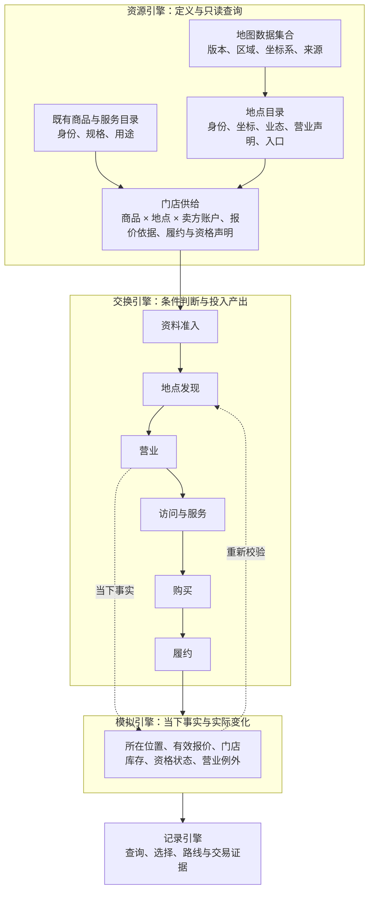
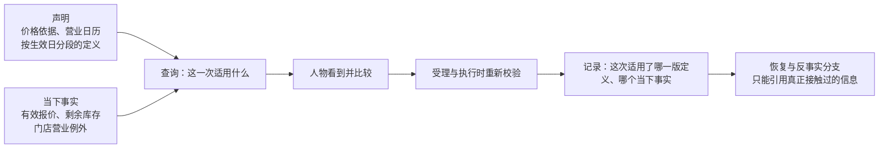
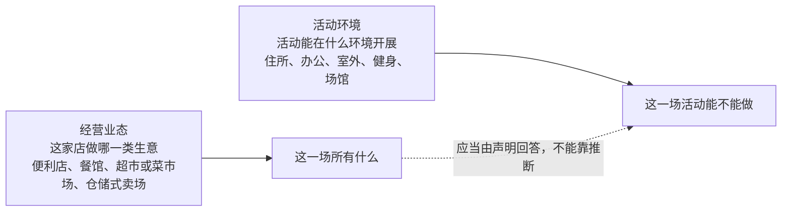

# 设计提案：地图数据集合、地点目录与门店供给

> 状态：提案，未裁决。任何合同、代码、测试与验收结论在本文被单独裁决为冻结以前不得依赖其内容。
> 日期：2026-09-21
> 范围：地图数据的来源选择与固定方式、地点目录与门店供给的数据结构、规则应挂在哪一层、以及从当前实现迁移的最小完整流程。
> 依据：`docs/dev/ANALYSIS-map-model.md`（同题分析草案）的问题定义与差距清单，本文把它推进到可裁决的数据结构与迁移步骤。
> 关系：涉及接口与字段的部分需在裁决后补入 `docs/CONTRACTS.md`；语料与来源分类引用 `docs/design/03-resource-engine.md`；规则分层引用 `docs/design/02-exchange-engine.md`。

## 产品行为

数字人生活的世界里，同一件商品应该在多家门店各自有价、各自有货；数字人应该能知道这些店在哪里、哪家此刻开门、去一趟要多久，然后自己决定去哪一家。现在做不到，不是因为缺少地图引擎，而是因为**商品身份兼任了供给身份**：`ProductConfig.merchant_location_id` 把每一件商品钉死在一家店上，库存是一把按商品标识的平表，价格是商品目录对象上的一条转账边。

业界解决这个问题的答案已经收敛，而且和本系统"只有环境能改世界状态"是同一种形状：**价格不是商品的属性**。GS1 的 GDSN 把报价放在独立于贸易项目的价格同步报文里，schema.org 把价格放在 `Offer` 而不是 `Product`，Google Merchant Center 的门店库存是商品资源的子级、继承父级字段再覆盖少量字段。本提案采用同一形状。

## 概念词表

一个概念只用一个词。本文只用这四个词，别再引入"店铺""商家""SKU"之类的近义词。

| 采用 | 含义 | 边界 |
| --- | --- | --- |
| 地图数据集合 | 固定区域、坐标系、时区、来源与版本的一组地点与路线 | 是一条语料清单条目，不是新的引擎或服务 |
| 地点 | 有稳定身份和坐标的一个可定位场所 | 含住宅、办公室、公园等非经营地点 |
| 门店供给 | 一家地点提供的一件商品或一项服务，含卖方账户、报价、库存与履约条件 | 身份是（地点，商品或服务，卖方账户），不是商品身份 |
| 品牌 | 地点的可选属性，有来源时关联稳定品牌标识 | 同一品牌可有多家地点；无品牌的独立商店仍是有效地点 |

另一个必须先在措辞上分开、再在数据结构上合并的东西：**经营业态**（便利店、仓储式卖场、综合零售店）与**活动环境地点类**（`home`/`office`/`outdoor`/`fitness`/`venue`/`anywhere`）。前者描述这家店做哪一类生意，后者描述活动能在什么环境开展。7-Eleven、Costco、Target、Micro Center 是四种不同业态的例子，不能统统编码成同一种"超市"，也不该被塞进活动环境词表。

## 业界方案

### 地图与地点数据

| 成熟机制 | 适用的问题 | 不能由它证明的事情 |
| --- | --- | --- |
| 开放地图数据集合与地点目录 | 具体地点身份、名称、坐标、业态、品牌与来源 | 一家店此刻有某商品、库存充足 |
| 品牌词典 | 同一品牌的多家分店归到稳定品牌标识 | 分店之间价格、库存、资格相同 |
| 道路路由与距离矩阵 | 已知起终点与出行方式，算道路距离和预计时长 | 商店目录、实时营业状态、实时交通 |
| 营业日历与访问条件 | 开放时段、休息日、例外日期与资格要求 | 人物必然会选此处，或到达时条件仍然相同 |

### 门店级供给

商品与供给的分离是零售数据交换领域的标准做法，三家成熟体系的做法一致：

| 体系 | 商品与供给如何分开 | 对本项目的可借之处 |
| --- | --- | --- |
| GS1 GDSN | 价格走独立的价格同步报文，贸易项目报文只带指向商品的最小引用 | 价格不由商品定义携带；允许商品的提供方与价格的提供方不是同一个 |
| schema.org | 价格在 `Offer` 上，商品是 `Product`；`priceSpecification` 的 `validFrom`/`validThrough` 表达有效期 | 同一商品的多条供给各自有身份，下架一条不影响商品 |
| Google Merchant Center | 门店库存是商品资源的子级，继承共享商品数据，只覆盖价格、库存与可得性 | 门店供给"继承商品 + 覆盖少量字段"的形状 |

### 规则维护

规则以明确字段和有类型的条件表达，参数来自地点与供给定义，运行时输入来自模拟引擎。**不按品牌名写分支，不为地图另造通用规则语言。**

各引擎的职责不新增层：资源引擎管定义、来源、版本与只读查询；交换引擎解释声明并判断条件；模拟引擎持有当下事实并落实变化；记录引擎保存本次实际返回过什么信息。

#### 规则清单

| 规则 | 输入与判断 | 结果与必须保留的边界 |
| --- | --- | --- |
| 资料准入 | 地点身份、坐标系、来源、地图范围、供给与路线引用是否一致 | 必需字段或关系不完整则拒绝发布；缺失信息不能默认为全天营业或全品类供货 |
| 地点发现 | 人物允许查询的范围、业态或商品需求、公开信息、道路范围条件 | 返回具体地点及已知状态；未知与不存在分开；不强制只返回当前能购买的店 |
| 营业 | 当地时区、每周开放区间、例外日期与模拟时间 | 支持分段、跨午夜与全天营业；保留原始声明与来源；未知时不推断为开放 |
| 访问与服务 | 地点要求、人物资格、所需服务是否支持 | 返回可进入、可使用或明确原因；会员、预约只在场景实际需要时启用 |
| 购买 | 具体门店供给、有效报价、数量、该门店可用库存、余额与履约条件 | 整单通过或拒绝；按供给扣门店库存、按卖方记账；同商品在不同门店互不混淆 |
| 履约 | 自提的在场条件，或配送的支持范围与运输路径 | 自提与配送分别判断；到店、付款、交付、消费是不同事实 |
| 时间变化 | 出发前预计条件与执行时实际条件 | 到达后、购买时重新校验；预计可买不保证执行成功，失败保留具体原因 |

#### 规则维护与时间

规则要能被审计，不只是被版本化。数值声明补三个字段即可，属于**加了几乎不花钱、事后补不回来**的一类：

| 字段 | 含义 | 为什么必须有 |
| --- | --- | --- |
| `effective_from` / `effective_to` | 该取值在模拟时间上适用哪一段 | 调价、换套餐、门店改营业时间都是时间上的事实 |
| `reviewed_on` | 最后一次有人核对过它的日期 | 区分"核对过的假设"与"当初随手填的数" |
| `still_valid_on` | 该取值仍然可信到什么时候 | 让过期的假设在发布时暴露，而不是在运行中 |

生效日是**半开区间** `[effective_from, effective_to)`，例外日期优先于每周声明。一条取值在第一个生效日之前是**未定义**，不是零、也不是默认全天营业。

#### 当前取值与历史取值的分工

模拟引擎持有的是**当下事实**，资源引擎持有的是**定义与声明**。两者的时间语义不同，不要混在一起：

本系统已经有价格失效机制（`price_version` 与到点调价），它属于"当下事实"这一侧，可以扩展成按门店报价，不必推翻。

#### 人物怎样在多家门店之间选

这一节决定候选集的粒度，是本方案里唯一会牵动候选契约、轮转与呈现窗口的部分。成熟系统的做法分成两种，而且分野清晰：

| 系统 | 候选集的粒度 | 选择在什么时候定型 |
| --- | --- | --- |
| MATSim | 单个设施，一个活动类型对应整批候选 | 运行期重规划，按时间预算圈定候选 |
| ActivitySim 等出行需求模型 | 交通小区，不是门店 | 抽样 → 对数求和 → 模拟三段式 |
| UrbanSim | 楼栋与地块，**从不做到门店级** | 按行业分别估计的离散选择 |
| 门店选址文献（Huff 类） | 单个门店 | 概率分配，不选出唯一门店 |
| AgentSociety | 单个 POI | 按类别与半径筛出候选，选择留给调用方 |

三条可用的结论。

**第一，候选应当是"地点 × 供给"，而不是"地点"。** 因为人物比较的东西（这家有没有我要的那件、多少钱、现在开不开门）全部挂在供给上。只有地点信息时，"去超市"这个决策没有任何可比较的内容。

**第二，候选集必须按可达范围预先圈定，而且要用道路路程。** MATSim 用时间预算圈定候选集，这是成熟做法。本系统已经有冻结路线与分时系数，能给出有依据的路程，但要注意 **AS2 自带的选择工具用的是投影直线距离**，与本系统"直线距离不能冒充可达时间"的原则冲突，因此那部分不能直接复用，只能复用它的地点身份与空间索引。

**第三，选择必须由人物做，环境只提供可比较的事实。** 门店选址文献里有一套现成的概率分配公式，它的形状是"吸引力除以距离的幂，再按全部候选归一"。这套公式**不能替人物做决定**，理由与 MATSim 的容量机制同理：环境一旦替人物算出"应该去哪家"，就违反了本系统"环境决定可行、人物决定选择"的分工。它可以用于验收数据的构造（确认不同门店确实产生行为差异），但运行时呈现给人物的是可比较的事实，选择权仍在人物。

需要点明的一处现实约束：调研的四类平台里，**没有一个是自带门店选择模型的**。候选筛选到处都有，选择环节普遍留空。这意味着这一层是要自己写的，不是接上就有的。

### 数据来源与固定方式

本系统运行期只读冻结语料，从不访问在线服务；外部抓取与转换在准备阶段完成。地图数据按同一规则办。

来源选择上，本项目对"真实复现本地零售行为"没有主张，只需要**真有这些地方、坐标说得清、许可允许冻结进仓库**这三条。按这三条，地点目录用开放地图数据已足够，把品牌与分店分开表达的能力也已经具备（品牌标签加稳定品牌标识，配合维护中的品牌词典）。

#### 可以复用的已有能力

本项目已经引入 AS2，而 AS2 自带一层地点机制，可以直接复用而不再自建：

| 已有能力 | 位置 | 可否复用 |
| --- | --- | --- |
| 地点的稳定身份与坐标 | AS2 地点记录 | 可复用，作为地点身份 |
| 两级业态分类 | AS2 的一级与二级类别 | 可复用为业态取值，但需转换为本项目口径 |
| 按圆心与半径的空间查询 | 空间索引查询 | 可复用，作为地点发现的粗筛 |
| 按直线距离的重力选择 | AS2 的选择工具 | **不可复用**，与本项目"直线距离不能冒充可达时间"冲突 |

也就是说：**地点身份、业态分类与空间粗筛复用 AS2，可达范围与最终选择留在本项目。** 可达范围必须走已有的冻结路线与分时系数，不能沿用 AS2 那套投影距离。

需要新建的一层是**业态到活动环境的映射表**。调研确认业界没有这类公开标准，最接近的是地图数据分类树，而它只解决"这是什么店"，不解决"这里能做什么活动"。所以这张映射表是必须自己写、且需要人工审阅的实际工作量，不能指望自动推导。

#### 业态取值的选择

业态目前没有公开标准可依，但有两种可用的取值来源，二者不冲突，建议以本项目口径为主、地图分类树为辅：

| 来源 | 适用处 | 代价 |
| --- | --- | --- |
| 本项目自定的业态词表 | 决定门店可比较的类别与承载的活动 | 需要自己维护，规模小但必须人工审 |
| 地图数据的分类树 | 把外部来源归并进本项目的业态 | 需要一张逐项映射表与人工复核 |

两者都不宜直接当运行期取值：前者没有外部校验，后者粒度太细（同一类餐馆会分成多个子类），而且缺少本项目关心的"这家店能做什么活动"这一层。

已冻结的探针区域里品牌确实是有的，但**覆盖不齐**：区域内有连锁咖啡五家、连锁快餐一家、一家带稳定品牌标识的连锁超市，便利店四家里只有一家是连锁品牌，另几家是独立小店，而**该连锁便利店自身没有品牌标识标签**。这是开放地图数据的常态——品牌是可选属性，不是每家有。因此数据结构必须让"没有品牌"是一等公民：品牌缺失不影响一家地点成为有效的门店供给提供方，只是无法据此跨分店归并。

是否引入额外的开放地点数据集合属于可选项，收益是商品品类与连锁品牌覆盖更全，代价是许可条款更复杂（同一数据集合内各主题许可不同，有的主题带共享条款、有的主题是逐来源的宽松许可）、坐标系转换与实体归并要自己做一遍。**在第一版的小区域规模下不值得**，等扩大区域时再按届时的实际缺口决定。

首版验收所需的门店多样性**已经躺在仓库里**：已冻结的探针区域含咖啡馆七家、餐馆七家、便利店四家、超市与菜市场各一家，另有药房、邮局、银行、图书馆、医院各至少一家。当前语料只用掉其中八家，剩余地点无需新增任何外部数据即可纳入地点目录。这意味着"同业态多家门店"的验收不必等新数据，可以直接在现有冻结语料上做。

**场景只选择地点及其初值，不再手抄另一份名称、坐标与营业定义。** 今天同一批十一个地点在语料与场景各存一份、字段还不同（语料有 `covers`/`opening_hours`/`affordances`，场景有 `open_hour`/`close_hour`），这是两份真相。

地图资料与模拟日期的差异必须可见：近期采集不能冒充实验日期的历史事实。道路、地点与供给可以有不同来源时间，发布时各自标明依据与适用限制。来自不同坐标系的资料在准备阶段完成转换，不把偏移坐标混进路由。

路线准备范围要与可行动范围一致。今天的语料里八家具名外部地点有身份，但 `catalog/rules/travel-fare.toml` 逐条复现的只有十二条以 `home`/`office`/`market` 为端点的冻结路线，其余地点是"有身份、没路"。这个缺口必须先关掉，否则门店发现会返回一个走不到的目标。

#### 许可边界

地点与道路数据来自开放地图项目，其许可（ODbL 1.0）的共享要求挂在**公开使用**上，不挂在**取用**上：许可正文明确"在组织内部使用派生数据库不属于公开使用"，因此仅在本机跑模拟、语料不对外发布时，不触发共享条款。

但有一处不能顺推：**通知保留义务是休眠的，不是消失的**。许可要求"保持版权声明、数据库权利声明与许可声明完整"。这意味着内部清单里一旦漏掉声明，等将来真的要发布时就已经是错的，且无从追溯。因此 `corpora/LICENSES.md` 与语料清单里的来源记录必须**从一开始就完整**，不能留到发布前再补。这条不是新增义务，是把现有做法的理由说清。

交付侧还有两处判断，性质不同：

| 交付物形态 | 许可后果 |
| --- | --- |
| 复现了大量原始数据内容的表或结构化导出 | 更接近派生数据库，公开使用时继承共享条款 |
| 由数据生成的地图、图表、文字结论 | 属于产出作品，不继承共享条款，但公开使用时必须注明内容来源 |

本项目的数字足迹与导出数据集属于哪一类，取决于它复现了多少原始内容，不能一概而论。稳妥做法是**在交付清单上带来源声明**，与"记录引擎保存来源"的既有设计同向，实现上不额外增加机制，只是把声明从语料清单延伸到交付清单。

另有一条与本次设计无关但会在扩大语料时撞上的事实：开放地图数据的许可**与带共享条款的内容许可（如 CC BY-SA）互不兼容**，两个方向都不行。本仓库现在的电影元数据语料是"研究用途、未声明许可"，属于既存状况；一旦要引入新的内容语料，必须按来源逐个核对共享条款，不能合并后再看。业界的机器可读做法是给每一条来源记录一个"是否有共享条款"的布尔字段，让准备阶段直接拒绝不兼容的合并，而不是等发布时才发现。

涉及路线时还有一层：路由响应是"取数那一刻的路网"，既不是实验日期的事实，也无法事后重跑（公共路由实例不接受固定版本请求）。因此每条路线除现有的 `retrieved_at` 与 `fact_cutoff` 外，还应记录**所用路由实例与配置**，让"这条路当时是怎么算出来的"可追溯。

#### 外部地图数据不必对外分发也能满足可复现要求

地图数据的来源资料往往只能在准备阶段取得，运行期只用冻结结果。业界对这类项目有成熟处置：要求的是**完整说明输入数据怎么来的、怎么才能再取得**，而不是要求对外分发数据本身。具体到本项目，需要留下的是每类地图数据的取得方式、坐标与单位的处理步骤、以及已知的不确定性与适用限制。

这条也解释了为什么本仓库现有的做法是对的：`corpora/manifest.json` 已经逐文件记录来源、许可、选区条件与事实截止日，`catalog/rules/travel-time.toml` 已经用"快照＋可重跑标定脚本＋系数表"三件套固定了从公开报告取出的数值。门店供给的数值声明应当照抄这套三件套，而不是只写一个数字加一句来源，否则"这个数当初是怎么来的"会随第一次改数一起丢失。

## 当前实现的差距

| 差距名称 | 性质 | 当前状态与需要补充的能力 |
| --- | --- | --- |
| 商品身份兼任供给身份 | 缺失 | 一百五十九件商品的 `merchant_location_id` 全是 `market`；需要同商品多门店与独立报价库存 |
| 门店库存不按门店区分 | 缺失 | 库存是按商品标识的一把平表；同商品出现在两家店会共用一份库存 |
| 地点定义重复维护 | 缺失 | 语料与场景各存一份、字段不同；需要统一身份与版本引用 |
| 路线覆盖落后于地点集合 | 缺失 | 八家具名外部地点无冻结路线；需要按可行动范围完整准备 |
| 地点类合同名实不符 | 名实不符 | 见下节，是当前实现与既有合同的差异，应与新增地图能力分开处理 |
| 地点发现缺少空间查询 | 缺失 | 已有按当前地点列可达去处的观察；需要按业态、需求与道路范围查询并留发现证据 |
| 营业规则不完整 | 缺失 | 只有整点开闭店判断；需支持分段、跨日与日期例外 |
| 地图关系缺少整体校验 | 缺失 | 已有文件哈希与引用校验；仍需核验地点事实、路线端点、供给与地图发布的一致性 |

**地点类合同名实不符**值得单独说清，因为它不是新增能力而是现存缺陷，而且**不是改个字段名就能修好的**。

现状是这样的：地点语料用 `covers` 声明，取值是 `canteen_or_restaurant`/`convenience_store`/`supermarket_or_wet_market`/`park_or_fitness`/`home`/`office`/`merchant_goods`；生活活动条目用 `location_kinds` 声明，取值是 `home`/`office`/`outdoor`/`fitness`/`venue`/`anywhere`。运行门按字段名 `location_kinds` 读地点侧，读不到就按 `anywhere` 兜底；场景侧的 `LocationConfig` 根本没有这个字段。于是准入检查确实在按 `covers` 卡六类地点覆盖，而运行时的"此刻此地能不能做"什么都没拦。

两套取值只有 `home` 与 `office` 重合。若只是把 `covers` 改名为 `location_kinds`，结果是交集全空——连现在能做的健身、逛公园都会被判为地点不可行。所以取值不是命名问题，是**两个不同的轴**被一个字段名混住了：

正确的层间关系是：业态描述**这一场所有什么**（它决定地点发现能不能按需求筛出门店），活动环境描述**这一场活动能不能做**（它决定可行性门）。两者之间应当有一条**显式声明**的对应关系，比如"餐馆与综合零售能承载 `venue` 类活动""公园与球场能承载 `outdoor` 与 `fitness`"，而不是靠名字相近去猜。

这条对应关系用自动推断是危险的：把 `canteen_or_restaurant` 自动映射到 `venue`，等于让环境替人物宣布"任何有餐馆的地方都能做场馆类活动"，这正是本系统一贯拒绝的做法。

因此修法是三件事：地点侧同时声明经营业态与活动环境两组取值；准入检查改为核验两组取值都合法、且活动环境的取值集合非空；`docs/CONTRACTS.md` 的字段说明与运行门读同一个字段名。这是**修合同**，应在动供给结构之前单独做掉并单独验收。

## 分阶段路线图

先用已有区域中的多个门店跑通最小完整流程，至少让同一商品出现在两家门店，并给出有依据或显式假设的路程、价格、营业差异。

新数据结构与消费者一起切换：删除被替代的硬编码与旧声明，不并行维护两套格式。只改店名、只增加地点数量、只通过文件校验，都不足以验收地图能力。

### 验收场景

| 验收场景 | 应观察到的结果 |
| --- | --- |
| 同一商品在两家门店销售 | 商品定义相同，供给身份不同；价格、卖方与库存变化定位到所选门店 |
| 近店较贵、远店较便宜 | 人物实际看到可比较的路程与门店价差，选择及依据有记录；不预设必选哪一家 |
| 出发前可买，到达后关门或售罄 | 保留真实到达与失败结果，不把之前预计的条件当成功凭证 |
| 地点存在但该方式无路可达 | 地点仍可发现，出行动作得到明确不可达；未准备的数据不能冒充该结论 |
| 从家中订购配送或远程请求自提 | 配送按范围与运输路径校验；即时自提仍须在所选门店 |
| 某字段来自场景假设 | 观察、事件与来源关联可追踪该假设，不标成真实商店事实 |
| 规则故意忽略门店身份、营业或库存 | 新功能的源码突变审查必须发现这些行为破坏；普通通过测试不足以证明约束有效 |

## 设计决策点

以下是建议及其取舍，不代表这些选项已成为现行合同。

| 决策 | 选项 | 收益与代价 |
| --- | --- | --- |
| 世界的真实性 | **建议：真实地点加明确标记的供给假设** | 空间有依据，能控制门店差异；交易结论只适用于所声明的假设 |
| 世界的真实性 | 完全合成地图与门店 | 可精确覆盖规则边界；不能声称复现真实地区消费行为 |
| 世界的真实性 | 真实地点加真实门店供给快照 | 更适合零售现实评估；商品、价格、库存的获取与时效成本高 |
| 第一版的空间范围 | **建议：已有张江区域** | 可复用当前地点与路线，较快验证行为差异；不包含用户列举的全部品牌 |
| 第一版的空间范围 | 另选包含所需品牌的区域 | 能直接比较这些品牌门店；必须重新准备地点、商品与路线资料 |
| 第一版的行为范围 | **建议：门店发现、比较、出行与购买履约** | 覆盖本次核心需求；沿用物品留在取得地点的语义 |
| 第一版的行为范围 | 同时引入搬运、会员购买、预约与排队 | 可表达更丰富生活；需要扩大状态、动作与验收范围 |
| 规则取值的时间字段 | **建议：现在就补 `effective_from`/`reviewed_on`/`still_valid_on`** | 现在几乎不花成本；事后无法重建哪些假设核对过 |

尤其要单独决定"买菜带回家"：当前合同明确没有背包或携带动作，到店购买不会自动把物品转移回家。第一版可用到店购买后当场使用，或配送到家验证完整流程；若要购物带回家，必须显式扩展物品搬运规则，不能随地图功能隐含加入。

## 结论边界

本次交付是设计方案，不是功能实现或真实门店数据采集。本文不修改已有合同，也不声称上述新能力已通过运行验收。现有 `docs/dev/ANALYSIS-map-model.md` 的问题定义与差距清单仍然有效，本文在其上给出数据结构、来源选择、规则归属与迁移顺序。
