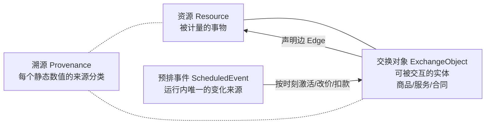
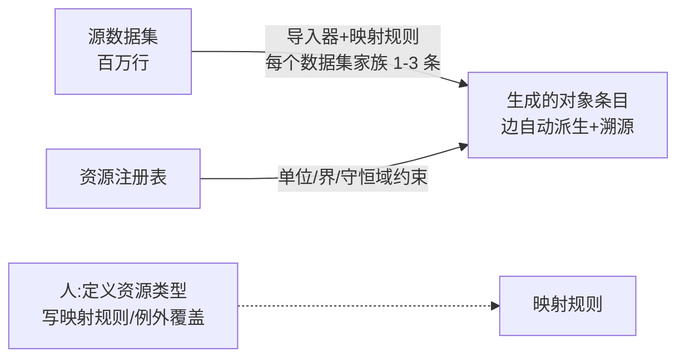
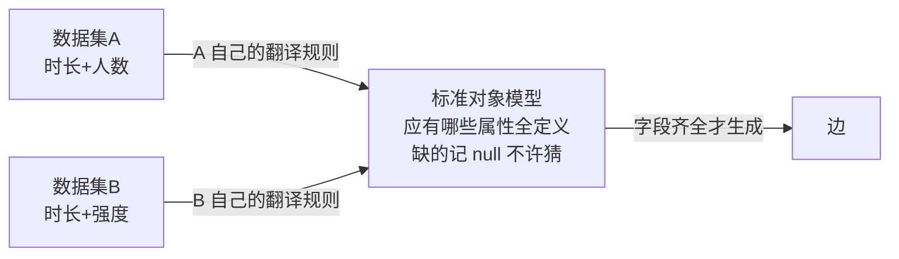
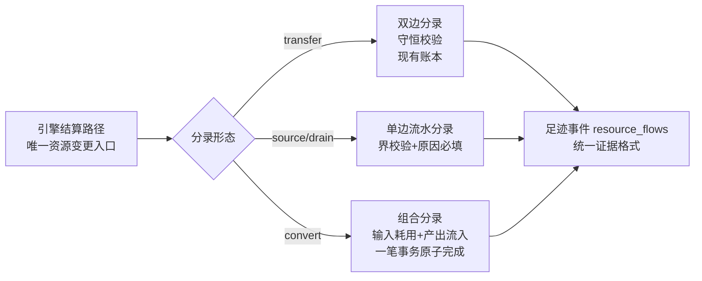

<!-- worldmock-doc: {"authority":"proposal","canonical_path":"docs/dev/PROPOSAL-resource-registry.md","implementation_state":"NOT-COMPLETE","kind":"PROPOSAL","owner":"WorldMock maintainers","replaces":[],"schema":"worldmock.document.metadata.v1","status":"PROPOSAL","superseded_by":null,"version":"2026-09-16"} -->
**Status: PROPOSAL**

# 静态资源与交换对象管理设计（提案）

状态：提案，未冻结。本文不修改 `docs/agentsociety2-design.md` 的权威性；裁决后逐节并入。
日期：2026-09-16。作者：ZCode 接力会话（综合与用户的多轮架构讨论）。

---

## 零、心智模型（先读这节，六条人话）

1. **世界里只有两种"账"**：流水账（钱——只能转账、总数永远对得上，现有银行级账本原样保留）和水池（体力/睡眠债/娱乐欲——有上下界，会注水/蒸发/放水，每笔进出写原因）。
2. **商品不是东西，是规则包**：牛奶 = 三条规则（买=转账 6.8 元、吃=体力注水 185 千卡、库存减一）。加房租/地铁/新车 = 写新规则包，不改引擎。
3. **人管字典，机器管户口**：人只定义"有哪几本账哪几个池"（十来个）和每个数据源的"翻译规则"（几条）；百万条商品规则由机器照翻译规则从数据集批量生成，条条带出处。
4. **每个数字报户口**：事实（数据库有，导入）/ 锚定的设定（参考现实拍板，参照证据存档）/ 明说的假设（标记为猜的，做敏感度检验）。不许来路不明。
5. **运行中唯一推动变化的是时间表**：开跑前把 84 天的事全排进一张表（任务上架、扣房租、调价、节日），到点执行笔笔留痕；改世界=改时间表，不是边跑边改规则。
6. **字典只加不改，退役打标**：已发布条目永不就地修改，改语义发新版本；每次实验钉死字典版本，历史永远可复现。

以下章节是这六条的技术展开与参考件（Schema、命令行、校验规则、分期计划）。

---

## 一、目标与非目标

**目标**

1. 把现在散落三处的资源语义（货币=守恒账户、能量/睡眠债=身体参数、娱乐需求=累积量）收编为**一套统一的资源注册表**。
2. 交换对象（商品/服务/劳动合同）不再各自硬编码效果，改为**声明式的边**（对资源池的流入/流出/转移）。
3. 静态目录支持**增量维护**：百万级对象场景下人工只维护推导规则，不维护具体条目。
4. 运行内的一切变化统一走**预排事件**，目录运行期不可变。
5. 每个静态数值带**溯源标注**，区分事实型/锚定型/假设型。

**非目标**

- 不做市场动态（动态定价、议价、供需博弈）——价格变化用预排的 PRICE_CHANGE 表达。
- 不做运行中目录变更——世界修订协议是独立提案，本文不含。
- 不做 AI 自动定价/自动配平——锚定与配平是人的决策，系统只留证据链。
- 不引入向量检索/数据库化的目录存储——目录是冻结文件（JSON/TOML），可哈希可审计。

---

## 二、核心概念模型

三个一等概念，术语全篇唯一：



- **资源**：世界中被计量的事物。分两种形态（见 §3）。
- **交换对象**：人物可交互的实体。它的全部经济语义 = 一组边。
- **预排事件**：运行期内世界变化的唯一通道（§7）。
- **溯源**：每个静态数值必须声明来源类型（§5）。

---

## 三、资源注册表

### 3.1 资源定义结构

```json
{
  "resource_id": "energy_kcal",
  "kind": "level",
  "unit": "kcal",
  "owner": "agent",
  "bounds": {"min": 0, "max": 2400},
  "conservation": "open",
  "alert_rules": [
    {"below": 800, "code": "HUNGRY"},
    {"below": 400, "code": "EMERGENCY_ENERGY"}
  ],
  "provenance": {
    "type": "fact",
    "source": "FAO/WHO/UNU energy requirements; Mifflin-St Jeor BMR (65kg male)",
    "artifact": "corpora/references/energy-requirements.md"
  },
  "version": 1
}
```

### 3.2 两种资源形态（关键区分）

| 形态 | 例子 | 不变量 | 账本记法 |
| --- | --- | --- | --- |
| **存量型 level** | 能量、睡眠债、娱乐需求 | 上下界硬约束；所有变动 = 流入/流出事件（带原因） | 单边流水分录 |
| **账户型 account** | 货币（各账户） | **守恒域内零和**：域内所有账户之和恒等于初始注入 | 双边转账分录（现有账本直接推广） |

守恒域是显式声明：货币域 `closed`（外部锚点账户吸收注入/销毁），身体域 `open`（有源有漏，只要求逐笔可重建+界内）。

现状映射：现在的 `engine` 六账户 = 货币域的全部账户；现在的 `body` 三参数 = 三个 level 资源（睡眠债的下界 0、娱乐需求 [0,1]）。**统一后账本从"只管钱"推广为"多资源分录"**，货币分录的守恒校验原样保留。

### 3.3 新增资源的成本

注册表加一条（目录 minor 版本 +1）→ 需要产生/消耗它的对象加边 → 场景引用新版本即可。引擎侧只在出现**新守恒域**或**新分录形态**时需要代码，新增同类资源零代码。

---

## 四、交换对象 = 边的声明

### 4.1 边类型（借 Machinations 词表，语义收窄）

| 边类型 | 方向 | 例 |
| --- | --- | --- |
| `transfer` | 账户→账户（守恒域内） | 买牛奶：人物→商家 680 分 |
| `source` | 无中生有（进 level 池） | 吃牛奶：能量 +185 kcal |
| `drain` | 消耗（出 level 池） | 基础代谢 65 kcal/h；活动 MET 增量 |
| `convert` | 时间×资源→资源 | 工作：有效秒×效率→按合同折钱 |

### 4.2 交换对象结构（以现有牛奶为例的等价改写）

```json
{
  "object_id": "food-6923644266066",
  "name": "纯牛奶",
  "object_kind": "product",
  "edges": [
    {"on": "purchase", "type": "transfer", "from": "account:agent", "to": "account:merchant:grocery", "amount_fen": 680},
    {"on": "consume", "type": "source", "resource": "energy_kcal", "amount": 185, "duration_s": 900}
  ],
  "stock": {"initial": 120, "restock": "none"},
  "provenance": [
    {"part": "energy edge", "type": "fact", "source": "openfoodfacts:product/6923644266066"},
    {"part": "price edge", "type": "anchored", "source": "numbeo:shanghai/2026-01/milk", "method": "point-in-distribution p60"}
  ],
  "version": 1
}
```

现状映射：`products[]` 的 `price_fen/energy_kcal_per_unit` 散字段 → 显式边；`work` 合同 → 一种 `object_kind: contract` 的交换对象（边=convert + 验收门槛）；`travel` → `object_kind: service`（边=transfer，费率规则引用注册表的计费公式）。

### 4.3 百万级对象：人维护规则，不维护边



"哪些对象要补哪些边"由映射规则回答（"凡有 kcal 字段的食品 → 能量 source 边"），有字段的自动出边，没字段的自然没有。人工只出现在：资源类型定义（个位数）、映射规则（每数据集家族个位数）、例外覆盖（墓碑+版本）。

### 4.3.1 多数据集异构字段（错位数据集的合并）

同类型数据集字段常常错开（A 有时长+人数没强度，B 有时长+强度没人数）。**禁止任何数据集直连边**，统一走四件套：



1. **标准对象模型**：每个对象类型定义完整属性集；翻译规则按数据集配（每数据集一条），只填它填得动的字段。
2. **缺失处理是声明式策略**（禁止代码隐式行为）：跨数据集按键互补合并 / 类别映射表代填（人写一次）/ 显式默认值（标 assumption + 生成代填清单留审计）/ 关键输入缺太多则不生成边。
3. **冲突解决是声明式规则**：同一对象多来源值打架时按事先声明的优先级取胜（如"更专业来源胜、平级取更新"），胜负记录在案。
4. **字段级溯源**：生成的每条边记录每个数值的供给方（数据集.字段 / 映射表 / 默认值），上游数据集出问题或下线（墓碑）时能一键拉出受影响边清单，不必全量重来。

无数据集支撑的数值（如"每分钟社交精力增益"）不逐对象拍脑袋：用参数化模型（三五个 assumption 参数）从对象客观属性算出，配合 §5 的敏感性检验与矩匹配校准。

### 4.4 目录检视：查询与可视化

原则：权威存储保持冻结文件；查询与可视化均为**无状态衍生视图**（每次从文件现读），不建长驻服务/Web UI，不画百万对象图（任何视图先聚合或过滤，图形工具只接触十位数节点）。

**存储格式**：目录存 JSONL（一行一条目：资源定义/对象/映射规则/墓碑），SQLite `json_extract` 直接扫——与本项目足迹分析的既有习惯一致，零新依赖。

**查询命令族**（只读）：

| 命令 | 回答 |
| --- | --- |
| `catalog edges-of <resource>` | 谁在给某池注水/放水（聚合） |
| `catalog objects-affecting <resource>` | 影响某资源的全部对象 |
| `catalog lineage <object>` | 溯源链：每个数值来自哪个数据集哪个字段 |
| `catalog imputed` | 代填清单：哪些对象用了声明式默认值 |
| `catalog impact --dataset <id>` | 上游数据集出问题/下线时受影响的边清单 |
| `catalog diff <v1> <v2>` | 版本增量审阅 |

**可视化三层**（全部机器生成）：

1. **资源流全景图**：节点=注册表全部池（十来个），边=聚合后的流，随目录版本重新生成存入 docs——世界经济的"一页纸总览"。
2. **单池下钻图**：某池的全部进出边（几十条，mermaid/Graphviz 渲染）。
3. **目录健康报表**：各资源边数分布、fact/anchored/assumption 占比、代填率、无主数值清单（应为空，非空即报警）、每数据集供给量——数据治理仪表盘。

---

## 五、溯源三分类（每个静态数值必选其一）

| 类型 | 含义 | 数据来源示例 | 冻结方式 |
| --- | --- | --- | --- |
| `fact` | 物理事实，有权威数据集 | Open Food Facts（成分）、Compendium of Physical Activities（MET）、Mifflin-St Jeor（BMR）、DRIs（能量上限） | 导入器直采，条目引用 dataset+entry id |
| `anchored` | 设定型数值，有现实参照但本质是实验设定 | 价格（Numbeo/统计局零售价）、工资水平 | 参照快照入语料清单 + 取样方法 + 冻结值 |
| `assumption` | 研究假设，无权威来源 | 效率曲线节点、睡眠恢复率、娱乐需求增速 | 显式标注 + 评估层敏感性检验 |

现状问题举例：`body.source_kind` 把 BMR/MET 这类 `fact`（65 kcal/h ≈ 65kg 男性 Mifflin-St Jeor 值；sleep 0.95/wait 1.3/walking 3.5 均为 Compendium 原值）与效率曲线这类 `assumption` 打包成一个笼统的 `experiment_assumption`——重构时逐参数拆标。

---

## 六、目录生命周期：增量维护规则

### 6.1 变更分类学

| 操作 | 规则 | 目录版本 |
| --- | --- | --- |
| 新增资源/对象/边 | 纯增量，向后兼容（老场景引用子集照常校验） | minor +1 |
| 修改语义（单位/界/守恒域/边方向） | **禁止就地改**：新 id 或 major 版本 | major +1 |
| 弃用 | 墓碑（保留可读，准入校验拒绝新场景引用） | minor +1 |
| 删除 | **不存在此操作**，只有墓碑 | — |

### 6.2 场景钉版本

场景声明 `catalog_version` + 目录哈希（与现有 `corpus_manifest_sha256` 同构）。老场景永远可复现；评估工具打开历史数据时按当时版本解读。

### 6.3 人机交互面（CLI）

```
worldmock catalog add-resource   <def.json>       # 新增资源定义
worldmock catalog add-objects    <import规则>      # 批量导入对象（跑映射规则）
worldmock catalog deprecate      <id> --reason    # 打墓碑
worldmock catalog diff           v1 v2            # 人工审阅增量
worldmock catalog validate       <scenario.json>  # 准入校验（见 §8）
```

---

## 七、运行内变化：预排事件统一

### 7.1 现状（保留并推广）

现有机制已经是"编译-执行"结构：场景加载时把邮件/任务展开成时间有序的 `ScheduledEvent` 表（约 256 条），引擎按（时刻、序号、ID）确定性点火，每条产生可审计的 environment_event。**本设计保留该机制，只扩类型。**

现存分叉一并消除：日历旗标（春节/调休/加班，只注上下文不改状态）统一为**零状态变更的预排事件**，与状态变更事件同表同序。

### 7.2 新增事件类型

| ScheduledKind | 效果 | 用途 |
| --- | --- | --- |
| `PRICE_CHANGE` | 改某对象 transfer 边的金额（引用对象 id+version） | 涨价/促销 |
| `PRODUCT_RELEASE` | 对象上架（库存从 0 变可用） | 新商品 |
| `BILL_DUE` | 周期性 transfer（账户→外部锚点） | 房租/水电/月度扣款 |
| `PAYROLL` | 周期性 transfer（雇主→账户，可带合同引用） | 月薪发放节奏 |
| `CALENDAR_FLAG` | 注入当日旗标（零状态变更） | 收编现有日历 |

### 7.3 三层 authoring（人只碰最上层）

```
意图层（人写）    recurrence 模板 + 参数："每个工作日 09:00 发布一个包工任务直到 03-30"
    ↓ 展开器（代码，确定性，带种子）
冻结层（场景存）  展开后的全量条目，哈希锁定          ← 场景永远存展开形，不存意图
    ↓ 引擎按表执行
运行层            到点点火 → 环境事件 → 状态变更 → 全部入审计
```

交互命令：`worldmock schedule build --intents plan.toml --out scenario.json`，产物过 `validate` 准入门。

---

## 八、准入校验（场景加载时，全部 fail-closed）

1. 引用完整性：所有边引用的 resource_id / object_id 存在于场景钉定的目录版本。
2. 单位匹配：边的 amount 单位 = 资源注册表的 unit。
3. 守恒域一致：transfer 的两端账户属于同一 closed 域；source/drain 只作用于 open 域资源。
4. 界检查：任何静态初值在资源 bounds 内。
5. 无墓碑引用：新场景引用墓碑条目即拒绝。
6. 预排表合法性：时刻严格递增可排序；引用对象版本存在；BILL_DUE/PAYROLL 的账户存在。
7. 计费公式引用：travel 类对象引用的费率公式在注册表中已声明。

---

## 九、结算通道统一

现状的资金守恒账本（双边、零和、全历史重建）**原样成为货币域的执行器**；推广点：



身体模型（body）的数值结算从"散在各规则里的直接赋值"改为统一走分录——能量变动从此和资金变动同格式可审计、可对账、可在评估层做资源流分析（比如"每天的能量 Source/Drain 平衡表"）。

---

## 十、与现有系统的映射总表

| 现有 | 去向 |
| --- | --- |
| engine 六账户 + ledger 双边守恒 | 货币域账户资源 + transfer 分录（不变量不变） |
| body 三参数 + 阈值 + MET 表 | level 资源定义 + drain 规则 + alert_rules（fact 溯源补标） |
| products[] 散字段 | 交换对象 + 显式边 + 溯源数组 |
| tasks[]（合同/计酬/验收） | object_kind: contract 的交换对象 + convert 边 + 验收门槛 |
| travel 费率硬编码 | 注册表中的费率公式声明，对象引用 |
| price_version | 对象条目 version（语义并入目录版本） |
| 日历旗标 | CALENDAR_FLAG 预排事件 |
| 邮件/任务预排表 | 保留机制，纳入统一 ScheduledEvent 表 |
| corpus manifest 溯源 | 扩展承载 anchored/fact 的证据快照 |

---

## 十一、实施分期

| 期 | 内容 | 风险 |
| --- | --- | --- |
| **P1 数据治理**（不动引擎） | B 层参数逐条溯源补标；价格锚定档案（Numbeo/统计局快照 + 取样记录）；现有 16 商品/56 任务改写为带溯源的边声明（结构对齐 §4.2 但引擎仍读旧字段，或直接做 P2） | 低 |
| **P2 注册表与结算**（核心） | 资源注册表落地；多资源分录；body 结算改走统一通道；准入校验 7 条；场景 schema 迁移（重新生成场景，老运行按钉版本可读） | 中——运行时身份变化，分支链重跑 ~1h；537 项测试中 body/ledger 相关需适配 |
| **P3 预排扩展** | 5 个新 ScheduledKind + 效果处理器；日历旗标统一；意图层构建器 + `schedule build` 命令 | 中低 |
| **P4 目录 CLI** | catalog 五命令 + diff 审阅 | 低 |
| **P5 敏感性检验** | 评估层加 assumption 参数扰动分析 | 低 |

P2+P3 完成即具备"房租/月薪/餐食节律"全部挂载能力；建议 P2 前冻结一版十二周基线运行，重构后再跑一版，用评估工具量化收益。

---

## 十二、明确的设计立场（防止漂移）

1. **目录是冻结文件，不是数据库**——可哈希、可审计、可随场景归档；运行期零 IO。
2. **时间是世界唯一的变化推动者**——运行内一切变化走预排；目录演化只发生在运行之间。
3. **守恒是分域的**——货币域严格零和（继承现有银行级账本），身体域界内流水平衡；不发明全局守恒。
4. **人治理 schema，流水线生产数据**——百万对象的边来自映射规则，不来自人工。
5. **假设必须显式**——没有来源的参数标 assumption 并进敏感性检验，禁止伪装成 fact。

---

## 十三、路径架构（重构施工图）

数据流决定目录流：`datasets →(翻译规则)→ catalog →(意图展开)→ scenarios →(run)→ runs →(evaluation)→ 报告`。

```text
WorldMock/
├── src/worldmock/                # 代码：common / 静态 / 动态 / CLI 四层
│   ├── common/                   #   横切设施：opslog、errors、llm 薄层
│   ├── catalog/                  #   静态层·代码：registry/objects 加载、importer、admission、inspect、builder
│   ├── scheduling/               #   预排·代码：intent 解析、expand 展开器、events 效果处理器
│   ├── resources/                #   动态层·资源结算通道：多资源分录（transfer/source/drain/convert）
│   ├── life/                     #   动态层·领域规则（engine/body/activities/work/travel/content/game 瘦身）
│   ├── footprints/               #   审计层（原样）
│   ├── evaluation/               #   评估层（+敏感性检验）
│   ├── delivery/                 #   标注加工（已降级冷冻）
│   └── cli.py / runtime.py / status.py
├── catalog/                      # 静态层·数据（冻结 JSONL，git 管）
│   ├── resources.jsonl · objects.jsonl
│   ├── rules/                    #   映射规则（每数据集家族一份，人写）
│   ├── overrides/                #   例外覆盖 + 墓碑
│   └── snapshots/                #   anchored 取值快照
├── datasets/                     # 外部原始数据集（gitignore，只留 manifest）
├── corpora/                      # 冻结语料证据（承载 fact 证据件）
├── intents/                      # 预排意图（人写 TOML，schedule build 输入）
├── scenarios/                    # 冻结场景（展开形）
├── custom/ · vendor/ · labelkit-projects/ · docs/ · tests/
└── runs/ · .work/                # 永不进 git
```

数据四分工：**原料不进库（datasets）、字典进库（catalog）、证据进库（corpora）、快照进库（scenarios）**。

## 十四、一天验证计划（重构验收）

1. **数据**：catalog/ 由现有场景与语料生成——资源 4 类（money_fen + 三个 level）、对象 = 现有 16 商品 + 出行服务 + 三种合同，全部带溯源标注；画像沿用场景现有 agents 配置不改。
2. **行为等价性**：重构后引擎对同一经济的结算结果可对账——货币域守恒不变量原样保留；一天运行结束做守恒审计（期末六账户合计 = 初始注入）。
3. **运行**：真实 DeepSeek 跑 multi-person 一天场景完整到零点，导出认证通过，结构化操作日志全程落盘，记忆系统正常工作。
4. **对比**：与重构前的一天运行（如 runs/deepseek-multi-47931e06）并排对比：事件数、动作接受/拒绝、经济流量、体力轨迹、二人存活状态——量级一致、无系统性异常即为验证通过。
5. **数据补充边界**：对象数据全部沿用现有开源语料；仅当发现必要字段缺失时才从 HuggingFace 补充（hfmirror 镜像、关代理直连），任何拉取留快照与 manifest 记录。
