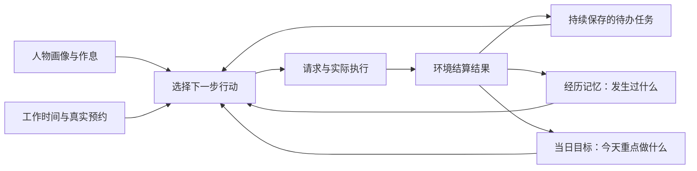
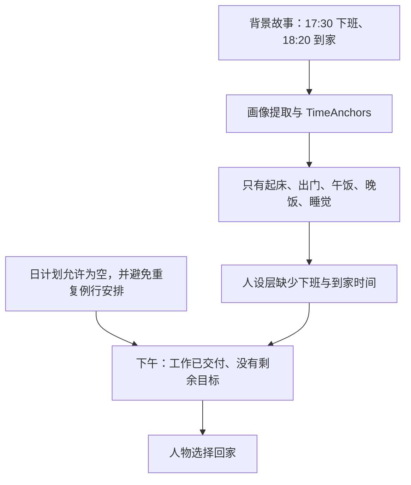
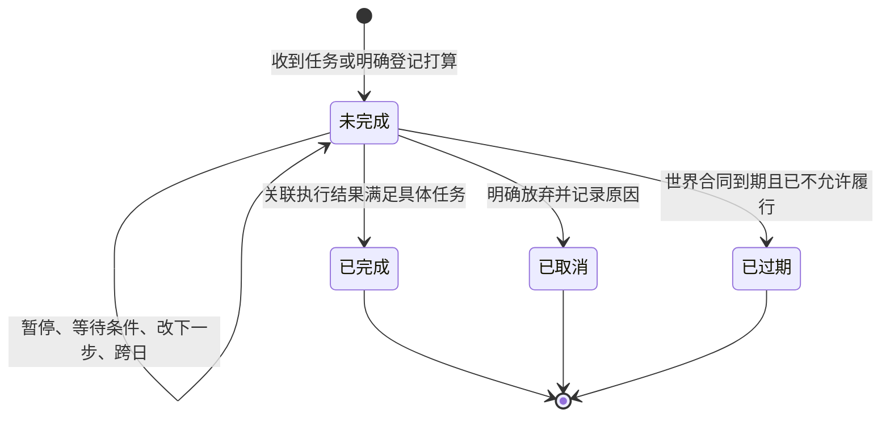
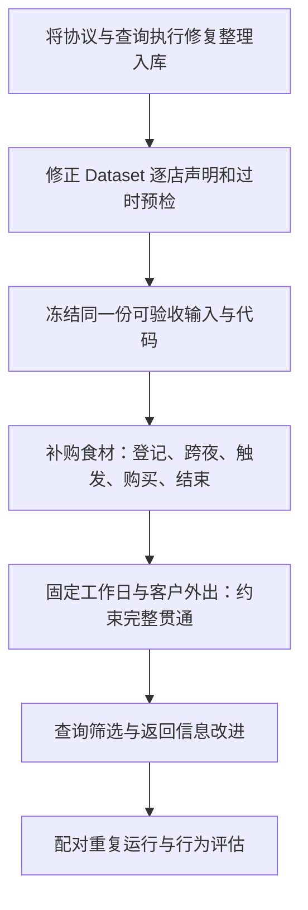

# 未完成任务、人物行为约束与全天运行修复提案

> 状态：未冻结提案；2026-10-02。本文没有修改生产行为，也不代替现行 SPEC。
> 2026-10-02 经设计评审收敛为草稿规格[个人事务与工作安排规格](SPEC-errands-workday.md)（同为未冻结）：行为条款、实现细节与冻结条款修订以该规格为准，逐文档同步作业与文件修改清单见其配套[实施计划](research/errands-workday-implementation-plan.md)，本文保留设计背景、运行证据与取舍依据；被评审改正的表述见文末「设计评审后的更正与去向」。
> 范围：白领林悦与商务赵铭的全天运行、工具交互改动的实际效果，以及运行期间两仓库的未提交修复。
> 建议：保留有效的协议与执行链路修复；补全待办任务的持续状态；修复作息信息丢失；重新整理供给声明与验收工具。

## 建议采用的心智模型

人物需要同时知道“我通常怎样生活”“我还有什么没办完”“今天准备重点做什么”“刚才实际发生了什么”。
目前，未完成的打算主要夹在活动总结和主观记忆里，而当日目标只表示意图是否获得过推进。
因此，增加反思提示的力度，不能保证人物在明早继续办事；把当日目标改成任务完成清单，又会改变已经裁决的语义。

推荐继续使用现有七层提示、WorldState、事件记录与检查点。待办任务进入已有待办层，经历与反思留在记忆层，
作息进入人设层，工具是否可执行仍由环境判断。无需增加一个记忆框架、另一套数据库或通用任务编排器。

## 运行证据与结论边界

本次分析读取了原始运行、模型请求和工具结果，并核对当前源码与运行时源码索引。
详细计数与源码身份见[核查证据](research/2026-10-02-dayrun-review-evidence.json)。原始数据位于同级的
WorldMock-Dataset 仓库；这些外部运行文件并非 WorldMock 仓库自带夹具。

| 人物 | 对照运行 | 本次完整运行 |
| --- | --- | --- |
| 白领林悦 | `0001-white-collar-lianqiu/runs/2026-09-29-938e289-day-r2` | `0001-white-collar-lianqiu/runs/2026-10-01-3b4afe5-dayrun-r2` |
| 商务赵铭 | `0002-business-sales-zhaoming/runs/2026-09-29-938e289-day-r3` | `0002-business-sales-zhaoming/runs/2026-10-01-3b4afe5-dayrun-r3` |

上表路径均相对于 `../WorldMock-Dataset/requests/`。下列生活时间均为模拟世界的 Asia/Shanghai 时间。
两个新运行基于 `3b4afe5` 加未提交修复，且白领与商务的运行时源码摘要不同；商务运行包含后续计划报错改进。

| 观察项 | 白领：旧 → 新 | 商务：旧 → 新 | 可以得出的结论 |
| --- | --- | --- | --- |
| 世界请求 / 世界拒绝 | 126 / 7 → 127 / 3 | 184 / 13 → 152 / 9 | 这两次轨迹中的执行拒绝减少 |
| 名称错误 | 46 → 0 | 41 → 6 | 名称发现与报错反馈有明显改善 |
| 协议错误响应 | 71 → 9 | 78 → 20 | 结构化交互更顺畅，仍有错误 |
| 决策模型响应数 | 206 → 154 | 287 → 217 | 决策调用减少；不包含所有记忆阶段调用 |
| 决策 token 合计 | 4,999,836 → 3,167,720 | 6,217,669 → 4,241,352 | 分别减少约 36.6% 与 31.8% |
| 已结算工作任务 | 1 → 1 | 5 → 6 | 工作结果没有随调用减少而下降 |
| 工作返工拒绝 | 1 → 1 | 4 → 4 | 工作成果质量没有得到同等改善 |
| 到家时间 | 15:15 → 17:42:39 | 15:56 → 19:09 | 本次轨迹较合理；旧商务随后还曾返回办公室 |

错误指标来自不同层，不能相加后除以世界请求数。查询调用按模型原始 tool call 统计，返回按调用身份去重；
token 是记录中的用量，不是价格估计。商品也同时大幅扩充：白领商品 10 → 173、供给 9 → 357；
商务商品 7 → 176、供给 90 → 3480。代码、提示、输入与随机生成的行为轨迹同时变化，
所以这些结果支持“整个更新后的系统在这两次运行中改善”，不能单独证明 SPEC-tool-interaction 的因果收益。

### 未完成事项仍未成为可靠的待办

| 事实 | 对应缺口 |
| --- | --- |
| 白领新运行有 64 条不同身份的记忆，routine 32 条；商务 88 条，routine 35 条、reflection 20 条 | 分类数量显示记录重心，但不能仅凭类型判定每条记忆无用 |
| 白领次日 00:16:01 反思提到提前吃掉番茄鸡蛋、明天需要补购；08:00 的记忆仍提及补购 | 不能说模型完全忘了；问题是没有形成持续、可更新的补购任务 |
| 次日计划在 00:00 已生成，仍准备使用“已买食材”做晚饭 | 新需求产生晚于计划；午夜生成一次计划不能处理之后的变化 |
| 主行动请求读取的是各层 JSON，没有直接把巩固后的 MEMORY.md 当作待办输入 | 只修改记忆巩固 prompt，无法覆盖真正驱动行动的链路 |

当前[记忆层](../../src/worldmock/life/memory_layer.py)优先保护未结束订单、未回复消息及最近片段，
没有对应未完成个人事务的保护规则；较早的 self_notes 会受字符预算裁剪。
[待办层](../../src/worldmock/life/todo_layer.py)只有暂停活动和当日目标。
[主提示](../../custom/agents/life_prompt.py)要求把要延续的打算写入 summary，
但“有一段文字”不具备任务的持续身份、触发时机和结束条件。

### 提前回家不是单一的服从问题

旧白领在 14:58:54 离开办公室，并在决策中指出缺少下班节律。新运行在 15:19 完成工作，
因为当天计划保留了 17:30 离开公司的打算，实际在 17:19:21 出发；这段时间主要读书、吃零食。
画像的结构性缺口没有随这次较晚回家而消失，工作量也仍不足以解释整段办公时间。

证据对应[画像字段](../../src/worldmock/profile/models.py)、[提取器](../../src/worldmock/profile/extractor.py)、
[人设投影](../../custom/agents/life_persona.py)和[日计划生成](../../src/worldmock/life/day_planning.py)。
“通常几点下班”属于习惯；“工作日必须在某段时间履职”属于场景约束，两者必须保留来源和不同的效力。

### 查询已可用，但找到可执行选项仍费力

新白领调用 query_world 13 次，成功 11 次，返回合计 72,846 字符；商务调用 49 次，成功 42 次，
返回合计 307,206 字符。商务在 19:09 查询正餐时，总量为 681，第一页 20 项均不可执行，部分响应约 2.2 万字符。
“美团外卖”作为购买来源与作为查询对象的含义也不一致。人物最终经历查询、尝试远程购买被拒，再开车去餐馆。
这说明完整分页已经打通，但仍需缩小与当前行动相关的候选集合；扩大商品数量本身不能解决这个问题。

## 可参考的项目与研究

以下为本次核对的原始论文、作者仓库和产品官方资料。可采用其设计或评估方法；论文结果不等于 WorldMock 的实测收益。

| 参考 | 已验证的做法 | 本项目采用什么 | 不直接采用什么 |
| --- | --- | --- | --- |
| [Generative Agents，2023](https://arxiv.org/html/2304.03442v2)及[作者实现](https://github.com/joonspk-research/generative_agents) | 经历、反思和未来计划协同；计划包含时间、地点与持续时间，并随观察调整 | 区分过去经历与未来行动；检查跨时间的一致性 | 不用完整日程树替换已有“当日目标”，不把合理叙述当作完成证据 |
| [LangChain TodoListMiddleware 源码](https://github.com/langchain-ai/langchain/blob/master/libs/langchain_v1/langchain/agents/middleware/todo.py) | 待办有明确内容与状态；更新写入 agent state；限制同轮并行改写 | 待办作为持久状态，更新必须有明确顺序 | 不照搬模型任意标记 completed，也不整表重写掉未完成任务 |
| [LangGraph 状态持久化](https://docs.langchain.com/oss/python/langchain/short-term-memory) | 通过检查点保存线程状态，可以扩展状态字段 | 使用已有 WorldState 与共同检查点保存任务 | 不额外引入 LangGraph 的运行时和存储 |
| [Letta memory blocks](https://docs.letta.com/v1-sdk/memory/memory-blocks) | 持续注入上下文的关键记忆与按需检索分工；所引页面为 V1 SDK 文档 | 未完成任务的关键字段持续可见，不依赖一次碰巧检索命中 | 不安装 Letta，也不让自由改写的记忆块成为世界事实 |
| [Mem0 官方说明](https://docs.mem0.ai/core-concepts/memory-operations/add) | 从交流中提取记忆、保存并检索；add 与显式 update/delete 有各自职责 | 经历与偏好可参考其提取、检索分工 | 不用语义记忆写入成功代替任务完成；已有依赖也不是必须接入的理由 |
| [Microsoft Graph workingHours](https://learn.microsoft.com/en-us/graph/api/resources/workinghours?view=graph-rest-1.0) | 工作日、开始、结束与时区为显式字段 | 表达可审计的工作时间，不靠模型从人设称谓推断 | 该 API 本身不证明“禁止提前离岗”；执行约束属于本项目场景合同 |
| [GoodAI LTM Benchmark](https://github.com/GoodAI/goodai-ltm-benchmark) | 包含 prospective_memory、trigger_response 等长程记忆测试 | 测试“隔一晚、遇到触发条件后会不会去做” | 不直接搬其历史模型排名或数据许可到本项目 |
| [Mem2ActBench，2026](https://arxiv.org/html/2601.19935v1) | 评估历史记忆是否用于选工具、填参数；指出会回答不等于会使用 | 将记忆验收延伸到真实工具调用与最终结果 | 其离线工具生成不能替代本项目交互式全天验收 |
| [PersonaGym，EMNLP Findings 2025](https://arxiv.org/abs/2407.18416) | 在与人物相关的不同情境里评估行为与人设一致性 | 使用普通工作日、客户外出、休息日等对照情境 | 不用语言风格分数替代实际行程和时刻证据 |
| [τ-bench，2024](https://arxiv.org/abs/2406.12045) | 对照最终数据库状态，重复试验衡量可靠性 | 世界状态作完成判据，同场景多次运行并报告失败 | 不凭一条成功轨迹宣布稳定修复 |
| [Anthropic 工具设计经验](https://www.anthropic.com/engineering/writing-tools-for-agents) | 面向实际任务设计查询，组合过滤与分页，统计调用、错误和 token | 评估从需求到可执行选项的成本，返回足够行动的信息 | 不照搬特定 token 限额，也不增加通用查询语言 |

本项目的技术判断是：最值得复用的是“显式状态、持续可见、事件反馈、行为评估”。
已核对 `pyproject.toml` 和当前调用链：项目具有 Pydantic、Ray、AS2 记忆存储及检查点；
`mem0ai==2.0.7` 已在依赖中，但 `src`、`custom` 中没有直接接入。
本地 Mem0 实现有 add/search/update/delete，并不能替项目定义哪些世界事件证明任务完成。

| 方案 | 好处 | 主要代价或缺口 | 建议 |
| --- | --- | --- | --- |
| 只改反思与记忆 prompt | 修改小，可能减少无用复述 | 未完成事项仍会被裁剪，跨日更新和完成依据仍缺失 | 与状态修复一起做，不单独宣称完成 |
| 引入新的向量记忆或知识图谱框架 | 可增强历史检索和关系组织 | 当前缺口是任务生命周期；引入另一套状态与存储不能自动解决它 | 本轮不采用 |
| 把 day_plan 改成全天任务表 | 所有安排看起来集中在一处 | 混淆意图推进与任务完成，推翻已有裁决，日切换仍需另行处理 | 不采用 |
| 扩展现有待办与人物状态，补全作息和明确约束 | 复用当前执行、结算与恢复，能逐条核验任务是否延续 | 需要同步请求、状态、提示和行为测试 | 推荐 |

## 提议的行为设计

### 待办任务持续保存，完成由对应结果确认

| 内容 | 状态归属 | 如何结束 |
| --- | --- | --- |
| 工作任务、订单、待回复消息 | 沿用现有世界对象；待办层投影其当前状态 | 使用工作结算、订单终态、关联消息回复等既有结果 |
| 人物主动记下的事务，例如明天补购食材 | 在人物运行状态中保存，有稳定内部身份、描述、下一步、触发时间或条件、状态与来源 | 可核验事务由关联执行结果完成；主动放弃保留取消原因 |
| 当日目标，例如今天准备做饭 | 继续使用现有 day_plan | progressed 仍只表示获得过活动推进，不表示自然语言目标完成 |
| 感受、偏好、经验 | 沿用主观记忆与反思 | 可压缩整理，不参与任务完成判定 |

工作任务不再复制一份可独立改写的状态。个人事务采用显式登记和更新：在现有活动汇报、暂停、收尾请求中提交任务变更，
由环境提交记录；同一事务引用原身份更新。外部工作通知直接来自世界，不再交给模型重新抽取一遍。
模型仍负责选择下一步，系统不自动替人物购物或提交工作。

暂停、阻塞、当前进度由已有活动、地点与可执行条件展示，不再维护另一份互相矛盾的工作进度。
任务跨午夜保留；日计划重新生成、修订或标记 progressed，都不能删除它。
当前工作合同逾期会拒绝提交，因此逾期工作必须显示“已过期”并留下原因，不能假装第二天仍可继续交付。

可核验的个人事务绑定具体对象和结果，例如“取得一包番茄鸡蛋食材”由对应库存取得结果确认，
“吃晚饭”由消费结算确认；下单、到店、开始制作和获得活动推进都不能冒充这些结果。
模型自述完成但缺少对应结果时，保留主观记录与未完成状态。对世界尚不能表示其完成条件的宽泛打算，
只作为当日目标或主观打算保存，不增加自然语言完成裁判或通用条件表达式。

未完成任务的概要进入待办层，不占用当前记忆层 8000 字符的裁剪预算。触发时刻复用现有提醒与调度机制；
提醒触发只表示该考虑这件事，不能把任务改为完成。检查点保存同一份任务状态与事件位置，恢复后不重复创建或重复结算。

### Prompt 改变信息分工

| 现有问题 | 建议写入规则的含义 |
| --- | --- |
| summary 承担延续打算，但只是可被裁剪的文字 | 要延续的事务写入待办；summary 解释当前活动停在哪里、为何调整 |
| “想记住的事”容易产生日常复述 | memories 只保存能影响以后决策的新信息；已有作息、已在待办中的任务不重复记一遍 |
| 反思偏重习惯、感受与偏好 | 反思保留有用经验与变化；不能代替任务登记，也不能把未完成说成完成 |
| 晚于午夜产生的新需求不进入当日计划 | 新任务即时进入待办；行动前同时考虑未完成任务、当日目标和当前条件 |

提示调整与任务状态在同一个端到端变化中交付。不要先删掉当前 summary 中延续打算的规则，
再留下尚未实现的任务入口。最终删除重复承担任务存储职责的旧提示，不保留新旧两套路径。

### 补全作息，明确工作时间的来源和效力

推荐补全离开工作地点、回家时刻的结构化表达，并贯通输入、提取、场景覆盖、画像文本及人设层。
是否适用由具体人物与日期决定；没有固定工作地点或下班时间的商务人物不能被套用白领模板。

| 情境 | 建议行为 | 证据要求 |
| --- | --- | --- |
| 画像只是“通常 17:30 下班” | 作为默认习惯持续提示；偏离时能够解释当时的任务与情境 | 保存画像来源，并评估多次运行的偏离 |
| 场景明确固定工作时间与工作地点 | 完成一项工作不解除当班义务；个人日计划不能取消它 | 场景显式声明工作日、时间、时区、地点及允许的例外 |
| 午休、客户拜访、获准请假 | 按具体时间与地点允许行动 | 使用场景或已知外部安排；自由编一句理由不能改写外部事实 |
| 当天工作已经做完但仍在班 | 可选择场景支持的整理、学习、休息等行为，并报告工作量不足 | 不伪造新任务，也不通过延长空等伪装八小时有效工作 |

硬约束仅来源于明确的场景事实。人物习惯仍允许合理偏离；不能把规则缺失造成的提前回家解释成有意模拟。
首个验收场景使用固定班次，商务场景使用真实客户安排。
与当前“今日计划可覆盖日常作息”的规则同步修订：个人计划可以调整习惯，不能自行解除外部义务。

### 查询以找到能做的下一步为目标

当前 query_world 只有 name、way、category、offset。建议在原工具增加明确的购买来源筛选与当前可执行筛选，
来源名称复用购买请求已支持的门店和渠道解析；返回按同一个冻结观察求值，仍保留完整分页。
筛选结果为空时，明确返回当前条件下没有匹配，人物可以有意识地改查全部已知选项与不可执行原因。
不自动改写查询、不扩大权限，也不静默改成另一家店或另一个渠道。

返回保留名称、方式、来源、价格或代价、可执行状态及必要原因；重复的工具描述和长合同不在每件商品中反复复制。
用“找到可以买的晚餐并实际买到”评估改动，同时检查没有遗漏分页尾项、隐藏 false/零值或破坏当前查询批次原子性。
这是对固定四字段查询合同的显式修订，应连同 SPEC-tool-interaction 更新，不作为暗藏在数据集脚本里的优化。

## 运行期间 hack fix 的逐项审查

这里的“建议入库”表示修复方向和归属合理，不表示已替整个仓库完成发布门禁。
审查覆盖 tracked diff、未跟踪源文件、运行回执和执行脚本；生成数据与历史日志不按源码修改行数计算修复数量。

| 修改 | 判断 | 入库建议与剩余工作 |
| --- | --- | --- |
| life_agent 增加决策失败和工具分发失败的异常日志 | 合理诊断；错误继续传播或走既有错误合同，没有把失败改成成功 | 入 WorldMock，随相关修复提交；保留错误传播断言 |
| life_memory 覆写反思调用，新增 life_reflection 严格工具与引用校验 | 合理协议修复。限定一次 submit_reflection、一至三条洞见、已存在且不重复的引用，拒绝自由文本 | 入 WorldMock，连同严格反思测试；只证明输出结构与引用合法，不宣称解决任务记忆 |
| LifeEnvActor / LifeEnvProxy 显式转发 read_query，runtime 使用该类 | 必要执行链路修复，实际等待远端结果，保持单写入 actor | 入 WorldMock，连同装配和真实 Ray 测试；它是当前 AS2 固定版本的 Life 扩展，不做多版本兼容；补 query_world 的远端行为断言 |
| 重复计划意图错误中删除 str.value，两个入口共用完整位置与合并提示 | 合理根因修复。真实 JSON 反序列化后是字符串；重复请求应返回校验错误，不应崩溃 | 入 WorldMock；保留至多八条、每意图一条的既有合同；模型合并目标的探针不能充当任务完成证明 |
| 与 actor 工厂、严格反思、错误文案同步的既有测试修改 | 所检查入口随实现改变，未发现通过放宽业务限制来掩盖错误 | 与各自生产修复一起入库，不单独提交一批“测试通过”改动 |
| Dataset 删除 available_at 输入，普通任务 appointment=null，补关联通知 | 合理跟进当前场景合同，普通任务按通知开放 | 入 WorldMock-Dataset；客户预约继续保存明确时间，不能全改成普通工作 |
| 删除无产物的 housework-cooking，绑定正式库存配方输出 | 合理切换到已有料理链路 | 入 WorldMock-Dataset；同步删除仍期待旧活动名称的预检与夹具，验证购买、制作、入库、食用全链 |
| rebuild_dataset 在隔离重建时为所有人物复制共享 tools | 合理跟进白领与商务生成器的新共享依赖，消除只为部分人物准备工具的特殊分支 | 入 Dataset；现有白领、商务重建回执可保留，正式合入前覆盖其他三个人物的重建入口 |
| publish_catalog 引入当前目录、刷新身份 | 采用当前正式目录合理；按名字静默删除上游不同身份对象、version_minor 固定加三不适合作为长期发布规则 | 整理后入 Dataset：显式解决冲突、按现有内容发布规则分配版本，并检查绑定完整性 |
| runtime_storefronts 调用正式供给构建器，保留库存、卖方、履约与种子 | 复用生成器合理，实验来源也明确标为 synthetic | 保留这种调用方式；逐店声明改正后与数据一起入 Dataset |
| 随机抽取约十道餐品、便利店使用整个 food 根集合、同类门店全量复制 | 能让实验获得更多选项，但违背现行 SPEC 对逐店完整声明、具体子品类与禁止随机补齐的要求 | 不按现状入正式生成逻辑；用有来源的完整菜单或明确的合成场景逐店声明替换，不能只修低于数量门槛的店 |
| 商品扩充函数给所有地点营业日历统一改 reviewed_on、still_valid_on、source | 不合理地扩大修复范围；商品扩充不能证明营业信息被重新核验，家和办公室也受到影响 | 从正式供给逻辑删除这些改写；营业资料按其自身来源发布，历史运行快照保持原样 |
| LabelKit 输入逐个 items 移除 memories/views，独立审计检查每项，保留 summary | 必要隐私边界修复；此前只处理顶层字段不能覆盖现行请求形状 | 入 Dataset，附多项与非原地修改测试；独立审计脚本移到稳定 tools 入口，避免长期调用旧日期 execution 路径 |
| 白领完成后重新生成导出交接与 LabelKit 输入 | 对派生产物做修正合理；没有据此重新声称模型行为发生过变化 | 发布修正后的派生产物身份和来源，保留原始世界足迹，不把重导出当重跑 |
| run_day.py 冻结输入、真实退出码、失败中止、保留尝试和源码索引 | 作为本次实验驱动合理；明确 not_certified 优于把加载成功冒充规格通过 | 日期脚本、精简回执可作实验记录；常用能力并入现有 Dataset 工具，删除正式入口对日期目录和固定两个人物的依赖 |
| 既有 Windows 环境运行、登记锁定子模块；完整 uv sync 因 Jericho 构建不支持失败 | 证明当前环境可以运行，尚未证明干净机器可安装 | 环境回执入实验记录；不把手工环境当安装方案，不添加静默跳过依赖；明确实际所需依赖后完成 Windows/Linux 干净安装验证 |
| 大体积源码 zip、数据库、失败日志及多次重跑产物 | 对追溯有用，不能代替源代码提交与固定依赖 | 小型索引、摘要、命令和验证回执入库；大产物按已有交付规则保存，不把整份本地工作目录提交 |

README 指向新报告、旧验收明确标为历史记录的调整合理，应与本次报告一起入库。
`.gitignore` 排除本机大包和中止运行可以保留，但正式发布必须提供可取得的代码版本及必要失败摘要；只有哈希没有内容无法复现。

严格反思的工具格式与 DeepSeek 的严格模式方向一致；严格模式要求所有对象字段必填并禁止额外属性，
但任务语义和引用是否真实仍需客户端核验。见 [DeepSeek Tool Calls](https://api-docs.deepseek.com/guides/tool_calls/)。
Ray 扩展目前访问 `_router._environment()`，这是需要随锁定 AS2 版本做真实集成测试的耦合点；
当前可保留这个小型 Life 扩展，不据此开发通用环境适配层。

### 正式预检本身也有过时假设

本次两个 `dataset-preflight.json` 均为 fail，冻结说明明确标记 `not_certified`。
这些失败不能全部解释成当前引擎缺功能：

| 当前预检判断 | 与现行实现的冲突 | 应修正的验收方式 |
| --- | --- | --- |
| LifeScenario 没有 purchase_channels 字段就判不支持 App 购买 | 当前渠道由手机配置经 load_purchase_channels 派生，不是场景顶层字段 | 通过正式加载器检查实际渠道，并用 App 名发起真实购买 |
| 不在当前观察或一次 browse 窗口就判不可执行 | 当前支持指名购买与 query_world 完整分页；展示轮转不等于禁止操作 | 检查真实按名请求与必要分页，不把一页展示当全集 |
| 仍要求 housework-cooking | 新输入已使用正式库存料理 | 用真实食材到成品、再消费的结果验证 |

这些脚本在 `WorldMock-Dataset/tools/preflight_runtime.py`，属于这次正式入库必须补齐的欠账。
应修复断言并重跑，不得把 fail 改成 pass、删除失败行，或以新测试通过覆盖旧门禁。
另一方面，随机菜单和营业资料来源改写是源码已确认的问题，不会因为预检存在误判而自动变得合理。

## 实施顺序与验收

首个任务端到端场景只需要补购食材：夜间收尾明确登记，次日仍在待办；缺货时保留并展示原因，
买到后由库存结果结束；从共同检查点恢复得到相同任务状态。该链路通过行为与变异测试后，
再把工作、消息等既有对象统一呈现在待办层。其存储和完成依据从开始就采用最终架构，不做临时文本清单。

| 验收对象 | 必须观察的行为 | 必须被测试杀死的错误变异 |
| --- | --- | --- |
| 跨夜记任务 | 夜间新需求在次日决策出现；超过记忆裁剪长度仍保留；不靠主动问答唤回 | 午夜清空任务、裁剪时移除任务、只写 MEMORY.md 不投影 |
| 完成依据 | 下单未到货、制作未完成、部分数量不足时仍未完成；取得对应物品才完成 | 把 start、accepted、progressed 或自述当完成 |
| 取消与截止 | 取消留下原因；逾期工作明确终止且不能继续提交；日计划修订不删除待办 | 清单重写丢任务、自动延长截止、取消仍提醒 |
| 检查点 | 恢复后状态及证据相同，不重复创建、不重复购买结算 | 任务遗漏快照、重复消费同一结果、引用未来或他人事件 |
| 人物与工作时间 | 普通工作日保留结束时间；午休/客户拜访按声明可外出；休息日不套工作日 | 提取丢下班字段、所有人物套班次、日计划解除硬约束、禁止合法午休 |
| 查询 | 来源与购买解析一致，筛选后可执行，分页全集无遗漏，世界和时钟不变 | 忽略来源、漏最后页、查询改变世界、只回远端引用而非结果 |
| 数据集与料理 | 逐店声明等于实际供给；原料消费产生成品；渠道真实可买 | 复制根集合到所有店、随机补齐、只改来源日期、生成假料理结果 |
| LabelKit 边界 | 每个 item 均无主观私有字段；活动与 summary 来源逐项一致 | 仅移除顶层字段、漏第二项、改原始世界事件 |

现有“当日目标 progressed”指标继续使用原定义，新增任务完成率不得复用它的名称或分母。
任务指标分别统计登记后仍可见、触发后的实际行动、正确完成、错误完成、取消和过期。
习惯评估记录偏离时间及其事实依据，工作负荷记录有效工作、实际履职与空闲时间，避免只检查晚回家。

建议在固定代码、输入、模型配置下，对每个人物先做至少三次配对完整日运行，报告全部成功与失败；
再使用未参与修改的情境检验。小样本用于发现回归，不能声称统计显著。
代码变化与供给扩充应在独立对照中比较，不能继续把二者收益合并归因。
查询同时报告完成任务所需模型调用、错误响应、查询返回量、token 与最终购买结果，降低 token 不能以任务失败为代价。

| 代码或文档归属 | 需同步的变化 |
| --- | --- |
| WorldMock 人物与生活运行时 | 人物状态、待办投影、活动请求、事件结果关联、提示与检查点；复用既有 Pydantic 与记录机制 |
| WorldMock 画像与场景 | 下班/到家作息、显式工作安排、对应行动可用性与合理例外 |
| WorldMock 查询 | 原 query_world 的筛选、公开名称解析、精简结果与远端集成测试 |
| WorldMock-Dataset | 完整逐店声明、当前任务与料理输入、稳定交付审计入口、正式行为预检、跨平台重建 |
| 现行规格 | SPEC-persona-prompt、SPEC-day-plan-goals、SPEC-life-realism、SPEC-time-and-energy、SPEC-tool-interaction、相应合同和手册 |

当日目标规格只补充与待办的边界，不推翻“活动推进不等于自然语言任务完成”的既有裁决。
新输入和快照按现有版本与身份规则发布，重新生成测试夹具；不写 migration，不保留旧字段解析或 fallback。
历史运行以原代码、输入和摘要保留作为证据，不在本次提案中改写。

## 本次核查已经做了什么

| 核查 | 实际结果 | 限制 |
| --- | --- | --- |
| 工具、记忆、人设、查询与真实 Ray 回归 | 132 passed，2 warnings；命令与回执见核查证据 | 是定向回归，不是全仓发布门禁 |
| 严格反思、计划重复反馈、真实 JSON 入口 | 补跑 11 passed | 与上行部分用例重叠，不能简单相加为独立覆盖量 |
| Dataset 当前输入与 LabelKit 私有字段 | 补跑 10 passed | 不替代人物规格预检与新机安装 |
| 运行期间变异回执 | 查到 8 个错误变异均记为 killed | 本次读取既有回执，没有重新运行这些变异；尚缺正式预检误判和营业来源改写的守卫 |
| 源码身份 | 核对的六个修复生产文件与商务快照一致；白领仅 models.py 为较早版本 | 不能把两次运行当成完全相同源码 |
| 正式输入认证 | 两份预检均失败，冻结说明均为 not_certified | 包含过时断言与实际数据问题，必须逐项修正后再验收 |

建议优先收进版本库的是严格反思、Ray 查询转发、计划校验、异常日志和 LabelKit 隐私过滤及其测试。
商品扩充保留正式生成器的复用方式，重新发布逐店声明；营业来源改写直接删除。
任务状态、工作时间和查询改进作为随后可分别验收的完整行为变化，不与本次已有修复混成一个无法归因的大提交。

## 设计评审后的更正与去向

2026-10-02 的设计评审（[评审记录](research/2026-10-02-errands-workday-design-review.md)）逐条核对了本文的事实表述与方案，下表列出被改正或收窄的部分。
本文正文保持评审前的原貌作为设计背景；与下表不一致之处，以[草稿规格](SPEC-errands-workday.md)为准。正文里的「待办任务」「未完成任务」在规格中统一称个人事务。

| 本文表述 | 评审结论 | 规格中的去向 |
| --- | --- | --- |
| 人物写作连秋、赵明 | 数据集场景与运行报告写作林悦、赵铭；运行目录名仍是 `0001-white-collar-lianqiu` | 已在本文改正 |
| 待办层投影工作任务、订单、待回复消息，并在补购链路之后统一呈现 | 与人物 Prompt 规格的唯一出现原则直接冲突 | 待办层只新增个人事务，既有对象位置不变（裁决 E1）；统一呈现登记为范围外 |
| 状态图含「已过期」，验收含逾期与部分数量 | 过期只对工作任务成立且已有现行表达；个人事务没有截止字段 | 个人事务只有未完成、已完成、已取消（裁决 E4）；数量按多次结算累计 |
| 要延续的事务写入待办，summary 只解释当前活动；不保留新旧两套路径 | 只有能由结算确认的事才能成为事务 | 可核验的事只走事务；起床时刻这类不可核验的打算仍写暂停与收尾的 summary，两者领域不相交（规格 3.1，跨日延续的缺口登记为范围外） |
| 行动前同时考虑未完成任务、当日目标和当前条件 | 系统层只写各层是什么与交互规则，不写决策次序 | 不新增行为指令；待办层每轮可见 |
| 可核验事务的例子为番茄鸡蛋食材与「吃晚饭」 | 正式目录没有番茄鸡蛋对象；「吃晚饭」没有具体商品 | 完成依据为结果种类、具体商品与数量的闭集，验收用正式目录的素炒什锦食材包 |
| 在汇报、暂停、收尾请求中提交任务变更；新任务即时进入待办 | 没有可点名活动时没有入口；反思不是人物工具 | 入口边界照实写明，反思里想到的事在其后下一次播报、暂停或收尾时登记 |
| 触发时间或条件，复用现有提醒 | 现有提醒挂在当日目标上、随计划过期且会结束睡眠；没有条件触发 | 事务自带提醒时刻，只支持时刻，新增不叫醒睡眠的唤醒原因 |
| 严格反思限定一至三条洞见 | 现行合同、锁定 AS2 常量与已登记用例都是至多五条、三个问题引导；工作树同时替换了反思文案 | 保持现行合同，只修通道（裁决 R1）；失败处理见裁决 R2 |
| 重复计划意图两个入口共用完整位置 | 实现只定位后出现的条目，超限时不再报重复，与当日目标规格现行条款不一致 | 改代码以符合现行条款（裁决 R3） |
| 补 `query_world` 的远端行为断言 | 生产路径上 `query_world` 由宿主本地求值，只有回看任务走远端 | 远端断言守回看任务；两入口等价沿用已登记的用例并参数化登记；运行装配使用转发类另有断言 |
| 132 passed、11 passed 支撑入库建议 | 两条定向命令不含两份仍按旧反思形状应答的已登记用例，也不含任何门禁 | 阶段 1 以全量门禁为入库条件 |
| 工具分发失败走既有错误合同 | 四个失败阶段码只存在于代码，接口合同没有登记 | 随阶段 1 补登（规格 1.4） |
| 至少三次配对完整日运行，再用未参与修改的情境检验 | 真实运行计费，只在用户要求时启动 | 计划每臂三次并另跑一个留出情境，只报告；少于三次时验收记录写明未达复跑要求 |
| 完整依赖同步在 Windows 上失败，需完成干净安装验证 | 与本特性无关 | 登记为范围外，另行处理，不以静默跳过依赖解决 |
| 硬约束仅来源于场景事实；午休、客户拜访按声明可外出 | 没有写环境拒绝什么；现行原则是环境只执行可行性与资源约束 | 推荐把工作安排作为环境核验的事实呈现、不新增拒绝（裁决 W1，须用户裁定）；另一选项及其代价同表 |
| 场景显式声明工作日、时间、时区、地点 | 场景已有唯一时区 | 工作安排不带时区字段 |
| 查询返回里重复的工具描述和长合同 | 逐项重复的是完整请求候选，商品项没有合同 | 删除逐项候选，只省略空值（裁决 Q2） |
| 数据集逐店声明、预检、LabelKit 审计列入实施顺序与验收表 | 代码不在本仓库，无法登记为本仓库验收台账行 | 移入规格「数据集侧登记」（含须观察与须杀死的错误），只阻塞配对复跑 |
| 到家时刻、681 项查询、00:16 的反思等数字 | 核查证据文件里没有出处，只能在数据集仓库复算 | 规格不引用；36.6%、31.8% 不作为收益或阈值 |
| 「代码或文档归属」五份现行规格 | 实际被改写的还有一日运行保真、AS2 集成、数字人交互、决策上下文、交互菜单、生活运行时、一日行为、地图与门店、LabelKit 交付等规格，以及架构、实验、验收文档、设计十章与手册 | 规格「冻结条款修订」按主题列出，配套实施计划的文档同步作业与文件修改清单逐文件列出 |
| 审查覆盖 tracked diff | 目录说明、目录生成脚本与目录测试的未提交修改不在审查表内 | 作为工具交互的文档对齐单独先行提交（规格 1.5） |
