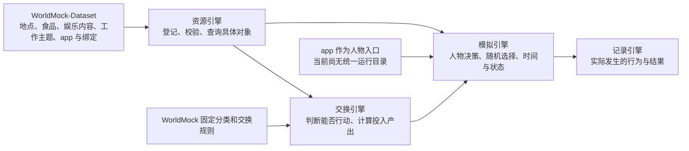
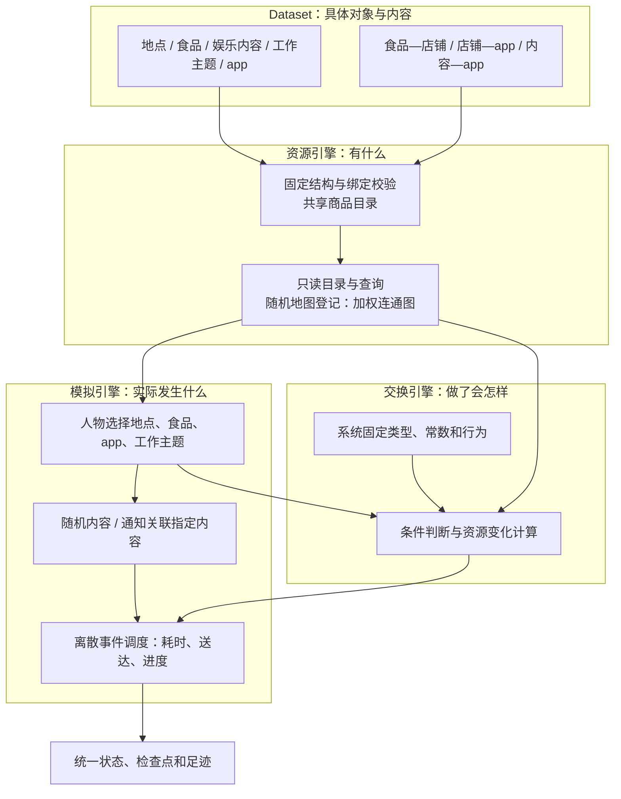
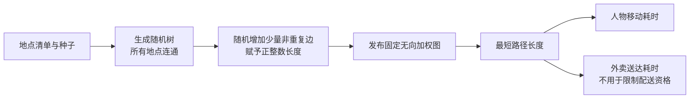
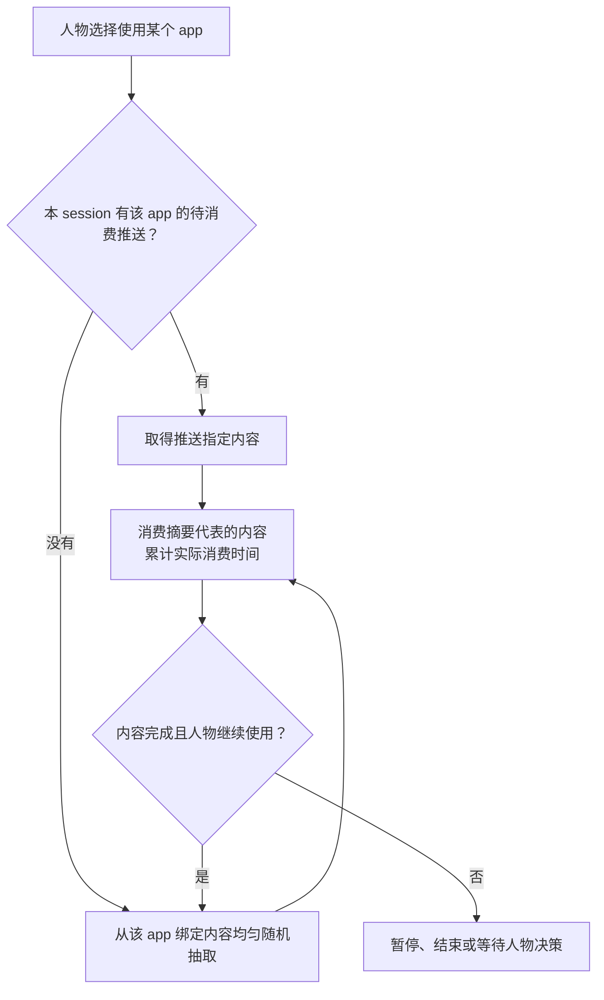
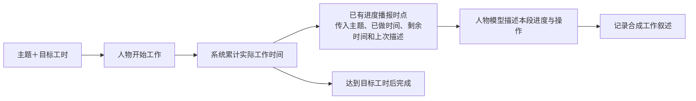
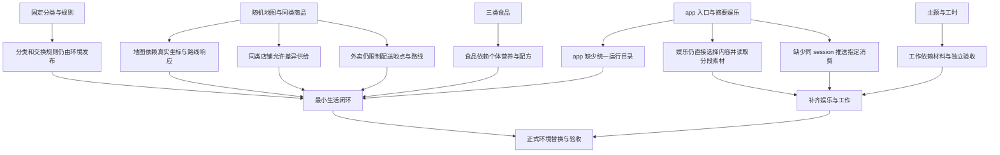

# 以 app 为入口的资源与规则引擎简化提案

> 状态：未冻结提案；2026-10-06。本次只交付设计，不改变现行运行行为。
> 代码基线：7e1ffab3b49971922069c0c1fa400ffcbb075beb

## 第一章　用户原话与项目框架

### 用户原话

以下完整誊写原始请求，不修改措辞、大小写和标点：

> **地图**
>
> - 不再采用真实的地图，地点通过随机边联通（每个节点保证至少有一条边），边具备长度，用于计算人物从某个点到另一个点的移动时间
> - 地点根据类型提供服务/商品，同样类型的地点提供完全一样的商品，餐饮地点可以绑定APP，一个app可以绑定多个地点（比如美团app可以对多个饮食店铺下外卖单），不具备app的餐饮地点则必须到店消费
>
>
>
> 食品：
>
> - 不再为每个食物生成具体的热量信息，食品系统简化成零食，饮品，正餐三个类别，每个类别提供固定的热量；而环境数据集之需要为每个类别提供catalog，具体人物想要吃什么则是LLM根据餐品名称和人设画像喜好决定即可
> - 食品必须绑定可提供的店铺，或者支持all选项让食品可以一次性绑定到所有的店铺；如果店铺绑定了app则persona可以通过外卖方式取得食品
>
>
>
> 娱乐：
>
> - 将数据分为以下几种类型（文章，图文，短视频，长视频，实况）， 内容可以使用合成/真实摘要提供；
> - 每个娱乐内容可以绑定到多个app，persona不再直接指定娱乐内容，而是选择使用某个app，使用时随机推送app绑定的娱乐内容
> - app可以根据提供的内容在早8-晚10阶段对persona进行推送某个内容摘要，如果推送后persona在该session内打开该app，则app推送的具体内容指定消费 - 如果persona将该内容消费完成，则继续使用随机策略
>
>
>
> 工作：
>
> - 移除具体的工作内容数据，仅保留主题和工时，每当进度播报时通过提示词让LLMs自己编造进度和执行操作
>
>
>
> app：
>
> - 需要环境数据集注册时提供app的catalog，以及以上与app有关说明的绑定关系
>
>
>
> 请根据以上描述重新设计我们的资源和规则引擎，力求大幅简化两个引擎的复杂度，让数据更多地向真实使用的app靠拢（不要再使用开源的奇怪数据，更多的是真实的app名称/真实的电视剧名称/电影名称 + 合成/真实摘要 + 合成数值），并减少运行时系统的维护压力；分类规则和交换规则在worldmock系统端钉死，数据集端仅提供实际的对象名称和内容；
>
>
>
> 根据这些信息，写一个proposal，proposal开头需要将以上内容原文誊写

追加原话：

> 外卖全地图可达

### 项目框架映射

本文将用户所说的“规则引擎”对应到项目现有的“交换引擎”；下文统一使用“交换引擎”。

### 转述确认

你的意思是：世界只需要足够支撑生活选择的地点、商品、内容和时间成本；人物通过熟悉的 app 获取外卖和娱乐，
工作细节由人物自己叙述。WorldMock 统一规定事物的类别和行为后果，Dataset 负责填充名字、摘要、合成数值和明确绑定，
不再承担规则设计和复杂真实数据加工。外卖覆盖全部地点，对吗？

下文把明确要求与补充建议分开：三类食品、五类娱乐、同类地点同商品、app 入口、全地图外卖属于明确要求；
其余补充策略均为建议，包括连通图、推送频率、session 边界、具体合成常数，以及做饭、库存和营业的取舍。

## 第二章　简化后的设计

### 业界方案概览

| 成熟机制 | 适用部分 | 不适用部分 |
| --- | --- | --- |
| 加权连通图 | 随机生成可达地点，用最短路径长度计算移动耗时 | 真实道路、坐标纠偏、在线路由和交通预测 |
| 共享商品目录 | 商品只登记一次，同类型店铺共享商品集合，渠道单独绑定 | 商业平台的店铺差异定价、促销、库存与复杂分销 |
| 通知关联指定内容 | 推送保存 app 和内容身份，打开 app 时消费相同内容 | 操作系统通知服务、点击归因平台、个性化推荐系统 |
| 离散事件调度 | 推送、送达、内容结束在模拟时间到点发生 | 再引入一套调度器、在线轮询或逐秒调用模型 |

### 提升后的设计

#### 两个引擎各自只做一件事

资源引擎不维护人物状态，不判断购买后的余额；交换引擎不生成故事、不推荐内容、不自行推进时间。
随机选择和推送状态归模拟引擎，使用既有调度、事务和检查点，避免把两个静态引擎重新做成运行平台。

| 内容 | 唯一维护方 | Dataset 可以提供什么 |
| --- | --- | --- |
| 分类、允许的行为、服务能力、资源单位与交换公式 | WorldMock | 选择已有类型，不能新增类型或规则 |
| 食品热量、交通速度、娱乐效果、推送策略、配送规则 | WorldMock | 不能提供覆盖值、表达式、规则继承或回调 |
| 地点、商品、app、作品、工作主题 | Dataset | 稳定标识、真实或合成名称、固定类型 |
| 摘要、价格、内容时长、工作目标工时 | Dataset | 对象内容与合成数值；不能借字段改变规则 |
| 地图边和长度 | 注册时由 WorldMock 生成，Dataset 发布结果 | 地点清单和生成种子；无需真实地图材料 |
| 余额、持有食品、订单、观看位置、工作累计时间 | 模拟引擎 | 场景初始值；运行后由实际事件更新 |

“固定”指规则随 WorldMock 版本发布并测试，不能由环境覆盖；不新增可编辑规则配置层。
保留人物画像、初始资金、作息和场景时区等既有场景输入，它们不属于资源分类或交换公式。

#### 本次重设计的五类目录和三种绑定

| 对象 | 最小内容 | 绑定 |
| --- | --- | --- |
| 地点 | 标识、名称、WorldMock 内置地点类型 | 餐饮地点可绑定多个 app；空集合表示只能到店 |
| 食品 | 标识、名称、零食／饮品／正餐、每份价格 | 必须给店铺集合或 `all` |
| 娱乐内容 | 标识、名称、文章／图文／短视频／长视频／实况、摘要、消费时长 | 必须绑定一个或多个 app |
| 工作主题 | 标识、主题、目标工时 | 由场景分配给人物；沿用场景的工作地点和班次 |
| app | 标识、真实名称 | 从店铺绑定和内容绑定得到可用入口 |

绑定只维护一个方向：食品记录店铺，店铺记录 app，内容记录 app；反向查询索引由注册生成，不再手工维护镜像表。
同一 app 可以同时有店铺和内容入口。仅有名字不会自动获得外卖、娱乐或其他系统能力。
已有消息等行为使用同一 app 身份；本提案不另造社交系统。

登记时一次性检查唯一标识、引用存在、类型有效、正数价格与时长、绑定完整性和同类店铺商品一致性。
名称用于人物展示和选择，内部仍用稳定标识；同名店铺按地点区分，同名内容按作品与集数区分。
非法对象或旧规则字段直接报错并记录英文错误日志，不忽略、不猜测、不自动补齐。

目录和摘要放在同一份发布环境中；保留环境版本、文件清单、内容哈希与系统规则版本等必要身份信息。
真实摘要保留来源信息，合成摘要明确标记合成；价格、时长和地图长度标记为仿真数值。
真实名称不代表实际平台当前上架、真实服务承诺或真实剧情摘要，绑定均为该模拟环境的声明。
本表不删除其他现有生活服务和非食品用品；它们使用系统固定类型，保留生活所需行为，退出通用品类继承和交换配对。

#### 地图只表达可达性和时间成本

建议要求至少两个地点，禁止自环和重复边；随机树保证全图连通，因此每个节点至少有一条边。
仅检查“至少一条边”会允许互不相通的地点组，不足以支撑任意地点间出行。
额外边数和长度范围采用系统固定生成规则，不提供图算法插件或数据集自定义生成器。
节点与边按稳定标识排序发布，长度使用整数米；加载和恢复直接读取固定图，不依据种子重新生成。

人物移动时间＝最短路径长度÷所选方式的系统固定速度，向上取整为秒；同地点不产生出行。
保留当前需要的步行、驾车等方式，但不同方式共用同一张图，不再分别维护路线响应。
交通费用由系统按方式计算，Dataset 不提供路线价格公式、实际道路或路径逐段证据。
显示时使用节点关系图；布局坐标只服务绘图，不参与距离和时间计算。
位置和出行导出同步改为地点、路径和距离；下游消费同一新合同，不保留真实 GPS 轨迹要求或伪造经纬度的兼容输出。

#### 同类店铺同商品，外卖全地图可达

相同地点类型共用相同服务集合和商品集合；商品价格定义在商品上，不设店铺覆盖价格。
app 绑定可以不同，因此同菜单的两家店可以一家有外卖、另一家只能到店。
建议餐馆、咖啡店、便利店、超市分别作为内置食品店铺类型，均允许提供三类食品并绑定外卖 app；
住宅、工作地点、公园不出售食品，其他地点沿用各自系统固定服务。每种类型内的实际商品集合必须一致。

食品的 `all` 只展开到系统认定可以提供食品的全部店铺，不包含住宅、办公室等普通地点。
显式店铺集合必须满足：对任一店铺类型，要么全部绑定，要么全部不绑定。
若同类型两家店只绑定了一家，注册直接拒绝并指出冲突，不擅自把绑定扩散到另一家。
需要不同菜单时，应使用系统已经支持的不同地点类型；不能在 Dataset 私设子类型规避规则。

“全地图可达”覆盖所有已注册地点，无配送半径、区域白名单、地点类型白名单或路程上限。
外卖仍必须满足店铺—app 绑定、食品—店铺绑定和付款条件；没有 app 的店铺不能被其他 app 代下单。
到店消费按字面落实为在店购买和进食，不开放取餐带离的履约方式；无 app 店铺不能远程购买。
建议送达耗时＝系统固定备餐时间＋店铺至收货地点最短距离÷系统固定配送速度，不引入骑手和运力模型。
配送耗时向上取整为秒，距离只影响送达时间；费用为商品价加系统固定配送费，不含隐式店铺附加价。
订单明确付款人、收货人和收货地点，默认给自己送至当前停留地点；路途中下单必须明确一个地点。
人物离开后仍送至订单地点，食品归收货人在该地点持有，到达才能取用；不自动追踪人物或归付款人所有。

为降低维护量，建议店铺目录商品持续供应，删除逐店库存、动态报价、促销和补货；人物持有食品的数量仍然准确结算。
这项建议不改变全地图配送要求，是否保留营业时间约束见设计决策点。

#### 三类食品只保留“份”和固定热量

| 食品类别 | 建议固定热量，每份 | 建议固定食用时长，每份 | 示例名称 |
| --- | --- | --- | --- |
| 零食 | 200 千卡 | 5 分钟 | 薯片、曲奇、坚果 |
| 饮品 | 100 千卡 | 3 分钟 | 拿铁、奶茶、橙汁 |
| 正餐 | 600 千卡 | 20 分钟 | 黄焖鸡米饭、牛肉面、三明治套餐 |

表内数值是待冻结的仿真假设，不宣称某一具体食品实际含有这些热量。
Dataset 不再提交每百克热量、营养成分、食材、配方或食品偏好权重。
人物依据名称、价格、摘要和画像选择食品，系统不再根据食材标签计算口味排名。

购买以整份计，吃的过程中按实际消费比例结算该类别固定热量；暂停后只保留剩余份量。
同餐多项沿用按份量折算后取最长食用时长；每项以实际消费比例乘该类别热量计算原始摄入。
一整份分几次吃的原始摄入总量相同；身体净能量仍经过现有利用效率、上限和消耗结算，不能与原始热量混为一谈。
不能靠重复开始进食重复获得热量，购买也不直接增加能量。
建议做饭退出食品取得链，食材采购、配方匹配、食材扣减和烹饪营养计算一并删除；这项删减须随提案明确裁决。

#### 娱乐选择 app，系统选择内容

人物只选 app 和使用时长，不传内容标识；实际内容身份在系统选中后进入结果和足迹。
五种内容统一使用“摘要＋消费时长＋已消费时间”，不再要求全文、字幕、逐段素材或完整视频文件。
真实电视剧按集登记，电影按部登记；名称使用真实名称，摘要可以合成，消费时长可以是明确标记的合成数值。
实况采用有限时长的节目片段和摘要，不接真实直播流，也不引入无限内容对象。

一个内容可以绑定多个 app；同一人物的内容进度按内容身份共享，切换 app 不复制已消费进度。
抽到尚未完成的内容从原位置继续；已完成内容可开始新一轮消费并记录新次数，不需要推荐画像或去重队列。
一次 app 使用活动内，当前内容结束前不抽新内容；暂停后继续同一活动也不抽签。
主动结束后重新打开属于新活动，重新执行推送优先或随机选择；旧内容的消费进度仍然保留。
完整结束后若使用时长尚未耗尽，随机抽取下一条并继续消耗剩余时长。
空内容集合明确显示该 app 没有娱乐内容；不能从其他 app 借内容或临时合成来填空。

摘要可以在推送和打开时完整展示，但这不等于已经完成消费；完成度只由实际时间推进。
人物可以不打开推送 app，也可以提前停止消费；指定内容约束只决定看什么，不强迫看到结束。

#### 推送沿用当前 session 和模拟时钟

建议复用当前“在一个地点停留或在一段路上”的 session，避免另造 app session。
时间窗按场景当地时间解释为 `08:00 ≤ 时间 < 22:00`；只有有绑定内容的 app 才能产生娱乐推送。
推送保存人物、app、内容、摘要、发出时间和当前 session，作为通知进入人物可见上下文。

| 发生什么 | 固定行为 |
| --- | --- |
| 本 session 收到推送后首次打开对应 app | 先消费该推送指定内容；不重新抽签 |
| 指定内容中途停止，本 session 再打开 | 继续该内容剩余部分 |
| 指定内容已完成，继续使用或再次打开 | 恢复随机选择；不把同一推送再次当成强制内容 |
| app 已在使用时收到推送 | 不打断当前内容；之后重新打开才触发指定内容 |
| session 已结束仍未完成指定内容 | 推送的优先资格结束；实际内容进度保留，后续按随机策略选择 |
| 推送发生在窗口内，打开时已经超过 22:00 | 同 session 仍可按推送消费；22:00 只限制新推送 |

通知发出后，指定内容在任一绑定 app 完成，都解除本 session 内指向它的待消费推送；通知之前的完成记录不解除新推送。
同一人物同一时刻只进行一个娱乐 app 使用活动，避免同一内容进度被多个 app 并行推进。
建议在当地时间 08:00 至 21:00 的每个整点，向每个人最多推送一条，均匀随机选一个合格 app，再随机选其内容。
同一个 session、同一个 app 最多产生一条推送，消除覆盖优先级、堆积和通知队列策略。
本 session 已经推送过的 app 不再进入抽选；没有合格 app 就不产生通知，不在下一时刻补发。
这是统一的系统策略，Dataset 不填写推送脚本、时间表、推荐权重或人物定向配置。
推送事件复用既有调度与唤醒规则，遵守当前睡眠和活动中断约束；不会用墙钟计时器唤醒模拟。
session 切换时直接清除其推送资格，不假设现有系统已经提供独立的 session 结束事件。

#### 工作只计工时，模型负责描述

工时建议按实际处于工作活动的时间累计，暂停、休息和并行非工作活动不能增加工作工时。
不再将效率折扣作为工作主题完成门槛；身体疲劳仍按系统固定规则产生。
模型可写“整理完销售数据，正在修改图表”，但不能把自己声称的百分比当成系统进度或提前完成依据。
同一段工作只在既有进度播报时生成描述，不为每秒、每个片段新增独立模型调用。

“编造执行操作”限定为模拟中的工作叙述；真实发消息、转账等会改变世界的操作仍须经过对应动作及结算。
删除预制工作正文、答案文件、材料分段读取、作品提交、独立语义验收、返工及验收后任务付款。
工资复用已有独立工资预排事件，不要求为工作主题新增报酬字段；工作主题只保留主题和工时。
模型输出失败沿用当前模型调用错误处理，不用预制工作材料或模板冒充成功生成。

### 设计决策点

以下建议尚未视为用户确认；批准提案时可以逐项调整，当前不阻塞完整设计交付。

| 决策 | 推荐选项及利弊 | 另一个选项及利弊 |
| --- | --- | --- |
| 地图是否全连通 | 全连通：任意地点可出行，算法和规则简单；比最低度数要求更强 | 只保证有边：完全按最低要求；会出现人物到不了的地点组 |
| 同类店铺的食品绑定 | 精确绑定并校验同类一致：不改变作者指定范围；作者需补齐同类店铺 | 按店铺类型填写绑定：更省数据；改变了逐店绑定的书写方式 |
| session 的含义 | 复用地点／路途 session：复用现有上下文；长停留时推送资格也较长 | 新定义 app session：更像手机使用；增加第二种会话与边界规则 |
| 推送频率 | 每人每小时至多一条、每 app 每 session 至多一条：负担有界；频率不按 app 差异化 | 每 app 每日固定一条：更简单；大量 app 时可能集中干扰 |
| 外卖时间 | 固定备餐＋图上配送时间：距离有用途；需一次最短路 | 全部固定送达时间：最简单；远近没有差异 |
| 营业与供给 | 不设库存、店铺全天服务：最少状态；放弃关门和售罄情境 | 无库存、按类型固定营业时间：多一个时间判断；保留日常关门情境 |
| 做饭是否保留 | 删除做饭和食材配方：食品只走购买与消费；不再模拟自己制作食物 | 保留为固定耗时生活活动：仍能表达做饭；不产生食品，需清楚区分操作与进食 |
| 食品常数 | 采用表内热量和食用时长：明确易测；只代表仿真假设 | 重新标定类别常数：可调整节奏；仍禁止逐食品差异 |
| 内容进度与重看 | 跨 app 共享进度、允许重看：状态少；新打开可能再次抽到已看作品 | 跨 app 共享进度、看完后排除：少重复；内容池会耗尽，必须定义停止行为 |
| 工作工时 | 实际工作秒数：完成口径直接；不模拟效率影响产出 | 有效工作秒数：保留效率影响；需解释实际工时和目标工时差异 |

## 第三章　当前实现的差距与交付路线

### 差距归属图

### 差距明细表

以下“缺失”指相对于本提案目标尚未提供，原有行为遵循旧规格的，不记为现有实现缺陷。

| 差距名称 | 当前与目标 | 性质 | 阶段 |
| --- | --- | --- | --- |
| 分类和交换规则仍由环境发布 | 当前环境提供分类树和交换规则；目标为 WorldMock 固定类型和行为 | 缺失 | 最小生活闭环 |
| 地图依赖真实坐标与路线响应 | 当前加载真实坐标及按方式冻结的路线；目标为随机加权图 | 缺失 | 最小生活闭环 |
| 同类店铺允许差异供给 | 现行规范要求部分同类餐馆菜单不同；目标为同类型共享菜单 | 缺失 | 最小生活闭环 |
| 外卖仍限制配送地点与路线 | 当前有目的地白名单及路线可达要求；目标为全部地点可收货 | 缺失 | 最小生活闭环 |
| 食品依赖个体营养与配方 | 当前加载单品营养并支持食材做饭；目标为三类固定热量 | 缺失 | 最小生活闭环 |
| app 缺少统一运行目录 | 购买已有 app 渠道，娱乐仍事后归属；目标为统一目录和动作时确定 app | 缺失 | 最小生活闭环 |
| 娱乐仍直接选择内容并读取分段素材 | 当前人物指定内容，系统揭示片段；目标为选 app、系统随机内容和摘要 | 缺失 | 补齐娱乐与工作 |
| 缺少同 session 推送指定消费 | 已有 session 和事件队列，没有对应内容关联；目标为推送后定向消费 | 缺失 | 补齐娱乐与工作 |
| 工作依赖材料与独立验收 | 当前有输入、答案、进度揭示和验收付费；目标为工时计量与合成叙述 | 缺失 | 补齐娱乐与工作 |

### 分阶段路线图

#### 正式替换时复用与删除的范围

| 可直接复用 | 应整体退出当前运行链 |
| --- | --- |
| 已有 NetworkX、Pydantic、JSON 校验能力 | 真实地图坐标、外部路线响应和对应加载校验 |
| 当前时钟、活动生命周期、事件队列和地点 session | 数据集品类树、属性继承、交换规则配对与规则覆盖 |
| 余额账本、持有数量、订单状态和原子提交 | 逐食品营养、食材配方、逐店库存与动态报价（建议） |
| 当前身体状态、人物画像、模型决策和足迹 | 逐内容正文分段、人工投影中的内容到 app 配置 |
| 统一 app 使用行为与五类娱乐目录 | TextWorld 独立游戏链，以及“刷手机”却不记录 app 的重复活动入口 |
| 环境身份、随机状态、检查点和导出 | 工作输入与答案、提交验收、返工与任务付款链 |

资源目录只存对象及其关系，运行时按内置类型直接处理动作；不再为每个对象编译一份交换边。
删除失去生产用途的适配器、字段、命令、测试夹具及依赖；通用库有其他现行用途时保留，不能仅因名称相似就删除。
不新增推荐系统、通用规则解释器、插件机制、兼容层、迁移工具或失败兜底。
手机导出直接读取实际动作中的 app、店铺和内容身份，名称只查同一 app 目录；
删除卖家到 app、内容到 app、付款 app 等事后推断映射，并同步替换手机输入校验和来源登记中的旧配置依赖。

| 阶段 | 可审阅的交付结果 | 放行依据 |
| --- | --- | --- |
| 冻结新规则 | 一份新规格、内置类型清单、常数表、旧条款删除清单 | 本文每项需求都有明确规则和测试断言，不留互相冲突的旧规范 |
| 最小生活闭环 | 人工小环境含同类门店、有／无 app 店铺和远距离收货点，完成移动、购买、送达、进食 | 真正经过资源查询、交换判断、模拟状态和记录导出；余额、份量、热量一致 |
| 补齐娱乐与工作 | 五类内容、多 app 绑定、推送指定消费、暂停继续、工时与模型叙述 | 受控模型与原生动作测试覆盖时间边界和拒绝条件，恢复不重抽内容、不重复结算 |
| 正式环境替换与验收 | Dataset 用真实 app／作品名称和摘要重新制作当前目录；旧生产入口全部删除 | 双仓当前输入验证、完整自然日模型运行、导出核验、独立变异审查及跨平台收据 |

在隔离开发分支先跑通最小生活闭环，继续补齐直到覆盖全部需求；正式切换不暴露半套新协议。
旧格式直接拒绝；历史运行保留为不可变证据，使用当时版本查看，不提供新引擎的迁移或兼容读取。
格式切换同时覆盖发布环境、场景、检查点、足迹和手机交接；不能只换目录而让下游继续读取旧字段。
旧规则和相关现行文档在实现时同步删除或改写，本次 proposal 不提前修改冻结规格。

| 必须钉住的行为 | 有意义的验收反例 |
| --- | --- |
| 分类与规则归系统 | 环境写入热量覆盖值、交换表达式或自定义类型时必须拒绝 |
| 地图连通且长度可计时 | 孤立节点、多个连通分量、非正长度被拒绝；已知小图验证最短路径耗时 |
| 同类店铺同商品 | 只给同类型的一家绑定食品必须拒绝；`all` 不包含住宅 |
| 全地图外卖 | 对全部注册地点逐个下单并送达，含最远地点和没有外卖 app 的收货地点 |
| app 与店铺绑定有效 | 用未绑定 app 给某店下单被拒绝；无 app 店铺到店购买成功 |
| 食品热量固定 | 同类别不同名字等量食用的原始摄入热量相同；拆分、暂停、恢复总量不变 |
| 娱乐只从所选 app 取内容 | 不相关内容永不抽中；多 app 内容身份一致；个人不能直接指定内容 |
| 推送与消费关联 | 同 session 打开命中指定内容，提前停止后重开仍命中，任一绑定 app 完成后解除，换 session 失效 |
| 时间窗口精确 | 08:00 可推送，22:00 不产生新推送；使用场景时区；恢复不会重复产生通知 |
| 工作由时间决定 | 模型声称已完成不能跳过工时；暂停不计时；工资不走材料验收链 |
| 随机和状态可恢复 | 相同环境、种子和动作序列得到相同地图与内容序列；断点前后没有重扣款或双倍热量 |
| app 足迹来自真实动作 | 记录所选 app、店铺和实际内容，手机投影不再事后猜 app |
| 位置记录与地图一致 | 出行导出引用实际地点和路径，不生成或要求真实 GPS 轨迹 |

实现必须通过 uncle-bob-review：针对以上行为制造能改变结果的源码变异，确认测试实际阻止错误。
本次没有生产改动，不运行实现门禁，也不把文档审阅称为变异审查或模型运行验收。
Windows、macOS、Linux 和换目录恢复分别取得实际结果；单机通过不代表跨平台完成。

配套证据位于本文相邻的 `research/resource-rule-simplification/`：
`engine-evidence.md` 记录引擎与规范冲突，`dataset-evidence.md` 记录数据和 app 链，
`industry-evidence.md` 记录官方来源及取舍。它们是本次设计证据，不是新方案已实现的证明。
