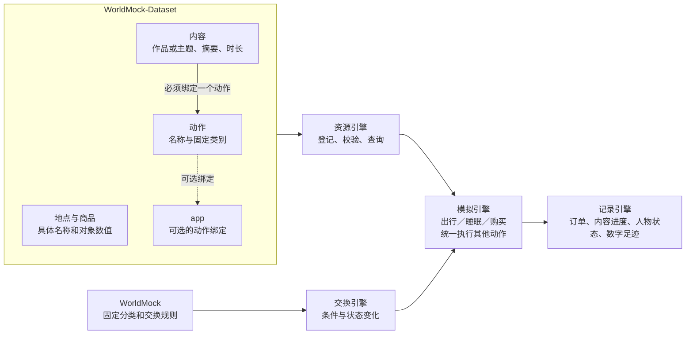
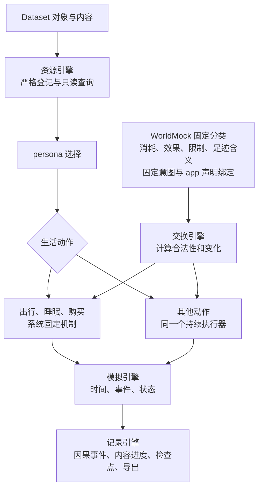
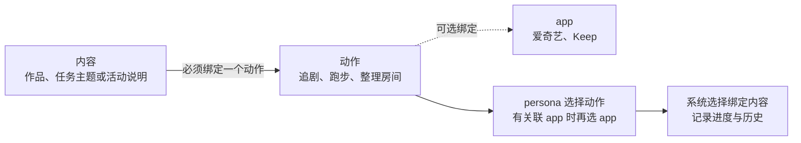
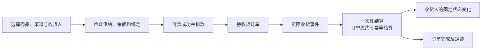
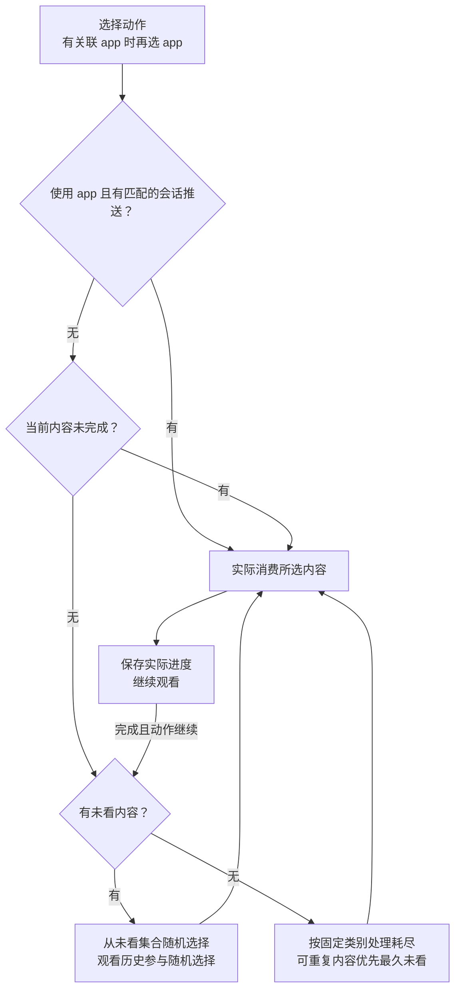
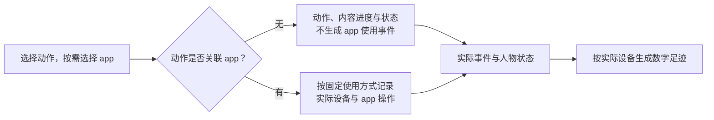
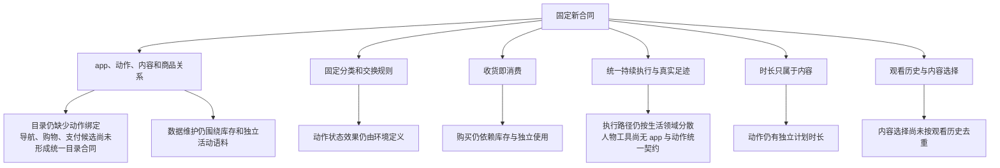
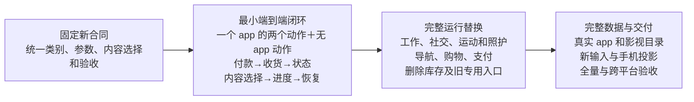

> **动作：**
>
> - 系统仅保留出行，睡眠，购买；对应的导航，购物，支付app由数据集提供候选
> - 食物不再需要购买 + 食用，取消库存，persona购买并收到后即获得热量；包括其他的物品也一样，人物在收到物品后视为自动消耗并获得对应的状态
> - 其他的动作由数据集进行自定义+维护，分为三个部分，内容，动作，app；内容必须绑定到某个动作上，但persona仅选择app+动作，内容则随机推送（app推送消费机制仍然保留），由系统记录进度和是否看过；内容随机推送时尽量保证不重复；
>
>
>
> 请根据以上描述重新设计我们的资源和规则引擎，力求大幅简化两个引擎的复杂度，让数据更多地向真实使用的app靠拢（不要再使用开源的奇怪数据，更多的是真实的app名称/真实的电视剧名称/电影名称 + 合成/真实摘要 + 合成数值），并减少运行时系统的维护压力；分类规则和交换规则在worldmock系统端钉死，数据集端仅提供实际的对象名称和内容；
>
> 根据这些信息，写一个proposal，proposal开头需要将以上内容原文誊写

# 以动作和内容组织资源与固定规则的简化提案

> 状态：未冻结提案；2026-10-07。本文提出新的动作合同，现行运行行为仍以已冻结规格为准。
> 代码基线：a0ab98cb2690c6d81ad9d42582722d44b49fe702

## 第一章　心智模型与项目框架的映射

### 用户补充原话

> 动作也不一定非要绑定app，但是内容一定会绑定到动作上

> 动作本身不占用时长，某个动作的时长由具体消费的内容决定

动作与 app 的绑定可选，内容必须绑定动作；动作不自带时长，实际时长由消费的内容决定。

### 项目框架映射

人物处理出行、睡眠和购买；其他行为选择动作，关联 app 时再选择相应 app。
具体消费什么、持续多久，由内容决定；状态变化按固定规则和实际消费时间结算。

本文沿用项目的“资源引擎”和“交换引擎”名称；用户所说的规则引擎对应交换引擎。

当前已有 app 内容随机选择、会话推送和跨 app 内容进度。当前尚无统一动作目录，
购买仍先进入库存再食用，工作与生活活动仍分别执行。因此本次需要改变动作和收货合同，
同时复用已有时间调度、推送、进度与记录能力。

### 转述确认

你的意思是：WorldMock 只负责出行、睡眠、购买这些基础生活机制，
收到商品就完成使用并得到效果；其余行为由 Dataset 维护 app、动作和绑定内容。
人物选择动作，关联 app 时再选 app；动作本身不占时间，消费具体内容才推进时间和进度。
系统负责选择内容、保存历史并尽量避免重复；名字和内容由 Dataset 供给，规则由 WorldMock 固定，对吗？

下文的动作类别、商品类别、内容选择顺序和 app 使用记录方式是补充建议，尚待裁决。
地图、场景作息和人物画像沿用当前合同，本次不重新设计。

## 第二章　简化后的设计

### 业界方案概览

| 成熟机制 | 适用部分 | 不适用部分 |
| --- | --- | --- |
| [固定意图与 app 声明绑定](https://developer.android.com/reference/app-actions/built-in-intents) | 系统定义行为含义，app 声明支持的行为；动作名称与执行规则分开 | 复制整套移动平台接口、按每个 app 编写执行器 |
| [订单履约与幂等结算](https://docs.stripe.com/checkout/fulfillment.md?payment-ui=stripe-hosted) | 支付与交付分开；同一交付只能结算一次 | 在线支付接入、库存、退换货和复杂履约平台 |
| [观看历史参与随机选择](https://engineering.atspotify.com/2025/11/shuffle-making-random-feel-more-human) | 参考最近消费历史，减少重复 | 推荐模型、画像打分服务和多轮候选评分 |
| [继续观看](https://about.netflix.com/en/news/now-you-can-easily-tidy-up-your-continue-watching-row-on-all-devices) | 内容身份与进度独立于一次 app 打开，保留未完成作品 | 完整播放器、商业版权系统和节目运营后台 |

### 提升后的设计

#### 资源引擎管对象，交换引擎管后果

保留已有模块分工。资源引擎不存人物库存或观看状态，交换引擎不加载表达式或脚本，
模拟引擎不为“追剧”“刷短视频”“处理方案”分别增加专用动作处理器。
新增 app、动作名称、作品和商品，只需重新发布 Dataset；新增分类语义才需要更改 WorldMock。

| 内容 | WorldMock 固定 | Dataset 填充 |
| --- | --- | --- |
| 动作 | 出行、睡眠、购买的行为；其他动作的固定类别、app 使用方式和统一执行方式 | 动作名称、说明、所选固定类别与 app 使用方式、可选的 app 绑定 |
| 商品 | 固定类别、店铺类型的可供给类别、收货效果和数量结算公式 | 商品名称、类别、价格、店铺绑定 |
| 内容 | 允许的内容形式、进度单位、选择和重复规则 | 作品或主题名称、摘要、时长、必需的动作绑定与适用的 app 限定 |
| app | 导航、购物、支付用途及使用记录的含义 | 真实名称、用途、支持的动作、可用支付绑定 |
| 人物运行状态 | 状态含义、时间规则、事务和恢复合同 | 场景初始状态与画像；运行中不提供效果覆盖 |

Dataset 可以选择固定类别，不能定义类别、状态名、效果数值、代谢当量、前置条件表达式或执行回调。
允许的对象数值限定为价格和内容时长等内容属性；工作目标工时也统一为工作内容的时长。

#### 内容必须绑定动作，动作可选绑定 app

| 对象 | 最小登记内容 | 约束 |
| --- | --- | --- |
| app | 身份、真实名称、固定用途；购物 app 的可用支付 app | 用途来自系统闭集；支付绑定必须指向支付用途 |
| 动作 | 身份、名称、固定类别、可为空的 app 集合；关联 app 时登记 app 使用方式 | 不含时长或独立时间窗口；无 app 时直接可选；不允许系统动作的替代路径 |
| 内容 | 身份、动作身份、标题、摘要、形式、内容时长、来源；必要的对象引用；关联 app 时登记可用 app 集合 | 时长属于内容；必须绑定动作；无 app 时不填 app 集合，有 app 时填合法非空子集 |
| 商品 | 身份、名称、固定商品类别、价格、店铺集合 | 仅从已定义的收货效果中选择；不包含库存、配方、耐久度或任意效果 |
| 地点 | 当前地点身份、名称、固定类型和购物 app 绑定 | 保留现行地图和同类店铺供给合同 |

绑定方向为内容→动作、动作→可选 app、商品→店铺、店铺→购物 app，反向索引由资源引擎生成。
动作的 app 集合为空时直接选择动作，内容不登记 app 限定；非空时选择 app＋动作，内容限定合法 app。
空集合不表示“全部 app”；app 与动作可多对多，同一内容跨 app 使用同一身份，不靠复制内容绕开历史。

连续剧、课程或工作主题建议增加“系列身份”和“顺序”：随机选系列，系列内按顺序推进，
避免先看结局再看开头；Dataset 提供内容关系，不定义排序算法。

登记必须拒绝缺失动作、悬空引用、未知类别、空内容动作、错误 app 绑定、店铺供给不相容和旧规则字段。
导航或支付 app 只需有合法用途，不需要伪造娱乐内容来通过登记。
规则只从 WorldMock 包加载；发布环境保存规则版本和内容哈希，退出无实际对象信息的规则副本。

#### 时长只属于具体消费的内容

动作不保存时长或默认窗口，选取内容不消耗模拟时间；显示的动作时长仅由已消费内容的时间派生。
同一“追剧”动作，消费四十分钟的一集就需要四十分钟，消费两分钟片段就需要两分钟。
内容时长是完整消费的完成标准；实际消费时间才推进进度并按固定速率结算状态。
暂停不增加进度，提前结束只记录已消费部分，恢复只需消费剩余时长；不能按完整时长提前记收益。
连续消费的总时长等于各条内容实际消费时间之和；没有另一层动作截止时间或额外操作耗时。
内容完成产生完成事件和决策机会；人物继续时再选择下一条内容，不靠固定动作窗口维持接续。
出行路线、睡眠安排和交易操作也由本次具体内容承载时间，系统动作类别本身不设固定时长。
路线计算结果写入行程内容；具体睡眠安排和交易操作的时长进入对应内容；配送等待是独立事件，
不等于人物持续购物，也不生成整段购物 app 使用。登记拒绝动作时长字段和非正的内容时长。

#### 自定义动作名不等于自定义规则

建议把其他动作压缩为下列固定类别。类别只决定系统行为，人物仍看 Dataset 提供的自然动作名称。

| 固定类别 | Dataset 可维护的动作示例 | 系统固定的处理 |
| --- | --- | --- |
| 娱乐 | 追剧、看电影、刷短视频、读文章、听节目 | 按实际内容时间累计进度，按固定速率缓解娱乐需要 |
| 工作与学习 | 处理方案、学习课程、整理资料 | 实际消费时间计入内容进度；进度播报时生成描述，描述不改变工时 |
| 社交 | 聊天、语音通话、参与讨论 | 按固定规则缓解社交需要；真实通信继续由发送、接收和通话事件证明 |
| 运动 | 跑步、跟练、步行锻炼 | 固定能量消耗与情绪变化；活动进度不冒充 app 前台时长 |
| 日常照护 | 洗漱、整理房间、放松练习 | 按内容时长推进，按固定规则改变状态；可直接执行，也可关联 app |

固定类别规定场所和对象限制，内容实际消费时才占用并行名额；无 app 动作只按固定类别执行，
不登记 app 使用方式。关联 app 时，app 使用方式固定为“持续使用手机 app”“通过其他设备使用 app”“借助 app 安排或记录线下行为”；
Dataset 只选择合法组合，不能定义方式、前台比例或操作脚本。同一 app 可以登记不同方式的动作。
例如手机处理文档与电脑处理文档同属工作与学习，但使用方式不同，不靠动作名称推断设备。
内容只提供场景对象身份、主题和说明；app 使用方式仅补充有关联 app 的执行与足迹语义。
余额、能量、睡眠压力、睡眠不足、娱乐需要、社交需要与情绪沿用现有含义，不为商品或动作新建状态池。

工作主题并入“任务主题”内容，目标工时就是内容时长，工作目标身份直接使用内容身份。
场景为人物分配工作内容身份；任务主题只从当前人物被分配的集合选择，普通课程不计入工作完成。
需要对方的社交内容必须引用已登记人物或联系人；对象不能从标题、摘要或画像推断。
通信按“选定内容及对象→固定资格检查→已有发送、接收或共同在场事件→进度与状态结算”执行，
只有通过检查且实际发生的通信才有收益和足迹，随机摘要本身不构成双方交谈。

暂停、恢复、结束、查询和播报仍是控制工具；人物可结束消费并保留实际进度，
但不指定内容身份、具体作品、工作主题或旧生活活动身份。

#### 收到商品就完成消费和状态结算

付款成功不产生商品收益；到店取得或配送送达才触发收益。
到店购买在取得商品时结算，外卖和其他配送在既有送达事件发生时结算。
保持付款人、收货人、收货地点和订单身份；赠送的收益归有完整状态的收货人。
已结算订单再次恢复或收到重复事件，不再扣款或增加收益。

建议区分收货对象：有完整状态的模拟人物收到即结算状态；场景联系人收到只记录收货与消费完成，
不为联系人增加身体模型或虚构状态。联系人持有记录一并删除；这一边界属于待裁决的补充建议。

| 商品类别建议 | 收货后的固定结果 | Dataset 不能提供什么 |
| --- | --- | --- |
| 正餐、零食、饮品 | 按数量获得对应类别的固定热量 | 单品营养、独立食用时长、食用比例和剩余份量 |
| 休闲用品 | 按固定规则缓解娱乐需要 | 商品自己的娱乐效果表达式 |
| 日常用品 | 按固定规则影响情绪，并记录消费完成 | 任意新状态、装备能力、保质期、耐久度和使用回调 |

非食品类别与效果随规格固定，未定义类别不能登记或猜测效果。电子设备等长期持有物按要求一次性消费，
保留订单历史，不形成设备持有或装备能力。

取消人物库存、初始库存、食用、使用库存物品、丢弃、赠送库存物品以及数量余量。
赠送商品改为购买时指定收货人。取消食用时间意味着就餐过程被抽象为收货结算，
记录“购买、收货、状态变化”，不会补造一次不存在的用餐活动。
保持身体模型的状态上限，记录商品提供值与人物实际变化值，超出上限的部分也不转成库存。

#### 导航、购物、支付 app 是可选对象

| 系统动作 | 人物选择什么 | app 的作用 |
| --- | --- | --- |
| 出行 | 目的地、交通方式、可选导航 app | 图和固定规则计算本次行程内容的时长；实际使用导航 app 才产生对应足迹 |
| 睡眠 | 选择睡眠，系统确定本次具体睡眠内容 | 时长来自睡眠内容，实际中断按已睡时间记录；不要求 app 或生成手机使用记录 |
| 购买 | 商品、数量、收货人；在线选择购物 app 与可用支付 app，到店可不使用 app | 购物与支付归属同一订单，只记录实际使用的 app |

app 名称不参与规则判断。高德地图、百度地图、美团、京东、微信、支付宝都是 Dataset 对象，
WorldMock 只识别用途和绑定。人物只能从已登记、对当前对象有效的候选中选择。
支付 app 是订单内的选择，不增加“支付”生活动作，也不等待人物再下达一轮支付指令。
现金等现场支付方式沿用系统明确支持的渠道，不伪装成 app。

同一 app 的购买入口进入订单，内容动作进入内容过程；支付用途不自动授予其他功能。

#### 随机内容优先新内容，保留继续观看和推送消费

上述顺序是建议。合格集合先由“当前人物＋动作”确定，使用 app 时再限定到所选 app；
系列顺序、工作分配与场景对象限制均适用，无 app 动作也从绑定内容中随机选择。
同一集合存在其他合格内容时，连续消费不立即重播刚完成的内容。

“是否看过”从实际消费产生：消费时间大于零才算看过，完成需达到所选内容时长。
推送送达、展示摘要、进入候选都不算看过。
进度按“人物＋内容身份”跨 app 共享，保存累计进度、完成轮数、最近消费时间；
未完成的当前内容保存所属动作，有 app 时再保存 app 身份；人物之间不共享历史。
工作与实体动作使用“是否执行过”，与“是否看过”共用这一套实际进度事实。

未看过集合耗尽后，娱乐和可重复实体活动允许再次执行，优先最久未消费的内容，
同样新旧程度的内容再随机选择；有限工作主题完成后不重新开工，等待新主题或结束动作。
这由固定类别决定，不添加 Dataset 可调重复权重或推荐策略字段。
有限内容库不能保证永久不重复，系统明确记录重看轮次，而不是把旧内容改名当作新内容。

主动 app 推送只适用于关联 app 的动作；无 app 动作开始时由系统分配内容，也复用继续进度和去重。
app 推送沿用当前白天窗口、会话有效期、不打断睡眠和消费完成后接续的机制，
增加动作身份；生成推送也使用同一观看历史和合格集合，
从已有活动与待消费推送派生人物级预留集合，跨 app 避免再次选择同一预留内容；
其他 app 推送的内容已经消费完成时释放该预留，不因推送优先强制重播。
打开其他动作不消费这条推送，过期推送不跨会话强制生效。
序列化观看记录、当前内容、待消费推送和既有随机状态；从检查点恢复后不重新抽取已经选好的内容。

#### 数字足迹对应实际发生的动作与 app 使用

动作是入口，app 是可选渠道。无 app 的跑步、整理或线下交流只记录实际内容进度、动作与状态。
有关联 app 也不代表全程使用手机：八小时工作不能全算飞书前台，跑步不能全算 Keep 前台，
线下交流不能变成微信消息。固定使用方式决定足迹，Dataset 不编造前台比例，其他设备使用不进入手机投影。

导航、购物、支付、推送、内容消费用订单或活动身份串起原因；手机投影从实际事件生成。
模型描述只补充文本，不能改变工时、热量或发送事实。

#### 数据制作围绕熟悉的 app 与作品

| 作者维护什么 | 例子 | 真实性边界 |
| --- | --- | --- |
| 真实 app 名称与用途 | 高德地图、美团、京东、微信、支付宝、爱奇艺、腾讯视频 | 名称有来源；用途和对象绑定是该模拟环境的明确声明 |
| 真实作品名称与内容关系 | 电视剧《狂飙》、电视剧《三体》、电影《流浪地球2》 | 保留作品、季集和来源；示例不声称当前所有平台均有这些作品 |
| 合成或有来源的摘要 | 某一集的剧情摘要、文章摘要、短视频简介 | 合成摘要明确标记合成；真实摘要保留来源 |
| 合成对象数值 | 商品价格、作品时长、跑步或照护内容时长、工作内容时长 | 标记仿真数值，遵守系统单位和范围 |
| 自定义动作名称 | 追剧、看电影、刷短视频、处理方案、跟练 | 映射固定类别，不附加交换规则 |

正式环境只发布运行实际读取的目录、摘要和来源；退出无实际用途的原始语料与旧加工链。
保留现有真实名称和来源标注，补充普通电视剧与电影；引擎不抓取网页或接入平台。

已存在的 Pydantic、NetworkX、Python 随机数和事务记录足够承载这些变化，
不新增规则语言、推荐服务或 app 插件体系。
交付验收中的规则表达式工具有独立用途，不能因为生活动作固定就删除仍在使用的依赖。

### 设计决策点

用户已经明确的“仅保留三种系统动作、无库存、收货自动消耗、选择动作并按需选择 app、
内容绑定动作、动作不自带时长、消费内容决定时长、尽量不重复、系统固定规则”直接作为设计边界。
以下只列补充选择，推荐项仍是提案。

| 需要裁决的补充选择 | 推荐方案及利弊 | 可选方案及利弊 |
| --- | --- | --- |
| 固定动作类别与 app 使用方式 | 五种类别，关联 app 时选择三种固定使用方式；无 app 直接执行；复用状态和同一执行器 | 把设备与线上线下差异都展开成细分类别；含义更直接，但类别数量和维护量增大 |
| 非食品商品效果 | 休闲用品缓解娱乐需要，日常用品影响情绪；所有收益一次性结算；长期持有被抽象掉 | 进一步区分系统固定用途类别；状态更细致，但需增加经验证的规则常数 |
| 场景联系人收货 | 只记录收货与消费完成，不新增身体模型；保留送礼足迹，无法观察联系人状态收益 | 只允许模拟人物收货；合同更小，但退出对外部联系人的物品赠送 |
| 继续观看与未看内容顺序 | 推送优先，其次继续观看，再取未看内容；连续长内容完整性更好，短期内容多样性略低 | 推送优先，其次未看内容，再续未完成内容；更少重复，但容易积累未完成作品 |
| 连续内容顺序 | 随机选系列，系列内按顺序；保留人物的长期连续行为，多两个内容关系字段 | 每条内容独立随机；目录更小，但电视剧和连续任务可能乱序 |
| 内容耗尽 | 娱乐可按最久未看重播，已完成工作不重做；有限目录仍可支持长期运行 | 所有类别耗尽即结束；重复更少，但人物经常遇到无内容可用 |

状态变化规则与常数在固定规格中集中裁决；Dataset 提供具体内容时长，不能覆盖规则或增设动作时间窗口。

## 第三章　当前实现的差距

### 差距归属图

### 差距明细表

这些是新需求相对于当前已冻结合同的差距；已有规则副本防篡改和 app 推送消费都已具备，
不会被计为重新开发。下表的“缺失”表示新模型尚未实现。

| 差距名称 | 对应设计点 | 性质 | 阶段 |
| --- | --- | --- | --- |
| 目录仍缺少动作绑定 | 内容必须绑定动作，动作可选绑定 app | 缺失 | 最小端到端闭环 |
| 导航、购物、支付候选尚未形成统一目录合同 | 导航、购物、支付 app 是可选对象 | 缺失 | 完整运行替换 |
| 动作状态效果仍由环境定义 | 自定义动作名不等于自定义规则 | 缺失 | 最小端到端闭环 |
| 购买仍依赖库存与独立使用 | 收到商品就完成消费和状态结算 | 缺失 | 最小端到端闭环 |
| 执行路径仍按生活领域分散 | 资源引擎管对象，交换引擎管后果 | 缺失 | 完整运行替换 |
| 人物工具尚无 app 与动作统一契约 | 内容必须绑定动作，动作可选绑定 app | 缺失 | 最小端到端闭环采用最终请求；完整运行替换补全类别 |
| 内容选择尚未按观看历史去重 | 随机内容优先新内容，保留继续观看和推送消费 | 缺失 | 最小端到端闭环 |
| 动作仍有独立计划时长 | 时长只属于具体消费的内容 | 缺失 | 最小端到端闭环 |
| 数据维护仍围绕库存和独立活动语料 | 数据制作围绕熟悉的 app 与作品 | 缺失 | 完整运行替换 |

当前目录已有购物店铺绑定，缺的是导航和支付用途以及它们共同的候选合同。
当前生活活动仍携带自定义状态效果，不能把“包规则已经固定”误当成全部动作后果已经固定。
当前娱乐内容由系统选择；人物工具尚无包含可选 app 的统一动作入口。
当前 app 默认使用窗口和生活动作典型时长仍独立于内容，应退出新合同。

### 分阶段路线图

最小端到端闭环在隔离工作区中采用最终人物请求，通过正式模拟引擎和记录入口验证新场景。
先证明有 app 与无 app 的动作都可执行，同一动作消费不同长度内容按各自时长推进，食品和非食品收货均可结算，
并验证选择、推送、未看内容、进度、真实足迹和检查点能够一起运行。随后用同一执行器补全固定类别，
完成正式入口替换；不会为继续使用旧数据另建兼容执行路径。

| 交付阶段 | 必须观察到的结果 |
| --- | --- |
| 固定新合同 | app、动作、内容、商品、固定类别和状态效果有唯一合同；明确修订现行库存、食用、工作和工具条款 |
| 最小端到端闭环 | 同一动作按内容时长运行；暂停、提前结束与恢复只计实际消费；无 app 不造足迹；收货不重复结算；推送与去重正确 |
| 完整运行替换 | 其他动作都使用同一执行器；人物选动作，关联 app 时再选 app；通信与工作事实正确；导航与支付有候选和事件；生产状态、工具与检查点不含库存 |
| 完整数据与交付 | Dataset 按新合同重新制作并发布；新增实际对象无需改引擎；手机足迹能追溯到实际使用；长期内容顺序与跨机器结果一致 |

完整运行替换时同步删除独立食用和库存使用路径、旧工作主题入口、
旧生活活动效果与典型时长、app 默认使用窗口、动作独立计划时长，以及对应字段、夹具、制作链和文档条款。
继续复用地图、时钟、身体基础模型、订单、app 推送、内容进度、事务、记录和检查点，
只按最终合同修改其边界。正式运行不接受旧库存或旧活动格式，不编写迁移与兼容层。

每条冻结行为都要有行为测试，并通过独立源码变异的 Bob Uncle Review。
验收必须包含真实入口的端到端事件核查、长期运行和各目标平台回执；
新目录登记通过不等于人物已经实际使用，新数据发布不等于引擎已经验收。
