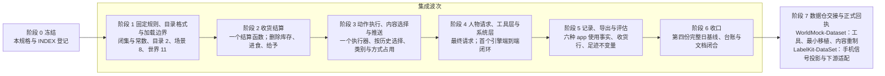

<a name="spec-acs-动作与内容简化开发规格"></a>
# 动作与内容简化开发规格

> 状态：FROZEN。本文件是本特性的唯一开发规格；条款随阶段 1–6 的集成波次一次生效，波次合入之前，当前行为、接口与设计正文仍以所属合同与[资源与规则引擎简化规格](SPEC-resource-and-rule-simplification.md#spec-rrs-资源与规则引擎简化开发规格)为准。
> 日期：2026-10-07。
> 代码基线：05a295ab464165e9ce3bd7cd7783e0513fb57e8d。
> 来源：[提案](PROPOSAL_2026-10-07_APP_ACTION_RESOURCE_AND_RULE_SIMPLIFICATION.md)（用户原话、心智模型、简化后的设计、六个补充选择、差距与路线）；本文按 2026-10-07 用户给定的审查准则与对现行合同、规格、设计和代码的逐条核对收敛，六个补充选择与提案没有写明之处在「裁决记录」逐项定稿。
> 范围：系统动作只留出行、睡眠、购买，等待是时间原语；库存、进食、给予与联系人持有删除，商品收货即结算；其余行为由数据集以 app、动作、内容三类对象登记，由一个执行器按内容时长执行、按历史选择内容并保留 app 推送；导航、购物、支付 app 由人物点名并写进足迹；类别、使用方式、效果与供给表归 WorldMock 固定（`RULES_VERSION = 2`）；目录格式 2、场景结构 8、世界结构 11 与足迹合同一并更换，旧格式一律拒绝；数据仓按新格式重制正式环境，下游的 LabelKit-DataSet 按新足迹合同适配手机信号投影与数据加工。

<a name="spec-acs-用户得到什么"></a>
## 用户得到什么

环境只登记五类对象：app（真实名称；可带导航、购物、支付用途，购物 app 写明能用哪些支付 app）、地点、商品（五个固定类别之一、价格、在哪些店卖）、动作（名称、说明、五个固定类别之一；可以绑定 app 并选一种使用方式，也可以不绑定）和内容（必须绑定一个动作；标题、摘要、时长，电视剧按集带系列与集数）。人物能做的事只有四种写法：出行（可点名一个导航 app）、睡眠、购买（网购点名购物 app 与它绑定的一个支付 app，到店可点名支付 app 也可不用），以及「进行」一个数据集命名的动作（动作绑定了 app 就再选一个 app，社交类动作另写对方是谁）；空下来仍可等待，等待只是让时间流过的原语。买的东西到手即结算，没有库存也没有「吃」这一步：吃的加热量，休闲用品缓解一点娱乐需要，日常用品带来一次小的情绪脉冲。做动作时看哪一条、做哪个主题由系统选：先看这段停留或路程里推给这个 app 与这个动作的那条，再接没看完的，再接追到一半的剧的下一集，再取没看过的，都看过才重播并如实记下第几轮；动作自己没有时长，内容多长就做多久，娱乐类看完一条自动接下一条直到人物停下，其余类别做完一条就结束；工作也是动作，场景分配给人物的工作内容做完不再重做。运行之后的足迹只写真实发生过的 app 使用：持续用手机或其他设备的动作有一行使用区间和逐条内容消费记录，借助 app 的线下动作与导航只有开始和结束两个触点，没有 app 的动作不留 app 记录；订单记下实际用到的购物 app 与支付 app，每次收货恰有一条收货记录；每一行都能追到产生它的那个模拟事件。类别、数值与结算规则由 WorldMock 定死，WorldMock-Dataset 只提供名字、摘要、价格、时长与绑定。WorldMock 交出的是完整认证的足迹导出；手机信号投影、LabelKit 窗口、训练与规则数据由 LabelKit-DataSet 从导出加工，本仓库不产出它们，也不安装或调用 LabelKit。



不做的事：不引入推荐模型、口味权重、数据集可调的重复权重或评分；不引入规则语言、插件或逐 app 执行器；不设兼容层、迁移工具或双格式；不新建状态池；不为每条内容的完成增加决策、唤醒原因或工具；动作没有自己的时长或窗口，人物也不填时长；不为行程、睡眠或交易登记内容；不设计时的下单或支付活动；不设现金或支付渠道闭集；一个订单行不超过一件；不模拟剩余份量、耐用品或设备持有；不给场景联系人身体或持有；目录内容不引用场景人物；环境里不放规则哈希或规则副本；不合成用餐活动；不重新设计地图、地点类型、推送网格、session 或人物画像编译；不在本仓库或数据仓实现手机信号投影、LabelKit 窗口或任何数据加工命令；不归档资源与规则引擎简化规格。

<a name="spec-acs-裁决记录"></a>
## 裁决记录

用户于 2026-10-07 指示核定实施计划与文件修改清单（设计文档优先）并定稿最终开发规格，审查准则是设计是否服务系统的主目的：模拟真实的人使用 app 的数字足迹。提案的六个补充选择与本文补定按这一准则定稿；用户改判走版本表。下面五张表合起来是本特性的全部裁决，编号在实现、台账与登记里原样引用。次序：U1 … U6 是边界，R 与 P 只把它们写精确、不反转；R1 … R6 与 P-1 … P-43 同为定稿，与提案文字不一致处以本规格为准，并逐条列在「与提案文字的出入」；「对前序冻结规格的修订」是 R、P 的推论，只说明被改的对象，不另立规则。字段、码与数值在所属章节定义一次，本章给结论与依据。依据列的「足迹审查 n」「行为审查 n」「简化审查 名称」是三份按主目的所做审查（依次为足迹真实性、行为与成本、简化与数据）的发现编号；三份审查是定稿前的工作笔记，不随仓库保存，这些编号与「行为用例」的 T 编号无关；值是仿真假设的写「实验假设」。

<a name="spec-acs-裁决用户边界"></a>
### 用户明确的六条边界

| 编号 | 用户原话 | 本规格的精确化 |
| --- | --- | --- |
| U1 | 「系统仅保留出行，睡眠，购买；对应的导航，购物，支付app由数据集提供候选」 | 有世界后果的系统动作恰为出行、睡眠、购买，`START_ACTIVITY_ACTIONS` 为 `travel_to`、`sleep`、`wait`、`purchase`、`do`；等待是时间原语，`send_message` 是零时长工具，二者不是生活动作（P-19）。app 以 `AppPurpose` 的三种用途登记，人物从工具层候选里点名，系统不代选（P-11 … P-14）。定义在「固定规则与常数」「环境格式」「购买与支付」「收货结算」「出行与导航」「睡眠」 |
| U2 | 「食物不再需要购买 + 食用，取消库存，persona购买并收到后即获得热量；包括其他的物品也一样，人物在收到物品后视为自动消耗并获得对应的状态」 | 删除 `AgentState.inventory`、`agents[].initial_inventory`、`WorldState.contact_holdings` 与进食、使用、给予；五个 `GoodsCategory` 各有固定的收货效果，由唯一的收货结算函数在到店受理或送达时结算一次（R2、P-8 … P-10）。定义在「购买与支付」「收货结算」 |
| U3 | 「其他的动作由数据集进行自定义+维护，分为三个部分，内容，动作，app；内容必须绑定到某个动作上，但persona仅选择app+动作，内容则随机推送（app推送消费机制仍然保留），由系统记录进度和是否看过；内容随机推送时尽量保证不重复；」 | 目录文件 `apps.json`、`actions.json`、`contents.json`；内容以 `action_id` 绑定恰好一个动作；人物请求只写动作名与可选的 app，没有内容键。「随机推送」落在两处：开始动作时系统按 R4 … R6 选内容；整点 app 推送沿用现行机制并限定在娱乐类的手机动作（P-27）。「看过」的唯一定义是 `last_consumed_at`（P-25）。「尽量不重复」是未看单元优先，耗尽后取 `completed_rounds` 最少者重播并如实记轮（R6）。定义在「环境格式」「执行与时长」「内容选择」「进度与确定性」「推送」 |
| U4 | 「动作也不一定非要绑定app，但是内容一定会绑定到动作上」 | 动作的 `app_ids` 可为空，此时 `manner` 为 null、其内容的 `app_ids` 为空；非空时内容的 `app_ids` 是动作 app 的非空子集；每个动作、每个动作与 app 的组合至少有一条内容（`ACTION_APP_MANNER_INVALID`、`CONTENT_ACTION_MISSING`、`CONTENT_APP_BINDING_INVALID`、`ACTION_CONTENT_EMPTY`）。定义在「环境格式」 |
| U5 | 「动作本身不占用时长，某个动作的时长由具体消费的内容决定」 | 登记拒绝动作上的任何时长字段；`action` 活动的 `planned_end_at` 恒为当前内容的结束时刻，实际消费秒数推进进度并按固定速率结算状态；「内容」只指目录 `Content`，三种系统动作的时间按次计算（P-1、P-2、P-5）。定义在「执行与时长」 |
| U6 | 「请根据以上描述重新设计我们的资源和规则引擎，力求大幅简化两个引擎的复杂度，让数据更多地向真实使用的app靠拢（不要再使用开源的奇怪数据，更多的是真实的app名称/真实的电视剧名称/电影名称 + 合成/真实摘要 + 合成数值），并减少运行时系统的维护压力；分类规则和交换规则在worldmock系统端钉死，数据集端仅提供实际的对象名称和内容；」 | 全部闭集、类别表、占用、常数与收货效果定义在 `src/worldmock/exchange/` 并由 `RULES_VERSION = 2` 绑定；数据集能填的数只有 `price_fen`、`duration_seconds`、`series.episode`，严格模型拒绝其余字段；规则字节由 `code_sha256` 钉住（P-31）；生活活动语料、工作主题目录与规则副本退出环境。定义在「固定规则与常数」「环境格式」「数据仓交接」 |

<a name="spec-acs-裁决提案决策表"></a>
### 提案的六个补充选择

| 编号 | 提案的选择名 | 定稿 | 依据 |
| --- | --- | --- | --- |
| R1 | 固定动作类别与 app 使用方式 | 五个类别 `ActionCategory`（`entertainment` 娱乐、`work_study` 工作与学习、`social` 社交、`exercise` 运动、`daily_care` 日常照护）与三种方式 `AppUseManner`（`phone_continuous`、`other_device`、`offline_assisted`）；不设合法组合表，不设细分类别；类别与方式各固定一张 WorldMock 小表；绑定了 app 的动作恰选一种方式，没有 app 的动作没有方式 | 三种方式是把八小时工作或一次跑步挡在手机使用区间之外的最小集合，前提是每种方式恰对应一种足迹形状、同一时刻只有一段持续的手机使用（足迹审查 2、足迹审查 5）；类别的接续一列决定一次使用是一行 `app_use` 还是许多行（行为审查 1）；组合表多一张表和一个登记码却不改变任何足迹行 |
| R2 | 非食品商品效果 | 休闲用品每个订单行使 `entertainment_need` 降低 0.10（下限 0）；日常用品每个订单行施加一次 +0.05 的情绪脉冲，幅度同现行 `goal_progressed` 脉冲。不变量：任何非食品收货效果不超过最弱内容形式 30 分钟的缓解量（每小时 0.2 × 0.5 小时 = 0.10）。两个值是实验假设；不设耐用品与持有 | 收货不占模拟时间；一次购买若抵得上一小时视频，买东西就成了解闷最省的办法，挤掉本系统要记录的 app 使用（行为审查 12）；足迹需要的是每笔非食品订单与食品一样以一条可审计的收货记录收尾 |
| R3 | 场景联系人收货 | 带 `receive_location_id` 的场景联系人可以作收货人：订单到 `delivered` 并写 `received_at`，`receipt` 行的 `provided`、`applied` 为 null；不建身体，不写 `goods_received` 事件，不声称联系人消费了什么；`WorldState.contact_holdings` 删除；买家保留既有 `delivery_arrival` 事件与唤醒 | 给模拟之外的人下单是常见的真实手机足迹，保留它不增加机制；给没有模型的人记「消费完成」是一条背后没有模拟事件的事实（三份审查对本项结论一致） |
| R4 | 继续观看与未看内容顺序 | 一次执行开始时依次取：(1) 当前 session 里推给这个 app 与这个动作的置顶推送；(2) 该人物该动作未完成的内容（`position_seconds > 0`），取 `last_consumed_at` 最近者，同值按 `content_id`；(3) 已开始系列的下一集；(4) 未看的单元，带键均匀抽取；(5) R6 的耗尽规则。`entertainment` 接续内用同一次序但没有第 1 步：推送只由人物开始该 app 与该动作打开 | 接着看留下位置连续的 `content_consumed` 行，这正是真实「继续观看」历史的样子；先取未看会留下一条越积越长、没有手机历史会呈现的弃看尾巴；次序只多用一个时间字段（足迹审查 9） |
| R5 | 连续内容顺序 | 跨系列随机、系列内按序，不加字段，沿用既有 `Content.series{title, episode}`。系列身份是 `(action_id, series.title)`；同一系列各集的 `action_id` 与 `app_ids` 相同，`(series.title, episode)` 唯一，违反为 `CONTENT_SERIES_INVALID`。抽取以单元为对象：一条独立内容，或一个系列以它在当前轮未完成的最低集为代表；已开始的系列先于未开始的单元，最近消费的优先。推送用同一单元规则，不会跳集 | 集数乱序或每看一集换一部剧，标注者一眼即知是假的；所需字段目录里已有，只是选择器不读；以单元抽取使长剧不因集数多而占满抽取 |
| R6 | 内容耗尽 | 内容按轮可重复，只有一个例外。可重复：没有未看单元时取 `completed_rounds` 最少的单元，并列时带键均匀抽取，另有合格单元时不取刚完成的那条；每次重播 `completed_rounds` 加一，如实记录、不改名。例外：场景分配给人物的内容（类别 `work_study`，`agents[].work_content_ids`）有限，完成后不再选中。没有合格内容时开始以业务码 `CONTENT_EXHAUSTED` 拒绝，工具层该行不可用并写同一原因；进行中的活动合格集合变空时以既有 `planned_end` 完成。场景加载要求：声明 `work_schedule` 的人物至少有一条分配的工作内容（`WORK_CONTENT_REQUIRED`），且分配内容的时长之和不少于该人物在场景 `start_at` 到 `end_at` 之间的排班秒数（`WORK_CONTENT_INSUFFICIENT`）。不设数据集权重或策略字段 | 最久未看的排序在第一轮之后冻结成一个固定循环，是训练数据里看得见的人造痕迹（行为审查 13）；有限的工作内容若无加载检查，十二周里上班的人会无声地无事可做，整个班次被手机使用填满（行为审查 3）；有限性由「场景分配」推出，不需要逐类别的策略表；目录有限，重播须如实记轮（足迹审查 15） |

<a name="spec-acs-裁决主目的补定"></a>
### 按系统主目的补定

提案没有写明或写法与主目的相悖的点，逐条定稿。

| 编号 | 定稿 | 依据 |
| --- | --- | --- |
| P-1 | 动作的一次执行是一个 `action` 活动。每条内容完成都写完成证据、`completed_rounds` 加一并释放指向它的 session 推送；类别 `entertainment` 在同一次结算里选出下一条，在同一活动、同一行 `app_use` 内静默接续，其余四类做完一条即以既有 `planned_end` 完成。只有既有 22 个唤醒原因之一到期或活动完成时才请人物决策；不加唤醒原因、继续工具或逐条决策 | 逐条决策把一次刷视频拆成几十个两三分钟的活动：`app_use` 碎成每条一行，动作窗口被相同的「继续」样本填满，两小时短视频的决策由现行的 8 次变成 40–80 次，而逐条足迹行不需要决策就已存在（足迹审查 1、行为审查 1、简化审查 CADENCE） |
| P-2 | `action` 活动没有自己的时长：`planned_end_at` 恒为正在消费的内容的结束时刻，以 `DERIVED_DURATION_CAP_SECONDS` 封顶，每次换内容与恢复时按恢复已在使用的公式（已用秒数加当前内容余量）重定；暂停不加进度，提前结束只记已消费部分，恢复只需余量且不重抽；`ACTIVITY_TOO_SHORT` 不再用于 `action` 活动；`APP_USE_DEFAULT_SECONDS` 删除 | U5；没有动作窗口，一次 app 使用才始终是一个活动、一行 `app_use`（行为审查 1） |
| P-3 | 播报机会一经提出即被消耗：结算一次唤醒原因含 `progress_report_due` 的决策时，该人物当时到期的每个活动的 `report_anchor_at` 都移到该时刻，不论人物提交的是什么请求；长时间执行里的常设询问就是按场景 `progress_report_interval_seconds` 到期的既有 `progress_report_due` | 内容驱动之后每条内容的结束都是时钟边界；一次没被回答的播报会在每条内容结束时重新触发，把逐条决策带回来（行为审查 4） |
| P-4 | `CONTENT_MIN_SECONDS = 60`：每条内容登记时 `duration_seconds` 不小于 60，违反以 `ENVIRONMENT_NUMBER_INVALID` 拒绝；不设上限；下限只约束登记，恢复时的内容余量可以更短 | 每条内容的结束都带一次全世界的结算与提交；不足一分钟的内容不给手机足迹增加信息，却成倍增加事件量（行为审查 5、简化审查 CADENCE） |
| P-5 | 「内容」只指绑定到数据集动作的目录 `Content`。三种系统动作没有内容：行程时长按发布图与固定速度逐次计算并存在出行活动上；睡眠的计划长度沿用现行睡眠需要规则，按实际秒数结算；购买与支付是零模拟秒的时点事实，不建活动、不占名额；配送等待是既有预排事件。登记拒绝动作上的任何时长字段 | 行程、睡眠与交易没有可供数据集撰写的对象；计时的下单活动需要一个编造的常数，并写出一段编造长度的购物 app 使用（足迹审查 10、行为审查 9、简化审查 SYSCONTENT） |
| P-6 | 足迹合同在冻结时定稿，随阶段 5 在波次内实现。`app-usage.jsonl` 的事实为 `app_use`、`app_touch`、`content_consumed`、`push_delivered`、`push_opened`、`push_released`，`purchases.jsonl` 的事实为 `purchase`、`order_attempt`、`receipt`；导出工件仍是五个文件。行取自带非空 app 身份的活动快照，不看活动类型；`MANNER_DEVICE` 把 `phone_continuous`、`offline_assisted` 映射到 `phone`，把 `other_device` 映射到 `other`。`phone_continuous` 与 `other_device` 写一行带 `segments` 的 `app_use` 和每次结算一行 `content_consumed`；`offline_assisted` 只在受理开始与实际结束各写一个 `app_touch`；没有 app 的活动零行。七条不变量由 `validate_export` 检查；导出不作亮屏或前台声明 | 提案规定了哪些足迹不得存在，没有定义存在的记录；现行导出按活动类型 `use_app` 取行且区间跨过暂停，线下辅助动作照此写出的正是被禁止的全程区间；每次导出都从事件重算 app 使用，事件从第一段代码起就要带齐动作、方式、支付 app 与收货证据（足迹审查 2、足迹审查 6） |
| P-7 | 两份足迹工件 `app-usage.jsonl`、`purchases.jsonl`、它们的行形状与 `validate_export` 的七条不变量归 WorldMock。手机信号投影归 LabelKit-DataSet，本规格只把它写成交接要求：逐行投影，只筛 `device = phone`，一行对一行，不带自己的规则；由订单派生的下单、付款、送达通知三种信号按「数字足迹合同」归属表写明的取法。本仓库与 WorldMock-Dataset 都不实现这份投影；WorldMock 不安装也不调用 LabelKit，没有数据加工命令，也没有交付清单。LabelKit 窗口及其对事件的公开投影同归 LabelKit-DataSet（P-8、P-27）；下游消费者仍是未完成的验收 | 活在下游投影脚本里的规则与「规则在 WorldMock 钉死」相悖；只写「手机投影」而不点名工件、归属与字段的规格，可以通过全部门禁却交不出消费者读得了的东西（足迹审查 4、足迹审查 6）；三个仓库的归属按 2026-10-07 的用户裁决，即现行文档版本表的 `2026-10-07-repository-ownership` 行 |
| P-8 | 收货只有一个结算函数，由到店受理处与既有 `delivery_arrival` 事件处调用：`pending → delivered`、`received_at`、状态效果与收货人资源流的排空都在这一个函数内；已是 `delivered` 的订单再遇事件原样返回且不写任何东西，重复提交的动作返回已存结果。模拟人物收货恰写一条 `data.kind = "goods_received"` 的 `environment_event`：归收货人所有、对其可见、`source_kind = "environment"`、与状态改变同一次提交，以 `order_id` 和 `caused_by` 关联；事件连同完整载荷、所有人与可见性原样进入 `events.jsonl`，下游窗口怎样投影它是对 LabelKit-DataSet 的交接要求（「数据仓交接」） | 进食删除后收货是「东西被消费了」的唯一证据，必须是全程审计最严的记录；现行摄入流只在时钟推进时排空，不立这条规则它会挂到下一个、可能属于别人的事件上，第三方收货人的能量变化也没有自己的事件（足迹审查 3、行为审查 8） |
| P-9 | 食品收货沿用现行 `apply_food`，包括睡眠不足利用率曲线与能量上限：`provided` 为类别千卡乘数量，`applied` 为实际变化，超出上限的部分丢失且不转成任何东西；`GOODS_ENERGY_KCAL` 为 `meal` 600、`snack` 200、`drink` 100，进食时长删除 | 身体轨迹与既有基线保持可比，不新增常数；标注者凭记录里的两个数就能核对一笔收货（足迹审查 3、行为审查 8） |
| P-10 | 配送在既有 `delivery_arrival` 事件上结算给订单的收货人，不论其身在何处、是否睡着；门口不留任何东西。睡着的收货人不被叫醒；醒着的模拟收货人以既有 `delivery_arrival` 原因唤醒；不是收货人的买家保留唤醒与进度记录 | 「等人在场再结算」是换了名字的库存；不写明则留下一条能量在公司上涨、货却送到家里而无规则可依的足迹（足迹审查 14、行为审查 8） |
| P-11 | `AppPurpose` 为 `navigation`、`shopping`、`payment`，app 的 `purposes` 可为空。`shopping` 在用途里当且仅当至少一家店铺绑定该 app；`payment_app_ids` 非空当且仅当有 `shopping` 用途，每项指向带 `payment` 用途的 app，可以指向自己；违反为 `APP_PURPOSE_INVALID`。`APP_UNBOUND` 保留码名，含义改为既无用途也无动作绑定。购物 app 总是绑定地图店铺；无店铺电商、包裹与次日达不在范围内，真实电商 app 以绑定超市的即时零售登记并声明为环境假设 | U1 点名三种用途；多用途的真实 app 可以如实登记，导航与支付 app 不必伪造娱乐内容；二十分钟送达的包裹电商订单是地图表达不了的渠道（足迹审查 4、简化审查 APPPURPOSE） |
| P-12 | 网购必须点名购物 app（`app`）与它 `payment_app_ids` 里的一个支付 app（`pay_app`）；缺失或未绑定是带候选的名称拒绝，没有默认值；现行取最小 `app_id` 的回退删除。履约店铺由系统在绑定该 app 且售卖该商品的店铺中取 `expected_at` 最早者，同值按 `store_id` | 被默认填上的 app 是一条没人选过的 app 使用记录（足迹审查 4） |
| P-13 | 到店订单的 `app` 为 null；`pay_app` 可以点名任一带支付用途的 app，为 null 表示这笔支付不留 app 记录。不引入现金或支付渠道闭集；出行车费不记支付 app | 到店扫码付款是最常见的真实支付足迹，支付 app 若只挂在购物 app 之后就表达不了它；代码里不存在任何支付渠道（足迹审查 4、简化审查 APPPURPOSE） |
| P-14 | 出行项可以点名一个已登记的导航用途 app；不点名就没有导航记录，系统从不代选。导航固定为方式 `offline_assisted`：出行活动保存 `navigation_app_id`，导出在受理出发与实际到达各写一个 `app_touch`，以 `activity_id` 关联；导航不占名额、不属于行程身份。睡眠不产生 app 使用行，睡眠中送达的推送仍是 `push_delivered` 事实且不叫醒人 | `trip_id` 每走同一段路都重复，按它关联会把不同日子并在一起；整段行程的使用区间夸大了步行时的手机使用（足迹审查 11） |
| P-15 | 一个订单行就是一件，人物请求没有数量键；一次请求至多两行；同一商品只在收货人不同时才能出现两次；结算公式仍读行上的 `quantity`，其值恒为 1 | 没有库存、配送费按单固定时，一次订两三顿最划算：三次饭点下单并成一次，午晚的下单节律从足迹里消失（行为审查 6、简化审查 GOODS） |
| P-16 | 请求删除 `from` 与 `prefer`；渠道由 `app` 表达；`query_world.from` 改名为 `app` | 一个商品一个价、配送费固定之后 `prefer` 没有可比较的东西（简化与数据审查的呈现项） |
| P-17 | 每个 `action` 活动占用它的类别名额，`social` 占 `talk`；方式 `phone_continuous` 另占 `use_app`；`other_device`、`offline_assisted` 与导航 app 不另占。驾车占 `wait`、`entertainment`、`work_study`、`exercise`、`daily_care`、`use_app`，只剩交谈；睡眠占全部八个；`SLOT_LIMIT = 2` 不变 | 一个人同一时刻至多一段持续的手机使用，不论类别；否则导出里出现同一人两段重叠的手机区间，没有手机记得出这种东西；用其他设备或不用 app 工作时仍可用手机（足迹审查 5、行为审查 10） |
| P-18 | 类别 `social` 的对方必填，由人物写在请求的 `to` 键：在场的人物，或通话时的场景联系人。没有 app 的社交动作走现行共处路径（邀请、接受、对方结束时对齐），有 app 的走现行通话路径并把该 app 记在活动上；内容不引用任何场景对象，只给话题、摘要与时长；没有对方的社交信息流浏览归 `entertainment` | 目录内容为所有场景共享，登记不了对场景人物的引用；由系统随机抽出通话对象会打断标注者最先看的因果链：来了消息，人物回的是那个人（足迹审查 7、行为审查 11、简化审查 SOCIALREF） |
| P-19 | 等待不是生活动作，也不是数据集动作，是引擎的时间原语，语义与现行相同：目标「自己」、方式「等待」、长度为场景的 `activity_feedback_seconds`，没有内容、app、类别与 app 使用记录；它与睡眠一起在每张菜单上受保护。`send_message` 仍是零时长工具，没有 app 身份 | 时钟只在有活动时推进；没有等待，空着的人物会在同一秒里耗尽同刻决策预算，或被推去在中午睡一整觉（行为审查 2、简化审查 WAIT） |
| P-20 | 读信作为活动删除：场景邮件的正文在到达时可见，与直接消息相同；`read_mail`、方式「阅读」与目标类 `message` 退出 | U1 之外不保留专用活动类型；读信活动不产生任何 app 使用事实（简化审查 WAIT） |
| P-21 | `ContentKind` 五个成员不变；内容所属动作的类别是 `entertainment` 时 `kind` 必填，其余类别必须为 null，违反为 `ENVIRONMENT_KIND_INVALID`；`CONTENT_RELIEF_PER_HOUR` 的五个速率不变，只用于娱乐 | 工作主题、一次跑步、整理房间没有媒体形式；给形式闭集添上没有规则含义的成员，等于让数据集为一件事维护两套标签（简化审查 FORM） |
| P-22 | `GoodsCategory`（`meal`、`snack`、`drink`、`leisure`、`daily`）取代 `FoodCategory`；`FOOD_STORE_KINDS` 改名 `STORE_KINDS`，成员不变；`GOODS_CATEGORY_STORE_KINDS` 固定每种店铺类型能供给的类别。商品沿用现行食品的 `store_ids` 规则（显式列表或 `"all"`，同类型店铺同菜单），`"all"` 展开到每一家类型可供给该类别的店铺；码改名为 `GOODS_BINDING_MISSING`、`GOODS_BINDING_KIND_INCONSISTENT`，绑定到不是店铺或类型不能供给该类别的地点为 `GOODS_STORE_KIND_INVALID` | 哪种店卖哪类东西是分类规则，归 WorldMock（U6）；绑定机制沿用已冻结的做法，不为同一事实另造形状（简化审查 GOODS） |
| P-23 | 场所限制只有一张粗粒度的类别表：`exercise` 限 `home`、`outdoor`、`fitness`，其余类别不限；另有一条对象规则：场景分配的工作内容只有被分配者能消费，且只能在其 `work_schedule.workplace_location_id`。动作不带场所字段 | 场所限制是分类规则（U6）；更细的场所合理性交给人物的常识，并写进「已知局限」（简化审查 PLACE） |
| P-24 | 类别表的接续方式、MET 与按实际秒数的状态效果由 WorldMock 固定，数据集碰不到任何一列。`exercise` 的 MET 5.0 与 `daily_care` 的 MET 2.0 是新增的实验假设，其余取现行值；现在定义在 `life/felt.py`、`life/social.py`、`life/activities.py` 的社交、情绪与运动速率移入 `exchange`，并进入单一来源归属表 | 新造的数只有两个；这些常数现在处于 `RULES_VERSION` 的归属之外，「规则钉死在一处」尚不成立（行为与成本、简化与数据两份审查的类别常数项） |
| P-25 | `ContentProgress{content_id, position_seconds, completed_rounds, last_consumed_at}` 以人物与内容为键、跨 app 共享。`last_consumed_at` 是最近一次消费秒数为正的结算的模拟秒，是「看过」「执行过」的唯一定义；推送送达、摘要展示、进入候选与零秒暂停都不算。不另存当前内容、所属动作或 app。预留集合在抽取时派生、从不保存：该人物其他进行中或暂停活动里选中的内容，加上当前 session 待消费或已打开推送置顶的内容；只在另有合格内容时跳过 | 可推导事实的存储副本是每次恢复都要校验、还可能与目录不一致的新检查点状态；零秒暂停若算看过，会标记一条从未产生 `content_consumed` 行的内容（足迹审查 9、简化审查 DERIVED） |
| P-26 | 选择只读冻结目录、`content_progress`、当前 session 的推送、该人物的活动与 `WorldState.random_state`；每个候选集与并列集都按 `content_id` 排序；抽取用现行带键 sha256 流，键为 `activity_id:draw_index`（开始时为 0，每接续一条加 1），推送用 `scheduled_id`；不用内置 `hash()`、集合次序或墙钟。选中的内容存在活动数据与 session 推送里，暂停、恢复与检查点恢复从不重抽；键格式属 `RULES_VERSION` 范围 | 选择依赖历史之后，缺了排序与带键决胜，两台机器或一次检查点恢复就会抽到不同内容，内容足迹不再逐字节可复现（足迹审查 9） |
| P-27 | 推送的白天网格、每个 session 每个 app 至多一条、session 有效期与不打断睡眠不变。推送只从类别 `entertainment` 且方式 `phone_continuous` 的动作的内容里抽，单元规则与历史同一次打开；`push_id` 公式与逐 session 键不变，环境事件与进度层记录增加动作名。`push_opened` 是同一 session 内对该 app 该动作第一次被受理的开始；开始该 app 的另一个动作既不打开也不消费它，接续从不打开它。WorldMock 导出的是人物可见的 `app_push` 原始事件及其载荷；下游窗口对它的投影归 LabelKit-DataSet，列为交接要求（「数据仓交接」） | 工作主题与打卡页成为内容之后可能被推送，那是没有手机会显示的通知；人物不知道推送属于哪个动作就会打开错的那个，推送、打开、消费的链条合不上（足迹审查 8） |
| P-28 | 工具名与数量不变。`start_activity.items[]` 为 `{target, way, app, to, pay_app}`，每个键必填、不用时写 null；请求里没有时长、内容、主题或数量键；`WAYS` 为 步行、驾车、睡觉、等待、购买、进行。工具层新增目标类 `action`：内容里至少有一条未被分配或分配给本人的每个动作始终列出（不看内容是否已完成、人物此刻在哪里），每个绑定的 app 一行，没有 app 的一行 `app: null`，动作不轮转；列出的行没有合格内容时不可用并写 `CONTENT_EXHAUSTED` 的原因；候选种类只剩 `product`，`lifestyle`、`task` 两种候选、生活活动检索表、`named_catalog.py` 与非商品对象的轮转退出。动作行显示的时长只由内容派生 | 人物只选动作与可选的 app（U3）；对象少到可以全列之后，三种候选的轮转与呈现管线没有重新挂键的必要；动作行不显示时长，人物会在常人不会开始的时刻开始长内容（行为审查 14） |
| P-29 | 系统层保持十八条及其位置；只改写提到进食、持有物、以 app 为目标、工作主题或工具层时长的条文，新文逐字写在「系统层」；其他特性台账逐字钉住的句子原样保留 | 旧文在每一次决策里告诉人物去做世界已不支持的事（送到才能吃、打开 app、按主题计工时），诱发重复下单与无意义的决策（行为审查 7、行为审查 14） |
| P-30 | 当日计划意图落到新对象上：睡眠对应睡眠；晨间例程、家务对应 `daily_care`；通勤、外出对应出行；工作对应带分配内容的 `work_study`；用餐对应本人在既有时间容差内收到一件 `meal` 商品；休息对应等待或 `daily_care`；娱乐对应 `entertainment`；社交对应 `social`；运动对应 `exercise` | 不改则用餐目标永远无法推进，整天挂作未完成的承诺；生活活动类别消失后若干意图失去证据（行为审查 7） |
| P-31 | 规则文件只从包读取；`runtime_code_sha256` 另外哈希 `src/worldmock/data/` 下的每个文件，规则字节由 `code_sha256` 钉住。目录清单保留 `rules_version`（必须等于 2），不加规则哈希；`environment_identity` 仍是五个字段；`require_engine_rules` 与 `catalog/rules/` 的副本删除；清单的 `files` 恰列六个文件 | 包内规则文件现在只靠环境里的字节副本进入运行身份，撤掉副本而不扩大哈希范围，规则可以在 `RULES_VERSION` 不动时改变而旧运行仍能恢复；把哈希放进清单则要数据仓去算引擎包的字节（简化审查 RULEHASH） |
| P-32 | 发布环境是 `catalog/` 加 `scenarios/`，引擎不再读 `corpora/`。场景结构 8 删除 `corpus_root`、`corpus_manifest_sha256`；世界结构 11 删除 `content_manifest_sha256`；运行清单 4 去掉语料钉 | 生活活动语料退出后引擎不读 `corpora/` 下的任何文件；钉住没有运行期读取方的文件只产生与行为无关的身份不符（简化审查 CORPORA） |
| P-33 | 内部动机评分器随本特性退役：删除 `src/worldmock/life/motivation.py`、`src/worldmock/exchange/motivation.py`、`src/worldmock/data/motivation.toml`、`affordances.toml` 的家族层及其解析、`observation.data.motivation_internal`；场景结构 8 删除整个 `agents[].motivation`（十个字段都随评分器失去读取方），`MotivationProfile` 与 `MotivationProfileSource` 一并删除 | 它读取的输入（持有食品与进食时间、生活活动效果与典型时长、主题目标工时）全部被本特性删除；输出不进提示，在评估、足迹、脚本与工具里没有读取方；保留等于为一个没人用的数重写三个生成器（简化审查 MOTIVATION） |
| P-34 | 进食与持有删除后失去来源的读取方逐项定稿：`meal_diversity` 改按食品类别 `receipt` 行的 `goods_id`；质量报告 `conversion_efficiency.food` 改按收货的 `applied / provided`；`activity_distribution` 去掉用餐族，并在口径里写明参照用餐分钟没有模拟对应物；已核验经历删除 `consumed`、加入 `received`，`played.app_id` 可为 null；个人事务结果「吃掉」与结果键删除，事务在收货时办成；`SOCIAL_NEED_SHARED_MEAL_RATE` 与共餐规则删除；评估域 `eat` 删除；评估以「快照有 app 且 `device = phone`」判定手机数字交互，以 `goods_received` 与 `delivery_arrival.orders[]` 为收货证据；质量 `content_contact.by_app` 只计 app 使用行，新增 `by_action` 计全部内容结算，并在 `repeat_watch` 旁给出重播秒数占比；时间线与查看器只在快照有 app 时写 app 名，只对 `device = phone` 写「用手机」；系统从不合成用餐活动 | 这些读取方不会报错，只会读出零并被当成行为解读；八小时工作若继续算作数字交互，正是提案对手机禁止的结果（足迹审查 12、足迹审查 13） |
| P-35 | 身份号：目录 `format_version` 2；`RULES_VERSION` 2；场景结构 8；世界结构 11；运行清单 4；导出清单 4；质量报告 6；行为报告 `behavior-metrics-2`；`affordances.toml` 版本 2；WorldMock-Dataset 的 `environment_version "2"`；LabelKit-DataSet 所有的下游手机投影清单（随新行形状升号，号由该仓库定）。不变：地图结构 1 与生成器规则 1、`Event` 与 `Checkpoint` 结构 1、22 个唤醒原因、事件类型集合、`environment_identity` 的五个字段。每个入口拒绝旧号，不迁移、不双读 | 行形状、状态字段与抽取键都在变；有一个号没写明，就会出现漏掉某道门的查找替换式升级（足迹真实性、简化与数据两份审查的身份号项） |
| P-36 | 新代码的位置：收货结算 `src/worldmock/life/receipt.py`，执行器 `src/worldmock/life/action_run.py`，选择 `src/worldmock/life/content_select.py`；`session_actions.py` 与 `life/models.py` 的行数只许减少或持平。可供性注册表保留 TOML 载体，类型行改为 `wait`、`sleep`、`travel`、`action`，现行条件占用机制增加 `category` 与 `manner` 两个维度 | 风格门限制单个文件的行数，逼近上限的正是这两个文件；条件占用已为出行方式存在，不另造机制（简化与数据审查的代码落点项） |
| P-37 | 提案的四段落成阶段 0、一个集成波次（阶段 1–6）与阶段 7。波次在一条特性分支上开发、一次合入主干；阶段 1–6 各有自己的提交和所有者测试，行为是纯函数的阶段 1–3 的所有者测试不导入 `LifeEngine`；后继与被替换的路径在同一提交里交换，新旧不并存；不留空壳、兼容重导出、跳过的检查或延期标记；整文件在最后一个消费者离开的阶段删除。完成集合 `STAGES_DONE` 只接受 `∅ → {1,2,3,4,5,6} → {1,…,7}`。阶段 4 的首个 `LifeEngine` 创建、决策、推进、检查点、重开闭环就是提案的「最小端到端闭环」里程碑，不是合入点；阶段 7 只登记回执 | 不许兼容路径、引擎创建急切读取整个目录、只有一套夹具环境和一种请求形状，「最小端到端闭环」与「完整运行替换」不可能分别合入，理由同前序规格的 B-33；足迹读取方若留到最后一段，会在整整一段里失效（简化审查 STAGE、足迹审查 6） |
| P-38 | 台账至多 30 个契约点；属于引擎行为的契约点至少有一个走真实请求、引擎与 SQLite 路径的行为用例，每个契约点至少一个源码变异；不建前序规格那种规模的变异表。必有一行成本：一次不少于两小时、跨不少于 20 条内容的 `entertainment` 执行恰产生一行 `app_use`、每条内容一行内容证据，且可归于这次执行的 `decision_started` 事件不多于 `2 + floor(seconds / progress_report_interval_seconds)`；新的完整日基线运行把每人每日决策数报告为观测值（写在阶段 6 的回执与实现状态里，不设阈值） | 成本行让节律规则可测，并在十二周运行开始之前给出实测成本（行为与成本审查的成本证据项、简化与数据审查的预算项） |
| P-39 | 阶段 0 的冻结提交只含本规格与 `docs/INDEX.md`：`docs/design/` 下的文件、其他任何文档与测试文件都不动，提案文件不动。机器登记键 `action-content-simplification` 与台账文件 `tests/fixtures/acs-acceptance.json`、`tests/acs_acceptance.py`、`tests/test_acs_acceptance.py` 在阶段 1 创建，完成集合为空 | 其他现行文档的文字在所属阶段之前必须继续与代码一致；机器登记在几处注册表之间是全有或全无的（简化与数据审查的冻结提交项） |
| P-40 | 设计章节、CONTRACTS 与各规格在使句子成真的代码所属阶段原位改写，汇编 HTML 进同一提交；章节正文不写相对于阶段的句子。被改写文档的版本表行标识为 `2026-10-07-acs-<阶段短名>`，短名依次为 `freeze`、`rules`、`receipt`、`action`、`request`、`record`、`close`、`dataset` | 用户要求设计文档优先；中间两段的边界不定，逐阶段改写章节就无法执行，前序特性留下的过期阶段句即由此而来（简化与数据审查的设计文档项） |
| P-41 | 人工环境在本规格逐行冻结，幸存对象保留现有标识，至少包含：一个导航 app 与一个只有支付用途的 app；一个带支付绑定的购物 app；一个带两个不同方式动作的 app；一个绑定两个 app 的动作；一个没有 app 的动作；一个 `other_device` 动作；一个 `offline_assisted` 动作；每个类别一个动作；一个三集的系列；一条分配的工作内容与一条未分配、可重复的 `work_study` 内容；现有夹具已有的每个食品类别各一种食品、一种休闲用品、一种日常用品；一个模拟第三方收货人场景与一个联系人收货人 | 每条规则都要有一个真实对象走过真实请求、引擎与 SQLite 路径；缺一行，那条规则就只在辅助函数上得证（足迹真实性、简化与数据两份审查的夹具项） |
| P-42 | 数据仓门槛由数据仓的测试检查，不进引擎：至少一个导航 app 与一个支付 app；每个类别、每种方式至少一个动作；至少一部三集以上的电视剧系列与一部电影，使用真实片名；每个 `entertainment` 动作与 app 的组合绑定的内容总时长不少于 10800 秒（实验假设：按锚定使用量一天之内不重复）；每个商品类别至少五种商品；每个人物的初始余额加运行期内预排工资减预排账单不少于 运行天数 × 7000 分（实验假设；场景失去初始库存且不作补偿）。来源信息留在数据仓的来源文件里，引擎目录除 `summary_source` 外不加来源字段 | 未看优先只在有未看内容时起作用，足迹的多样性是数据规模的属性，引擎修不了；人物中途没钱，之后的足迹只剩饥饿与拒绝（足迹审查 15、行为审查 13、行为审查 15） |
| P-43 | 阶段 7 面向两个兄弟仓库，波次进入主干之前二者都不按新格式发布。WorldMock-Dataset（环境）的次序：不再发布任何格式 1 的改动，并钉在波次之前的引擎提交上，直到波次进入主干；之后依次是工具、以 `environment_version "2"` 发布的最小移植、内容重制（只换内容的再发布，不需要引擎改动），最后由 WorldMock 登记正式环境回执。LabelKit-DataSet（导出的下游消费者）在波次进入主干之后把手机信号投影、窗口、训练与规则数据改到新的事件种类、活动种类、事实行与身份号。「数据仓交接」列出数据仓工具导入的每个引擎符号及其新名字或删除，以及对 LabelKit-DataSet 的交接要求 | 数据仓工具按名字导入引擎内部符号，波次落地即在导入处断开；仓库之间的次序一乱，发布环境或下游读取方与引擎分叉，产不出任何正式运行，也就没有真实足迹（简化审查 DATASET） |

<a name="spec-acs-裁决提案出入"></a>
### 与提案文字的出入

提案原文不改；下列各处以右栏为准。

| 提案原文 | 本规格 | 理由 |
| --- | --- | --- |
| 「内容完成产生完成事件和决策机会；人物继续时再选择下一条内容」 | 完成证据照写，不给决策机会；`entertainment` 静默接续（P-1） | 提案流程图的边「完成且动作继续」与「消费完成后接续的机制」写的就是静默接续 |
| 「出行路线、睡眠安排和交易操作也由本次具体内容承载时间」 | 系统动作没有内容；时间按次计算；购买零秒（P-5） | 这三者没有可登记的对象 |
| 「需要对方的社交内容必须引用已登记人物或联系人」 | 对方由人物在请求里点名；内容从不引用场景对象（P-18） | 目录内容跨场景共享 |
| 「现金等现场支付方式沿用系统明确支持的渠道」 | 没有这样的渠道；支付 app 为 null 即不留 app 记录（P-13） | 代码里不存在支付渠道 |
| 「商品、数量、收货人」 | 本版人物请求没有数量（P-15） | 保住按饭点下单的节律 |
| 「优先最久未消费的内容」 | 完成轮数最少者优先，并列时带键抽取（R6） | 最久未看在第一轮之后是固定循环 |
| 「有限工作主题完成后不重新开工，等待新主题或结束动作」 | 保留，并由两项场景加载检查保证排班内有内容可做（R6） | 十二周里上班的人不能无声地无事可做 |
| 「场景联系人收到只记录收货与消费完成」 | 只记收货（R3） | 联系人没有可以发生「消费」的模拟事件 |
| 「多两个内容关系字段」 | 沿用既有 `series{title, episode}`，不加字段（R5） | 字段已在目录模型里 |
| 「发布环境保存规则版本和内容哈希」 | 保留规则版本；规则字节经 `code_sha256` 钉住，环境里没有规则哈希（P-31） | 数据仓不计算引擎字节 |
| 「固定类别规定场所和对象限制」 | 一张只限运动的粗粒度场所表，加分配工作内容的对象规则（P-23） | 更细的场所合理性交给人物常识 |
| 「最小端到端闭环」「完整运行替换」两个阶段 | 阶段 0、一个集成波次（阶段 1–6）、阶段 7（P-37） | 不许兼容路径时两段无法分别合入 |
| 「完整运行替换时同步删除独立食用和库存使用路径、旧工作主题入口」 | 在该清单之外另行退役：内部动机评分器（P-33）、语料钉与 `corpora` 的运行期读取（P-32）、读信活动（P-20）、候选种类 `lifestyle` 与 `task` 及其呈现管线（P-28） | 它们的输入或用途被本特性删除 |

<a name="spec-acs-裁决前序规格"></a>
### 对前序冻结规格的修订

前序规格自己的裁决表原文不改，被取代与被修订的裁决只在本表记录；「被取代」「被修订」两栏都没有点名的条款继续有效。各文档正文的改写作业见「现行文档原位改写」。前五行的文档是[资源与规则引擎简化规格](SPEC-resource-and-rule-simplification.md#spec-rrs-资源与规则引擎简化开发规格)，其余各行一份规格一行。LabelKit 窗口与手机信号投影的规格不在本仓库，对它们的要求只写在「数据仓交接」。

| 文档 | 对象 | 被取代 | 被修订 | 保留 |
| --- | --- | --- | --- | --- |
| 资源与规则引擎简化规格 | 裁决 | D-12、D-14、D-15、D-51、C-5（app 目标、方式「打开」与固定使用窗口；R1、P-1、P-2、P-28）；D-20、D-50、B-6、B-42（工作主题目录与主题上限；R6、P-4）；D-34（来源为空时取最小 `app_id`；P-12、P-16）；B-2、B-3（系统层句子；P-29）；B-26（非食品退出目录、生活服务由语料表达；R2、P-22）；D-28 的生活活动 `location_kinds` 半句（P-23）；D-41 的 `read_mail` 半句（P-20） | D2（绑定规则推广到商品；P-22）；D4、B-16（推送候选；P-27）；D7 后半句（生活活动改为数据集动作）；D8、C-4（千卡保留，进食秒数与食用窗口删除；P-9）；D9（加入 R4 … R6 的次序、预留与有限内容）；D-18、C-3（速率不变，只用于娱乐；P-21）；D-19（加 `last_consumed_at`；P-25）；D-22、D-49（叙述通道保留，目标类 `task` 退出）；D-35（`APP_CONTENT_EMPTY` 由 `CONTENT_EXHAUSTED` 取代，其余码以「活动受理拒绝码」为准）；D-36（`APP_UNBOUND` 改义；P-11）；D-43（系列决定选择次序；R5）；D-44（事实种类，逐行投影归 LabelKit-DataSet；P-6、P-7）；D-46、B-7（人工环境与第四份基线；P-41）；D-52、B-30（打开键改为 `activity_id:draw_index`；P-26）；B-1（改写集合；P-29）；B-4（进度记录加动作名，系统不再代选 app）；B-9（常数名）；B-17（数量门槛；P-42）；B-20（`WORK_SCHEDULE_REQUIRED` 的条件改为分配了工作内容）；B-21（随 P-33）；B-22、B-23（占用闭集与「人物选动作与可选 app、系统选内容」；P-17、P-28）；B-25（内容时长下限；P-4） | D1、D3、D5、D6、D10、D-11、D-13、D-16、D-17、D-21、D-23 … D-27、D-29 … D-33、D-37、D-40、D-42、D-45、D-47、D-48、C-1、C-2、C-6、C-8、B-10 … B-14、B-24、B-29、B-31、B-32、B-35、B-43 |
| 同上 | 闭集 | `FoodCategory`（由 `GoodsCategory`）；`ActivityKind`（十个减为 `wait`、`sleep`、`travel`、`action`）；`RESOURCE_CLAIM_SLOTS`（成员换为 `wait`、`travel`、`talk`、`use_app`、`entertainment`、`work_study`、`exercise`、`daily_care`）；`WAYS`（十六个减为六个）及随之收缩的 `ACTION_WAYS`；`START_ACTIVITY_ACTIONS`（十一个减为五个）；`CandidateKind`（只剩 `product`）；`TARGET_KINDS`（改为 `location`、`product`、`action`、`person`、`contact`、`self`、`activity`） | `FOOD_STORE_KINDS` 改名 `STORE_KINDS`；`ContentKind` 的必填条件（P-21）；`environment_event.data.kind` 加 `goods_received`，`work_topic_completed` 改名 `work_content_completed` | `LocationKind`、`PLACE_KIND_ENVIRONMENTS`、`SummarySourceKind`、`ScheduledKind`、`WakeReason` 的 22 个成员与次序 |
| 同上 | 常数 | `APP_USE_DEFAULT_SECONDS`；`FOOD_CONSTANTS` 的进食秒数；`BODY_CONSTANTS.activity_met` 的 `work`、`use_app`、`read_mail`、`consume`、`chat`、`call` 键与生活活动条目自带的 `met_value`（由 `CATEGORY_MET`） | `RULES_VERSION` 由 1 改为 2；`FOOD_CONSTANTS` 的千卡改名 `GOODS_ENERGY_KCAL`；`CONTENT_RELIEF_PER_HOUR` 值不变、只用于娱乐；新增 `GOODS_RECEIPT_EFFECTS`、`CONTENT_MIN_SECONDS` | 出行、配送、地图与推送常数；身体常数，含 `food_efficiency_curve` 与能量上限；`wait`、`sleep`、`travel:walking`、`travel:driving` 的 MET；`DERIVED_DURATION_CAP_SECONDS` |
| 同上 | 章节 | 「三类食品与进食」整节；「娱乐：app、内容与推送」的内容选择、固定窗口与活动生命周期条款；「工作主题与叙述」的主题目录、分配与完成条款；「数据仓交接」 | 「用户得到什么」；「固定规则与常数」；「环境格式」的目录文件、场景结构 7、注册校验与错误；「店铺、食品与外卖」的即时交付到当地持有与持有条款；「观察与工具面」「系统层」；「状态、事件、检查点与导出」；「人工环境」；「验收台账」「行为用例」「变异登记」里随测试退役的行，在删除该测试的同一提交删除 | 「地图与出行」；「店铺、食品与外卖」的同类型同菜单、全地图可达、配送时间与费用、商家账户条款；「娱乐：app、内容与推送」的推送网格与 session 条款；「工作主题与叙述」的叙述通道与按实际秒数计时；规格不归档，其机器登记仍是现行特性 |
| 同上 | 过程性裁决 | — | — | B-8、B-18、B-19、B-27、B-33、B-34、B-36 … B-41、B-44、C-7 与两份早期备忘的条目是该特性的实施历史，不约束本特性；本特性的阶段、台账、基线与人工环境由 P-37 … P-41 自定 |
| `docs/dev/SPEC-environment-data-ownership.md` | 条款族 | 「活动效果来自环境」一行 | 通用规则归属（包内 TOML 的环境副本）、数据准备归属、测试输入归属、发布与约束 | 其余 |
| `docs/dev/SPEC-life-runtime.md` | 条款族 | 进食的交互语义；持有、使用与给予；app 使用的固定时长 | 状态归属；内容完成边界与续行；播报锚点（P-3）；转换效率与具体活动结算；活动组合政策的占用表；七层请求与工具层目标；候选契约与呈现；远程订购；社交路径的入口；生活动作与请求形状；派生时长上限；个人事务的完成依据 | 共享时钟、同刻决策、22 个唤醒原因、身体基础模型、导航与配送、资金与合同 |
| `docs/dev/SPEC-life-realism.md` | 条款族 | 动机层（P-33）；商务与进食的进食部分；家庭储备一行 | 世界素材品类要求；`location_kinds` 的运行期语义；素材可达性；工具层与进度层的呈现；时间线标签 | 其余 |
| `docs/dev/SPEC-interaction-menu.md` | 条款族 | 生活活动的地点类资格与排序 | 菜单动作闭集（`START_ACTIVITY_ACTIONS` 五项）；观察与人物工具；查询筛选里的来源措辞 | 菜单声明与门控机制 |
| `docs/dev/SPEC-map-and-storefront.md` | 条款族 | 食品持有；请求级 `from` 与 `prefer` | 按地点类型的供给（商品类别与供给表）；整单购买与履约（收货结算、支付 app）；指名购买 | 发布图、地点发现、固定价格、配送时间与费用 |
| `docs/dev/SPEC-parallel-activities.md` | 条款族 | — | 占用声明表；系统层第 8 条的文本；恢复次序里的主题上限一步 | 暂停的活动不占名额、恢复要有空名额、`SLOT_LIMIT` |
| `docs/dev/SPEC-idle-fillers.md` | 条款族 | — | 系统层里提到 app 与进食的条文；R12（人物选动作与可选的 app，系统选内容）；依赖 app 内容静默边界的用例 | 零点计划模板、班次与休息时段的唤醒 |
| `docs/dev/SPEC-day-plan-goals.md` | 条款族 | — | 意图到活动族的映射（P-30）；用餐目标的推进证据；`plan_day` 输入里的待办任务 | 当日目标的生成、修订与提醒机制 |
| `docs/dev/SPEC-dayrun-behavior.md` | 条款族 | 餐馆的实际进食路径 | 等待与内容接触；占用与资源准入；共同时间结算里的 app 内容边界；事件投影（已核验经历与 app 使用事实） | 其余 |
| `docs/dev/SPEC-decision-context.md` | 条款族 | — | 供给比较与结算结果里的食品、持有措辞；结果通道承载收货结果 | 其余 |
| `docs/dev/SPEC-agent-interaction.md` | 条款族 | 以 app 为目标的条款 | 对象与动作选择；动作时长的来源；会话字段里的推送；稳定工具面；决策触发表 | 三级结构与七层上下文 |
| `docs/dev/SPEC-as2-integration.md` | 条款族 | — | 错误合同示例与验收矩阵里的进食、给予条目 | 其余 |
| `docs/dev/SPEC-run-viewer-names.md` | 条款族 | — | 名称索引的来源（动作与商品取代食品、工作主题、生活活动）；活动标题 | 地点名称、缺失与重新加载 |
| `docs/dev/SPEC-run-viewer-context.md` | 条款族 | — | 名称索引的来源与事件标签（`use_app`、方式「打开」、工作主题完成） | 请求选择与关联、22 个唤醒标签 |
| `docs/dev/SPEC-shared-rules-and-rebuildable-env.md` | 条款族 | 活动规则表里「生活活动效果来自环境」与活动家族 | 活动时长、缓解速率、候选种类各行；包内 TOML 的环境副本；文档原子同步清单 | 可重建环境 |
| `docs/dev/SPEC-layering-and-test-tiers.md` | 条款族 | — | 现行特性集合（阶段 1 接纳本特性的台账）；完整日基线清单（阶段 6 的第四份） | 其余 |

<a name="spec-acs-固定规则与常数"></a>
## 固定规则与常数

WorldMock 拥有全部分类、常数与交换公式，定义在 `src/worldmock/exchange/`（`types.py` 闭集、`constants.py` 常数、`operators.py` Decimal 算子、`body.py` 身体常数），由 `RULES_VERSION = 2` 绑定：它写进运行清单与检查点的 `environment_identity.rules_version`，与目录清单的 `rules_version` 不相等即拒绝加载、恢复与重放；类别表、收货规则与内容抽取键格式都在它的范围内。环境没有任何字段能进入本节的表、常数或算子。本节与「环境格式」「状态、事件、检查点与导出」是闭集、字段、常数与登记错误码的唯一定义处，其余各节只引用；生效后取代[资源与规则引擎简化规格](SPEC-resource-and-rule-simplification.md#spec-rrs-固定规则与常数)的「固定规则与常数」与「环境格式」。

<a name="spec-acs-闭集"></a>
### 闭集

新闭集 `ActionCategory`、`AppUseManner`、`MANNER_DEVICE`、`AppPurpose`、`GoodsCategory`、`STORE_KINDS`、`GOODS_CATEGORY_STORE_KINDS` 与既有的 `ContentKind`、`START_ACTIVITY_ACTIONS` 定义在 `exchange/types.py`。运行协议闭集留在今天的定义处，只改成员：`ActivityKind` 与订单状态在 `life/models.py`，`RESOURCE_CLAIM_SLOTS` 在 `catalog/affordances.py`，`WAYS` 在 `life/vocabulary.py`，`TARGET_KINDS` 在 `life/prompt_schemas.py`，`CandidateKind` 在 `life/candidates.py`，`WakeReason` 在 `life/schedule.py`，`ScheduledKind` 在 `scheduling/events.py`。`LocationKind`（八个）、`PLACE_KIND_ENVIRONMENTS` 与 `SummarySourceKind` 不变。

| 闭集 | 成员 | 变化 |
| --- | --- | --- |
| `ActionCategory` | `entertainment` 娱乐、`work_study` 工作与学习、`social` 社交、`exercise` 运动、`daily_care` 日常照护 | 新；没有子类别 |
| `AppUseManner` | `phone_continuous`「持续使用手机 app」、`other_device`「通过其他设备使用 app」、`offline_assisted`「借助 app 安排或记录线下行为」 | 新；没有类别与使用方式的合法组合表 |
| `MANNER_DEVICE` | `phone_continuous → phone`、`other_device → other`、`offline_assisted → phone` | 新；设备值只有 `phone`、`other` |
| `AppPurpose` | `navigation` 导航、`shopping` 购物、`payment` 支付 | 新；一个 app 的 `purposes` 可以为空（只承载动作） |
| `GoodsCategory` | `meal` 正餐、`snack` 零食、`drink` 饮品、`leisure` 休闲用品、`daily` 日常用品 | 取代 `FoodCategory`（`snack`、`drink`、`meal`），标签表由 `FOOD_CATEGORY_LABELS` 的三项改为五项；加 `leisure`、`daily` |
| `STORE_KINDS` | `restaurant`、`cafe`、`convenience_store`、`supermarket` | `FOOD_STORE_KINDS` 改名，成员不变；只有这四类地点可绑定 app、可出现在商品绑定里 |
| `GOODS_CATEGORY_STORE_KINDS` | restaurant：`meal`、`drink`、`snack`；cafe：`drink`、`snack`；convenience_store：五类；supermarket：五类 | 新；店铺类型可供给类别的固定表，今天任何食品店铺可卖任何食品 |
| `ContentKind` | `article`、`image_text`、`short_video`、`long_video`、`live` | 成员与 `CONTENT_KIND_LABELS` 不变；内容的动作属于 `entertainment` 时必填，其他类别必须为 null |
| `ActivityKind` | `wait`、`sleep`、`travel`、`action` | 删 `work`、`use_app`、`read_mail`、`consume`、`lifestyle`、`chat`、`call`；加 `action` |
| `RESOURCE_CLAIM_SLOTS` | `wait`、`travel`、`talk`、`use_app`、`entertainment`、`work_study`、`exercise`、`daily_care`（仍是八个） | 删 `work`、`read_mail`、`consume`、`lifestyle`；加四个类别名；闭集外的名字加载时拒绝 |
| `WAYS` | 步行、驾车、睡觉、等待、购买、进行 | 删 到店、远程下单、食用、使用、给予、工作、打开、交谈、通话、阅读 |
| `START_ACTIVITY_ACTIONS` | `travel_to`、`sleep`、`wait`、`purchase`、`do` | 删 `work`、`consume`、`use_app`、`chat`、`call`、`read`；场景菜单的 `allowed_actions` 取自本集，`wait`、`sleep` 仍是保护项 |
| `TARGET_KINDS` | `location`、`product`、`action`、`person`、`contact`、`self`、`activity` | 删 `holding`、`task`、`app`、`lifestyle`、`message`；加 `action` |
| `CandidateKind` | `product` | 删 `lifestyle`、`task` |
| `WakeReason` | 现有 22 个，声明次序不变 | 不变；内容完成不是唤醒原因 |
| `ScheduledKind` | `mail_arrival`、`delivery_arrival`、`calendar_flag`、`bill_due`、`payroll`、`message_arrival`、`app_push` | 不变 |
| 订单状态 | `pending`、`delivered` | 今天的字面量另有从不写入的 `ready`、`cancelled`，一并删除 |
| `app-usage.jsonl` 事实类型 | `app_use`、`app_touch`、`content_consumed`、`push_delivered`、`push_opened`、`push_released` | 加 `app_touch` |
| `purchases.jsonl` 事实类型 | `purchase`、`order_attempt`、`receipt` | 加 `receipt` |
| 已核验经历类型 | `waited`、`arrived`、`played`、`received` | 删 `consumed`；加 `received`；`played.app_id` 可为 null |
| `environment_event.data.kind` | 现有成员加 `goods_received`；`work_topic_completed` 改名 `work_content_completed` | 载荷见「状态、事件、检查点与导出」 |

<a name="spec-acs-类别固定表"></a>
### 类别固定表

| 类别 | 内容完成后的接续 | `CATEGORY_MET` | 按实际秒数的状态效果 | 场所 | 附加规则 |
| --- | --- | --- | --- | --- | --- |
| `entertainment` | 系统选出下一条，在同一活动内静默接续 | 1.0 | `entertainment_need` 按内容类型以 `CONTENT_RELIEF_PER_HOUR` 缓解 | 任意 | 唯一可推送的类别，且只在使用方式为 `phone_continuous` 时 |
| `work_study` | 一条内容，随后活动以既有的 `planned_end` 完成 | 1.5 | 没有按秒效果；场景分配的内容完成的那次结算，对本人施加一次 `MOOD_PULSES["goal_progressed"]`（+0.05）；这是新增的触发点，当日目标首次推进时的同名脉冲不变，两者互不替代 | 任意；场景分配的内容只能在本人的 `work_schedule.workplace_location_id` | 场景分配的内容有限，且只有被分配者可消费 |
| `social` | 一条内容 | 无 app 1.5，有 app 1.3 | `social_need` 缓解：无 app 每小时 0.5，有 app 每小时 0.4，只计既有共同交谈或通话事实证明的秒数；对方不在的秒数每小时 0.2 | 任意 | 必须有对象，由人物在请求的 `to` 写出 |
| `exercise` | 一条内容 | 5.0 | 情绪每小时 +0.1 | 活动环境 `home`、`outdoor`、`fitness`（按 `PLACE_KIND_ENVIRONMENTS`，即地点类型 home、park、fitness） | 无 |
| `daily_care` | 一条内容 | 2.0 | 能量消耗之外没有 | 任意 | 无 |

| 使用方式 | 设备（`MANNER_DEVICE`） | 额外占用 |
| --- | --- | --- |
| `phone_continuous` | `phone` | `use_app` |
| `other_device` | `other` | 无 |
| `offline_assisted` | `phone` | 无 |

数据仓为每个动作选一个类别，有 app 的动作再选一个使用方式，无 app 的动作没有使用方式；两张表的任何一列数据仓都不能改。类别决定内容完成后的接续、代谢当量、按秒的状态效果、场所限制、占用的名额与可否推送。使用方式决定设备、是否另占 `use_app`，以及 app 使用记录是整段连续使用还是只有起止两个触点（行形态见「状态、事件、检查点与导出」）；出行上的导航 app 固定按 `offline_assisted` 记录。

<a name="spec-acs-占用"></a>
### 占用

- 每个 `action` 活动占用自己类别的名额：`entertainment`、`work_study`、`exercise`、`daily_care` 各占同名名额，`social` 占 `talk`。
- 使用方式 `phone_continuous` 另占 `use_app`：一个人同一时刻至多一个持续手机使用，不论类别。`other_device`、`offline_assisted` 与出行上的导航 app 不另占。
- `wait` 占 `wait`；`travel` 占 `travel`，驾车另占 `wait`、`entertainment`、`work_study`、`exercise`、`daily_care`、`use_app`（只剩交谈可以并行）；`sleep` 占全部八个；购买与支付是零秒的时点事实，不是活动，不占名额。
- 同一人物进行中活动的占用交集非空即既有的 `RESOURCE_CONFLICT`；`SLOT_LIMIT = 2` 不变（定义处仍是 `life/activity_control.py`）。
- 占用仍由可供性注册表（`src/worldmock/data/affordances.toml`，`version = 2`）显式声明：种类行只有 `wait`、`sleep`、`travel`、`action`，条件占用的维度由 `mode` 扩为 `mode`、`category`、`manner`。

<a name="spec-acs-常数表"></a>
### 常数表

全部是仿真假设，登记到 `docs/EXPERIMENT.md#experiment-实验假设声明`；标「实验假设」的是本特性新增的数。`tests/test_single_source.py` 的 `OWNERS` 为每个名字登记唯一定义处；「迁入」指定义移到 `exchange/constants.py`，名字与值不变，原处不留再导出。

| 名称 | 值 | 单位 | 依据 |
| --- | --- | --- | --- |
| `RULES_VERSION` | 2 | 无 | 今天为 1 |
| `GOODS_ENERGY_KCAL` | `meal` 600、`snack` 200、`drink` 100 | 千卡每份 | 取代 `FOOD_CONSTANTS` 与 `FoodConstants`，热量不变；食用秒数（1200、300、180）删除 |
| `GOODS_RECEIPT_EFFECTS` | `leisure`：`entertainment_need` −0.10（下限 0）；`daily`：一次情绪脉冲 +0.05 | 每条订单行 | 实验假设；`daily` 与 `MOOD_PULSES` 的 `goal_progressed` 同幅；不变量：非食品收货效果不超过最弱内容形式 30 分钟的缓解（每小时 0.2 × 0.5 小时 = 0.10） |
| `CATEGORY_MET` | `entertainment` 1.0、`work_study` 1.5、`social` 1.5（无 app）与 1.3（有 app）、`exercise` 5.0、`daily_care` 2.0 | MET | 前三类取今天 `activity_met` 的 `use_app`、`work`、`chat`、`call`；`exercise`、`daily_care` 是实验假设；重复定义 `CHAT_MET`、`CALL_MET` 删除 |
| `BODY_CONSTANTS.activity_met` | `wait: 1.3`、`sleep: 0.95`、`travel:walking: 3.5`、`travel:driving: 1.5` | MET | 值不变；键 `work`、`use_app`、`read_mail`、`consume`、`chat`、`call` 删除；环境条目 `lifestyle:<id>` 的并入删除 |
| `CONTENT_RELIEF_PER_HOUR` | `article` 0.2、`image_text` 0.2、`short_video` 0.3、`long_video` 0.4、`live` 0.3 | 娱乐需要单位每小时 | 不变；只用于 `entertainment` |
| `CONTENT_MIN_SECONDS` | 60 | 秒 | 实验假设；每条内容 `duration_seconds` 的登记下限；没有上限 |
| `DERIVED_DURATION_CAP_SECONDS` | 86400 | 秒 | 值与定义处（`life/models.py`）不变；当前内容的剩余更长时封顶一次活动的计划时长，内容按续看规则接着消费 |
| `APP_USE_DEFAULT_SECONDS` | 删除（今天 1800） | 秒 | 动作没有窗口 |
| `SOCIAL_NEED_CONVERSATION_RATE`、`SOCIAL_NEED_CALL_RATE`、`CHAT_RELIEF_DECLINED_PER_HOUR` | 0.5、0.4、0.2 | 社交需要单位每小时 | 前两个由 `life/felt.py`、第三个由 `life/social.py` 迁入，依次用于无 app 的 `social`、有 app 的 `social`、对方不在的秒数；同值的重复定义 `CHAT_RELIEF_ACCEPTED_PER_HOUR`、`CALL_RELIEF_PER_HOUR` 删除 |
| `SOCIAL_NEED_AWAKE_RATE`、`SOCIAL_NEED_MESSAGE_RELIEF` | 0.04、0.05 | 每清醒小时、每条已读消息 | 由 `life/felt.py` 迁入；`SOCIAL_NEED_SHARED_MEAL_RATE`（今天 0.3）随共餐规则删除 |
| `MOOD_PULSES` | `message_received` +0.1、`discomfort_hourly` −0.1、`goal_progressed` +0.05、`service_refused` −0.05 | 情绪单位每次 | 由 `life/felt.py` 迁入 |
| `MOOD_HALFLIFE_MINUTES`、`MOOD_HALFLIFE_NEUROTICISM_FACTOR`、`MOOD_PULSE_NEUROTICISM_FACTOR`、`MOOD_DISCOMFORT_TRIGGER_HOURS` | 45、0.3、0.5、2 | 分钟、系数、系数、小时 | 由 `life/felt.py` 迁入 |
| `LIFESTYLE_HEALTH_MOOD_PER_HOUR` | 0.1 | 情绪单位每小时 | 由 `life/activities.py` 迁入，只用于 `exercise`，不再乘环境权重；`LIFESTYLE_ENTERTAINMENT_SCALE_PER_HOUR`、`LIFESTYLE_SOCIAL_SCALE_PER_HOUR` 删除 |
| `BODY_CONSTANTS` 其余项与 `RESOURCE_METAS` | `maximum_energy_kcal` 2400、`basal_kcal_per_hour` 65、`hunger_threshold_kcal` 800、`emergency_threshold_kcal` 400、`awake_sleep_debt_per_hour` 1、`sleep_recovery_per_hour` 2、`entertainment_need_per_awake_hour` 0.08、`food_efficiency_curve` 为 (0, 0.9)、(8, 0.9)、(16, 0.85)、(24, 0.8) | 同今天 | 不变 |
| 出行、配送、地图、推送常数 | `WALKING_METERS_PER_SECOND` 1.2、`DRIVING_METERS_PER_SECOND` 7.0、`DRIVING_FARE_MINIMUM_FEN` 500、`DRIVING_FARE_FEN_PER_METER` `Decimal("0.2")`、`DELIVERY_METERS_PER_SECOND` 5.0、`DELIVERY_PREP_SECONDS` 600、`DELIVERY_FEE_FEN` 500、`MAP_MIN_NODES` 2、`MAP_EXTRA_EDGES(n)` ⌊(n−1)/2⌋、`MAP_EDGE_LENGTH_M` (200, 2000)、`MAP_GENERATOR_RULE_VERSION` 1、`PUSH_HOURS_LOCAL` `range(8, 22)`、`PUSH_SUMMARY_MAX_CHARS` 200 | 同今天 | 不变 |

算子（`src/worldmock/exchange/operators.py`，Decimal 精确舍入不变）：`evaluate_purchase(unit_price_fen, quantity)`、`evaluate_travel_fare(mode, distance_m)`、`travel_seconds(mode, distance_m)`、`delivery_seconds(distance_m)`、`delivery_fee_fen()` 不变。`evaluate_food_energy(category, consumed_fraction)` 删除，由收货算子 `evaluate_goods_receipt(category, quantity)` 取代：参数是 `GoodsCategory` 与正整数数量，没有食用比例；食品类别返回 `GOODS_ENERGY_KCAL[category] × quantity`，即收货记录的 `provided`；`leisure`、`daily` 返回 `GOODS_RECEIPT_EFFECTS` 的每行固定量。食品的实际变化 `applied` 仍由今天的 `apply_food`（睡眠不足利用曲线与能量上限）得出，超出上限的部分丢失，不转成任何别的东西。签名不带系数：环境没有任何字段能进入这些函数。

<a name="spec-acs-环境格式"></a>
## 环境格式

发布环境是一个目录：`catalog/`（登记的对象、绑定、图与清单）与 `scenarios/`。引擎不再读取任何 `corpora/`；环境根下的其他目录不被读取也不被校验。`tests/data_paths.py` 的 `select_environment` 只要求 `catalog/manifest.json` 与 `scenarios/single-person.json`。全部 JSON 为严格模型（`DeepFrozenModel`，`extra="forbid"`），LF，条目按标识排序，绑定列表无重复且排序；未知字段与旧字段直接报错，不忽略、不猜测、不补齐。规则文件只从 `worldmock.data` 包读取：`require_engine_rules` 与环境内的规则副本删除，`runtime_code_sha256` 另外哈希 `src/worldmock/data/` 下的每个文件，规则字节由 `code_sha256` 钉住；`environment_identity` 仍是五个字段，环境里没有规则副本，也没有规则哈希。场景仍按场景文件所在目录的 `../catalog` 解析目录。

<a name="spec-acs-环境目录文件"></a>
### 目录文件

| 文件 | 内容 |
| --- | --- |
| `catalog/manifest.json` | `{format_version: 2, environment_id: str, environment_version: str, rules_version, files: [{path, sha256, size_bytes: 非负整数}], catalog_content_sha256}`；`rules_version` 必须等于 `RULES_VERSION`；`files` 恰好列出下面六个文件；`catalog_content_sha256` 的框架化摘要算法不变，只是必需文件集改为这六个 |
| `catalog/apps.json` | `{apps: [{app_id, name, purposes: [AppPurpose], payment_app_ids: [app_id]}]}`；两个列表无重复且排序，都可以为空；`channel_key(name)` 唯一且不等于任何地点显示名 |
| `catalog/locations.json` | 不变：`{locations: [{location_id, name, branch_label（可选）, kind: LocationKind, app_ids: [app_id]}]}`；`app_ids` 只在 `kind ∈ STORE_KINDS` 时允许非空；空列表 = 只能到店 |
| `catalog/goods.json` | `{goods: [{goods_id, name, category: GoodsCategory, price_fen: 正整数, store_ids: [location_id] 或 "all"}]}`；取代 `foods.json`；列表形态的 `store_ids` 无重复且排序；`"all"` 展开到类型可供给该类别的全部店铺；同类型店铺同菜单 |
| `catalog/actions.json` | `{actions: [{action_id, name, description, category: ActionCategory, app_ids: [app_id], manner: AppUseManner 或 null}]}`；`app_ids` 无重复且排序，可以为空，空不表示全部 app；`manner` 键必填，值在无 app 时为 null；没有时长、时间窗、场所、效果字段 |
| `catalog/contents.json` | `{contents: [{content_id, action_id, title, kind: ContentKind 或 null, summary, summary_source: {kind, url: str 或 null, notice: str 或 null}, duration_seconds: 不小于 CONTENT_MIN_SECONDS 的整数, app_ids: [app_id], series（可选）: {title, episode: 正整数}}]}`；`kind` 键必填；`app_ids` 无重复且排序；`summary` 按 `len(summary)` 不超过 `PUSH_SUMMARY_MAX_CHARS`；标题不要求唯一；同一内容跨 app 只有一个标识 |
| `catalog/map.json` | 不变（地图结构 1、生成规则 1） |

`foods.json`、`work_topics.json`、`affordances.toml`、`rules/` 与生活活动语料退出环境。文件模型沿用 `AppsFile`、`LocationsFile`、`ContentsFile` 的命名方式，定义在 `src/worldmock/catalog/models.py`：`GoodsFile`（`goods.json`，行模型 `Goods`）与 `ActionsFile`（`actions.json`，行模型 `Action`）；`FoodsFile`、`WorkTopicsFile` 与行模型 `Food`、`WorkTopic` 删除，`CatalogData` 与 `Catalog` 以字段 `goods`、`actions` 取代 `foods`、`work_topics`。绑定方向是内容→动作、动作→app、商品→店铺、店铺→购物 app，反向索引由 `Catalog` 在登记通过后一次冻结：`menus_by_kind`（每种店铺类型的商品）、每个店铺的商品（取代 `foods_by_store`）、`stores_by_app`、`apps_by_store`、每个动作的内容、每个（动作，app）对的内容（取代 `contents_by_app`）、每个 app 承载的动作、每种用途的 app、每个系列按集数升序的内容，以及不变的 `graph`、`map_sha256`、`location_kinds(kind)`、`shortest_m(a, b)`。系列身份是 `(action_id, series.title)`，沿用既有的 `series` 字段，不加新字段。

数据仓只提供三种数：`price_fen`、`duration_seconds`、`series.episode`。数据仓永远不能设置：类别与使用方式的含义、代谢当量、状态效果与缓解速率、热量与营养、收货效果、动作的时长、时间窗或默认窗口、场所限制、对象要求、前置条件、设备与前台比例、操作脚本或回调、重复权重与推荐策略、店铺类型的可供给类别、配送费与配送时间、支付渠道、库存与份数、内容对场景人物的引用、`summary_source` 之外的来源字段、规则副本与规则哈希。

<a name="spec-acs-场景结构8"></a>
### 场景结构 8

- 保留：`scenario_id`、`timezone`、`start_at`、`end_at`、`random_seed`、`activity_feedback_seconds`、`reconsideration_interval_seconds`、`idle_reconsideration_interval_seconds`、`progress_report_interval_seconds`、`max_same_moment_decisions`、`candidate_presentation_limit`、`candidate_pool_limit`、`rotation_quota_ratio`、`rotation_stale_seconds`、`environment{environment_id, environment_version}`、`accounts[]{account_id, money_fen, role}`（角色 `merchant:<location_id>`，每个已选的 `STORE_KINDS` 地点一个；`employer:*`、`transport:service`、`external:scenario`）、`body{mass_kg, initial_energy_kcal, initial_sleep_debt_hours, initial_entertainment_need}`、`locations[]{location_id}`、`interaction_menus_by_location_kind`（键为八个 `LocationKind`）、`messages[]`、`calendar`、`bills[]`、`payrolls[]`；`agents[]` 的 `agent_id`、`name`、`background_story`、`health_habits`、`social_style`、`trait_source_kind`、`home_location_id`、`initial_balance_fen`、`interaction_menu`、`work_schedule`、`chronotype_midsleep`、`sleep_need_hours`、`lunch_window`、`dinner_window`、`leave_work_window`、`arrive_home_window`、`bedtime_window`、`contacts[]{contact_id, salutation, relation, closeness, channels, reply_policy, receive_location_id}`。
- 新增与改义：`schema_version: 8`；`agents[].work_content_ids: [content_id]`（无重复的非空标识，默认空；与 `work_schedule` 同有同无）；`interaction_menus_by_location_kind` 与 `agents[].interaction_menu` 的 `allowed_actions` 取自新的 `START_ACTIVITY_ACTIONS`，必须保留 `wait`、`sleep`。
- 删除：`corpus_root`、`corpus_manifest_sha256`、`agents[].initial_inventory`、`agents[].lifestyle_activities`、`agents[].work_topic_ids`，以及整个 `agents[].motivation`。它的 `weights`、`tau`、`beta_present_bias`、`loss_aversion`、`comfort`、`aspiration.daily_work_seconds`、`emotion_sensitivity` 今天只被内部动机评分器 `src/worldmock/life/motivation.py` 读取，`schema_version`、`big_five`、`source{persona_text_sha256, model, prompt_version, consensus}` 只被加载校验、没有任何读者；评分器退役后十个字段全部失去读者，`MotivationProfile` 与 `MotivationProfileSource` 一并删除，画像编译不产出该对象。
- 运行视图：`RuntimeScenario` 以 `goods`、`actions` 取代 `foods`、`work_topics`；`BodyConfig.activity_met` 与 `entertainment_relief_per_hour` 只是包常数的投影，不再并入环境条目。人物卡片的覆盖目标（`CoverageTargets`）由登记目录确定，不读语料：`habit_response_keywords` 取动作名与地点显示名，`food_kinds` 取类别为 `meal`、`snack`、`drink` 的商品名，`media_kinds`（五个内容类型标签）与 `app_names`（全部登记 app 名）不变；运行输入警告 `CONTENT_EMPTY_WITH_MEDIA_TASTES` 在没有任何内容带非空 `app_ids` 时发出。结构 7 在每个入口直接拒绝，没有迁移与双读。

<a name="spec-acs-注册校验与错误"></a>
### 注册校验与错误

`src/worldmock/catalog/admission.py` 仍是唯一的登记校验器，`load_catalog`、`worldmock validate --environment` 与数据仓的检查都调用它；失败抛 `RegistrationError`（`IntegrityError` 子类，带稳定 `code`），原因与日志一律英文，文字只定义在 `src/worldmock/catalog/errors.py` 的 `REGISTRATION_REASONS`。名称比较一律经 `channel_key`。严格模型的多余字段错误一律先映射为 `ENVIRONMENT_KIND_INVALID`，再按字段名映射其余错误（动作行上名为 `duration_seconds` 的多余字段因此是 `ENVIRONMENT_KIND_INVALID`，不是 `ENVIRONMENT_NUMBER_INVALID`）。下表是改动后的全部 32 个码；条件前标「新」的是新码，标「改」的是含义或文字有变的保留码，其余不变。

| 码 | 条件 | 英文原因 |
| --- | --- | --- |
| `RULES_VERSION_MISMATCH` | 清单 `rules_version` ≠ `RULES_VERSION` | "The environment was published for a different rules version." |
| `ENVIRONMENT_STALE_FILE` | 改：`catalog/` 下有六个目录文件与清单之外的文件（`foods.json`、`work_topics.json`、`affordances.toml`、`rules/` 等），或清单列出了六个之外的路径 | "The catalog contains a file that the manifest does not list." |
| `ENVIRONMENT_FILE_UNLISTED` | 改：清单缺少六个必需文件之一 | "The manifest does not list a required catalog file." |
| `ENVIRONMENT_IDENTITY_MISMATCH` | 改：文件 sha256 或字节数与清单不符；`catalog_content_sha256` 与重算不符（不再用于规则副本） | "A catalog file does not match the identity recorded in the manifest." |
| `ENVIRONMENT_PIN_MISMATCH` | 场景 `environment` 钉与正在加载的清单 `environment_id` 或 `environment_version` 不同 | "The scenario pins an environment that is not the one being loaded." |
| `ENVIRONMENT_ID_DUPLICATE` | 改：同一文件内标识重复；app 名、地点显示名或商品名在本文件内重复；同一绑定列表或清单路径重复 | "An identifier or display name is declared twice in one catalog file." |
| `ENVIRONMENT_REF_UNKNOWN` | 改：`store_ids`、`app_ids`、`payment_app_ids` 或场景引用（已选地点、住处）指向未登记的对象 | "A binding refers to an object that is not registered." |
| `ENVIRONMENT_KIND_INVALID` | 改：`kind`、`category`、`purposes`、`manner`、`summary_source.kind` 不在闭集；任何未知字段，含动作上的时长、时间窗、场所与效果字段；条目或绑定未按标识排序；非 `STORE_KINDS` 地点带 `app_ids`；内容 `kind` 在 `entertainment` 动作下为 null，或在其他类别下非 null | "A declared kind is outside the fixed set." |
| `ENVIRONMENT_NUMBER_INVALID` | 改：`price_fen`、`length_m`、`series.episode` 不是正整数；`duration_seconds` 不是整数或小于 `CONTENT_MIN_SECONDS`；`size_bytes` 不是非负整数；`seed` 不是整数 | "A declared number is outside its allowed domain." |
| `GOODS_BINDING_MISSING` | 新：商品没有 `store_ids`，或显式列表为空 | "A goods item must be bound to stores or to all stores that may supply its category." |
| `GOODS_STORE_KIND_INVALID` | 新：`store_ids` 含不属于 `STORE_KINDS` 的地点，或含类型不能供给该类别的店铺 | "A goods item is bound to a place that cannot supply its category." |
| `GOODS_BINDING_KIND_INCONSISTENT` | 新：某类型的店铺里有的绑定了该商品、有的没有 | "A goods item must be bound to every store of a kind or to none of them." |
| `APP_PURPOSE_INVALID` | 新：`shopping ∈ purposes` 而没有店铺绑定该 app，或店铺绑定了没有 `shopping` 的 app；`payment_app_ids` 在非购物 app 上非空，或在购物 app 上为空；其中某项不是带 `payment` 用途的 app（app 可以列出自己） | "An app purpose does not match its store or payment bindings." |
| `APP_UNBOUND` | 改：app 的 `purposes` 为空，且没有任何动作绑定它 | "An app must declare a purpose or be bound by at least one action." |
| `APP_NAME_COLLIDES_LOCATION` | app 名与地点显示名相同 | "An app name must differ from every place name." |
| `ACTION_APP_MANNER_INVALID` | 新：`app_ids` 非空而 `manner` 为 null，或 `app_ids` 为空而 `manner` 非 null | "An action must declare a manner exactly when it is bound to apps." |
| `ACTION_CONTENT_EMPTY` | 新：某个动作没有内容，或某个（动作，app）对没有 `app_ids` 含该 app 的内容 | "An action and each of its apps must have at least one content." |
| `ACTION_NAME_COLLIDES` | 新：动作名与另一个动作、任一 app、地点显示名、商品名或 `WAYS` 的方式词相同 | "An action name must differ from every other action, app, place, goods and way name." |
| `CONTENT_ACTION_MISSING` | 新：内容没有 `action_id`，或它不是已登记的动作 | "A content must be bound to one registered action." |
| `CONTENT_APP_BINDING_INVALID` | 新：动作无 app 而内容 `app_ids` 非空；动作有 app 而内容 `app_ids` 为空或不是动作 `app_ids` 的子集 | "A content must list a non-empty subset of its action's apps, or none when the action has no app." |
| `CONTENT_SERIES_INVALID` | 新：同一 `series.title` 的各集不在同一个动作下，或 `app_ids` 不全相同；`(series.title, episode)` 重复 | "Episodes of a series must share one action and one app set and have unique episode numbers." |
| `CONTENT_SUMMARY_TOO_LONG` | `summary` 超过 `PUSH_SUMMARY_MAX_CHARS` | "A content summary exceeds the registration limit." |
| `CONTENT_SOURCE_URL_MISSING` | `summary_source.kind = real` 而 `url` 为空 | "A real summary must record its source url." |
| `MAP_TOO_SMALL` | 节点少于 `MAP_MIN_NODES` | "The map needs at least two places." |
| `MAP_EDGE_INVALID` | 自环、重复无序对、未知端点、非正长度、未按规范排序、`nodes` 与地点清单不等 | "The map has an edge that is not a sorted positive link between two registered places." |
| `MAP_DISCONNECTED` | BFS 不能到达全部节点 | "The map is not connected." |
| `MAP_NOT_REGENERATED` | `worldmock validate --environment` 或 `--check` 的重生成结果与发布的 `map.json` 不逐字节相同 | "The published map differs from the generator output for its seed." |
| `MERCHANT_ACCOUNT_MISSING` | 改：已选的 `STORE_KINDS` 地点没有 `merchant:<location_id>` 账户 | "A selected store has no merchant account." |
| `WORK_CONTENT_UNKNOWN` | 新：场景 `work_content_ids` 指向未登记的内容，或指向动作类别不是 `work_study` 的内容 | "A scenario assigns a work content that is not a registered work and study content." |
| `WORK_SCHEDULE_REQUIRED` | 改：`work_content_ids` 非空的人物没有 `work_schedule` | "A person with assigned work content must declare a work schedule." |
| `WORK_CONTENT_REQUIRED` | 新：声明了 `work_schedule` 的人物 `work_content_ids` 为空 | "A person with a work schedule must be assigned at least one work content." |
| `WORK_CONTENT_INSUFFICIENT` | 新：人物被分配内容的 `duration_seconds` 之和小于其班次落在 `[start_at, end_at)` 内的秒数（班次按 `shift_on` 取，每个班次计 `starts` 到 `ends` 的全长） | "The assigned work content is shorter than the person's scheduled shifts in the run window." |

退役的码：`FOOD_BINDING_MISSING`、`FOOD_STORE_NOT_FOOD_STORE`、`FOOD_BINDING_KIND_INCONSISTENT`、`CONTENT_APP_MISSING`、`WORK_TOPIC_UNKNOWN`；场景初始库存的引用检查随字段删除。场景加载还执行既有的 `check_work_schedules`、`check_location_kinds` 与可见标签唯一性（来源随 `TARGET_KINDS` 缩为地点、商品、动作、其他人物、联系人与「自己」，不再读生活活动语料）。目录格式 1 与场景结构 7 在加载器的严格模型处直接拒绝。

<a name="spec-acs-环境命令"></a>
### 环境命令

- `worldmock environment generate-map --locations <locations.json> --seed <整数> --output <map.json>` 与 `--check`：参数、生成规则、输出字节与 `MAP_NOT_REGENERATED` 不变；`locations.json` 的形状不变，同一地点集与种子的已发布地图逐字节不变。
- `worldmock validate --environment <环境根>`：登记校验 `catalog/`（格式 2）并重生成比对 `map.json`，再把 `scenarios/` 下每个场景交给真实加载器（含四个 `WORK_*` 码与场景加载检查）；不再读取 `corpora/manifest.json`，不再比对规则副本。成功结果为 `{valid, environment_id, environment_version, scenarios}`（删 `corpus_entries`）；失败逐条给出 `{path, code, reason}` 并非零退出，机制不变。不带 `--environment` 的 `worldmock validate` 同样不再读取语料清单，结果去掉 `corpus_entries`，`validate_persona_coverage` 不再取语料根；其余检查不变。

<a name="spec-acs-人工环境"></a>
### 人工环境

`tests/fixtures/environment/` 是声明的人造世界：地点、内容与数值是人工测试事实，app 名用真实名字；它必须让全部行为用例与完整日用例不带 `--environment-root` 通过。对象存续的沿用今天的标识，下列各表逐行冻结，表外没有行。`corpora/`、`catalog/foods.json`、`catalog/work_topics.json`、`catalog/affordances.toml` 与 `catalog/rules/` 删除；`catalog/locations.json` 与 `catalog/map.json`（种子 7，七个节点、九条边）字节不变；`catalog/manifest.json` 为 `environment_id: "artificial-test"`、`environment_version: "1"`、`format_version: 2`、`rules_version: 2` 与六个文件的清单。

| 地点 `location_id` | 名称 | `kind` | `app_ids` | 菜单（由商品绑定与固定供给表得出） |
| --- | --- | --- | --- | --- |
| `cafe` | 三杯咖啡 | cafe | `[eleme, meituan]` | 薯片、柠檬茶 |
| `home` | 家 | home | `[]` | 无 |
| `noodle-1` | 一心面馆 | restaurant | `[meituan]` | 牛肉面、薯片、柠檬茶 |
| `noodle-2` | 二味小炒 | restaurant | `[]` | 同 `noodle-1` |
| `office` | 公司 | office | `[]` | 无 |
| `park` | 五里公园 | park | `[]` | 无 |
| `store` | 四季便利 | convenience_store | `[]` | 饭团、薯片、柠檬茶、扑克牌、纸巾 |

| app `app_id` | 名称 | `purposes` | `payment_app_ids` | 承载的动作 |
| --- | --- | --- | --- | --- |
| `alipay` | 支付宝 | `[payment]` | `[]` | 无（只有支付用途） |
| `amap` | 高德地图 | `[navigation]` | `[]` | 无 |
| `bilibili` | 哔哩哔哩 | `[]` | `[]` | 刷推荐、学课程（两种使用方式） |
| `douyin` | 抖音 | `[]` | `[]` | 刷推荐 |
| `eleme` | 饿了么 | `[shopping]` | `[alipay]` | 无 |
| `keep` | Keep | `[]` | `[]` | 跑步 |
| `meituan` | 美团 | `[shopping]` | `[alipay, wechat]` | 无 |
| `wechat` | 微信 | `[payment]` | `[]` | 语音通话 |

| 商品 `goods_id` | 名称 | `category` | `price_fen` | `store_ids` |
| --- | --- | --- | --- | --- |
| `beef-noodles` | 牛肉面 | meal | 2800 | `[noodle-1, noodle-2]` |
| `chips` | 薯片 | snack | 800 | `"all"` |
| `lemon-tea` | 柠檬茶 | drink | 1200 | `"all"` |
| `playing-cards` | 扑克牌 | leisure | 1500 | `"all"`（只展开到 `store`） |
| `rice-ball` | 饭团 | meal | 1000 | `[store]` |
| `tissue` | 纸巾 | daily | 600 | `[store]` |

| 动作 `action_id` | 名称 | `category` | `app_ids` | `manner` |
| --- | --- | --- | --- | --- |
| `browse-feed` | 刷推荐 | entertainment | `[bilibili, douyin]` | phone_continuous |
| `office-work` | 办公 | work_study | `[]` | null |
| `quiet-rest` | 安静休息 | daily_care | `[]` | null |
| `run` | 跑步 | exercise | `[keep]` | offline_assisted |
| `small-talk` | 聊天 | social | `[]` | null |
| `study-course` | 学课程 | work_study | `[bilibili]` | other_device |
| `voice-call` | 语音通话 | social | `[wechat]` | phone_continuous |

| 内容 `content_id` | 标题 | `action_id` | `kind` | `duration_seconds` | `app_ids` | `series` |
| --- | --- | --- | --- | --- | --- | --- |
| `c-article` | 测试文章 | `browse-feed` | article | 600 | `[bilibili]` | 无 |
| `c-call` | 测试通话 | `voice-call` | null | 600 | `[wechat]` | 无 |
| `c-chat` | 测试闲聊 | `small-talk` | null | 600 | `[]` | 无 |
| `c-course` | 测试课程 | `study-course` | null | 1800 | `[bilibili]` | 无 |
| `c-drama-1`、`c-drama-2`、`c-drama-3` | 测试剧集第一集、第二集、第三集 | `browse-feed` | long_video | 各 1800 | `[bilibili]` | `title` 测试剧集，`episode` 1、2、3 |
| `c-image` | 测试图文 | `browse-feed` | image_text | 300 | `[bilibili]` | 无 |
| `c-live` | 测试实况 | `browse-feed` | live | 1500 | `[douyin]` | 无 |
| `c-long` | 测试长视频 | `browse-feed` | long_video | 2400 | `[bilibili, douyin]` | 无 |
| `c-rest` | 测试休息 | `quiet-rest` | null | 900 | `[]` | 无 |
| `c-run` | 测试慢跑 | `run` | null | 1200 | `[keep]` | 无 |
| `c-short`、`c-short-2` | 测试短视频、测试短视频二 | `browse-feed` | short_video | 120、90 | `[douyin]` | 无 |
| `topic-sales` | 季度销售数据整理 | `office-work` | null | 32400 | `[]` | 无 |

摘要均为合成（`summary_source.kind = synthetic`，`notice` 写「测试用合成摘要」，`url` 为 null）；动作的 `description` 是一句人工说明。今天的 `sandwich` 三明治删除（cafe 按固定供给表不能供给正餐）；`quiet-rest` 由生活活动条目改为动作，`topic-sales` 由工作主题改为内容。`topic-sales` 是唯一由场景分配的内容，时长等于人物 1 一个班次的 32400 秒；`c-course` 是未分配、可重复的 `work_study` 内容；三集系列放在可推送的动作上。

| 场景事实 | 值 |
| --- | --- |
| 文件 | `scenarios/single-person.json` 与 `multi-person.json`（2026-01-05 当地整日）、`multi-person-half-day.json`（当日 8 点至 12 点）；结构 8，`random_seed: 7`，`activity_feedback_seconds: 900`，`rotation_stale_seconds: 3600`，`environment` 钉同清单；八个地点类型的 `allowed_actions` 均为 `[do, purchase, sleep, travel_to, wait]` |
| 人物 1 `Test Person` | 住处 `home`，`initial_balance_fen: 10000`，`work_schedule` 为周一至周五 9 点至 18 点在 `office`、无休息时段，`work_content_ids: [topic-sales]`，`interaction_menu: null` |
| 人物 2 `Second Test Person`（两个双人场景） | 住处 `home`，`initial_balance_fen: 10000`，`work_schedule: null`，`work_content_ids: []`；人物 1 下单、人物 2 收货即第三方收货人场景（有完整状态的模拟收货人） |
| 联系人收货人 | 三个场景里人物 1 的 `contacts[]` 各有同一位：`contact_id: "contact-colleague"`、`salutation: "王磊"`、`relation: "同事"`、`closeness: 16`、`channels: ["phone", "message"]`、`reply_policy: "none"`、`receive_location_id: "office"`；也是语音通话的对象 |
| 账户 | `merchant:noodle-1`、`merchant:noodle-2`、`merchant:cafe`、`merchant:store`、`transport:service`、`external:scenario`（各 0 分）与 `employer:test`（10000 分）；人物账户由 `initial_balance_fen` 隐式建立 |
| 预排与初值 | `payrolls[]` 一条（`test-payroll`，10000 分，当日 10 点付给人物 1）与 `messages[]` 一封（`test-mail`，发给人物 1）逐字段同今天；`body` 与 `calendar` 同今天；没有初始库存，也没有任何替代字段 |

覆盖核对：导航 app `amap`；只有支付用途的 app `alipay`；带支付绑定的购物 app `meituan`、`eleme`（`wechat` 未绑定 `eleme`）；同一 app 两个不同使用方式的动作在 `bilibili`；两个 app 的动作 `browse-feed`；无 app 的动作 `office-work`、`quiet-rest`、`small-talk`；`other_device` 动作 `study-course`；`offline_assisted` 动作 `run`；五个类别各有动作；三集系列 `c-drama-1` 至 `c-drama-3`；已分配的工作内容 `topic-sales` 与未分配可重复的 `c-course`；今天已有的三个食品类别各有商品，另有休闲用品与日常用品各一。

<a name="spec-acs-系统动作"></a>
## 系统动作：出行、睡眠与购买

系统自己实现的生活动作只有出行、睡眠、购买三种；其余生活行为都是 Dataset 登记的动作，由「其他动作：统一执行、内容与推送」的同一个执行器执行。「内容」在本文只指目录里绑定到某个 Dataset 动作的一条 `Content`。三种系统动作没有内容：行程时长按发布图与固定速度逐次计算并存在出行活动上；睡眠计划时长取睡眠需要规则并存在睡眠活动上，按实际经过秒数结算；购买与支付是零模拟秒的时点事实，不建活动、不占名额；配送等待是既有的预排事件。登记拒绝动作上的任何时长字段。本章只写行为：闭集、常数、目录字段、请求形状、状态与导出行分别定义在「闭集」「常数表」「环境格式」「观察与工具面」「状态、事件、检查点与导出」。

<a name="spec-acs-出行与导航"></a>
### 出行与导航

- 时长与车费：`src/worldmock/life/travel.py::plan_trip` 按发布图最短路与固定速度算出 `Trip`，`duration_seconds` 即出行活动的 `planned_duration_seconds`，`travel_activity_data` 的行程快照写进活动数据；每次推进由 `persisted_trip` 按发布图重算并比对，不符即 `IntegrityError`。车费在受理出发时由 `pay_travel_fare` 付给 `transport:service`，不记支付 app。同地点出行的拒绝、`ROUTE_DURATION_MISMATCH`、出发与到达的 session 切换都不变。
- 导航 app：人物可以在出行项的 `app` 写一个登记了 `navigation` 用途的 app；候选是全部这样的 app，不按地点或方式绑定。不写就没有导航记录，系统从不代选；所写名称不是导航用途的 app 时以 `APP_NOT_OFFERED` 拒绝并给候选。
- 记录：出行活动数据的 `navigation_app_id` 保存所选 app，未选为 null。它不是行程身份的一部分：`trip_id`、路径、时长、车费都不因它改变，`persisted_trip` 的比对不含它。
- 足迹：导航的使用方式固定为 `offline_assisted`。导出只在受理出发与实际结束（到达；人物途中结束行程时为结束时刻）各写一条 `app_touch`，以 `activity_id` 关联（`trip_id` 在同一路段每次重复，不作关联键）；运行终点截断不写结束行；不写 `app_use`，不写 `content_consumed`。
- 占用：导航 app 不占任何名额。出行占 `travel`；驾车的附加占用与 `RESOURCE_CLAIM_SLOTS` 同处定义，驾车时只剩和人说话。

<a name="spec-acs-睡眠"></a>
### 睡眠

- 计划时长：睡眠没有内容、app 与类别，人物也不选时长。时长取 `src/worldmock/life/durations.py::derived_activity_duration` 的睡眠分支，`capped_duration_seconds(round(body.sleep_need_hours × 3600))`，存为睡眠活动的 `planned_duration_seconds`。身体按实际经过秒数结算，睡眠压力、睡眠不足恢复与代谢当量的规则不变。
- 提前结束只有两种：当日目标提醒到点（`src/worldmock/life/activities.py::end_sleep_by_reminder`，`boundary_type` 与 `interruption_reason` 记 `plan_reminder`）与运行终点截断；都按已睡秒数结算。睡眠中只有 `src/worldmock/life/schedule.py::SLEEP_ALLOWED_REASONS` 的四个原因形成决策；睡眠不能暂停，占全部名额。
- 足迹：睡眠不产生任何 app 使用行。睡眠中到期的推送照常写入 session 并形成 `push_delivered` 事实，不唤醒；睡眠中送达的订单照常收货结算，不唤醒（「收货结算」）。

<a name="spec-acs-购买与支付"></a>
### 购买与支付

- 行与件：一个购买项是一行一件。行上的 `quantity` 恒为 1（`worldmock.life.order_routing::_item` 今天写死的值，结算公式仍读这个字段）；人物请求没有数量键；一次请求至多两项；同一商品出现两次只允许收货人不同（`src/worldmock/life/routing.py::combination_issues` 现行的 `(target, to)` 重复检查）。多人份用不同收货人的两行表达。
- 拆单：各项按 `(store_id, destination_id, app_id, payment_app_id)` 组成整单（`order_requests` 的分组键加入店铺与支付 app），其中 `store_id` 是系统为该行选出的履约店铺（到店为人物所在的店铺，在线见下面的选店）。各行独立选店，选到不同店铺的行各成一张整单；同一请求里到店与在线各成一单。每张整单一次付款、一次配送费，配送单各有一个 `delivery_arrival` 预排事件。`ORDER_LOCATION_MISMATCH` 只留作整单校验的完整性检查（`basket` 的订单行检查），人物请求到不了它：人物不能点名店铺，它现行的下一步 "Order from each store separately." 不再对人物成立。
- 在线下单：`app` 写购物 app；`pay_app` 必填，且属于该购物 app 的 `payment_app_ids`。缺失是 `PAYMENT_APP_REQUIRED`，未绑定是 `PAYMENT_APP_NOT_BOUND`，都是带候选的名称类拒绝，从不取默认值。`fulfillment = delivery`。
- 选店：履约店铺由系统在「绑定该购物 app 且在售该商品」的店铺里选，取最早 `expected_at`（`delivery_seconds` 按图上最短距离），并列取最小 `store_id`。所写名称不是 `shopping` 用途的 app 是 `APP_NOT_OFFERED`；是购物 app 但它绑定的店铺都不售该商品是 `SUPPLY_NOT_AT_STORE`。
- 到店购买：`app` 为 null，店铺就是人物所在地点。该地点不是在售该商品的店铺时按「活动受理拒绝码」的要求地点分句拒绝，下一步去图上最近的在售店铺（今天 `nearest_store` 的选法）。`fulfillment = pickup`，订单 `app_id` 为 null。`pay_app` 可写任一登记了 `payment` 用途的 app；写 null 表示这笔付款不留 app 记录。不设现金或支付渠道闭集。
- 收货人与收货地：`to` 为 null 是本人，否则是已知人物或联系人（`RECIPIENT_NOT_FOUND` 不变）。收货地不是参数，取 `src/worldmock/life/recipients.py::recipient_location`：本人为当前停留地点（途中给自己下单按现行分句拒绝），同世界人物为其所在地点，联系人为 `receive_location_id`。到店为他人购买要求收货人此刻就在该店。收货人没有可用收货地时按「活动受理拒绝码」的收货人分句拒绝。
- 付款：受理当秒每单一笔 `settle_money_transfer(付款人 → merchant:<store_id>, 货款 + 配送费)`，原因 `purchase:order`，不变。支付 app 是订单内的选择，记在订单的 `payment_app_id` 上；不增加支付动作，不增加决策轮。付款成功不产生商品效果，效果只在「收货结算」。
- 时间与占用：下单与付款零模拟秒，不建活动，不占名额，不占 `use_app`。配送等待不是持续的购物 app 使用。驾车途中不能在线下单的现行准入不变。
- 离开请求的东西：`from`、`prefer` 两键，方式 到店、远程下单，以及 `from` 为 null 时取最小 `app_id` 的默认规则（资源与规则引擎简化规格 D-34）。购物 app 只能绑定地图上的店铺。

<a name="spec-acs-收货结算"></a>
### 收货结算

- 一个函数，两个调用点：`worldmock.life.receipt::settle_receipt` 是唯一的收货结算函数，只从今天写入持有的两处调用。到店：`src/worldmock/life/basket.py::purchase_order` 里今天调用 `add_holding` 的位置，即受理与付款的同一次结算。配送：`delivery_arrival` 到期时，`worldmock.scheduling.effects::_deliver_orders` 经 `src/worldmock/life/commerce.py::deliver_order` 调用 `add_holding` 的位置。两处的 `add_holding` 与 `inventory_change` 在同一提交删除。
- 函数内一次做完四件事，不能分开调用：订单 `pending → delivered`；写 `received_at`（到店等于 `created_at`，配送为到期当秒）；对收货人施加状态效果；取走本次效果产生的资源分录。到店订单以 `pending` 建单并在同一次 `purchase_order` 内结算，今天 `_build_orders` 直接写 `delivered` 的分支删除。订单状态闭集为 `pending`、`delivered`。
- 恰好一次，沿用三道现有保护：到期事件在施加效果之前弹出并与效果同一提交（`process_scheduled_events` 的现行次序）；`delivered` 的订单再次遇到事件时原样返回、不写任何东西（`deliver_order` 现行的非 `pending` 提前返回）；重复提交的动作经 `worldmock.life.decision_coordinator::DecisionCoordinator._existing_action` 与 `processed_actions` 返回已存结果，不再分发。
- 收货人不在场或在睡：配送在到期当秒对订单的收货人结算，不看收货人此刻在哪里、是否睡着。不设门口暂存、待取或延后结算。
- `goods_received` 事件：模拟人物每次收货恰好写一条 `environment_event`，`data.kind = "goods_received"`，`agent_id` 是收货人，人物可见，`source_kind = "environment"`，与状态变更同一提交，不带 `action_id` 与 `decision_id`。它以 `order_id` 与 `caused_by` 关联：到店指向购买结果事件，配送指向 `delivery_arrival` 事件。

| `data` 字段 | 含义 |
| --- | --- |
| `order_id`、`payer_id`、`goods_id`、`category`、`quantity` | 订单行、付款人、商品、商品类别、件数（恒为 1） |
| `destination_id`、`recipient_location_id`、`recipient_asleep` | 订单的收货地；收货人当秒实际所在地点（途中为 null）；收货人当秒是否在睡 |
| `provided`、`applied` | 规则给出的量；收货人状态的实际变化量。二者同单位、同为非负量值 |
| `efficiency` | 只有食品：本次的利用效率 |
| 资源分录 | 本次效果自己的分录，主体为收货人，时刻为收货当秒；各类别写什么见下面的资源分录一条 |

- 食品公式：`src/worldmock/life/body.py::apply_food` 不变。`provided` = 类别热量（`GOODS_ENERGY_KCAL`）× `quantity`；效率取收货当秒的 `food_utilization_efficiency(sleep_deficit_hours)`；能量不超过 `BODY_CONSTANTS.maximum_energy_kcal`；`applied` = 能量的实际增加量。超出上限的部分丢失，不转成持有、余量或任何别的东西。
- 非食品效果取 `GOODS_RECEIPT_EFFECTS`：休闲用品每行降低一次 `entertainment_need`（下限 0），日常用品每行施加一次情绪脉冲。`provided` 是常数值，`applied` 是实际变化量（日常用品的 `applied` 是情绪值的实际变化）。没有耐用、持有与装备能力。
- 资源分录：食品写 `food:intake`（不变）；休闲用品写一条 `entertainment_need` 的减少分录，`cause` 为 `goods:receipt`（本规格新增的名字，只在本条定义）；日常用品不写资源分录，情绪不是计量资源。`apply_food` 把 `food:intake` 分录写进模块级的 `_flow_buffer`，今天只在时钟推进的身体结算处被 `worldmock.life.world_ops::_resource_flows_data` 取走。收货结算函数在返回前以 `_resource_flows_data(收货人, 当秒)` 取走自己的分录并写进 `goods_received`；函数返回时缓冲为空，分录不会落到下一个事件或别人名下。
- 联系人收货：带 `receive_location_id` 的场景联系人作收货人时，订单同样变为 `delivered` 并写 `received_at`，导出的 `receipt` 行 `provided`、`applied` 为 null。不建身体，不写 `goods_received`，不声称联系人消费了什么。`WorldState.contact_holdings` 删除。
- 唤醒：不新增唤醒原因。配送送达时，付款人保留 `delivery_arrival` 环境事件（`orders[]`）、唤醒与进度记录，不论他是不是收货人；醒着的模拟收货人以同一个 `delivery_arrival` 原因被唤醒，睡着的不唤醒（该原因不在 `SLEEP_ALLOWED_REASONS`）。到店时不唤醒任何人；在店的第三方模拟收货人在自己的下一次决策从进度层看到这条收货。

<a name="spec-acs-等待通信与邮件"></a>
### 等待、通信与邮件

今天的十种活动种类逐一归位：

| 今天的 `ActivityKind` | 今天的方式 | 之后 |
| --- | --- | --- |
| `wait` | 等待 | 保留：引擎的时间原语（见下） |
| `sleep` | 睡觉 | 保留：「睡眠」 |
| `travel` | 步行、驾车 | 保留，加可选导航 app：「出行与导航」 |
| `work` | 工作 | 并入 `action`：`work_study` 类别动作的指派内容，「工作与学习」 |
| `use_app` | 打开 | 并入 `action`：绑定 app 的动作，人物选动作与 app；今天的娱乐内容属 `entertainment` |
| `lifestyle` | 进行 | 并入 `action`：Dataset 把动作登记到五个类别之一；条目自带的效果、代谢当量、场所、时间窗与典型时长全部离开 |
| `consume` | 食用、使用、给予 | 删除：进食与使用并入「收货结算」，给予改为购买时在 `to` 写收货人 |
| `read_mail` | 阅读 | 删除：邮件到达即见正文（见下） |
| `chat` | 交谈 | 并入 `action`：`social` 类别、不绑定 app 的动作，「社交」的共同在场路径 |
| `call` | 通话 | 并入 `action`：`social` 类别、绑定 app 的动作，「社交」的通话路径 |

- 等待不是生活动作，也不是 Dataset 动作，是引擎的时间原语，语义与今天相同：`target` 自己、`way` 等待，计划时长为场景 `activity_feedback_seconds`（`derived_activity_duration` 的默认分支），代谢当量取 `wait`，占 `wait`；没有内容、app、类别与 app 使用记录。它与睡觉一起留在每张菜单的受保护动作里（`src/worldmock/life/interaction_menu.py::PROTECTED_SELF_ACTIONS`）。时间只在有进行中活动时推进，等待是不做任何动作而让时间过去的唯一方式。
- `send_message` 仍是零模拟秒的独立工具，收件人是人物或联系人，联系人回复机制不变。它没有 app 身份，不产生 app 使用行（登记在「已知局限」）。
- 邮件：阅读邮件的活动删除。场景邮件在 `mail_arrival` 到期当秒连同正文对人物可见，口径与直接消息相同，唤醒原因仍是 `message_arrival`。`worldmock.life.content::reveal_mail` 的「读完才见正文」删除。
- 没有对方的社交信息流浏览属于 `entertainment`，不属于 `social`。

<a name="spec-acs-其他动作"></a>
## 其他动作：统一执行、内容与推送

出行、睡眠、购买与等待之外的全部生活行为都是 Dataset 登记的动作，由一个执行器（`src/worldmock/life/action_run.py`）执行，由一个选择器（`src/worldmock/life/content_select.py`）选内容。人物只选动作，动作绑定 app 时再选其中一个 app，社交动作另在 `to` 写对方；消费哪条内容、持续多久、何时接下一条都由系统按本章确定。类别、使用方式、占用与状态效果只取「闭集」与「类别固定表」；执行器从 Dataset 读到的数值只有内容时长。

<a name="spec-acs-执行与时长"></a>
### 执行与时长

- 一次执行一项活动：一个受理的动作项建一项 `kind = action` 的活动（活动数据见「状态、事件、检查点与导出」）。同一项活动贯穿它消费的全部内容，app 使用记录也只有一条。选取内容不消耗模拟时间。
- 计划结束：活动没有自己的时长、窗口或默认值。开始、每次换内容与恢复时，都用 `worldmock.life.activities::_resume` 已用的公式重设：`remaining = min(ceil(当前内容 duration_seconds − 位置), DERIVED_DURATION_CAP_SECONDS)`，`planned_duration_seconds = elapsed_seconds + remaining`，`planned_end_at = 当前时刻 + remaining`。`planned_end_at` 因而恒为当前内容的结束时刻（或上限）；`TimeAdvanceCoordinator._next_epoch` 的候选本来就含每项进行中活动的 `planned_end_at`，时钟在那里停下。被上限截断的内容留下 `position_seconds > 0`，下次由「内容选择」第 2 步接着做。
- 推进与证据：活动内游标 `media_position_seconds` 按实际经过秒数推进；每次结算把游标写回全局 `ContentProgress`，并写一条 `activity_progress.data.content` 证据。连续消费的总时长等于各条内容实际消费秒数之和，没有另一层截止时间，也没有额外的操作耗时。
- 完成证据：使位置到达内容 `duration_seconds` 的那次结算写 `completed = true` 的证据，`completed_rounds` 加 1，全局位置归零，向 `played[]` 追加一行，并解除当前 session 指向该内容的全部推送（`src/worldmock/life/app_push.py::release_app_pushes`）。
- 接续按类别固定：`entertainment` 在同一次结算里按「内容选择」第 2–5 步取下一条，`draw_index` 加 1，重设计划结束；活动保持进行中，`boundary_type` 仍为 null，同一条 `app_use` 行延续。其余四个类别一次执行只消费一条内容，内容结束时活动以现有的 `planned_end` 完成并成为待收尾。进行中活动的合格集合变空时同样以 `planned_end` 完成。
- 决策机会：只有现有 22 个唤醒原因之一到期，或活动完成时，才请人物决策。内容完成本身不是唤醒原因；不新增唤醒成员，不新增「继续」工具，不逐条内容决策。长时间连续执行期间的固定检查点是既有的 `progress_report_due`（场景 `progress_report_interval_seconds`，可以落在一条内容中间）。被请决策时活动照常进行，人物不结束、不暂停它就继续。
- 播报机会给出即消耗：一次决策的唤醒原因含 `progress_report_due` 时，该次决策的请求结算后，不论人物提交的是哪个工具、受理还是拒绝，该人物当时已到期的每项进行中活动的 `report_anchor_at` 都移到这一时刻。「已到期」用 `worldmock.life.rhythm::_progress_report_due` 的同一判定。`report_status` 仍经 `src/worldmock/life/activity_control.py::with_note` 写自述并移动锚点。不这样做，一次没有回应的播报会在每条内容结束时重新成立。本条修订 `docs/dev/SPEC-life-runtime.md` 的播报锚点规则，在该文件登记版本行。
- 暂停：保留 `content_id` 与已消费位置，不增加进度。零消费秒的暂停不写、也不新建 `ContentProgress` 记录。
- 提前结束：`conclude_activity` 结束进行中或暂停的活动，只记录已消费的部分；未完成的内容留下 `position_seconds > 0`。`action` 活动在任何一次决策都可以结束；除社交外也都可以暂停（「社交」）。
- 恢复：`report_status` 点名暂停的活动即恢复（现行）。恢复不重抽：沿用活动里的 `content_id`，以该内容最新的全局位置覆盖活动内游标，再重设计划结束；恢复本身不消费、不增轮数、不释放推送。检查次序沿用 `_report_refusal`：开始地点 → 内容仍合格（保留的指派内容已完成时以 `CONTENT_EXHAUSTED` 拒绝，只能收尾）→ 名额 → 占用。
- 最短时长：`ACTIVITY_TOO_SHORT` 不再用于 `action` 活动。`CONTENT_MIN_SECONDS` 只约束内容全长，续做的内容可以剩不到 60 秒。
- 模型文字只描述：自述、播报与总结不改变进度、工时、热量与发送事实。活动名称里不出现内容标题或工作主题。

<a name="spec-acs-内容选择"></a>
### 内容选择

选择器在三处被调用：受理开始（第 1–5 步）、`entertainment` 接续（第 2–5 步）、生成推送（第 2–5 步，见「推送」）。输入只有人物、动作与所选 app（动作不绑定 app 时为空）。

- 合格集合：该动作绑定的内容；动作有 app 时只留 `app_ids` 含所选 app 的；场景指派的内容（出现在任一人物的 `work_content_ids` 里）只对被指派者合格，且只在其工作地点合格；去掉已完成（`completed_rounds >= 1`）的指派内容。
- 单元：不属于系列的一条内容是一个单元。一个系列（身份 `(action_id, series.title)`）是一个单元，只由代表集出面：设 r 为各集 `completed_rounds` 的最小值，代表集是 `completed_rounds == r` 的各集里 `episode` 最小的一集。单元的轮数是独立内容的 `completed_rounds` 或系列的 r。系列因此永不越集。
- 预留集合在抽取时派生、从不落盘：该人物其他进行中或暂停活动当前选中的内容，加上当前 session 里 `pending` 或 `opened` 推送钉住的内容。因完成而 `released` 的推送不预留。
- 两项排除只在仍有别的合格内容时生效，依次施加：先从合格集合去掉预留集合，结果为空则不去；接续时再去掉刚完成的那条，结果为空则不去。代表集被排除的系列整个单元被排除。以下各步在排除后的候选上进行，第 1 步除外。

1. 推送。动作有 app，当前 session 的 `app_pushes[app_id]` 为 `pending` 或 `opened`，且其内容绑定的正是本动作：取该内容，`pending` 置为 `opened`，`pinned_by_push_id` 写它的 `push_id`。
2. 未完成的内容。候选里 `position_seconds > 0` 的，取 `last_consumed_at` 最近的一条，并列取最小 `content_id`。
3. 已开始系列的下一集。有某集 `completed_rounds > r` 的系列，取其代表集；多个系列时取各集 `last_consumed_at` 最大值最近的，并列取代表集 `content_id` 最小的。
4. 未看的单元。没有任何一集（或该条内容）`last_consumed_at` 非空的单元，按代表内容的 `content_id` 排序后键控均匀抽一个。
5. 耗尽。没有未看单元时取轮数最少的单元，并列时同样排序后键控均匀抽一个。重播照实使 `completed_rounds` 加 1，不改名，不当作新内容。

- 可重复与有限：全部内容按轮重复，唯一的例外是场景指派的内容（「工作与学习」）。没有 Dataset 权重、口味、推荐或重复策略字段。
- `CONTENT_EXHAUSTED`：受理开始时合格集合为空即拒绝，工具层该行以同一原因显示不可用（内容全部分配给别人的动作不列出，按名开始同样以本码拒绝，列出规则见「工具层」）；合格集合只因人物不在工作地点而为空时改用要求地点分句（「活动受理拒绝码」）。

<a name="spec-acs-进度与确定性"></a>
### 进度与确定性

- `ContentProgress{content_id, position_seconds, completed_rounds, last_consumed_at}` 按「人物 + 内容」保存在 `AgentState.content_progress`，跨 app 共享，人物之间不共享。不存动作、app 或「当前内容」指针：未完成即 `position_seconds > 0`，动作由内容唯一的动作绑定得出。
- 「看过」与「执行过」只有一个定义：`last_consumed_at` 非空。它是最近一次消费秒数为正的结算的模拟秒。推送送达、摘要展示、进入候选与零秒暂停都不算；今天 `worldmock.life.content::store_app_progress` 在零秒暂停时新建记录的行为删除。
- 完成即位置到达 `duration_seconds`：`completed_rounds` 加 1，位置归零，`last_consumed_at` 保留。活动内游标只是运行快照，结算与恢复都不能用它覆盖更新的全局位置；别的 app 已做完这一轮时，恢复从新一轮的 0 秒开始，随后只有实际推进到末尾才再增一轮。
- 确定性输入：选择只读冻结目录、`content_progress`、当前 session 的推送、该人物的活动与 `WorldState.random_state`。每个候选集、预留集与并列集都按 `content_id` 排序。不用内建 `hash()`、集合迭代序、墙钟与缓存。
- 抽取键：沿用 `src/worldmock/life/randomness.py::random_stream` 的键控 sha256 流，它不推进 `random_state`。活动内选择的键是 `activity_id:draw_index`（开始为 0，每接续一条加 1）；今天的打开键 `action_id:app_id` 删除。推送的键是 `scheduled_id`。每次选择至多一次抽取。键格式属于 `RULES_VERSION` 的范围。
- 不重抽：选中的内容只存在活动数据与 session 推送里。暂停、恢复、检查点恢复与反事实重演都读已存的选择；推送预排事件在提交前弹出，恢复不重发。

<a name="spec-acs-推送"></a>
### 推送

预排、session 与状态机沿用[资源与规则引擎简化规格](SPEC-resource-and-rule-simplification.md#spec-rrs-娱乐app内容与推送)「娱乐：app、内容与推送」，只改候选、选择、载荷与打开四处。

- 不变：每个人物、每个当地日、`PUSH_HOURS_LOCAL` 的每个整点一个 `app_push` 预排事件；一个 session 每个 app 至多一条（`session.app_pushes[app_id]` 任何状态的条目都阻止再推）；`push_id` 为 `<scheduled_id>:<app_id>:<content_id>`；状态 `pending`、`opened`、`released`；醒着的人以 `app_push` 唤醒，睡眠中照常写入、不唤醒；到达当秒的推送属于新的停留 session；session 结束即失去资格，内容进度保留；窗口只限制新推送；app 使用中收到推送不打断；没有合格 app 时结算为系统可见的 `{kind: "app_push", pushed: false, session_id}`。
- 候选（改）：只推送类别 `entertainment` 且使用方式 `phone_continuous` 的动作的内容。合格 app 是当前 session 没有推送条目、且至少有一个这样的动作对该人物合格集合非空的 app。工作内容、打卡页、其他设备与线下动作的内容永不被推送。
- 选择（改）：以 `scheduled_id` 为键的同一条随机流依次从排序候选取 app、取该 app 上合格的动作，再按「内容选择」第 2–5 步取内容。单元规则、历史与预留排除和打开时相同，所以推送不越集，也不选别处已预留的内容。
- 载荷（改）：人物可见的环境事件与进度层的 `app_push` 记录加动作名，推送事实加 `action_id`。
- 打开（改）：`push_opened` 是同一 session 内对「该 app + 该动作」的第一次受理开始（「内容选择」第 1 步）。中途停止后本 session 再开始同一 app 与动作，仍取同一条推送的剩余部分。在该 app 上开始别的动作既不打开也不消费它。接续从不打开推送。
- 解除（不变）：内容在任一绑定 app、任一活动里真实完成，即解除当前 session 指向它的全部推送；通知之前的完成不解除新推送；被别处完成解除的推送不强制重播。

<a name="spec-acs-工作与学习"></a>
### 工作与学习

- 指派：场景 `agents[].work_content_ids` 把 `work_study` 动作的内容指派给人物。指派内容只有被指派者能消费，并且有限：`completed_rounds >= 1` 之后永不再选。未被任何人指派的 `work_study` 内容对所有人合格，按轮重复，不计入工作完成。人物不点名内容或主题，只选动作与 app。
- 工作地点：指派内容只在人物位于 `work_schedule.workplace_location_id` 时合格（今天 `src/worldmock/life/work.py::validate_work_start` 的规则，途中不算在场）。未指派内容不限地点。
- 累计与目标：工作目标工时就是内容的 `duration_seconds`，累计工时就是 `content_progress[content_id].position_seconds`；今天按活动求和的 `work_totals` 删除。暂停、休息与并行的其他活动不计，没有效率折扣。被 `DERIVED_DURATION_CAP_SECONDS` 截断的一次活动结束后，内容保持未完成。
- 完成：使位置到达 `duration_seconds` 的那次结算里，活动以 `boundary_type = "planned_end"` 完成，并为指派内容写一条只对本人可见的 `environment_event`，`data.kind = "work_content_completed"`（今天 `work_completion_draft` 写的 `work_topic_completed` 改名），同一次结算对本人施加一次 `MOOD_PULSES["goal_progressed"]`（+0.05）；这是新增的触发点，当日目标首次推进时的同名脉冲不变，两者互不替代。未指派内容的完成只写通用的完成证据，没有这条事件，也没有这次脉冲。状态效果见「类别固定表」。
- 在手承诺：尚有未完成的指派内容即算在手承诺（`rhythm._has_commitments` 改读内容进度），重估间隔规则不变。上下班与休息时刻仍只唤醒，不自动开始或停止工作。
- 叙述不变：播报走 `report_status.items[].summary`，`with_note(anchor=True)` 存 `progress_note` 与 `note_history`，`recall_task_summary` 返回它们。模型写的百分比或「已完成」不改变位置，不触发完成。
- 两项场景加载检查（码与英文原因在「环境格式」）：`WORK_CONTENT_REQUIRED`，每个声明了 `work_schedule` 的人物至少有一条指派内容；`WORK_CONTENT_INSUFFICIENT`，指派内容时长之和不少于该人物在 `[start_at, end_at)` 内排定的班次秒数。二者使有限的指派内容不会在运行中途无声用完。`WORK_SCHEDULE_REQUIRED` 保留。

<a name="spec-acs-社交"></a>
### 社交

- 两条执行路径由动作是否绑定 app 决定。不绑定 app 的 `social` 动作走今天的共同在场路径（`src/worldmock/life/social_actions.py::start_chat`）；绑定 app 的走今天的通话路径（`start_call`），所选 app 记在活动上，足迹行由使用方式决定。
- 对方必填，由人物写在 `to`；为 null 即 `COUNTERPART_REQUIRED`。无 app 路径的对方必须是此刻同处一地、可以交谈的人物；有 app 路径的对方必须是本人通讯录里的场景联系人。内容从不引用场景对象，只给话题、摘要与时长；系统不抽取对方。
- 无 app 路径：发起时向对方送出交谈邀请（现行邀请消息与 `message_arrival`）。对方以任一不绑定 app 的 `social` 动作、`to` 写发起方即为接受，不再发邀请。接受方保留自己写的动作，按「内容选择」从自己的进度取内容，按「执行与时长」的同一公式重设自己的计划结束；双方各自的 `ContentProgress` 只按本人实际消费的秒数推进，谁也不沿用对方的游标。一对人物同时至多一项。结束对齐沿用现行的 `partner_ended` 规则：任一方的活动结束（做完内容的 `planned_end`，或人物结束它），对方的那项在同一秒以 `partner_ended` 结束（`end_partner_chats`），没做完的内容留下已消费的位置。
- 有 app 路径：不建模对方的回复；受理即成立通话事实。
- 两条路径共有：一次执行一条内容，结束即 `planned_end`；不能暂停；时长只来自内容，今天按反馈间隔派生再截取的 `CHAT_DURATION_BOUNDS`、`CALL_DURATION_BOUNDS` 不再适用，晚接受不因剩余不足一分钟被拒。
- 共同秒数的证明：缓解只对事实证明的秒数给出。无 app 路径按 `shared_chat_seconds`：双方互指对方的两项活动同时进行的秒数按共同交谈速率，其余秒数（对方未接受或已结束）按无对方速率。有 app 路径的全部实际秒数按通话速率。三个速率与代谢当量见「类别固定表」；抽到的话题摘要本身不构成交谈。
- 占用：社交活动占 `talk`；使用方式为 `phone_continuous` 时另占 `use_app`。

<a name="spec-acs-活动受理拒绝码"></a>
### 活动受理拒绝码

本表是本特性新增、改名或改义的业务与名称类拒绝码及其公开文字的唯一定义处，其他章节只引用码名。尖括号内容必须替换为本轮可读名称，不能暴露内部标识。名称类拒绝带可照填的候选，「下一步」一列对它们是 `fix`；「—」表示该码现行没有这一项，保持没有。

| 码与分句 | 条件 | 英文原因 | 下一步 | `unmet` |
| --- | --- | --- | --- | --- |
| `APP_REQUIRED`（新，名称类） | 动作绑定了 app 而 `app` 为 null；空不表示任意 app | "This action is done through an app and none was named." | "Set app to one of the apps offered for this action." | — |
| `APP_NOT_OFFERED`（新，名称类） | 所写 `app` 不是该目标可用的 app：没有绑定该动作，或动作不绑定 app；出行时不是 `navigation` 用途；购买时不是 `shopping` 用途 | "The named app is not offered for this target." | "Use one of the offered apps, or null where none is offered." | — |
| `PAYMENT_APP_REQUIRED`（新，名称类） | 在线下单而 `pay_app` 为 null | "An order placed through a shopping app must name a payment app." | "Set pay_app to a payment app offered by that shopping app." | — |
| `PAYMENT_APP_NOT_BOUND`（新，名称类） | 在线下单的 `pay_app` 不在该购物 app 的 `payment_app_ids`；到店购买的 `pay_app` 不是 `payment` 用途的 app | "The named payment app cannot be used for this order." | "Use one of the offered payment apps, or null for an in-store purchase." | — |
| `COUNTERPART_REQUIRED`（新，名称类） | `social` 类别的动作而 `to` 为 null | "This action needs the other person to be named." | "Name a person who is here, or a contact when the action uses an app." | — |
| `CONTENT_EXHAUSTED`（新，业务；取代 `APP_CONTENT_EMPTY`） | 开始：该人物、动作与 app 的合格集合为空。恢复：暂停活动保留的指派内容已完成 | "Nothing is left to do for this action." | "Choose another action." | — |
| `ACTIVITY_PRECONDITION_UNMET`：要求地点（改条件） | 动作的合格集合只因人物不在工作地点而为空；或到店购买而人物所在地点不是在售该商品的店铺 | "<action or purchase> requires presence at <place>." | "Go to <place>." | `required_location_id` |
| `ACTIVITY_PRECONDITION_UNMET`：收货人不能收货 | 收货人此刻没有收货地点，或到店为他人购买而收货人不在该店 | "<name> currently has no eligible receiving location." | "Wait until <name> can receive it, or buy it for yourself." | — |
| `ELIGIBILITY_LOCATION_KIND_MISMATCH`（改义） | 类别场所规则不容许当前地点，途中不在任何地点；今天的依据是生活活动条目的 `location_kinds` | "The current location category does not admit this activity." | — | — |
| `SUPPLY_NOT_FOUND`（改义） | 没有商品匹配所写名称 | "No goods exist for the written name; changing spelling cannot create goods." | "Use an exact known goods name." | — |
| `SUPPLY_NOT_AT_STORE`（改义，名称类） | 所写购物 app 绑定的店铺都不售该商品 | "The named app does not sell these goods." | "Set app to a shopping app that sells <goods>, or buy them in a store." | — |
| `ORDER_DUPLICATE_ITEM`（改义） | 同一订单重复出现相同 `(store_id, goods_id, recipient_id)` | "The same goods for the same recipient appear twice in one order." | "Keep one line for that goods and recipient." | — |
| `ROUTE_FIELDS_INVALID`（改文字） | 条件不变：方式本身不接受的键写了值（「请求形状」） | "The route fields do not match the way." | "Correct app, to, pay_app and answering." | — |
| `ACTIVITY_TOO_SHORT`（收窄） | 只剩等待与睡眠的一分钟下限；不用于 `action` 活动，也不再拒绝晚接受的交谈 | "An activity must last at least one minute." | — | — |

新增请求侧码的错误项路径：`APP_REQUIRED`、`APP_NOT_OFFERED` 指向 `items[i].app`，`PAYMENT_APP_REQUIRED`、`PAYMENT_APP_NOT_BOUND` 指向 `items[i].pay_app`，`COUNTERPART_REQUIRED` 指向 `items[i].to`；`src/worldmock/life/business_feedback.py` 的字段定位随之覆盖这三个键，`FULFILLMENT_NOT_SUPPORTED` 的定位随该码删除。

码与文字不变、只是触发位置从 `target` 移到 `to` 的社交码：`SOCIAL_PARTNER_NOT_FOUND`、`CHAT_PARTNER_NOT_AVAILABLE`、`CHAT_ALREADY_ACTIVE`、`CONTACT_NOT_FOUND`、`SOCIAL_ACTIVITY_CANNOT_PAUSE`。未知的动作名并入 `NAME_NOT_FOUND`。`ACTIVITY_DURATION_INVALID` 只剩 `capped_duration_seconds` 对等待与睡眠派生时长的校验，工作主题分句（`work.work_start_refusal`）与进食分句删除。`APP_NOT_BOUND` 保留为整单校验（`validate_purchase_order`）的现行码与文字，条件合并为「订单的 app 不在店铺的绑定里」。`RESOURCE_CONFLICT`、`SESSION_LIMIT_EXCEEDED`、`RECIPIENT_NOT_FOUND`、`DESTINATION_NOT_FOUND`、`INSUFFICIENT_FUNDS` 与本文未列出的保留码继续使用现行专属公开文字。

离开的码（括号内是今天的抛出处；表项同时从 `guidance._DEFAULT_REASONS`、`_DEFAULT_FIXES`、`_DEFAULT_NEXT_STEPS` 与 `error_contract` 的 `_HOST_DEFAULTS`、`HOST_NAME_CODES`、`ENVIRONMENT_NAME_CODES` 删除）：`APP_CONTENT_EMPTY`（`content.choose_app_content`、`LifeRuleEngine.validate_start`）；`WORK_TOPIC_NOT_FOUND`（`work.validate_work_start`、`LifeRuleEngine.work_topic`、宿主侧 `name_resolution._not_found`）；`LIFESTYLE_ACTIVITY_NOT_FOUND`（`LifeRuleEngine.validate_activity_location`、`ActionHandlers._start_lifestyle_action`、`ActionHandlers._plan_goal_for_activity`）；`MESSAGE_NOT_VISIBLE`（`content.reveal_mail`、`LifeRuleEngine.validate_start`）；`PRODUCT_NOT_HELD`（`admission._holding_refusal`、`basket.change_inventory`、`basket.validate_meal_inventory`、`giving.held_refusal`、`ActionHandlers._consume`）；`PRODUCT_NOT_FOUND`、`PRODUCT_USE_MODE_NOT_ALLOWED`、`MEAL_DURATION_MUST_BE_LONGEST`、`MEAL_ITEM_COUNT_OUT_OF_RANGE`（`basket` 的进食函数与 `ActionHandlers._start_consume_action`）；`PRODUCT_USE_LOCATION_REQUIRED`、`PRODUCT_USE_DURATION_MISMATCH`、`NON_FOOD_USE_SINGLE_ITEM`（今天已无抛出处，只剩默认原因表项）；`SUPPLY_SOURCE_MISMATCH`（`named_purchase._staged`、`named_purchase._mismatch`、`routing._item_errors`、`basket._order_fulfillment`）；`SOURCE_NOT_FOUND`（`named_purchase._source_not_found`；`world_query._source_issue` 只借用它的默认原因文字，随 `query_world` 的改键在「观察与工具面」处理）；`FULFILLMENT_NOT_SUPPORTED`（`named_purchase._unsupported`、`order_routing.order_requests`、`basket._order_fulfillment`）；`PICKUP_LOCATION_REQUIRED`（`basket._order_fulfillment`）。

<a name="spec-acs-观察与工具面"></a>
## 观察与工具面

人物仍只经七层请求与十一个原生工具接触世界：`REQUEST_MODELS` 七个模型、`custom/envs/life_env.py::_STABLE_TOOL_SURFACE` 的八个名字与启动时的工具面核对都不变，不新增购买、支付、打开 app 或「下一条」工具（P-28）。本章只定人物看到与提交的形状：成员闭集见「闭集」，受理、选内容与结算见「系统动作：出行、睡眠与购买」「其他动作：统一执行、内容与推送」，拒绝码的条件与英文文字见「活动受理拒绝码」。贯穿全章的要求只有一条：每条 app 足迹都能回指人物在请求里亲手写下的一个键（动作的 app、购物 app、支付 app、导航 app、交流对象），内容、主题、时长与数量没有键。宿主与环境继续在同一份冻结观察上调用同一组名称解析与错误合同函数；所写名称不准时返回可照填的候选，从不替换。

<a name="spec-acs-请求形状"></a>
### 请求形状

`start_activity` 为 `{items, answering}`：`items` 一至两项、原子受理；每项恰有五个键 `target`、`way`、`app`、`to`、`pay_app`，全部必填，用不上的写 null（严格 Schema 不用判别联合，只有一种扁平的项）；`answering` 的含义与校验不变。方式唯一决定内部动作，六种方式见「闭集」的 `WAYS`。

| 动作 | `target` | `way` | `app` | `to` | `pay_app` |
| --- | --- | --- | --- | --- | --- |
| 出行 | 地点名 | 步行 或 驾车 | 一个导航用途的 app，或 null | null | null |
| 睡眠 | 自己 | 睡觉 | null | null | null |
| 等待 | 自己 | 等待 | null | null | null |
| 到店购买 | 商品名 | 购买 | null | null（本人收）或收货人 | 一个支付用途的 app，或 null |
| 在线购买 | 商品名 | 购买 | 购物 app | null（本人收）或收货人 | 该购物 app 的 `payment_app_ids` 里的一个 |
| 不绑定 app 的数据集动作 | 动作名 | 进行 | null | 类别 `social` 时写对方，其余 null | null |
| 绑定 app 的数据集动作 | 动作名 | 进行 | 该动作绑定的一个 app | 同上 | null |

- 整项规则：两项可以是不同动作；`(target, to)` 相同的两项仍由 `StartActivityRequest.validate_items` 拒绝，所以同一商品只能给不同收货人各买一件；一项就是一件，请求没有数量键（P-15）。
- 键与动作不符：方式本身不接受的键写了值（出行的 `to`、`pay_app`，睡觉与等待的三个键，动作的 `pay_app`，非社交动作的 `to`）是现有的 `ROUTE_FIELDS_INVALID`；`app`、`pay_app`、`to` 的其余违反用 `APP_REQUIRED`、`APP_NOT_OFFERED`、`PAYMENT_APP_REQUIRED`、`PAYMENT_APP_NOT_BOUND`、`COUNTERPART_REQUIRED`，没有合格内容是业务码 `CONTENT_EXHAUSTED`，条件与文字只在「活动受理拒绝码」定义。`app`、`pay_app` 的名称类拒绝列出此刻可写的全部 app 名；`COUNTERPART_REQUIRED` 列出此刻可写的对方（无 app 的动作为同处一地的人物，有 app 的动作为本人的联系人）；`allowed_values` 即这些名称，候选是换好该键的完整请求项；系统从不替人物补上任何 app 或对方。
- 离开请求的东西：`items[].from` 与请求级 `prefer`（P-16）；方式 到店、远程下单、食用、使用、给予、工作、打开、交谈、通话、阅读，`WAY_SYNONYMS` 里指向它们的同义词一并删除，`LIFE_VERBS` 随之删 `consume`；以 app、工作主题、持有物、生活活动、邮件为 `target` 的写法；带店铺的商品名「<门店>出售的<商品>」。请求里没有时长、内容、主题键，今后也不加。
- 名称写法：地点「地点：<名称>」、人物「人物：<姓名>」、联系人「联系人：<称谓>」与「自己」不变；商品与动作直接写登记名称，`OBJECT_PREFIXES` 只剩 `location`、`person`、`contact` 三项，不新增前缀（`ACTION_NAME_COLLIDES` 保证动作名不与 app、地点、商品及方式词相撞）；所写名称仍由 `resolve_name` 逐级放宽解析，唯一才受理。
- 控制工具：`report_status`、`pause_activity`、`conclude_activity` 的形状不变，请求级 `errands[]` 的条目见「当日目标与事务」。活动名为「<动作名>（<app 名>）（M月D日 HH:MM 起）」，动作没有 app 时为「<动作名>（M月D日 HH:MM 起）」；等待、睡觉与出行的活动名不变。人物可写的任何名称里都没有内容标题：私有绑定 `task_bindings` 删除，`recall_task_summary.task_name` 只接受当日目标文字与活动名（含记忆层的活动标注），返回的 `progress_note` 与 `note_history` 不变。
- `query_world`：六个键为 `name`、`way`、`category`、`app`、`available_only`、`offset`；`from` 改名 `app`，与 `items[].app` 同名同义，只接受登记的 app 名，筛出经它可下单的商品与经它可做的动作，店铺名不再是筛选值；`category` 取商品类别标签或动作类别标签；四个筛选至少一个非 null、分页与只读语义不变。`app` 不是登记 app 名时是 `ARGUMENTS_INVALID` 明细：`expected` "null or a known app name is required."，`why` "The written app is not a known app name."，候选为至多三条只换了 `app` 的完整查询；app 名误写进 `name` 的明细保留，`expected` 改为 "An app name belongs in app; name takes an object name."。

内部请求模型随之改动（`src/worldmock/life/models.py`，另注者除外）：

| 今天的符号 | 处置 |
| --- | --- |
| `ActivityRequestItem` | 键为 `target`、`way`、`app`、`to`、`pay_app`；`from_` 与别名 `from` 删除 |
| `StartActivityRequest` | 只剩 `items`、`answering`；删 `prefer`、`validate_prefer`、`PURCHASE_PREFERENCES`、`_PREFER_FORMAT` |
| `PurchaseItem` | `{store_id, goods_id, quantity, recipient_id, request_message_id}`：`food_id` 改名；`quantity` 恒为 1，结算公式仍读它 |
| `PurchaseOrderRequest` | `{items, fulfillment, destination_id, app_id, payment_app_id}`：在线两个 app 身份都非空；到店 `app_id` 为 null、`payment_app_id` 可空 |
| `ConsumeItem`、`ConsumeRequest`、`CONSUME_DURATION_CAP_SECONDS` | 删除 |
| `StartSocialActivityRequest` | 删除：社交走动作执行器，没有请求时长 |
| `ActivityStartParams` | 删 `target_id` 与 `_TARGETED_ACTIVITY_KINDS`；加 `action_id`、`app_id`、`counterpart`（`action`）与 `navigation_app_id`（`travel`）；`planned_duration_seconds` 对 `action` 为 null，对 `wait`、`sleep`、`travel` 仍由规则派生后填入 |
| `ChangeActivityRequest` | 删 `resume_cap_seconds`：主题上限随工作主题消失，恢复时长按「执行与时长」重设 |
| `ErrandChange`、`_ERRAND_REQUIRED`、`_ERRAND_NULL` | 七个键，见「当日目标与事务」 |
| `QueryWorldRequest`（`src/worldmock/life/world_query.py`） | `from_` 改为 `app`；`_FILTER_KEYS` 为 `name`、`way`、`category`、`app` |
| `SendMessageActionRequest`、`ReviseDayPlanRequest`、`PlanGoalInput`、三个控制工具的项模型、`RecallTaskSummaryRequest` | 不变 |

<a name="spec-acs-工具层"></a>
### 工具层

工具层仍是 `{layer, targets, callable_index}`，发送时紧凑为 `{layer, groups, callable_index}`；可用性的单一来源 `refusal_for`、受理次序与「提示与拒绝一字不差」不变。动作行在 `{action, way, available, reason, price, duration, quantity, note}` 上增加必填可空的 `app`（`tool_groups._ACTION_FIELDS` 同步加入）；人物可写的 app 名只出现在三处：动作行的 `app`、在线购买行 `note` 里的可用支付 app、`callable_index` 的两个名单。目标的 `contract` 键删除。

| `kind` | 列出什么 | `state` | 动作行 |
| --- | --- | --- | --- |
| `location` | 现行来源的可达地点 | null | 步行、驾车各一行：`app` 为 null，`price` 车费、`duration` 行程时长、`note` 费力程度不变；导航 app 不逐行列 |
| `product` | 每种商品一个目标，名称即商品名，不再按店铺展开；集合是人物所在店铺的菜单与经某个购物 app 可送到当前地点的商品之并，受既有呈现上限与按 `goods_id` 的轮转 | 「<类别标签>」，食品类另写「，每份约 N 千卡」 | 方式都是 购买，`quantity` 恒为「1 份」。到店一行：`app` 为 null，`price` 为商品价；人物不在在售该商品的店铺时不可用，原因取要求地点分句。每个绑定了在售店铺的购物 app 一行：`app` 为该 app 名，`price` 为含配送费的到手价，`note` 写「预计 HH:MM 送到；可用<支付 app 1>、<支付 app 2>付款」，时刻按系统将选的履约店铺算 |
| `action` | 列出集合与合格集合分开：内容里至少有一条未被分配或分配给本人的每个动作始终列出，不看内容是否已完成、人物此刻在哪里（合格集合里的完成、工作地点条件与类别场所规则只影响行的可用性），没有呈现窗口与轮转；内容全部分配给别人的动作不列出，但每个登记的动作名都能解析，这样的开始以 `CONTENT_EXHAUSTED` 拒绝 | 「<类别标签>；<动作说明>」 | 方式 进行。动作不绑定 app 时一行 `app` 为 null；绑定时每个 app 一行。`price`、`quantity` 为 null，`duration` 见下。`note` 依次写：使用方式标签（无 app 不写）；本 session 推给该 app 且属于该动作的待消费推送「有推送：《<标题>》（<类型标签>）」；类别 `social` 的「to 写对方」。列出的行合格集合为空时 `available` 为 false，原因同 `CONTENT_EXHAUSTED`；只因不在要求的地点而此刻不能做的行不可用，原因取要求地点分句或类别场所码 |
| `person`、`contact` | 现行来源；它们是 `to` 的候选 | 在场人物写「正在<在做的事>」，`action` 活动用动作名 | 没有动作行；工具 `send_message` 不变 |
| `self` | 恒在 | null | 等待、睡觉两行，`duration` 不变 |
| `activity` | 进行中与刚结束的活动 | `action` 活动写「已做<时长>，《<当前内容标题>》还剩<时长>」，刚结束的另写终局；其余三种沿用现行客观进度 | 没有动作行；三个控制工具；类别 `work_study` 的活动可带 `last_report`，取该人物同一内容各次活动里最近的一条 `progress_note` |

- 时长只由内容派生，不是动作的字段：该行存在将被续上的内容时（「内容选择」第 1 步命中的推送内容，否则第 2 步的未完成内容）`duration` 写它的剩余时长；否则写该行合格集合里内容时长的最小值至最大值「约 A 至 B」，相等时写一个值。购买行的 `duration` 为 null。
- 开始与恢复的结果：`details.content{action, app, title, kind, summary, duration, pushed}` 写明这次选中的内容，依次是动作名、app 名（无 app 为 null）、标题、内容类型标签（非娱乐内容为 null）、摘要、这条内容此刻还剩的时长、是否由推送钉住；它取代 `details.app_content` 与 `details.work`。恢复不重抽，结果带同一形状。娱乐接续换到的下一条不产生结果，只反映在活动目标的 `state`。
- `callable_index` 四个键，`INDEX_KEYS` 依此次序：`goods`（按商品类别标签给 `{category, count, examples}`，口径与商品目标集合相同，菜单不许 `purchase` 时为空）、`navigation_apps`（导航用途的 app 名，菜单不许 `travel_to` 时为空）、`payment_apps`（支付用途的 app 名，菜单不许 `purchase` 时为空）、`query_categories`（商品类别与动作类别的完整计数）。两个 app 名单按 `app_id` 排序，只列名称，不带动作与可用性。
- 私有观察（不进任何一层）：`goods[]`（取代 `foods[]`）、`actions[{action_id, name, category, app_ids, manner}]`、`apps[{app_id, name, purposes, payment_app_ids}]`、`contents[{content_id, action_id, title, kind}]`、`menus`、`pending_deliveries`、`routes`、`locations`、`app_pushes`（当前 session）、`messages`（到达的邮件都带正文）、`world_query_apps`、`home_location_id`（「家」「住处」按它解析，由 `ObservationBuilder._observation_data` 直接写入）；绑定表为 `interaction_bindings`（类别 `location`、`supply`、`action`、`person`、`contact`、`self`）、`goal_bindings`、`activity_bindings`、`person_bindings`、`errand_bindings`、`errand_item_bindings`。删除 `inventory`、`available_inventory`、`held_foods`、`work_topics`、`task_bindings`、`catalog_bindings`、`motivation_internal`。提示禁键表以 `goods_id`、`payment_app_id`、`navigation_app_id` 取代 `food_id`、`topic_id`、`work_topics`、`task_bindings`、`catalog_bindings`。
- 离开工具层的东西：`holding`、`task`、`app`、`lifestyle`、`message` 五类目标；非商品对象的呈现窗口与轮转、按名调用未展示的生活活动、`callable_index.lifestyle`；候选种类 `lifestyle`、`task`；持有份数、食用与给予行；app 的「约 30 分钟」、生活活动的典型时长、工作行按主题剩余派生的时长；到店、远程下单两种行与按店铺展开的商品目标。
- 其余各层：环境层 `fixed_rules` 仍对有效菜单排除的每个动作写一句「这里不能<说法>」，`ACTION_PHRASES` 缩为五项，`do` 的说法为「做工具层里的动作」；`ACTIVITY_KIND_LABELS`、`ACTIVITY_DOING_LABELS` 缩为四个活动种类，`action` 活动在人读文字里一律用动作名。待办层与进度层的变化见「当日目标与事务」「事件与证据」。

<a name="spec-acs-系统层"></a>
### 系统层

十八条与下标不变（P-29）。改写第 6、7、8、12、13、15、17 条，其余十一条逐字不动；第 2 条列出的六个世界请求与工具面一致，不改。落地后唯一权威文本在 `docs/CONTRACTS.md#contracts-model-request` 的系统层 JSON 块，模块常量 `src/worldmock/agents/life_prompt.py::LIFE_SYSTEM_LAYER` 与之逐字相同；只读系统层不变。下面围栏块是七条的冻结全文，取代[资源与规则引擎简化规格](SPEC-resource-and-rule-simplification.md#spec-rrs-系统层)「系统层」围栏块里的第 7、8、12、13、17 条，逐条锁定测试改读本节。

```text
第 6 条
思考只在同一时刻的连续决策之间保留，时间推进后丢弃。以后要买到或拿到的具体东西，在 report_status、pause_activity 或 conclude_activity 的 errands 里记成个人事务，它一直留在待办层，到提醒时刻只提醒一次，不会叫醒睡着的你；其他需要延续的打算写进 pause_activity 或 conclude_activity 的 summary，report_status 的 summary 只留到本段停留或路程结束。想记住的事只记以后做决定用得上的新情况，人设层已有的作息和待办层已有的事务不再记。

第 7 条
时间只在你有进行中的活动时推进；没有进行中的活动时，同一时刻会继续请你决策。等待与睡觉也是活动。醒着时，等待与出行一般要做满工具层写的时长才会再请你决策；其他动作自己没有时长，做多久由这次拿到的内容决定：工具层写的是大概要多久，开始的结果里写明这次是哪一条、有多长，这一条做完活动就结束并请你决策，只有娱乐类的会自己接着下一条，直到你停下。做得久的中途隔一阵也会请一次；自己下的单送到、提醒到点、有人找你、有 app 推送、到了定下的上下班时刻、写明的休息时段开始或结束，到时也会请你决策，手上的活动照常进行，哪一次想停都可以结束。所以空下来不必干等，像平常人那样照自己的习惯做点别的，刷刷手机、看点东西、收拾一下都算，不用等闷了才做；等待只留给几分钟内就有事请你决策的时候。

第 8 条
你可以同时做两件事。环境只拦同一种的两件：工具层里类别相同的动作算一种，写着「持续使用手机 app」的动作不论类别另算一种，等待、出行各算一种。不同种的两件环境不拦，但没拦不等于做得到，做不做得到由你照常理判断：边做家务边听、边走边聊，做得到；两只手都占着的事，比如洗漱、洗碗、打扫，配不了拿着手机看；你自己觉得别扭的组合就不要一起做，一件做完再做另一件。开车时只能再和人说话，睡觉时不做别的。手上有一件在进行时，轮到你决策就可以再开始一件，原来那件照常进行。同时进行的最多两项，刚结束还没收尾的也算，暂停的不算，恢复暂停的活动要有空位；活动一结束，同一时刻先用 conclude_activity 收尾，再做别的。

第 12 条
名称照工具层、待办层中的写法填写；商品、地点都可以直接写名称，即使此刻没有展示；写得不准时会返回最接近的候选，不会替你改。出行、睡觉、等待、购买以外的事都是工具层里的动作，做哪一条内容由环境定，你只选动作和它列出的 app，开始的结果里会写明这次是哪一条。这段停留或路程里收到推送后，用那个 app 开始推送所属的动作，先做的是推送的内容，不开始也可以。

第 13 条
start_activity 一项一个对象，写 target、way、app、to、pay_app，用不上的写 null；方式决定动作。出行：target 写地点，way 写步行或驾车，app 可以写一个导航 app，不用导航就写 null。购买：target 写商品，way 写购买，一项一件；人在店里买，app 写 null，pay_app 可以写一个支付 app，写 null 就是不经 app 付款；网上买，app 写购物 app，pay_app 写这个购物 app 能用的一个支付 app，由环境安排门店送来；to 写 null 是自己收，给别人买就写对方实名。工具层里的动作：target 写动作名，way 写进行，动作列了 app 就在 app 写其中一个，没列就写 null；社交类的动作在 to 写对方实名，其他动作 to 写 null。睡觉与等待 target 写自己。替别人办事时用 answering 关联未回复消息。

第 15 条
你会饿、会困、会累，饿着或困着做事会慢，走路比坐车更费力。东西买到手或送到就算用掉：吃的喝的当场算吃了，别的东西当场算用了，没有另外吃或用的一步，也存不下来。只是「有点想吃」时，正餐留到平常的饭点前后吃，离饭点还早可以买点喝的或零食；到了「饿」，离平常饭点一小时以内可以提前下单，更早就先买点东西垫一下；到了「很饿」或更饿，别等饭点，马上买吃的。在路上的、这里能买的、能送到这里的都算；下单的东西要送到才算吃上。每个饭点的正餐只吃一次，提前吃过的那顿就算吃过了。

第 17 条
安排给你的工作要在要求的地点做，做哪一项由环境安排，按实际做的时间计进度：播报时用自己的话写这段做了什么、做到哪里；写的进度不改变已做的时间，一项做满它的时长环境会结束这次活动，做完的不再安排。
```

- 仍然满足的文字约束（`tests/integration/test_seven_layer_request.py`、`tests/integration/test_tool_description_references.py`、`tests/integration/test_life_agent_protocol.py`）：十八条；「上班安排」只在第 1、14 条；「待办」只在第 1、4、6、12 条；`reason` 只在第 11 条；「只是登记」「available 为 false 的会被拒绝」「能送到这里的都算」「同时进行的最多两项」「有 app 推送」各恰好一次；「暂停的不算」「恢复暂停的活动要有空位」「环境只拦同一种的两件」「原来那件照常进行」只在第 8 条；「到时也会请你决策，手上的活动照常进行」「等待只留给几分钟内就有事请你决策的时候」只在第 7 条；「到时不一定会请你决策」「不为凑钟点干等」只在第 14 条；「不用撑到某个钟点」只在第 16 条；第 12 条含「最接近的候选，不会替你改」；第 13 条以「start_activity 一项一个对象」开头；第 15 条以「你会饿」开头、含「每个饭点的正餐只吃一次」、「」引语恰好三处且依次是饥饿分级的前三档；不写工具用途句、不含语言指定词、不新增行动次序；此前登记的退役读法（名额、饭点、送达、就寝四处与资源与规则引擎简化规格的十一处）仍不出现。
- 其他特性台账钉住的源码原文逐字保留，并各落在模块常量的同一源码行内：第 2 条「conclude_activity、revise_day_plan、send_message 之一；」，第 6 条以「到提醒时刻只提醒一次，不会叫醒睡着的你；」开头的那一整行，第 7 条「手上的活动照常进行」与「有 app 推送」，第 8 条「原来那件照常进行」，第 14 条的钟点一句，第 15 条「正餐留到平常的饭点前后吃」，第 16 条「还没到就寝时间就照常过晚上」。
- 被本节取代的既有断言与台账行，随阶段 4 的同一提交改写：第 15 条的「下单的东西送到、拿到手才能吃」改断言「下单的东西要送到才算吃上」；第 12 条的「娱乐只选 app」与第 17 条的「按主题计工时」两个定位短语、资源与规则引擎简化规格台账里跨第 12、13 条的两行变异原文与「按主题计工时」变异退役，由本特性台账的系统层行接管。新增的退役读法，任何一条规则里都不再出现：「吃、用东西算一种」「用手机 app 算一种」「边吃边看」「算一顿」「娱乐只选 app」「方式写打开」「写 target、way、from、to」「给予必须写他人」「prefer 必须写」「手边的」「拿到手才能吃」「按主题计工时」「吃掉的具体东西」。
- 用途句：`TOOL_DESCRIPTIONS["start_activity"]` 改为「开始一项或两项活动：逐项写目标、方式、所用应用、对方或收货人与付款应用。」，`TOOL_DESCRIPTIONS["query_world"]` 改为「按已知名称、方式、公开品类或所用应用查询世界，可只看此刻能做的，按返回的偏移量翻页。」；其余十个用途句不变。两句都满足只写用途的扫描：一句中文、句号结尾、没有三个字母以上的拉丁词与规则说法。
- 指纹：`prompt_sha256` 绑定两份系统层与 `LAYER_SCHEMAS`（后者活引用 `WAYS`、`LIFE_VERBS`、`TARGET_KINDS`、`CONTENT_KIND_LABELS`、`INTENT_KINDS`，并写着可调用索引的键、进度层记录与结果详情的形状）；`tool_schema_sha256` 绑定十一个原生工具定义与 `affordances.toml` 的原始字节。阶段 4 改写系统层七条、请求模型、两句用途句、七层 Schema 与可调用索引，两个指纹在该阶段取得最终值；阶段 1–3 中凡删改上述闭集成员或注册表字节的提交都会移动对应指纹，中间值不作任何断言；阶段 5、6 不改这两个指纹的输入；`code_sha256` 在阶段 1–6 的每个代码提交变动。没有测试、夹具或现行文档钉任何指纹字面值，落地后此前的运行、检查点与导出都不能恢复、重放或合并比较。

<a name="spec-acs-当日目标"></a>
### 当日目标与事务

`INTENT_KINDS` 的十一种意图、`revise_day_plan` 与零点计划的形状、提醒与修订机制都不变；变的只是每种意图由什么证据推进（P-30）。

| 意图 | 推进它的证据 |
| --- | --- |
| 睡眠 | `sleep` 活动 |
| 晨间例程、家务 | `action` 活动，`data.category` 为 `daily_care` |
| 通勤、外出 | `travel` 活动 |
| 工作 | `action` 活动，`data.category` 为 `work_study`，且该次结算的内容在本人的 `work_content_ids` 里 |
| 用餐 | 本人作为收货人的 `meal` 类 `goods_received` 事件 |
| 休息 | `wait` 活动，或 `data.category` 为 `daily_care` 的 `action` 活动 |
| 娱乐 | `action` 活动，`data.category` 为 `entertainment` |
| 社交 | `action` 活动，`data.category` 为 `social` |
| 运动 | `action` 活动，`data.category` 为 `exercise` |

- 用餐之外的十种意图沿用 `progress_day_plan` 的判定：目标未推进、家族相符、登记之后的正时长结算，带 `around_time` 的目标另要求活动在 `GOAL_TIME_TOLERANCE_SECONDS` 的容差内进行；一次结算至多推进一个目标，同一活动当日只用一次，共享家族仍按目标清单的次序裁决。家族令牌由活动快照给出：`sleep`、`travel`、`wait` 取活动种类，`action` 取 `data.category`；`ACTIVITY_KIND_FAMILIES`、`LIFESTYLE_CATEGORY_FAMILIES`、`INTENT_ACTIVITY_FAMILIES` 按上表重写，`lifestyle:<品类>` 令牌消失。
- 用餐由收货推进：本人的 `goods_received` 事件 `category` 为 `meal`、收货秒不早于目标的登记时刻、在当日之内，且目标带 `around_time` 时收货秒落在它前后 `GOAL_TIME_TOLERANCE_SECONDS` 之内，即推进清单里第一条未推进的用餐目标。`PlanGoal` 新增 `progress_order_id`：`progressed_at` 非空时它与 `progress_activity_id` 恰有一个非空；一张订单当日只推进一个目标。谁付的款不论；零食、饮品与非食品的收货、别人或联系人收货都不推进。系统不合成用餐活动，`ROUTINE_INTENT_KINDS` 不变。
- 个人事务只剩「取得」一种结果，所以不再有结果键：`ErrandChange` 为七个键 `change`、`name`、`item`、`quantity`、`memo`、`remind_time`、`reason`，新增必填 `item`、`quantity`；`ErrandState` 删 `outcome`，同一人物对同一商品至多一条未完成事务；`item` 的字段说明改为「要取得的商品名称。」，`docs/CONTRACTS.md` 的控制工具定稿表去掉 `outcome` 一行，为十三行。
- 事务在收货时办成，完成依据只读一处：事务所有人自己的 `goods_received` 事件，按 `goods_id` 命中，每条累加它的 `quantity`，达到数量即办成。到店成交、配送送达与别人买给本人都经这一事件；买给联系人的不算任何人取得。`evidence_rows` 现行的四个读点（结果里的已送达订单、`given`、`inventory_changes`、进食进度）删除。待办层行的 `done_when`「取得<商品> N 份」与 `progress`「已取得 N 份」不变；`errand_bindings` 的行减 `outcome`，`errand_item_bindings` 列全部商品名；事务事件的快照随 `ErrandState`。

<a name="spec-acs-状态事件检查点与导出"></a>
## 状态、事件、检查点与导出

本章与「固定规则与常数」「环境格式」同为字段的唯一定义处：世界状态、事件载荷、导出行与结构版本在这里各定义一次。共同检查点仍封存完整的 `WorldState` 与各人物工作区，`Event` 与 `Checkpoint` 的结构仍为 1，事件类型集合与 22 个唤醒原因不变；恢复与重放读已存的选择，从不重抽内容。

<a name="spec-acs-世界状态"></a>
### 世界状态

字段名取今天的 `src/worldmock/life/models.py`；`WORLD_SCHEMA_VERSION = 11`。表里没有出现的模型（`BodyState`、`AppPush`、`StoredAction`、`PendingAction`、`DecisionRoundState`、`SameMomentPresentation` 与预排事件）不变。

| 模型 | 保留 | 新增 | 删除 |
| --- | --- | --- | --- |
| `WorldState` | `schema_version`、`version`、`current_time`、`end_time`、`run_id`、`timezone`、`scenario_sha256`、`agents`、`accounts`、`activities`、`sessions`、`deliveries`、`pending_events`、`processed_actions`、`presentation_state`（只剩商品轮转，键为 `goods_id`）、`same_moment_presentation`、`random_seed`、`random_state` | 无 | `content_manifest_sha256`、`contact_holdings`；`validate_world` 的库存非负检查 |
| `AgentState` | 其余全部字段；`content_progress{content_id: ContentProgress}` 仍是跨 app 的进度权威 | 无 | `inventory`；`read_message_ids`（邮件到达即见正文，没有已读状态）；`consecutive_rejections`（唯一的读取方是内部动机评分器，随它删除；拒绝结果里的同刻轮次字段不变） |
| `ContentProgress` | `content_id`、`position_seconds`、`completed_rounds` | `last_consumed_at`（必填整数；记录只由消费秒数为正的结算创建与更新） | 无 |
| `SessionState` | 全部字段；`app_pushes{app_id: AppPush{push_id, content_id, issued_at, status}}` 的键与 `push_id` 公式不变，推送所属的动作由内容的唯一绑定得出，不另存 | 无 | 无 |
| `ActivityState` | 生命周期、计划、结算、播报、会话与自述字段；`media_position_seconds` 是当前内容的运行游标；`route_progress_meters`、`destination_id`、`travel_mode` 只属出行；`planned_end_at` 与 `planned_duration_seconds` 对 `action` 活动按「执行与时长」重设，剩余时长校验照旧成立 | 无 | `target_id`（`action` 的对象身份在 `data.action_id`，其余三种本来就没有对象）；`task_kind` 的 `work_topic` 取值 |
| `ActivityState.data` | `wait`、`sleep` 不变；`travel` 的 `trip_id`、`path`、`distance_meters`、`origin_id`、`destination_id`、`travel_payment`、`arrival` | `travel` 加 `navigation_app_id`（可空，不参与行程完整性比对）；`action` 为 `{action_id, category, app_id, manner, counterpart, content_id, start_position_seconds, pinned_by_push_id, draw_index, played[{content_id, kind, from_position, to_position}]}`，其中 `app_id`、`manner`、`counterpart`、`pinned_by_push_id` 与 `played[].kind` 可空 | `use_app` 的 `content_kind`、`summary`、`repeat`；`work`、`consume`、`lifestyle`、`read_mail`、`chat`、`call` 各自的形状（含 `partner_id`、`contact_id`，由 `counterpart` 取代） |
| `DeliveryState` | `order_id`、`agent_id`、`store_id`、`app_id`、`seller_account_id`、`quantity`（恒为 1）、`unit_price_fen`、`delivery_fee_fen`、`total_price_fen`、`destination_id`、`fulfillment`、`recipient_id`、`request_message_id`、`created_at`、`expected_at`、`status`、`path`、`trip_id`、`distance_meters`、`prep_seconds` | `goods_id`（原 `food_id`）、`category`、`payment_app_id`（可空）、`received_at`（`pending` 时为 null，到店等于 `created_at`） | `status` 的 `ready`、`cancelled` 两个取值 |
| `PlanGoal`、`ErrandState` | 其余全部字段 | `PlanGoal.progress_order_id` | `ErrandState.outcome` |

候选游标身份的 `catalog_digest`（今天取 `content_manifest_sha256`）改取冻结目录清单的 `catalog_content_sha256`，即 `environment_identity` 的同名字段；商品轮转的其余输入不变。新建与恢复时的身份核对（`EngineContext.validate`）删去语料身份与持有食品两项，其余不变；活动与订单引用的 `action_id`、`app_id`、`content_id`、`navigation_app_id`、`goods_id`、`payment_app_id` 与对方身份必须存在于当前冻结环境，否则是 `IntegrityError`。

<a name="spec-acs-事件与证据"></a>
### 事件与证据

- `environment_event.data.kind` 的成员只变两处。新增 `goods_received`：归收货人所有、人物可见、`source_kind` 为 `environment`，载荷 `{kind, order_id, payer_id, goods_id, category, quantity, destination_id, recipient_location_id, recipient_asleep, provided, applied, efficiency}` 另带本次效果自己的资源分录，`efficiency` 只有食品非空，写入时机与关联见「收货结算」。`work_topic_completed` 改名 `work_content_completed`，载荷 `{kind, content_id}`，只对本人可见。载荷改形的另有两种：`delivery_arrival` 为 `{kind, scheduled_id, orders[]}`，`orders[]` 是 `DeliveryState` 的 JSON，`inventory_changes` 删除，事件仍归付款人；`app_push` 见下一条。
- 推送事件：人物可见的 `app_push` 载荷加 `action_id` 与 `action`（动作名），为 `{kind, push_id, app_id, app, action_id, action, content_id, title, content_kind, summary, session_id, issued_at}`；没有合格 app 的系统可见结算 `{kind, pushed: false, session_id}` 不变。
- `activity_progress.data`：`interval_start`、`interval_end`、活动快照、资源分录与出行的 `arrival` 不变；`action` 活动每次结算带 `content{content_id, app_id, kind, position_before_seconds, position_after_seconds, completed, completed_rounds_after}`，`app_id`、`kind` 可空；`work`、`consumption` 两个键删除。事件里的活动快照是 `ActivityState` 的 JSON，`action` 活动另带 `title`（动作名）与 `content_title`（当前内容标题）。
- `action_result.data`：`orders[]` 为 `DeliveryState` 的 JSON；删除 `given`、`inventory_changes`、`app_content`、`work` 与 `outcome[]` 的 `items`、`note`。`details` 的键为 `purchases`、`planned`、`arrival`、`content`、`outcome`（每项 `{activity, outcome}`）、`recall`、`reason`、`next_step`、`fix`、`items`、`linked_orders`、`resolved`、`notes`、`errands`；`purchases[]` 的键不变（`product` 取商品名，不复述请求里的 app）；删除 `given`、`mail`、`app_content`、`work`。
- 已核验经历四种：`waited`、`arrived` 不变；`played{content_id, app_id, position_before_seconds, position_after_seconds, interval_start, interval_end}` 的 `app_id` 可空，来源是任一 `action` 活动位置前进的结算；`received{order_id, goods_id, category, quantity}` 的来源是本人的 `goods_received` 事件，公共字段 `activity_id` 为 null；`consumed` 删除，去重与排序键里的 `food_id` 随之删除。
- 进度层记录类型仍是九种。`app_push` 加 `action`，为 `{occurred_at, type, app, action, title, kind, summary}`。`work_completed{topic}` 的 `topic` 写完成的那条工作内容的标题。`delivery{order, status, message}` 的 `status` 只有 `delivered`：付款人照旧从 `delivery_arrival` 得到「已送到<地点>」（收货人不是自己时写明收货人）；不是付款人的模拟收货人从自己的 `goods_received` 得到一条，`message` 写「<付款人>买的，已送到<地点>」。订单名为「<商品> 1 份（HH:MM 购买）」，在线订单写「（HH:MM 经<购物 app>购买）」。邮件的 `message_arrival` 同时带 `subject` 与 `text`（正文）；交谈邀请的 `text` 结尾改为「，开始一项不用 app 的社交动作并在 to 写<发起人>即接受」。
- 记忆层 `settled` 句：活动句仍是「<活动名>：<起止>（暂停 …），<终局>」，`action` 活动后接已完成内容的标题「，《A》《B》」，当前内容有实际推进而未完成时再写「（《C》未完）」，一条都没有推进时不接；活动名已含动作名与 app 名，句中不另写 app。订单句为「HH:MM 购买<商品> 1 份，付 N 元」，在线订单在「购买」前写「经<购物 app>」并接「，预计 HH:MM 送到<地点>」，有支付 app 时在金额后写「（<支付 app>）」，回应与收货人的括注不变。完成句为「HH:MM 完成「<内容标题>」」。「吃了…」「丢弃…」与「把…给了…」三种句子删除。零点计划输入的经历句：`played` 写「<起止> <动作名>《<标题>》」，有 app 时在动作名前写「用<app>」；`received` 写「HH:MM 收到<商品> 1 份」。
- 交给下游的事件：WorldMock 不构造 LabelKit 窗口，也不定义环境事件在窗口里的公开投影。导出的 `events.jsonl` 原样带着人物可见的 `goods_received` 与 `app_push`，各有本节前两条写明的完整载荷，连同所有人、可见性与 `caused_by`；窗口怎样裁剪它们是对 LabelKit-DataSet 的交接要求，写在「数据仓交接」（P-8、P-27）。

<a name="spec-acs-数字足迹合同"></a>
### 数字足迹合同

导出工件仍是 `events.jsonl`、`activities.jsonl`、`verified-experiences.jsonl`、`purchases.jsonl`、`app-usage.jsonl` 五个文件（P-6）；`activities.jsonl` 的行仍是活动的最后快照加执行区间 `segments`，随 `ActivityState` 去掉 `target_id`，经历行见「事件与证据」。`app-usage.jsonl` 的行只来自带非空 app 身份的活动快照（`action` 活动的 `data.app_id`，出行的 `data.navigation_app_id`）与推送事件，从不按活动种类判断。六种事实共有八个字段 `fact_kind`、`agent_id`、`activity_id`、`app_id`、`action_id`、`manner`、`device`、`source_event_id`；`device` 由 `MANNER_DEVICE` 得出并直接写在行里，消费者不自行解释使用方式。本文件与活动 `data` 里的 `action_id` 是目录动作的身份；`purchases.jsonl` 与事件信封里的 `action_id` 是现行的请求动作身份，两者不是同一个标识，不互相关联。

| `fact_kind` | 另有字段 | 何时写 |
| --- | --- | --- |
| `app_use` | `segments[{started_at, ended_at}]`、`status` | 使用方式为 `phone_continuous` 或 `other_device` 的每个 `action` 活动一行，取最后一份权威快照；`segments` 与 `activities.jsonl` 用同一合并，暂停区间不在其中；现行的顶层 `started_at`、`ended_at` 删除 |
| `content_consumed` | `content_id`、`kind`、`interval_start`、`interval_end`、`position_before`、`position_after`、`completed`、`push_id` | 上述两种方式的活动每次带 `content` 的结算一行；`kind` 对非娱乐内容为 null；`push_id` 只在该内容由推送钉住时非空 |
| `app_touch` | `edge`（`start` 或 `end`）、`occurred_at` | `offline_assisted` 的 `action` 活动与带导航 app 的出行：受理开始一行，实际结束（完成、到达或人物结束）一行；运行终点截断不写 `end`，暂停与恢复不写；导航行的 `action_id` 为 null |
| `push_delivered` | `push_id`、`content_id`、`session_id`、`occurred_at` | 人物可见的 `app_push` 事件；`activity_id` 为 null |
| `push_opened` | 同上 | 同一 session 内对该 app 该动作第一次受理的开始；`activity_id` 是打开它的活动 |
| `push_released` | 同上 | 内容真实完成解除本 session 指向它的每条未释放推送；`activity_id` 是完成该内容的活动 |

| 使用方式 | 行 |
| --- | --- |
| `phone_continuous`、`other_device` | 每个活动一行 `app_use`，每次结算一行 `content_consumed`；`device` 分别为 `phone`、`other` |
| `offline_assisted`，以及出行上的导航 app | 只有起止两行 `app_touch`，`device` 为 `phone`；没有 `app_use`，没有 `content_consumed`；内容进度仍在 `events.jsonl` 与 `activities.jsonl` |
| 没有 app | 零行 |

推送只来自 `phone_continuous` 的动作，三种推送行的 `manner`、`device` 因而恒为 `phone_continuous`、`phone`。`app_use` 的含义是该 app 在这些区间里处于持续使用；导出不作亮屏、前台或后台的声明，也不声明通知被点开：`push_opened` 只表示人物在同一 session 里开始了那个 app 的那个动作。

| `purchases.jsonl` 的 `fact_kind` | 字段 | 何时写 |
| --- | --- | --- |
| `purchase` | `agent_id`、`order_id`、`goods_id`（原 `food_id`）、`category`、`store_id`、`app_id`、`payment_app_id`、`unit_price_fen`、`delivery_fee_fen`、`quantity`、`total_price_fen`、`fulfillment`、`recipient_id`、`request_message_id`、`created_at`、`action_id`、`source_event_id` | 订单首次出现的那条动作结果，现行规则不变；到店 `app_id` 为 null，`payment_app_id` 为 null 即这笔付款没有 app 记录 |
| `order_attempt` | `agent_id`、`action_id`、`request_event_id`、`way`、`status`、`error_code`、`occurred_at` | 现行规则不变；方式归一后只有 购买 |
| `receipt` | `agent_id`、`order_id`、`recipient_id`、`received_at`、`goods_id`、`category`、`quantity`、`provided`、`applied`、`source_event_id` | 每张 `delivered` 的订单恰好一行。`agent_id` 是付款人；`source_event_id` 是使订单变为 `delivered` 的付款人事件（到店为下单的动作结果，配送为 `delivery_arrival`）；`provided`、`applied` 取收货人的 `goods_received`，收货人是联系人时为 null |

`purchase` 与 `receipt` 行以订单行为单位：每个 `order_id` 恰一行 `purchase`；同一整单各行的 `source_event_id`、`created_at` 相同，金额按行给出，各行合计等于那一笔转账。

| 归属 | 拥有 | 不做 |
| --- | --- | --- |
| WorldMock | 两份足迹工件、它们的行形状与「足迹不变量」 | 不产出手机行；不安装也不调用 LabelKit，没有数据加工命令，也没有交付清单 |
| LabelKit-DataSet | 手机信号投影，本规格只作交接要求（「数据仓交接」）：只筛 `device` 为 `phone` 的行，一行对一行地投影；下单取 `purchase` 的 `created_at` 与 `app_id`，付款取 `created_at` 与 `payment_app_id`，送达通知取配送订单的 `receipt` 行并发给付款人，并按 `order_id` 取同一订单 `purchase` 行的 `app_id` 与 `fulfillment`，这是送达通知唯一允许的查找。LabelKit 窗口、训练与规则数据同归它；下游消费者仍是未完成的验收 | 不带自己的规则，不再读 `events.jsonl` 推导送达（P-7） |
| WorldMock-Dataset | 环境素材、制作工具与环境发布（「数据仓交接」） | 不实现手机信号投影 |

<a name="spec-acs-足迹不变量"></a>
### 足迹不变量

`src/worldmock/footprints/validation.py::validate_export` 在从事件重算并逐行比对五个工件之外，另查下面七条；任何一条不成立都是 `IntegrityError`，导出不被接受。每条是验收台账的一行。

1. `app-usage.jsonl` 里出现的每个 `activity_id` 都属于快照带 app 身份的活动；没有 app 的活动一行也没有。
2. 同一人物的 `device` 为 `phone` 的 `segments` 两两不重叠。
3. 每张 `delivered` 的订单恰有一行 `receipt`；收货人是模拟人物时恰有一条 `goods_received` 事件，是联系人时没有。
4. 每张订单 `created_at <= received_at`；账户变化只出现在创建该订单的那条事件上，收货事件不带账户变化。
5. 同一人物同一内容在一轮之内（相邻两次 `completed` 之间）位置单调不减，每行 `position_after` 不小于 `position_before`；每条 `content_consumed` 的区间落在所属活动的某个 `segment` 内。
6. 每条 `push_opened`、`push_released` 与每个非空的 `content_consumed.push_id` 都指向同一人物此前一条 `push_delivered`。
7. 每一行的 `source_event_id`（`order_attempt` 为 `request_event_id`）都是该行 `agent_id` 所有的事件。

<a name="spec-acs-进食与持有的读者"></a>
### 进食与持有的读者处置

进食、持有、工作主题与以活动种类判断 app 使用的每个读取方逐项定稿（P-34）；表外没有读者保留对已删载荷的读取分支。

| 读者 | 今天读什么 | 定稿 |
| --- | --- | --- |
| 已核验经历（`src/worldmock/footprints/experiences.py`） | 进食进度得 `consumed`；`played` 要求字符串 `app_id` | 见「事件与证据」；它在观察路径上，随写出这些事件的阶段一起改，不留到阶段 5 |
| 个人事务结算（`src/worldmock/life/errands.py`） | 已送达订单、`given`、`inventory_changes`、进食进度 | 只读 `goods_received`，见「当日目标与事务」 |
| 当日目标推进与 `evaluation/goal_metrics.py` | 用餐对应 `consume` 活动 | 用餐由收货推进，见「当日目标与事务」；目标度量按同一判定读 `progress_order_id` |
| 社交账的共餐（`SOCIAL_NEED_SHARED_MEAL_RATE`） | 进行中的进食活动 | 规则与常数删除，没有替代 |
| 内部动机评分 | 持有食品、进食时间、生活活动效果、主题目标工时 | 随评分器退役（P-33），没有读者 |
| 质量 `conversion_efficiency.food` | 进食进度的份量与 `food_efficiency` | 改按食品类 `goods_received` 的 `applied / provided`，以 `provided` 加权；没有食品收货时的空原因由 `no_food_consumption_progress` 改为 `no_food_receipt` |
| 质量 `content_contact` | 只有 `use_app` 的内容结算 | `by_app` 只计 `app-usage.jsonl` 的 `content_consumed` 行，没有空键；新增 `by_action` 计全部内容结算（含无 app 的动作）；`by_kind` 只计 `kind` 非空的；`repeat_watch` 旁新增 `repeat_seconds_share`，即重播的已消费秒数占全部已消费秒数之比 |
| 质量 `work_topics` | 工作活动的 `target_id`、观察里的 `work_topics`、`work_topic_completed` | 键名不变，改读分配内容：`topics` 为各人物 `work_content_ids` 的条数，`completed` 为 `work_content_completed` 事件数，`worked_seconds_by_topic` 以 `content_id` 为键累加内容结算秒数 |
| 质量 `errand_metrics` | 提醒后受理的购买与进食；办成事件的证据 | 提醒后的行动只认受理的购买；证据只认 `goods_received` |
| 质量 `day_plan_metrics`、`memory_references`、`timeline_labels`、`name_rejections`、`app_pushes` | 目标推进、五行经历窗口、时间线标签、名称拒绝码、推送漏斗 | 前四项随新的推进证据、经历种类、标签规则与名称码集合；`app_pushes` 的六个计数口径不变 |
| 行为 `meal_diversity` | 进食进度 | 改按本人为收货人的食品类 `receipt` 行，以 `goods_id` 计 |
| 行为 `activity_distribution` 与家族表 | `consume` 计用餐，`use_app`、`read_mail` 计娱乐，生活活动按品类 | 去掉用餐族；`wait` 计休息，`travel` 计通勤，`action` 按类别：`entertainment`、`work_study`、`social`、`exercise`、`daily_care` 依次计娱乐、工作、社交、运动、家务；`CONVENTIONS` 写明参照的用餐与个人卫生分钟没有模拟对应物 |
| 行为 `content_contact_minutes`、`workload`、`habitual_consistency`、`deliberate_goals` | `use_app` 的结算；`work` 活动；旧家族表 | 依次改读类别 `entertainment` 的内容结算、内容在本人 `work_content_ids` 里的 `work_study` 结算、新家族表 |
| 评估公开证据（`evaluation/public_evidence.py`） | 按活动种类映射动作，`consume` 拆成进食与使用，`work_topic_completed`，送达读 `order` | 动作映射按 `action` 的类别；收货证据读 `goods_received`（每单一行，键为 `order_id`）与 `delivery_arrival` 的 `orders[]` |
| 评估适配器（`_DIGITAL_ACTIVITY_TYPES`） | `work`、`use_app`、`read_mail` 一律算数字交互 | 快照有 app 且 `device` 为 `phone` 是手机数字交互；`other` 是数字交互但不是手机；没有 app 的活动是线下活动 |
| 评估域与映射 | 官方域 `eat`；`worldmock_activity_map` 的 `consume`、`use_app`、`lifestyle` 行；评审闭集里的 `consume`、`work_topic`、`food_id`、`topic_id` | 域 `eat` 删除；映射与闭集改用四个活动种类、五个类别、`goods_id` 与 `content_id` |
| `scripts/inspect_run.py` | `eat_progress`、`lowest_energy_before_meal`、`meal_count`、按 `food_id` 的重复下单 | 进食次数与首餐前最低能量改按本人的食品类 `goods_received`；重复下单按 `goods_id`；`eat_progress` 删除 |
| `scripts/render_day.py` 与 `tools/run-viewer.html` | 「吃 X」「用<app>看《title》」、工作主题、`use_app` 的「用手机」，名称索引读 `foods`、`work_topics` | 一个 `action` 标签器：只在快照有 app 时写 app 名，只对 `device` 为 `phone` 写「用手机」；名称索引读 `goods`、`actions`、`apps`、`contents`；订单行按 `goods_id`，另显示支付 app；事件标签加 `goods_received`、`work_content_completed` |

<a name="spec-acs-结构版本"></a>
### 结构版本

十一个身份号（P-35）：前九个随集成波次一次升级，后两个分属 WorldMock-Dataset 与 LabelKit-DataSet；每个入口拒绝旧号，不迁移、不双读。

| 身份 | 今天 → 之后 | 定义处 | 拒绝旧号的入口 |
| --- | --- | --- | --- |
| 目录 `format_version` | 1 → 2 | `CatalogManifest`（`src/worldmock/catalog/models.py`） | 目录加载：`validate`、`run`、`resume`、`replay`、`worldmock validate --environment` |
| `RULES_VERSION` | 1 → 2 | `src/worldmock/exchange/constants.py` | 清单 `rules_version` 不等即 `RULES_VERSION_MISMATCH`；`environment_identity.rules_version` 不等时恢复、重放与导出校验拒绝 |
| 场景结构 | 7 → 8 | `LifeScenario.schema_version`（`src/worldmock/life/scenario.py`） | 场景加载：`validate`、`run`、`resume`、`replay` |
| 世界结构 | 10 → 11 | `WORLD_SCHEMA_VERSION` | 打开存储、恢复与重放（`WorldState` 的字面量）；`validate_export` |
| 运行清单 | 3 → 4 | `src/worldmock/life/world_setup.py` 的清单构造 | `require_environment_identity`（恢复、重放）；导出校验的 `_validate_run_identity` |
| 导出清单 | 3 → 4 | `src/worldmock/footprints/export.py` 的 `_export_identity` | `validate_export` 的 `_validate_identity`；评估的 `_validate_canonical_manifest`；下游读取方先以 `validate_export` 认证导出（对 LabelKit-DataSet 的交接要求） |
| 质量报告 | 5 → 6 | `build_quality_report` | `validate_export` 从事件重算并整份比对，旧报告不相等即拒绝 |
| 行为报告 | `behavior-metrics-1` → `behavior-metrics-2` | `behavior_metrics_report` | 只写不读；不同标识的报告不合并比较 |
| `affordances.toml` 的 `version` | 1 → 2 | `src/worldmock/data/affordances.toml` | 注册表加载，即引擎建立与工具指纹计算 |
| WorldMock-Dataset 的 `environment_version` | "2" | 数据仓发布的 `catalog/manifest.json` | 场景的环境钉不符即 `ENVIRONMENT_PIN_MISMATCH` |
| 下游手机投影清单 | 随新行形状升号，号由 LabelKit-DataSet 定 | LabelKit-DataSet 的手机信号投影 | 该仓库自己的读取方 |

不变：地图结构 1 与生成器规则 1、`Event` 与 `Checkpoint` 结构 1、22 个唤醒原因、十四个事件类型、`environment_identity` 的五个字段。

<a name="spec-acs-删除清单"></a>
## 删除清单

删除本特性使之失去生产用途的模块、符号、字段、码、名字、测试与夹具；另有现行用途的代码保留（`safe_file`、`relative_declaration`、商品的候选与轮转管线、`apply_food`、共处与通话两条社交路径、推送预排与 session）。删除与后继在同一提交交换（P-37）：符号在取代它的路径落地的阶段删除；闭集成员、码与名字在最后一个读写方离开的阶段删除；整个文件在最后一个消费者离开的阶段删除；不留空壳、重导出、兼容读取分支或只为旧名保留的常量。库存、进食与给予连同它们在工具层的呈现在阶段 2 一起离开；七种旧活动种类在阶段 3 整体离开：每个模块里它们的读取方、抛出方、闭集成员与码（执行路径，连同工具层、观察、投影、词表与名称解析里的呈现）同提交删除，`CONTENT_EXHAUSTED` 与 `COUNTERPART_REQUIRED` 随选择器与执行器加入；阶段 4 只做加法与请求换形：目标类 `action` 与动作行、五键请求、到店与远程下单并为购买、`from` 与 `prefer` 的删除、`APP_REQUIRED`、`APP_NOT_OFFERED`、`PAYMENT_APP_REQUIRED`、`PAYMENT_APP_NOT_BOUND` 与可调用索引的键。可供性注册表在阶段 1 一次改到最终声明，内部动机评分器同在阶段 1 整体删除；被删名字的模块级导入方按「实施阶段与提交」的波次规则处置。结构号在阶段 1 一次升到位（目录 2、场景 8、世界 11、运行清单 4），状态字段按本章所列阶段离开；波次只合入一次，阶段之间没有可发布的中间结构。删除一个符号的提交同时删去只为它提供覆盖的测试节点。

「钉住处」写今天把该项钉在台账、夹具或守卫里的位置，删除它的同一提交解除；被钉住的台账行各自的处置集中在「既有特性台账里被钉住的行」。标记：[TI] `tests/tool_interaction_acceptance.py`；[DF] `tests/dayrun_fidelity_acceptance.py`；[PP] `tests/persona_prompt_acceptance.py`；[TE] `tests/time_and_energy_acceptance.py`；[EW] `tests/errands_workday_acceptance.py`；[RRS] `tests/rrs_acceptance.py`、`tests/fixtures/rrs-acceptance.json` 与[资源与规则引擎简化规格](SPEC-resource-and-rule-simplification.md#spec-rrs-验收台账)的「验收台账」「行为用例」「变异登记」三张表（守卫核对表与登记一致，三处同改）；[IF] `tests/idle_fillers_acceptance.py` 与 `tests/fixtures/idle-fillers-acceptance.json`；[SR] `tests/shared_rules_acceptance.py`；[LA] `tests/test_layering_acceptance.py`；[OWN] `tests/test_single_source.py` 的 `OWNERS`；[IG] `tests/test_import_graph.py`；[DOC] `tests/fixtures/acceptance_requirements.json` 与 `tests/fixtures/current-feature-owners.json`（要求与归属两处同改）；[QT] `scripts/fresh_check.py` 的 `QUICK_TESTS`。`tests/fixtures/mutation-symbol-baseline.json` 与 `tests/fixtures/layering-public-api.json` 字节不动：前者的守卫只核对仍登记的变异，后者钉住的二十个 `LifeEngine` 公开方法签名不变。符号以 `模块::名字` 写，指删除前的定义处。

<a name="spec-acs-删除生产模块"></a>
### 生产模块（整个文件）

| 阶段 | 文件 | 钉住处 |
| --- | --- | --- |
| 1 | `src/worldmock/life/motivation.py`、`src/worldmock/exchange/motivation.py`、`src/worldmock/data/motivation.toml` | 内部动机评分器退役（P-33）；它在模块级导入的 `WorkTopic`、`FOOD_CONSTANTS`、`FoodCategory`、`MotivationProfile`、`FamilySpec`、`PROTOTYPE_GENERATORS` 全部在阶段 1 删除，所以整体随阶段 1 离开；消费者 `worldmock.life.observe::ObservationBuilder._motivation_internal`、`_motivation_context`、`_motivation_evidence`、同模块的函数 `_recent_meal_counts` 与 `worldmock.life.projection::ProjectionInputs.motivation_internal` 同提交删除；[DF] `FEATURE_PRODUCTION_FILES`（`life/motivation.py`）；[RRS] `FEATURE_PRODUCTION_FILES`（两个 `.py`）与变异 `rrs_food_snack_enters_meal_candidates`；[OWN] `exchange/motivation.py` 行 |
| 2 | `src/worldmock/life/giving.py` | 给予由购买时在 `to` 写收货人取代；消费者 `worldmock.life.session_actions::ActionHandlers._give_action` 与 `worldmock.life.tool_layer::_give_check` 同提交删除；[PP]、[RRS] 的 `FEATURE_PRODUCTION_FILES` |
| 3 | `src/worldmock/life/named_catalog.py` | 按名调用未展示的生活活动与工作主题随这两种旧活动种类退出（P-28）；消费者 `worldmock.life.observe::ObservationBuilder._observation_data` 里的 `name_bindings` 调用同提交删除；私有键 `home_location_id` 保留，改由 `ObservationBuilder._observation_data` 直接写入，只有 `catalog_bindings` 离开；[DF]、[RRS] 的 `FEATURE_PRODUCTION_FILES` |

`src/worldmock/life/{commerce,content,durations,retrieval,rules,work}.py` 与 `src/worldmock/corpora/manifest.py` 保留，只删下表所列符号；`life/retrieval.py` 保留 `feasible_kinds`、`LOCATION_KINDS`、`ANYWHERE_KIND`，供运动类的场所规则使用。新文件只有 `src/worldmock/life/{receipt,action_run,content_select}.py`（P-36）。

<a name="spec-acs-删除生产符号"></a>
### 生产符号（文件保留）

| 阶段 | 符号 | 钉住处 |
| --- | --- | --- |
| 1 | `worldmock.exchange.types::FoodCategory`、`FOOD_CATEGORY_LABELS`（由 `GoodsCategory` 与五项标签表取代）、`FOOD_STORE_KINDS`（改名 `STORE_KINDS`）；`START_ACTIVITY_ACTIONS` 的成员 `work`、`consume`、`use_app`、`chat`、`call`、`read` | [OWN] `exchange/types.py` 行改名并加入新闭集；[SR] 公共枚举 行节点不变 |
| 1 | `worldmock.exchange.constants::FoodConstants`、`FOOD_CONSTANTS`（千卡改名 `GOODS_ENERGY_KCAL`，进食秒数删除）、`APP_USE_DEFAULT_SECONDS`（`worldmock.life.durations` 对它的模块级导入与 `derived_activity_duration` 的 `USE_APP` 分支同提交删除）；`worldmock.exchange.operators::evaluate_food_energy`（由 `evaluate_goods_receipt` 取代）；`worldmock.exchange.body::BodyConstants.activity_met` 的键 `work`、`use_app`、`read_mail`、`consume`、`chat`、`call` | [OWN] `exchange/constants.py`、`exchange/operators.py` 两行；[RRS] 变异 `rrs_drink_energy_200`、`rrs_food_energy_always_meal` |
| 1 | `worldmock.life.felt::SOCIAL_NEED_AWAKE_RATE`、`SOCIAL_NEED_CONVERSATION_RATE`、`SOCIAL_NEED_CALL_RATE`、`SOCIAL_NEED_MESSAGE_RELIEF`、`MOOD_PULSES`、`MOOD_HALFLIFE_MINUTES`、`MOOD_HALFLIFE_NEUROTICISM_FACTOR`、`MOOD_PULSE_NEUROTICISM_FACTOR`、`MOOD_DISCOMFORT_TRIGGER_HOURS`，`worldmock.life.social::CHAT_RELIEF_DECLINED_PER_HOUR`，`worldmock.life.activities::LIFESTYLE_HEALTH_MOOD_PER_HOUR`（迁入 `exchange/constants.py`，原处不留）；重复定义 `worldmock.life.social::CHAT_RELIEF_ACCEPTED_PER_HOUR`、`CALL_RELIEF_PER_HOUR`、`CHAT_MET`、`CALL_MET`（删除） | [OWN] 为迁入的每个名字加行 |
| 1 | `worldmock.catalog.models::Food`、`FoodsFile`、`WorkTopic`、`WorkTopicsFile`（由行模型 `Goods`、`Action` 与文件模型 `GoodsFile`、`ActionsFile` 取代，工作主题并入内容；`worldmock.life.work` 对 `WorkTopic` 的模块级导入同提交换成 `Content`），`CatalogData` 与 `Catalog` 的 `foods`、`work_topics`（由字段 `goods`、`actions` 取代），`Catalog.foods_by_store`、`contents_by_app`；`worldmock.catalog.admission::_check_foods`；`worldmock.catalog.loader::require_engine_rules`；`worldmock.catalog.identity::REQUIRED_CATALOG_FILES` 的 `foods.json`、`work_topics.json`、`affordances.toml`、`rules/motivation.toml`、`rules/persona-mapping.toml` | [OWN] `catalog/models.py` 行的 `Food`、`WorkTopic`；[RRS] 变异 `rrs_spread_inconsistent_food`、`rrs_all_foods_in_homes`、`rrs_food_kcal_from_environment`、`rrs_package_snapshots_unchecked` |
| 1 | `worldmock.corpora.manifest::CorpusSource`、`CorpusEntry`、`CorpusManifest`、`load_manifest`、`_validate_entry` 与包 `worldmock.corpora` 的两个导出 | [OWN] `corpora/manifest.py` 行（`safe_file`、`relative_declaration`）不变；[SR] 安全文件 行 |
| 1 | `worldmock.life.scenario::LifeScenario.corpus_root`、`corpus_manifest_sha256`，`AgentConfig.initial_inventory`、`lifestyle_activities`、`work_topic_ids`、`motivation`，`MotivationProfile`、`MotivationProfileSource`、`_BIG_FIVE_TRAITS`、`_MOTIVATION_WEIGHTS`，`RuntimeScenario.foods`、`work_topics`，`_check_document_references` 的持有地点检查 | [EW] 变异 `scenario_structure_four_admitted` |
| 1 | `worldmock.life.semantics::_lifestyle_met`、`_check_lifestyle_ids`、`ScenarioSemantics.motivation_transforms` 与 `load_motivation_transforms` 调用，`assemble_semantics`、`_assemble_body` 的 `corpus_root` 参数；`worldmock.life.content::LIFESTYLE_ITEMS_PATH`、`load_lifestyle_items`、`_lifestyle_item`、`_time_window`；`worldmock.life.retrieval::LIFESTYLE_RELATIVE`、`item_kinds`、`place_kinds`（后者没有生产调用方，它在 `tests/life/test_retrieval.py` 与 `tests/life/test_public_interface_evidence.py` 的节点同提交删除） | [IG] 延迟导入行 `worldmock.life.semantics`、`_lifestyle_met`；[SR] 安全文件 行 |
| 1 | `worldmock.life.world_setup::_require_engine_rules`，`load_runtime_scenario` 的 `load_manifest` 调用，`_initial_agent` 的库存初值，`_run_manifest` 的 `corpus_manifest_sha256`；`worldmock.validation::validate_project`、`validate_environment` 的 `load_manifest` 调用与结果键 `corpus_entries`；`worldmock.life.models::WorldState.content_manifest_sha256`（`worldmock.life.presentation` 传给候选游标的 `catalog_digest` 同提交改取目录清单的 `catalog_content_sha256`） | [RRS] 行为用例 T13、T15、T16 |
| 1 | `worldmock.life.engine_context::EngineContext.corpus_root`、`lifestyle_items`；`worldmock.life.rules::LifeRuleEngine` 的 `corpus_root` 参数与 `activity_location_kinds`；`worldmock.life.load_checks::check_visible_labels`、`visible_object_labels` 的 `corpus_root` 参数与 `_agent_labels` 的生活活动来源；`worldmock.profile.coverage_targets::build_coverage_targets` 的 `corpora_root` 参数 | [LA] `EngineContext` 字段集 |
| 1 | `src/worldmock/data/affordances.toml` 的 `[kinds.work]`、`[kinds.use_app]`、`[kinds.read_mail]`、`[kinds.consume]`、`[kinds.lifestyle]` 与整个 `[families.*]` 层；`worldmock.catalog.affordances::FamilySpec`、`ContentKindSpec`、`_FAMILY_KEYS`、`GENERATOR_PARAM_KEYS`、`PROTOTYPE_GENERATORS`、`ATTENTION_KINDS`、`HABIT_ACTIONS`、`REFERENCEABLE_RESOURCES`、`_parse_family`、`_parse_attention`、`_parse_candidate`、`_parse_habit_members`、`_check_generator_values`、`_parse_content_kind`、`_check_habit_coverage`，`AffordanceView` 的 `family_names`、`motivation_families`、`families_by_rank`、`attention_params`、`classify_habit_event`、`attention_required_kinds`，MET 占位符 `{item_id}`；`RESOURCE_CLAIM_SLOTS` 的 `work`、`read_mail`、`consume`、`lifestyle` | [RRS] 变异 `rrs_driving_loses_app_claim`、`rrs_retired_watch_claim_accepted`；[SR] 活动家族 行 |
| 1 | `worldmock.life.models::AgentState.consecutive_rejections` 与 `worldmock.life.decision_coordinator` 里对它的两处写入（唯一的读取方是内部动机评分器） | — |
| 2 | `worldmock.life.commerce::add_holding`、`held_quantity`（`deliver_order` 保留，改为调用收货结算） | [RRS] 变异 `rrs_food_duplicate_delivery_after_restore` |
| 2 | `worldmock.life.basket::inventory_change`、`change_inventory`、`portion_duration`、`meal_portion`、`open_meal`、`meal_duration`、`validate_meal_use`、`validate_meal_inventory`、`meal_food_rate`、`apply_meal_progress`，`OrderOutcome.inventory_changes`，`_build_orders` 直接写 `delivered` 的分支 | [RRS] 变异 `second_food_interval_repeats_full_portion` |
| 2 | `worldmock.life.models::ConsumeItem`、`ConsumeRequest`、`CONSUME_DURATION_CAP_SECONDS`，`AgentState.inventory`，`WorldState.contact_holdings` 与 `validate_world` 的库存非负检查，`DeliveryState.food_id`（改名 `goods_id`）与状态字面量 `ready`、`cancelled` | [OWN] `life/models.py` 行的 `CONSUME_DURATION_CAP_SECONDS` |
| 2 | `worldmock.life.session_actions::ActionHandlers._start_consume_action`、`_give_action`、`_consume`；`worldmock.life.time_advance::TimeAdvanceCoordinator._apply_consume_effect`；`worldmock.life.activities::_food_energy_rate`；`worldmock.life.body::ActivityFactors.food_energy_kcal_per_hour`；`worldmock.life.activity_validation::_consume_target_is_valid`；`worldmock.life.engine_context::EngineContext._validate_inventory_foods` | — |
| 2 | `worldmock.life.activity_evidence::is_eating`、`discard_opened`、`meal_consumption_data`、`dedupe_revealed_cues`（今天已无生产调用方），`conclusion_outcome` 的物品行 | — |
| 2 | `worldmock.life.admission::_holding_refusal`、`Item.holding`、`Item.held_at`；`worldmock.life.projection::holding_ids`、`_holding_object_rows`；`worldmock.life.tool_layer::_consume_check`、`_give_check`、`_held_at_row`；`worldmock.life.observe::ObservationBuilder._inventory_item_contracts`；`worldmock.life.object_labels::remote_holding_label`；`worldmock.life.vocabulary::USE_WAYS`、`GIVE_WAY` | — |
| 2 | `worldmock.life.errands::_handed`、`_arrived`、`_consumed`（`evidence_rows` 只读 `goods_received`）；`worldmock.life.errand_state::OUTCOME_CODES`、`OUTCOME_WORDS`、`ErrandState.outcome`；`worldmock.life.models::ErrandChange.outcome` 与 `_ERRAND_REQUIRED`、`_ERRAND_NULL` 里的 `outcome` | [EW] `errands` 上的六个变异 |
| 2 | `worldmock.life.rhythm::_shared_meal`；`worldmock.life.felt::SOCIAL_NEED_SHARED_MEAL_RATE`、`SocialExposure.shared_meal_hours`；`worldmock.life.settled_text::give_sentence`，`activity_sentence` 的「吃了」「丢弃」分句，`experience_sentence` 的 `consumed` 分支；`worldmock.footprints.experiences::_validate_consumed_fact`、`_consumed`、`_consumption_item`；`worldmock.life.contact_exchange::_received` 对 `given` 的读取；`worldmock.scheduling.effects::_deliver_orders` 的 `inventory_changes` | — |
| 3 | `worldmock.life.models::ActivityKind` 的 `WORK`、`USE_APP`、`READ_MAIL`、`CONSUME`、`LIFESTYLE`、`CHAT`、`CALL`，`LIFESTYLE_TYPE_PREFIX`、`_TARGETED_ACTIVITY_KINDS`、`StartSocialActivityRequest`、`SessionTaskKind.WORK_TOPIC`、`ActivityState.target_id`、`ActivityStartParams.target_id`、`ChangeActivityRequest.resume_cap_seconds`、`AgentState.read_message_ids` | — |
| 3 | `worldmock.life.content::LifestyleItem`、`validate_lifestyle_effects`、`choose_app_content`、`_content_snapshot`、`initialize_app_usage`、`app_content_result`、`resume_app_usage`、`store_app_progress`、`settle_app_usage`（由执行器与选择器取代）、`reveal_mail`、`mail_headers` | [RRS] 该模块上的十三个变异；[OWN] `life/content.py` 行；[SR] 邮件头 行 |
| 3 | `worldmock.life.work::work_totals`、`work_start_seconds`、`work_start_refusal`、`work_resume_cap`、`contract_view`、`work_progress_data`、`WORK_START_MINIMUM_SECONDS`（`validate_work_start` 的工作地点规则与 `work_completion_draft` 保留，改以内容为参数） | [RRS] 变异 `rrs_paused_work_accumulates`、`rrs_parallel_food_counts_as_work`、`rrs_completed_work_topics_reset_hours`；[OWN] `life/work.py` 行；[SR] 开工阻断、模块说明 两行 |
| 3 | `worldmock.life.rules::LifeRuleEngine._validate_work`、`validate_activity_location`、`work_topic`，`validate_start` 的工作、app 与读信分支；`worldmock.life.durations::derived_activity_duration` 的 `LIFESTYLE` 分支（`USE_APP` 分支已随阶段 1 的 `APP_USE_DEFAULT_SECONDS` 删除）；`worldmock.life.activities::LIFESTYLE_ENTERTAINMENT_SCALE_PER_HOUR`、`LIFESTYLE_SOCIAL_SCALE_PER_HOUR`、`lifestyle_relief_rates`、`_frozen_lifestyle_effects`、`_apply_lifestyle_felt_relief` | [OWN] `life/durations.py` 行不变；[RRS] 变异 `rrs_work_target_does_not_end_activity` |
| 3 | `worldmock.life.session_actions::ActionHandlers._start_lifestyle_action`、`_start_targeted_action`、`_targeted_duration`、`_work_start_data`、`_resume_cap`、`_reported_work`、`_task_link`、`_recall_task`；`worldmock.life.social_actions::CHAT_DURATION_BOUNDS`、`CALL_DURATION_BOUNDS`、`social_duration_seconds`、`late_acceptance_refusal`；`worldmock.life.result_projection::_read_mail` | [TI] 变异 `read_mail_body_lost` |
| 3 | `worldmock.life.projection::_task_object_rows`、`_lifestyle_object_rows`、`_mail_object_rows`、`_app_object_rows`；`worldmock.life.tool_layer::_work_check`、`_lifestyle_check`、`_app_check`、`_app_state`、`LayerContext.lifestyle_items` 与目标的 `contract` 键；`worldmock.life.prompt_schemas::_CONTRACT`；`worldmock.life.observe::ObservationBuilder._lifestyle_pool`、`_enabled_lifestyle_items`、`_work_topic_rows`、`_visible_task_rows`、`_work_topic_pool` | [RRS] 变异 `rrs_completed_work_topic_remains_visible` |
| 3 | `worldmock.life.name_resolution::_catalog_target`、`CATALOG_KINDS`，`_not_found` 的工作主题分支（它们读 `catalog_bindings` 与工作主题） | — |
| 3 | `worldmock.life.callable_index::_lifestyle_names`、`IndexSources.lifestyle` 与 `INDEX_KEYS` 的 `lifestyle`；`worldmock.life.candidates::CandidateKind` 与 `CANDIDATE_KINDS` 的 `lifestyle`、`task`；`worldmock.life.presentation::WORK_TOPIC_CATEGORY` | [OWN] `life/candidates.py` 行不变 |
| 4 | `worldmock.life.models::ActivityRequestItem.from_`、`StartActivityRequest.prefer`、`validate_prefer`、`PURCHASE_PREFERENCES`、`_PREFER_FORMAT`；`worldmock.life.request_errors::_purchase_preferences`；`worldmock.life.vocabulary::PURCHASE_WAYS`、`NAMED_PURCHASE_WAYS`；`worldmock.life.object_labels::supply_label`、`_SOLD_BY` | — |
| 4 | `worldmock.life.name_resolution::SourceMatch`、`resolve_source`、`near_source_names`、`_source_notes`；`worldmock.life.routing::SUPPLY_SOURCE_MISMATCH`、`_other_place`；`worldmock.life.named_purchase::_source_not_found`、`_mismatch`、`_unsupported` | [TI] 变异 `consistent_store_source_note_omitted`；[RRS] 变异 `rrs_food_named_unbound_store_succeeds` |
| 4 | `worldmock.life.world_query::QueryWorldRequest.from_`（改名 `app`）、`_source_issue`、`_source_stores`、`_SOURCE_EXPECTED`、`_CHANNEL_IN_NAME_EXPECTED` | [EW] `world_query` 上的五个变异 |
| 5 | `worldmock.footprints.purchases::ORDER_WAYS` 的「到店」「远程下单」；`worldmock.footprints.app_usage` 里按活动种类 `use_app` 取行与校验来源的两处判断，`project_app_usage` 写在 `app_use` 行顶层的 `started_at`、`ended_at`；`worldmock.evaluation.public_evidence::_consume_category` 与 `_TARGETED_ACTIONS`、`_ACTION_OF_KIND` 的旧种类行；`worldmock.evaluation.adapters::_DIGITAL_ACTIVITY_TYPES`；`worldmock.evaluation.errand_metrics::_consumed`；`worldmock.life.schedule::LIFESTYLE_CATEGORY_FAMILIES`（最后的读者是评估的两张家族表） | [OWN] `life/schedule.py` 行；[RRS] 变异 `rrs_app_usage_omits_content_consumed`、`rrs_food_purchase_fact_loses_app` |
| 5 | `scripts.render_day::_consume_label`、`_lifestyle_label`、`_work_label`、`_app_label`、`_mail_label`（由一个 `action` 标签器取代）与 `NAME_KINDS` 的 `foods`、`work_topics`；`scripts.inspect_run::eat_progress`；`tools/run-viewer.html` 的 `KIND_LABELS`、`ENVK_LABELS` 里七个旧种类与 `work_topic_completed` 的标签，名称索引的 `foods`、`work_topics` | `tests/tools/run_viewer.test.cjs` |

<a name="spec-acs-删除字段与码"></a>
### 场景与目录字段、错误码与名字

成员闭集、字段形状与码的条件在「闭集」「注册校验与错误」「活动受理拒绝码」「世界状态」「事件与证据」定义；本表只列消失的项与它离开的阶段。码离开时，同名表项一并从 `guidance` 的 `_DEFAULT_REASONS`、`_DEFAULT_FIXES`、`_DEFAULT_NEXT_STEPS` 与 `error_contract` 的 `_HOST_DEFAULTS`、`HOST_NAME_CODES`、`ENVIRONMENT_NAME_CODES` 删除。

| 阶段 | 类别 | 消失的项 | 后继 |
| --- | --- | --- | --- |
| 1 | 目录文件 | `catalog/foods.json`（`food_id`）、`catalog/work_topics.json`（`topic_id`、`topic`、`target_hours`）、`catalog/affordances.toml`、`catalog/rules/motivation.toml`、`catalog/rules/persona-mapping.toml`，以及清单 `files` 里的这五项 | `catalog/goods.json`（`goods_id`）、`catalog/actions.json`、带 `action_id` 的 `contents.json`；规则只从包读取 |
| 1 | 语料 | `corpora/manifest.json`、`corpora/lifestyle/items.json` 及条目字段 `activity_id`、`name_zh`、`description_zh`、`category`、`typical_duration_minutes`、`met_value`、`location_kinds`、`time_window`、`needs_partner`、`effects` | 动作与内容；数值归「类别固定表」 |
| 1 | 场景字段 | `corpus_root`、`corpus_manifest_sha256`、`agents[].initial_inventory`、`agents[].lifestyle_activities`、`agents[].work_topic_ids`、`agents[].motivation` 及其十个子字段；菜单 `allowed_actions` 的 `work`、`consume`、`use_app`、`chat`、`call`、`read` | `agents[].work_content_ids`；`do` |
| 1 | 运行身份 | 运行清单的 `corpus_manifest_sha256`；`WorldState.content_manifest_sha256`；`worldmock validate` 两种结果里的 `corpus_entries` | 商品轮转的 `catalog_digest` 改取目录清单的 `catalog_content_sha256`（`environment_identity` 的同名字段）；其余没有后继 |
| 1 | 登记码 | `FOOD_BINDING_MISSING`、`FOOD_STORE_NOT_FOOD_STORE`、`FOOD_BINDING_KIND_INCONSISTENT`、`CONTENT_APP_MISSING`、`WORK_TOPIC_UNKNOWN` | 依次为 `GOODS_BINDING_MISSING`、`GOODS_STORE_KIND_INVALID`、`GOODS_BINDING_KIND_INCONSISTENT`、`CONTENT_APP_BINDING_INVALID`、`WORK_CONTENT_UNKNOWN` |
| 1 | 常数与 MET 键 | 进食秒数 1200、300、180；`APP_USE_DEFAULT_SECONDS`；MET 键 `work`、`use_app`、`read_mail`、`consume`、`chat`、`call` 与环境并入的 `lifestyle:<id>` | `CATEGORY_MET` |
| 1 | 占用声明与评分器 | 名额 `work`、`read_mail`、`consume`、`lifestyle`；注册表的种类行 `work`、`use_app`、`read_mail`、`consume`、`lifestyle`；可供性的七个家族与全部候选生成器原型；`observation.data.motivation_internal`；`AgentState.consecutive_rejections` | 名额 `entertainment`、`work_study`、`exercise`、`daily_care`；种类行 `action` |
| 2 | 方式与目标 | 方式 食用、使用、给予及同义词 吃、吃饭、用餐、进食、送、给、赠送；`LIFE_VERBS` 的 `consume`；目标类 `holding` 与名称前缀「持有物」 | 购买时在 `to` 写收货人 |
| 2 | 状态与请求字段 | `AgentState.inventory`、`WorldState.contact_holdings`、`DeliveryState.food_id`、订单状态 `ready`、`cancelled`；个人事务的 `outcome` 键与结果「吃掉」；进食活动数据 `request`、`consumed`、`opened`、`discarded`、`food_energy_kcal_per_hour` | `goods_id`；`pending`、`delivered` |
| 2 | 事件与观察载荷 | `action_result.data` 的 `given`、`inventory_changes` 与 `outcome[]` 的 `items`、`note`；`delivery_arrival` 的 `inventory_changes`；`activity_progress.data.consumption`；`details.given`；已核验经历 `consumed`；私有键 `inventory`、`available_inventory`、`held_foods` | `goods_received` 事件；经历 `received` |
| 2 | 业务码与常数 | `PRODUCT_NOT_HELD`、`PRODUCT_NOT_FOUND`、`PRODUCT_USE_MODE_NOT_ALLOWED`、`PRODUCT_USE_LOCATION_REQUIRED`、`PRODUCT_USE_DURATION_MISMATCH`、`NON_FOOD_USE_SINGLE_ITEM`、`MEAL_DURATION_MUST_BE_LONGEST`、`MEAL_ITEM_COUNT_OUT_OF_RANGE`；`unmet` 值 `recipient_present`；`CONSUME_DURATION_CAP_SECONDS`、`GIVE_PORTION_LIMIT`、`SOCIAL_NEED_SHARED_MEAL_RATE` | 无 |
| 3 | 活动种类 | `ActivityKind` 的 `work`、`use_app`、`read_mail`、`consume`、`lifestyle`、`chat`、`call`；`task_kind` 的 `work_topic`；子类型前缀 `lifestyle:` | `action` |
| 3 | 状态与载荷 | `ActivityState.target_id`、`AgentState.read_message_ids`；活动数据里 `use_app` 的 `content_kind`、`summary`、`repeat` 与工作、生活活动、读信、交谈、通话各自的形状（`topic_id`、`message_id`、`partner_id`、`contact_id`、冻结的效果）；`activity_progress.data.work`；`action_result.data` 与 `details` 的 `app_content`、`work`、`mail` | `action` 活动数据的十个键；`details.content` |
| 3 | 事件名、码与常数 | `work_topic_completed`；`MESSAGE_NOT_VISIBLE`、`APP_CONTENT_EMPTY`、`LIFESTYLE_ACTIVITY_NOT_FOUND`、`WORK_TOPIC_NOT_FOUND`；`ACTIVITY_DURATION_INVALID` 的工作主题分句；`CHAT_DURATION_BOUNDS`、`CALL_DURATION_BOUNDS`、`WORK_START_MINIMUM_SECONDS`、两个 `LIFESTYLE_*_SCALE_PER_HOUR` | `work_content_completed`；`CONTENT_EXHAUSTED` 与 `COUNTERPART_REQUIRED` 随选择器与执行器加入 |
| 3 | 方式与目标 | 方式 工作、打开、交谈、通话、阅读及其同义词，`ACTION_WAYS` 的对应五项；目标类 `task`、`app`、`lifestyle`、`message`；名称前缀「工作」「应用」「活动」「邮件」；目标的 `contract` 键 | 方式 进行（今天已有）；目标类 `action` 在阶段 4 加入 |
| 3 | 工具层与私有键 | `callable_index.lifestyle`；候选种类 `lifestyle`、`task`；私有键 `work_topics`、`task_bindings`、`catalog_bindings`；提示禁键 `topic_id` | 没有后继 |
| 3 | 人读标签 | `ACTION_PHRASES` 的 `work`、`use_app`、`chat`、`call`、`read`、`consume`；`ACTIVITY_KIND_LABELS`、`ACTIVITY_DOING_LABELS` 的七个旧种类；`OBJECT_PREFIXES` 的 `work_topic`、`holding`、`app`、`lifestyle`、`mail` | `do` 的说法与动作名 |
| 4 | 请求与查询键 | `items[].from`、请求级 `prefer` 及其两个取值；`query_world.from`；方式 到店、远程下单及其同义词；带店铺的商品名「<门店>出售的<商品>」 | `items[].app`、`items[].pay_app`；`query_world.app` |
| 4 | 工具层与提示禁键 | 提示禁键 `food_id` | `callable_index` 的 `navigation_apps`、`payment_apps`；禁键 `goods_id`、`payment_app_id`、`navigation_app_id` |
| 4 | 业务、宿主与名称码 | `SUPPLY_SOURCE_MISMATCH`、`SOURCE_NOT_FOUND`、`FULFILLMENT_NOT_SUPPORTED`、`PICKUP_LOCATION_REQUIRED` | `APP_REQUIRED`、`APP_NOT_OFFERED`、`PAYMENT_APP_REQUIRED`、`PAYMENT_APP_NOT_BOUND`；未知动作名并入 `NAME_NOT_FOUND` |
| 5 | 导出与报告 | `app_use` 行顶层的 `started_at`、`ended_at`；`purchase` 行的 `food_id`；`order_attempt.way` 的 到店、远程下单；质量报告空原因 `no_food_consumption_progress`；评估官方域 `eat` 与 `worldmock_activity_map` 的 `consume`、`use_app`、`lifestyle` 行；评审闭集的 `consume`、`work_topic`、`food_id`、`topic_id` | `segments`；`goods_id`；`no_food_receipt` |

<a name="spec-acs-删除测试与夹具"></a>
### 测试文件与夹具

测试文件在它的主题被取代、且它登记的延续行为都已有后继节点的阶段删除；在那之前它留在树上，其中依赖引擎的节点到阶段 4 才恢复运行。夹具随最后一个读取它的测试删除。

| 阶段 | 删除 | 取代者 |
| --- | --- | --- |
| 1 | `tests/corpora/test_branch_coverage.py`、`test_corpora.py`、`test_windows_coverage.py` | 无（语料清单读取器删除）；路径安全由 `tests/test_shared_primitives.py` 与 `tests/catalog/test_identity.py` 以目录文件读取为消费者覆盖；`tests/corpora/test_text_encoding.py` 保留 |
| 1 | `tests/fixtures/environment/catalog/foods.json`、`work_topics.json`、`affordances.toml`、`rules/motivation.toml`、`rules/persona-mapping.toml`，`tests/fixtures/environment/corpora/manifest.json`、`corpora/lifestyle/items.json` | `catalog/goods.json`、`catalog/actions.json` 与重写的 `catalog/contents.json`（「人工环境」） |
| 1 | `tests/fixtures/dayrun_wc_named_purchase.json`、`tests/fixtures/dayrun_work_reviews.json` | 无；今天已没有任何读取方 |
| 1 | `tests/life/test_motivation.py`、`test_food_motivation.py` | 无（内部动机评分器没有后继） |
| 2 | `tests/life/test_meal_outcome.py`、`test_dayrun_inventory_regressions.py`、`test_rrs_food_body.py`、`test_giving.py`、`tests/integration/test_meal_checkpoint.py` | `tests/life/test_receipt.py`；跨检查点不重复结算的引擎节点在阶段 4 的 `tests/integration/test_acs_engine_wave.py` |
| 3 | `tests/life/test_lifestyle.py`、`test_environment_effects.py`、`test_activity_location_kinds.py`、`test_work_topics.py`、`test_news_feed.py` | `tests/life/test_action_run.py`、`tests/life/test_content_select.py`；工资不依赖工作的节点迁入 `tests/life/test_scheduling.py` |
| 3 | `tests/life/test_mail_reading.py`、`tests/integration/test_mail_read_result.py` | 无（读信活动没有后继）；邮件到达即见正文由 `tests/life/test_progress_events.py` 的消息到达节点覆盖 |
| 4 | `tests/life/test_app_ui.py`、`test_work_protocol.py`、`test_presentation_fidelity.py` | `tests/life/test_tool_layer.py` 的动作行节点与 `tests/life/test_prompt_layers.py` 的闭集节点；商品轮转仍由 `tests/life/test_food_presentation.py`、`test_rotation.py`、`test_relevance.py` 覆盖 |
| 4 | `tests/integration/test_rrs_engine_wave.py` | `tests/integration/test_acs_engine_wave.py` |

`tests/life/test_app_progress.py`、`test_app_push.py`、`test_app_vocabulary.py`、`test_retrieval.py`、`test_content_catalog_titles.py`、`test_commerce.py`、`test_contact_exchange.py`、`test_food_errand_evidence.py` 不删除，按「随实现一起改的测试与夹具」原位改写。

<a name="spec-acs-删除台账行"></a>
### 既有特性台账里被钉住的行

六个登记特性与闲时、共享规则两份台账里，凡节点或符号落在上面三张表内的行逐一列出。处置三种：「删除」指行所验证的行为退役，行、它的节点常量与 [DOC] 里的要求和归属同提交删除；「改指」指行为由本规格延续，行与要求身份不动，节点换成取代者里的同义节点；「改写原文」指变异保留，`original` 换成改后的源码原文。各台账的 `FEATURE_PRODUCTION_FILES`、`FEATURE_TEST_FILES` 在删除文件的同一提交删去对应项。

| 台账 | 行或登记项 | 阶段 | 处置 |
| --- | --- | --- | --- |
| [PP] | `LEDGER['进食']`、`PROGRAM_ERRORS['不足一份的食物无法消费']`、`GAPS['进食提前结束只显示「已收尾」']`，`LEDGER['程序错误']` 里这两项的节点，常量 `_MEAL`、`_INVENTORY` | 2 | 删除；[DOC] 删 `规范：交互语义-进食`、`验收：进食`、`验收：不足一份的食物无法消费`、`验收：进食提前结束只显示「已收尾」` |
| [PP] | `LEDGER['来源与去向']`、`LEDGER['可用性']`、`RULINGS[24]` 的给予节点，常量 `_GIVING`；`GAPS['联系人回复缺少双方历史']` 的 `test_received_lists_delivered_orders_and_gifts_to_the_contact` | 2 | 改指 `tests/life/test_receipt.py` 的收货人节点；后一个节点在 `tests/life/test_contact_exchange.py` 原位改名（联系人只凭已送达订单收到东西）并同步登记 |
| [PP] | `LEDGER['七层请求']`、`['可用性']`、`['进度层']` 的工作主题节点 | 3、4 | `tests/life/test_work_topics.py` 的节点在阶段 3 改指 `tests/life/test_action_run.py` 的分配工作内容节点；`tests/life/test_work_protocol.py` 的节点在阶段 4 改指 `tests/life/test_prompt_layers.py` 与新引擎闭环 |
| [PP] | `LEDGER['唯一出现']` 的读信结果节点与推送标题节点 | 3、4 | 读信节点删除；推送节点在阶段 4 改指工具层动作行的推送备注节点 |
| [DF] | `LEDGER['呈现']`、`RULINGS['S4']`、`RULINGS['S8']` 的生活活动窗口节点，常量 `_PRESENT` | 4 | 行改指商品轮转节点；[DOC] 删 `规范：呈现与浏览-生活活动的地点类资格与排序` |
| [DF] | `LEDGER['呈现']`、`LEDGER['浏览与提示']` 的动机候选节点；`LEDGER['浏览与提示']`、`RULINGS['S9']` 的 app 目标节点；未被引用的常量 `_GIVING` | 1、4 | 动机节点与常量在阶段 1 删除；app 目标节点在阶段 4 改指 `tests/life/test_tool_layer.py` 的动作行节点 |
| [TE] | `ACCEPTANCE['绿色基线']`（`_GREEN_BASELINE_TESTS` 的库存回归一个节点、工作三个节点） | 2、3、4 | 库存节点删除；完成事件节点改指 `tests/life/test_action_run.py`，工资节点随用例迁入 `tests/life/test_scheduling.py` 后改指，工具与阶段闭集节点在阶段 4 改指 `tests/life/test_prompt_layers.py` |
| [TE] | `ACCEPTANCE['五个动词与并行']`（`_FIVE_VERBS_TESTS` 的八个节点）、`['会话、活动与记忆']`（一个）、`['本机运行修复']`（两个）、`['同刻决策']`（`_SAME_MOMENT_TESTS` 的动机评分一个节点） | 1、3、4 | 动机节点在阶段 1 删除，读信两个节点与生活活动途中节点在阶段 3 删除；其余改指执行器、占用与工具层动作行的同义节点 |
| [TI] | `BEHAVIOR['购买与食用']` | 2 | 改指 `tests/life/test_receipt.py` 与 `tests/life/test_commerce.py` 的购买到收货节点；行名属历史要求身份，不改 |
| [TI] | `BEHAVIOR['工作主题累计与地点']`、`BEHAVIOR['普通邮件与睡眠']` | 3 | 前者改指分配工作内容节点；后者删读信节点，保留睡眠节点 |
| [TI] | 变异 `read_mail_body_lost`、`consistent_store_source_note_omitted`、`native_purchase_route_loses_way` | 3、4、4 | 前两个删除；第三个改写原文（`routing` 的项校验按五个键重写） |
| [EW] | `LEDGER['完成依据']`（`_COMPLETION_TESTS`、`_START_KILLERS`） | 2 | 改指；`tests/life/test_errand_completion.py` 的 `test_eating_counts_the_actual_interval_quantity`、`test_a_gift_followed_by_a_cancel_in_one_round_credits_nothing` 与 `tests/life/test_food_errand_evidence.py` 的给予、进食两个节点删除，`test_an_order_and_a_gift_for_a_contact_outside_the_world_count_for_nobody` 原位改名并同步登记 |
| [EW] | `SPEC_MUTATIONS['当面给予不计入取得']`；`errands` 上的变异 `gift_is_not_obtained`、`activity_start_counts_as_eaten`、`holdings_at_noting_count_as_obtained`、`interval_begun_before_noting_counts`、`pending_order_counts_as_obtained`、`nested_results_orders_counted` | 2 | 该行与前四个变异删除（给予、进食区间与持有都已不存在），[DOC] 删 `变异：当面给予不计入取得`；后两个换成读 `goods_received` 的同义变异，所属两行保留 |
| [EW] | `world_query` 上的变异 `query_source_filter_ignored`、`unknown_source_returns_an_empty_page`、`query_source_resolved_by_plain_name_equality`、`source_candidates_include_unpermitted_places`、`query_purchase_way_not_expanded` | 4 | 前四个换成 `app` 筛选上的同义变异，所属的「忽略来源」「来源解析另写一套」两行保留；最后一个删除（购买只剩一种方式，不再展开） |
| [EW] | 变异 `scenario_structure_four_admitted`、`system_layer_copy_diverges` | 1、4 | 前者改写原文（结构字面量 8）；后者不动（钉住的第 6 条源码整行逐字保留，见「系统层」） |
| [RRS] | 行为用例 T27、T29、T48（全部所有者节点在被删文件里） | 1、2、3 | 删除，连同只由它们杀死的变异行：T29 随评分器在阶段 1，T27 在阶段 2，T48 在阶段 3；引用它们的台账行（食品热量固定、随机和状态可恢复、工作面与阶段身份）同提交去掉这三个编号，各行仍有保留的用例；行为由本特性台账的收货与分配工作内容各契约点接管 |
| [RRS] | 行为用例 T43、T44、T45、T46（台账行「工作由时间决定」只列这四个，绑在该行的四条变异只由 T44、T45、T46 杀死） | 3、4 | 改指：四个用例行留在该规格的表与登记里，所有者节点换到 `tests/life/test_action_run.py` 的分配工作内容节点（只按实际秒数累计、暂停不计、叙述不触发完成、做满内容时长即完成且不再选中），`tests/life/test_work_protocol.py` 的节点在阶段 4 改指；语句里已退役的分句（主题目录与主题上限、并行进食）同提交删去 |
| [RRS] | 行为用例 T13 的规则副本节点，T30 的进食证据节点，T33、T41 的 app 目标节点，T47、T50 的工作提示闭集节点；T15、T16 里节点名写着世界 10、运行清单 3 的所有者节点 | 1 … 5 | 行保留；被删节点与语句里已退役的分句同提交删去；写着旧结构号的节点在升级该号的阶段原位改名并同步登记 |
| [RRS] | 行为用例 T15、T16、T17、T19、T22、T33、T34、T36、T39 在 `tests/integration/test_rrs_engine_wave.py` 的晚期集成节点 | 4 | 改指 `tests/integration/test_acs_engine_wave.py` 的同义节点；写着结构 9 的节点改名为拒绝世界 10 并同步登记；持有未登记食品与进食证据两个节点删除 |
| [RRS] | 变异 `second_food_interval_repeats_full_portion`、`rrs_food_snack_enters_meal_candidates`、`rrs_package_snapshots_unchecked`、`system_entertainment_in_purchase_rule`、`system_work_deadline_effective_hours` | 1 … 4 | 删除（进食、动机候选、规则副本、「娱乐只选 app」与「按主题计工时」两句都已不存在） |
| [RRS] | 变异：`worldmock.life.content` 上十三个、`work_totals` 上三个、`rrs_completed_work_topic_remains_visible`、`rrs_food_named_unbound_store_succeeds` | 3、4 | 换成执行器、选择器、工具层与购买解析上的同义变异（共享进度不分 app、恢复不重抽、完成只加一轮、暂停不计工时、完成的分配内容不再列出、未绑定的购物 app 被拒） |
| [RRS] | 其余落在改写符号上的变异（`FOOD_CONSTANTS`、`evaluate_food_energy`、`_check_foods`、`deliver_order`、`WAYS`、`_product_state`、可供性占用、`app_push` 三个函数、`_purchases`、`_app_snapshot`、世界结构号），以及杀手节点在被删测试文件里的变异 | 1 … 5 | 原文有变的改写原文，符号改名的同时改 `symbol`；原文未变的只把杀手改指取代者里的同义节点 |
| [RRS] [DOC] | `规范：三类食品与进食`；`变异：分两次吃第二次重复计满一份`、`变异：零食计入正餐候选`；`验收：食品热量固定（食品热量固定）` 与「变异：商品 state 不写类别与热量」；`变异：暂停的工作活动继续累计工时；并行进食计入工时` | 1、2、3 | 第一条与它的归属不动：该规格的锚点与正文保留，守卫要求每个 `spec-rrs-` 锚点都有归属；两条 `变异：` 连同变异行删除，零食一条随评分器在阶段 1，分两次吃一条在阶段 2；中间两条的归属改指本文件「常数表」「工具层」；最后一条删去并行进食半句，归属改指「工作与学习」 |
| [RRS] | `STAGES_DONE` 与阶段集合 | — | 不动；该特性的八个实现阶段仍全部完成 |
| [IF] | 行为用例 T18 的工作完成节点；四个系统层变异 | 3、4 | 节点改指 `tests/life/test_action_run.py`；四个变异不动（钉住的短语逐字保留，见「系统层」） |
| [SR] | `RULES` 的 活动时长（app 时长与进食时长两个节点）、开工阻断、模块说明、邮件头、活动家族、安全文件 | 1 … 4 | 进食时长节点、开工阻断与邮件头两行删除；app 时长节点改指动作行时长节点；模块说明改指保留的出行时长节点；活动家族改指类别家族节点；安全文件的节点改以目录文件读取为消费者 |
| [LA] [OWN] [IG] [QT] | `EngineContext` 字段集；`OWNERS` 的 `life/work.py`、`life/content.py`、`exchange/motivation.py` 三行与 `LIFESTYLE_CATEGORY_FAMILIES`、`CONSUME_DURATION_CAP_SECONDS`；`_lifestyle_met` 延迟导入行；`QUICK_TESTS` 的 `tests/life/test_environment_effects.py` | 1 … 5 | 字段集去掉 `corpus_root`、`lifestyle_items`；三行与两个名字删除；延迟导入行删除；`QUICK_TESTS` 换为 `tests/life/test_action_run.py` |

<a name="spec-acs-测试与夹具"></a>
## 随实现一起改的测试与夹具

改写的测试在原位修改断言与说明，不改节点名；含义已不成立的用例改名并同步登记它所在的台账。表内的阶段是文件取得该行所述断言的阶段；文件引用的名字在更早的阶段被删时，随删除该名字的提交先改掉对应的节点。新测试只写文件路径，节点登记在 `tests/fixtures/acs-acceptance.json`。阶段 1–3 的所有者测试是纯测试，不导入 `LifeEngine`（P-37）；经 `engine_factory` 走真实请求、引擎与 SQLite 的测试从阶段 4 的首个引擎闭环起改写并运行。每个阶段的提交同时解除「既有特性台账里被钉住的行」里属于本阶段的钉住，不留到收口。

| 阶段 | 位置 | 改动 |
| --- | --- | --- |
| 0 | — | 冻结提交不动任何测试与夹具（P-39） |
| 1 | `tests/fixtures/acs-acceptance.json`、`tests/acs_acceptance.py`、`tests/test_acs_acceptance.py`（新增） | 台账、登记与守卫；`STAGES_DONE` 为空，守卫只接受 `∅ → {1,…,6} → {1,…,7}`；契约点不超过 30 个（P-38） |
| 1 | `tests/fixtures/acceptance_requirements.json`、`tests/fixtures/current-feature-owners.json`、`tests/test_layering_acceptance.py` | 新键 `action-content-simplification`，归属指向本文件锚点；`FEATURES` 接纳第七个登记特性，归档断言仍只对已归档的五个成立 |
| 1 | `tests/fixtures/environment/**` | 按「人工环境」逐行重写：新增 `catalog/goods.json`、`catalog/actions.json`，重写 `catalog/apps.json`、`catalog/contents.json`、`catalog/manifest.json`、三份场景（结构 8）与 `README.md`；`catalog/locations.json`、`catalog/map.json` 字节不变 |
| 1 | `tests/data_paths.py`、`tests/frozen_inputs.py`、`tests/test_frozen_inputs.py`、`tests/engine_fixture.py`、`tests/life/test_frozen_inputs_runtime.py`、`tests/test_test_tiers.py`、`tests/test_coverage_gate.py`、`scripts/run_tests.py` | `select_environment` 与 `--environment-root` 只要求 `catalog/` 与 `scenarios/`；`CORPORA_ROOT`、`relative_corpus` 与语料树摘要删除；补丁目标只剩 `world_setup.load_runtime_scenario`；缓存键覆盖六个目录文件；层级与覆盖率两个守卫构造的环境根只含这两个目录，缺 `corpora` 的失败断言改为没有 `corpora/` 的环境根受理 |
| 1 | `tests/life/scenario_fixtures.py`、`tests/test_dayrun_baseline.py`、`tests/test_time_and_energy_completeness.py` | 夹具与守卫：构造的场景不再写 `corpus_root`，不再复制 `corpora/`；`_SKIP_ALLOWLIST` 去掉已删除的 `tests/corpora/test_branch_coverage.py` |
| 1 | `tests/exchange/test_types.py`、`test_constants.py`、`test_operators.py` | 新闭集与标签、`RULES_VERSION` 钉为 2、两张固定表、`GOODS_ENERGY_KCAL`、`GOODS_RECEIPT_EFFECTS` 及其不变量、`CATEGORY_MET`、`CONTENT_MIN_SECONDS`、`evaluate_goods_receipt`；迁入常数的单一来源 |
| 1 | `tests/catalog/conftest.py`、`test_loader.py`、`test_admission.py`、`test_identity.py`、`test_engine_package_resources.py` | 六个文件的登记往返与反向索引；「注册校验与错误」每个码一个反例（含动作上的时长字段、系列、用途与支付绑定）；格式 1 与旧文件拒绝；环境规则副本比对节点删除，改证 `runtime_code_sha256` 覆盖 `src/worldmock/data/` 的每个文件 |
| 1 | `tests/catalog/test_affordance_shadow.py`、`tests/life/test_affordance_contract.py` | 注册表的声明：版本 2、四个种类行、八个名额、`category` 与 `manner` 两个条件维度、没有家族层，退役名与闭集外的占用名加载时拒绝 |
| 1 | `tests/life/test_scenario.py`、`test_load_checks.py`、`test_semantics.py`、`test_session_state.py`、`test_state_serialization.py`、`tests/test_validation.py`、`tests/test_cli.py`、`tests/integration/test_environment_identity.py`、`test_run_manifest.py` | 场景 8、世界 11、运行清单 4 的模型与身份比较，旧号 7、10、3 各有拒绝节点；四个 `WORK_*` 码；`validate` 结果没有 `corpus_entries`；不宣称引擎可创建 |
| 1 | `tests/test_single_source.py`、`tests/test_import_graph.py`、`tests/test_shared_primitives.py`、`tests/life/test_retrieval.py`、`tests/life/conftest.py`、`tests/life/purchase_worlds.py` | `OWNERS` 换名并加入新闭集与迁入常数；删 `_lifestyle_met` 延迟导入行；安全文件节点换消费者；`item_kinds`、`place_kinds` 节点删除（后者另在 `tests/life/test_public_interface_evidence.py`）；`bring_to_window` 与 `registered_world` 改在新目录上构造 |
| 1 | `tests/profile/test_coverage.py`、`test_injection.py`、`tests/integration/test_persona_profile.py`、`test_input_warnings.py` | 覆盖目标按「场景结构 8」运行视图所列的四项由登记目录派生，不读语料；画像编译不产出 `motivation`，带该字段的场景被结构 8 拒绝 |
| 2 | `tests/life/test_receipt.py`（新增） | 收货结算的纯所有者测试：到店与送达各结算一次、重复事件与重复动作不再结算、收货人不在场或在睡、模拟第三方与联系人、五个类别的 `provided` 与 `applied`、上限丢失、分录归收货事件 |
| 2 | `tests/life/test_commerce.py`、`test_purchase_apps.py`、`test_purchase_stages.py`、`test_named_purchase.py`、`test_storefront_commerce.py`、`test_dayrun_restaurants.py`、`test_contact_exchange.py`、`tests/life/routing_fixtures.py`、`tests/footprints/test_verified_experiences.py`、`tests/life/test_experience_sentences.py` | 没有持有；订单以 `pending` 建单并在同一次结算内 `delivered`；`goods_id`、`category`、`payment_app_id`、`received_at`；经历 `received` 取代 `consumed` |
| 2 | `tests/life/test_errand_completion.py`、`test_errand_settlement_idempotence.py`、`test_food_errand_evidence.py`、`test_errand_state.py`、`test_errand_changes.py`、`test_errand_names.py`、`test_errand_requests.py`、`tests/integration/test_errand_checkpoint.py`、`tests/integration/test_activity_schema.py` | 事务七个键、没有 `outcome`；完成依据只读事务所有人的 `goods_received` |
| 2 | `tests/life/test_body.py`、`test_body_flows.py`、`test_felt_states.py`、`test_energy_feasibility.py`、`test_scheduling.py`、`tests/scheduling/test_branch_coverage.py`、`tests/life/test_day_plan.py`、`test_goal_around_time.py`、`test_memory_layer.py`、`test_progress_layer_projection.py` | 能量只在收货时增加；共餐规则删除；`delivery_arrival` 没有 `inventory_changes`，睡着的收货人不被唤醒；用餐目标由 `meal` 收货推进（`progress_order_id`）；订单句、完成句与配送记录的新文字 |
| 3 | `tests/life/test_action_run.py`、`tests/life/test_content_select.py`（新增） | 执行器：计划结束恒为当前内容结束、暂停与提前结束只计实际消费、恢复不重抽、五个类别的接续与效果、分配工作内容的有限性与工作地点、播报机会给出即消耗；选择器：R4 的五步、系列单元、预留集合、R6 的轮数与 `CONTENT_EXHAUSTED`、抽取键与逐字节确定性 |
| 3 | `tests/life/test_app_progress.py`、`test_app_push.py` | 跨 app 共享进度、零秒暂停不建记录、`last_consumed_at`；推送只取娱乐类的手机动作、同一单元规则、打开限定在同一 app 与动作、接续不打开 |
| 3 | `tests/life/test_parallel_admission.py`、`test_parallel_acceptance.py`、`test_parallel_activities.py`、`test_paused_slots.py`、`test_resource_conflict_progress.py` | 并行准入的行为：类别名额、驾车与睡眠的占用、`phone_continuous` 互斥 |
| 3 | `tests/life/test_activities.py`、`test_activity_effects.py`、`test_duration_boundaries.py`、`test_shared_rules.py`、`test_shared_body.py`、`test_social.py`、`test_social_rounds.py`、`test_wake_reasons.py`、`test_activity_wake_facts.py`、`test_same_moment_decisions.py`、`test_progress_events.py`、`test_scheduling.py` | 类别 MET 与按秒效果；社交两条路径、对方必填与共同秒数；22 个唤醒原因与次序不变，内容完成不成原因；邮件到达即见正文；工资节点迁入 |
| 3 | `tests/life/test_day_plan.py`、`test_day_planning.py`、`test_relevance.py`、`test_workload_report.py`、`test_work_schedule.py` | 十一种意图按「当日目标与事务」的证据推进；家族令牌取活动种类或类别；在手承诺读分配内容的进度；零点计划输入的待办任务是分配的工作内容 |
| 4 | `tests/integration/test_acs_engine_wave.py`（新增） | 首个引擎闭环（P-37）：在人工环境上创建、决策、推进、检查点、重开；同一 app 两个不同方式的动作与一个无 app 动作；付款、收货、状态；选择、进度、恢复不重抽；结构 7、10 与环境身份不符在打开、恢复与重放入口被拒 |
| 4 | `tests/test_start_activity_contract.py`、`tests/life/conftest.py`、`tests/life/test_tool_protocol.py`、`test_tool_layer.py`、`test_prompt_layers.py`、`test_callable_index.py`、`test_name_resolution.py`、`test_error_contract.py`、`test_world_query.py`、`test_world_query_filters.py`、`test_request_linking.py`、`test_control_name_rejections.py`、`test_interaction_menu_invariants.py`、`test_interaction_menu_runtime.py`、`test_activity_menu.py`、`test_readable.py`、`test_environment_layer.py`、`test_candidates.py`、`test_food_presentation.py`、`test_menu_discovery.py`、`test_app_vocabulary.py` | 六种方式与同义词表，退役方式仍被拒；五个键的请求项与逐键拒绝码；动作行、购买行与 `app` 字段；时长只由内容派生；`callable_index` 四个键；`query_world.app`；候选只有商品；宿主与环境同码同文 |
| 4 | `tests/integration/test_seven_layer_request.py`、`test_tool_description_references.py`、`test_life_agent_protocol.py`、`test_activity_schema.py`、`test_strict_endpoint.py`、`test_interaction_menu.py`、`test_grounded_targets.py`、`test_storefront_tools.py`、`test_decision_context_protocol.py`、`test_unique_presence_run.py`、`test_external_environment_lifecycle.py` | 系统层七条的正向断言与新增退役读法、两句用途句、工具数 11 与稳定面 8 不变、最终 `prompt_sha256` 与 `tool_schema_sha256`；逐条锁定测试改读本文件「系统层」 |
| 4 | `tests/life/test_tool_interaction_habits.py`、`tests/fixtures/tool_interaction_habits.json`、`tests/fixtures/viewer-context.json`、`tests/integration/test_run_viewer_recording.py` | 习惯链改为 购买、进行；查看器夹具的 `action`、`continuation` 从新格式运行重录，`legacy_*` 不动 |
| 5 | `tests/footprints/test_app_usage.py`、`test_purchases.py`、`test_export.py`、`test_validation.py`、`test_quality.py`、`test_event_fields.py`、`test_branch_coverage.py`、`test_goal_export.py`、`test_errand_export.py`、`tests/life/test_export_integration.py`、`test_timeline_labels.py` | 六种 app 使用事实与三种使用方式的行形状、`receipt` 行、导出清单 4、质量报告 6；`validate_export` 的七条不变量每条一个正例与一个反例；`export_run` 与 `validate_export` 的重算比对；`validate_export` 拒绝导出清单 3 与世界 10 的导出；`events.jsonl` 原样带着人物可见的 `goods_received` 与 `app_push`（完整载荷、所有人与可见性），导出侧不做窗口投影 |
| 5 | `tests/integration/test_acs_engine_wave.py` | 导出与成本节点：两小时以上、不少于 20 条内容的娱乐执行恰一行 `app_use`、每条内容一条证据，决策数不超过 P-38 的上限 |
| 5 | `tests/evaluation/conftest.py`、`test_adapters.py`、`test_behavior_metrics.py`、`test_branch_coverage.py`、`test_errand_metrics.py`、`test_goal_metrics.py`、`test_workload_metrics.py`、`tests/evaluation/fixtures/scenario.json` | 评估入口拒绝导出清单 3 的导出；`behavior-metrics-2`、新家族表、`meal_diversity` 与手机数字交互的判定；评估场景夹具去掉域 `eat` 与旧活动映射行 |
| 5 | `tests/footprints/test_render_day.py`、`tests/integration/test_biz_timeline_recording.py`、`tests/fixtures/dayrun-biz-timeline.json`、`tests/tools/run_viewer.test.cjs`、`run_viewer_context.test.cjs`、`test_run_viewer.py`、`tests/life/test_rerun_metrics.py` | 一个 `action` 标签器与名称索引 `goods`、`actions`、`apps`、`contents`；时间线夹具从新格式夹具运行重新生成；`rerun` 的进食项改按食品收货 |
| 1–5 | `tests/life/test_domain_branch_coverage.py`、`test_engine_branch_coverage.py`、`test_public_interface_evidence.py`、`test_public_interface_guards.py`、`tests/test_rrs_public_interfaces_external.py`、`tests/integration/test_host_branch_coverage.py`、`test_agent_branch_coverage.py` | 删除符号的同一提交删去只覆盖它的节点；新增的每个公开函数由所有者测试执行全部函数体，覆盖率门的零未覆盖公开接口在阶段 6 核对 |
| 1–5 | 表内没有点名、但引用被删名字的其余 42 个测试文件：`tests/evaluation/test_shared_event_parsing.py`、`tests/integration/test_conclude_memories.py`、`test_dayrun_parallel_agent.py`、`test_grounded_evidence.py`、`test_host_feedback.py`、`test_interaction_menu_roundtrip.py`、`test_observation_agent_seam.py`、`test_parallel_rejection_contract.py`、`test_presentation_habits.py`、`test_same_second_continuation.py`、`test_verified_memory.py`、`tests/life/test_activity_title_embedding.py`、`test_candidate_contract_boundaries.py`、`test_candidate_wiring.py`、`test_continuation_metrics.py`、`test_coverage_closure_models.py`、`test_coverage_closure_projection.py`、`test_coverage_closure_scenario.py`、`test_decision_budget.py`、`test_decision_context_projection.py`、`test_engine_feedback.py`、`test_engine_round.py`、`test_errand_reminder.py`、`test_errand_todo_layer.py`、`test_grounded_observation.py`、`test_location_sessions.py`、`test_model_input_killpoints.py`、`test_money_settlement.py`、`test_narration.py`、`test_persona_layer.py`、`test_public_observation_contract.py`、`test_query_cost_report.py`、`test_session_attribution.py`、`test_shift_edge_runs.py`、`test_sleep_billing.py`、`test_state_write_recheck.py`、`test_todo_layer.py`、`test_tool_interaction_runtime.py`、`test_travel_graph.py`、`test_wait_passive_entertainment.py`、`tests/test_environment_profiles.py`、`test_tool_interaction_acceptance.py` | 在删除该名字的提交原位改写；依赖引擎的从阶段 4 起恢复运行。加上本行，本章各表列全了要删除、要改写与新增的测试文件 |
| 6 | `tests/integration/test_dayrun_complete_days.py`、`tests/scripts/test_freeze_rrs_baseline.py`、`tests/fixtures/dayrun-action-content-baseline.json`（新增） | 脚本日改在新人工环境上（到店购买并收货、经购物 app 与支付 app 下外卖、带导航 app 出行、一次带推送的娱乐执行、无 app 动作、分配的工作内容与播报、睡眠）；同一场景与同一种子完整运行两次，`scripts/freeze_rrs_baseline.py` 的 `freeze_matching_baseline` 逐项一致后冻结第四份基线，基线 JSON 的键集与冻结脚本不变；每人每日 `decision_started` 数由完整日用例从该次运行的事件计算，写进阶段 6 的回执与 `docs/dev/implementation-status.md` 的「动作与内容简化开发状态」，不设阈值；`PROTECTED` 加入第三份基线 |
| 6 | `tests/fixtures/acs-acceptance.json`、`tests/acs_acceptance.py`、`tests/test_acs_acceptance.py`、`docs/dev/test-durations.json`、`docs/dev/coverage-report.json` | `STAGES_DONE` 由空集改为 `{1,2,3,4,5,6}`；核对最终文件集合与全部变异回执；首次运行标准层、全量层与覆盖率门并重录耗时；不在本阶段首次解除阶段 1–5 的钉住 |
| 7 | `tests/fixtures/acs-acceptance.json`、`tests/acs_acceptance.py` | 只登记正式环境回执并把 `STAGES_DONE` 改为 `{1,…,7}`；不改任何行为用例 |

字节不动的证据文件（历史基线、历史运行的录制样本与两份历史比对基准）：`tests/dayrun_baseline.py`、`tests/fixtures/dayrun-layering-baseline.json`、`dayrun-shared-rules-baseline.json`、`dayrun-resource-rule-baseline.json`、`mutation-symbol-baseline.json`、`layering-public-api.json`、`dayrun_truncations.json`、`dayrun-contact-replies.json`、`control-request-generations.json`、`archive-assets.json`、`tests/resources/fixtures/anchor-money.json`。

<a name="spec-acs-现行文档原位改写"></a>
## 现行文档原位改写

本章是用户要求核定的文件修改清单的文档部分，设计文档在前：先是改写规则与设计文档的一屏清单，再按阶段逐份列出作业。左栏写文档与位置，今天已有锚点的写「路径#锚点」，新增的小节与没有锚点的位置写标题；右栏只写改写后的语义，字段、码与数值以所指章节为准，不在这里另行定义。

<a name="spec-acs-文档规则"></a>
### 改写规则

| 规则 | 要求与依据 |
| --- | --- |
| 原位改写 | 与本规格冲突的条款在所属正文原位改写，同一件事任何时刻只有一条有效要求；不另起并列小节，不留新旧两套文字。每项作业落在使其句子成真的代码所属阶段（P-40），阶段 0 不预写 |
| 锚点 | 现有 `<a name>` 一律保留，新增小节另给新锚点。九个章节的标题锚点从不改名：`src/`、`custom/`、`tests/` 的注释与文档字符串只引用它们，门禁逐条解析。标题文字随语义改，锚点不动 |
| 被取代的节 | 整节被取代时，正文改写为现行规则的一两句并指向所属合同，不留空节：`tests/fixtures/current-feature-owners.json` 把其他特性的要求登记到这些节，例如 `docs/dev/SPEC-life-runtime.md#persona-prompt-交互语义-进食`、`docs/dev/SPEC-life-runtime.md#dayrun-fidelity-身体与需要-区间事实只有一个来源社交账与共同用餐`、`docs/dev/SPEC-interaction-menu.md#dayrun-fidelity-呈现与浏览-生活活动的地点类资格与排序`，正文为空即门禁失败 |
| 版本表行 | 有版本表的文档在改写它的每个阶段于表末加一行，行标识 `2026-10-07-acs-<阶段短名>`，短名依次为 `freeze`、`rules`、`receipt`、`action`、`request`、`record`、`close`、`dataset`；日期写实际提交日，内容写被改写条款的现行语义。`docs/design/08-configuration.md` 的版本表是四列，作者列写实际提交者 |
| 文件头说明行 | 每份被改写的文档在文件头保留一行「按动作与内容简化规格修订「<节名>」（阶段 N）」，规格名链接本规格标题锚点 `spec-acs-动作与内容简化开发规格`，后续阶段在同一行补节名与阶段。设计章节把这一行放在带键引用块（`> **状态**` 至 `> **目标读者**` 或 `> **范围**`）之后：`scripts/build_design_doc.py` 只在文件头前十二行里读 `> **键**：值`，排在带键块之前的说明行会把状态、日期、版本挤出汇编封面。手册沿用带日期的文件头修订说明 |
| 章节版本 | 设计章节（05 除外）在本特性第一次改写它的阶段把文件头「版本」末位加一并改「日期」，之后各阶段只改日期；`docs/design/05-recording-engine.md` 只加特性标识行，版本号不变。新行一律加在版本表最后一行之后，汇编取表末行作该章的最新修订 |
| 只写现行语义 | 章节、合同与规格的正文只陈述改写当时成立的语义，不写「本阶段」「在阶段 N 接入」「随后切换」这类相对阶段的句子；阶段只出现在文件头说明行与版本表。前序特性留下的这类句子在触及它所在小节的阶段删除，逐条列在下面各表 |
| 汇编 | 改动任一设计章节或 `docs/CONTRACTS.md` 被摘录十五节之一的每个提交，都运行 `python scripts/build_design_doc.py` 并一并提交 `docs/design/worldmock-design.html`，以 `python scripts/build_design_doc.py --check` 通过为准。十五节的锚点是 `contracts-person-tools`、`contracts-day-goal-request`、`contracts-request-settlement`、`contracts-closed-request-models`、`contracts-action-results`、`contracts-social-errors`、`contracts-seven-layers`、`contracts-seven-layer-schema`、`contracts-model-request`、`contracts-tool-result-channel`、`contracts-turn-budget`、`contracts-generation-parameters`、`contracts-model-identity`、`contracts-reasoning-return`、`contracts-cli`；摘录到下一个同级或更高级标题为止，所以其下的 `contracts-交互菜单声明与有效菜单`、`contracts-活动受理拒绝码`、`contracts-运行状态枚举`、`contracts-运行诊断输出` 同样触发 |
| 共享规则引用 | 九个章节与 `docs/CONTRACTS.md`、`docs/ARCHITECTURE.md` 各保留对共享规则与可重建环境规格文件的引用，各章「共享规则与可重建环境修订」一节不删：`tests/test_shared_rules_spec.py` 逐份核对这十一个文件，并断言文件数恰为十一。不新增第十个 `0N-` 章节，移交后空出的 06 也不补 |
| 系统层与用途句 | `docs/CONTRACTS.md#contracts-model-request` 的系统层 JSON 块与 `docs/CONTRACTS.md#contracts-person-tools` 逐字登记的两句用途句，与模块常量 `LIFE_SYSTEM_LAYER`、`TOOL_DESCRIPTIONS` 在阶段 4 的同一提交改，逐字相同。同一节的字段说明定稿表里，个人事务的各行（去掉 `outcome` 一行、`item` 的新说明）随阶段 2 删除 `ErrandChange.outcome` 的提交与代码里的字段说明同改：`tests/integration/test_tool_description_references.py` 逐字比对二者。除此之外各阶段不碰这几处文字，锁定测试始终成立 |
| 源码引用 | 现行文档里指向 `src/`、`custom/`、`tests/`、`scripts/` 的链接与 `路径::名字` 形式的引用，在移动、改名或删除该文件或定义的同一提交改写（门禁解析它们）；`docs/dev/ANALYSIS-spec-coverage.md` 各增量映射里指向被删测试节点的行属于此类，随删除该节点的提交删除或改指。本特性新建的符号在文档里写点分模块形式或只写名字 |
| 不改的文件 | `docs/archive/`、`docs/dev/research/`、已裁决与未冻结的提案（含本特性的提案）、既有验收记录、其他冻结规格的裁决表原文不改。资源与规则引擎简化规格的正文与锚点不由本章改写，被取代与被修订的条款以「对前序冻结规格的修订」为准；文件头说明行与版本表行按本章各阶段添加。它另有两类改动：(1) 正文引用的定义被本特性删除或改名时，在同一提交于文件头前二十行内加一行引用出处行，格式为「> 引用出处：`<路径>::<名字>` @ `05a295ab464165e9ce3bd7cd7783e0513fb57e8d`」（与 `docs/dev/SPEC-interaction-menu.md` 文件头的做法相同，提交取本规格的代码基线），正文不改；(2)「验收台账」「行为用例」「变异登记」三张表里随测试退役或改指的行，由「既有特性台账里被钉住的行」在删改该测试的同一提交同步修改（守卫核对表与登记一致） |

<a name="spec-acs-设计文档清单"></a>
### 设计文档确认清单

`docs/design/` 下十二个文件（九章、入口、总结与汇编 HTML）的全部改动一屏列完；单元格是该阶段被改写的小节，逐节语义在其后各阶段表。阶段 0 不动这个目录。每章在被改写的阶段另加版本表行并更新文件头，表内不再重复。

| 文件 | 阶段 1 | 阶段 2 | 阶段 3 | 阶段 4 | 阶段 5 | 阶段 6、7 |
| --- | --- | --- | --- | --- | --- | --- |
| `00-overview.md` | 文件头、环境说明段、核心原则、核心术语、需求映射表（两行旧文）、设计决策、设计假设、开放问题、参考文献、版本历史（并表） | 地图中的消费行为、数据质量原则、需求映射表、背书总表 | 需求映射表、背书总表 | 地图中的消费行为、需求映射表 | 解决方案 | 6：复核；7：系统目标的下游对接一行 |
| `01-architecture.md` | 文件头、环境说明段、职责与交接、状态归属与写入边界、准备与初始化、地图与门店供给的交接、配置与运行入口、状态与记录、代码对应关系 | 状态归属与写入边界、地图与门店供给的交接、状态与记录 | 系统定位、状态归属与写入边界、观察行动与执行、事件驱动的时间推进、已采用的设计决策、实际生产依赖与状态归属 | 系统定位、观察行动与执行、地图与门店供给的交接、状态与记录 | 状态与记录 | 6：复核 |
| `02-exchange-engine.md` | 环境说明段、系统固定类型与常数、交换对象与资源变化声明、门店供给的时态与履约判断、当前实现与验收三节、纯规则与执行职责、可供性与活动声明（注册表的声明） | 功能设计、校验交换条件、资源变化的计算、不同交换的计算依据、返回规则结果、食品交换的规则调用 | 可供性与活动声明、不同交换的计算依据 | 返回规则结果 | 无 | 6：复核 |
| `03-resource-engine.md` | 环境说明段、项目框架映射、职责约定、语料五节、组织与发布目录、随机地图的生成与发布、可计量资源定义、交换对象与内容条目、地点商品与门店供给、文件职责、构建与版本、文件身份校验、准入三节、基础类型与资源装配 | 可计量资源定义、地点商品与门店供给 | 检索与呈现（候选种类一句） | 检索与呈现、地点发现与供给比较、无结果与范围限制、检索呈现的实现与验收 | 无 | 6：复核 |
| `04-simulation-engine.md` | 文件头、环境说明段、共享规则节一句、地图与供给初始化、输入与启动流程、恢复与反事实运行编排、当前实现入口、当前实现边界 | 项目框架映射、与其他模块的分工、输入与启动流程、提供当前可见的处境、发现与比较门店供给、校验与占用安排、预排事件、活动生命周期、身体变化与效率、反馈续行与结束、从实际进度到世界变化、调用并等待人物决策、当日目标、失败处理、验收重点 | 校验与占用安排、预排事件、app 使用时长、活动生命周期、身体变化与效率、反馈续行与结束、判断唤醒条件、结算边界与决策机会、从实际进度到世界变化、当日目标、恢复与反事实运行编排、当前运行职责对象、验收重点 | 人物所见与可做之事、发现与比较门店供给、调用并等待人物决策、校验与占用安排、将真实结果交还人物、失败处理、当前实现边界 | 无 | 6：复核 |
| `05-recording-engine.md` | 文件头、必须保存的内容、持久化结构、检查点创建、地图与供给的恢复身份 | 必须保存的内容、事件类型枚举、事件正文与资源证据、地图与门店供给证据、共同身体结算与决策证据、activity_progress 事件、已核验经历、检查点创建、恢复身份、记录生活全过程的验收 | 事件字段、事件类型枚举、事件正文与资源证据、activity_progress 事件、已核验经历、工具纠错与只读查询的证据、检查点创建 | 必须保存的内容、地图与门店供给证据、工具纠错与只读查询的证据 | 导出行为、完整性验证、质量报告、固定截止导出的验收、调试工具 | 6：复核 |
| `07-evaluation.md` | 无 | 无 | 无 | 无 | 文件头、协议门禁、报告项、24 小时重复率、证据事件、活动、适配器职责、两个数据集对比、比较边界 | 6：复核；7：两阶段执行的命令路径 |
| `08-configuration.md` | 环境说明段、职责与边界、配置层级、加载与校验、参数归属、文件位置与合同、交互菜单声明、供给初值、身体资源初值、人物差异与衍生体感、工作安排声明、规则来源与配置边界、资源目录引用、语料引用、规则配置入口、validate 命令、校验清单、配置版本与运行绑定、语料管理、规则维护、与其他模块的关系、冻结输入与可重建测试、校验报告、错误分类与提示 | 人物差异与衍生体感 | 无 | 无 | 无 | 6：复核；7：validate 命令的路径 |
| `09-io-formats.md` | 文件头、环境说明段、职责与边界、WorldState、AgentState、工具请求一节的结构号一句 | 职责与边界、WorldState、AgentState、BodyState、当前工具请求查询与错误格式（个人事务变更） | AgentState、ActivityState | 当前工具请求、查询与错误格式 | 无 | 6：复核 |
| `README.md` | 无 | 无 | 无 | 无 | 无 | 6：文件头、文档状态说明、更新约定、版本表；7：文档状态说明的下游消费一句 |
| `SUMMARY.md` | 无 | 无 | 无 | 无 | 无 | 6：复核；7：维护与证据的下游消费一句 |
| `worldmock-design.html` | 重新汇编 | 重新汇编 | 重新汇编 | 重新汇编 | 重新汇编 | 6、7：凡有章节改动即重新汇编 |

九章与入口没有一份不动；总结今天已不写结构号、特性修订清单与逐章亮点，阶段 6 只复核。保持原样的最大几块是：05 的「保存与关联证据」「一致性保存与校验」（「持久化结构」除外）与「恢复与反事实分支」；07 的「盲评流程」「统计方法」与「报告生成」；02 六个只留锚点的空节照旧为空。原第 06 章随数据加工移交 LabelKit-DataSet 而删除：窗口、加工清单与手机信号投影不再是本仓库的文档，对它们的要求只写在「数据仓交接」。

<a name="spec-acs-文档阶段0"></a>
### 阶段 0（冻结）

| 文档与位置 | 改写后的语义 |
| --- | --- |
| `docs/INDEX.md#index-特性规格与提案` | 在提案一行之下登记本规格，首格链接标题锚点，状态 `FROZEN`；提案一行状态改 `已裁决`，职责列改为「用户原话、心智模型与设计背景；六个补充选择与全部补定已收敛为动作与内容简化冻结规格」；「对前序冻结规格的修订」列出的各份规格在职责列末尾加「由动作与内容简化规格修订对应条款，随阶段 N 提交实现」，N 取该规格在本章各阶段表里出现的阶段 |
| `docs/INDEX.md#index-按任务读`、`docs/INDEX.md#index-权威层级`、`docs/INDEX.md#index-版本表` 与文件头日期 | 「按任务读」加一行「实现或审查动作与内容简化」，指向本规格的「裁决记录」「验收台账」与本章；「权威层级」加一条：被本规格修订的条款以本规格为准，条款随阶段 1–6 的集成波次一次生效，波次合入之前现行行为、接口与设计正文仍以所属合同与资源与规则引擎简化规格为准；版本表加行 `2026-10-07-acs-freeze` |
| 其余全部文档 | 不动。`docs/design/` 下任何文件、`docs/CONTRACTS.md`、各规格、手册、`docs/dev/ANALYSIS-spec-coverage.md`、`docs/dev/SPEC-layering-and-test-tiers.md` 与提案文件都不在冻结提交里（P-39），冻结提交因而不需要重新汇编 |

<a name="spec-acs-文档阶段1"></a>
### 阶段 1（固定规则、目录格式与加载边界）

| 文档与位置 | 改写后的语义 |
| --- | --- |
| `docs/design/00-overview.md`、`docs/design/01-architecture.md`、`docs/design/04-simulation-engine.md`、`docs/design/05-recording-engine.md`、`docs/design/09-io-formats.md` 的文件头 | 带键引用块上移到标题之下，现有不带键的资源与规则引擎简化说明行移到带键块之后，本特性说明行排在它们后面；改后状态、日期、版本都落在前十二行。今天汇编封面上这五章与 07 的版本、其中 01、04 与 07 的日期显示为「—」，原因就是说明行排在带键块之前；07 在阶段 5 第一次被改写时同样处理 |
| 00、01、02、03、04、08、09 七章文件头之后以「具体环境及制作工具」开头的环境说明段；`docs/design/04-simulation-engine.md#design-04-simulation-engine-共享规则与可重建环境修订` 与 `docs/design/09-io-formats.md#io-formats-当前工具请求查询与错误格式` 里各一句「当前场景结构 6」 | 现行结构号统一为场景结构 8、世界结构 11（今天 00、04 写 6，其余五章写 7）；「活动效果随环境加载并在启动时冻结」改为「类别、使用方式、效果与供给表由 WorldMock 固定，环境只登记对象、绑定与价格、内容时长、集数三种数」；外部环境目录只列 `catalog/`、`scenarios/`；正式环境一句统一成 02、03、08 已用的「正式重制环境路径由 WorldMock-Dataset 发布决定」（00、01、04 今天写的 `environment/zhangjiang-baseline/` 在数据仓并不存在）。其他特性自述当时身份的句子不动 |
| `docs/design/00-overview.md#overview-核心原则` | 「离线语料」一行改为：环境只经目录登记进入引擎，引擎不读语料；真实名称、合成或有出处的摘要与合成数值由数据仓的目录提供 |
| `docs/design/00-overview.md#overview-核心术语`、`docs/design/00-overview.md#overview-设计决策`、`docs/design/00-overview.md#overview-设计假设若不成立需回到设计层`、`docs/design/00-overview.md#overview-开放问题后续版本议题`、`docs/design/00-overview.md#overview-参考文献` | 资源引擎一行改为登记 app、地点、商品、动作、内容及其绑定。新增三个术语：动作（五个固定类别之一，可绑定 app 并取一种使用方式）、内容（绑定恰好一个动作，自带时长）、商品（五个固定类别，收货即结算）；app 改为「带固定用途、可被动作绑定的渠道」；「工作主题」改为「分配的工作内容」（场景 `work_content_ids`）。设计决策与设计假设的绑定链写内容→动作→可选的 app；开放问题的类型一行写五种内容形式只属娱乐类、动作类别五个；参考文献加本规格 |
| `docs/design/00-overview.md#overview-需求映射表`、`docs/design/00-overview.md#overview-版本历史` | 需求映射表里两行前序特性之前的旧文改正：「按 kind 池与逐店类别、价格位置加确定性偏移」改为同类型店铺同菜单、一个商品一个固定价、店铺类型可供给的类别由 WorldMock 固定；「内容来自固化的开源语料」改为真实 app 与作品名、合成或有出处的摘要、合成数值，由数据仓目录登记。版本历史表中间的空行删除：它把表拆成两张，汇编取到的最新修订停在 2026-10-05 的「环境数据归属」一行；本特性的行加在并回后的表末 |
| `docs/design/01-architecture.md#architecture-职责与交接`、`docs/design/01-architecture.md#architecture-状态归属与写入边界`、`docs/design/01-architecture.md#architecture-准备与初始化`、`docs/design/01-architecture.md#architecture-地图与门店供给的交接`、`docs/design/01-architecture.md#architecture-配置与运行入口`、`docs/design/01-architecture.md#architecture-状态与记录`、`docs/design/01-architecture.md#architecture-现有代码与职责的对应关系` | 资源引擎只做登记、校验、只读查询与反向索引，内容选择、进度与历史归模拟引擎；环境对象一行为 app、地点、商品、动作、内容与图。初始化登记清单加六个目录文件，引擎不读 `corpora/`，规则文件只从包读取。供给交接补一句：店铺类型可供给的商品类别由 `GOODS_CATEGORY_STORE_KINDS` 固定。「状态与记录」写现行身份：目录格式 2、`RULES_VERSION` 2、场景结构 8、世界结构 11、运行清单 4，规则字节由 `code_sha256` 钉住。对应表里指向被删模块的链接同提交改 |
| `docs/design/02-exchange-engine.md#exchange-engine-系统固定类型与常数`、`docs/design/02-exchange-engine.md#exchange-engine-交换对象与资源变化声明`、`docs/design/02-exchange-engine.md#exchange-engine-门店供给的时态与履约判断`、`docs/design/02-exchange-engine.md#design-exchange-engine-current-responsibility` | `RULES_VERSION = 2`。固定类型表新增动作类别与类别固定表（接续、代谢当量、按秒效果、场所）、使用方式与设备、app 用途、商品类别与店铺供给表、收货效果与 `CONTENT_MIN_SECONDS`；食品一行只留每份热量，食用秒数删除；数值与「闭集」「类别固定表」「常数表」同文。「三份包 TOML 的环境副本」一句改为规则只从包读取、环境里没有副本。交换对象声明改为：数据仓只为对象选类别与使用方式，只填价格、内容时长与集数。门店供给读 `goods.json` 的 `price_fen`，菜单由商品绑定与供给表得出，节内相对阶段的遗留句删除。「纯规则与执行职责」列出的固定闭集、常数与算子补类别固定表与收货算子 |
| `docs/design/02-exchange-engine.md#exchange-engine-实现职责与证据入口`、`docs/design/02-exchange-engine.md#exchange-engine-当前差距`、`docs/design/02-exchange-engine.md#exchange-engine-分阶段验证与完成条件` | 三节里「阶段 N 提供、在阶段 M 验证」的前序特性阶段叙述全部删去，改写为现行职责、所有者测试的位置与尚未取得的证据层级；之后各阶段只在所触及的句子上更新 |
| `docs/design/02-exchange-engine.md#exchange-engine-可供性与活动声明` | 注册表的声明：`affordances.toml` 为版本 2，种类行只有 `wait`、`sleep`、`travel`、`action`，占用名是「闭集」的八个，条件占用按 `mode`、`category`、`manner`，家族层删除；「本阶段保持十一项占用名、在阶段 4 同时切换」一句删除。读这些声明的并行准入与执行器行为在阶段 3 改写 |
| `docs/design/03-resource-engine.md#resource-engine-项目框架映射`、`docs/design/03-resource-engine.md#resource-engine-职责约定`、`docs/design/03-resource-engine.md#resource-engine-交换对象与内容条目`、`docs/design/03-resource-engine.md#resource-engine-地点商品与门店供给`、`docs/design/03-resource-engine.md#design-resource-engine-current-responsibility` | 资源引擎登记 app、地点、商品、动作、内容五类对象与图，不保存库存、观看状态或进度，框架图的查询与提供两个节点照此重画。绑定方向是内容→动作、动作→app、商品→店铺、店铺→购物 app，反向索引在登记通过后一次冻结；五类对象的字段、约束与索引清单照「目录文件」。商品五个类别，`"all"` 展开到类型可供给该类别的店铺。「图查询在阶段 2 加入」一句删除 |
| `docs/design/03-resource-engine.md#resource-engine-语料清单与文件身份`、`docs/design/03-resource-engine.md#resource-engine-语料整理的实现与验收`、`docs/design/03-resource-engine.md#resource-engine-资源内容和语料的关系`、`docs/design/03-resource-engine.md#resource-engine-可计量资源定义` | 引擎不再读取、校验或钉住任何 `corpora/` 文件，场景的语料根与语料清单摘要两个字段删除；生活活动语料退出环境，语料的整理与来源记录归数据仓。内容摘要在 `contents.json`，真实摘要带 URL、合成摘要带声明不变。环境提供的数只有价格、内容时长与集数。指向 `src/worldmock/corpora` 与 `tests/corpora` 的链接随该包的处置同提交改 |
| `docs/design/03-resource-engine.md#resource-engine-组织与发布目录`、`docs/design/03-resource-engine.md#resource-engine-整理与固化流程`、`docs/design/03-resource-engine.md#resource-engine-来源分类`、`docs/design/03-resource-engine.md#resource-engine-冻结地图的准备与发布` | 发布环境是并列的 `catalog/` 与 `scenarios/`，没有 `corpora/`；引擎不读取也不核验任何语料，语料的整理、固化与来源分类归数据仓，引擎目录里的来源只有内容的 `summary_source`；`worldmock validate --environment` 校验登记、重生成比对地图并加载全部场景，成功结果为 `{valid, environment_id, environment_version, scenarios}`，不校验语料清单与规则副本 |
| `docs/design/03-resource-engine.md#resource-engine-文件职责`、`docs/design/03-resource-engine.md#resource-engine-构建与版本`、`docs/design/03-resource-engine.md#resource-engine-文件身份校验` | 目录是清单加六个文件 `apps.json`、`locations.json`、`goods.json`、`actions.json`、`contents.json`、`map.json`；`format_version` 2，地图结构 1，清单 `rules_version` 必须等于 2；清单不列规则副本也不带规则哈希，`environment_identity` 仍是五个字段。新增 app、动作、内容、商品只需数据仓再发布，新增类别或效果才改 WorldMock 并升 `RULES_VERSION` |
| `docs/design/03-resource-engine.md#resource-engine-准入边界`、`docs/design/03-resource-engine.md#resource-engine-准入失败的处理`、`docs/design/03-resource-engine.md#resource-engine-资源校验的实现与验收` | 登记校验是「注册校验与错误」的 32 个码：内容绑定恰好一个动作，动作有 app 时内容的 app 集合是其非空子集，空集合不表示全部 app；动作上不许有时长字段，内容时长不小于 60 秒；导航与支付 app 不需要内容；店铺类型不能供给的类别不能绑定。反例随新码补齐。「实际图查询在阶段 2 接入」一句删除 |
| `docs/design/04-simulation-engine.md#simulation-engine-地图与供给初始化`、`docs/design/04-simulation-engine.md#simulation-engine-输入与启动流程`、`docs/design/04-simulation-engine.md#simulation-engine-恢复与反事实运行编排`、`docs/design/04-simulation-engine.md#simulation-engine-当前实现入口`、`docs/design/04-simulation-engine.md#simulation-engine-当前实现边界` | 「地图与供给初始化」里的结构号写场景结构 8、世界结构 11。启动读目录格式 2 与场景结构 8，不读语料；恢复与重放核对世界结构 11、运行清单 4 与五字段环境身份，旧号直接拒绝。恢复一节两处「游戏」是前序特性之前的旧文，删去。实现边界补本特性的现行身份一句（目录 2、规则 2、场景 8、世界 11、运行清单 4）；实现入口的源码链接随模块增删同提交改 |
| `docs/design/05-recording-engine.md#recording-engine-必须保存的内容`、`docs/design/05-recording-engine.md#recording-engine-持久化结构`、`docs/design/05-recording-engine.md#recording-engine-检查点创建`、`docs/design/05-recording-engine.md#recording-engine-地图与供给的恢复身份` | 运行清单结构 4：去掉语料钉，`environment_identity` 五个字段不变。恢复输入、检查点与恢复身份写世界结构 11。「持久化结构」里 `category_matches` 一句是前序特性之前的旧文，删除 |
| `docs/design/08-configuration.md#configuration-职责与边界`、`docs/design/08-configuration.md#configuration-配置层级`、`docs/design/08-configuration.md#configuration-加载与校验`、`docs/design/08-configuration.md#configuration-参数归属`、`docs/design/08-configuration.md#configuration-文件位置与合同` | 环境目录一行：app（用途与支付绑定）、地点、商品、动作、内容、发布图与清单。场景结构 8 一行与字段表照「场景结构 8」：删语料根与语料清单摘要、`initial_inventory`、`lifestyle_activities`、`work_topic_ids` 与整个 `motivation`，加 `work_content_ids`。WorldMock 包一行：闭集、类别表、常数与算子。参数归属删「初始食品持有」，工作一行改为目录内容加人物的 `work_content_ids`，类别效果与收货效果归 WorldMock。「在阶段 5 验证」一句删除 |
| `docs/design/08-configuration.md#configuration-交互菜单声明`、`docs/design/08-configuration.md#configuration-地图引用与门店供给初值`、`docs/design/08-configuration.md#configuration-身体资源初值`、`docs/design/08-configuration.md#configuration-人物差异与衍生体感`、`docs/design/08-configuration.md#configuration-工作安排声明` | 菜单的 `allowed_actions` 取 `travel_to`、`sleep`、`wait`、`purchase`、`do`，必须含 `wait` 与 `sleep`。没有初始食品持有，也没有任何替代字段；人物不带动机参数。声明 `work_schedule` 的人物至少分配一条工作内容，分配时长之和不少于排班秒数（`WORK_CONTENT_REQUIRED`、`WORK_CONTENT_INSUFFICIENT`），分配的内容只能在 `workplace_location_id` 做。「app 动作切换在阶段 4 发生」等相对阶段的遗留句删除 |
| `docs/design/08-configuration.md#configuration-规则来源与配置边界`、`docs/design/08-configuration.md#configuration-资源目录引用`、`docs/design/08-configuration.md#configuration-语料引用`、`docs/design/08-configuration.md#configuration-规则配置入口`、`docs/design/08-configuration.md#configuration-validate-命令`、`docs/design/08-configuration.md#configuration-校验清单`、`docs/design/08-configuration.md#configuration-配置版本与运行绑定`、`docs/design/08-configuration.md#configuration-语料管理`、`docs/design/08-configuration.md#configuration-规则维护` | 规则只从包读取，环境里没有规则副本，包内规则文件是可供性注册表与人物映射，动机规则文件退役，`runtime_code_sha256` 另外哈希 `src/worldmock/data/` 下的每个文件。目录身份是清单加六个文件；场景不引用语料。`worldmock validate --environment` 的成功结果是 `{valid, environment_id, environment_version, scenarios}`。校验清单去掉语料清单、规则副本与食品持有。运行绑定为运行清单 4。数据仓再发布只换对象与绑定，改规则就是改 WorldMock 并升 `RULES_VERSION`。各节「阶段 N」的遗留句删除 |
| `docs/design/08-configuration.md#configuration-与其他模块的关系`、`docs/design/08-configuration.md#configuration-校验报告`、`docs/design/08-configuration.md#configuration-错误分类与提示`、`docs/design/08-configuration.md#design-configuration-current-responsibility` | 关系图去掉「语料清单 → 语料加载器」一条边；校验输出不列语料条目数，结果为 `{valid, environment_id, environment_version, scenarios}`；错误分类表的「语料或包资源身份」一行改为目录与包资源身份；测试运行的环境输入摘要只绑定 `catalog/` 与 `scenarios/` |
| `docs/design/09-io-formats.md#io-formats-职责与边界` | 统一的目录是清单加六个文件；规则没有环境副本 |
| `docs/design/09-io-formats.md#io-formats-worldstate世界状态` | `WorldState.schema_version` 为 `Literal[11]`，删 `content_manifest_sha256`。本节里前序特性之前的整段旧文（`SupplyQuoteState`、`opening_exceptions`、`purchase_pairing_state`、`InventoryItemConfig` 与浏览）删除，这些名字在代码里早已不存在；推送字段一句里相对阶段的说法删除 |
| `docs/CONTRACTS.md#contracts-环境与检查命令合同`、`docs/CONTRACTS.md#contracts-环境数据归属合同` | 数据仓发布 app、地点、商品、动作、内容、图与绑定，只填价格、内容时长与集数三种数；环境根只有 `catalog/` 与 `scenarios/`。分类、常数与规则归 WorldMock，规则文件只从包读取，「三份包 TOML 副本逐字节一致」一行与生活活动自带效果、场所、时间窗、代谢当量的一句删除。`validate --environment` 不读语料、不比对规则副本 |
| `docs/CONTRACTS.md#contracts-环境目录与绑定`、`docs/CONTRACTS.md#contracts-环境目录文件`、`docs/CONTRACTS.md#contracts-语料内容目录字段`、`docs/CONTRACTS.md#contracts-环境标题与活动效果` | 目录文件表、绑定方向、32 个登记码及英文原因与「环境格式」同文；内容字段加 `action_id`、可空的 `kind` 与沿用的 `series`。「环境标题与活动效果」只留标题一行，生活活动效果四行删除 |
| `docs/CONTRACTS.md#contracts-cli`、`docs/CONTRACTS.md#contracts-地点类词表` | `validate --scenario` 与 `validate --environment` 两行去掉语料与三份包 TOML；`--scenario` 的结果没有 `corpus_entries`，`--environment` 的结果为 `{valid, environment_id, environment_version, scenarios}`；本节属被摘录的十五节，汇编 HTML 同提交重建。地点类词表里「生活活动条目保留自己的 `location_kinds`」一句删除，类别场所表在阶段 3 加入 |
| `docs/CONTRACTS.md#contracts-人物卡片覆盖率产出`、`docs/CONTRACTS.md#contracts-运行输入警告`、`docs/dev/SPEC-life-realism.md#spec-life-realism-画像编译`、`docs/manual/personas.md#personas-习惯的行为核验目标` | 覆盖目标由登记目录确定，不读语料：习惯反应对动作名与地点显示名，饮食喜好对类别为 `meal`、`snack`、`drink` 的商品名，媒体对五个内容类型标签与全部 app 名；`CONTENT_EMPTY_WITH_MEDIA_TASTES` 在没有任何内容带非空 `app_ids` 时发出；定义在「场景结构 8」 |
| `docs/dev/SPEC-life-realism.md#spec-life-realism-动机层`、`docs/dev/SPEC-life-realism.md#spec-life-realism-验收矩阵` 的「动机层不外泄」一行、`docs/CONTRACTS.md#contracts-体感与动机证据`、`docs/dev/SPEC-life-runtime.md#time-and-energy-决策不耗时时间只在做事时流动-实现约定`、`docs/design/09-io-formats.md#io-formats-agentstate人物状态` | 内部动机评分器退役（P-33）：「动机层」改写为不再计算也不再写 `motivation_internal`，人物的选择只来自七层请求；接口合同删 `motivation_internal`；验收矩阵该行改为观察里没有 `motivation_internal`，指向被删测试文件的引用同提交删除。`AgentState.consecutive_rejections` 随评分器删除：实现约定里「保留，只作动机层挫败感的输入」一句连同对 `MotivationContext.max_same_moment_decisions` 的源码引用改写为该字段已删除、拒绝结果里的同刻轮次字段不变；人物状态表删这一行 |
| `docs/CONTRACTS.md#contracts-交互菜单声明与有效菜单`、`docs/CONTRACTS.md#contracts-工作安排声明`、`docs/CONTRACTS.md#contracts-冻结地图与场景引用`、`docs/CONTRACTS.md#contracts-领域枚举`、`docs/CONTRACTS.md#contracts-model-identity`、`docs/CONTRACTS.md#contracts-共同检查点与恢复`、`docs/CONTRACTS.md#contracts-持久化结构`、`docs/CONTRACTS.md#contracts-版本表` | 菜单闭集为五项 `START_ACTIVITY_ACTIONS`。工作安排改述为分配的工作内容与四个 `WORK_*` 码。身份为目录 2、规则 2、场景 8、世界 11、运行清单 4，`code_sha256` 的范围加 `src/worldmock/data/`。领域枚举新增「世界 10 → 11」对照表，本阶段写 `content_manifest_sha256` 的删除，其余各行在删改该字段的阶段补。版本表加行 |
| `docs/ARCHITECTURE.md#architecture-环境数据与通用规则的归属`、`docs/ARCHITECTURE.md#architecture-核心决策`、`docs/ARCHITECTURE.md#architecture-离线语料如何进入环境` | 分类与规则归 `worldmock.exchange`，包内规则文件没有环境副本；数据仓发布清单加六个目录文件；核心决策的结构号一句写新号，「地点类型和食品类别」一句改为地点类型、商品五类与动作五类；环境只经目录登记进入引擎 |
| `docs/EXPERIMENT.md#experiment-环境发布与运行身份`、`docs/EXPERIMENT.md#experiment-经济参数`、`docs/EXPERIMENT.md#experiment-能量感知标签`、`docs/EXPERIMENT.md#experiment-工作参数`、`docs/EXPERIMENT.md#experiment-地图与门店供给的实验身份`、`docs/EXPERIMENT.md#experiment-实验假设声明` | 运行身份写新号；商品价格含非食品；热量来自 `GOODS_ENERGY_KCAL`；工作目标工时就是分配内容的 `duration_seconds`；「三份包 TOML 字节副本」一句删除。实验假设声明删食用秒数与 `APP_USE_DEFAULT_SECONDS` 两处，新增 `GOODS_RECEIPT_EFFECTS`、`CATEGORY_MET` 的 `exercise` 5.0 与 `daily_care` 2.0、`CONTENT_MIN_SECONDS` |
| `docs/VERIFICATION.md#verification-地图与门店供给`、`docs/VERIFICATION.md#verification-工程门禁` | app 绑定一行改为「`shopping` 用途当且仅当有店铺绑定该 app，支付绑定指向带 `payment` 用途的 app」；素材可达性一行改为「内容可达 ⇔ 绑定一个已登记的动作，且动作有 app 时内容的 app 集合是其非空子集」 |
| `docs/dev/SPEC-environment-data-ownership.md`「职责与接口」的通用规则归属、标题来自环境、活动效果来自环境、数据准备归属、测试输入归属各行，「发布与约束」「实施结果与验收入口」 | 规则只在引擎包，环境没有副本；「活动效果来自环境」一行改为效果由类别固定在 WorldMock；场景结构写 8；数据仓准备清单加六个目录文件与场景；测试输入是「人工环境」逐行冻结的各表 |
| `docs/dev/SPEC-shared-rules-and-rebuildable-env.md#shared-rules-活动规则`、`docs/dev/SPEC-shared-rules-and-rebuildable-env.md#shared-rules-防漂移守卫`、`docs/dev/SPEC-shared-rules-and-rebuildable-env.md#shared-rules-文档原子同步清单` | 包内 TOML 的环境副本一句删除；单一来源归属表登记迁入 `exchange` 的社交、情绪与运动常数及本特性新增的常数；同步清单去掉语料与规则副本两项 |
| `docs/dev/SPEC-layering-and-test-tiers.md#layering-archive`、`docs/dev/SPEC-layering-and-test-tiers.md#layering-cache`、`docs/dev/SPEC-layering-and-test-tiers.md#layering-engine`；`docs/dev/ANALYSIS-spec-coverage.md#analysis-spec-coverage-规格测试用例覆盖率追溯矩阵` | 现行特性集合接纳 `action-content-simplification`，完成集合为空；缓存键与 `EngineContext` 不含语料身份。追溯矩阵新增「动作与内容简化映射」一节，写三份登记文件 `tests/fixtures/acs-acceptance.json`、`tests/acs_acceptance.py`、`tests/test_acs_acceptance.py` 与夹具键，各行此时只有阶段与锚点；两份文档的版本表各加行 |
| `docs/dev/SPEC-life-runtime.md#spec-life-runtime-数据进入环境的过程`、`docs/dev/SPEC-life-runtime.md#spec-life-runtime-来源与准入`、`docs/dev/SPEC-life-runtime.md#spec-life-runtime-内容目录契约`、`docs/dev/SPEC-life-runtime.md#spec-life-runtime-身体参数与单位` | 进入环境的是目录登记的五类对象，没有语料清单哈希；来源为真实 app 与作品名、真实或合成摘要、合成数值；内容以 `action_id` 绑定一个动作，娱乐类才有形式；代谢当量取 `CATEGORY_MET` 与保留的等待、睡眠、步行、驾车四项，环境不给代谢当量 |
| `docs/dev/SPEC-life-realism.md#spec-life-realism-世界素材品类要求`、`docs/dev/SPEC-life-realism.md#spec-life-realism-素材可达性`、`docs/dev/SPEC-life-realism.md#spec-life-realism-地图门店供给与活动环境` | 素材表改行：家庭储备一行删除；正餐一行改为商品五类及其固定收货效果；内容一行改为内容绑定动作；工作一行改为场景分配的工作内容；生活活动一行改为数据集动作（名称、说明、类别、可选的 app 与使用方式，没有效果与时长字段）。可达性同 `docs/VERIFICATION.md#verification-工程门禁` 的新句。门店供给按 `GOODS_CATEGORY_STORE_KINDS` |
| `docs/dev/SPEC-map-and-storefront.md#spec-map-and-storefront-冻结输入与身份`、`docs/dev/SPEC-map-and-storefront.md#spec-map-and-storefront-按地点类别生成完整供给`；`docs/dev/SPEC-interaction-menu.md#spec-interaction-menu-声明与准入`、`docs/dev/SPEC-interaction-menu.md#spec-interaction-menu-实验身份与恢复`；`docs/dev/SPEC-day-plan-goals.md#dayrun-fidelity-加载校验与当日目标推进-场景加载时就该拒绝的问题` | 身份写新号；菜单是商品绑定与固定供给表的结果，店铺类型不能供给的类别不出现在它的菜单里；菜单动作闭集五项，`wait`、`sleep` 仍受保护；场景加载拒绝的问题照「注册校验与错误」，含四个 `WORK_*` 码 |
| `docs/dev/SPEC-idle-fillers.md#spec-idle-fillers-身份与基线`、`docs/dev/SPEC-parallel-activities.md#spec-parallel-activities-身份与基线` | 现行身份为场景结构 8、世界结构 11、运行清单 4；加一句：本规格移动 `prompt_sha256`、`tool_schema_sha256` 与 `code_sha256`，此前的检查点由结构号拒绝 |
| `docs/dev/SPEC-resource-and-rule-simplification.md#spec-rrs-版本表` 与文件头说明行 | 加行 `2026-10-07-acs-rules`：「固定规则与常数」「环境格式」「人工环境」由本规格的同名章节取代，`RULES_VERSION` 为 2；文件头加 `worldmock.life.world_setup::_require_engine_rules` 的引用出处行（该规格「环境格式」的目录文件一节引用它，这个定义在本阶段删除） |
| `docs/manual/resources.md#resources-定义地点门店供给与世界素材`、`docs/manual/resources.md#resources-先找到应该修改的文件`、`docs/manual/resources.md#resources-输入与生成文件`、`docs/manual/resources.md#resources-编写生活活动`、`docs/manual/resources.md#resources-编写内容与工作材料`、`docs/manual/resources.md#resources-修改后更新文件身份`、`docs/manual/resources.md#resources-验证修改` | 文件表是清单加六个目录文件，没有工作主题目录、语料与规则副本。「编写生活活动」改写为「编写动作」，锚点保留：名称、说明、五个类别之一、可空的 app 集合与使用方式，没有时长、效果、代谢当量、场所与时间窗字段。内容一节：每条内容绑定一个动作，它的时长就是做它的时间（不小于 60 秒），娱乐类才填形式，剧集按集登记，工作内容由场景分配。app 一节补用途与支付绑定 |
| `docs/manual/scenarios.md#scenarios-看懂场景的组成`、`docs/manual/scenarios.md#scenarios-限制人物可以做什么`、`docs/manual/scenarios.md#scenarios-配置工作任务和消息`、`docs/manual/scenarios.md#scenarios-工作通知与目标发布`；`docs/manual/personas.md#personas-在场景中填写人物` | 场景结构 8 的字段与例子；菜单例子只用五个动作，旧例里「移除 `watch`」一类说法删除；工作一节写 `work_content_ids`、内容时长即目标工时与两项加载检查，分配的内容从运行开始可做；人物字段表删 `initial_inventory` 与动机参数 |
| `docs/manual/README.md#readme-文件放在哪里`、`docs/manual/resources.md#resources-哪些路径可以换`、`docs/manual/runtime.md#runtime-从校验到新建运行` | 环境根只有 `catalog/` 与 `scenarios/`，没有 `corpora/` 与三份包规则副本；场景结构 8，没有 `corpus_root`；流程图的输入节点写目录与场景 |
| `docs/manual/scenarios.md#scenarios-选择起点与文件位置`、`docs/manual/scenarios.md#scenarios-校验自己的场景`、`docs/manual/scenarios.md#scenarios-声明工作安排`；`docs/manual/personas.md#personas-正文与实际世界条件要一致` | 场景不写 `corpus_root`，动作的效果由 WorldMock 按类别固定，不由语料根提供；校验一节去掉语料与包资源副本，结构号写 8；工作安排的例子与规则改用 `work_content_ids` 与四个 `WORK_*` 码；人物一节去掉 `agents[].motivation` 与食品持有 |
| `docs/manual/rules.md#rules-配置入口与生效范围`、`docs/manual/rules.md#rules-身体规则`、`docs/manual/rules.md#rules-活动声明`、`docs/manual/rules.md#rules-动机评分`、`docs/manual/rules.md#rules-跨人物的通用参数`、`docs/manual/rules.md#rules-单个人物的参数`、`docs/manual/rules.md#rules-人物映射表`、`docs/manual/rules.md#rules-在独立目录中调参并验证`；`docs/manual/runtime.md#runtime-从检查点恢复` | 配置入口去掉初始食品持有与环境规则副本两处，可调的只剩人物映射与场景参数；身体规则只列每份热量，食用秒数删除。活动声明写注册表版本 2 的四个种类行、八个占用名与类别固定表，这些都不可由环境或场景调整。动机评分三节各改写为一句：内部动机评分退役，没有可调参数。人物映射表去掉「与 `catalog/rules/persona-mapping.toml` 逐字节一致」与 `motivation.big_five` 两处；独立目录调参一节去掉语料、包规则副本与人物动机。恢复一节写旧结构号直接拒绝，没有迁移 |
| `tests/fixtures/environment/README.md` | 按「人工环境」重写：七个地点、八个 app、六种商品、七个动作、十五条内容与种子 7 的图；没有语料目录与规则副本的说明 |
| `docs/manual/runtime.md#runtime-工具交互的运行检查`、`docs/manual/scenarios.md#scenarios-配置日历和预排事件`、`docs/manual/evaluation.md#evaluation-绑定真实候选输入`、`docs/dev/SPEC-life-runtime.md#spec-life-runtime-场景与身体规则`、`docs/dev/SPEC-life-runtime.md#spec-life-runtime-地图与门店供给行为`、`docs/VERIFICATION.md#errands-workday-度量与下游-首次受影响发布身份` 与两份手册里写到结构号的其余句子 | 只改结构号与规则副本的说法：场景结构 8、世界结构 11、运行清单 4，规则文件只从包读取、环境里没有规则副本；数值与拒绝入口以「结构版本」为准。这些小节里的导出清单与质量报告号在阶段 5 改 |

<a name="spec-acs-文档阶段2"></a>
### 阶段 2（收货结算）

| 文档与位置 | 改写后的语义 |
| --- | --- |
| `docs/design/00-overview.md#overview-地图中的消费行为`、`docs/design/00-overview.md#overview-数据质量原则`、`docs/design/00-overview.md#overview-需求映射表`、`docs/design/00-overview.md#overview-算法与工程背书总表` | 末段改为：每单一次付款；到店在受理时、配送在送达时由同一个结算函数结算一次；食品按类别热量、睡眠不足利用率与能量上限给能量，休闲与日常用品给固定效果；没有食用时长、份额与持有。需求映射表「购买食品与实际进食分别结算」改为「付款与收货分别记录，收货即结算」，个人事务一行的「买到、拿到或吃掉」改为「买到或拿到」。引用完整性一行的事务完成依据改为本人的收货事件。背书表「进食热量」改为「收货热量」 |
| `docs/design/01-architecture.md#architecture-状态归属与写入边界`、`docs/design/01-architecture.md#architecture-地图与门店供给的交接`、`docs/design/01-architecture.md#architecture-状态与记录` | 人物资产只有余额与订单，没有食品持有与联系人持有，个人事务一句里的「食品持有」删去；交接补一句：付款成功不产生商品效果，效果只在收货结算；状态图节点去掉「库存」 |
| `docs/design/02-exchange-engine.md#exchange-engine-交换引擎的功能设计`、`docs/design/02-exchange-engine.md#exchange-engine-校验交换条件`、`docs/design/02-exchange-engine.md#exchange-engine-资源变化的计算`、`docs/design/02-exchange-engine.md#exchange-engine-不同交换的计算依据`、`docs/design/02-exchange-engine.md#exchange-engine-返回规则结果`、`docs/design/02-exchange-engine.md#exchange-engine-食品交换的规则调用` | 贯穿示例改为「付款、收货、一次结算」。条件判断不读持有，购买只查供给、余额与绑定。收货量由 `evaluate_goods_receipt(category, quantity)` 给出 `provided`，食品的 `applied` 由 `apply_food` 得出，超出能量上限的部分丢失。计算依据表的行为购买与支付、收货结算、出行，「进食」一行删除。「返回规则结果」末段写付款与收货结算由模拟引擎分别提交。「食品交换的规则调用」改写为收货结算的调用链，标题随改、锚点保留。两节里相对阶段的遗留句删除 |
| `docs/design/03-resource-engine.md#resource-engine-可计量资源定义`、`docs/design/03-resource-engine.md#resource-engine-地点商品与门店供给` | 可计量资源没有库存一项；模拟引擎只保存实际订单，没有食品持有 |
| `docs/design/04-simulation-engine.md#simulation-engine-项目框架映射`、`docs/design/04-simulation-engine.md#simulation-engine-与其他模块的分工`、`docs/design/04-simulation-engine.md#simulation-engine-输入与启动流程`、`docs/design/04-simulation-engine.md#simulation-engine-提供当前可见的处境`、`docs/design/04-simulation-engine.md#simulation-engine-发现与比较门店供给`、`docs/design/04-simulation-engine.md#simulation-engine-校验与占用安排` | 结算框去掉库存、加入收货结算；交换引擎一行的输入改为收货的类别与数量。恢复加载的是订单与待收货订单，没有持有。吃饭的途径是「在路上的、这里能买的、能送到这里的」，没有「手边的」。供给比较按商品与五个类别。取得与给予两段改为购买时在 `to` 写收货人，到店为他人购买要求收货人此刻在店；食品准入与食用窗口删除 |
| `docs/design/04-simulation-engine.md#simulation-engine-预排事件`、`docs/design/04-simulation-engine.md#simulation-engine-活动生命周期`、`docs/design/04-simulation-engine.md#simulation-engine-实际区间身体变化与效率`、`docs/design/04-simulation-engine.md#simulation-engine-反馈续行与结束` | `delivery_arrival` 到期即对订单的收货人结算，不看收货人在哪里、是否睡着，睡着的收货人不被叫醒；已是 `delivered` 的订单再遇事件不写任何东西；`inventory_changes` 删除。生命周期图去掉进食分支。身体表删进食一行与共同用餐，食品利用效率在收货当秒取值。进食的 `details.outcome` 删除 |
| `docs/design/04-simulation-engine.md#simulation-engine-从实际进度到世界变化`、`docs/design/04-simulation-engine.md#simulation-engine-失败处理`、`docs/design/04-simulation-engine.md#simulation-engine-验收重点` | 世界变化表的「库存与配送」改为「订单与收货结算」：状态改为 `delivered`、写 `received_at`、施加效果与写 `goods_received` 在同一次提交；个人事务一行改为按本人的 `goods_received` 办成。失败表删「库存不足」。验收重点的食品行改为收货恰好一次、重复事件不重复结算 |
| `docs/design/04-simulation-engine.md#simulation-engine-调用并等待人物决策`、`docs/design/04-simulation-engine.md#simulation-engine-接收当日目标并记录实际推进` | 个人事务只有取得一种结果，在收货时办成，变更为七个键（「当日目标与事务」）；用餐目标由本人收到 `meal` 类商品推进，时间容差不变，系统不合成用餐活动 |
| `docs/design/05-recording-engine.md#recording-engine-必须保存的内容`、`docs/design/05-recording-engine.md#recording-engine-事件类型枚举`、`docs/design/05-recording-engine.md#recording-engine-事件正文与资源证据` | 必须保存的内容加付款、待收货订单、收货时刻与一次结算的 `provided`、`applied`；个人事务一行去掉「库存」。`environment_event.data.kind` 加 `goods_received`，十四个事件类型不变。`action_result.data` 的 `orders[]` 是 `DeliveryState` 的 JSON，删 `given`、`discarded`、`inventory_changes` 与进食的结果条目；`delivery_arrival` 为 `{kind, scheduled_id, orders[]}`，仍归付款人；模拟收货人每次收货恰有一条 `goods_received`，字段照「事件与证据」；个人事务的完成证据只有事务所有人自己的 `goods_received` |
| `docs/design/05-recording-engine.md#recording-engine-地图与门店供给证据` | 本节里前序特性之前的供给、报价版本、`purchase_pairing_state`、浏览与可见凭据旧文整段删除，改写为订单与收货证据：付款人、收货人、收货地、订单身份、`payment_app_id` 与 `received_at`；付款成功不产生商品效果；联系人收货只有订单变为 `delivered`，没有 `goods_received` |
| `docs/design/05-recording-engine.md#recording-engine-共同身体结算与决策证据`、`docs/design/05-recording-engine.md#recording-engine-activity_progress-事件`、`docs/design/05-recording-engine.md#recording-engine-已核验经历与主观记忆`、`docs/design/05-recording-engine.md#recording-engine-检查点创建`、`docs/design/05-recording-engine.md#recording-engine-地图与供给的恢复身份`、`docs/design/05-recording-engine.md#recording-engine-记录生活全过程的验收` | 「是否共同用餐」删除；收货引起的身体变化不属于区间结算，记在 `goods_received` 自己的资源分录里。`activity_progress` 的 `consumption` 键与 `food_efficiency` 删除。已核验经历删 `consumed`，加 `received{order_id, goods_id, category, quantity}`，来源是本人的 `goods_received`。检查点快照没有食品持有与联系人持有，订单带 `goods_id`、`category`、`payment_app_id`、`received_at`。验收表「订单收货人」一行改为送达即结算给收货人 |
| `docs/design/08-configuration.md#configuration-人物差异与衍生体感` | 食品利用效率一句改为在收货结算时生效 |
| `docs/design/09-io-formats.md#io-formats-职责与边界`、`docs/design/09-io-formats.md#io-formats-worldstate世界状态`、`docs/design/09-io-formats.md#io-formats-agentstate人物状态`、`docs/design/09-io-formats.md#io-formats-bodystate身体状态`、`docs/design/09-io-formats.md#io-formats-当前工具请求查询与错误格式` | 世界状态里只有实际订单，没有食品持有；事件与经历用 `goods_id` 与类别。删 `contact_holdings` 与 `AgentState.inventory`；`DeliveryState` 的字段与两个状态取值照「世界状态」；`PlanGoal` 加 `progress_order_id`；`ErrandState` 删 `outcome` 键，格式一节的个人事务变更写七个键。人物状态一节里前序特性之前的可见供给旧文删除。身体表「进食补充」改为「食品收货补充」，社交需要一行去掉共同用餐 |
| `docs/CONTRACTS.md#contracts-lifeenv-状态字段`、`docs/CONTRACTS.md#contracts-状态归属`、`docs/CONTRACTS.md#contracts-资源与需求字段`、`docs/CONTRACTS.md#contracts-持久化当下事实`、`docs/CONTRACTS.md#contracts-场景联系人` | 人物资产只有账户余额；`inventory` 与 `contact_holdings` 两行、「库存按地点和食品身份记份数」一句删除；检查点封存订单、内容进度与推送。联系人可以作收货人：订单到 `delivered` 并写 `received_at`，不建持有、不写 `goods_received` |
| `docs/CONTRACTS.md#contracts-request-settlement`、`docs/CONTRACTS.md#contracts-地点发现与购买身份`、`docs/CONTRACTS.md#contracts-供给结算与事件载荷`、`docs/CONTRACTS.md#contracts-action-results`、`docs/CONTRACTS.md#contracts-领域枚举` | 购买依次检查供给、余额与绑定，受理当秒付款，订单以 `pending` 建立；到店在同一次结算、配送在 `delivery_arrival` 到期时，由唯一的收货结算函数结算一次。同餐合并消费与食品持有各段删除。商品字段照「目录文件」。`DeliveryState` 与订单状态闭集照「世界状态」，「世界 10 → 11」表补 `inventory`、`contact_holdings` 与订单字段各行。`goods_received` 与 `delivery_arrival` 的载荷、`action_result.data` 删去 `given` 与 `inventory_changes` 照「事件与证据」 |
| `docs/CONTRACTS.md#contracts-活动受理拒绝码`、`docs/CONTRACTS.md#contracts-day-goal-request`、`docs/CONTRACTS.md#contracts-个人事务`、`docs/CONTRACTS.md#contracts-体感与动机证据`、`docs/CONTRACTS.md#contracts-记忆字段` | 进食、持有与给予的拒绝码删除：`PRODUCT_NOT_HELD`、`PRODUCT_NOT_FOUND`、`PRODUCT_USE_MODE_NOT_ALLOWED`、`MEAL_DURATION_MUST_BE_LONGEST`、`MEAL_ITEM_COUNT_OUT_OF_RANGE`、`PRODUCT_USE_LOCATION_REQUIRED`、`PRODUCT_USE_DURATION_MISMATCH`、`NON_FOOD_USE_SINGLE_ITEM` 与 `ACTIVITY_DURATION_INVALID` 的进食分句。用餐目标由本人作为收货人的 `meal` 类 `goods_received` 推进。个人事务的范围是「取得一件具体商品若干份」，完成依据只读事务所有人自己的 `goods_received`；个人事务变更为七个键，状态与事务事件快照里的 `outcome` 键删除。食品目标显示类别与每份热量，足迹保存 `provided`、`applied` 与 `efficiency`。`settled` 的订单句照「事件与证据」，「吃了…」「丢弃…」「把…给了…」三种句子删除 |
| `docs/CONTRACTS.md#contracts-person-tools` 的字段说明定稿表 | 个人事务各行随代码里的字段说明同提交改：去掉 `outcome` 一行（剩十三行），`item` 的说明改为「要取得的商品名称。」；本节属被摘录的十五节，汇编 HTML 同提交重建。系统层 JSON 块与两句用途句不在本阶段改 |
| `docs/ARCHITECTURE.md#architecture-必须达到的行为`、`docs/ARCHITECTURE.md#architecture-核心决策`；`docs/EXPERIMENT.md#experiment-效率曲线`、`docs/EXPERIMENT.md#experiment-需求状态`；`docs/VERIFICATION.md#verification-测试矩阵` | 消费一行改为付款与收货；人物自主性一行的「吃」改为「买」。食品利用效率曲线在收货当秒取值，公式不变；社交需要一行去掉共同用餐。测试矩阵的资源结算、指名购买、个人事务三行按收货结算与新的完成依据改写 |
| `docs/ARCHITECTURE.md#architecture-活动与经历的唯一归属`；`docs/CONTRACTS.md#contracts-下推返回体`、`docs/CONTRACTS.md#contracts-派生量字段`；`docs/dev/SPEC-life-realism.md#spec-life-realism-验收矩阵` 的「商务与进食」一行 | 「买到、拿到或吃掉」改为「买到或拿到」；对象身份写 `<store_id>:<goods_id>`；验收矩阵该行改为购买与收货，指向被删测试文件的引用同提交改指 `tests/life/test_receipt.py` |
| `docs/dev/SPEC-life-runtime.md#spec-life-runtime-状态归属规则`、`docs/dev/SPEC-life-runtime.md#spec-life-runtime-资源表达`、`docs/dev/SPEC-life-runtime.md#spec-life-runtime-转换效率算法`、`docs/dev/SPEC-life-runtime.md#spec-life-runtime-具体活动结算`、`docs/dev/SPEC-life-runtime.md#spec-life-runtime-资金与合同`、`docs/dev/SPEC-life-runtime.md#spec-life-runtime-随身持有与远程订购` | 人物资产没有持有、消耗品数量与使用权。食品能量 = 类别热量 × 件数 × 收货当秒的利用率，不超过能量上限。结算表删进食与给予两行，购物一行改为「购买：受理当秒付款，收货即结算」。付款成功不产生商品效果。「随身持有与远程订购」的持有部分改写为没有持有，订购部分改写为收货结算，标题随改、锚点保留 |
| `docs/dev/SPEC-life-runtime.md#time-and-energy-能量感知-商品热量与路线费力`、`docs/dev/SPEC-life-runtime.md#time-and-energy-能量不拦人-让人物趁早吃`、`docs/dev/SPEC-life-runtime.md#persona-prompt-交互语义-来源与去向`、`docs/dev/SPEC-life-runtime.md#persona-prompt-交互语义-进食`、`docs/dev/SPEC-life-runtime.md#dayrun-fidelity-身体与需要-区间事实只有一个来源社交账与共同用餐` | 商品目标的状态写类别与每份热量；「趁早吃」改述为趁早买，买到手或送到即算吃上。去向一节去掉「食用和给予使用当地真实食品持有」。「进食」一节改写为：没有进食这一步，食品在收货当秒结算，规则见「收货结算」。共同用餐判定与它的缓解规则删除，区间事实的唯一来源仍是共同身体结算所用的活动集合，社交账只读共同交谈与通话 |
| `docs/dev/SPEC-life-runtime.md#errands-workday-个人事务-范围与状态`、`docs/dev/SPEC-life-runtime.md#errands-workday-个人事务-完成依据与结算`、`docs/dev/SPEC-life-runtime.md#errands-workday-个人事务-记下更新取消`、`docs/dev/SPEC-life-runtime.md#errands-workday-个人事务-校验与错误`、`docs/dev/SPEC-life-runtime.md#errands-workday-个人事务-事件检查点与恢复`、`docs/dev/SPEC-life-runtime.md#errands-workday-个人事务-待办层与进度层呈现`、`docs/dev/SPEC-life-runtime.md#spec-life-runtime-验收矩阵` | 个人事务只有取得一种结果：范围是取得一件具体商品若干份，同一人物对同一商品至多一条未完成事务；完成依据只读事务所有人自己的 `goods_received`，按 `goods_id` 累加件数，到店成交、配送送达与别人买给本人都算，买给联系人的不算任何人取得。个人事务变更七个键，`ErrandState` 与事务事件的快照不带结果键，待办层行的 `done_when` 与 `progress` 不变。验收矩阵随测试改行 |
| `docs/dev/SPEC-life-realism.md#spec-life-realism-商务与进食`、`docs/dev/SPEC-life-realism.md#persona-prompt-进度与记忆的更新-settled-的写法`；`docs/dev/SPEC-map-and-storefront.md#spec-map-and-storefront-整单购买与履约`、`docs/dev/SPEC-map-and-storefront.md#spec-map-and-storefront-记录恢复与交付`；`docs/dev/SPEC-decision-context.md#spec-decision-context-地点发现与供给比较`、`docs/dev/SPEC-decision-context.md#spec-decision-context-登记确认与结算结果` | 进食部分改写为收货结算；`settled` 的订单句与被删的三种句子同接口合同。整单购买：每单一次付款，订单记 `payment_app_id` 与 `received_at`，收货结算一次，没有食品持有；检查点封存订单。供给比较与结算结果的措辞改为商品与收货，结果通道承载收货结果 |
| `docs/dev/SPEC-dayrun-behavior.md#spec-dayrun-behavior-餐馆的实际进食路径`、`docs/dev/SPEC-dayrun-behavior.md#spec-dayrun-behavior-已核验经历与人物自述`；`docs/dev/SPEC-day-plan-goals.md#spec-day-plan-goals-实际推进与情绪`；`docs/dev/SPEC-as2-integration.md#dayrun-fidelity-错误合同`、`docs/dev/SPEC-as2-integration.md#spec-as2-integration-验收矩阵` | 「餐馆的实际进食路径」改写为：到店购买在受理当秒结算给在店的收货人，没有先持有再食用的路径。已核验经历以 `received` 取代 `consumed`。用餐目标由收货推进。错误合同示例与验收矩阵里的进食、给予条目换成购买的现行码 |
| `docs/dev/SPEC-resource-and-rule-simplification.md#spec-rrs-版本表` 与文件头说明行 | 加行 `2026-10-07-acs-receipt`：「三类食品与进食」整节、「店铺、食品与外卖」的即时交付到当地持有与持有条款由本规格「购买与支付」「收货结算」取代 |
| `docs/manual/resources.md#resources-正餐家庭储备和联系人` | 改写为商品与收货：五个类别各自的收货效果，没有家庭储备与初始持有，给别人买在购买时写收货人，联系人收货只需 `receive_location_id` |
| `docs/manual/scenarios.md#scenarios-修改日期与模拟节奏` | 「取得或吃掉」一句改为取得 |

<a name="spec-acs-文档阶段3"></a>
### 阶段 3（动作执行、内容选择与推送）

| 文档与位置 | 改写后的语义 |
| --- | --- |
| `docs/design/00-overview.md#overview-需求映射表`、`docs/design/00-overview.md#overview-算法与工程背书总表` | 工作两行改为：人物做 `work_study` 类动作，场景分配的工作内容按实际秒数累计，做满即完成且不重做。「覆盖 app 使用与 app 内容」一行改为：人物选动作与可选的 app，系统选内容并记进度与历史。背书表「工作主题」改为「分配的工作内容」；「内容呈现」改为一个选择器，次序是推送、未完成的内容、已开始系列的下一集、未看单元、轮数最少者重播，娱乐类静默接续 |
| `docs/design/01-architecture.md#architecture-系统定位`、`docs/design/01-architecture.md#architecture-状态归属与写入边界`、`docs/design/01-architecture.md#architecture-事件驱动的时间推进` | 活动执行一行改为三种系统动作、等待原语与一个执行全部数据集动作的执行器。状态归属加内容进度（含最近消费时刻）与 session 推送。边界清单为活动计划结束（即当前内容结束）、预排事件与既有唤醒，去掉「工作截止」 |
| `docs/design/01-architecture.md#architecture-观察行动与执行`、`docs/design/01-architecture.md#architecture-已采用的设计决策`、`docs/design/01-architecture.md#design-architecture-current-responsibility` | 三处前序特性之前的旧文改正：「观察、行动与执行」里 `appointment` 与 `RuntimeWorkTask` 一段删除；设计决策「内容检索：属性筛选与倒排索引」一行改为按消费历史的确定性内容选择；职责图去掉并不存在的 `WorkReviewCoordinator`，按执行器、选择器与收货结算三个模块重画 |
| `docs/design/02-exchange-engine.md#exchange-engine-可供性与活动声明`、`docs/design/02-exchange-engine.md#exchange-engine-不同交换的计算依据` | 活动种类只有 `wait`、`sleep`、`travel`、`action`，并行准入与执行器的占用照「占用」；生活活动条目自带的 `location_kinds` 与效果删除，场所限制只有类别表。计算依据表「工作」一行改为「动作内容消费：类别速率 × 实际消费秒数」 |
| `docs/design/04-simulation-engine.md#simulation-engine-校验与占用安排`、`docs/design/04-simulation-engine.md#simulation-engine-程序加速与媒体倍速` | 出行、睡眠、购买与等待之外的全部行为由一个执行器执行。动作没有自己的时长：计划结束恒为当前内容的结束时刻，以 `DERIVED_DURATION_CAP_SECONDS` 封顶，人物不提交时长；`APP_USE_DEFAULT_SECONDS` 与工作主题上限两处删除，「app 使用时长」一节的标题随改、锚点保留。每个 `action` 活动占类别名额，`phone_continuous` 另占 `use_app` |
| `docs/design/04-simulation-engine.md#simulation-engine-活动生命周期`、`docs/design/04-simulation-engine.md#simulation-engine-实际区间身体变化与效率` | 生命周期图改为：选内容、按内容推进、每条完成写证据；选内容不消耗模拟时间；暂停不加进度，提前结束只记已消费部分，恢复只需余量且不重抽。身体表按五个类别各一行，代谢当量与按秒效果照「类别固定表」，工作与 app 使用两行并入，生活活动条目自带效果的一句删除 |
| `docs/design/04-simulation-engine.md#simulation-engine-预排事件`、`docs/design/04-simulation-engine.md#simulation-engine-反馈续行与结束`、`docs/design/04-simulation-engine.md#simulation-engine-判断唤醒条件`、`docs/design/04-simulation-engine.md#simulation-engine-结算边界与决策机会` | 推送只从娱乐类且 `phone_continuous` 的动作的内容里抽，单元规则、历史与预留同一次打开，载荷加动作名；预排一节的工作主题一句删除。娱乐类内容完成是静默边界，同一次结算选出下一条并在同一活动内接续；其余类别做完一条即以 `planned_end` 完成。播报机会一经提出即被消耗（P-3）。唤醒原因仍是 22 项，没有内容完成一项；边界表「app 内容完成」「app 推送」两行按上述改写。「系统层第 7 条归阶段 6 重钉」的遗留句删除 |
| `docs/design/04-simulation-engine.md#simulation-engine-从实际进度到世界变化`、`docs/design/04-simulation-engine.md#simulation-engine-接收当日目标并记录实际推进`、`docs/design/04-simulation-engine.md#simulation-engine-恢复与反事实运行编排`、`docs/design/04-simulation-engine.md#design-simulation-engine-current-responsibility`、`docs/design/04-simulation-engine.md#simulation-engine-验收重点` | 世界变化表的「工作主题与工资」改为「内容进度与完成、工资」：分配内容做满时写 `work_content_completed`。当日目标的家族由活动快照给出，`action` 取类别，对应关系照「当日目标与事务」。恢复读已存的选择，从不重抽内容。职责对象一节按执行器、选择器与推送三处改写，去掉工作主题累计。验收重点的工作主题、app 内容与推送、唤醒三行按本规格的验收台账改写 |
| `docs/design/05-recording-engine.md#recording-engine-事件字段`、`docs/design/05-recording-engine.md#recording-engine-事件类型枚举`、`docs/design/05-recording-engine.md#recording-engine-事件正文与资源证据`、`docs/design/05-recording-engine.md#recording-engine-activity_progress-事件` | 观察一行的 `app_content` 与结果一行的 `work{…}` 改为统一的 `details.content` 与 `activity_progress.data.content`。`work_topic_completed` 改名 `work_content_completed`，载荷 `{kind, content_id}`。`app_push` 载荷加 `action_id` 与 `action`；`action_result.data` 删 `app_content`、`work`。每个 `action` 活动每次结算带 `content{content_id, app_id, kind, position_before_seconds, position_after_seconds, completed, completed_rounds_after}`，`app_id` 与 `kind` 可空；`ContentProgress` 加 `last_consumed_at`，只由消费秒数为正的结算创建与更新；活动数据照「世界状态」 |
| `docs/design/05-recording-engine.md#recording-engine-已核验经历与主观记忆`、`docs/design/05-recording-engine.md#recording-engine-工具纠错只读查询与当天操作备忘的证据`、`docs/design/05-recording-engine.md#recording-engine-检查点创建` | `played` 的来源是任一 `action` 活动位置前进的结算，`app_id` 可空。工作主题一段改为场景 `work_content_ids` 分配的工作内容、内容进度与 `work_content_completed`。检查点快照含带最近消费时刻的内容进度、session 推送与活动里已选中的内容 |
| `docs/design/09-io-formats.md#io-formats-agentstate人物状态`、`docs/design/09-io-formats.md#io-formats-activitystate活动状态` | `ContentProgress` 加 `last_consumed_at`；`read_message_ids` 删除；占用名换为八个新名。`ActivityState.kind` 取 `wait`、`sleep`、`travel`、`action`；删 `target_id` 与 `task_kind` 的 `work_topic` 取值；`action` 的 `data` 照「世界状态」，`consume`、`use_app`、`work`、`lifestyle`、`read_mail`、`chat`、`call` 各行删除；`action` 的计划时长由当前内容派生 |
| `docs/CONTRACTS.md#contracts-状态归属`、`docs/CONTRACTS.md#contracts-request-settlement`、`docs/CONTRACTS.md#contracts-活动受理拒绝码`、`docs/CONTRACTS.md#contracts-action-results`、`docs/CONTRACTS.md#contracts-领域枚举`、`docs/CONTRACTS.md#contracts-持久化当下事实` | 活动一行的占用名换为八个新名；工作一行改为分配内容的进度；内容接触一行加 `last_consumed_at`，它是「看过」的唯一定义。结算检查删「app 打开固定 1800 秒」与生活活动上限两处，改为时长只来自内容、选择次序照「内容选择」。拒绝码：`CONTENT_EXHAUSTED` 取代 `APP_CONTENT_EMPTY`，新增 `COUNTERPART_REQUIRED`，`WORK_TOPIC_NOT_FOUND`、`LIFESTYLE_ACTIVITY_NOT_FOUND`、`MESSAGE_NOT_VISIBLE` 离开，`ACTIVITY_TOO_SHORT` 与 `ACTIVITY_DURATION_INVALID` 收窄，恢复次序里「工作主题剩余」一步改为「内容仍合格」。`ActivityKind` 四个成员，「世界 10 → 11」表补活动与内容进度各行，`environment_event.data.kind` 的 `work_topic_completed` 改名 |
| `docs/CONTRACTS.md#contracts-day-goal-request`、`docs/CONTRACTS.md#contracts-day-plan-template`、`docs/CONTRACTS.md#contracts-model-request` 的零点计划输入 | 意图家族表照「当日目标与事务」重写，`lifestyle:<品类>` 令牌消失，家族由活动快照给出。在手承诺里的「可见未完成任务」改为尚有未完成的分配工作内容。零点计划输入的待办任务各行取本人分配且未完成的工作内容，目标为内容时长，已做为内容进度 |
| `docs/CONTRACTS.md#contracts-消息与收件箱`、`docs/CONTRACTS.md#contracts-交谈与通话`、`docs/CONTRACTS.md#contracts-语料内容目录字段`、`docs/CONTRACTS.md#contracts-记忆字段` | 场景邮件到达时连同正文可见，读信活动删除。交谈与通话是 `social` 类动作的两条执行路径：不绑定 app 走共处，绑定 app 走通话，时长只来自内容。内容一句改为人物选动作与可选的 app、系统按「内容选择」选内容。`settled` 的活动句与完成句照「事件与证据」 |
| `docs/ARCHITECTURE.md#architecture-必须达到的行为`、`docs/ARCHITECTURE.md#architecture-核心决策`；`docs/EXPERIMENT.md#experiment-需求状态`、`docs/EXPERIMENT.md#experiment-活动节奏与同刻决策上限`、`docs/EXPERIMENT.md#experiment-决策点节奏`；`docs/VERIFICATION.md#verification-测试矩阵` | 内容丰富一行改为动作与内容的覆盖；工作主题一段改为分配的工作内容。娱乐需要一行里已退役的偏好公式删去，写按内容形式的固定速率、只用于娱乐类。决策点节奏：娱乐接续中的内容完成不增加 `decision_started`，其余类别做完一条即活动完成并请人物决策，长时间执行的常设询问是 `progress_report_due`。测试矩阵的时间一致、决策节律、工作主题累计、内容知识、共同恢复各行改写 |
| `docs/dev/SPEC-life-runtime.md#spec-life-runtime-状态归属规则`、`docs/dev/SPEC-life-runtime.md#spec-life-runtime-共享时钟`、`docs/dev/SPEC-life-runtime.md#spec-life-runtime-决策节律结算边界与唤醒条件分离`、`docs/dev/SPEC-life-runtime.md#spec-life-runtime-决策机会规则`、`docs/dev/SPEC-life-runtime.md#spec-life-runtime-内容提供行为`、`docs/dev/SPEC-life-runtime.md#spec-life-runtime-结算间隔与续行`、`docs/dev/SPEC-life-runtime.md#spec-life-runtime-具体活动结算` | 工作主题累计一行改为分配内容的进度。边界来源含每个 `action` 活动当前内容的结束时刻；22 个唤醒原因与同步点不变。播报锚点规则改为 P-3：结算一次唤醒原因含 `progress_report_due` 的决策时，该人物当时到期的每个活动的 `report_anchor_at` 都移到该时刻，不论提交的是什么请求。内容只经动作提供。续行按类别：娱乐静默接续，其余完成。结算表的工作、app 使用与生活活动各行并为五个类别 |
| `docs/dev/SPEC-life-runtime.md#spec-life-runtime-活动组合政策`、`docs/dev/SPEC-life-runtime.md#spec-life-runtime-社交最小可行版`、`docs/dev/SPEC-life-runtime.md#time-and-energy-五类生活动作与并行准入-并行准入`、`docs/dev/SPEC-life-runtime.md#time-and-energy-五类生活动作与并行准入-交谈` | 占用表照「占用」：类别名额、`phone_continuous` 另占 `use_app`、驾车只剩交谈、睡眠占全部八个。社交的两条路径、对方必填与共同秒数的证明照「社交」，时长只来自内容，晚接受不因剩余不足一分钟被拒 |
| `docs/dev/SPEC-life-runtime.md#time-and-energy-五类生活动作与并行准入-派生时长上限`、`docs/dev/SPEC-life-runtime.md#time-and-energy-会话活动与记忆提示中不出现内部身份-活动的生命周期`、`docs/dev/SPEC-life-runtime.md#dayrun-fidelity-身体与需要-下限缓解与累积口径`、`docs/dev/SPEC-life-runtime.md#tool-interaction-普通工作与预约活动` | 「派生时长上限」只留上限：`action` 的时长属于内容，等待与睡眠仍由规则派生，app 固定窗口与食用范围两句删除。生命周期写暂停、提前结束与恢复的新规则。缓解按内容形式的固定速率，只用于娱乐类。普通工作一节改为分配的工作内容：累计是内容进度，做满即完成且不重做，叙述不改变进度 |
| `docs/dev/SPEC-life-realism.md#spec-life-realism-location_kinds-的运行期强制语义`；`docs/dev/SPEC-interaction-menu.md#dayrun-fidelity-呈现与浏览-生活活动的地点类资格与排序`、`docs/dev/SPEC-interaction-menu.md#spec-interaction-menu-环境执行与拒绝` | 场所资格只有类别表（`exercise` 限 `home`、`outdoor`、`fitness`）与分配工作内容的工作地点条件；动作始终列出，不排序、不轮转，不满足时该行不可用并写原因。拒绝不累计内容进度 |
| `docs/dev/SPEC-parallel-activities.md#spec-parallel-activities-占用声明`、`docs/dev/SPEC-parallel-activities.md#spec-parallel-activities-占用落点`、`docs/dev/SPEC-parallel-activities.md#spec-parallel-activities-名额落点`、`docs/dev/SPEC-parallel-activities.md#spec-parallel-activities-测试`；`docs/dev/SPEC-idle-fillers.md#spec-idle-fillers-测试与夹具`、`docs/dev/SPEC-idle-fillers.md#spec-idle-fillers-验收台账` | 占用声明表照「占用」，落点为版本 2 的注册表；恢复次序里主题上限一步改为「内容仍合格」。依赖 app 内容静默边界的用例改用娱乐类动作的接续，台账行随测试改 |
| `docs/dev/SPEC-day-plan-goals.md#spec-day-plan-goals-度量输出合同`、`docs/dev/SPEC-day-plan-goals.md#time-and-energy-零点计划与计划提醒-输入调用失败与记录`；`docs/dev/SPEC-dayrun-behavior.md#spec-dayrun-behavior-等待与内容接触`、`docs/dev/SPEC-dayrun-behavior.md#spec-dayrun-behavior-唯一状态与资源准入`、`docs/dev/SPEC-dayrun-behavior.md#spec-dayrun-behavior-共同时间与身体结算`；`docs/dev/SPEC-agent-interaction.md#spec-agent-interaction-会话字段`、`docs/dev/SPEC-agent-interaction.md#spec-agent-interaction-决策轮循环与播报节律` | 意图到活动族的映射与零点计划的待办任务同接口合同。等待不产生内容接触，人物选动作与可选的 app、系统选内容；占用与内容边界按类别。会话推送属于某个动作；决策触发表没有内容完成一行，播报锚点按 P-3 |
| `docs/dev/SPEC-day-plan-goals.md#spec-day-plan-goals-当前工具交互约束` | 工作主题改述为场景分配的工作内容 |
| `docs/dev/SPEC-shared-rules-and-rebuildable-env.md#shared-rules-活动规则` | 活动时长一行：`action` 的时长来自内容，没有固定窗口与食用范围；缓解速率一行：按内容形式固定，只用于娱乐类；「生活活动效果来自环境」与活动家族两行改为类别固定表 |
| `docs/dev/SPEC-resource-and-rule-simplification.md#spec-rrs-版本表` 与文件头说明行 | 加行 `2026-10-07-acs-action`：「娱乐：app、内容与推送」的内容选择、固定窗口与活动生命周期条款，「工作主题与叙述」的主题目录、分配与完成条款由本规格「其他动作：统一执行、内容与推送」取代；推送网格、session 与叙述通道条款继续有效 |
| `docs/manual/rules.md#rules-活动声明` | 活动种类写 `wait`、`sleep`、`travel`、`action` 四个；「娱乐统一使用 `use_app`」一句改为娱乐是 `entertainment` 类动作 |
| `docs/design/03-resource-engine.md#resource-engine-检索与呈现`、`docs/CONTRACTS.md#contracts-候选与呈现合同`、`docs/dev/SPEC-life-runtime.md#spec-life-runtime-候选契约与呈现规则`、`docs/dev/SPEC-shared-rules-and-rebuildable-env.md#shared-rules-活动规则` | 本阶段只改一句：候选种类只剩 `product`（`lifestyle`、`task` 两个成员随代码在本阶段删除）；这四处的目标类、行形状与呈现规则仍在阶段 4 改写 |

<a name="spec-acs-文档阶段4"></a>
### 阶段 4（人物请求、工具层与系统层）

| 文档与位置 | 改写后的语义 |
| --- | --- |
| `docs/design/00-overview.md#overview-地图中的消费行为`、`docs/design/00-overview.md#overview-需求映射表` | 人物在请求里点名导航 app（可以不用）、购物 app 与它绑定的一个支付 app，到店可以点名支付 app，系统从不代选。「人物只选对象与方式」一行改为五键请求与按 `app` 筛选的只读查询 |
| `docs/design/01-architecture.md#architecture-系统定位`、`docs/design/01-architecture.md#architecture-观察行动与执行`、`docs/design/01-architecture.md#architecture-地图与门店供给的交接`、`docs/design/01-architecture.md#architecture-状态与记录` | 交互菜单一行：`start_activity.items[]` 每项恰有 `target`、`way`、`app`、`to`、`pay_app` 五个键。人物选动作与可选的 app，社交类另写对方，内容由系统选。交接补导航 app 的候选是全部带导航用途的 app。「状态与记录」加一句：本特性使 `prompt_sha256` 与 `tool_schema_sha256` 取得新值 |
| `docs/design/02-exchange-engine.md#exchange-engine-返回规则结果` | `query_world` 的六个键为 `name`、`way`、`category`、`app`、`available_only`、`offset` |
| `docs/design/03-resource-engine.md#resource-engine-检索与呈现`、`docs/design/03-resource-engine.md#resource-engine-地点发现与供给比较`、`docs/design/03-resource-engine.md#resource-engine-无结果与范围限制`、`docs/design/03-resource-engine.md#resource-engine-检索呈现的实现与验收` | 候选种类只剩 `product`；动作不经候选管线，按「工具层」的列出集合始终列出。`callable_index` 恰为 `goods`、`navigation_apps`、`payment_apps`、`query_categories`。网购必须点名购物 app 与它绑定的支付 app，「来源为空时取最小 `app_id`」一句删除；到店 `app` 为 null，可点名任一支付 app。`query_world` 的筛选键 `from` 改名 `app`，只接受登记的 app 名 |
| `docs/design/04-simulation-engine.md#simulation-engine-人物所见与可做之事` | 工具层的目标类为 `location`、`product`、`action`、`person`、`contact`、`self`、`activity`；动作行加可空的 `app`，时长只由内容派生；内容里至少有一条未被分配或分配给本人的动作始终列出，每个绑定的 app 一行，没有合格内容的行不可用；商品每种一个目标，到店一行、每个购物 app 一行；`callable_index` 四个键。请求五键与各动作的写法照「请求形状」，没有时长、内容、主题与数量键。「渠道称呼由场景钉定的手机配置派生」一句是前序特性之前的旧文，删除 |
| `docs/design/04-simulation-engine.md#simulation-engine-发现与比较门店供给`、`docs/design/04-simulation-engine.md#simulation-engine-调用并等待人物决策` | 供给一节去掉 `from`、`prefer` 与「来源为空时取最小 `app_id`」的默认：网购点名购物 app 与它绑定的支付 app，缺失或未绑定是带候选的名称拒绝。`query_world` 的六个键与明细照「请求形状」 |
| `docs/design/04-simulation-engine.md#simulation-engine-校验与占用安排`、`docs/design/04-simulation-engine.md#simulation-engine-将真实结果交还人物`、`docs/design/04-simulation-engine.md#simulation-engine-失败处理`、`docs/design/04-simulation-engine.md#simulation-engine-当前实现边界` | 名称解析的对象是地点、商品、动作、人物与联系人；出行可点名一个导航用途的 app，写在活动的 `navigation_app_id`，不占名额、不属于行程身份。开始与恢复的结果带 `details.content{action, app, title, kind, summary, duration, pushed}`，取代 `details.app_content` 与 `details.work`。失败表的指名购买一行按新的名称类拒绝码。实现边界加提示与工具两个指纹取得新值的一句 |
| `docs/design/05-recording-engine.md#recording-engine-必须保存的内容`、`docs/design/05-recording-engine.md#recording-engine-地图与门店供给证据`、`docs/design/05-recording-engine.md#recording-engine-工具纠错只读查询与当天操作备忘的证据` | 动作执行一行补请求五键、订单的支付 app 与出行的导航 app；出行证据加可空的 `navigation_app_id`；查询证据的键为 `name`、`way`、`category`、`app`、`available_only`、`offset`，工具层紧凑形状的动作行带 `app` |
| `docs/design/09-io-formats.md#io-formats-当前工具请求查询与错误格式` | 按「请求形状」重写：五键请求与六键查询；`appointment` 一段（前序特性之前的旧文）、生活活动效果复制到活动数据的一段与相对阶段的遗留句删除 |
| `docs/CONTRACTS.md#contracts-person-tools`、`docs/CONTRACTS.md#contracts-closed-request-models` | `start_activity` 为 `{items, answering}`，每项五键，没有 `prefer`；`query_world` 六键。`start_activity` 与 `query_world` 两句用途句的定稿照「系统层」。可写名称的对象是地点、人物、联系人、商品、动作与活动，商品与动作直接写登记名称。方式闭集六个，键与动作的对应表、同义词表照「请求形状」，来源与去向表删除；「`use_app` 没有可指定内容的参数」一段改为请求里没有时长、内容、主题与数量键 |
| `docs/CONTRACTS.md#contracts-活动受理拒绝码`、`docs/CONTRACTS.md#contracts-tool-result-channel`、`docs/CONTRACTS.md#contracts-social-errors` | 新增 `APP_REQUIRED`、`APP_NOT_OFFERED`、`PAYMENT_APP_REQUIRED`、`PAYMENT_APP_NOT_BOUND`，离开的来源与履约码照「活动受理拒绝码」；「英文原因与下一步逐字采用资源与规则引擎简化规格」一句对本表新增、改名与改义的码改指本规格；宿主码表同步。社交码的文字不变，触发位置由 `target` 移到 `to` |
| `docs/CONTRACTS.md#contracts-观察投影字段`、`docs/CONTRACTS.md#contracts-seven-layers`、`docs/CONTRACTS.md#contracts-工具交互公开投影`、`docs/CONTRACTS.md#contracts-seven-layer-schema`、`docs/CONTRACTS.md#contracts-活动控制行`、`docs/CONTRACTS.md#contracts-候选与呈现合同`、`docs/CONTRACTS.md#contracts-候选对象与来源`、`docs/CONTRACTS.md#contracts-排除原因码`、`docs/CONTRACTS.md#contracts-private-fields` | 七层的目标类、各类目标的 `state` 与动作行、`callable_index` 四键、进度层记录与结果详情的键照「工具层」「事件与证据」；目标的 `contract` 键删除。活动名为「<动作名>（<app 名>）（M月D日 HH:MM 起）」，没有 app 时省去中间一段，不含内容标题。候选种类只剩 `product`，来源 `carried` 删除。禁键表以 `goods_id`、`payment_app_id`、`navigation_app_id` 取代 `food_id`、`topic_id`、`work_topics`、`task_bindings`、`catalog_bindings` |
| `docs/CONTRACTS.md#contracts-model-request`、`docs/CONTRACTS.md#contracts-model-identity` | 系统层 JSON 块的第 6、7、8、12、13、15、17 条换成「系统层」的冻结全文，其余十一条逐字不动；块后「阶段 5 只改动第 2 条、其余五条仍是阶段 6 的实施边界」两句相对阶段的遗留删除。模型身份写明两个提示指纹由本特性移动，文档不登记指纹字面值 |
| `docs/ARCHITECTURE.md#architecture-核心决策`；`docs/EXPERIMENT.md#experiment-交互菜单与运行身份`；`docs/VERIFICATION.md#verification-测试矩阵` | 请求一句写五键。指纹历史加本特性一行：`prompt_sha256`、`tool_schema_sha256`、`code_sha256` 都变，此前的运行、检查点与导出不能恢复、重放或合并比较。测试矩阵的自主选择、观察投影、七层提示、候选与呈现一致性各行改写，原生工具十一个、稳定面八个不变 |
| `docs/dev/SPEC-life-runtime.md#spec-life-runtime-七层请求`、`docs/dev/SPEC-life-runtime.md#spec-life-runtime-观察投影行为规则`、`docs/dev/SPEC-life-runtime.md#spec-life-runtime-交互菜单的运行边界`、`docs/dev/SPEC-life-runtime.md#spec-life-runtime-系统层`、`docs/dev/SPEC-life-runtime.md#spec-life-runtime-候选契约与呈现规则`、`docs/dev/SPEC-life-runtime.md#spec-life-runtime-曝光轮转` | 工具层目标与动作行照「工具层」；菜单排除的动作在环境层各写一句，说法只有五项。系统层摘要随七条新文改。候选契约、两级上限与轮转只作用于商品，动作始终列出 |
| `docs/dev/SPEC-life-runtime.md#time-and-energy-五类生活动作与并行准入-人物选择什么`、`docs/dev/SPEC-life-runtime.md#time-and-energy-五类生活动作与并行准入-请求形状与菜单`、`docs/dev/SPEC-life-runtime.md#time-and-energy-五类生活动作与并行准入-动作照常列出做错了再说明`、`docs/dev/SPEC-life-runtime.md#persona-prompt-交互语义-指名购买`、`docs/dev/SPEC-life-runtime.md#tool-interaction-工具请求-开始活动`、`docs/dev/SPEC-life-runtime.md#tool-interaction-工具请求-只读查询` | 人物能做的是出行、睡眠、等待、购买与「进行」一个动作，`consume` 一类动词删除。请求五键与键和动作不符时的拒绝照「请求形状」。指名购买写商品名，渠道由 `app` 表达，没有 `from` 与 `prefer`。查询六键 |
| `docs/dev/SPEC-life-realism.md#persona-prompt-七层请求-系统层`、`docs/dev/SPEC-life-realism.md#persona-prompt-七层请求-工具层`、`docs/dev/SPEC-life-realism.md#persona-prompt-七层请求-工具层的紧凑编码与即时查询`、`docs/dev/SPEC-life-realism.md#persona-prompt-七层请求-进度层`、`docs/dev/SPEC-life-realism.md#persona-prompt-七层请求-唯一出现原则`、`docs/dev/SPEC-life-realism.md#errands-workday-提示信息分工-系统层第-146-条`、`docs/dev/SPEC-life-realism.md#errands-workday-提示信息分工-工具用途句与字段说明` | 工具层目标类七个，app 不再是目标，动作行带 `app`；紧凑编码的动作字段加 `app`；进度层九种记录的形状照「事件与证据」；人物可写的 app 名只出现在动作行、在线购买行的备注与两个名单。逐字引用系统层第 6 条与用途句的段落换成新文 |
| `docs/dev/SPEC-interaction-menu.md#spec-interaction-menu-观察与人物工具`、`docs/dev/SPEC-interaction-menu.md#dayrun-fidelity-呈现与浏览-只列名称的可调用索引`、`docs/dev/SPEC-interaction-menu.md#errands-workday-查询筛选与返回精简-请求`、`docs/dev/SPEC-interaction-menu.md#errands-workday-查询筛选与返回精简-来源解析`；`docs/dev/SPEC-map-and-storefront.md#spec-map-and-storefront-地点发现与候选呈现`、`docs/dev/SPEC-map-and-storefront.md#dayrun-fidelity-按名调用与指名购买-指名购买from-是约束不是语法`、`docs/dev/SPEC-map-and-storefront.md#dayrun-fidelity-按名调用与指名购买-购买渠道app-名解析为成员门店`、`docs/dev/SPEC-map-and-storefront.md#dayrun-fidelity-按名调用与指名购买-更简单的购买请求裁决-s10` | 观察与工具的目标、动作与控制映射照「工具层」；可调用索引四个键；查询的来源筛选改为 `app`，店铺名不再是筛选值。指名购买：请求级 `from` 与 `prefer` 离开，网购点名购物 app 与支付 app，履约店铺由系统在绑定该 app 且售卖该商品的店铺里取最早送达者，同值按 `store_id` |
| `docs/dev/SPEC-agent-interaction.md#spec-agent-interaction-对象与动作选择`、`docs/dev/SPEC-agent-interaction.md#spec-agent-interaction-稳定工具面`、`docs/dev/SPEC-agent-interaction.md#spec-agent-interaction-保护项修订`、`docs/dev/SPEC-agent-interaction.md#spec-agent-interaction-上下文分层`；`docs/dev/SPEC-decision-context.md#spec-decision-context-即时查询操作备忘与紧凑结果` | 以 app 为目标的条款改写为：对象是动作，app 是动作行上的一个键；动作时长来自内容，生活活动的典型时长一句删除。稳定工具面八个名字不变；保护项仍是等待与睡觉。查询结果的紧凑形状带 `app` |
| `docs/dev/SPEC-parallel-activities.md#spec-parallel-activities-丙第8条`、`docs/dev/SPEC-idle-fillers.md#spec-idle-fillers-系统层`、`docs/dev/SPEC-shared-rules-and-rebuildable-env.md#shared-rules-活动规则` | 同时做两件事规格的第 8 条、让「等待」成为例外规格的第 7 条与第 15 条，全文换成「系统层」的冻结全文，第 14、16 条不动；让「等待」成为例外规格里「环境在人物所选 app 内选内容」改为「人物选动作与可选的 app，系统选内容」。活动规则表的候选种类一行只剩 `product` |
| `docs/dev/SPEC-resource-and-rule-simplification.md#spec-rrs-版本表` 与文件头说明行 | 加行 `2026-10-07-acs-request`：「观察与工具面」「系统层」由本规格同名章节取代，系统层的逐条锁定测试改读本规格「系统层」的围栏块；文件头加 `worldmock.life.name_resolution::resolve_source` 的引用出处行（该规格「店铺、食品与外卖」一节引用它，这个定义在本阶段删除） |
| `docs/CONTRACTS.md#contracts-场景常量`；`docs/dev/SPEC-interaction-menu.md#spec-interaction-menu-验收台账`；`docs/dev/SPEC-life-realism.md#spec-life-realism-验收矩阵` 的「候选与呈现」一行；`docs/dev/implementation-status.md#implementation-status-已落地的条款口味权重降级为排序信号` | 「候选常量只约束商品、生活活动与任务」改为只约束商品；交互菜单台账里 `use_app`、`prefer`、食品持有与工作主题上限各行按现行请求与工具层改写；「候选与呈现」一行写候选只有商品。两处指向测试节点的引用按「改写规则」的源码引用一行处置，不等到本阶段：`tests/life/test_candidates.py` 里写着三种候选的节点改名的提交、`tests/life/test_app_ui.py` 删除的提交各自同时改指 |
| `docs/manual/runtime.md#runtime-工具交互的运行检查` | 运行检查的请求例子改为五键写法，购买写商品名与 app，娱乐与工作写动作名 |
| `docs/manual/resources.md#resources-只读查询与有时长浏览`、`docs/manual/scenarios.md#scenarios-修改日期与模拟节奏` | `query_world` 的筛选键写 `app`；候选与 `callable_index` 两段改为候选只有商品、索引四个键，生活活动窗口的说法删除 |

<a name="spec-acs-文档阶段5"></a>
### 阶段 5（记录、导出与评估）

| 文档与位置 | 改写后的语义 |
| --- | --- |
| `docs/design/07-evaluation.md` 的文件头 | 07 在本阶段第一次被改写：带键引用块上移、不带键的说明行移到其后，版本末位加一，做法同阶段 1 的五章 |
| `docs/design/00-overview.md#overview-解决方案` | 补一句产品定位：产出是动作与 app 使用的数字足迹，身体、资金、地图与工作为它提供处境；足迹只写真实发生的 app 使用，持续使用留区间与逐条内容消费，线下辅助与导航只留起止两个触点，没有 app 的动作不留 app 记录，每一行都能追到一个模拟事件 |
| `docs/design/01-architecture.md#architecture-状态与记录` | 现行身份补导出清单 4、质量报告 6 与行为报告 `behavior-metrics-2` |
| `docs/design/05-recording-engine.md#recording-engine-导出行为`、`docs/design/05-recording-engine.md#recording-engine-完整性验证`、`docs/design/05-recording-engine.md#recording-engine-固定截止导出的验收` | 导出清单结构 4，工件仍是五个文件。`app-usage.jsonl` 的六种事实、八个共有字段与按使用方式的行形状，`purchases.jsonl` 的 `purchase`、`order_attempt` 与 `receipt` 三种行，逐字段照「数字足迹合同」；行取自带 app 身份的活动快照，不看活动种类；导出不作亮屏、前台或通知被点开的声明。`validate_export` 在重算比对之外另查「足迹不变量」七条，任何一条不成立即 `IntegrityError`；验收表加这七条与收货行 |
| `docs/design/05-recording-engine.md#recording-engine-质量报告` | `quality.json` 结构 6。`conversion_efficiency.food` 按食品收货的 `applied / provided`，空原因为 `no_food_receipt`；`content_contact` 的 `by_app` 只计 `content_consumed` 行，新增 `by_action`，`by_kind` 只计类型非空的，`repeat_watch` 旁加 `repeat_seconds_share`；`work_topics` 键名不变、改读分配内容；`errand_metrics` 只认受理的购买与 `goods_received` |
| `docs/design/05-recording-engine.md#recording-engine-调试工具` | 名称索引以 `goods`、`actions` 取代 `foods`、`work_topics`。时间线与查看器用一个 `action` 标签器：只在快照有 app 时写 app 名，只对 `device` 为 `phone` 写「用手机」；订单行按 `goods_id` 并显示支付 app；事件标签加 `goods_received`、`work_content_completed`。运行检查的进食次数与首餐前最低能量改按本人的食品类 `goods_received`，重复下单按 `goods_id` |
| `docs/design/07-evaluation.md#evaluation-协议门禁gates`、`docs/design/07-evaluation.md#evaluation-报告项reports`、`docs/design/07-evaluation.md#evaluation-小时重复率` | 质量报告 6 的键照「进食与持有的读者处置」。`meal_diversity` 与 24 小时重复率按本人收货的食品类 `receipt` 行的 `goods_id`；`content_contact_minutes` 读娱乐类的内容结算；`workload` 读内容在本人 `work_content_ids` 里的 `work_study` 结算；`activity_distribution` 去掉用餐族，`wait` 计休息、`travel` 计通勤、`action` 按类别计娱乐、工作、社交、运动、家务，口径写明参照的用餐与个人卫生分钟没有模拟对应物。报告标识 `behavior-metrics-2` |
| `docs/design/07-evaluation.md#evaluation-证据事件publicevidence`、`docs/design/07-evaluation.md#evaluation-活动activitysession`、`docs/design/07-evaluation.md#evaluation-适配器职责`、`docs/design/07-evaluation.md#evaluation-两个数据集对比`、`docs/design/07-evaluation.md#evaluation-门店选择与供给假设的比较边界` | 适配器读导出清单 4 的五个工件。动作映射按 `action` 的类别；收货证据读 `goods_received`（每单一行，键为 `order_id`）与 `delivery_arrival` 的订单列表。快照有 app 且 `device` 为 `phone` 才是手机数字交互，`other` 是数字交互但不是手机，没有 app 的是线下活动。官方域 `eat` 删除，映射与评审闭集改用四个活动种类、五个类别、`goods_id` 与 `content_id`。分别核验的事实是付款与收货 |
| `docs/CONTRACTS.md#contracts-版本表` | 加行：导出 4、质量 6、`behavior-metrics-2`。`docs/CONTRACTS.md#contracts-足迹交接` 在本阶段不改写：五类工件一句照旧成立，字段仍指向记录引擎的导出合同（`purchases.jsonl` 多出 `receipt` 行不改变工件个数）；手机信号投影与 LabelKit 任务归 LabelKit-DataSet 的现行句已与 P-7 一致，本合同不定义这份投影，也不定义 `goods_received`、`app_push` 在下游窗口里的投影 |
| `docs/ARCHITECTURE.md#architecture-一条完整生活经历如何形成数据` | 流程图与正文改为：三种系统动作与统一执行的动作产生事件，收货结算写收货证据，导出按使用方式写 app 使用事实与收货行；流程图末端「认证导出：五类工件」交给 LabelKit-DataSet 的一步不变 |
| `docs/VERIFICATION.md#verification-协议门禁`、`docs/VERIFICATION.md#verification-报告项report-only`、`docs/VERIFICATION.md#verification-交付阶段与通过条件`、`docs/VERIFICATION.md#errands-workday-度量与下游-质量报告`、`docs/VERIFICATION.md#errands-workday-度量与下游-行为评估`、`docs/VERIFICATION.md#verification-真实性评估与结论边界`、`docs/VERIFICATION.md#verification-测试矩阵` | 质量报告 6 的键与行为报告项按新的读取口径；「交付阶段与通过条件」表的「内容与出行」一行写六种 app 使用事实，「完整足迹导出」一行写导出清单 4、质量报告 6、收货行与七条不变量；真实性评估不含用餐时长。测试矩阵的行为指标一行改写 |
| `docs/dev/SPEC-run-viewer-names.md#spec-run-viewer-names-运行内对象名称`、`docs/dev/SPEC-run-viewer-names.md#spec-run-viewer-names-活动标题`、`docs/dev/SPEC-run-viewer-names.md#spec-run-viewer-names-验证`；`docs/dev/SPEC-run-viewer-context.md#spec-run-viewer-context-结构与原文`、`docs/dev/SPEC-run-viewer-context.md#spec-run-viewer-context-验证与边界` | 名称索引读 `goods`、`actions`、`apps`、`contents`；`action` 活动的标题是动作名，有 app 时加 app 名。事件标签去掉 `use_app`、方式「打开」与工作主题完成，加 `goods_received`、`work_content_completed`；22 个唤醒标签与十一个工具标签不变 |
| `docs/dev/SPEC-life-realism.md#spec-life-realism-呈现与导出`；`docs/dev/SPEC-dayrun-behavior.md#spec-dayrun-behavior-事件投影`；`docs/dev/SPEC-day-plan-goals.md#spec-day-plan-goals-三层度量与质量导出` | 时间线只在快照有 app 时写 app 名，只对 `device` 为 `phone` 写「用手机」；`app-usage.jsonl` 写六种事实，「手机行只从这些认证事实投影」一句改为：手机信号投影归 LabelKit-DataSet，只从 `app-usage.jsonl` 与 `purchases.jsonl` 逐行投影；工作时间线读 `content_id`、内容进度与 `work_content_completed`。事件投影的 app 使用事实按使用方式。目标度量按同一判定读 `progress_order_id` |
| `docs/dev/SPEC-resource-and-rule-simplification.md#spec-rrs-版本表` 与文件头说明行 | 加行 `2026-10-07-acs-record`：「状态、事件、检查点与导出」由本规格同名章节取代，D-44 的事实种类与投影归属按 P-6、P-7 |
| `docs/manual/evaluation.md#evaluation-修改类别映射和公开参照` | 类别映射按四个活动种类与五个动作类别，没有用餐族 |
| `docs/manual/runtime.md#runtime-工具交互的运行检查`、`docs/manual/evaluation.md#evaluation-绑定真实候选输入`、`docs/VERIFICATION.md#errands-workday-度量与下游-首次受影响发布身份`、`docs/INDEX.md#index-主文档` | 只改身份号：导出清单 4、质量报告 6、行为报告 `behavior-metrics-2`；`docs/VERIFICATION.md` 测试矩阵与通过条件里写到这三个号的句子同改 |

<a name="spec-acs-文档阶段6"></a>
### 阶段 6（收口）

| 文档与位置 | 改写后的语义 |
| --- | --- |
| 九个设计章节与 `docs/design/worldmock-design.html` | 逐章复核并改正遗漏：正文不留相对阶段的句子；写「当前」「现行」的结构号一律是场景 8、世界 11、运行清单 4、导出 4、质量 6；被取代的旧名（食品持有、工作主题、`use_app`、方式「打开」）只留在版本表与其他特性自述当时身份的句子里；每章的共享规则引用仍在。有改动的章加行 `2026-10-07-acs-close` 并重新汇编 |
| `docs/design/README.md#readme-worldmock-设计文档集`、`docs/design/README.md#readme-文档状态说明`、`docs/design/README.md#readme-更新约定`、`docs/design/README.md#readme-版本` | 文件头加本特性说明行并改日期。「文档状态说明」的结构号写现行值：场景 8、世界 11、运行清单与导出清单 4、质量报告 6（今天写 7、10、3、5）；同节正式环境与下游消费的两句不在本阶段改。更新约定加一条：设计章节的特性说明行放在带键引用块之后。版本表加行 `2026-10-07-acs-close`。入口今天没有按特性分列的修订小节、阅读路径与供给一致性说明，不为本特性另起小节；「文档清单」九行的职责说法在波次之后仍成立，只复核 |
| `docs/design/SUMMARY.md#summary-完成状态`、`docs/design/SUMMARY.md#summary-文档结构` | 只复核，不预定改写：总结今天不写结构号、特性修订清单、逐章亮点与生产路径，原先落在这些内容上的作业没有对象。复核两节对覆盖范围与章节组成的说法在波次之后仍成立；发现不成立的句子才改，并在 `docs/design/SUMMARY.md#summary-版本历史` 加行 `2026-10-07-acs-close` |
| `docs/INDEX.md#index-特性规格与提案`、`docs/INDEX.md#index-按任务读`、`docs/INDEX.md#index-版本表` 与文件头说明行 | 各规格行的后缀改为「修订条款已实现」并写明同步过正文的阶段；本规格一行与「按任务读」一行写阶段 1–6 的实际状态，阶段 7 写未执行。版本表加行 `2026-10-07-acs-close` |
| `docs/INDEX.md#index-环境数据归属`、`docs/INDEX.md#index-用户配置手册`、`docs/INDEX.md#index-核心系统`、`docs/INDEX.md#index-测试` | 环境说明段写目录格式 2、场景结构 8，引擎不读语料，流程图的冻结环境节点只列 `catalog` 与 `scenarios`。手册一行与文件归属两张表按新的目录文件、`src/worldmock/life/` 下的收货结算、执行器与选择器三个模块及新的测试文件改写，被删模块的行删除 |
| `docs/dev/implementation-status.md#implementation-status-worldmock-实现状态`、`docs/dev/implementation-status.md#implementation-status-资源与规则引擎简化开发状态` 之前新增的「动作与内容简化开发状态」、`docs/dev/implementation-status.md#implementation-status-当前世界格式worldstateschema_version-为-9`、`docs/dev/implementation-status.md#implementation-status-已冻结条款与确定性证据`、`docs/dev/implementation-status.md#implementation-status-项目级真实验收边界`、`docs/dev/implementation-status.md#implementation-status-版本表` | 新增一节：范围、阶段 1–6 各自的提交、证据层级与平台、每人每日决策数的观测值、未执行项（阶段 7、三项真实验收）。资源与规则引擎简化一节保留为带日期的记录，被本特性取代的结论指向新节。「当前世界格式」的标题与正文写 11，锚点不动。两节边界说明里提到进食与工作主题的措辞改为收货与分配的工作内容 |
| `docs/dev/ANALYSIS-spec-coverage.md#analysis-spec-coverage-资源与规则简化映射` 之后的「动作与内容简化映射」、`docs/dev/ANALYSIS-spec-coverage.md#analysis-spec-coverage-版本表` | 本特性的映射按机器登记的最终内容生成，每个契约点有测试节点。其他特性增量映射里指向已删测试节点的行，已在删除该节点的提交删除或改指，本阶段只复核没有悬空引用 |
| `docs/VERIFICATION.md#verification-资源与规则引擎简化特性门禁` 之前新增的「动作与内容简化特性门禁」、`docs/VERIFICATION.md#verification-测试矩阵`、`docs/VERIFICATION.md#verification-incremental-evidence`、`docs/VERIFICATION.md#verification-版本表` | 新增一节照「门禁与平台」写本特性的门禁：台账闭合、同场景同种子完整日双跑一致与第四份基线、标准层与全量层、覆盖率门禁、独立源码变异审查，并写明正式环境与平台回执属于阶段 7。测试矩阵的特性表加本特性一行；增量证据边界一节登记本特性实际取得的证据层级 |
| `docs/dev/SPEC-layering-and-test-tiers.md#layering-baseline`、`docs/dev/SPEC-layering-and-test-tiers.md#layering-acceptance`；`docs/dev/SPEC-idle-fillers.md#spec-idle-fillers-身份与基线`、`docs/dev/SPEC-parallel-activities.md#spec-parallel-activities-身份与基线`；`docs/dev/coverage-baseline.md#coverage-baseline-基线记录` | 完整日基线清单加第四份（结构 8 的人工环境），前三份历史 JSON 保留字节；现行特性集合里本特性的完成集合为 `{1,2,3,4,5,6}`。两份规格的身份一节补质量报告 6 与第四份基线。覆盖率基线记录登记波次合入后的实测 |
| `docs/manual/README.md#readme-按你想改变的事情选择入口`、`docs/manual/README.md#readme-创建自己的第一个场景`、`docs/manual/README.md#readme-手册版本表`；根 `README.md` 的 `readme-实验与数据`、`readme-项目版本表` | 手册入口表与流程图按 app、地点、商品、动作、内容五类对象改写，第一个场景的走查用结构 8 与五键请求。根 README「实验与数据」写环境根只有 `catalog/` 与 `scenarios/`、目录为清单加六个文件、场景结构 8，「三份包 TOML 副本」的说法删除，导出清单五类工件一句不变；版本表加行 `2026-10-07-acs-close` |
| `docs/dev/SPEC-resource-and-rule-simplification.md#spec-rrs-版本表` 与文件头说明行 | 加行 `2026-10-07-acs-close`：「用户得到什么」的叙述由本规格取代；该规格不归档，机器登记仍是现行特性，随测试退役的台账行已按「对前序冻结规格的修订」处理 |

<a name="spec-acs-文档阶段7"></a>
### 阶段 7（数据仓交接与正式回执）

本阶段只登记两个兄弟仓库的回执，不改任何行为条款：WorldMock-Dataset 的环境发布，与 LabelKit-DataSet 对导出的下游消费。

| 文档与位置 | 改写后的语义 |
| --- | --- |
| `docs/design/07-evaluation.md#evaluation-两阶段执行`、`docs/design/08-configuration.md#configuration-validate-命令` | 命令示例里的 `environment/zhangjiang-baseline/` 改为阶段 7 回执登记的环境根；该目录名在数据仓并不存在。07、08 加行 `2026-10-07-acs-dataset` 并重新汇编 |
| `docs/EXPERIMENT.md#experiment-实验身份与范围`、`docs/EXPERIMENT.md#experiment-交互菜单与运行身份`、`docs/EXPERIMENT.md#experiment-命令入口`、`docs/EXPERIMENT.md#experiment-场景参数`、`docs/EXPERIMENT.md#experiment-内容与语料绑定`、`docs/EXPERIMENT.md#experiment-实验假设声明` | 正式场景与目录的路径写回执登记的环境根，环境版本 `"2"`。内容与语料绑定按发布的目录改写：真实 app 名、真实剧集与电影名、合成或有出处的摘要、合成数值，不再引用语料清单。实验假设声明登记数据仓门槛里的两个假设：每个娱乐类动作与 app 的组合绑定时长不少于 10800 秒，每人每天 7000 分 |
| `docs/CONTRACTS.md#contracts-环境数据归属合同`、`docs/INDEX.md#index-环境数据归属`、`docs/INDEX.md#index-场景与配置`、`docs/INDEX.md#index-版本表` | 「当前正式环境」的路径、版本与结构号写回执登记的值；场景与配置表去掉语料目录一行，目录一行写五类对象与图。版本表加行 `2026-10-07-acs-dataset` |
| 现行规格与手册里其余写着正式环境字面路径的位置，包括 `docs/dev/SPEC-life-runtime.md`、`docs/dev/SPEC-life-realism.md`、`docs/dev/SPEC-interaction-menu.md`、`docs/dev/SPEC-map-and-storefront.md`、`docs/dev/SPEC-idle-fillers.md`、`docs/dev/SPEC-shared-rules-and-rebuildable-env.md`、`docs/dev/SPEC-layering-and-test-tiers.md` 的文件头说明段，`docs/dev/SPEC-environment-data-ownership.md`「实施结果与验收入口」，`docs/manual/runtime.md#runtime-准备环境`、`docs/manual/runtime.md#runtime-使用已安装的环境`，`docs/manual/personas.md` 与 `docs/manual/evaluation.md` 的开头说明 | 统一写回执登记的环境根；阶段 7 之后，除版本表行、其他特性自述当时身份的句子与资源与规则引擎简化规格的正文外，现行文档不再把 `environment/zhangjiang-baseline/` 写成正式环境。命令示例的 `--environment` 与 `--environment-root` 参数随之改 |
| `docs/dev/implementation-status.md` 的「动作与内容简化开发状态」、`docs/dev/coverage-baseline.md#coverage-baseline-基线记录`、`docs/VERIFICATION.md` 的「动作与内容简化特性门禁」 | 登记数据仓的发布提交、正式环境上标准层与全量层的回执、逐平台结论与未取得的证据；完成集合为 `{1,…,7}`。LabelKit-DataSet 一侧只登记状态：它是否已按新结构（导出清单 4、新的事件种类、活动种类与事实行）改好手机信号投影、窗口、训练与规则数据，照该仓库自己的回执写，本仓库不运行也不代它声明通过。没有取得的回执照实写未执行，不以人工环境的结果代替 |
| `docs/design/README.md#readme-文档状态说明`、`docs/design/SUMMARY.md#summary-后续维护建议`、`docs/design/00-overview.md#overview-系统目标`、`docs/CONTRACTS.md#contracts-足迹交接`、`docs/ARCHITECTURE.md#architecture-数据加工归属`、`docs/INDEX.md#index-数据加工归属`、`docs/VERIFICATION.md#verification-数据加工验收边界`、`docs/EXPERIMENT.md#experiment-数据加工归属`、`docs/dev/implementation-status.md#implementation-status-目录与数据加工归属`，根 `README.md` 的 `readme-命令` | 这十处各有一句写下游的新消费验收尚未取得。LabelKit-DataSet 给出按新结构消费的回执之后，各句改写为回执登记的状态；没有回执就原句不动，不写成已通过。有改动时 00 加行 `2026-10-07-acs-dataset` 并重新汇编，入口与总结的版本表加同名行 |
| `docs/dev/SPEC-resource-and-rule-simplification.md#spec-rrs-版本表` 与文件头说明行 | 加行 `2026-10-07-acs-dataset`：「数据仓交接」由本规格同名章节取代 |

<a name="spec-acs-验收台账"></a>
## 验收台账

下列要求全部实现，各有可收集的行为或结构用例，登记到 `tests/fixtures/acs-acceptance.json`；登记与本表一一对应、顺序相同，每行写阶段、规格锚点、测试节点与实现符号。契约点至多 30 个（P-38），本表恰 30 行；「足迹不变量」的七条各占一行。

- 所有者节点：阶段 1–3 的契约点各有不导入 `LifeEngine` 的所有者节点。阶段 1 直接测交换、目录、场景与状态加载；阶段 2 在手工构造的 `WorldState` 上直接测收货结算、订单与送达预排事件的效果；阶段 3 直接测执行器、选择器、推送的编译与结算、占用注册表。这三个阶段的变异只由同阶段的这类节点杀死，收集失败不算杀死。
- 引擎路径：阶段 2–4 的契约点（`系统层逐字` 除外）与 `接续成本`、`足迹事实与导出身份`、`完整日基线` 是引擎行为，各至少一个节点经真实请求、引擎与 SQLite：以 `engine_factory` 加 `mutate` 在人工环境上构造场景。阶段 2、3 的这类节点从阶段 4 起登记为集成节点，只加强证据，不改变契约点与变异的归属阶段。阶段 1 的四行、`系统层逐字`、七条不变量与 `进食与持有的读者` 是规则、目录或投影行为，由纯所有者用例验证。
- 目录变体：需要人工环境表外对象的用例（T19、T23、T36）复制人工环境、改写目录文件并以 `refresh_manifest_identity` 刷新清单；「人工环境」各表不为用例加行。
- 不变量反例：T39–T45 的反例改的是事件流，使五个工件的逐行重算仍然相符，只有被测的那一条不成立；T37 的真实导出通过全部七条。

| 契约点 | 阶段 | 必须通过的验证 |
| --- | --- | --- |
| 分类与规则归系统 | 1 | T1、T2、T3、T4：闭集、常数与可供性注册表的声明单一来源；环境里的效果、代谢当量与动作时长被拒绝；规则字节由 `code_sha256` 钉住，环境里没有规则副本 |
| 环境登记与错误码 | 1 | T5、T6 |
| 用途、供给与内容绑定 | 1 | T7、T8、T9：app 用途与支付绑定；按店铺类型的商品供给；内容绑定动作与 app 子集；系列 |
| 场景 8、世界 11 与工作内容检查 | 1 | T10、T11：旧结构号在加载、打开、恢复与重放入口被拒；两项工作内容加载检查 |
| 收货恰好一次 | 2 | T12、T13：到店、配送、检查点恢复、重复事件 |
| 收货事件归收货人 | 2 | T14、T15、T16：`provided` 与 `applied`；不在场与睡着的收货人；联系人收货；收货是事务与用餐目标的唯一证据 |
| 没有库存 | 2 | T17 |
| 时长只来自内容 | 3 | T18、T19 |
| 娱乐接续与单条完成 | 3 | T20、T21 |
| 内容选择次序 | 3 | T22、T23：推送、未完成、系列、未看、轮数最少；不立即重播 |
| 进度与确定性 | 3 | T24、T25：看过只由正消费产生；恢复不重抽 |
| 推送资格与打开 | 3 | T26、T27 |
| 按类别与方式占用 | 3 | T28：同一人物没有两段持续的手机使用 |
| 社交、等待与邮件 | 3 | T29、T30：对方来自请求；等待是时间原语；没有读信活动 |
| 订单点名购物与支付 app | 4 | T31：没有默认值 |
| 请求形状与工具面 | 4 | T32、T33、T34：T34 是首个引擎闭环 |
| 系统层逐字 | 4 | T35 |
| 接续成本 | 5 | T36 |
| 足迹事实与导出身份 | 5 | T37、T38：每种使用方式的行形状；收货行；导出侧的结构号 |
| 足迹不变量 1 | 5 | T39：app 使用行只来自带 app 的活动 |
| 足迹不变量 2 | 5 | T40：同一人物的手机区间不重叠 |
| 足迹不变量 3 | 5 | T41：每张已送达订单恰一行收货、至多一条收货事件 |
| 足迹不变量 4 | 5 | T42：收货不早于下单，钱只在下单事件上变化 |
| 足迹不变量 5 | 5 | T43：内容位置单调，消费区间落在活动区间内 |
| 足迹不变量 6 | 5 | T44：打开、解除与消费指向已送达的推送 |
| 足迹不变量 7 | 5 | T45：来源事件归本人所有 |
| 进食与持有的读者 | 5 | T46、T47：质量报告、脚本与查看器；行为报告与评估 |
| 完整日基线 | 6 | T48 |
| 工程门禁与文档一致性 | 6 | T49、T50 |
| 正式环境与平台回执（只报告） | 7 | 「数据仓交接」与「门禁与平台」：WorldMock-Dataset 发布之后的正式环境回执与平台回执；LabelKit-DataSet 对新导出的消费（手机信号投影，窗口对 `goods_received` 与 `app_push` 的公开投影）由该仓库验收，本仓库不运行也不声明；不登记测试节点 |

<a name="spec-acs-行为用例"></a>
### 行为用例

对象取自「人工环境」；人物 1、人物 2 与联系人王磊是其中的两个人物与联系人收货人。

| 编号 | 用例验证什么 |
| --- | --- |
| T1 | `exchange.types` 的闭集成员与标签（`ActionCategory` 五个、`AppUseManner` 三个、`MANNER_DEVICE` 三项、`AppPurpose` 三个、`GoodsCategory` 五个、`STORE_KINDS` 四个、`GOODS_CATEGORY_STORE_KINDS`）、`RULES_VERSION == 2` 与「常数表」各值只在 `exchange` 定义（`OWNERS` 核对）；`life/felt.py`、`life/social.py`、`life/activities.py` 里没有第二份社交、情绪或运动速率；可供性注册表为版本 2、种类行恰为 `wait`、`sleep`、`travel`、`action`，`RESOURCE_CLAIM_SLOTS` 恰为八个，`affordances.toml` 里闭集外的占用名加载时拒绝 |
| T2 | 算子与常数逐值：`evaluate_goods_receipt` 对 `meal`、`snack`、`drink` 返回 600、200、100 乘数量，对 `leisure`、`daily` 返回 0.10 与 0.05；`CATEGORY_MET` 为 1.0、1.5、1.5（社交有 app 时 1.3）、5.0、2.0；非食品收货效果不超过最弱内容形式 30 分钟的缓解量 0.10；出行、配送与购买算子与今天逐值相等 |
| T3 | 数据集设不了规则：动作行带 `duration_seconds`、`typical_duration_minutes`、`time_window`、`location_kinds`、`met_value` 或 `effects`，内容行带缓解速率，商品行带 `kcal`，各被严格模型以 `ENVIRONMENT_KIND_INVALID` 拒绝；人工环境里的数只有 `price_fen`、`duration_seconds`、`series.episode` |
| T4 | 规则字节：在仓库树的副本上改动 `src/worldmock/data/` 下任一文件的一个字节，`runtime_code_sha256` 随之改变；`catalog/` 下出现 `affordances.toml` 或 `rules/`、清单列出第七个路径 → `ENVIRONMENT_STALE_FILE`；清单带规则哈希字段被严格模型拒绝；`environment_identity` 恰为五个字段 |
| T5 | 人工环境登记往返：六个目录文件加载后，派生索引（按店铺类型的菜单、每家店的商品、`stores_by_app`、`apps_by_store`、每个动作的内容、每个动作与 app 组合的内容、每个 app 承载的动作、每种用途的 app、系列按集数升序）与「人工环境」各表的手工期望相等；`worldmock validate --environment` 对人工环境退出码 0，结果为 `{valid, environment_id, environment_version, scenarios}` |
| T6 | 「注册校验与错误」的 32 个码各一个最小反例（参数化），码与英文原因相符，没有一条被静默通过；`validate --environment` 对每个反例非零退出并给出 `{path, code, reason}`；`duration_seconds` 为 59 以 `ENVIRONMENT_NUMBER_INVALID` 拒绝、为 60 受理；五个退役码不在 `REGISTRATION_REASONS` 里 |
| T7 | `amap`、`alipay` 没有任何动作与内容仍登记通过；`eleme` 的 `payment_app_ids` 置空、`bilibili` 带 `payment_app_ids`、`meituan` 列出没有支付用途的 `douyin`、`eleme` 去掉 `shopping` 而 `cafe` 仍绑定它、`amap` 加 `shopping` 而没有店铺绑定它，各 → `APP_PURPOSE_INVALID`；`meituan` 加 `payment` 用途并在 `payment_app_ids` 列出自己时受理；既无用途也无动作绑定的 app → `APP_UNBOUND` |
| T8 | 固定供给表：`"all"` 的扑克牌只进 `store` 的菜单，薯片与柠檬茶进四家店铺；`cafe` 没有正餐，两家面馆菜单逐项相同，`home`、`office`、`park` 菜单为空；牛肉面绑定 `cafe`、纸巾绑定 `noodle-1`、薯片绑定 `home` 各 → `GOODS_STORE_KIND_INVALID`；饭团只绑定两家面馆之一 → `GOODS_BINDING_KIND_INCONSISTENT`；`store_ids` 为空 → `GOODS_BINDING_MISSING` |
| T9 | 内容的 `action_id` 缺失或未登记 → `CONTENT_ACTION_MISSING`；`c-rest`（动作无 app）带 `app_ids`、`c-run` 的 `app_ids` 置空、`c-short` 的 `app_ids` 写不属于「刷推荐」的 `keep` → `CONTENT_APP_BINDING_INVALID`；删掉 `c-run`，或删掉 `douyin` 上「刷推荐」的全部内容 → `ACTION_CONTENT_EMPTY`；`run` 的 `manner` 置 null、`quiet-rest` 写 `manner` → `ACTION_APP_MANNER_INVALID`；`c-run` 写 `kind`、`c-short` 的 `kind` 置 null → `ENVIRONMENT_KIND_INVALID`；《测试剧集》第二集改绑另一个动作、改成与另两集不同的 `app_ids`、`episode` 改为 1，各 → `CONTENT_SERIES_INVALID` |
| T10 | 场景结构 8 受理；`schema_version: 7`、`corpus_root`、`corpus_manifest_sha256`、`agents[].initial_inventory`、`agents[].lifestyle_activities`、`agents[].work_topic_ids`、`agents[].motivation` 各被拒绝；`allowed_actions` 含 `use_app` 或缺 `wait` 被拒绝；`work_content_ids` 写 `c-short` → `WORK_CONTENT_UNKNOWN`；人物 2 写 `[c-course]` 而没有 `work_schedule` → `WORK_SCHEDULE_REQUIRED`；人物 1 的 `work_content_ids` 置空 → `WORK_CONTENT_REQUIRED`；`end_at` 延后一天（两个班次 64800 秒、分配内容 32400 秒）→ `WORK_CONTENT_INSUFFICIENT`，原场景一个班次 32400 秒恰好受理 |
| T11 | 世界 11 校验通过；带 `content_manifest_sha256` 或 `schema_version: 10` 的世界状态被 `WorldState.model_validate` 拒绝；目录 `format_version: 1` 被拒绝，`rules_version: 1` → `RULES_VERSION_MISMATCH`；运行清单 4 带五个身份字段、没有语料钉；阶段 4 起由真实的打开、恢复与重放入口各拒绝世界 10 与运行清单 3，篡改目录一个字节后恢复以 "Runtime environment identity mismatch" 拒绝 |
| T12 | 到店在 `store` 买饭团：同一次结算里订单 `pending → delivered`、`received_at == created_at`、能量上涨恰一次；经美团（支付宝付款）订牛肉面：受理当秒只扣 3300 分、订单 `pending`、能量不变，`delivery_arrival` 到期当秒订单 `delivered`、`received_at` 为到期秒、能量上涨恰一次；余额只在下单当秒变化 |
| T13 | 送达前做检查点并恢复，订单只送一次、只扣一次款；对已 `delivered` 的订单再投递同一 `delivery_arrival` 事件，订单、能量、事件数与资源分录都不变；同一 `action_id` 重复提交返回已存结果、不再建单 |
| T14 | 人物 1 经美团为人物 2 订牛肉面：恰一条 `goods_received`，`agent_id` 为人物 2、人物可见、`source_kind` 为 `environment`、与状态改变同一次提交、`caused_by` 指向 `delivery_arrival` 事件（到店指向购买结果）；`provided` 为 600，睡眠不足为 0 时 `efficiency` 为 0.9，能量不高于 1860 时 `applied` 为 540，能量 2000 时 `applied` 为 400 且差额不进入任何状态；`food:intake` 分录在这条事件里，结算返回时流缓冲为空；扑克牌 `provided` 为 0.10，`entertainment_need` 为 0.04 时 `applied` 为 0.04；纸巾是一次 +0.05 的情绪脉冲 |
| T15 | 人物 1 为人物 2 下单后人物 2 离开收货地 `home` 去了 `park`：到期当秒照常结算给人物 2，`destination_id` 为 `home`、`recipient_location_id` 为 `park`；人物 2 睡着时送达：照常结算、`recipient_asleep` 为 true、不被唤醒，买家人物 1 仍因 `delivery_arrival` 就绪并得到进度记录；醒着的人物 2 以 `delivery_arrival` 原因就绪；收货人为联系人王磊（收货地 `office`）：订单 `delivered` 并写 `received_at`，没有 `goods_received`，没有任何身体或持有状态 |
| T16 | 人物 1 记下「取得牛肉面 1 份」的事务，在本人的 `goods_received` 到达时办成，买给王磊的那份不算；带 `around_time` 的用餐目标由本人在容差内收到牛肉面推进并写 `progress_order_id`，收到薯片、人物 2 收货都不推进；已核验经历得到 `received{order_id, goods_id, category, quantity}`，没有 `consumed` |
| T17 | `AgentState` 与 `WorldState` 没有 `inventory`、`contact_holdings`；`delivery_arrival` 载荷恰为 `{kind, scheduled_id, orders[]}`，`action_result` 没有 `given`、`inventory_changes`；收货之后任何状态里都没有这件商品的份数；阶段 4 起观察没有 `inventory`、`available_inventory`、`held_foods`，工具层没有 `holding` 目标与 食用、使用、给予 行 |
| T18 | 同一动作「刷推荐」（哔哩哔哩）抽到《测试图文》时 `planned_end_at` 为开始后 300 秒，抽到《测试长视频》时为 2400 秒；「跑步」做满 1200 秒、「安静休息」做满 900 秒各以 `planned_end` 完成；请求与目录动作都没有时长字段，一次活动的经过秒数等于各条内容实际消费秒数之和 |
| T19 | 「学课程」看到 700 秒后暂停 30 分钟：进度仍是 700；恢复不重抽，`planned_end_at` 为恢复时刻加 1100 秒；改为提前结束则只记 700 秒、`completed_rounds` 不变；余量 40 秒的恢复受理（`ACTIVITY_TOO_SHORT` 不用于 `action`）；目录副本里 90000 秒的内容一次活动计划 86400 秒，结束后位置为 86400、未完成，下次开始接着做 |
| T20 | 「刷推荐」（抖音）里《测试短视频》在 120 秒处完成的那次结算：写 `completed` 为 true 的证据、`completed_rounds` 加 1、位置归零、`played[]` 加一行、`draw_index` 加 1、`planned_end_at` 重设为下一条的结束时刻；活动仍在进行、`boundary_type` 为 null；人物没有因内容完成而就绪，`WakeReason` 仍是 22 个 |
| T21 | 「跑步」「安静休息」「学课程」「办公」「聊天」「语音通话」各在一条内容结束时以 `planned_end` 完成并成为待收尾，不接下一条；唤醒原因含 `progress_report_due` 的决策里人物提交的不是 `report_status` 或请求被拒，结算后该人物到期活动的 `report_anchor_at` 都移到该时刻，下一条内容结束时不因播报再次就绪；各类别的活动按「当日目标与事务」的表推进对应意图的目标 |
| T22 | 在哔哩哔哩开始「刷推荐」，依次：本 session 有推给哔哩哔哩且属于「刷推荐」的推送时取推送内容并置 `opened`；否则取 `position_seconds > 0` 的内容里 `last_consumed_at` 最近的一条，同值取最小 `content_id`；否则看完第一集的《测试剧集》取第二集，从不先到第三集；否则在未看单元里带键均匀抽取，三集的系列只算一个单元；接续用同一次序但不取推送 |
| T23 | 抖音上四条内容各完成一轮后继续接续：取到的都是 `completed_rounds` 最少的单元，重播使其变为 2、不新建内容；另有合格内容时不接刚完成的那条，合格集合只剩一条时才立即重播；另一项暂停活动选中的内容与当前 session 待消费推送钉住的内容只在另有合格内容时被跳过；`topic-sales` 完成后在 `office` 开始「办公」→ `CONTENT_EXHAUSTED`，未分配的 `c-course` 完成后可再做并记第二轮；分配内容对人物 2 不合格；`topic-sales` 做满时写一条只对人物 1 可见的 `work_content_completed{kind, content_id}` 并施加一次 `goal_progressed` 脉冲（+0.05），`c-course` 完成时两者都没有 |
| T24 | 推送送达、摘要出现在工具层、内容进入候选与零秒暂停之后，该内容没有 `ContentProgress` 记录，仍按未看参与抽取；消费 1 秒的结算把 `last_consumed_at` 写为该模拟秒；完成一轮后 `last_consumed_at` 保留、位置归零；《测试长视频》在抖音看到 1000 秒后在哔哩哔哩从 1000 秒继续，人物 2 的进度不受影响 |
| T25 | 活动内抽取键为 `activity_id:draw_index`、推送为 `scheduled_id`，按 UTF-8 材料、SHA-256 前八字节大端整数与按 `content_id` 排序的候选手算的期望逐项相等；抽取不推进 `random_state`；相同环境、种子与动作序列两次得到相同的内容序列；接续中途做检查点、关闭并重开后，当前内容、位置与随后的序列不变；暂停后恢复不重抽 |
| T26 | 推送只落在「刷推荐」（`entertainment` 且 `phone_continuous`）上：穷举 200 个 `scheduled_id`，被推的 app 只有哔哩哔哩与抖音，内容从不是 `c-course`、`c-run`、`c-call`、`topic-sales`；《测试剧集》未开始时只会推第一集，看完第一集后只会推第二集；别的活动正选中的内容在另有合格内容时不被推送；同 session 同 app 至多一条；事件与进度层记录带动作名「刷推荐」；睡眠中送达只留 `push_delivered`、不唤醒 |
| T27 | 收到哔哩哔哩上「刷推荐」的推送后：同 session 开始「刷推荐」（哔哩哔哩）先做推送内容，推送置 `opened`、活动的 `pinned_by_push_id` 为其 `push_id`；改为开始「学课程」（哔哩哔哩）或「刷推荐」（抖音）不打开也不消费它；接续取到的内容不打开推送；中途停止后同 session 再开始取同一条的余量；《测试长视频》在抖音完成即解除哔哩哔哩上指向它的推送；换 session 后推送失效、进度保留 |
| T28 | 「刷推荐」（抖音）进行中再开始「语音通话」（微信）→ `RESOURCE_CONFLICT`（两段持续手机使用）；与「学课程」（其他设备）、与 `park` 的「跑步」（Keep）并行各受理；哔哩哔哩与抖音各开一项「刷推荐」、「办公」与「学课程」并行各 → `RESOURCE_CONFLICT`；驾车的占用不含 `talk`，「聊天」不因占用被拒（途中没有同处一地的对方，受理仍以 `CHAT_PARTNER_NOT_AVAILABLE` 拒绝），「语音通话」「刷推荐」→ `RESOURCE_CONFLICT`；睡眠时全部被拒；带高德地图的步行与「刷推荐」并行受理 |
| T29 | 「聊天」的 `to` 为 null → `COUNTERPART_REQUIRED`；`to` 写同在 `home` 的人物 2：发出邀请，人物 2 以无 app 的社交动作、`to` 写人物 1 即接受；接受方保留自己写的动作，按自己的进度取内容（人工环境里同为 `c-chat`，从 0 秒起），先到内容结束的一方以 `planned_end` 完成，另一方同秒以 `partner_ended` 结束且内容未完成，各自的 `ContentProgress` 只增加本人实际消费的秒数；共同进行的秒数按每小时 0.5、对方未接受的秒数按 0.2 缓解；「语音通话」（微信）`to` 写联系人王磊受理、`wechat` 记在活动上、全程按 0.4；相同种子下换一个 `to` 抽到的内容不变；社交活动不能暂停 |
| T30 | 等待：`target` 自己、`way` 等待，计划 900 秒（场景 `activity_feedback_seconds`），代谢当量 1.3，占 `wait`，没有内容、app、类别与 app 使用行；菜单去掉 `wait` 或 `sleep` 被拒；没有进行中活动时同刻继续请决策，等待使时钟推进；`mail_arrival` 到期当秒 `test-mail` 的正文对人物 1 可见，唤醒原因 `message_arrival`；`ActivityKind`、`WAYS`、`TARGET_KINDS` 里没有 `read_mail`、阅读、`message`；`send_message` 零秒且没有 app 身份 |
| T31 | 经美团订牛肉面：`pay_app` 为 null → `PAYMENT_APP_REQUIRED`，候选是换上支付宝、微信的两条完整请求项；经饿了么订柠檬茶而 `pay_app` 写微信 → `PAYMENT_APP_NOT_BOUND`，候选只有支付宝；`app` 写抖音 → `APP_NOT_OFFERED`；经美团买饭团 → `SUPPLY_NOT_AT_STORE`；任何情形系统都不补 app；受理的订单 `app_id`、`payment_app_id` 即所写，经美团订薯片的履约店铺取 `expected_at` 最早者、同值取较小 `store_id`；经美团同时订牛肉面与薯片，两行各自选店，选到的店铺不同时成两张整单，各自付款、各收一次配送费、各有一个 `delivery_arrival`；在 `noodle-2` 到店买牛肉面 `app_id` 为 null，`pay_app` 写微信则 `payment_app_id` 为 `wechat`、写 null 则为 null、写高德地图 → `PAYMENT_APP_NOT_BOUND`；一项一件、`quantity` 恒为 1，给自己与人物 2 各订一份受理，`(target, to)` 相同的两项被拒 |
| T32 | `items[]` 每项恰有 `target`、`way`、`app`、`to`、`pay_app` 五个必填键；多出 `from`、时长、内容、主题、数量键或请求级 `prefer` 被严格 Schema 拒绝；`WAYS` 恰六个，打开、食用、工作等退役方式被拒；出行写 `pay_app`、非社交动作写 `to` → `ROUTE_FIELDS_INVALID`；「刷推荐」`app` 为 null → `APP_REQUIRED`，写 Keep、或「安静休息」写任一 app → `APP_NOT_OFFERED`，各带此刻可写的全部 app 名与可照填的候选；出行 `app` 写高德地图受理并存 `navigation_app_id`，写美团 → `APP_NOT_OFFERED`；原生工具 11 个、稳定面 8 个；`query_world` 的六个键含 `app`、不含 `from`；宿主与环境对同一请求给出相同的码与文字 |
| T33 | 工具层目标类恰为 `location`、`product`、`action`、`person`、`contact`、`self`、`activity`；人物 1 的七个动作始终列出、不轮转：「刷推荐」两行、「办公」一行 `app` 为 null；人物 2 列出六个，内容全部分配给人物 1 的「办公」不列出，人物 2 按名开始它 → `CONTENT_EXHAUSTED`；动作行 `duration` 在有未完成内容时是它的余量，否则是该行合格集合时长的最小至最大（抖音行为 90 秒至 2400 秒）；有待消费推送的行 `note` 写出推送；不在 `office` 时「办公」行不可用，原因与提交后的拒绝一字不差；`topic-sales` 完成后「办公」行仍然列出，以 `CONTENT_EXHAUSTED` 的原因不可用；商品目标一行到店、每个购物 app 一行，在线行写预计送达与可用支付 app；`callable_index` 恰为 `goods`、`navigation_apps`、`payment_apps`、`query_categories`；开始结果的 `details.content` 写明这次的内容；任何一层都没有 `content_id`、`goods_id`、`payment_app_id`、`navigation_app_id` |
| T34 | 首个引擎闭环：人工环境登记 → 场景加载 → `LifeEngine.create` → 人物 1 以最终请求开始「安静休息」，再开始「刷推荐」（抖音）→ 推进到接续中途 → 共同检查点 → 关闭 → `LifeEngine.open` 重开后环境身份、世界状态、当前内容与位置逐项相等 → 继续调度，受理一笔经美团的订单并在送达当秒收货；全程没有运行故障 |
| T35 | 实际请求、`docs/CONTRACTS.md` 的系统层 JSON 块与模块常量三者逐字相等，共十八条；第 6、7、8、12、13、15、17 条等于「系统层」的围栏块，其余十一条字节不变；「系统层」列出的既有文字约束与新增退役读法的反向断言全部通过；两句用途句等于「系统层」的定稿；提示指纹与工具指纹随本阶段改变 |
| T36 | 成本：人工环境副本把 `douyin` 上「刷推荐」的内容换成二十条各 360 秒的短视频，场景经 `mutate` 去掉这段时间里的其他预排唤醒，`progress_report_interval_seconds` 为缺省的 1800；人物开始「刷推荐」（抖音），被请决策时只播报，满 7200 秒结束：`app-usage.jsonl` 恰一行 `app_use`，二十条内容各恰一条 `completed` 为 true 的内容证据，从开始到结束归于该人物的 `decision_started` 不多于 `2 + floor(7200 / 1800)` 即 6 个 |
| T37 | 一次真实运行的导出：「刷推荐」（抖音，中途暂停一次）→ 一行 `app_use`（`segments` 两段、不含暂停、`device` 为 `phone`）与每次内容结算一行 `content_consumed`；「学课程」（哔哩哔哩）→ 同样两种行，`device` 为 `other`；「跑步」（Keep）→ 只有 `edge` 为 `start`、`end` 的两行 `app_touch`；带高德地图的步行 → 出发与到达两行 `app_touch`，`action_id` 为 null，同一路段走两次是两组不同 `activity_id` 的行；没点名导航的出行、「安静休息」「办公」「聊天」与睡眠零行；运行终点截断的「跑步」没有 `end` 行；每行带齐八个共有字段，三种推送行带 `action_id` |
| T38 | `purchases.jsonl`：`purchase` 行带 `goods_id`、`category`、`payment_app_id`（到店未写支付 app 为 null）；每张 `delivered` 订单恰一行 `receipt`，`agent_id` 是付款人、`provided` 与 `applied` 取自收货人的 `goods_received`，联系人收货时为 null，`pending` 订单没有 `receipt`；导出仍是五个工件，导出清单 4、质量报告 6、行为报告 `behavior-metrics-2`；`validate_export` 与评估各拒绝导出清单 3 或世界 10 的导出；`events.jsonl` 原样带着人物可见的 `goods_received` 与 `app_push`，载荷、所有人、可见性与 `caused_by` 同「事件与证据」，导出不含窗口投影 |
| T39 | 不变量 1：事件流让没有 app 的「安静休息」的 `activity_id` 出现在 `app-usage.jsonl` → `validate_export` 以 `IntegrityError` 拒绝 |
| T40 | 不变量 2：同一人物的「刷推荐」（抖音）与「语音通话」（微信）两段 `device` 为 `phone` 的 `segments` 重叠 60 秒 → 拒绝；与 `device` 为 `other` 的「学课程」重叠不拒绝 |
| T41 | 不变量 3：`delivered` 订单没有或有两行 `receipt`；模拟收货人的订单没有或有两条 `goods_received`；联系人收货的订单带一条 `goods_received` → 各拒绝 |
| T42 | 不变量 4：`received_at` 早于 `created_at`；`delivery_arrival` 或 `goods_received` 事件带账户变化 → 各拒绝 |
| T43 | 不变量 5：一轮之内 `position_after` 小于 `position_before`，或后一行从前一行的 `position_after` 之前开始；`content_consumed` 的区间落在暂停里、不在任何 `segment` 内 → 各拒绝 |
| T44 | 不变量 6：`push_opened`、`push_released` 或非空的 `content_consumed.push_id` 指向不存在、属于另一人物或此后才送达的 `push_delivered` → 各拒绝 |
| T45 | 不变量 7：某行的 `source_event_id`（`order_attempt` 为 `request_event_id`）是另一人物所有或不存在的事件 → 拒绝 |
| T46 | 质量报告 6：`conversion_efficiency.food` 等于食品类 `goods_received` 的 `applied / provided`（以 `provided` 加权），没有食品收货时空原因为 `no_food_receipt`；`content_contact.by_app` 只计 `content_consumed` 行、没有空键，`by_action` 含无 app 的「办公」「安静休息」，`repeat_seconds_share` 等于重播秒数占已消费秒数之比；`work_topics` 读分配内容与 `work_content_completed`；`inspect_run` 的进食次数按本人的食品类 `goods_received`；`render_day` 与查看器只在快照有 app 时写 app 名、只对 `device` 为 `phone` 写「用手机」 |
| T47 | 行为报告 `behavior-metrics-2`：`meal_diversity` 按本人收货的食品类 `receipt` 行的 `goods_id`，扑克牌不计入；`activity_distribution` 没有用餐族，`action` 按类别归族；评估：「刷推荐」（抖音）是手机数字交互，「学课程」是数字交互但不是手机，「办公」是线下活动；域 `eat` 不存在；收货证据读 `goods_received` 与 `delivery_arrival.orders[]`；无 app 动作的 `played.app_id` 为 null |
| T48 | 人工环境上的脚本日以同一场景、同一种子完整运行两次，中途做检查点并重开；两个候选的场景哈希、种子与摘要逐项相等时，生产冻结入口才原子写出第四份完整日基线 `tests/fixtures/dayrun-action-content-baseline.json`，任一失配拒绝且目标字节不变；回执写真实的 OS、架构、CPython 版本、`.python-version` 与两份锁文件的身份；每人每日 `decision_started` 数由完整日用例从该次运行的事件计算，写进阶段 6 的回执与 `docs/dev/implementation-status.md` 的「动作与内容简化开发状态」，不设阈值；基线 JSON 的键集与 `scripts/freeze_rrs_baseline.py` 不变；`tests/dayrun_baseline.py` 与前三份基线的字节不变 |
| T49 | `scripts/run_tests.py --environment-root` 的输入摘要只要求非空的 `catalog/` 与 `scenarios/`：没有 `corpora/` 的环境根受理，缺 `scenarios/` 以 "Test environment input directory is missing: scenarios" 失败；`scripts/run_tests.py` 的这项改动随阶段 1 的环境格式落地，本用例与它的变异作为门禁用例登记在阶段 6 的契约点 |
| T50 | 风格门禁（`_OUTSTANDING` 只减不增，`session_actions.py` 与 `life/models.py` 的行数不高于代码基线）、导入图、单一来源（`OWNERS` 登记新闭集与迁入的常数）、快速、标准与全量三层完整收集、设计说明书汇编 `--check`、文档门禁、全部现行验收守卫与归属守卫通过；本特性登记的生产与测试文件没有延期标记与空壳函数 |

<a name="spec-acs-机器登记"></a>
### 机器登记

- 三个登记文件在阶段 1 的提交创建，冻结提交不含（P-39）：`tests/fixtures/acs-acceptance.json`（契约点 → `{stage, spec, tests[], implementation[]}`，与台账首列一一对应、顺序相同；`spec` 是本文件的锚点；只报告的行名含「只报告」且两个列表为空）、登记模块 `tests/acs_acceptance.py` 与守卫 `tests/test_acs_acceptance.py`。
- 同一提交把特性键 `action-content-simplification` 加进三处注册表：`tests/fixtures/acceptance_requirements.json`（`normative_requirements` 为本文件每个 `spec-acs-` 锚点去掉前缀后的名字，`验收台账.tables` 为台账表，`mutation_requirements` 为变异表首列）、`tests/fixtures/current-feature-owners.json`（每条 `规范：`、`验收：`、`变异：` 要求各一个指向本文件锚点的所有者，所指章节有实质规范正文）与 `tests/test_layering_acceptance.py` 的 `FEATURES`（`tests/test_current_feature_owners.py` 以导入的同一元组核对）。三处由 `set(FEATURES) == set(requirements)`、`set(OWNERS) == set(FEATURES)` 与 `scripts/documentation_owners.py` 的键集相等、所有者齐全且非空互相约束，只能同时出现或同时缺席，所以冻结提交一处都不登记。
- `tests/acs_acceptance.py`：`STAGE_IDS = {"0" … "7"}`、`IMPLEMENTATION_STAGES = {"1" … "6"}`、`REPORT_ONLY_STAGES = {"7"}`。`STAGES_DONE` 创建时为空，只接受 `∅ → {1,2,3,4,5,6} → {1,…,7}`：任何部分集合都被拒绝；`{1,…,6}` 在阶段 6 的全部门禁通过后一次写入；`{1,…,7}` 在本仓库登记正式环境回执的提交写入，只报告行的两个列表仍为空。另登记 `FEATURE_PRODUCTION_FILES`（本特性新增或改动且位于 `src/`、`custom/`、`tools/`、`scripts/` 的生产文件）、`FEATURE_TEST_FILES`（含登记模块与守卫）、`BEHAVIOUR_CASES`（T 编号 → `{owner_stage, owner_nodes, integration_nodes: [{stage, node}]}`）、`MUTATION_ROWS`（变异表各行 → 阶段、契约点与各分句的变异名）、`MUTATIONS`（`SourceMutation` 元组）与 `RECEIPTS`（`.work/` 下本特性自己的变异回执目录）。阶段 1–5 可以登记并运行已经存在的真实节点与变异，守卫立即校验它们，不因 `STAGES_DONE` 为空而要求登记为空。
- 守卫核对：台账表、行为用例表与变异表分别和登记的键一一对应、顺序相同、阶段相等，`规范：` 要求集合等于本文件的全部锚点；T 的 `owner_stage` 等于引用它的台账行的最早阶段；已登记的节点立即解析到会被收集、未被跳过、不是空壳的测试，实现符号解析到四个生产根下的真实定义，未来名字不能登记；阶段 1–3 的所有者节点在不导入 `LifeEngine` 的解释器里可收集；变异行的阶段等于所绑契约点的阶段，杀手取自该行所列用例的已登记节点，结构用例 T50 不能充当杀手；每个变异的原文在其符号内恰好出现一次且变异后能编译；特性登记的生产与测试文件没有延期标记与空壳函数。`STAGES_DONE` 写入 `{1,…,6}` 时，每个实施契约点的 `tests`、`implementation` 非空，被引用的每个 T 都有所有者节点，引擎路径的契约点各至少一个经真实引擎的节点（阶段 2、3 的是集成节点），每个变异分句至少一个变异，全部杀手先在未变异源码上通过，随后每个变异被杀死（退出码 1、断言失败、没有收集或导入错误）。
- 变异执行根：`tests/mutation_runner.py::source_location` 只接受 `worldmock.*`、`custom.*`、`scripts.*` 三个可导入的生产根，拒绝 `tools.*` 与 `tests.*`；变异在隔离子进程里按模块名注入，工作树一个字节都不改，也不改测试代码。注入对 Ray worker 与按文件路径加载的适配器类不生效，针对引擎行为的杀手一律在本进程里直驱 `LifeEngine`。查看器 JavaScript 由既有 Node 用例与阶段 6 的独立审查在隔离工作树上验证，不登记为 `SourceMutation`。

<a name="spec-acs-变异登记"></a>
## 变异登记

每个实施契约点至少一个改变行为的源码变异，全表的变异分句不超过实施契约点数的两倍（P-38）；只报告行不登记变异。一行里以中文分号隔开的分句各是一个变异，同绑该行的契约点、同由该行所列用例杀死；「行为所有者阶段」等于契约点的阶段。未被杀死的变异先补测试再重审，不删变异。

| 变异 | 行为所有者阶段 | 被谁杀死 | 绑定契约点 |
| --- | --- | --- | --- |
| 加载器接受动作行上的 `duration_seconds` 并把它当作活动时长 | 1 | T3 | 分类与规则归系统 |
| `runtime_code_sha256` 不哈希 `src/worldmock/data/` 下的文件 | 1 | T4 | 分类与规则归系统 |
| 内容时长下限由 60 秒改为 1 秒 | 1 | T6 | 环境登记与错误码 |
| 购物 app 的 `payment_app_ids` 为空时被受理 | 1 | T7 | 用途、供给与内容绑定 |
| `"all"` 展开到全部店铺、不查固定供给表（扑克牌进了面馆的菜单） | 1 | T8 | 用途、供给与内容绑定 |
| 内容的 `app_ids` 不是所属动作 app 的子集时被受理；同一系列的各集可以分属不同动作 | 1 | T9 | 用途、供给与内容绑定 |
| 分配内容的时长之和少于排班秒数的场景被受理 | 1 | T10 | 场景 8、世界 11 与工作内容检查 |
| 结构 10 的世界状态被接受 | 1 | T11 | 场景 8、世界 11 与工作内容检查 |
| 付款受理当秒就施加商品效果（外卖未到先加能量） | 2 | T12 | 收货恰好一次 |
| 已是 `delivered` 的订单再遇 `delivery_arrival` 事件时再结算一次 | 2 | T13 | 收货恰好一次 |
| `goods_received` 归付款人所有而不是收货人；收货结算返回前不取走资源分录（`food:intake` 落到下一个事件） | 2 | T14 | 收货事件归收货人 |
| 收货人睡着时配送延到醒来才结算 | 2 | T15 | 收货事件归收货人 |
| `delivery_arrival` 事件的载荷带回 `inventory_changes` | 2 | T17 | 没有库存 |
| `planned_end_at` 取固定的 1800 秒窗口而不是当前内容的结束时刻 | 3 | T18 | 时长只来自内容 |
| 暂停期间内容位置继续前进 | 3 | T19 | 时长只来自内容 |
| 内容完成被当作决策机会（每条内容请一次决策）；娱乐活动在第一条内容结束时完成、不接下一条 | 3 | T20 | 娱乐接续与单条完成 |
| `exercise` 的活动在内容完成后接续下一条；播报到期而人物没有播报时不移动 `report_anchor_at` | 3 | T21 | 娱乐接续与单条完成 |
| 未看的单元排在未完成的内容之前；系列在未完成的各集里均匀抽取而不取最低集 | 3 | T22 | 内容选择次序 |
| 耗尽后的抽取不看 `completed_rounds`；完成的分配内容仍被选中 | 3 | T23 | 内容选择次序 |
| 零秒暂停也写 `last_consumed_at`；内容进度按 app 分开保存 | 3 | T24 | 进度与确定性 |
| 恢复暂停的活动时重抽内容 | 3 | T25 | 进度与确定性 |
| 推送从全部绑定 app 的动作里抽（含 `other_device` 的「学课程」） | 3 | T26 | 推送资格与打开 |
| 在该 app 上开始另一个动作也把推送置为 `opened`；接续取内容时打开推送 | 3 | T27 | 推送资格与打开 |
| `phone_continuous` 不另占 `use_app`（两段持续手机使用可以并行）；`other_device` 也占 `use_app` | 3 | T28 | 按类别与方式占用 |
| `to` 为 null 的社交动作被受理，由系统取一个在场人物作对方 | 3 | T29 | 社交、等待与邮件 |
| 菜单保护项去掉 `wait` | 3 | T30 | 社交、等待与邮件 |
| 在线下单缺 `pay_app` 时取该购物 app 的第一个支付 app；未绑定该购物 app 的支付 app 被受理 | 4 | T31 | 订单点名购物与支付 app |
| 动作绑定了 app 而 `app` 为 null 时取第一个绑定的 app | 4 | T32 | 请求形状与工具面 |
| 动作行的 `duration` 写固定的「约 30 分钟」而不由内容派生 | 4 | T33 | 请求形状与工具面 |
| 第 15 条仍写「拿到手才能吃」 | 4 | T35 | 系统层逐字 |
| `app_use` 在活动每次换内容时另起一行 | 5 | T36 | 接续成本 |
| `offline_assisted` 的活动写出整段的 `app_use` 行；没有 app 的活动以空 `app_id` 写出 `content_consumed` 行 | 5 | T37 | 足迹事实与导出身份 |
| 订单还是 `pending` 时就写出 `receipt` 行；`validate_export` 接受导出清单 3 | 5 | T38 | 足迹事实与导出身份 |
| `validate_export` 不拒绝指向无 app 活动的 app 使用行 | 5 | T39 | 足迹不变量 1 |
| `validate_export` 不查同一人物手机区间的重叠 | 5 | T40 | 足迹不变量 2 |
| `validate_export` 接受没有 `receipt` 行的 `delivered` 订单 | 5 | T41 | 足迹不变量 3 |
| `validate_export` 接受带账户变化的收货事件 | 5 | T42 | 足迹不变量 4 |
| `validate_export` 接受一轮之内倒退的内容位置 | 5 | T43 | 足迹不变量 5 |
| `validate_export` 接受没有对应 `push_delivered` 的 `push_opened` | 5 | T44 | 足迹不变量 6 |
| `validate_export` 不核对 `source_event_id` 的所有人 | 5 | T45 | 足迹不变量 7 |
| 质量 `content_contact.by_app` 把没有 app 的内容结算记在空键下 | 5 | T46 | 进食与持有的读者 |
| 评估把一切 `action` 活动都算作手机数字交互，不看 app 与 `device` | 5 | T47 | 进食与持有的读者 |
| 冻结入口只比较场景哈希与种子、不比较摘要就写出基线 | 6 | T48 | 完整日基线 |
| 测试运行器的环境输入摘要仍要求环境根下有非空的 `corpora/` | 6 | T49 | 工程门禁与文档一致性 |

删除闭集成员、字段或整个模块属导入期或模型校验失败，不登记为变异；`ActivityKind`、`WAYS`、`TARGET_KINDS` 与 `RESOURCE_CLAIM_SLOTS` 的成员由 T1、T28、T30、T32、T33 的断言守住。

<a name="spec-acs-门禁与平台"></a>
## 门禁与平台

迭代用针对文件的 pytest；任何阶段都不以延期标记、跳过或缩小收集通过门禁。每个文档提交运行 `python scripts/documentation_gate.py`，改到设计章节或被汇编的接口合同章节时另运行 `python scripts/build_design_doc.py --check`。

| 阶段 | 提交前必须通过 |
| --- | --- |
| 1–3 | 该阶段登记的纯所有者节点与直接相关的测试文件、本特性登记守卫的自检、该提交改到的既有验收守卫节点；不宣称引擎套件、标准层或全部现行特性守卫通过 |
| 4 | 另加首个 `LifeEngine` 闭环（T34）、阶段 2–4 的引擎集成节点，以及快速、标准、全量三个选择器的完整 `--collect-only` 无收集错误 |
| 5 | 另加导出、重算与 `validate_export`（T36–T47）；导出切换完成后首次运行标准层 |
| 6 | 同场景同种子的双跑完整日与第四份基线（T48）；标准层、全量层与覆盖率门禁（分支覆盖率不低于 85 %、未覆盖公共接口为零）；风格门禁、导入图、单一来源、文档门禁、设计汇编 `--check`、全部现行验收守卫与归属守卫（T50）；变异审查。全部通过后一次把 `STAGES_DONE` 写为 `{1,…,6}` |
| 7 | 只登记回执，不改契约点 |

- 既有登记：删除测试文件、测试节点或生产符号的提交，同时改指或删除其他现行特性登记里引用它的行；阶段 1–5 只要求该提交改到的守卫节点通过，全部现行守卫在阶段 6 通过。
- 双跑规则：第四份完整日基线以同一人工场景、同一种子在两个独立进程里各完整运行一次，两个候选逐项一致才由生产冻结入口写出；不能用两粒种子各跑一次代替重复性证明；`tests/dayrun_baseline.py` 与前三份基线 JSON 的字节不变。基线只证明产生它的那台主机上的人工环境。
- 变异审查：全部杀手先在未变异源码上建立通过基线，再逐个运行 `tests/acs_acceptance.py` 登记的变异并杀死；另由独立审查在干净提交的隔离工作树上重做一遍。复用别的平台或历史的回执不算，导入期失败不算。
- 回执写明：真实命令与退出码、OS、架构、CPython 版本、`.python-version` 内容、实际安装的 `requirements/lock.txt` 与同步的 `uv.lock` 的身份；分层运行的回执恰好覆盖所选节点的多重集；变异审查为未变异基线与每个变异各留一份回执。结果按实际产生的证据层级报告。
- 登记为未执行：Windows 平台回执不由本特性产出（「已知局限」），不从其他平台推定；带 `--environment-root` 的正式环境全量层、覆盖率、完整日与换目录恢复以数据仓发布的 `environment_version "2"` 环境为输入，阶段 7 之前在实现状态里写「未执行」，不写成通过；人工环境上的本仓库门禁不等待数据仓。LabelKit-DataSet 对新导出的消费（手机信号投影、窗口、训练与规则数据）由该仓库验收并登记，本仓库没有数据加工命令，不运行也不从自己的门禁推定它。严格的跨平台事件相等与三项项目级真实验收不因本特性的离线门禁改变状态。

<a name="spec-acs-数据仓交接"></a>
## 数据仓交接

阶段 7 面向两个兄弟仓库（P-42、P-43），各在自己的仓库以自己的提交进行，本仓库不写它们的文件。归属以 `docs/CONTRACTS.md#contracts-足迹交接` 与 `docs/ARCHITECTURE.md#architecture-数据加工归属` 为准：环境仓库 WorldMock-Dataset（下称数据仓）持有环境素材、制作工具与环境发布，本章第一部分是它对正式环境的重制；下游仓库 LabelKit-DataSet 持有输入整理、手机信号投影、LabelKit 窗口与任务配置、模型加工、训练数据加载和规则测试数据，本章第二部分是对它的交接要求。本仓库提供的是格式合同（「环境格式」「数字足迹合同」）、登记校验器与 `worldmock validate --environment`、认证导出的 `validate_export`、人工环境的样例（「人工环境」），以及本章的清单；本仓库没有数据加工命令，也没有交付清单。本章全部属阶段 7。数据仓现行的正式环境是 `environment/shanghai-simplified/`（目录格式 1、`environment_version "1"`），下文的数据仓路径相对这个目录或数据仓根。

次序固定，前一步做完才做后一步；波次合入本仓库主干之前，两个仓库都不按新格式发布：

| 步 | 做什么 | 做完的标志 |
| --- | --- | --- |
| 1 | 数据仓不再发布任何格式 1 的改动，并钉在集成波次之前的引擎提交上；LabelKit-DataSet 不发布按新足迹合同读取的投影、窗口或数据 | 持续到波次合入本仓库主干 |
| 2 | 数据仓改工具（第一部分的工具表与引擎符号表） | 工具以安装的波次后引擎导入，数据仓自己的测试通过 |
| 3 | 最小移植：现有 app、地点、内容、食品、工作主题、生活活动与场景搬到格式 2，只补新格式必需的用途、支付绑定、动作、类别、使用方式与工作内容分配 | 以 `environment_version "2"` 发布，第一部分的校验命令通过 |
| 4 | 内容重制：以普通电视剧、电影与常见商品取代开放数据集的食品行、生活活动行与机构类标题；只换内容的再发布，不需要引擎改动 | 按现行规则发布新的环境版本并更新场景的 `environment` 钉；数量、真实名称与余额门槛通过 |
| 5 | 本仓库登记正式环境回执 | 本仓库的完成集合由 `{1,…,6}` 写为 `{1,…,7}` |

LabelKit-DataSet 的适配不在这五步里排号：它在波次进入主干之后进行，验收由该仓库登记；步 5 只登记正式环境回执。

第一部分，环境仓库 WorldMock-Dataset：

- 未提交的考勤改动：数据仓工作树里新增了 app `dingtalk`「钉钉」、内容 `attendance-dingtalk`「考勤打卡」（占位类型 `article`）与办公地点 `wc-office` 的 `app_ids` 绑定，它依赖没有进入本仓库主干的引擎改动，现行登记校验拒绝它。这部分环境与来源文件不以格式 1 提交或发布，改作最小移植里的第一个格式 2 动作：绑定 `dingtalk` 的一个动作，使用方式 `offline_assisted`，类别由数据仓从五个固定类别里选；打卡内容的 `kind` 为 null、时长不短于 `CONTENT_MIN_SECONDS`；办公地点的 `app_ids` 清空（只有 `STORE_KINDS` 地点可以绑定 app）。它的足迹是起止两个 `app_touch`，永不被推送；引擎不把它限定在办公地点（「已知局限」）。
- 不可变证据：`requests/*/inputs/**`、`runs/**`、`execution/**` 原样保留，不按新格式改写。

要产出的文件：

| 文件 | 内容 |
| --- | --- |
| `catalog/manifest.json` | `format_version: 2`、`rules_version: 2`、`environment_version "2"`，`files` 恰列下面六个文件；身份由制作工具刷新 |
| `catalog/apps.json` | 每个 app 加 `purposes` 与 `payment_app_ids`；补导航用途与支付用途的 app；被店铺绑定的 app 带 `shopping` 与至少一个可用支付 app |
| `catalog/locations.json`、`catalog/map.json` | 形状不变；`app_ids` 只留在 `STORE_KINDS` 地点；地点集与种子不变时 `map.json` 逐字节不变 |
| `catalog/goods.json` | 取代 `foods.json`：标识改为 `goods_id`，类别取五个 `GoodsCategory`，`store_ids` 服从固定供给表（咖啡店不能绑定正餐），同类型店铺同菜单 |
| `catalog/actions.json` | 新文件：生活活动、工作与各内容 app 的使用都登记为动作（名称、说明、类别；绑定 app 时选一种使用方式）；不带时长、时间窗、场所、效果与代谢当量 |
| `catalog/contents.json` | 每行加 `action_id`；娱乐内容保留 `kind`，其余为 null；动作有 app 时 `app_ids` 是其 app 的非空子集，没有 app 时为空；工作主题改为 `work_study` 动作下的内容，`duration_seconds` 取原目标工时的秒数；每个动作、每个动作与 app 的组合至少一条内容；电视剧按集写 `series` |
| `scenarios/*.json`（现有十个） | 结构 8：删 `corpus_root`、`corpus_manifest_sha256`、`agents[].initial_inventory`、`agents[].lifestyle_activities`、`agents[].work_topic_ids`、`agents[].motivation`；加 `agents[].work_content_ids`；菜单的 `allowed_actions` 取自五项并保留 `wait`、`sleep`；`environment` 钉新版本 |
| `sources/catalog/{apps, locations, goods, actions, contents, sources}.json` 与两份说明 | 作者文件、来源登记与说明同步；来源、许可与合成标记只留在这里 |

要删除的文件：

- 发布目录：`catalog/{foods.json, work_topics.json, affordances.toml, rules/}`；`corpora/` 整个目录（`manifest.json`、`lifestyle/**`，以及引擎与数据仓工具今天都不读内容的 `scenario-contacts/**`、`scenario-mail/**`）。
- 作者目录：`sources/catalog/{foods.json, work_topics.json}`；`sources/corpora/manifest.json` 与 `sources/corpora/lifestyle/**`（含开放数据集的原始输入）；`scenario-contacts`、`scenario-mail` 的作者稿是否留存由数据仓定，不再进入发布环境。
- 工具与测试：`tools/environment_rules.py`（规则副本的唯一写入方）、`tests/zhangjiang/test_corpora.py`。

要改写的工具（环境制作、冻结与运行驱动；手机信号投影、输入整理与来源审计见第二部分）：

| 工具 | 改写 |
| --- | --- |
| `tools/environment_prepare/catalog.py`（入口 `tools/build_catalog.py`） | 作者文件集改为 apps、locations、goods、actions、contents；交给登记校验的数据以商品与动作取代食品与工作主题；不再写规则副本；清单写 `format_version: 2`；`--check` 的逐字节比对不变 |
| `tools/scenario_build.py` | 不再发布 `corpora/`，不再往场景写 `corpus_root` 与 `corpus_manifest_sha256`；只发布结构 8 的场景并以真实加载器逐个加载 |
| `tools/{environment_ownership, freeze_dataset, rebuild_dataset, preflight_data}.py` | 去掉语料清单身份与 `corpora/` 目录的读取、复制与比对；生成目录只有 `catalog`、`scenarios`、`phone` |
| `tools/preflight_persona.py` | 工时核对改读 `agents[].work_content_ids` 所指内容的 `duration_seconds`；同一条件引擎已在场景加载时以 `WORK_CONTENT_INSUFFICIENT` 检查 |
| `tools/shared_media.py` | 产出带 `action_id` 的 `contents.json` 行，非娱乐内容 `kind` 为 null |
| `tools/{action_chain, verify_scenario_repairs}.py` | 请求项写五个键；以方式「进行」与动作名开始活动，不再按 `use_app` 找对象；读 `inventory` 的持有核对删除，改核对订单的收货；不再复制语料目录 |
| `tools/{run_day, verify_day_run, dataset_preflight, preflight_runtime, verify_environment_ownership, environment_baseline}.py` | 随运行清单 4、导出清单 4、世界结构 11 与新事件形状核对各自读取的字段；`run_day.py` 的 `phone`、`labelkit`、`audit` 三个阶段与 `verify_day_run.py` 对来源审计的调用，随第二部分那三项职责的归属处置，其余命令行不变 |

今天导入的引擎符号与它们在波次之后的去向（取自核对时可见的数据仓 `tools/`；导入方为 `simulate_phone.py`、`labelkit_input.py`、`audit_sources.py` 的属第二部分的职责；数据仓测试另有的在表后）：

| 引擎符号 | 导入它的工具 | 波次之后 |
| --- | --- | --- |
| `worldmock.catalog.models` 的 `FoodsFile`、`WorkTopicsFile` | `environment_prepare/catalog.py` | 删除；新的文件模型在同一模块：`GoodsFile`（`goods.json`，行模型 `Goods`）与 `ActionsFile`（`actions.json`，行模型 `Action`）；工作主题并入 `contents.json`，没有单独的文件模型 |
| 同模块的 `AppsFile`、`LocationsFile`、`ContentsFile`、`MapGraph`、`CatalogData` | `environment_prepare/catalog.py`、`shared_media.py` | 名字保留；行形状见「目录文件」；`CatalogData` 的字段 `goods`、`actions` 取代 `foods`、`work_topics` |
| `worldmock.catalog.load_catalog`、`worldmock.catalog.admission.validate_registration`、`worldmock.catalog.identity.compute_catalog_identity` | `environment_prepare/catalog.py`、`environment_ownership.py` | 名字保留；必需文件集是六个目录文件，只接受格式 2 |
| `worldmock.exchange.constants.RULES_VERSION` | `environment_prepare/catalog.py` | 保留，值为 2 |
| `worldmock.exchange.types.CONTENT_KIND_LABELS` | `labelkit_input.py`、`audit_sources.py` | 保留，五项不变 |
| 包资源 `worldmock.data` 的三个 TOML | `environment_rules.py` | `motivation.toml` 删除；其余两个不再被数据仓读取 |
| `worldmock.corpora.manifest.load_manifest` | `scenario_build.py`、`environment_ownership.py`、`freeze_dataset.py` | 删除，数据仓停止导入 |
| `worldmock.life.scenario.LifeScenario`、`worldmock.life.world_setup` 的 `load_runtime_scenario`、`load_scenario` | `scenario_build.py`、`preflight_data.py`、`preflight_runtime.py`、`freeze_dataset.py`、`simulate_phone.py`、`verify_scenario_repairs.py`、`action_chain.py` | 名字保留；只接受结构 8 |
| `worldmock.validation.validate_environment` | `preflight_data.py`、`verify_environment_ownership.py` | 名字保留；结果没有 `corpus_entries` |
| `worldmock.life.work_schedule` 的 `shift_on`、`shift_span` | `preflight_persona.py` | 不变 |
| `worldmock.footprints.validation.validate_export`、`worldmock.footprints.export.export_run` | `simulate_phone.py`、`labelkit_input.py`、`audit_sources.py`、`verify_day_run.py`、`action_chain.py` | 名字保留；只接受导出清单 4 与世界结构 11 |
| `worldmock.footprints.app_usage.project_app_usage`、`worldmock.footprints.purchases.project_purchase_facts` | `audit_sources.py` | 名字保留；返回「数字足迹合同」的行 |
| `worldmock.life.run_identity.environment_identity` | `simulate_phone.py` | 不变，仍是五个字段 |
| `worldmock.life.engine.LifeEngine`、`worldmock.life.day_planning.agents_missing_plan`、`worldmock.life.models` 的 `ModelIdentity`、`PlanDayRequest`、`REQUEST_MODELS`、`RunIdentity` | `action_chain.py`、`verify_scenario_repairs.py` | 名字保留；`REQUEST_MODELS` 仍是七个模型，`start_activity` 的项见「请求形状」 |
| `worldmock.life.world_query` 的 `QueryWorldRequest`、`query_world`、`validate_world_query` | `action_chain.py` | 名字保留；查询的 `from` 键改名 `app` |
| `worldmock.run_setup` 的 `runtime_code_sha256`、`require_locked_as2`，`worldmock.runtime`，`worldmock.model_endpoint` 的 `DEEPSEEK_BASE_URL`、`DEEPSEEK_MODEL`，`worldmock.errors.IntegrityError`，`worldmock.footprints.assets.atomic_write`，`worldmock.footprints.models.canonical_json` | `action_chain.py`、`run_day.py`、`verify_scenario_repairs.py`、`environment_prepare/catalog.py`、`scenario_build.py` | 不变；`runtime_code_sha256` 的哈希范围另含 `src/worldmock/data/` |
| 以 `python -m worldmock.cli` 调用的命令（`environment generate-map` 与 `run`、`resume`、`export`） | `environment_prepare/catalog.py`、`run_day.py` | 子命令与参数不变 |

数据仓测试另外导入的符号里：`worldmock.life.work.work_totals` 删除（工时改读内容进度的 `position_seconds`）；`worldmock.catalog.identity.REQUIRED_CATALOG_FILES` 的成员改为六个目录文件；`worldmock.life.models.DeliveryState` 的 `food_id` 改为 `goods_id`；`refresh_manifest_identity`、`parse_catalog_model`、`channel_key`、`generate_map`、`map_bytes`、`RegistrationError`、`ActivityState`、`Event`、`EventDraft`、`FootprintStore` 名字保留；私有函数 `_initial_state` 不在本合同内。

校验命令与通过条件：

| 命令或检查 | 通过条件 |
| --- | --- |
| `worldmock validate --environment environment/shanghai-simplified` | 退出码 0，结果为 `{valid, environment_id, environment_version, scenarios}`：登记校验、地图重生成比对与每个场景的真实加载（含四个 `WORK_*` 码）全部通过 |
| `tools/environment_prepare/catalog.py --environment … --check`、`tools/scenario_build.py --environment … --check`、`worldmock environment generate-map --check` | 都报告与作者文件的重建结果逐字节相同 |
| 数据仓 `tests/zhangjiang/*` | 重写为：登记往返、重生成字节稳定、每个动作及每个动作与 app 的组合有内容、同类型店铺同菜单、图连通、每个场景能以安装的引擎加载；`verification.json`、`assertion-transfer.json` 重新生成 |

数量、真实名称与余额门槛（P-42；取代前序规格的 B-17，由数据仓测试判定，不进引擎）：

| 门槛 | 值 | 性质 |
| --- | --- | --- |
| 导航 app、支付 app | 各至少一个 | 结构 |
| 动作 | 每个类别、每种使用方式各至少一个 | 结构 |
| 影视 | 至少一部三集以上的电视剧系列与一部电影，用真实片名 | 真实名称 |
| 娱乐内容量 | 每个 `entertainment` 动作与 app 的组合，绑定内容的总时长不少于 10800 秒 | 实验假设：按锚定使用量一天之内不重复 |
| 商品 | 每个类别至少五种 | 结构 |
| 余额 | 每个人物的初始余额加运行期内预排工资减预排账单，不少于 运行天数 × 7000 分 | 实验假设：场景失去初始库存且不作补偿 |
| 来源 | 留在数据仓的来源文件；引擎目录除 `summary_source` 外没有来源字段 | 结构 |

第二部分，下游仓库 LabelKit-DataSet：本仓库与数据仓都不实现下面的任何一项（P-7）；它们是对 LabelKit-DataSet 的交接要求，由该仓库实现并验收。核对时可见的 LabelKit-DataSet 检出只有 `sms_abstract/`，没有投影、输入整理或 LabelKit 任务的文件；这些职责今天可见的实现仍在数据仓的 `tools/simulate_phone.py`（手机信号投影）、`tools/labelkit_input.py`（输入整理，含人物可见事件的交接投影）与 `tools/audit_sources.py`（对前两者的来源审计），测试在数据仓的 `tests/test_phone_purchase_projection.py` 与 `tests/test_labelkit_subjective_fields.py`。下面的要求针对职责，不针对文件今天的位置。

它读的东西在波次之后的变化：

| 读的东西 | 波次之后 |
| --- | --- |
| 导出身份 | 导出清单 `schema_version` 4、检查点里的世界结构 11、冻结的运行清单 4、质量报告 6（「结构版本」）；读任何工件之前先以 `worldmock.footprints.validation.validate_export` 认证导出，旧号在这里被拒绝，不迁移、不双读。冻结的运行清单不再有 `corpus_manifest_sha256`，来源记录不再带它；`environment_identity` 仍是五个字段。导出仍是五个工件，没有交付清单 |
| 活动 | `ActivityKind` 只有 `wait`、`sleep`、`travel`、`action`；`work`、`use_app`、`read_mail`、`consume`、`lifestyle`、`chat`、`call` 不再出现。`action` 活动的 `data` 带目录动作的 `action_id`、五个类别之一的 `category`（`entertainment`、`work_study`、`social`、`exercise`、`daily_care`）、可空的 `app_id` 与 `manner`，形状见「世界状态」；活动没有 `target_id`；出行的 `data` 可带 `navigation_app_id` |
| `app-usage.jsonl` | 六种 `fact_kind`：`app_use`、`app_touch`、`content_consumed`、`push_delivered`、`push_opened`、`push_released`，各带八个共有字段 `fact_kind`、`agent_id`、`activity_id`、`app_id`、`action_id`、`manner`、`device`、`source_event_id`（「数字足迹合同」）。`app_use` 带 `segments`，顶层 `started_at`、`ended_at` 已不存在；`app_touch` 是新事实，带 `edge` 与 `occurred_at`；行取自带 app 身份的活动快照，不再按活动种类 `use_app` |
| `purchases.jsonl` | `purchase` 行的 `food_id` 改名 `goods_id`，另带 `category` 与可空的 `payment_app_id`；`order_attempt.way` 只有 购买；新增 `receipt` 行，每张 `delivered` 订单恰一行，字段为 `agent_id`、`order_id`、`recipient_id`、`received_at`、`goods_id`、`category`、`quantity`、`provided`、`applied`、`source_event_id` |
| 环境事件 | 人物可见的 `goods_received` 是新事件，归收货人，载荷见「事件与证据」；`work_topic_completed` 改名 `work_content_completed`，载荷 `{kind, content_id}`；`app_push` 的载荷加 `action_id` 与 `action`；`delivery_arrival` 为 `{kind, scheduled_id, orders[]}`，订单里 `food_id` 改名 `goods_id`，另带 `category`、`payment_app_id`、`received_at`，状态只有 `pending`、`delivered`。事件类型集合与 22 个唤醒原因不变 |
| 退出的证据 | 进食与持有的证据全部退出：`activity_progress.data` 的 `consumption` 与 `work`，`action_result.data` 的 `given`、`inventory_changes`、`app_content`、`work`，`delivery_arrival` 的 `inventory_changes`，已核验经历 `consumed`，事务的 `outcome`。读它们的窗口、训练字段与规则数据改读收货（`goods_received`、`receipt` 行、经历 `received`）与内容结算（`activity_progress.data.content`）；系统不合成用餐活动，足迹里没有用餐区间（「已知局限」） |
| 人物请求 | `action_requested` 里 `start_activity` 的请求项恰为 `target`、`way`、`app`、`to`、`pay_app` 五个键，方式只有六种（「请求形状」）；`prompt_sha256` 与 `tool_schema_sha256` 随波次改变（「系统层」） |

手机信号投影（P-7；行形状只在「数字足迹合同」定义）：

- 投影在 `validate_export` 认证导出之后只做四件事：取本人物 `device` 为 `phone` 的行、一行对一行改写成手机行、按时刻稳定排序、写身份。它不带自己的规则，不再从 `events.jsonl` 的 `delivery_arrival` 推导送达；行里没有的展示字段（推送的标题、类型与摘要）仍按 `source_event_id` 查来源事件。
- `app-usage.jsonl`：`app_use` 一行带 `segments`（顶层 `started_at` 已不存在）；`app_touch` 一行带 `edge`，时刻取 `occurred_at`；`content_consumed` 与三种推送行的取法不变并多带 `action_id`；事实类型闭集按六种核对。`device` 为 `other` 的行与没有 app 的动作不产生手机行。
- `purchases.jsonl`：下单取 `purchase` 行的 `created_at` 与 `app_id`（到店订单没有这一行）；付款取同一行的 `created_at` 与 `payment_app_id`（为 null 即没有这一行）；送达通知取配送订单的 `receipt` 行的 `received_at`，发给付款人，所用 app 与履约方式按 `order_id` 取同一订单 `purchase` 行的 `app_id` 与 `fulfillment`，这是送达通知唯一允许的查找。
- 投影清单随新行形状升号，号由 LabelKit-DataSet 定（可见的实现今天写 `schema_version` 1），旧号由它自己的读取方拒绝；投影不作亮屏、前台或通知被点开的声明。
- 核对：以一次真实导出核对上面各条；`device` 为 `other` 的行不出现在手机行里。

窗口对人物可见环境事件的公开投影（P-8、P-27）：WorldMock 只导出原始事件及其完整载荷（「事件与证据」），窗口里的投影由 LabelKit-DataSet 定义。`goods_received` 投影为恰好 `{kind, goods, category_label, quantity}`（商品名与类别标签）；`app_push` 仍是 `{kind, app, kind_label, summary}` 四键；其他环境事件仍为空对象。

输入整理与来源审计：接受新增的事实类型与收货行；来源记录不再带 `corpus_manifest_sha256`；推送记录带动作名。

本仓库登记为未执行、等数据仓发布后补的回执（发布之前在 `docs/dev/implementation-status.md` 写「未执行」，不写成通过）：

- 正式环境的全量层 `python scripts/run_tests.py --tier full --workers 6 --environment-root ../WorldMock-Dataset/environment/shanghai-simplified` 与 `scripts/coverage_gate.py --from-json`；`docs/dev/coverage-report.json`、`docs/dev/test-durations.json` 以该环境重录。
- 正式环境上的完整日与换目录恢复回执。
- `docs/CONTRACTS.md` 与 `docs/manual/README.md` 里的正式环境路径与版本。
- 不由本特性产出的回执照「已知局限」登记，不从其他平台或人工环境推定。

LabelKit-DataSet 按新结构消费导出的回执（手机信号投影、输入整理与来源审计、窗口、训练与规则数据）由该仓库产出；本仓库不运行也不代它声明，实现状态里只照它的实际回执登记，取得之前写「未执行」。

<a name="spec-acs-实施阶段"></a>
## 实施阶段与提交

[提案](PROPOSAL_2026-10-07_APP_ACTION_RESOURCE_AND_RULE_SIMPLIFICATION.md)的四段在本规格落成三部分（P-37）：「固定新合同」是阶段 0；「最小端到端闭环」与「完整运行替换」合成一个集成波次，即阶段 1–6，在一条特性分支上开发、一次合入主干；「完整数据与交付」分在两处，仓内读取方（导出、质量报告、评估、脚本与查看器）是波次里的阶段 5，数据仓重制、下游仓库 LabelKit-DataSet 的适配与正式回执是阶段 7。中间两段不能分别合入，原因有四：不许兼容路径、迁移或双格式；引擎创建在构造期读完整个目录（规则引擎的构造、场景语义组装、加载检查与人物初始状态），目录格式一变旧路径即不能启动；人工环境只有一套，人物请求只有一种形状；足迹读取方按活动种类取行，种类一变即失效。这与[资源与规则引擎简化规格](SPEC-resource-and-rule-simplification.md#spec-rrs-实施阶段)把它的阶段 1–5 定为一个波次是同一个理由。阶段 4 的首个 `LifeEngine` 创建 → 决策 → 推进 → 检查点 → 重开闭环就是提案的「最小端到端闭环」里程碑，它是波次内的门禁，不是合入点。

波次规则：

- 阶段 1–6 各有自己的提交与所有者测试；行为是纯函数的阶段 1–3，所有者测试不导入 `LifeEngine`（「验收台账」）。完成集合只走 `∅ → {1,2,3,4,5,6} → {1,…,7}`（「机器登记」）。
- 后继与被替换的路径在同一提交里交换，新旧不并存；不留空壳、兼容重导出、跳过的检查或延期标记；整文件在最后一个消费者离开的阶段删除。
- 模块级导入：阶段 1–3 各自提交之后，该阶段所有者测试导入的模块及其模块级导入闭包都可导入。删除或改名一个名字的提交因此同时改掉闭包内它的每个模块级导入方（换到后继名，或删去该导入与随之失效的分支），该文件的首次改动阶段取这一阶段；任何阶段都不为可导入而加别名或占位。阶段 1 据此同时改 `life/work.py`（`WorkTopic` 的导入）与 `life/durations.py`（`APP_USE_DEFAULT_SECONDS` 的导入与 `USE_APP` 分支），并整体删除内部动机评分器（`life/motivation.py`、`exchange/motivation.py`、`data/motivation.toml`，连同 `life/observe.py`、`life/projection.py` 里 `motivation_internal` 的读取方）：它在模块级导入的名字全部在阶段 1 删除。只被阶段 2 所有者测试导入的食品名读取方（`life/{basket,activity_evidence,purchase_offers,callable_index,tool_layer,world_query}.py` 与 `footprints/experiences.py`）留在阶段 2，阶段 1 的所有者测试不导入它们。
- 可供性注册表随阶段 1 一次改到最终声明（`version = 2`，种类行 `wait`、`sleep`、`travel`、`action`，条件占用的 `category`、`manner` 维度，`RESOURCE_CLAIM_SLOTS` 八项，家族层及其解析删除）：注册表的种类行与家族行在加载期以 `START_ACTIVITY_ACTIONS` 校验，场景加载会读注册表，闭集与注册表不能分在两个阶段切换。读这些声明的行为（并行准入、执行器的占用）与 `ActivityKind` 的成员在阶段 3 切换；内部动机评分器按上一条同在阶段 1 整体删除。
- 设计章节、`docs/CONTRACTS.md` 与各规格在使句子成真的代码所属阶段原位改写，汇编 HTML 进同一提交，章节正文不写相对于阶段的句子（「现行文档原位改写」）；被改写文档的版本行标识为 `2026-10-07-acs-<阶段短名>`，短名依次为 `freeze`、`rules`、`receipt`、`action`、`request`、`record`、`close`、`dataset`。
- 两个指纹与代码身份在各阶段的变化见「系统层」；波次合入之前，主干上的行为、接口与设计正文不变。

提交前的门禁：阶段 0 只需 `python scripts/documentation_gate.py` 与 `python scripts/build_design_doc.py --check` 通过，它不动任何登记，既有守卫不受影响；阶段 1–7 各自提交前必须通过的验证只在「门禁与平台」的表里定义。波次在阶段 6 的门禁全部通过、完成集合写为 `{1,…,6}` 之后以一个合并提交进入主干；阶段 7 的回执提交在数据仓发布之后单独进行。

下表的「拥有的文件」列的是首次改动该文件的阶段：每个生产文件只列一次，生产路径省略 `src/worldmock/` 前缀，没有标「新增」的生产文件今天都存在；后续阶段可以再改同一文件，有约束的在表后写明。各阶段另拥有本阶段登记的所有者测试、所删测试在其他现行特性登记里的行，以及「现行文档原位改写」的同阶段条目。

| 阶段 | 内容 | 拥有的文件 | 提交 |
| --- | --- | --- | --- |
| 0 冻结 | 本规格定稿；INDEX 登记本规格并把提案行改为 `已裁决`；不动 `docs/design/`、其他文档、测试与提案文件 | 本规格文件、`docs/INDEX.md` | `docs:` |
| 1 固定规则、目录格式与加载边界 | `exchange` 的闭集、常数与算子（`RULES_VERSION = 2`）；可供性注册表的最终声明；内部动机评分器整体删除；目录格式 2 与登记校验；场景结构 8、世界结构 11、运行清单 4 与加载链；规则文件只从包读取并进入 `code_sha256`；语料钉删除；人工环境重写；机器登记创建、完成集合为空 | `exchange/{types,constants,operators,body}.py`、`catalog/{models,loader,admission,errors,identity,affordances}.py`、`data/affordances.toml`、`corpora/{__init__,manifest}.py`（删语料清单的读取，路径安全函数留在原处）、`life/{scenario,semantics,load_checks,world_setup,engine_context,run_identity,engine}.py`、`life/models.py`（状态字段与 `WORLD_SCHEMA_VERSION`）、`life/rules.py`（构造期读取）、`life/{felt,social,activities}.py`（常数迁入 `exchange`）、`life/{body,rhythm,social_actions}.py`（只改迁入常数的读取处）、`life/{content,retrieval}.py`（生活活动语料的读取）、`life/presentation.py`（候选游标的 `catalog_digest` 改取 `catalog_content_sha256`）、`life/work.py`（`WorkTopic` 的导入换成内容行模型）、`life/durations.py`（`APP_USE_DEFAULT_SECONDS` 的导入与 `USE_APP` 分支）、`life/{observe,projection}.py`（只删 `motivation_internal` 的读取方）、`life/decision_coordinator.py`（`consecutive_rejections` 的两处写入）、`run_setup.py`、`validation.py`、`cli.py`（`validate` 的帮助文字）、`profile/{coverage_targets,injection}.py`、`scripts/run_tests.py`（环境输入摘要不再要求 `corpora/`）；删除 `life/motivation.py`、`exchange/motivation.py`、`data/motivation.toml`；`tests/fixtures/environment/**`；新建的三个登记文件 `tests/fixtures/acs-acceptance.json`、`tests/acs_acceptance.py`、`tests/test_acs_acceptance.py` 与三处注册表 | `feat(exchange):`、`feat(catalog):`、`feat(life):`、`chore(scripts):`、`test:`、`docs:` |
| 2 收货结算 | 唯一的收货结算函数接在到店受理与 `delivery_arrival` 两处；库存、进食、给予、联系人持有与事务的结果键同提交删除；订单带支付 app 与收货时刻；`goods_received` 事件；事务与用餐目标改由收货推进；已核验经历 `received` | 新增 `life/receipt.py`；删除 `life/giving.py`；`life/{activity_control,activity_evidence,activity_validation,admission,basket,callable_index,commerce,contact_exchange,control_items,day_plan_inputs,discovery,errand_state,errands,guidance,interaction_menu,memory_layer,name_resolution,named_purchase,narration,object_labels,order_routing,progress_layer,prompt_schemas,purchase_offers,recipients,request_linking,result_projection,routing,same_moment,schedule,session_actions,settled_text,storefront_runtime,time_advance,todo_layer,tool_layer,vocabulary,world_ops,world_query}.py`、`scheduling/effects.py`、`footprints/experiences.py`、`agents/life_memory.py` | `feat(life):`、`feat(scheduling):`、`docs:` |
| 3 动作执行、内容选择与推送 | 一个执行器执行全部数据集动作；按历史选择、系列与耗尽；推送归到动作之下；`ActivityKind` 换为四个，并行准入按类别与使用方式；七种旧活动种类在各模块的读取方与读信活动删除 | 新增 `life/{action_run,content_select}.py`；删除 `life/named_catalog.py`；`life/{activity_titles,app_push,candidates,error_contract,readable,relevance}.py`、`scripts/fresh_check.py`（`QUICK_TESTS` 随所列旧测试文件的删除改写） | `feat(life):`、`docs:` |
| 4 人物请求、工具层与系统层 | 最终请求形状与词表；名称解析与路由；工具层、可调用索引与 `query_world`；系统层七条与两句用途句；导航 app、购物 app 与支付 app 的点名和选店；首个引擎闭环 | `life/{business_feedback,request_errors,tool_groups,travel}.py`、`agents/life_prompt.py`、`custom/agents/life_agent.py`；阶段 2、3 动过的请求与呈现文件在本阶段取得最终形状 | `feat(life):`、`feat(prompt):`、`feat(host):`、`docs:` |
| 5 记录、导出与评估 | 六种 app 使用事实与收货行；`validate_export` 的七条不变量；导出清单 4、质量报告 6、行为报告 `behavior-metrics-2`；评估、脚本与查看器 | `footprints/{app_usage,export,purchases,quality,validation}.py`、`evaluation/{adapters,behavior_metrics,errand_metrics,goal_metrics,public_evidence,review,validation,workload_metrics}.py`、`scripts/{inspect_run,render_day}.py`、`tools/run-viewer.html`、`tools/run-viewer-context.js` | `feat(footprints):`、`feat(evaluation):`、`docs:` |
| 6 收口 | 同场景同种子的双跑完整日与第四份基线；台账闭合；标准层、全量层与覆盖率门禁；源码变异审查；文档收口 | 冻结入口沿用 `scripts/freeze_rrs_baseline.py`，不改它，也不新增入口；完整日脚本与第四份基线 `tests/fixtures/dayrun-action-content-baseline.json`、登记模块的完成集合；`docs/INDEX.md`、`docs/dev/implementation-status.md`、`docs/design/README.md` 与汇编 HTML，`docs/design/SUMMARY.md` 只复核 | `test:`、`docs:` |
| 7 数据仓交接与正式回执（只报告） | 两个兄弟仓库（「数据仓交接」）：WorldMock-Dataset 改工具、最小移植、内容重制；LabelKit-DataSet 把手机信号投影、窗口、训练与规则数据改到新的事件种类、活动种类、事实行与身份号；本仓库登记正式环境回执 | 两个仓库各有自己的提交；本仓库只改实现状态、覆盖率与耗时报告、正式环境路径与登记模块的完成集合，不改契约点 | 数据仓：`feat(environment):`；LabelKit-DataSet：按该仓库的约定；本仓库：`docs:`、`test:` |

跨阶段再改的文件里有约束的五处：

- 阶段 1 先动、所属行为在后的文件：`life/{content,retrieval,presentation}.py`、`life/{body,rhythm,social_actions}.py`、`life/{work,durations,decision_coordinator}.py` 与 `life/{observe,projection}.py` 在阶段 1 只做表里括注的那一处改动。`body`、`rhythm`、`observe`、`projection` 在阶段 2 再删进食、共餐与持有的部分；`content`、`retrieval`、`presentation`、`social_actions`、`work`、`durations`、`decision_coordinator` 的其余改动在阶段 3，随执行器、选择器与新的活动种类落地。
- `life/models.py` 与 `life/session_actions.py` 在阶段 1–4 都会被改（前者依次是世界状态字段、订单与事务模型、`ActivityKind` 与活动启动参数、人物请求模型；后者依次是进食与给予的入口、旧活动种类的启动、请求分发），两个文件的行数在每个阶段的提交之后都不高于代码基线（P-36）。
- `life/{tool_layer,projection,observe,name_resolution,vocabulary,prompt_schemas,callable_index,world_query}.py` 在阶段 2 只删持有、进食与给予的部分，在阶段 3 删工作主题、生活活动、app 目标与读信的部分，最终的目标类、行形状与索引键在阶段 4 完成。
- `agents/life_prompt.py` 只在阶段 4 改一次：系统层七条与两句用途句同提交落地，此前各阶段不改系统层文本。
- `footprints/experiences.py` 在观察路径上，不留到阶段 5：`received` 随阶段 2，`played` 的可空 `app_id` 随阶段 3。

依赖顺序固定为 0 → 1 → 2 → 3 → 4 → 5 → 6 → 7：阶段 2 用阶段 1 的商品类别、收货常数与订单字段；阶段 3 用阶段 1 的动作与内容目录，并改阶段 2 已清掉进食入口的同一批文件；阶段 4 把请求接到阶段 2、3 的结算与执行器上；阶段 5 读阶段 2–4 写出的事件；阶段 6 只收证据；阶段 7 以主干上的波次为输入。阶段内可以按互不重叠的文件或函数并行：阶段 1 的 `exchange` 先行，目录登记与场景、世界模型并行，评分器的删除与注册表的最终声明同提交；阶段 2 的结算函数及其两个调用点与各文件里持有读取方的删除并行，但同提交落地；阶段 3 的选择器与占用准入并行，执行器与推送在选择器之后；阶段 4 的请求与名称解析、工具层与索引、系统层文本三路并行，引擎闭环最后；阶段 5 在两份足迹工件的行形状定下之后，质量报告、评估、脚本与查看器并行。不能跨阶段提前删除仍有消费者的模块，也不能把行为留到阶段 6。

<a name="spec-acs-已知局限"></a>
## 已知局限

- 消息没有 app 身份：`send_message` 与 `message_arrival` 不带 app，现实里最常见的 app 使用在 `app-usage.jsonl` 里没有一行；社交类里只有绑定 app 的通话动作留下 app 记录。
- 用餐没有进食时间，到店没有停留：食品在收货当秒结算，足迹里只有下单、支付与收货三个时点，没有用餐活动；餐馆里的停留只在人物另外等待或做别的动作时才存在，行为报告没有可与参照对比的用餐分钟。
- 配送结算给不在场或睡着的收货人：身体状态的变化可以发生在收货人不在收货地或正在睡觉的时刻；收货事件如实记下收货人当秒所在地点与是否在睡，不代表人物当时在收货地接了货。
- 十二周内的足迹多样性受数据仓内容量限制：未看的内容用完之后只能重播，重播如实记轮并在质量报告里以重播秒数占比报告；引擎不能让有限的目录不重复。
- 电脑上的工作与线下活动不再算手机使用：其他设备的使用不进下游的手机信号投影，没有 app 的动作零行；手机使用区间比此前的运行稀疏而更真实，app 使用时长与此前的基线不可直接比较。
- 新增的数全是实验假设：运动与日常照护的代谢当量、两种非食品收货效果、内容时长下限、娱乐内容量门槛与每日余额门槛；本规格不承诺由它们得到的行为指标，每人每日决策数只作为观测值报告。
- 场所合理性在粗粒度的类别表之外靠人物的常识：只有运动与分配的工作内容受场所限制，打卡、家务一类动作在任何地点都会被受理，足迹里可能出现地点不合常理的动作。
- 无店铺电商无法表达：购物 app 必须绑定地图上的店铺，真实电商 app 只能登记为绑定超市的即时零售（环境假设），订单在几十分钟内送达，没有包裹、驿站与次日达的足迹。
- 导出不作亮屏、前台或后台的声明：`app_use` 只表示持续使用，`push_opened` 只表示同一 session 里开始了那个 app 的那个动作；需要屏幕级事件的消费者不能从两份足迹工件得到。
- 整单里的多行各有记录：足迹行以订单行为单位，一张整单含两行时，下游逐行投影的手机信号有两条同秒的下单、付款与送达记录，它们对应同一笔转账。
- Windows 回执与下游消费的验收不由本特性产出：Windows 上没有执行回执，不从其他平台推定；手机信号投影、LabelKit 窗口、训练与规则数据归 LabelKit-DataSet，它按新结构消费导出仍是未完成的验收，本仓库不运行也不代它声明。

<a name="spec-acs-版本表"></a>
## 版本表

| 版本 | 日期 | 修改 |
| --- | --- | --- |
| `2026-10-07-acs-freeze` | 2026-10-07 | 冻结：提案收敛为本规格；提案的六个补充选择（R1 … R6）与按系统主目的的补定（P-1 … P-43）定稿；实施计划（阶段 0–7）、各阶段的文件清单与设计文档改写清单对照代码基线提交核定；各清单已按含同日数据加工归属变更（现行文档版本表的 `2026-10-07-repository-ownership` 行）的代码基线重新核对，手机信号投影与 LabelKit 窗口列为对 LabelKit-DataSet 的交接要求 |
