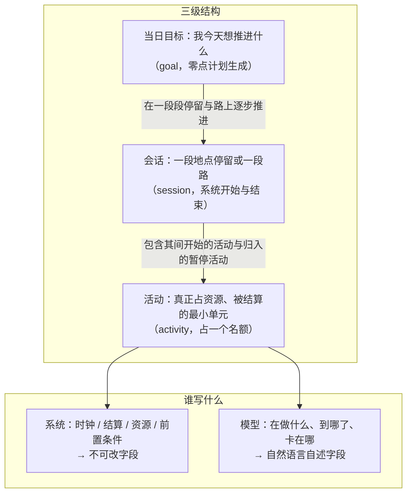
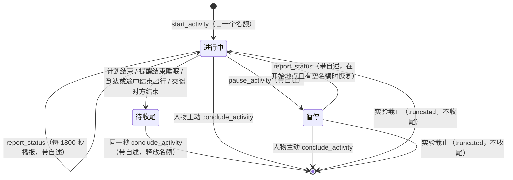
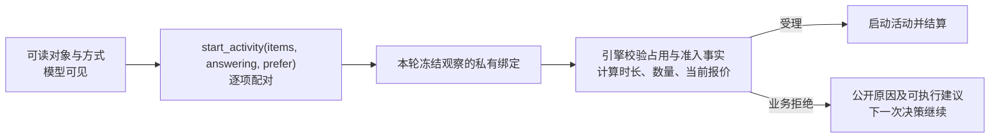
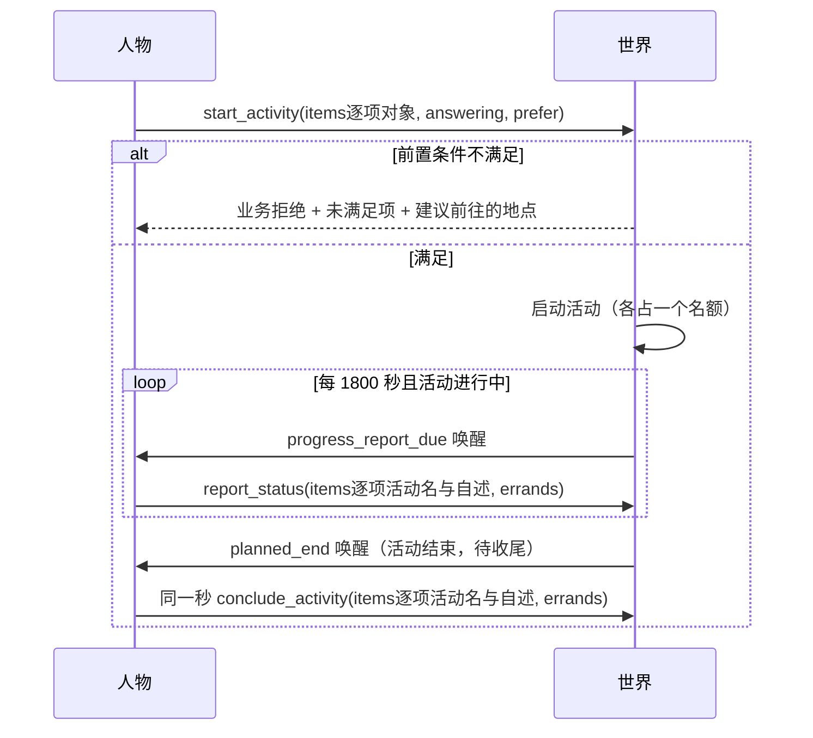
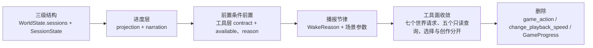

<a name="spec-agent-interaction-特性规格数字人交互会话层上下文分层与稳定工具面"></a>
# 特性规格：数字人交互（会话层、上下文分层与稳定工具面）

> 2026-10-07：按[资源与规则引擎简化规格](SPEC-resource-and-rule-simplification.md#spec-rrs-资源与规则引擎简化开发规格)同步阶段 5 的最终工具面与工作主题会话。

> 按[资源与规则引擎简化规格](SPEC-resource-and-rule-simplification.md#spec-rrs-资源与规则引擎简化开发规格)修订「对象与动作选择」、「前置条件前置与前往提醒」、「会话的状态位置」（阶段 2）；「即时查询、完整纠错与紧凑呈现、与既有文档的一致性核对」（阶段 3）；「对象与动作选择、决策轮循环与播报节律、冻结条款修订、游戏简化、上下文分层、会话字段、一致性核对」（阶段 4，app 使用与推送）。

> 状态：**FROZEN**；2026-09-23 按 issue #1 的运行证据及用户裁决修订；2026-09-24 按[时间与能量规格](SPEC-life-runtime.md#time-and-energy-决策不耗时时间只在做事时流动)修订，修订部分已实现并通过离线验收（证据见[时间与能量验收记录](../archive/time-and-energy/time-and-energy-verification.md)）；2026-09-27 按人物 Prompt 规格修订（[人物 Prompt 规格](SPEC-life-realism.md#persona-prompt-七层请求)「冻结条款修订」第 7、8、12、13、15、16、20–22、24、26 行），修订部分已实现并通过离线验收（证据见[人物 Prompt 验收记录](../archive/persona-prompt/persona-prompt-verification.md)）；2026-09-29 按[一日运行保真规格](../VERIFICATION.md#verification-incremental-evidence)修订（「冻结条款修订」第 10、11、13、14、18 行与其 3.5：控制工具改为 `items`、按名调用、指名购买与 `prefer`、名称类拒绝不计轮、公开结果键），修订部分已实现并通过离线验收。
> 来源：[数字人交互方案](PROPOSAL-agent-interaction.md#proposal-agent-interaction-数字人交互方案)。裁决后本规格取代该提案的全部行为定义。
> 字段与 Schema 由 [接口合同](../CONTRACTS.md#contracts-worldmock-接口合同) 承载；设计职责由既有设计文档承载。
> 本规格显式修订与旧交互工具、观察结果、预算和业务拒绝相关的冻结条款，见「冻结条款修订」。
> 原先阻断冻结的对象动作绑定、登记工具、目标层进展归属均已裁决；本版按最新裁决执行。
> 本规格描述最终行为；实现状态及文档同步以验收台账逐项核对，不能把规格冻结视为已实现。

> 2026-10-01 按[工具交互规格](SPEC-life-runtime.md#tool-interaction-工具请求)修订当前工具请求、查询与错误合同；本次设计已冻结，生产代码已实现，旧验收证据不覆盖新增条款。
> 本特性首次受影响的发布升级为场景 4、地图 3、目录 5.0、品类与规则绑定 3，世界结构仍为 8。各阶段独立发布；后续格式或内容再次变化时另升相应版本，禁止同目录版本覆盖内容。

> 2026-10-02 按[个人事务与工作安排规格](../VERIFICATION.md#verification-incremental-evidence)修订：三个控制工具增请求级 `errands`，待办层与进度层的个人事务呈现，唤醒原因 `errand_reminder_due`，环境层 `duty`，`query_world` 六键与返回精简；修订部分已实现并通过离线验收（证据见[个人事务与工作安排验收记录](../archive/errands-workday/errands-workday-verification.md)）。该规格首次受影响的发布：世界结构 9（阶段 2）、场景结构 5（阶段 3）；`prompt_sha256` 在阶段 2、3 各变一次，`tool_schema_sha256` 在阶段 2、4 各变一次（两个指纹由函数计算，仓库里没有字面钉值）。

> 2026-10-05 按[让「等待」成为例外规格](SPEC-idle-fillers.md#spec-idle-fillers-让等待成为例外开发规格)修订「决策轮循环与播报节律」「冻结条款修订」（阶段 1）。

> 2026-10-06 按[同时做两件事规格](SPEC-parallel-activities.md#spec-parallel-activities-同时做两件事开发规格)修订「三级结构与概念边界」「会话与活动的关系」「稳定工具面」、「保护项修订」的受限轮收窄、「冻结条款修订」第 2 行与「验收台账」（阶段 1）。

<a name="spec-agent-interaction-心智模型"></a>
## 心智模型

人物过日子不是「一次做一件事、做完再想」，而是**同时挂着若干件事、隔一阵回看进展**。
系统掌握时间、身体、报价、结算与资源；人物选择可读对象和动作，撰写自己的进展与通信内容。



**一条硬边界**：模型写的任何文字都不承载状态转移。活动的状态由系统字段推出；会话随出发与到达切换；
模型的进展自述只改变「人物怎么理解这件事」，永不作为完成证据。
个人事务的记下、更新与取消经三个控制工具的结构化字段 `errands` 提交，由环境校验后与该请求同一事务提交；它随活动动作提交，
不是新的登记动作工具（登记动作仍只有 `revise_day_plan`），也不是自述承载的状态转移。事务的「已完成」只由环境按结算证据写入，
请求里没有标记完成；「已取消」由人物请求触发并必须写原因。事务是人物记下的打算，随人物状态保存但不是世界事实，
名称、备注与取消原因只用于呈现、不参与结算与完成判定（个人事务与工作安排规格 2.1、2.2）。

**模型与引擎的执行契约**：`start_activity` 提交 `items[{target, way, from, to}]` 一至两项与请求级 `answering`、`prefer`，
每项直接关联同一对象的方式与来源去向；`items[i].way` 唯一推导内部动词，人物不再提交 `actions`。来源与去向按方式判定，食用、使用与制作的两端为 `null`。模型可读取系统公开的
路线方式、报价和前置条件以作选择，但不回填价格、报价版本、时长、数量或内部身份。
引擎从产生该次观察的冻结状态解析对象和动作，并计算执行参数。已结算动作的公开结果属于
**进度层**：系统写客观结果，人物写主观进展；这不增加上下文层。

<a name="spec-agent-interaction-权威来源与范围裁决"></a>
## 权威来源与范围裁决

| 内容 | 权威 |
| --- | --- |
| 会话、决策轮循环 | 本规格 |
| 人物工具 Schema、字段闭集、枚举 | [接口合同](../CONTRACTS.md#contracts-worldmock-接口合同) |
| 状态归属、结算与资源、共享时钟 | [life-runtime 规格](SPEC-life-runtime.md#spec-life-runtime-特性规格lifeenv-运行时行为与结算规则) |
| 决策所见（七层请求与进度层）、单一行动阶段、同秒续接、预算 | [人物 Prompt 规格](SPEC-life-realism.md#persona-prompt-七层请求)；动作登记与结果通道见 [decision-context 规格](SPEC-decision-context.md#spec-decision-context-特性规格决策上下文与工具结果) |
| 工具与活动类型准入、地点菜单 | [interaction-menu 规格](SPEC-interaction-menu.md#spec-interaction-menu-特性规格交互菜单) |
| 记忆合同、巩固与反思 | [life-realism 规格](SPEC-life-realism.md#spec-life-realism-特性规格人物决策与画像) |
| 当日目标 | [day-plan-goals 规格](SPEC-day-plan-goals.md#spec-day-plan-goals-当日目标特性开发规格) |
| 个人事务（记下、完成依据、提醒）、工作安排与环境层 `duty`、`query_world` 的来源与可执行筛选 | [个人事务与工作安排规格](SPEC-as2-integration.md#errands-workday-运行修复入库) |
| 事件、检查点、导出 | [记录引擎设计](../design/05-recording-engine.md#recording-engine-worldmock-产品设计说明书-记录引擎) |

**范围**：三级结构、活动生命周期、上下文分层与进度层、稳定工具面、决策轮循环与播报节律、
前置条件前置与前往提醒、并发上限、容量与午夜浓缩、游戏简化。

**跨规格边界**：评估、LabelKit 交付、画像、语料、品类与账本的领域规则分别由其规格负责；
本规格要求交付链读取与实际模型请求一致的公开投影，不能再从原始观察重组一份不同的输入。

<a name="spec-agent-interaction-三级结构与概念边界"></a>
## 三级结构与概念边界

系统里**已经有**三个概念：当日目标与活动各有生命周期，会话是按地点停留与路段分组的组织单位；本规格**不新增第四个**，而是明确它们的从属关系。
个人事务与工作安排规格另增**个人事务**（`AgentState.errands`：人物记下、跨日保留；办成只由环境按结算结果确认，人物只能取消并写原因；状态里只存未完成事务）。
它不是三级结构的一级：不占名额、不属于任何会话、不经 `task_kind`、`task_ref` 关联活动，也不放进 `DayPlan`（零点置空与 `revise_day_plan` 的整表替换都不波及它）；
本节的「任务」仍指当日目标；场景分配的工作对象统一称工作主题，不使用任务合同语义。

| 概念 | 谁创建 | 谁结束 | 可暂停 | 进展来源 | 生存期 | 状态位置 |
| --- | --- | --- | --- | --- | --- | --- |
| **任务**（当日目标 `PlanGoal`） | 零点计划 `plan_day`（人物可 `revise_day_plan` 修订） | 系统（跨日失效 `day_end`） | 否 | 环境活动证据（语义不变） | 当日 | `AgentState.day_plan`（冻结，不改） |
| **会话**（`SessionState`） | 系统（运行开始、出发、到达、途中结束出行） | 系统（出发、到达、途中结束出行、实验截止） | 否 | 无（组织单位：进度层 `events` 只含当前会话，`rejected_today` 保留当天跨会话拒绝备忘，结束的会话派生为记忆层的一条） | 一段地点停留或一段路 | `WorldState.sessions`（**新增**） |
| **活动**（`ActivityState`） | 人物（`start_activity`） | 系统（计划结束、提醒结束睡眠、到达或途中结束出行、交谈对方结束）或人物（`conclude_activity`）；系统结束的活动须在同一秒收尾 | 是（路上的活动与交谈、通话除外；只在开始地点且有空名额时恢复） | 结算证据 + 模型自述 | 开始至收尾，进行中与待收尾时占一个名额 | `WorldState.activities`（增字段，见「会话字段」） |

<a name="spec-agent-interaction-任务与会话的关系"></a>
### 任务与会话的关系

**任务由活动逐步推进，活动分属一段段会话。** 活动携带 `task_kind` 与 `task_ref` 指向它服务的任务：

| `task_kind` | `task_ref` 取值 | 说明 |
| --- | --- | --- |
| `"goal"` | `PlanGoal.intent_kind`（如 `"工作"`） | 当日目标；跨日随 `day_plan` 归零 |
| `"work_task"` | `task_id`（如 `backend-hourly-2026-01-05`） | 场景声明的多日工作合同 |
| `"none"` | `null` | 不服务任何已知任务（如临时散步） |

**目标层的证据规则不变**：`PlanGoal` 仍只由「正时长结算的活动」推进，`progress_activity_id` 仍是单值。
**会话不参与目标证据的判定**——它只是按地点停留与路段分组的组织单位。
（推论：服务同一目标的多项活动不会各自改写目标证据，目标证据仍由第一个匹配活动一次性盖章。）

<a name="spec-agent-interaction-会话与活动的关系"></a>
### 会话与活动的关系

**每人两个名额，进行中与待收尾的活动各占一个，暂停的不占**（暂停的个数不设上限）；`pause_activity` 让出名额，
`conclude_activity` 之后进行中与待收尾活动的名额释放；开始、出行与恢复暂停的活动都要有空名额。
**一个会话是一段地点停留或一段路**，由系统随出发与到达开始和结束，人物不手动开始或结束会话。
会话结束前，人物要结束或暂停其中仍在进行的活动：出发前须结束或暂停；路上开始的活动在到达或途中结束出行时
由世界结束，成为待收尾；暂停的活动随地点保留，回到该地点时归入那里的新会话，有空名额时可恢复；只有暂停的活动时可以出发。

**一个活动可分多段完成**。「多段」在记录里对应既有的**暂停/恢复语义**，不新增概念：
一个 `ActivityState` 记录跨多次暂停/恢复累积 `elapsed_seconds`，
暂停期间不计入；每次恢复重算 `planned_end_at`。工作活动的恢复与开工共用主题上限：
计划时长取主题剩余目标与 `DERIVED_DURATION_CAP_SECONDS` 的较小值，剩余不足 60 秒以
`ACTIVITY_DURATION_INVALID` 和主题专用原因拒绝。



**会话状态闭集**：`active` / `ended`；`kind` 取 `stay`（地点停留）或 `transit`（路上）。

<a name="spec-agent-interaction-会话的状态位置"></a>
### 会话的状态位置

会话住在 `WorldState` 内，随 `life` 快照一起提交与恢复——检查点参与者键集是
`{"life"} ∪ {agent:N}`（`src/worldmock/footprints/validation.py::_validate_checkpoint`），**会话不需要新的快照键**。

| 项 | 值 |
| --- | --- |
| 字段 | `WorldState.sessions: dict[str, SessionState]`，带 `default_factory` |
| 结构版本 | `WORLD_SCHEMA_VERSION` **5 → 6**（本规格引入会话）；时间与能量规格升为 **7**（地点会话与活动新增字段）；人物 Prompt 规格升为 **8**（观察改为七层数据）；个人事务与工作安排规格阶段 2 升为 **9**（`AgentState.errands`，只升一次，版本 8 的检查点与导出按版本拒绝）。资源与规则引擎简化规格整体升为 **10**，旧结构直接拒绝；定义在 `src/worldmock/life/models.py::AgentState.errands`，`WorldState.schema_version` 是 `Literal[WORLD_SCHEMA_VERSION]` 且**无默认值** |
| 场景声明 | **不需要**（会话是运行期生成物，同 `activities` / `deliveries`） |
| 旧检查点 | **拒绝加载**：`schema_version` 是 `Literal[WORLD_SCHEMA_VERSION]` 且**无默认值**；**不提供迁移或降级读取路径**，既有运行目录的检查点一律视为作废，需重跑而非恢复 |

<a name="spec-agent-interaction-会话字段"></a>
## 会话字段

```json
{
  "session_id": "internal-session-key",
  "agent_id": 1,
  "kind": "stay",
  "location_id": "internal-location-key",
  "status": "active",
  "started_at": 1767585601,
  "ended_at": null,
  "activity_ids": ["activity-...-action:0001"],
  "app_pushes": {},
  "name": "张江办公室（1月5日 12:00 起）"
}
```

| 模型与字段 | 归属 | 说明 |
| --- | --- | --- |
| 会话 `session_id` / `agent_id` / `kind` / `status` / `started_at` / `ended_at` | **系统，不可改** | 会话身份与生命周期；`kind` 取 `stay`（地点停留）或 `transit`（路上），`status` 取 `active` 或 `ended` |
| 会话 `location_id`（`stay`）或 `origin_id`、`destination_id`（`transit`） | **系统，不可改** | 停留地点，或这段路的出发地与目的地 |
| 会话 `activity_ids` | **系统，不可改** | 这段停留或路上开始的活动，以及回到该地点时归入的暂停活动 |
| 会话 `app_pushes` | **系统，不可改** | 按 app 标识保存当前会话的推送，状态为 `pending`、`opened` 或 `released`；会话切换后旧会话推送不再可打开 |
| 会话 `name` | **系统从冻结场景和开始时刻生成** | 停留「<地点>（<M月D日> HH:MM 起）」，路上「去<目的地>的路上（<M月D日> HH:MM 起）」 |
| 活动 `name` / `session_ids` / `concluded_at` / `report_anchor_at` | **系统，不可改** | 活动名「<做什么><对象>（<M月D日> HH:MM 起）」；先后所属的会话；收尾时刻；播报锚点 |
| 活动 `task_kind` / `task_ref` / `plan_goal_intent_kind` | **系统，不可改** | `task_kind` 取 `goal`、`work_topic` 或 `none`；工作活动以 `task_ref` 指向主题，公共目标类别仍是 `task` |
| 活动 `progress_note` / `note_updated_at` / `note_history` | **模型撰写** | 从原会话移来；结论固定标**未经核验** |
| app 活动 `content_id` / `media_position_seconds` / `next_interaction_at` / `played` | **系统，不可改** | 当前内容、活动游标、静默内容完成边界与本活动真实完成的内容轮次；暂停与结算写回人物全局 `ContentProgress` |

会话上不再有任务、承载对象、内容分段区间、累计秒数、前置条件与自述字段；客观进度取活动随结算累加的秒数、
全局 app 内容进度与工作主题累计，进度与自述都挂在活动上。

上例是**引擎私有状态**，字段名和身份不得原样序列化给模型。模型所见的进度层的 `events` 只含当前 session 的有序记录：
调用连同公开结果、收到的消息、送达、工作主题完成、当日目标提醒，以及个人事务的提醒到点与办成（`errand_reminder`、`errand_completed`，只写事务名称）；活动的客观进度在工具层活动目标的 `state`，暂停的活动与未完成的个人事务在待办层，
更早的 session 在记忆层。原始结果、内部身份、活动分段、账户状态和检查点只保存在事件与世界状态；模型只得到可理解且允许公开的业务反馈。
人物写下的内容（`self_note`、`self_notes`）与环境核验的结果分开呈现，是否经核验由系统层规则统一说明。
待办层个人事务的名称与备注同样是人物写下的，办没办成由环境按结算结果确认。

| 容量 | 上限 | 承载物 |
| --- | --- | --- |
| **进展自述** | 500 字符 | **活动级**：`ActivityState.progress_note`，由模型在 `report_status` / `pause_activity` / `conclude_activity` 对应活动那一项的 `items[].summary` 里撰写 |
| **目标单句进展** | 500 字符 | **目标级**：关联当日 `PlanGoal.progress_note`（保留）；控制工具提交时写入同一段原文，仍是独立字段；照存，不进提示，待办层的目标行不显示人物自述 |
| 记忆层 | 8000 字符 | 记忆层 JSON 的窗口（新常量），**不删任何记录**（见下）；与整次请求的 85% 阈值分开 |
| **个人事务** | 每人未完成至多 8 条；一次请求至多 4 条变更；名称 30 字符；备注与取消原因各 120 字符；数量 1–9 | `AgentState.errands`（只存未完成事务，完成或取消即移出）；上限是实验假设（登记在 `docs/EXPERIMENT.md#experiment-worldmock-实验设置`），由宿主与环境的同一校验执行、不写进工具 Schema：宿主以 `ARGUMENTS_INVALID` 纠错（上限随校验原因写在 `why`，`expected` 只给类型与格式），环境复核失败以 `ACTION_REQUEST_INVALID` 业务拒绝；不静默截取、不自动合并 |

进度层的 `events` 只含当前 session，**没有固定的记录数量上限或总字符上限**。其 JSON 按下文的整次请求 token
阈值浓缩，权威会话和事件保持完整；不得静默截去已结算反馈。

**「进展自述」与「目标单句进展」属于两个独立对象**：前者挂在活动上、随活动收尾而归档；后者挂在当日目标上、跨日随目标归零。控制工具遇到关联当日目标的活动时，将对应原文同时写入两个对象；未关联目标时只更新活动。二者恰好共用 500 字符这一上限，客观目标证据仍仅由正时长活动结算推进。同一段 summary 在本 session 内是进度层中该调用的参数，session 结束后是记忆层的 `self_notes`；目标上的原文不进提示。

<a name="spec-agent-interaction-稳定工具面"></a>
## 稳定工具面

世界请求工具为六个：四个活动控制工具、`revise_day_plan` 与 `send_message`。
再加 `recall_task_summary`、`query_world` 两个世界查询和三个记忆查询，人物原生工具总数为 11；
`custom/envs/life_env.py::_STABLE_TOOL_SURFACE` 是六个世界请求加两个世界查询，共 8 个。
工作叙述沿用 `report_status.items[].summary`，没有独立的工作交付工具。

**名词定义**：**活动动作**指开始、播报、暂停与结束活动——`start_activity`、`report_status`、`pause_activity`、`conclude_activity`（会话是地点停留或一段路，由系统随出发与到达开始和结束，人物不手动开始或结束会话，见[时间与能量规格](SPEC-life-runtime.md#time-and-energy-决策不耗时时间只在做事时流动)第七章）；**登记动作**只剩 `revise_day_plan`，它只修订当日计划及其提醒、不启动活动、不消耗生活时间；当日计划由运行时的零点后台任务 `plan_day` 生成，`plan_day` 不是人物工具（见[时间与能量规格](SPEC-life-runtime.md#time-and-energy-决策不耗时时间只在做事时流动)第四章）。
任务回看、世界查询与记忆查询工具不是生活动作；按条目身份读取的 `memory_read` 删除，查询结果不带条目身份（时间与能量规格第七章）。生活决策没有 `finish`：一轮决策恰好一个世界请求，登记即结束本轮；人物的只读问答保留 AS2 的 `finish`。

原 17 个工具里的游戏命令、播放中变速与 `submit_work` 删除；`revise_day_plan` 继续独立，
`plan_day` 是零点后台任务，`send_message` 保留为人物创作通信正文的唯一独立出口。不存在旧工具的兼容入口。

| 工具 | 可用条件 | 收 | 语义 |
| --- | --- | --- | --- |
| `start_activity` | 始终可用（同刻上限的受限轮除外） | 必填 `items[{target, way, from, to}]` 一至两项，必填可空 `answering`、`prefer`；含购买项偏好为「最快拿到」或「到手价最低」，无购买项为 `null` | 方式唯一推导内部动作；整组原子受理，旧平行数组与 `actions` 拒绝 |
| `recall_task_summary` | 查询回合预算允许时 | `task_name: str` | 即时只读回看本人已知的任务、当日目标或活动；不登记世界请求、不计同刻轮数，可与其他查询同批 |
| `query_world` | 查询回合预算允许时 | 必填 `name: str\|null`、`way: str\|null`、`category: str\|null`、`from: str\|null`、`available_only: bool`、`offset: int`；前四者至少一个非 null 且非 null 不得为空白，`available_only` 不单独构成查询条件，偏移非负 | 查询同一冻结权限内全集；`from` 与 `start_activity` 购买项的 `from` 同名同义、同一来源解析，只匹配供给条目；`available_only=true` 只留已确认此刻可执行的条目；筛选先于排序与切页，按二十项分页，不揭示新世界事实（个人事务与工作安排规格第五章，原为四键） |
| `report_status` | 有进行中或暂停的活动时 | `items: list[{activity_name, summary}]`（1–2 项；一日运行保真规格第六章，原为等长的 `task[]`、`summary[]`）；另有请求级必填 `errands: list[{change, name, outcome, item, quantity, memo, remind_time, reason}]`（与 `items` 平级，可为 `[]`，一次至多 4 条，每条八个键全部必填；`change` 取「新增」「更新」「取消」，没有「完成」；个人事务与工作安排规格 2.2，原为只含 `items`） | 各项对应一项活动；播报进行中活动；点名暂停的活动即恢复它，恢复只在开始地点且要有空名额；事务变更与活动状态转换同批校验、同一事务提交 |
| `pause_activity` | 有进行中活动时 | `items: list[{activity_name, summary}]`（1–2 项）；另有请求级必填 `errands: list[{change, name, outcome, item, quantity, memo, remind_time, reason}]`（与 `items` 平级，可为 `[]`，一次至多 4 条，每条八个键全部必填；`change` 取「新增」「更新」「取消」，没有「完成」；个人事务与工作安排规格 2.2，原为只含 `items`） | 各项对应一项进行中活动；暂停所选活动，暂停让出名额，恢复要有空名额；路上的活动不能暂停；事务变更与活动状态转换同批校验、同一事务提交 |
| `conclude_activity` | 有进行中、暂停或待收尾的活动时 | `items: list[{activity_name, summary, memories, views}]`（1–2 项；`memories` 为普通记忆，没有 `subject`；看法与偏好放 `views`，`about` 写对象，宿主转为存储的 `subject`；两者都必填可为空，合计不超过八条）；另有请求级必填 `errands: list[{change, name, outcome, item, quantity, memo, remind_time, reason}]`（与 `items` 平级，可为 `[]`，一次至多 4 条，每条八个键全部必填；`change` 取「新增」「更新」「取消」，没有「完成」；个人事务与工作安排规格 2.2，原为只含 `items`） | 各项对应一项活动；结束所选活动并写总结与记忆，进行中与待收尾活动的名额随之释放，暂停的在任何地点都可直接结束；未选活动保持原状；事务变更与活动状态转换同批校验、同一事务提交 |

| `send_message` | 可联系人物可见时 | `recipient_name: str`、`text: str` | 发送人物撰写的正文，执行现有通讯结算；结果归进度层 |
| `revise_day_plan` | 当日已有计划时（**含空清单**） | `goals[]`（替换全部未推进目标；每条带必填可空的 `remind_time`、`around_time`） | **修订**当日目标及其提醒；提醒按时间与能量规格第四章保留、换成新提醒或取消 |

六个世界请求、两个世界查询与三个记忆查询始终都在原生 `tools` 中，定义整次运行不变（例外是本次决策只剩最后一个回合时与输出截断后的那次重试时去掉全部查询工具，后者见[一日运行保真规格](SPEC-life-runtime.md#dayrun-fidelity-身体与需要) 7.2），参数不带逐轮名称枚举；「可用条件」不满足时，工具层把该工具标为
`available=false` 并写 `reason`，提交时以同一原因业务拒绝。名称的合法性由宿主本地校验与环境受理判定。

`task_name`、各项的 `activity_name` 与 `recipient_name` 都取本轮七层中出现的唯一可读名称。
工作主题在公共工具层仍用 `kind=task`，私有绑定种类为 `work_topic`。
同名对象由类型、地点或自然语言开始时间消歧，不能用内部编号、哈希、奇怪字符或索引后缀。
三个活动控制工具的 `items[].activity_name` 只取活动名（「做什么＋对象＋开始时刻」，开始时刻用绝对日期；同一轮可见的名称重复时
追加「（第二次）」这类序号）；`recall_task_summary.task_name` 取任务、当日目标或活动名（名称只取七层中出现的，会话名
不在其中）；`recall_task_summary.task_name` 可取尚未完成的工作主题名；各类名称共享同一唯一性检查，冲突时不设隐含优先级。
`errands[j].name` 在更新、取消时取待办层 `errands[].name` 写出的事务名，新增时由人物自拟（之后不可改名，终结后名称可以再用）；
新增的 `errands[j].item` 写商品名称，按名称解析到唯一商品。二者经私有绑定 `errand_bindings`（未完成事务：名称、事务身份、结果种类、商品身份）
与 `errand_item_bindings`（全部商品名到商品身份）解析，两键与 `errand_id` 都列入提示禁键。
写得不准时宿主以 `NAME_NOT_FOUND`、`NAME_AMBIGUOUS` 纠错、不替换，都不带 `candidates`：更新或取消的事务名错误在 `allowed_values`
列出本人全部未完成事务名（至多 8 个）；新增的商品名错误把最接近的至多三个商品名写在 `why`，不把全量商品名放进 `allowed_values`。
事务名只在 `errands[].name` 上解析，不进 `recall_task_summary` 的回看名称（个人事务与工作安排规格 2.3）。
名称至内部身份的映射只存于私有观察绑定，提交时按原观察解析；写得不准的名称按[一日运行保真规格](SPEC-life-runtime.md#dayrun-fidelity-身体与需要) 3.1
无损归一（全半角与括号、前缀、活动名里的开始时刻后缀等），归一后唯一即受理；仍不存在或不唯一则以名称类错误纠正：
`start_activity` 的目标名附可原样提交的完整请求候选，三个控制工具的 `items[].activity_name` 只定位到该参数、不带 `candidates`，
绝不任选一个、不按相似度替换。`items` 一至二项且活动不重复。
`summary` 是人物对活动进展的原创叙述，不是系统状态回填；工作叙述不改变主题累计。
`send_message.text` 与 `revise_day_plan` 的目标内容同样由人物撰写。
播报先校验全部活动名与阶段，接受进行中或暂停中的活动；暂停只接受进行中的活动，路上的活动除外；结束接受
进行中、暂停中或待收尾的活动。整组通过才依对应关系写入各活动的 `progress_note`，有关联当日目标时把同一原文写入
该目标独立的 `progress_note`（照存，不进提示）；任一项不合法则整组业务拒绝且世界状态不变。
请求级 `errands` 与 `items` 同批校验、同一事务提交：任何一条事务变更不合法则整请求被拒、世界不变；请求因任何原因被业务拒绝时事务变更一并不生效，
由请求触发的三种事务事件只在成功分支生成（同一请求的 `memories` 仍按既有规则在登记时由宿主写入）。
同一请求内按取消、更新、新增的次序求值，重名、同结果同商品与上限都按扣除本请求取消之后的未完成集合判定；
同一条未完成事务在一次请求里至多被一条更新或取消点名，两条新增不得同名（取消后可在同一请求里沿用原名重新新增）。
宿主与环境对同一冻结观察调用同一校验函数，环境复核失败合并为一次 `ACTION_REQUEST_INVALID`，照常计同刻轮数；
成功结果在 `details.errands` 给回执 `[{errand, change}]`（`errand` 为事务名称），被拒结果没有该键；
事务变更不是记忆写入点，不产生 `memory_updated`（个人事务与工作安排规格 2.2、2.3）。
播报暂停中的活动即在其开始地点恢复它，恢复要有空名额；结束只结束所选活动，未选活动保持原状。
没有可结束的活动时结束工具业务拒绝。有待收尾活动时做别的（包括只结束其他活动），以 `ACTIVITY_CONCLUSION_REQUIRED`
业务拒绝并点名先要收尾的活动。

**`plan_day` 与 `revise_day_plan` 保留为独立工具**（用户裁决，2026-09-22；已被取代，见段末）：
二者是**登记动作**，不启动活动、不消耗生活时间，与「会话动作」语义不同，
因此不属于 `start_activity` 可推导的生活动作。其请求形状、生命周期与修订规则不变，
沿用 [当日目标规格](SPEC-day-plan-goals.md#spec-day-plan-goals-当日目标特性开发规格) 与 [接口合同](../CONTRACTS.md#contracts-worldmock-接口合同)「当日目标请求」。
本段已由[时间与能量规格](SPEC-life-runtime.md#time-and-energy-决策不耗时时间只在做事时流动)第四章取代：`plan_day` 改为零点后台任务，登记动作只剩
`revise_day_plan`，条目增 `remind_time`。

<a name="spec-agent-interaction-对象与动作选择"></a>
### 对象与动作选择

冻结观察的工具层 `targets` 每项提供唯一可读的 `name`、`kind` 与 `actions[]`：每个动作是 `{action, way, available, reason, price, duration,
quantity, note}`，`action` 取五个动词，`way` 取方式闭集，不可用时 `reason` 写环境受理时的拒绝原文（可用时为 null）。
人可以直接理解每个活动，例如「地点：张江办公室」配 travel 的步行与驾车，「门店出售的午餐套餐」配 obtain 的到店与远程下单，
「工作：项目周会纪要」配 interact 的工作，「app：哔哩哔哩」配 interact 的打开。方式携带人物真正需要选择的出行方式和履约方式；
票价、版本、时长、库存、数量由系统在 `price`、`duration`、`quantity` 中告知或内部计算，不成为模型参数。
工作主题是 `start_activity` 的「工作」方式；`send_message` 不列为活动动作，收件人与正文由独立工具处理。

环境登记的全部 app 都以 `kind=app` 的目标始终列出，不是候选、不轮转、不进 `callable_index`；
没有绑定内容的 app 仍列出，但 `available=false`、原因是 `APP_CONTENT_EMPTY`。人物只提交 app 名与「打开」，
内容由环境在该 app 的绑定集合内抽取；当前会话有未释放推送时优先选择推送内容。

`obtain`、`consume` 另用 `items[i].from`、`items[i].to` 写来源与去向，其他动词两者都为 `null`：`obtain` 的 `from` 是可选约束，取 `null`、地点显示名（含住处的「家」「住处」写法）或渠道称呼
（目标是完整标签「<门店>出售的<商品>」时为 `null`、该门店或包含该门店的渠道；方式为制作时为 `null`；其他写法报 `SOURCE_NOT_FOUND`），
方式可写「购买」由系统定到店或远程下单，多于一家可服务时按请求级 `prefer` 选定（一日运行保真规格 3.5），
`to` 为 `null`（本人）或他人收货人（写人物目标的名称，如「人物：王磊」），制作的 `to` 为 `null`，由引擎确定本人去向；
食用、使用与制作的 `from`、`to` 均为 `null`，本人来源与去向由引擎推导；给予的 `from` 为 `null`，`to` 为人物名。`to` 的候选是 `null`（本人）或工具层的他人人物目标，写目标的名称；不在工具层的同世界人物也可写「人物：<名>」
（私有 `person_bindings`，给予他以不同处拒绝，配送给他送到其所在地点）；写的名称不是任何人物时以 `RECIPIENT_NOT_FOUND` 业务拒绝；收货地点不作参数。请求级 `answering` 填一条可见直接消息的
规范名称「<发件人> HH:MM 的消息」，只关联 `to` 等于该消息发件人的那几项。



冻结观察中的私有 `interaction_bindings` 只供宿主解析：（可读对象，动词，方式）映射到内部对象身份、
标准动作、路线方式、履约方式、`use_mode` 及该对象的冻结报价。`obtain` 的目标不在本轮列出时按场景供给指名解析
（一日运行保真规格 3.2、3.3、3.5）：分段匹配依次报 `SUPPLY_NOT_FOUND`（没有这件商品，附至多 3 个可照填的候选）、`SUPPLY_NOT_AT_STORE`、
`FULFILLMENT_NOT_SUPPORTED` 与 `ACTIVITY_PRECONDITION_UNMET`；多于一个可服务的匹配时按 `prefer` 选定一家并写进 `details.notes`，
不再报 `SUPPLY_NAME_AMBIGUOUS`，不自动替换。其余动词的目标也可以直接写名称：宿主与环境共用同一名称解析，无损归一后唯一即受理，
否则以名称类错误给可照填的候选（宿主判定的在本轮按协议纠错重试）。该绑定不进入模型提示或工具返回。
私有 `activity_bindings` 把本轮可读的活动名映射到内部身份（活动绑定另带阶段，同一轮重名时追加「（第二次）」这类
序号；另带 `note_labels`：记忆层 `self_notes` 中这项活动去掉开始时刻后缀的活动名，只作回看名称）；私有 `goal_bindings` 的名称就是
待办层写出的目标文字；会话名不在七层中出现，不绑定。
活动绑定另带 `resumable`：暂停的活动此刻能否恢复（人物正停留在它的开始地点）；人在别处时待办层把恢复标为不可用并点名开始地点，
提交时以 `ACTIVITY_PRECONDITION_UNMET` 业务拒绝，原因与待办层所写一字不差。
对同一个对象的多个合法动作逐一展示；`items[i].target`、`items[i].way`、`items[i].from` 与 `items[i].to` 逐项对应，
每个对象只需支持自己选中的动作；同一请求中只有 `to` 不同时才允许重复目标。两项可以是不同动作，例如步行与打开 app；
引擎验证组合能否并行，任一项不合法则整组不启动。
每项出行都须对应自己的目的地；每项购买都读取该供给自己的冻结报价（指名购买本轮未列出的商品按当前报价），不能把一件商品的
报价版本套给另一件。所选对象已不在本轮绑定或绑定不唯一，返回业务拒绝，不猜内部身份。

**引擎派生参数政策**：

| 动作 | 不由模型填写的执行参数 |
| --- | --- |
| 前往 | 由所选目的地与方式查询发布图，时长为 ceil(最短距离 ÷ 方式速度)，费用按固定规则；展示分钟数仅供阅读 |
| 工作 | 时长取剩余合同秒数、距截止秒数与活动允许上限中的最小值；距截止与剩余合同都不少于 60 秒才开工；恢复同样受截止约束，计划时长取距截止与合同上限减已累计中的较小值，不足 60 秒以 `ACTIVITY_DURATION_INVALID` 业务拒绝；30 分钟播报边界可在活动进行中唤醒 |
| 打开 app | 方式固定为「打开」，活动为 `use_app`；人物只填 app 名，计划时长固定取 `APP_USE_DEFAULT_SECONDS = 1800`，内容由环境在该 app 内抽取，人物不填内容身份、时长或倍速 |
| 生活活动 | 取目录 `typical_duration_minutes` 换算的秒数，超过 86400 秒按 86400 秒受理 |
| 阅读邮件、等待 | 取场景 `activity_feedback_seconds` |
| 交谈、通话 | 由场景 `activity_feedback_seconds` 派生后截取（通话 600–3600 秒、交谈 60–7200 秒）并取整到完整分钟，不再受请求模型 120 分钟上限约束 |
| 睡眠 | 人物当前 `sleep_need_hours × 3600`，按最近整数秒取整 |
| 购买、食用或使用持有物 | 购买每个所选对象数量为一份，使用各自冻结报价（指名购买按当前报价）及所选动作对应的履约方式，订单只有一个收货人，送达只入收货人的持有；持有物从目录 `use_modes` 展示「食用」或「使用」，引擎按冻结绑定的 `eat` / `use` 结算：开始时每件取 `min(1, 手边持有)` 移入本次活动，不足一份也可以吃，进食时长为 `max(60, round(整份时长 × 份量))` 秒，摄入只按开吃份量与实际进度计算；暂停保留开吃份量的剩余，结束丢弃剩余、不补算摄入，其他份数不动；余额、库存、地点和组合相容性在结算时重验 |
| 给予 | 瞬时，不占名额，无时长；从本人手边移出每件 `min(1, 持有)` 记入对方持有，任何人都不增加摄入；要求同处（同世界人物在同一地点；联系人则本人位于其收货地点） |

时长换算为正整数秒后，非出行活动最短 60 秒（进食时长的校验按份量折算）；生活活动超过 86400 秒按 86400 秒受理并在结果写明
计划时长，`use_app` 始终取固定 1800 秒；出行超限以 `ROUTE_DURATION_INVALID` 拒绝；占用、地点、截止时间等准入事实照常校验，能量不参与。
无法成立时返回说明具体约束的业务拒绝（带原因与下一步），不改用猜测值。
无时长动作不虚构活动时长。领域内部请求仍可带 `planned_duration_seconds`、
`price_version` 等字段，但由引擎从同一冻结观察填充，模型永不回填。

`from=null` 在购买时表示不额外限定卖方或渠道，完整商品标签仍限定标签门店；其他方式的来源由引擎推导，只允许 `null`。
`to=null` 始终表示本人，购买收货地沿用当前地点规则，不等于本人住处；只有购买或给予给他人时写真实人物名称。
食用、使用、制作及其他方式的 `to` 只允许 `null`；给予必须写他人，不能给予本人。
不接受在 `to` 填「自己」或本人姓名的旧写法；出行目的地由 `target` 与方式确定，`from/to` 不承载路线起止地点。

**Schema 约束**：`start_activity` 只包含必填 `items[{target, way, from, to}]` 一至两项与必填可空的 `answering`、`prefer`。
每项四键显式必填，`from`、`to` 是 `str|null`；`prefer` 显式必填可空：只要含「购买」「到店」或「远程下单」项，就必须写「最快拿到」或「到手价最低」；没有购买项时必须为 `null`。`null` 不再默认最快，不接受旧英文或短名。
`items[i].way` 的合法性按 `items[i].target` 对象本轮列出的方式验证（`obtain` 指名本轮未列出的商品时按指名购买解析），
`from`、`to` 的组合按方式唯一推导的内部动词验证；参数不带逐轮名称枚举，不能在模型工具 Schema 中加入动作专属参数。

DeepSeek strict 模式**禁用六个 Schema 键**
（`src/worldmock/life/models.py::_DEEPSEEK_UNSUPPORTED_SCHEMA_KEYS`）：
`oneOf`、`minLength`、`maxLength`、`minItems`、`maxItems`、`default`。

由此产生一条硬约束：**字符上限与「至多 2 个」的并发上限都不能写在工具 Schema 里**，
只能在提示词与业务规则中表达。故并发上限的 Schema 侧无约束，
`SESSION_LIMIT_EXCEEDED` 由业务规则独立兜住。
所有属性必须必填（strict 模式要求），本地请求按严格 JSON 类型及各字段既有范围、格式校验，不进行类型转换，不设缺省值（`default` 亦在禁用清单内）；`conclude_activity.memories` 的数量与
长度上限同样只由本地校验兜住。

**一次决策仍只提交一个世界请求**；之前可同批执行只读查询，世界请求与查询不得混批。
一个 `start_activity` 请求可逐项启动一至两个活动；两项按[时间与能量规格](SPEC-life-runtime.md#time-and-energy-决策不耗时时间只在做事时流动)第五章「并行准入」
共同校验（名额、目标在场与实际地点、出行方式、注册表占用、物品状态，能量不参与），任一项不成立则整组拒绝。
`revise_day_plan` 是独立登记工具，**不是** `actions` 的取值。

<a name="spec-agent-interaction-保护项修订"></a>
### 保护项修订

保护集随工具面收敛为六类：

| 类别 | 成员 | 为什么必须保护 |
| --- | --- | --- |
| 始终提供 | `start_activity` | 人物可开始活动；同刻上限的受限轮中由工具层标为不可用 |
| 只读查询 | `recall_task_summary`、`query_world`、`memory_*` | 查询不受世界请求同刻阶段限制，仍受模型回合预算限制 |
| 活动退出通道 | `report_status`、`pause_activity`、`conclude_activity` | **有进行中、暂停或待收尾的活动时可用**（各自按活动阶段标注）：三者是恢复、暂停与结束活动的**唯一**手段，剪掉会让活动永久占着名额 |
| 「自身」对象的动作 | `wait`、`sleep`（内部标准动作；场景 `allowed_actions` 与菜单保护项沿用内部名，人物所见分别为 `interact` 的「自己」对象（方式「等待」）与动词 `sleep`） | 不保留则无法等待与睡眠 |
| 当日目标登记 | `revise_day_plan` | 不保留则无法修订当日目标与提醒；当日已有计划时可用（含空清单） |
| 创作内容出口 | `send_message` | 通信正文由人物创作，不能由 `start_activity` 捏造；工作叙述使用既有控制工具的 `summary` |

**地点菜单不再剪裁工具，只剪裁对象的 `actions` 枚举。** `InteractionMenu` 的声明
只有 `allowed_actions`，地点与人物声明求交集后再与各对象能力结合。世界请求工具与查询工具始终都在原生 `tools` 中，
各自的使用条件由工具层 `available`、`reason` 标注，不放进地点菜单，也不恢复 `allowed_tools` 或 `allowed_activity_kinds`。
工具层的标注与环境受理出自同一判定：标为不可用的，提交时以 `reason` 所写的原因业务拒绝；标为可用的，宿主与环境都受理。

**同刻上限的受限轮收窄。** 同一人物同一模拟秒的决策轮数达到场景 `max_same_moment_decisions`
后，仍给至多三轮受限轮；环境按观察私有证据 `same_moment_stage` 只受理一类世界请求，工具层把其余动作与工具标为
`available=false`，`reason` 为同刻限制：
- `conclude_pending`（有待收尾活动）只受理点名待收尾活动的 `conclude_activity`，每项都可以收尾，一次收尾其中几项也受理，阶段持续到没有待收尾活动；
- `start_or_resume`（没有进行中也没有待收尾的活动；暂停的活动不占名额，这时两个名额都空着）开始或恢复一项持续活动（等待始终可选，不含到店购买与远程下单）；
- `resume_or_conclude` 与 `conclude_only` 留在阶段闭集中，现行阶梯不再进入它们。

开始或恢复被拒后留在原阶段，被拒的选项在工具层标原因；不再有「启动失败后只准等待」的阶段与升级。受限轮用完仍没有进行中活动，或仍有待收尾活动（例如待收尾活动旁另有进行中活动）时，
环境不替人物造活动：写一条 `environment_event`（`data.kind=decision_budget_exhausted`，`visibility=system`，带最近的拒绝码），
设 `next_decision_at = now + activity_feedback_seconds`，时钟可以推进（技术停顿，身体按静息结算），质量报告计数，不记成人物主动等待。

名称不带逐轮枚举，全部只读查询照常；形状错误按协议错误在本轮重试，不计轮数；越界请求以
`SAME_MOMENT_ACTION_RESTRICTED` 业务拒绝并计入同刻轮数，拒绝原因与工具层 `reason` 一字不差。同刻轮数照旧计入成功、拒绝与重放，
但名称类拒绝不计、也不施加 `service_refused` 情绪脉冲，每人每秒至多 2 次，第 3 次起照常（[一日运行保真规格](SPEC-life-runtime.md#dayrun-fidelity-身体与需要) 3.4）。阶段取值见[时间与能量规格](SPEC-life-runtime.md#time-and-energy-决策不耗时时间只在做事时流动)
第一章「规则」第 3 条与「实现约定」。

<a name="spec-agent-interaction-即时查询完整纠错与紧凑呈现"></a>
### 即时查询、完整纠错与紧凑呈现

`recall_task_summary`、`query_world` 与 `memory_recent`、`memory_search`、`memory_time_range` 属于只读查询，
在生活决策中可同批调用；整批参数通过校验后按请求顺序返回。查询不登记世界请求、不结束决策、不推进模拟时间、
不增加同刻轮数，每次实际模型回复仍占用 `MAX_REACT_TURNS=16` 的回合预算。世界请求必须单独调用，
与查询混批或含多个世界请求时整批拒绝，所有调用均未执行。
`query_world(name, way, category, from, available_only, offset)` 六键均必填、无缺省，旧四键请求按缺字段拒绝；
`name`、`way`、`category`、`from` 为 `str|null`，至少一个非 null（四者全空时在四个位置各报一条），非 null 不得为空白；
`available_only` 为严格 JSON 布尔（拒绝字符串、数字与 `null`），不单独构成查询条件；
`offset` 为严格非负 JSON 整数（拒绝布尔值、数字字符串及浮点数），首批显式写 `0`，不能省略；
`way` 取现有方式闭集，写「购买」（及其同义写法）等同于同时写「到店」与「远程下单」；`category` 匹配公开 `callable_index` 的类别标签；
`from` 写登记店铺显示名或 app 名，与购买请求共用同一来源解析，只匹配食品条目，认不出时以 `ARGUMENTS_INVALID` 定位 `from`，
并给至多三条换了 `from` 的完整 `query_world` 候选（个人事务与工作安排规格 5.1、5.2、5.5）。
查询只读取本轮冻结观察、已有私有绑定与可调用索引权限内的完整匹配集合，
不读未揭示邮件正文或他人食品持有；食品查询只读固定菜单，不通过浏览揭示事实。
`query_world` 的固定返回为 `{matches, total_count, next_offset}`，不新增说明键；`matches` 每项是冻结目标的无损紧凑投影
（`name, kind, phase, state, contract, actions, tools`，`contract` 仅任务目标有；紧凑规则复用工具层分组已有的实现，只省略 `null` 与空集合，
保留 `false`、零值与明确的未知原因），不再逐项附完整请求候选——照抄 `name` 与所选动作的 `way` 即可提交，候选只出现在错误合同里；
筛选在排序与切页之前施加，每批沿用现有 `candidate_presentation_limit=20`；`total_count` 是全部筛选交集后的完整匹配数，`next_offset` 必填可空。
还有结果时返回下一批偏移，没有更多结果时为 `null`；同一冻结观察内重复传回偏移可遍历筛选后的全集。
除下述两种参数错误外，任何筛选组合无匹配、或偏移恰为 `total_count` 时返回 `matches=[]`、`next_offset=null`（无匹配时 `total_count=0`），
不报错、不自动放宽、不换来源；`from` 解析成功但该来源没有权限内供给、`name` 写完整标签而 `from` 写另一家店都是合法空页。
两种参数错误都是 `ARGUMENTS_INVALID`：`from` 既不是地点显示名也不是渠道称呼（定位 `from`，给至多三条换了 `from` 的完整 `query_world` 候选）；
`from` 为 `null`、`name` 按对象名称解析无任何匹配且其写法恰是一个渠道称呼（定位 `name`，给一条把该值移到 `from`、`name` 写 `null` 的完整候选，不自动改写）。
偏移超出时按参数错误定位 `offset`，范围只在全部筛选合法后计算；不另设分页配置（个人事务与工作安排规格 5.3、5.4、5.5）。
查询结果即时通过原生 tool 消息返回，留存于模型交互证据；外部只读问答仍只开放人物记忆查询与 `finish`。

所有接口错误均使用英文 `reason`、`fix`、`message`、`why` 与错误日志，中文对象名保留原样。
错误顶层沿用 `{error_code, reason, fix, items, unmet}`；`items` 必须定位实际错误，
每项为 `{path, written, error_code, allowed_values, expected, why, candidates}`，不保留旧 `index`、`field` 定位字段。
`path` 是从工具调用根开始的完整位置数组，如
`["tool_calls", 0, "function", "arguments", "items", 0, "views", 1, "type"]`。
有限枚举在 `allowed_values` 完整列出；无枚举时为 `[]`，`expected` 写明类型、范围、格式、字段关系或世界条件。
未知工具定位 `function.name` 并列出本次实际提供的合法工具；组合错误定位 `tool_calls` 并说明合法调用组合。
不完整 JSON 定位该调用的 `function.arguments`，`expected` 含解析器的行列与该工具参数所需的闭集，
不推测尚未成功解析的参数字段。所有可独立确定的参数与名称错误一并报告，不能用一个粗略顶层字段掩盖嵌套位置。
候选统一为 `{tool, arguments, note}`，`note` 为英文说明或 `null`；`arguments` 是该工具完整合法的新请求，候选可原样提交。
`prefer` 的错误枚举按已合法的方式判定：含购买项返回 `["最快拿到", "到手价最低"]`，
没有购买项返回 `[null]`；尚不能判明方式时列声明的三值并说明跨字段约束，不猜购买类型。
名称字段不是封闭枚举，不把全量商品名塞进 `allowed_values`。业务前置条件中所有可独立确定的问题按既定准入顺序列出，
定位有关请求参数并给合法方式或下一步；需要合法对象才能判定的条件不凭空推断。

进度层另有 `rejected_today` 当天操作备忘：从本人当天已持久化的 `model_response.data.protocol_feedback`
与非重放 `action_rejected` 确定性推导，跨时刻和地点会话保留，跨场景本地日期清空。
每条恰含 `written`、英文 `why`、`times`、`last` 与可空的 `accepted_as`；按原始证据中的相同工具、参数位置和原文合并，
最近使用的至多八条，每条英文 `why` 至多六十字符。它说明系统曾怎样拒绝，不重放整段调用或模型思考，
不新增检查点字段、不写入或迁入人物记忆；会话事件 `events` 的范围仍只限当前会话。
同秒续接对备忘的更新随 `changes.rejected_today` 整体替换，链首快照保持逐字节不变。

公开工具层恰为 `{layer, groups, callable_index}`；每组为 `{kind, action, way, shared, targets}`。
控制对象的 `action`、`way` 为 `null`，仍保留控制工具和状态；解组按名称合并并逐值恢复全部公开字段，
冲突元信息是渲染错误。只省略 `null` 和空集合，保留 `false`、零值与明确的未知原因。
工具层提示使用按对象类别与方式分组的紧凑 JSON：共同字段只写一次，名称、可用性及其差异留在组内，
空字段省略，共同不可用原因提至组级；续接 `changes` 使用同一确定性编码。
编码必须能无损还原目标、方式、可用性、原因、价格、时长、数量、任务合同和其他工具可用性；
冻结观察的工具层结构、私有绑定、可调用索引与世界权限不变。紧凑编码不是预算浓缩，不能减少对象或事实。

`query_world(name, way, category, from, available_only, offset)` 六键必填，来源解析为目录店铺或 app，返回固定菜单的紧凑 `{matches, total_count, next_offset}`。
商品价格固定，类别标签来自食品类别；`available_only` 只按人在店内或店铺绑定 app 判断，不检查报价、营业、库存、配送区域或可见凭据。查询不揭示新世界事实、不推进时间、不占名额，只保存实际模型与 tool 交换证据。
查询与世界请求不得混批，先整批校验，再按原执行位置返回；有效交互菜单、同秒预算、名称纠错与只读权限保持原合同。

<a name="spec-agent-interaction-决策轮循环与播报节律"></a>
## 决策轮循环与播报节律



| 触发 | 来源 | 是否调用模型 |
| --- | --- | --- |
| 活动进行超过 `progress_report_interval_seconds`（自开始、恢复或上次播报起计） | **新增** `progress_report_due` | 是（一次决策机会） |
| 活动返回结果（`planned_end`） | 既有成员 | 是 |
| 某任务的 DDL 临近 | 既有 `task_due_soon` + `commitment_threatened` | 是 |
| 没有进行中活动（边界结算后或同一秒再决策） | **新增** `no_active_activity`（时间与能量规格第一章） | 是（同一秒决策；不进睡眠允许集合） |
| 当日目标的提醒到期 | **新增** `plan_reminder_due`（时间与能量规格第四章） | 是（睡眠中也提供，并结束睡眠） |
| 个人事务的提醒时刻到点 | **新增** `errand_reminder_due`（个人事务与工作安排规格 2.5；枚举追加在 `plan_reminder_due` 之后） | 是（清醒时提醒时刻进入下一边界与下一次决策机会的候选，精确到点；每个为清醒人物提供决策机会的边界把该人物全部已到点未提醒的事务一并交付，合并为一次决策机会、本原因只计一次，每条事务各写一条 `errand_reminded` 事件，与该边界的其他原因（如同刻到期的 `plan_reminder_due`）按枚举顺序并列；不改变事务状态；不进睡眠允许集合：睡眠中不入候选、不形成静默边界、不交付也不消耗，错过的提醒在人物醒来的那个边界交付，不另起边界） |
| 班次或休息时段的开始、结束（人物声明了工作安排） | **新增** `shift_start`、`shift_end`、`break_start`、`break_end`（[让「等待」成为例外规格](SPEC-idle-fillers.md#spec-idle-fillers-让等待成为例外开发规格)；枚举依次追加在 `errand_reminder_due` 之后） | 是（清醒时起止时刻进入下一边界与下一次决策机会的候选，精确到点，一次决策机会，进行中的活动照常继续；同一秒重合的起止各记一次，与该边界的其他原因按枚举顺序并列；不写事件、不进提示，人物看到的变化只有环境层 `duty.status`；不进睡眠允许集合：睡眠中不入候选、不形成静默边界、不叫醒，睡过的起止醒来后不补） |
| app 推送写入当前会话 | 阶段 4 新增 `app_push`（枚举追加在 `break_end` 之后） | 是（清醒人物一次机会；正在使用 app 时不打断；睡眠中推送仍保留但不唤醒） |
| app 内容到达末尾 | 活动的 `next_interaction_at` | 否；写回全局进度并在剩余计划时长内静默接续 |
| 活动暂停中 | 不触发 | 否 |
| 人物睡眠中 | 被 `SLEEP_ALLOWED_REASONS` 过滤 | 否 |

**实现要点**：`SLEEP_ALLOWED_REASONS`（`src/worldmock/life/schedule.py::SLEEP_ALLOWED_REASONS`）存的是 **`WakeReason` 枚举成员**而非字符串，共 4 项（`planned_end`、`run_start`、`wake_from_sleep`、`plan_reminder_due`，末项由时间与能量规格加入）；个人事务与工作安排规格追加的 `errand_reminder_due` 与[让「等待」成为例外规格](SPEC-idle-fillers.md#spec-idle-fillers-让等待成为例外开发规格)追加的 `shift_start`、`shift_end`、`break_start`、`break_end` 都不在其中。过滤在 `src/worldmock/life/schedule.py::evaluate_wake_reasons`，写法是**白名单**：

```python
if snap.is_asleep:
    reasons = [r for r in reasons if r in SLEEP_ALLOWED_REASONS]
```

阶段 4 的 `WakeReason` 为 25 个；三个工作原因保留到阶段 5，阶段 5 才删去它们并形成最终 22 个。
`app_push` 不进入上述四项睡眠允许集合。

因此新增的 `progress_report_due` **天然被睡眠过滤掉，不需要额外代码**。真正的风险是反向的：若有人把它加进 `SLEEP_ALLOWED_REASONS`，人物就会在睡眠中被播报唤醒。故验收断言是「**该成员不在集合内**」，而不是「加一份过滤逻辑」。`errand_reminder_due` 的验收断言同样是「该成员不在集合内」，想在某个时刻起床仍只用当日目标的提醒。它与 `progress_report_due` 不同的一点在候选：当日目标提醒在睡眠中仍计入下一边界候选，事务提醒时刻在人物睡眠中不计入下一边界与下一次决策机会的候选、不形成静默边界；这一条靠候选侧的显式判定与断言，白名单过滤管不到（个人事务与工作安排规格 2.5）。
班次与休息时段起止的四个成员与事务提醒同样两头把关：白名单过滤之外，候选侧在睡眠中剔除它们（下一次决策机会由 `src/worldmock/life/schedule.py::next_decision_time` 在睡眠中剔除，下一时钟边界只取 `src/worldmock/life/rhythm.py::awake_duty_edge_times` 给出的清醒人物的起止）；不同的是起止由场景工作安排与世界时钟直接求值、不带交付状态，睡过的起止醒来后不补（[让「等待」成为例外规格](SPEC-idle-fillers.md#spec-idle-fillers-让等待成为例外开发规格)「[机制与代码落点](SPEC-idle-fillers.md#spec-idle-fillers-班次边界机制)」「机制与代码落点」）。

| 参数 | 值 | 性质 |
| --- | --- | --- |
| `progress_report_interval_seconds` | **1800** | **场景参数**（与 `reconsideration_interval_seconds` 同类）；非正整数被拒 |

**播报同时是一次决策机会**：人物可在播报时顺手暂停、切换或结束活动，与「一次决策一个动作」不冲突。
**沉默边界仍不调用人物决策模型**：结算边界照常产生 `activity_progress`，只有唤醒条件命中才提供决策。

**业务拒绝不是运行故障**：地点、资源、余额、库存、提交返工、名称不可解析等拒绝保留
`ActionStatus.REJECTED` 和公开的原因与下一步（`reason`、`next_step`），进入进度层并给人物下一次决策机会：按时间与能量规格第一章
在同一秒再决策，受场景参数 `max_same_moment_decisions` 约束，不能生成 `run_failed`。
交互对象的占用检查结果写成动作说明，不剪裁对象。
模型协议无效、无法计费或世界不变量损坏仍按各自真正的故障路径处理。

<a name="spec-agent-interaction-前置条件前置与前往提醒"></a>
## 前置条件前置与前往提醒

工作场景输入只保留显式必填的 `appointment`：普通工作写 `null`，真实预约写 `{starts_at, reason}`；
删除输入 `available_at`、`availability_kind`、`appointment_reason`。内部 `RuntimeWorkTask.available_at`
由最早发给本人且关联该任务的邮件 `sent_at` 或预约 `starts_at` 派生，不写回输入、不增加检查点字段。
普通工作收到通知后，在地点及既有截止、素材条件满足时即可开始；任务的 `contract.opens` 使用同一派生时刻。
每封 `related_task_id` 非空的邮件都必须关联已存在的任务，且收件人必须是该任务受派人；另外，每个任务都至少有一封本人关联邮件。
预约只要求最早本人关联通知的 `sent_at <= appointment.starts_at`，后续合法提醒可晚于预约开始，不改变内部 `available_at`。
邮件到达不公开正文；阅读结果保留实际所读正文，仅不重复任务合同时间、地点或验收答案。


**规则一：前置条件必须在动作前进入提示**，不靠撞墙学习。

| 前置条件 | 判定处 | 在提示中的位置 |
| --- | --- | --- |
| 工作地点 `work_schedule.workplace_location_id` | `src/worldmock/life/work.py` 与 `activity_validation.py`的 `ACTIVITY_PRECONDITION_UNMET` | 工具层 task 目标的工作动作：人不在该地点时 `available=false`，`reason` 点名地点 |

能量不是前置条件（时间与能量规格第三章）。
场景声明的工作安排也不是前置条件：环境层 `duty` 只是环境求值的事实呈现，不改变任何动作的 `available`，不新增拒绝，班内离岗照常列出、照常受理；
它不生成主题开放或截止状态；只有工作地点用于工作主题的开始与恢复判定（个人事务与工作安排规格 4.5、4.7）。

**规则二：前置条件不满足时，拒绝必须给出可执行的下一步，并点名具体地点。**
这是本规格新增的强制要求：人不是碰壁才知道，而是被明确告知「去那里」。

| 错误码 | `data` 必含 | 说明 |
| --- | --- | --- |
| `ACTIVITY_PRECONDITION_UNMET` | 引擎私有结果含未满足规则 `unmet` 与可读建议 `suggested`；公开结果（进度层 `tool_call.result.details`）含一句原因 `reason` 与下一步 `next_step`（要去的地点、要先处理的活动或做法，只用可读名称） | 未满足项含地点时必须点名具体可到达地点，不能暴露 `destination_id` |

**呈现规则**：
- 工具层 task 目标呈现主题名称与四键 `contract{topic,target,done,remaining}`，工作活动可另带 `last_report`；
  工作动作的可用性写在 `available`、`reason`；不呈现主题或地点内部身份；
- 冻结观察的工具层 `targets` 照常列出运行内可能满足条件的对象与动作，不按人物当前状态剪裁；发布图连通，其他已选地点均列出步行与驾车；不能执行的动作保留所属合同的原因；
  条件未满足的动作 `available=false`，`reason` 是环境受理时的拒绝原文，前置地点在 `reason` 中点名；需要前往时只写 `Go to <place>.`，地点名称来自目录，不能生成多跳或配送区域提示。

<a name="spec-agent-interaction-游戏简化"></a>
## 游戏简化（已被 app 使用协议取代）

本节锚点为既有引用保留；阶段 4 删除独立游戏对象、命令回路、反馈边界和工具。
娱乐统一为人物选择 app、方式写「打开」、环境在该 app 内抽取内容；会话推送优先，其他内容按冻结随机链选择。

<a name="spec-agent-interaction-上下文分层"></a>
## 上下文分层

提示由确定性代码渲染为七层 JSON，每项信息在整个请求中只有一处完整内容，其他位置只用名称引用（[人物 Prompt 规格](SPEC-life-realism.md#persona-prompt-七层请求)第一章；
字段见[接口合同「七层字段」](../CONTRACTS.md#contracts-seven-layers)）。system 是系统层，user 是工具、人设、记忆、待办、环境、进度六层组成的 JSON 数组，
工具定义只经原生 `tools`；原 `persona_card` / `scene` / `facts` 三段划分废止。

| 层 | 落点 | 说明 |
| --- | --- | --- |
| 系统层 | system 消息 | 世界交互规则，每条机制只写一次，整次运行逐字节不变；身份前言、「怎样过一天」、预算附录与低预算提示都不再出现 |
| 工具层 | user 数组第 1 项 | 公开 `groups` 按类别、内部动作和方式组织目标；解组后的目标事实包含：各目标的动作与方式及其 `available`、`reason`、价格、耗时、数量；活动目标的 `phase` 与客观进度 `state`；task 目标的 `contract`；以目标名称为参数的其他工具及其可用性。工具定义本身只在原生 `tools` 中，稳定工具定义整次运行不变 |
| 人设层 | user 数组第 2 项 | 身份、作息、习惯、口味、关系与偏好；关系的 `view` 与 `preferences` 按对象原地更新 |
| 记忆层 | user 数组第 3 项 | 更早 session 与更早日期中已经发生的事：系统写的 `settled` 与人物写下的 `self_notes` 分列 |
| 待办层 | user 数组第 4 项 | 暂停的活动（地点、客观进度与可用的控制工具）、未完成的个人事务 `errands`（每行 `name`、`done_when`、`progress`、`memo`、`remind_time`、`noted_on`：名称、办成的依据、已办到哪、备注、尚未提醒的钟点与记下的日期；不含内部身份、状态枚举与可用性；没有时为 `[]`）与今日计划 `day_plan`；目标行只有意图、目标、是否推进、提醒时刻与大致时刻，不显示人物自述 |
| 环境层 | user 数组第 5 项 | 五项体感只给分级，数值仍不进提示；所在地点或路程的静态信息；今天的上班安排 `duty`（在 `location` 之后，必填可空，由环境按场景与世界时钟求值：人物没有工作安排为 `null`；当日不当班只写「休息日」，时段、地点与状态为 `null`、休息时段为空；当班日给时段、工作地点名、休息时段与状态，状态取「未到上班时间」「当班中」「休息时段」「已下班」，只由时钟与班次决定，不含人物在不在场；键与值不含内部身份；与所在地点一样在同秒续接链内不变，不进 `changes`；个人事务与工作安排规格 4.4） |
| 进度层 | user 数组第 6 项 | 当前 session 的有序 `events` 与当天跨会话的 `rejected_today` |

**进度层**的 `events` 只含当前 session：`session_started_at` 与 `events`，按 `occurred_at` 排列，同一时刻按事件序号。
`tool_call` 把一次世界请求连同公开结果合为一条（控制请求的参数略去 `errands`，与 `views` 同例，本 session 内由结果的 `details.errands` 回执可见），回复正文作为该调用的 `self_note`，只到本 session 结束；
`message_arrival` 写直接消息与交谈邀请的全文、邮件的主题；`delivery` 写订单的送达进展；
`app_push{occurred_at,type:"app_push",app,title,kind,summary}` 写 app 推送，`kind` 是内容类型标签而 `type` 保持事件类型；
`work_completed` 与 `plan_reminder` 各出现一次：前者写实际完成的主题名，提醒时刻只在待办层；
`errand_reminder`（个人事务提醒到点）与 `errand_completed`（环境确认办成）各只写事务名称（键 `errand`），
由人物可见的 `errand_reminded`、`errand_completed` 事件派生，来源事件计入观察的进度来源；事务的完整行（办成依据、进度、备注与提醒钟点）在六层快照内只在待办层，
别处只以名称引用；`condensed` 是预算浓缩产生的折叠记录。进度层不再按会话分组列出活动：
活动的客观进度只在工具层活动目标，暂停的活动与未完成的个人事务只在待办层，session 结束后由系统派生一条记忆进入记忆层（`settled` 与 `self_notes`）。
同一秒接着决策时，链首快照之后同秒发生的事经续接的 tool 消息交还（每条 tool 消息只带上一决策观察之后的新记录，同一条不重复），不另写 `just_now` 一句。
模型不见内部身份、哈希、账户、段区间、报价版本和完整世界状态。
同一条规则适用于七层中的全部目标、记录与联系人：人物看到名称、地点、方式、时间、费用、数量等业务事实，
不看到 `task_id`、`route_id`、`supply_id`、`product_id`、`message_id`、
`contact_id`、`topic_id` 等仅供引擎定位的键。全部模型工具根据冻结观察中的可读名称私有绑定解析（`obtain` 的指名购买按场景供给解析），
不得让人物从奇怪字符、编号或索引猜测对象。
工作主题名称取目录必填的 `WorkTopic.topic`，不缺省为内部 `topic_id`；公共目标类别仍为 `task`，
私有绑定使用 `work_topic` 定位分配关系和累计工时。

`tool_call.result` 只含 `occurred_at`、`status`、`error_code`、`message` 与 `details`，没有 `work_review`。
工作播报结果可在 `details.work[]` 写可读活动名、已做与剩余工时。
`use_app` 的 `details.app_content` 写 app、标题、内容类型标签、完整摘要与是否命中推送；不暴露内容身份、推送身份或抽取键。
`details` 只放本次新产生的可读事实（商品、份数、付款、送达地点与时刻、计划时长、进食的实际份量、终局 `outcome`、
近似候选 `candidates`；另有给予、到达、app 内容、读完的邮件、已关联的订单与控制请求受理的个人事务回执 `errands`（`[{errand, change}]`，`errand` 为事务名称；
被拒结果没有该键；进度层的调用参数略去 `errands`，回执是它在本 session 内的名称引用），键闭集见接口合同「七层字段」），不复述参数；
按一日运行保真规格第四章，`details` 在拒绝时另可含 `fix`（一句可照做的改法）与逐项明细 `items[]`（每项至多 3 个可照填的候选），受理时另可含归一结果 `resolved` 与说明 `notes`，
`message` 直接取 `reason`。`action_id`、`event_id`、`order_id`、
`product_id`、`supply_id`、`session_id`、`route_id`、`price_version`、账户身份、
私有评审参考、哈希和完整状态均不进入该记录。每条结果仍占一条记录，不能因去除内部字段
而丢失一个动作的反馈；结果在整个 session 内保留，不再有结果游标或观察水位。

<a name="spec-agent-interaction-容量浓缩与遗忘"></a>
## 容量、浓缩与遗忘

<a name="spec-agent-interaction-发送前-token-计数与进度浓缩"></a>
### 发送前 token 计数与进度浓缩

每次实际模型请求，包括行动和只读调用，在发送前按所选模型的上下文窗口计数。
计数对象是完整请求：原生 `tools`、系统层、各 user 层 JSON、续接消息（含回传的 `reasoning_content`）、
已发生的原生消息与工具返回，加上本次预留的最大输出 token。
不能用某一层的字符数代替整次请求 token 数，也不能假定选用模型一定有
256k 窗口；模型窗口与输出能力须在运行前从实际所用模型的权威元数据确定。
完整请求计数及达到阈值后浓缩的分界可参考
[Claude 官方上下文说明](https://platform.claude.com/docs/en/build-with-claude/context-windows)与
[阈值浓缩说明](https://platform.claude.com/docs/en/build-with-claude/compaction-threshold)；
本规格的 85% 与浓缩顺序是本项目自己的裁决，不依赖某供应商专用接口。

当上述总数达到上下文窗口的 **85%** 时依次处理（[人物 Prompt 规格](SPEC-life-realism.md#persona-prompt-预算)第四章）：
先提前结束本秒续接，本次请求改为从新快照构造，思考不再出现；再从旧到新去掉未受保护记录的 `self_note`；
再把最旧一段未受保护、已有结果的记录折成一条 `condensed` 记录，其 `lines` 为 settled 写法的句子。
个人事务的 `errand_completed` 记录折成一句只含时刻与事务名的句子；`errand_reminder` 与当日目标提醒同等对待，折叠后不留句（个人事务与工作安排规格 2.6）。
工具层的进行中与刚结束活动、待办层的暂停活动、未了结订单相关的记录与上次请求之后的新记录始终完整保留。
工具层、人设层、待办层与环境层不浓缩，记忆层只受自身 8000 字符窗口约束。合并前后均不让模型产生新的事实。
浓缩不改 `WorldState.sessions`、`WorldState.activities`、原始事件、人物目标或记忆。
每步后重新计算整次请求；若最终仍达到 **85%**，或超过模型输入额度，
以**容量故障**停止该次请求，按系统层、工具定义、各 user 层、续接消息、预留输出分层记录 token 用量与英文错误日志，
不静默删减。
旧 user 40000 字符、system 3000 字符、scene 800 汉字的独立致命容量闸门废止；
人物自述 500 字符等领域字段限额继续生效。
模型返回的实际 token 用量用于校核预估器；下一次请求仍须先完成全量计数。

<a name="spec-agent-interaction-午夜浓缩"></a>
### 午夜浓缩

模拟时钟跨过当日 `day_end_seconds` 时，仍执行既定记忆巩固与目标单句更新；巩固保留，其摘要不进提示。
记忆层按场景本地日期分区，零点不切断 session：`earlier_today` 取结束时刻落在今天的已结束 session，
`earlier_days` 只保留起源于该日且此刻仍未了结的事项与归属该日的就寝反思，已了结的旧事项自动消失。
个人事务不在当日计划里：零点置空当日计划与 `revise_day_plan` 的整表替换都不改动它，零点计划的输入只读它；未完成的事务跨零点原样留在待办层，
不进记忆层、不占 8000 字符窗口，记忆层不为它写 `settled` 句，记忆层「未了结事项」的口径不变（个人事务与工作安排规格 2.1、2.6、2.8）。
午夜处理与上述 **85% 发送前浓缩**是两个不同触发条件，均不得改写客观结算、已核验证据或原始事件。

<a name="spec-agent-interaction-遗忘是派生视图不是销毁"></a>
### 遗忘是派生视图，不是销毁

记忆层上限 **8000 字符**（新常量）由构建提示时的窗口实现，**不删任何记录**：超出时依次删去最旧日期的反思、
再把最旧的今日条目缩成只剩未了结的 settled 句；未了结事项与最近一个 session 的条目永不删去；仍超出时写英文日志，
交给整次请求的 85% 阈值处理。

- `episodes.jsonl` 只追加，`episode_counter == len(records)` 不变；
- `episodes_sha256` 证据链不变；
- 记忆层由环境从已提交事件与世界状态派生，模型写下的内容只进入 `self_notes`，不能改写 `settled`；
- 更早的 summary 可按活动名（记忆层 `self_notes` 所写的活动名即可）用 `recall_task_summary` 回看，结束活动写下的记忆与反思可用记忆查询取得。

<a name="spec-agent-interaction-事件与重建约束"></a>
## 事件与重建约束

硬约束：**SQLite 记录是唯一提交权威，导出时活动会从事件重建并逐字节比对**
（`src/worldmock/footprints/validation.py::validate_export`），质量报告也必须能仅从事件复现
（`src/worldmock/footprints/validation.py::_validate_quality`）。

**结论：不需要新增事件类型。** 世界请求沿用既有动作记录路径，查询与纠错存于模型交互证据，
`revise_day_plan` 走既有动作路径；零点计划 `plan_day` 的计划登记写 `environment_event`
（`data.kind="day_plan_generated"`），不产生 `action_requested`；
人物动作请求随既有 `action_requested` 事件落库
（含完整 `request` 与 `request_sha256`）：

| 内容 | 审计路径 |
| --- | --- |
| 会话的开始与结束 | 由系统随出发与到达开始和结束，只进世界状态（`WorldState.sessions`，随 `life` 快照保存），不写事件；活动所属会话由活动快照的 `session_ids` 记录 |
| 活动的开始 / 暂停 / 恢复 / 结束 | `action_requested`（`tool_name` + `request`）；暂停、恢复与结束另逐活动写一条 `environment_event`（`data.kind` 取 `activity_paused`、`activity_resumed`、`activity_concluded`，带活动快照 `data.activity`，`caused_by` 含本次请求事件） |
| 活动的实验截止截断 | 不经人物请求；每项被截断的活动（进行中或暂停）写一条 `environment_event`（`data.kind` 取 `activity_truncated`，带截断后的活动快照 `data.activity`，`caused_by` 为开始该活动的请求事件）；同源两项的聚合终态不带快照，导出据逐活动快照重建，与最终检查点逐项一致 |
| 模型的进展自述 | 同上；播报、暂停、结束都写 `request.items[]`，每项 `{activity_name, summary}`（结束另带该项的 `memories` 与 `views`），并写请求级 `request.errands[]`；读者只接受当前形状，缺 `errands` 键的控制请求记录按完整性故障拒绝，不留读取分支 |
| 活动的客观结算 | 既有 `activity_progress` |
| 个人事务的记下、更新、取消、推进、办成与提醒 | 变更随控制请求的 `action_requested`（`request.errands`）落库；事件类型闭集不变，每条被受理的变更、每次结算命中与每次提醒交付各另写一条 `environment_event`，一条事件只对应一条事务，人物字段为事务所有人、来源为环境，载荷为 `{kind, errand}`（`errand` 为事务快照），不含 `activity` 与 `resource_changes` 键。六种事件的 `decision_id` 与 `action_id` 都为空，只经 `caused_by` 关联，不进入任何动作窗口的结果，也不落进别人那次决策的分组（证据可以是别人的动作）。受理时 `data.kind` 取 `errand_registered`、`errand_updated`、`errand_cancelled`（`caused_by` 为请求事件，取消另带 `reason`，只在成功分支生成，内容没有变化的更新也写，`visibility=system`）；结算证据命中时取 `errand_progressed`（未达数量，`visibility=system`）或 `errand_completed`（达到数量，`visibility=agent`），另带 `quantity_added`，`caused_by` 为证据事件；提醒实际交付时取 `errand_reminded`（`visibility=agent`）。两种人物可见的事件是进度层 `errand_completed`、`errand_reminder` 记录的来源，其余四种只供审计与指标；未完成事务在 `AgentState.errands`，随 `life` 快照保存，终态只留在事件里（个人事务与工作安排规格 2.7） |
| 零点计划 | `model_request`、`model_response` 带 `data.purpose="plan_day"`（`visibility=system`，不带 `decision_id` 与 `action_id`）；计划写 `environment_event`（`data.kind="day_plan_generated"`，带 `data.day_plan` 与输入来源 `data.source_event_ids`），与世界状态中的计划、提醒和 `plan_submitted_dates` 同一次提交 |
| 会话快照 | 世界状态，随 `life` 快照保存 |
| 可读名称至内部身份及冻结报价 | 私有观察绑定与已登记动作证据，不能进入模型提示 |
| 实际模型请求与交付输入 | 保存同一份最终公开请求视图；交付时不从原始观察重组另一版本 |

**这同时确认**：进展自述一旦提交就永久留在 append-only 记录里，提示层的浓缩只改变
下一次所见，不会删除原始记录。

<a name="spec-agent-interaction-冻结条款修订"></a>
## 冻结条款修订

| # | 被修订条款 | 原文 | 修订后 | 连带改动 |
| --- | --- | --- | --- | --- |
| 1 | `WakeReason` 冻结词表 | 「唤醒原因是冻结词表，成员不可增删」 | 成员只经版本表与九个同步点增删：阶段 3 已删 `location_hours_change`，阶段 4 追加 `app_push`，阶段 5 删除 `task_available`、`task_due_soon`、`work_review_result`，现为最终 22 个；`SLEEP_ALLOWED_REASONS` 始终为四项 | 本阶段同步 `life.schedule.WakeReason`、足迹侧词表、事件字段用例、有序成员用例、查看器标签与计数、运行时规格与记录引擎；系统层第 7 条的最终文本仍属阶段 6 |
| 2 | 活动组合准入 | 「活动准入**仅**按占用交集判定」 | 保留占用交集，**追加**名额上限：进行中与待收尾的活动合计 ≤2（常量；暂停的不占，恢复暂停的活动要有空名额），超限报 `SESSION_LIMIT_EXCEEDED` | `rules.validate_start`、`interaction_menu`、错误码闭集 |
| 3 | 主观巩固触发 | 「为**三选一**」 | 改为**四选一**，增加「跨过当日 `day_end_seconds` 边界」 | `should_consolidate`、`docs/dev/SPEC-life-realism.md#spec-life-realism-特性规格人物决策与画像`「记忆合同」、`CONTRACTS` |
| 4 | 观察投影三段**与不得进入提示的内容** | 「user 消息由 `persona_card`、`scene`、`facts` 三部分组成」+「完整可供性合同不得进入提示」 | **三段划分不变**；只公开逐对象可读 `actions`，私有 `interaction_bindings` 与完整可供性合同仍禁止进入提示。**三段划分已由[人物 Prompt 规格](SPEC-life-realism.md#persona-prompt-七层请求)「冻结条款修订」第 8 行取代**：system 为系统层，user 为六层 JSON 数组；宿主渲染七层 JSON 与续接 tool 消息时按禁止键表逐键校验，原生 `tools` 是整次运行不变的常量，由测试校验 | `projection.py`、`narration.py`、`CONTRACTS`「观察投影字段」与「禁止进入提示的字段」 |
| 5 | 决策结果回灌 | `docs/dev/SPEC-decision-context.md#spec-decision-context-特性规格决策上下文与工具结果` 规定最近公开结果独立进入事实清单且场景概括最近一条 | 改为 `facts.progress.results` 归进度层；`scene` 不复制结果；私有观察仍可存原始关联证据。**已由人物 Prompt 规格「冻结条款修订」第 4、22 行取代**：结果是进度层 `tool_call.result`，在本 session 内一直保留，session 结束后进入记忆层 | `projection.py`、`result_projection.py`、`docs/dev/SPEC-decision-context.md#spec-decision-context-特性规格决策上下文与工具结果`、`CONTRACTS.md` |
| 6 | 字符预算与超限 | `docs/dev/SPEC-decision-context.md#spec-decision-context-特性规格决策上下文与工具结果` 以 user 40000 字符、system 3000 字符、scene 800 汉字单独熔断 | 模型调用以完整请求 token 加预留输出计数；达到所用模型窗口 85% 先只浓缩进度派生投影，重算仍达 85% 即报告容量故障；人物自述等字段语义上限另按其合同执行。**浓缩顺序已由人物 Prompt 规格「冻结条款修订」第 7 行取代**：先提前结束本秒续接，再浓缩进度层 JSON，仍超限按容量故障停止 | `life_context.py`、`life_agent.py`、`narration.py`、`docs/dev/SPEC-decision-context.md#spec-decision-context-特性规格决策上下文与工具结果`、`CONTRACTS.md` |
| 7 | 连续业务拒绝 | 业务拒绝连续达到阈值终止整次运行 | 保留拒绝事实与阈值观察，按既有 `activity_feedback_seconds` 冷却再给决策机会；不生成 `run_failed`。**已由时间与能量规格修订 2 取代** | `engine.py`、`docs/dev/SPEC-life-runtime.md#spec-life-runtime-特性规格lifeenv-运行时行为与结算规则`、测试 |

**未被修订的既有语义**：只有环境能改世界状态；一次决策一个生活动作；沉默边界不调用人物决策模型；
体感数值不进提示；已核验经历只由已提交事件确定性投影；SQLite 记录是唯一提交权威。

<a name="spec-agent-interaction-实现顺序"></a>
## 实现顺序

用户裁决：**一次性替换旧人物工具面**，不分期、不保留兼容入口。
建议的内部顺序仅描述同一变更集内的依赖：



<a name="spec-agent-interaction-与既有文档的一致性核对"></a>
## 与既有文档的一致性核对

本规格是交互行为的权威定义；同一变更集必须同步下列合同，不能留下互相矛盾的旧表述。

| 文档 | 必须同步的内容 |
| --- | --- |
| `docs/CONTRACTS.md#contracts-worldmock-接口合同` | 世界请求与查询工具的精确字段（含 `from`、`to`、`answering`）与可读名称绑定；七层字段与进度层 `tool_call.result` 的公开字段；完整请求 token 预算与禁用内部身份；工作主题四键合同、累计结果与 `last_report` |
| `docs/dev/SPEC-decision-context.md#spec-decision-context-特性规格决策上下文与工具结果` | 结果在本 session 内留在进度层、session 结束后进入记忆层；达到阈值先提前结束续接再浓缩进度层；旧字符闸门与新 token 预算关系 |
| `docs/dev/SPEC-life-runtime.md#spec-life-runtime-特性规格lifeenv-运行时行为与结算规则` | 业务拒绝后同一秒再决策（同刻上限）、引擎派生执行参数、会话状态和播报原因 |
| `docs/dev/SPEC-life-realism.md#spec-life-realism-特性规格人物决策与画像` | 午夜记忆巩固仍不篡改事件与已核验经历；app 使用只暴露 app 目标、app 推送与公开内容结果 |
| `docs/dev/SPEC-labelkit-delivery.md#spec-labelkit-delivery-特性规格数字足迹接入-labelkit` 与 `docs/EXPERIMENT.md#experiment-worldmock-实验设置` | 交付输入采用实际发送给模型的公开请求视图，保留其记忆与自述来源；不得把私有观察或后台 `plan_day` 请求混进样本；模型阶段只有 `action` |
| `docs/design/04-simulation-engine.md#simulation-engine-worldmock-产品设计说明书-模拟引擎` | 对象与动作选择、固定食品价格、引擎派生时长和资源前置条件、非致命业务拒绝 |
| `docs/design/05-recording-engine.md#recording-engine-worldmock-产品设计说明书-记录引擎` | 会话和公开结果的事件归属、模型请求及交付输入的可重建性、世界结构版本 |
| `docs/design/06-delivery.md#delivery-worldmock-产品设计说明书-数据交付` | LabelKit 输入只采用实际人物请求的公开视图，私有观察、重复前置状态和后台请求不混入 |
| `docs/design/08-configuration.md#configuration-worldmock-产品设计说明书-配置规格` | 保护项改为世界请求工具与只读查询工具，场景已有节律参数的归属 |
| `docs/design/09-io-formats.md#io-formats-worldmock-产品设计说明书-输入输出格式` | 模型请求与引擎内部请求分离、私有名称绑定、公开进度结构、世界结构版本 |
| `docs/design/00-overview.md#overview-worldmock-产品设计说明书-概述`、`docs/design/01-architecture.md#architecture-worldmock-产品设计说明书-总体架构` | 七层请求（system 为系统层，user 为六层 JSON）取代三段消息载体、规格修订权威 |

原提案和只读审计是历史证据，不再作为最终行为合同。`docs/dev/implementation-status.md#implementation-status-worldmock-实现状态`
记录当前代码实况，仅在行为实现并验证后更新，不能提前写成已落地。

<a name="spec-agent-interaction-文件修改清单"></a>
## 文件修改清单

| 职责 | 文件 |
| --- | --- |
| 模型工具与可读名称绑定 | `custom/agents/life_agent.py`、`src/worldmock/life/models.py`、`src/worldmock/life/observe.py`、`src/worldmock/life/session_actions.py` |
| 对象、进度和容量投影 | `src/worldmock/life/projection.py`、`src/worldmock/life/narration.py`、`custom/agents/life_context.py` |
| 结算、失败分类和执行反馈 | `src/worldmock/life/engine.py`、`src/worldmock/life/rules.py`、`src/worldmock/life/result_projection.py` |
| 交付输入与公开结果一致性 | `src/worldmock/delivery/windows.py`、`training.py`、`pipeline.py` 与 `src/worldmock/evaluation/public_evidence.py`；不新增独立输入副本 |
| 合同与设计文档 | 上节表中的所有文档，以及 `docs/dev/implementation-status.md#implementation-status-worldmock-实现状态` 的实际实现状态 |
| 验证 | `tests/life/` 的对象绑定、活动参数、非致命拒绝、进度容量测试；`tests/integration/` 的真实人物工具与交付输入往返测试 |

<a name="spec-agent-interaction-验收台账"></a>
## 验收台账

| 契约点 | 必须通过的验证 |
| --- | --- |
| 会话与活动生命周期 | 会话随出发与到达自动切换，人物不手动开始或结束会话；每人两个名额，进行中与待收尾的活动各占一个，暂停的不占；三个控制工具的 `items[]` 每项以 `activity_name` 点名一项活动并带自己的 `summary`（一日运行保真规格第六章）；播报能在开始地点恢复暂停的活动，没有空名额时以 `SESSION_LIMIT_EXCEEDED` 拒绝，待办层恢复的 `reason` 与之同文，暂停与恢复累计活动时段；结束只影响所选活动，暂停的活动可直接结束；自述不改变客观结算字段 |
| 目标与活动自述 | 每条播报、暂停或结束摘要各自写入所选活动的 `ActivityState.progress_note`；关联当日目标时同一原文也写该目标独立的 `PlanGoal.progress_note`，该原文不进提示，待办层目标行不显示人物自述；整组校验失败不部分写入 |
| 模型工具 Schema | `start_activity` 只含必填的 `items[{target, way, from, to}]` 一至两项与必填可空的 `answering`、`prefer`，方式唯一推导内部动词，旧 `actions` 字段被拒绝，`from`、`to` 的合法与非法组合分别受理、业务拒绝或按协议纠错，不含内部身份、价格、报价版本、时长、数量、正文和成果；原生工具整次运行不变，不带逐轮名称枚举；`report_status` / `pause_activity` 含 `items[{activity_name, summary}]` 与请求级 `errands[]`，`conclude_activity` 含 `items[{activity_name, summary, memories, views}]` 与请求级 `errands[]`（`errands` 一项由个人事务与工作安排规格增补，按其验收台账「事务变更与原子受理」验证；缺 `errands` 的旧形状直接拒绝），`views` 写入的记忆带 `subject`，`control_items` 只读当前 `items` 形状，旧平行数组直接拒绝；`send_message` 另有可读人物名和原创正文；原生工具恰为 11 个，环境稳定面恰为 8 个，没有 `submit_work` |
| 名称绑定 | 同名对象由自然语义消歧；所有模型可见对象与动作可被人理解；冻结观察能唯一解析，写得不准的名称无损归一后唯一即受理，仍未知或歧义时以名称类错误给可照填的候选、不替换（一日运行保真规格 3.1）；内部编号不出现在提示、工具参数或公开结果 |
| 冻结执行参数 | 出行按所选方式使用冻结路线的精确秒数与票价；双供给购买各自使用冻结报价；各活动时长和单份数量按本规格表计算，状态变化时仍经引擎校验 |
| 工作叙述与消息创作 | 工作活动用 `report_status.items[].summary` 写叙述，任务合同四键和 `last_report` 供模型判断，文字不改变累计工时；`send_message(recipient_name, text)` 使用既有通讯结算；两者都没有 `start_activity` 的隐藏正文参数 |
| 业务拒绝 | 业务拒绝后在同一秒再决策，轮数受同刻上限 `max_same_moment_decisions` 约束，达到上限仍无 `run_failed`；不再出现 `wait_only`，受限轮用完仍无进行中活动或仍有待收尾活动时写 `decision_budget_exhausted`、不造等待活动、时钟推进；工具层每个 `available=false` 的动作提交后，拒绝原因与 `reason` 一字不差；真正协议或世界故障保持故障路径；拒绝原因和可执行建议在进度层该调用的结果中出现，同秒续接时随 tool 消息返回；名称类拒绝不计同刻轮数、不施加情绪脉冲，每人每秒至多 2 次，第 3 次起照常（一日运行保真规格 3.4） |
| 进度层归属 | 进度层的 `events` 只含当前 session 的调用连同结果、消息全文、送达、`work_completed` 与提醒，结果在整个 session 保留；活动的客观进度只在工具层活动目标，暂停的活动只在待办层，更早的 session 在记忆层；请求中没有 `scene`、`facts` 与 `just_now` |
| 完整 token 计数 | 对行动、只读的每次实际请求，计入原生 `tools`、系统层、各 user 层、续接消息、历史消息与预留输出；与提供者实际 usage 抽样核对 |
| 85% 进度浓缩 | 阈值时先提前结束续接，再依次去 `self_note`、折叠为 `condensed`；受保护项完整保留；事件和权威状态字节不变；仍超限则带分层 token 用量报容量故障；记忆层按自身 8000 字符窗口截取 |
| 决策节律 | 播报间隔缺省 1800 秒；睡眠中不因播报唤醒；沉默边界不调用人物决策模型；活动结束提供下一次决策机会；唤醒原因最终为 22 项，预排事件为 7 类 |
| 前置条件 | 工作主题只在人物的工作地点开始，恢复依次核对地点、主题剩余上限、名额与占用；不满足时 `reason` 给出可执行下一步；没有技能、截止或材料门槛 |
| 游戏与旧接口 | `game_action`、播放中变速和旧模型工具签名全链路不存在，游戏仍可选择、结算和自述 |
| 记忆与检查点 | 午夜目标单句与记忆巩固不改已核验证据与事件，巩固摘要不进提示；记忆层按场景本地日期分区，未了结事项处理后消失；旧世界结构检查点被拒，未做迁移或兼容读取 |
| 事件与交付 | 人物请求及系统结算可由事件审计；交付输入与实际发送给模型的公开请求视图一致，私有观察和评审模型请求不进入人物样本 |
| 文档一致性 | 上节每份冻结合同同步；相互链接与锚点可解析，旧 7 工具、单会话 4000 字符、只计 user 字符、独立结果层、三段消息载体、`scene`、`facts`、身份前言与「怎样过一天」的表述均不存在或注明被取代 |

<a name="spec-agent-interaction-版本表"></a>
## 版本表

以下记录保留当时的变更与验证证据；当前接口约束以正文和工具交互规格为准。

| 版本 | 日期 | 修订内容 |
| --- | --- | --- |
| 1.0–1.2 | 2026-09-22 | 三级结构、七层上下文、旧七工具方案、播报、并发与午夜巩固的历史裁决 |
| 1.3 | 2026-09-23 | issue #1 后收敛模型与引擎的执行契约；九工具区分选择和原创内容；进度层承载执行结果；整次请求 token 计数与 85% 进度浓缩；业务拒绝不终止运行；交付输入一致性 |
| 1.4 | 2026-09-24 | 按[时间与能量规格](SPEC-life-runtime.md#time-and-energy-决策不耗时时间只在做事时流动)「冻结条款修订」第 17–21 行修订，修订部分待实现：三级结构改为当日目标 → 地点会话 → 活动，进度与自述挂在活动上，会话字段按该规格第七章重写；`start_activity` 为 `targets`、`actions`、`ways` 三个等长数组；播报只针对进行中活动，唤醒表增 `no_active_activity`、`plan_reminder_due`，业务拒绝后同一秒再决策；能量不是前置条件，交互对象照常列出并带说明；进度层按会话分组列活动，浓缩单位改为会话与已收尾活动；前置条件表的判定处按代码更正为 `ACTIVITY_PRECONDITION_UNMET`（既有漂移，原文 `WORK_LOCATION_REQUIRED`、`WORK_SKILL_INSUFFICIENT`），并刷新 `models.py`、`schedule.py`、`work.py` 行号；system 加「怎样过一天」，饿时补吃饭途径句；游戏为 `interact` 的合法目标；验收台账相应改写；修订 #2 改为常量名额，修订 #7 被取代；人物工具八个。「稳定工具面」「保护项修订」「对象与动作选择」「事件与重建约束」随代码修订。补记未入表的就地改动：`eee89fc` 在「决策轮循环与播报节律」加入 `RESOURCE_CONFLICT` 的延迟排期与按执行器资源声明检查占用；`778beca` 在「前置条件前置与前往提醒」改为交互对象只列当前可执行的对象与动作；二者由本版取代 |
| 1.5 | 2026-09-25 | 按时间与能量规格阶段 1（AI8）：「保护项修订」注明永恒可见的两件工具在同刻上限的受限轮中例外，新增受限轮收窄一段：按观察私有证据 `same_moment_stage`，`start_or_resume` 只开放开始或恢复一项持续活动（等待始终可选，不含到店购买与远程下单），`wait_only` 只开放等待；依赖名额与待收尾的三个阶段按最终行为写明：`conclude_pending` 只开放 `conclude_activity`，名称只列待收尾活动且须一次点名全部，`resume_or_conclude` 在两个名额都被暂停活动占着时恢复或结束其中一项，`conclude_only` 在名额满时开始或恢复被拒后只开放结束（名称只列占名额的活动）、此后只开放等待；名称枚举只列当下可执行项，记忆查询照常，形状错误按协议错误在本轮重试；越界请求以 `SAME_MOMENT_ACTION_RESTRICTED` 拒绝并计入同刻轮数；「稳定工具面」表中 `start_activity`、`recall_task_summary` 的「永恒可见」注明受限轮除外 |
| 1.6 | 2026-09-25 | 按时间与能量规格阶段 3（AI6、AI8、AI15）：「稳定工具面」的五个工具改称活动动作，控制对象由会话改为活动（`task[]` 只取活动名，回看可取任务、当日目标、活动或会话名，结果在下一次观察的 `details.recall` 中呈现），`report_status` 在有进行中或暂停的活动时可见并在开始地点恢复暂停的活动，`pause_activity` 不暂停路上的活动，`conclude_activity` 收 `memories` 并可结束进行中、暂停或待收尾的活动，生活决策没有 `finish`；「保护项修订」的退出通道改为活动退出通道；「对象与动作选择」的私有名称绑定改为活动绑定与会话绑定；「事件与重建约束」写明会话由系统开始和结束、只进世界状态，暂停、恢复与结束逐活动写 `environment_event`；「对象与动作选择」注明活动绑定的 `resumable`（暂停的活动此刻在开始地点、可以恢复；受限轮的恢复名称枚举只列这些）；「事件与重建约束」增实验截止截断的逐活动记录 `activity_truncated`（带截断后的活动快照）；「保护项修订」的当日目标登记：日首尚无计划但有待收尾活动（例如醒来时刚结束的睡眠）时不只开放 `plan_day` |
| 1.7 | 2026-09-25 | 按时间与能量规格阶段 4（AI6、AI7、AI8）：`start_activity` 收 `targets`、`actions`、`ways` 三个等长数组，`actions` 取五个动词；「对象与动作选择」的公开行改为 `{object, actions: [{action, note}]}`、示例改为动词加方式，私有绑定另记履约方式与 `use_mode`，引擎按占用与准入事实校验；派生参数表补开工 60 秒、「接着看 / 从头再看」、86400 秒上限与交谈、通话的截取区间；「Schema 约束」改为三个必填数组；保护项为五类，`wait`、`sleep` 注明人物所见的动词与方式 |
| 1.8 | 2026-09-25 | 按时间与能量规格阶段 5（AI6、AI8、AI15）：「稳定工具面」收敛为 8 个工具，登记动作只剩 `revise_day_plan`，删 `plan_day` 行（当日计划由零点后台任务生成，`plan_day` 不是人物工具）；`revise_day_plan` 在当日已有计划时可见（含空清单），条目带必填可空的 `remind_time`；「`plan_day` 与 `revise_day_plan` 保留为独立工具」一段注明已由该规格第四章取代；「保护项修订」的当日目标登记只含 `revise_day_plan`，工具条件可见性改为八个工具；「事件与重建约束」写明零点计划的登记写 `environment_event`（`data.kind="day_plan_generated"`）、不产生 `action_requested`，审计表增零点计划行（带 `purpose="plan_day"` 的模型请求与响应） |
| 1.9 | 2026-09-26 | 时间与能量规格阶段 7 后的文档一致性核对，按最终代码与该规格修正：`models.py`、`schedule.py`、`work.py` 引用行号刷新；「稳定工具面」记忆查询删去 `memory_read`、结果不带条目身份，`submit_work` 在有可见的未付款任务时可见（未达标 `WORK_INCOMPLETE`，正在做 `WORK_TASK_IN_PROGRESS`），补有待收尾活动时做别的以 `ACTIVITY_CONCLUSION_REQUIRED` 拒绝（该规格修订 18）；「对象与动作选择」无时长动作不虚构活动时长；「决策轮循环与播报节律」播报自开始、恢复或上次播报起计，业务拒绝公开原因与下一步（`reason`、`next_step`）；「前置条件前置与前往提醒」公开结果为 `reason` 与 `next_step`，`unmet`、`suggested` 只在私有结果；「上下文分层」`scene` 不复制完整结果、同刻轮次另有 `just_now`，进度层阶段说法改为进行中、已暂停、刚结束（待收尾）、已收尾、已结束，`alarms` 补当日目标提醒句；一致性核对与验收台账去掉拒绝冷却的旧表述；「稳定工具面」中 `plan_day` 与 `revise_day_plan` 保留为独立工具一段的首句注明已被取代 |
| 1.10 | 2026-09-26 | 时间与能量规格实现后（阶段 9）：状态头「修订部分待实现」改为已实现并通过离线验收，链接时间与能量验收记录；「午夜浓缩」一节及其修订 #3 按裁定保持原文 |
| 1.11 | 2026-09-27 | 按[人物 Prompt 规格](SPEC-life-realism.md#persona-prompt-七层请求)「冻结条款修订」第 7、8、12、13、15、16、20–22、24、26 行修订，修订部分待实现（人物 Prompt 台账 AI1–AI7）。理由：请求改为七层 JSON，三段载体、`scene` 与 `facts` 退出，进度层只含当前 session；`start_activity` 增来源与去向；原生工具整次运行不变，受限与可用性只由工具层表达。改动：文件头；「心智模型」的执行契约为五个等长数组与 `answering`；「权威来源与范围裁决」决策所见、单一行动阶段、同秒续接与预算指向人物 Prompt 规格；工作恢复与开工受同一截止约束；「会话字段」进度层只含当前 session，目标单句进展照存、不进提示，8000 字符为记忆层窗口，同一段 summary 只在进度层或记忆层；「稳定工具面」可见性改为可用条件，八个工具始终在原生 `tools` 中、不带逐轮名称枚举，名称只取七层中出现的，回看结果进 `tool_call.result.details.recall`；「对象与动作选择」改为工具层 `targets`，写 `from`、`to`、`answering` 与新方式「给予」，`obtain` 指名购买，派生参数表写开吃份量、小数份与时长折算、给予，「Schema 约束」为五个数组；「保护项修订」删「启动失败后只准等待」（`wait_only` 阶段及其升级），受限轮用完写 `decision_budget_exhausted` 并技术停顿，可用性与环境受理一致；「前置条件前置与前往提醒」改由 `contract` 与 `available`、`reason` 表达，删场景前往句；「上下文分层」以七层替换旧分层，「发送前 token 计数与进度浓缩」按人物 Prompt 规格第四章，「午夜浓缩」为记忆层零点分区，「遗忘是派生视图」写记忆层窗口；冻结条款修订 #4–#6 注明被取代；一致性核对与验收台账改写 |
| 1.12 | 2026-09-28 | 人物 Prompt 七层规格实现后文档（人物 Prompt 台账阶段 8，按最终代码 `f798ea7` 核对）：状态头改为修订部分已实现并通过离线验收；受限轮一节写明 `conclude_only` 只留在闭集中（开始或恢复被拒后留在原阶段，名额占满时进入或留在 `resume_or_conclude`），受限轮用完仍有待收尾活动时同样写 `decision_budget_exhausted`；稳定工具面注明最后一个回合去掉记忆查询工具；`to` 写人物目标的名称，不在工具层的同世界人物可写「人物：<名>」；续接的 tool 消息只带上一决策观察之后的新记录；`details` 指向接口合同的键闭集；禁止键校验的覆盖范围按代码写明；验收台账「业务拒绝」行补待收尾情形 |
| 1.13 | 2026-09-28 | 人物 Prompt 七层规格最后一批代码与规格出入的修复（见[人物 Prompt 验收记录](../archive/persona-prompt/persona-prompt-verification.md)）：受限轮 `conclude_pending` 每项待收尾活动都可以收尾、一次收尾其中几项也受理；私有 `goal_bindings` 的名称是待办层写出的目标文字，`activity_bindings` 另带 `note_labels`，更早的 summary 可按记忆层 `self_notes` 所写的活动名回看 |
| 1.14 | 2026-09-29 | 按[一日运行保真规格](../VERIFICATION.md#verification-incremental-evidence)「冻结条款修订」第 10、11、13、14、18 行与其 3.5 修订（一日运行保真 AI1，随该规格冻结）：「稳定工具面」`start_activity` 增请求级 `prefer` 与 `obtain` 的方式「购买」，`report_status`、`pause_activity` 改为 `items[{activity_name, summary}]`，`conclude_activity` 改为 `items[{activity_name, summary, memories, views}]`（看法与偏好放 `views`，`about` 对应存储的 `subject`）；名称一段改为控制工具取 `items[].activity_name`，写得不准的名称无损归一后唯一即受理、否则以名称类错误给候选（:196「同名对象由自然语义消歧」不变）；「对象与动作选择」`obtain` 的 `from` 改为可选约束并可写渠道称呼，私有绑定一段的指名购买改为分段匹配与按 `prefer` 选定、不再报 `SUPPLY_NAME_AMBIGUOUS`，其余动词也按名调用；「保护项修订」补名称类拒绝不计同刻轮数、不施加脉冲；「上下文分层」的公开结果补 `details` 的 `fix`、`items`、`resolved`、`notes` 与 `message` 取 `reason`；验收台账会话与活动生命周期、模型工具 Schema、名称绑定、业务拒绝四行改写；文件头补修订说明 |
| 1.15 | 2026-09-29 | 一日运行保真规格实现后（按 `e377669` 的代码核对）：「稳定工具面」原生工具的例外补输出截断后的那次重试同样去掉记忆查询工具（该规格 7.2）；「会话字段」容量表的「进展自述」与「事件与重建约束」的「模型的进展自述」改为控制工具各项的 `items[].summary`（旧形状经 `control_items` 读出，冻结时漏改）；文件头改为修订部分（控制工具的 `items`、按名调用、指名购买与 `prefer`、名称类拒绝不计轮、公开结果键）已实现并通过离线验收；验收台账不改 |
| `2026-10-01-tool-interaction` | 2026-10-01 | 按工具交互规格直接修订当前条款：逐项对象请求、方式推导、严格中文购买枚举与完整错误定位、即时只读查询、当天操作备忘及紧凑呈现；合同已实现，验收证据另列，历史验收不证明新增功能。 |
| `2026-10-01-tool-interaction-review` | 2026-10-01 | 按附件复核定稿：开始活动改逐项对象、购买偏好用精确中文枚举且非购买为 null、to=null 统一本人、查询四键与二十项分页；合同已实现，验收证据另列，错误语言仍待澄清且暂维持英文。 |
| `2026-10-02-errands-workday` | 2026-10-02 | 按[个人事务与工作安排规格](../VERIFICATION.md#verification-incremental-evidence)修订，修订部分在冻结时未随文实现（该规格阶段 2（个人事务）、阶段 3（工作安排）、阶段 4（查询）实现后的核对见 `2026-10-04-errands-workday-implemented` 行；逐条作业见[实施计划](../archive/errands-workday/errands-workday-implementation-plan.md)的文档同步作业 AI1–AI28、AI33）。理由：人物可记下由结算确认的个人事务，环境层每轮呈现上班安排，`query_world` 增来源与可执行筛选并精简返回。改动：文件头；「权威来源与范围裁决」增个人事务与工作安排一行；「心智模型」硬边界补事务变更的限定；「三级结构与概念边界」补个人事务不是第四级；「会话的状态位置」结构版本补 8 与 9；「会话字段」的进度层记录种类与待办层补个人事务，容量表增个人事务行；「稳定工具面」`query_world` 改六键，三个控制工具增请求级 `errands`，名称与整组校验两段补事务（名称错误的载体、同一请求内的求值次序与回执）；「即时查询、完整纠错与紧凑呈现」改六键、筛选先于切页、返回不再逐项附候选、两种参数错误之外无匹配为合法空页；「决策轮循环与播报节律」时序图改 `items` 与 `errands`，唤醒表增 `errand_reminder_due` 并写明清醒时精确到点、同刻合并、睡眠中不入候选；「前置条件前置与前往提醒」写明工作安排不是前置条件；「上下文分层」待办层、环境层 `duty`、进度层两种事务记录与 `details.errands`；「发送前 token 计数与进度浓缩」补两种事务记录的折叠口径；「午夜浓缩」事务跨零点保留；「事件与重建约束」审计表增事务行（办成与提醒事件人物可见，其余系统可见；六种事务事件都不带决策与动作身份）、控制请求带 `request.errands`；冻结条款修订 #1 追加 `errand_reminder_due`；验收台账「模型工具 Schema」行改写。顺带更正既有漂移：`revise_day_plan` 行与待办层行补 `around_time`，结构版本行补 8，保护项「五类」改六类，时序图的平行数组旧签名，控制工具活动名错误不带候选 |
| `2026-10-03-errands-workday-source` | 2026-10-03 | 随个人事务与工作安排规格阶段 4 更正既有漂移：购买来源的合法写法为地点显示名（含住处）与渠道称呼（个人事务与工作安排规格 5.2，实施计划 AI32）。「对象与动作选择」来源与去向段 `obtain` 的 `from` 由「门店名」改为地点显示名（含住处的「家」「住处」写法），依据现行 `purchase_offers.source_scope` 先按全部地点显示名与住处、再按渠道称呼解析；括号内各句不改，行为不变 |
| `2026-10-04-errands-workday-implemented` | 2026-10-04 | 个人事务与工作安排规格实现后文档（[实施计划](../archive/errands-workday/errands-workday-implementation-plan.md)作业 AI29、AI30，按[完整提交 d8a41d3718af2ce383ed454dc8b62f65e7a87bd6](https://github.com/HoldThatThgt/WorldMock/commit/d8a41d3718af2ce383ed454dc8b62f65e7a87bd6) 的代码核对）：文件头改为修订部分已实现并通过离线验收，链接[个人事务与工作安排验收记录](../archive/errands-workday/errands-workday-verification.md)（证据是离线测试；该规格阶段 6 的配对全天复跑只报告，没有执行）；`2026-10-02-errands-workday` 行里的冻结期状态注记改为指向本行。冻结时漏改而此时补正的条款：没有，按该规格修订的各条与最终代码核对一致。引用行号刷新六处：「会话的状态位置」检查点参与者键集见[当时的校验原文](https://github.com/HoldThatThgt/WorldMock/blob/d8a41d3718af2ce383ed454dc8b62f65e7a87bd6/src/worldmock/footprints/validation.py)、`WORLD_SCHEMA_VERSION` 见[当时的定义原文](https://github.com/HoldThatThgt/WorldMock/blob/d8a41d3718af2ce383ed454dc8b62f65e7a87bd6/src/worldmock/life/models.py)（冻结时先去掉了失准的行号）；「对象与动作选择」`_DEEPSEEK_UNSUPPORTED_SCHEMA_KEYS` 见[当时的定义原文](https://github.com/HoldThatThgt/WorldMock/blob/d8a41d3718af2ce383ed454dc8b62f65e7a87bd6/src/worldmock/life/models.py)；「决策轮循环与播报节律」`SLEEP_ALLOWED_REASONS` 见[当时的定义原文](https://github.com/HoldThatThgt/WorldMock/blob/d8a41d3718af2ce383ed454dc8b62f65e7a87bd6/src/worldmock/life/schedule.py)、睡眠过滤见[当时的判定原文](https://github.com/HoldThatThgt/WorldMock/blob/d8a41d3718af2ce383ed454dc8b62f65e7a87bd6/src/worldmock/life/schedule.py)；「事件与重建约束」活动重建比对见[当时的导出校验原文](https://github.com/HoldThatThgt/WorldMock/blob/d8a41d3718af2ce383ed454dc8b62f65e7a87bd6/src/worldmock/footprints/validation.py)、质量报告重算见[当时的质量校验原文](https://github.com/HoldThatThgt/WorldMock/blob/d8a41d3718af2ce383ed454dc8b62f65e7a87bd6/src/worldmock/footprints/validation.py)；「冻结条款修订」第 1 行的未识别分桶见[当时的统计原文](https://github.com/HoldThatThgt/WorldMock/blob/d8a41d3718af2ce383ed454dc8b62f65e7a87bd6/src/worldmock/footprints/quality.py)。条款正文不改 |
| `2026-10-05-idle-fillers-c` | 2026-10-05 | 按[让「等待」成为例外规格](SPEC-idle-fillers.md#spec-idle-fillers-让等待成为例外开发规格)阶段 1 修订：「决策轮循环与播报节律」唤醒表在事务提醒一行之后增班次与休息时段起止一行（`shift_start`、`shift_end`、`break_start`、`break_end` 依次追加在 `errand_reminder_due` 之后，清醒时精确到点给一次决策机会、活动照常继续、不写事件、不进提示，睡眠中不入候选、不形成静默边界、不叫醒，睡过的不补）；实现要点写明四个成员不在睡眠允许集合内，睡眠过滤的位置为 `src/worldmock/life/schedule.py::evaluate_wake_reasons`，并补四个成员与事务提醒同样在白名单与候选两头把关、不同的是不带交付状态且睡过的不补；「冻结条款修订」第 1 行追加四个成员，连带改动改为新增成员的九处同步点清单并以本行为准，注明调研文档的「唤醒词表的五处同步点」是冻结当时的清单、成员数已过期，质量报告直接读足迹侧词表、不是同步点；文件头补修订说明 |
| `2026-10-06-parallel-activities-slots` | 2026-10-06 | 按[同时做两件事规格](SPEC-parallel-activities.md#spec-parallel-activities-同时做两件事开发规格)阶段 1（暂停的活动不占名额）修订：「三级结构与概念边界」活动只在开始地点且有空名额时恢复，进行中与待收尾时占一个名额；「会话与活动的关系」每人两个名额只算进行中与待收尾的活动，暂停的不占、个数不设上限，`pause_activity` 让出名额，开始、出行与恢复暂停的活动都要有空名额，只有暂停的活动时可以出发，状态图的恢复边补「有空名额」；「稳定工具面」`report_status` 恢复要有空名额，`pause_activity` 暂停让出名额，`conclude_activity` 释放进行中与待收尾活动的名额、暂停的在任何地点都可直接结束；「保护项修订」的受限轮收窄删去 `resume_or_conclude` 与 `conclude_only` 的进入条件，二者留在阶段闭集中、现行阶梯不再进入，`start_or_resume` 写明在没有进行中也没有待收尾的活动时进入；「冻结条款修订」第 2 行原位改写为进行中与待收尾的活动合计 ≤2；「验收台账」会话与活动生命周期一行随之改写，补恢复没有空名额时的拒绝与待办层同文；文件头补修订说明 |
| `2026-10-06-rrs-map` | 2026-10-07 | 随机连通加权图、最短距离出行与环境恢复身份；对应正文按资源与规则引擎简化规格地图阶段修订 |
| `2026-10-06-rrs-store` | 2026-10-07 | 食品、店铺 app 来源、固定价格与单订单结算；类别消费、六个输入警告和目录覆盖率，删除本阶段退役正文 |
| `2026-10-06-rrs-app` | 2026-10-07 | app 目标与「打开」方式、固定时长、app 推送和公开 `app_content` 结果；会话保存 `app_pushes`，活动保存内容进度；游戏简化锚点改为被新协议取代 |
| `2026-10-06-rrs-work` | 2026-10-07 | 同步最终工具面与工作主题会话 |
