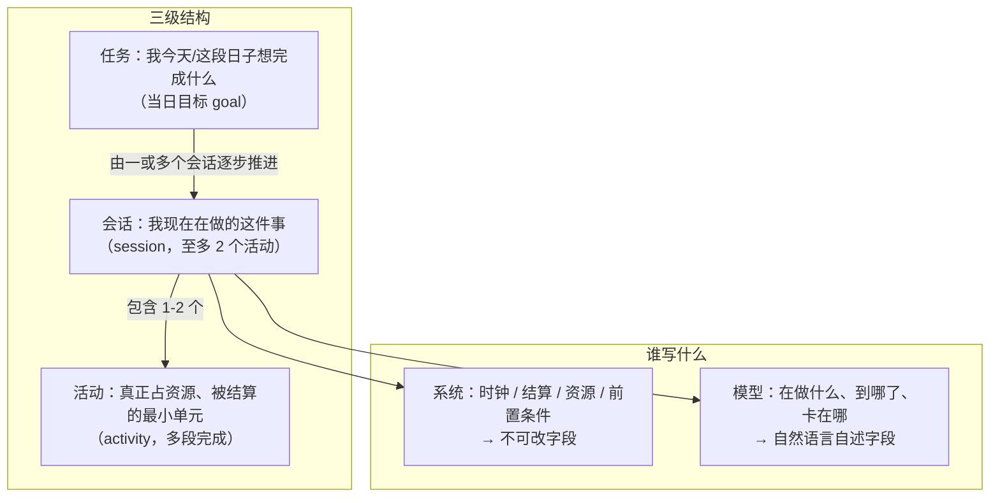
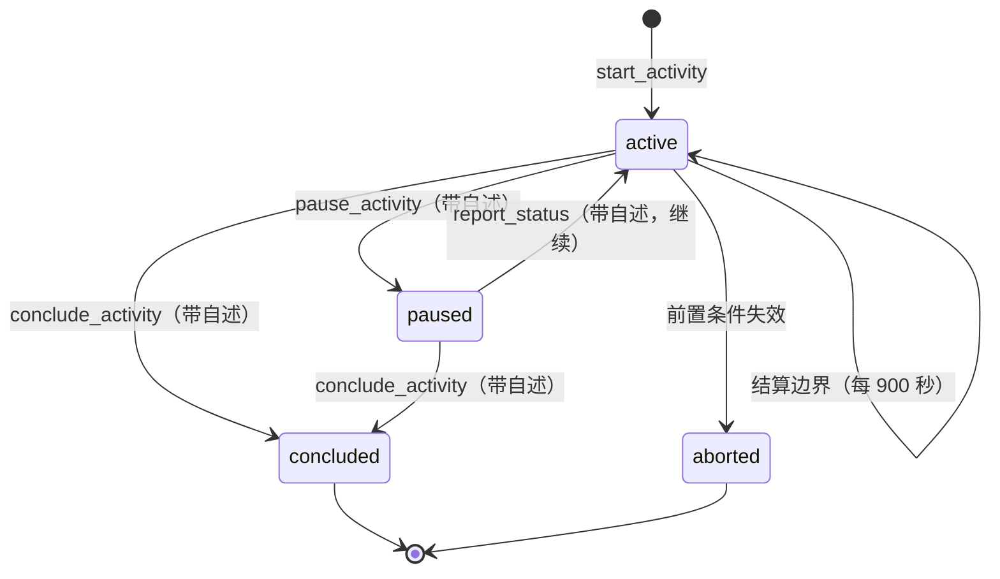
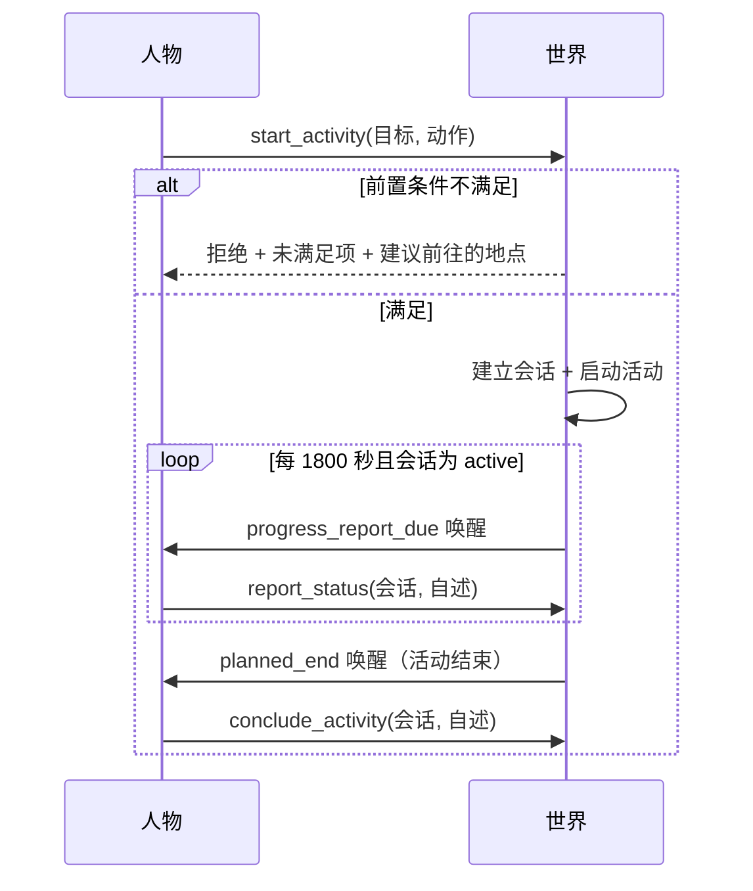
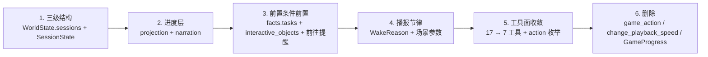

# 特性规格：数字人交互（会话层、上下文分层与稳定工具面）

> 状态：**FROZEN**；2026-09-22 冻结。依据用例心智模型与 11 路只读源码审计书写。
> 来源：[数字人交互方案](PROPOSAL-agent-interaction.md)。裁决后本规格取代该提案的全部行为定义。
> 字段与 Schema 由 [接口合同](../CONTRACTS.md) 承载；设计职责由既有设计文档承载。
> **本规格显式修订四条既有冻结条款**，见「冻结条款修订」节；该修订随本次冻结一并生效。
> **裁决状态**：原先阻断冻结的 3 项已于 2026-09-22 全部裁决，落地位置见文末「已裁决」节。
> **遗留**：2 处待消解缺口（原 3 处，「目标层进展字段的语义限定」已由裁决 #3 消解），
> 均为「规格要求 vs 代码无承载物」的实现落地项，**不改变条款语义**，清单见
> 「与既有文档的一致性核对」→「本规格自身的内部矛盾」。

## 心智模型

人物过日子不是「一次做一件事、做完再想」，而是**同时挂着若干件事、隔一阵回看进展**。
系统掌握时间、身体、结算与资源；人物掌握自己做的事进展到哪、接下来想干什么。



**一条硬边界**：模型写的任何文字都不承载状态转移。会话的进行、暂停、结束由系统字段单独推出；
模型的进展自述只改变「人物怎么理解这件事」，永不作为完成证据。

## 权威来源与范围裁决

| 内容 | 权威 |
| --- | --- |
| 会话、决策轮循环、进度层字段 | 本规格 |
| 人物工具 Schema、字段闭集、枚举 | [接口合同](../CONTRACTS.md) |
| 状态归属、结算与资源、共享时钟 | [life-runtime 规格](SPEC-life-runtime.md) |
| 决策所见、两阶段决策、预算 | [decision-context 规格](SPEC-decision-context.md) |
| 工具与活动类型准入、地点菜单 | [interaction-menu 规格](SPEC-interaction-menu.md) |
| 记忆合同、巩固与反思 | [life-realism 规格](SPEC-life-realism.md) |
| 当日目标 | [day-plan-goals 规格](SPEC-day-plan-goals.md) |
| 事件、检查点、导出 | [记录引擎设计](../design/05-recording-engine.md) |

**范围**：三级结构、会话生命周期、上下文分层与进度层、稳定工具面、决策轮循环与播报节律、
前置条件前置与前往提醒、并发上限、容量与午夜浓缩、游戏简化。

**不在范围内**：评估与交付（`evaluation/`、`delivery/`）、画像编译（`profile/`）、
语料构建（`corpora/`）、品类契约（`categories/`）、账本（`resources/`）。本规格对这些模块无任何结论。

## 三级结构与概念边界

系统里**已经有**三个不同生命周期的概念；本规格**不新增第四个**，而是明确它们的从属关系。

| 概念 | 谁创建 | 谁结束 | 可暂停 | 进展来源 | 生存期 | 状态位置 |
| --- | --- | --- | --- | --- | --- | --- |
| **任务**（当日目标 `PlanGoal`） | 人物（`plan_day`） | 系统（跨日失效 `day_end`） | 否 | 环境活动证据（语义不变） | 当日 | `AgentState.day_plan`（冻结，不改） |
| **会话**（`SessionState`） | 人物（`start_activity`） | 人物（`conclude_activity`）或系统（前置条件失效） | **是** | 系统字段 + 模型自述 | 跨多个结算边界，随目标失效 | `WorldState.sessions`（**新增**） |
| **活动**（`ActivityState`） | 人物（经会话） | 系统（`planned_end`）或人物 | 是（既有） | 结算证据 | 单次执行 | `WorldState.activities`（冻结，不改） |

### 任务与会话的关系

**任务由一或多个会话逐步推进。** 会话携带 `task_kind` 与 `task_ref` 指向它服务的任务：

| `task_kind` | `task_ref` 取值 | 说明 |
| --- | --- | --- |
| `"goal"` | `PlanGoal.intent_kind`（如 `"工作"`） | 当日目标；跨日随 `day_plan` 归零会话随之失效 |
| `"work_task"` | `task_id`（如 `backend-hourly-2026-01-05`） | 场景声明的多日工作合同 |
| `"none"` | `null` | 不服务任何已知任务（如临时散步） |

**目标层的证据规则不变**：`PlanGoal` 仍只由「正时长结算的活动」推进，`progress_activity_id` 仍是单值。
**会话层不参与目标证据的判定**——它只是人物视角的进展容器。
（推论：同一目标的多个会话不会各自改写目标证据，目标证据仍由第一个匹配活动一次性盖章。）

### 会话与活动的关系

**一个会话承载 1–2 个活动**（对应人物的「同时进行两个 activity」上限），
**一个活动可分多段完成**。

「多段」在记录里对应既有的**暂停/恢复语义**，不新增概念：
一个 `ActivityState` 记录跨多次暂停/恢复累积 `elapsed_seconds`，
暂停期间不计入；每次恢复重算 `planned_end_at`。



**会话状态闭集**：`active` / `paused` / `concluded` / `aborted`。

### 会话的状态位置

会话住在 `WorldState` 内，随 `life` 快照一起提交与恢复——检查点参与者键集是
`{"life"} ∪ {agent:N}`（`footprints/validation.py:110-111`），**会话不需要新的快照键**。

| 项 | 值 |
| --- | --- |
| 字段 | `WorldState.sessions: dict[str, SessionState]`，带 `default_factory` |
| 结构版本 | `WORLD_SCHEMA_VERSION` **5 → 6**（定义在 `src/worldmock/life/models.py:21`，`WorldState.schema_version` 是 `Literal[WORLD_SCHEMA_VERSION]` 且**无默认值**） |
| 场景声明 | **不需要**（会话是运行期生成物，同 `activities` / `deliveries`） |
| 旧检查点 | **拒绝加载**：`schema_version` 是 `Literal[WORLD_SCHEMA_VERSION]` 且**无默认值**；**不提供迁移或降级读取路径**，既有运行目录的检查点一律视为作废，需重跑而非恢复 |

## 会话字段

```json
{
  "session_id": "session-0007",
  "agent_id": 1,
  "task_kind": "work_task",
  "task_ref": "backend-hourly-2026-01-05",
  "status": "active",
  "started_at": 1767585601,
  "ended_at": null,
  "targets": ["backend-hourly-2026-01-05"],
  "activity_ids": ["activity-...-action:0001"],
  "segments": [[1767585601, 1767590401], [1767591301, 1767594001]],
  "invested_seconds": 7500,
  "effective_seconds": 6000,
  "remaining_contract_seconds": 14400,
  "preconditions_unmet": [],
  "progress_note": "锁粒度那块卡住了，先把接口对完再回头啃。",
  "note_updated_at": 1767594001,
  "note_history": []
}
```

| 字段 | 归属 | 说明 |
| --- | --- | --- |
| `session_id` / `agent_id` / `task_kind` / `task_ref` / `status` / `started_at` / `ended_at` | **系统，不可改** | 会话身份与生命周期 |
| `targets` / `activity_ids` / `segments` | **系统，不可改** | 承载对象、活动集合、分段区间 |
| `invested_seconds` / `effective_seconds` / `remaining_contract_seconds` | **系统，不可改** | 由 `segments` 投影的结算证据 |
| `preconditions_unmet` | **系统，不可改** | 未满足的前置条件与建议动作 |
| `progress_note` / `note_updated_at` / `note_history` | **模型撰写** | 结论固定标**未经核验** |

**呈现规则**：`scene` 只渲染当前会话的一句话（目标 + 进度短语）；
结构化字段进 `facts.sessions`；历史自述按上限裁剪后进 `note_history`。
**自述永不出现在「已核验经历」区段。**

| 容量 | 上限 | 承载物 |
| --- | --- | --- |
| 单会话进度层 | 4000 字符 | 该会话的全部客观字段与自述合计 |
| **进展自述** | 500 字符 | **会话级**：`SessionState.progress_note`，由模型在 `report_status` / `pause_activity` / `conclude_activity` 的 `summary` 里撰写 |
| **目标单句进展** | 500 字符 | **目标级**：`PlanGoal` 上的单句，模型叙述该当日目标推进到哪 |
| 长期记忆 | 8000 字符 | 人设层派生视图，装配时裁剪，**不删任何记录**（见下） |

**「进展自述」与「目标单句进展」是两个不同对象，不是同一概念的两个名字**：前者挂在会话上、随会话结束而归档；后者挂在当日目标上、跨日随目标归零。二者恰好共用 500 字符这一上限，但**互不替代**。

## 稳定工具面

人物动作工具**一次性收敛为 7 个**：5 个**会话动作**工具 + 2 个当日目标**登记动作**工具。

**名词定义**：**会话动作**指操纵会话生命周期的五个工具——`start_activity`、`recall_task_summary`、`report_status`、`pause_activity`、`conclude_activity`；**登记动作**指 `plan_day` 与 `revise_day_plan`，它们只登记计划、不启动活动、不消耗生活时间。
记忆工具与 `finish` 保持原样（它们不是生活动作）。

这 7 个工具名中，`start_activity`、`plan_day`、`recall_task_summary`、`report_status`、`pause_activity`、`conclude_activity` 在当前 `src/` 与 `custom/` 中作为**工具名字符串**出现 **0 次**（`start_activity` 仅作为 `activities.py:120` 的函数标识符存在，不是工具名）；`revise_day_plan` 已是既有工具名。故这是一次**工具面收敛**（17 → 7），不是改名。两类去向分别数清：

| 方向 | 计数 | 明细 |
| --- | --- | --- |
| 新工具面 | **7** | **5 个全新**（`start_activity`、`recall_task_summary`、`report_status`、`pause_activity`、`conclude_activity`）+ **2 个沿用**（`plan_day`、`revise_day_plan`，按裁决保留为独立工具） |
| 旧工具面 | **17** | **2 个整条删除**（`change_playback_speed`、`game_action`）+ **2 个沿用** + **13 个能力收进 `action` 参数** |

原先 17 个工具名分布在 45 个源文件里。

| 工具 | 可见性 | 收 | 语义 |
| --- | --- | --- | --- |
| `start_activity` | 永恒可见 | `targets[]`（≤2）、`action`、动作参数 | 开始一个会话；环境判定可行性后启动对应活动 |
| `recall_task_summary` | 永恒可见 | `task_kind` + `task_ref` 或 `session_id` | 只读回看任一任务或会话的进展；不改变世界 |
| `report_status` | 有 `active` 会话时 | `session_id[]`、`summary` | 播报进展并**继续**当前会话 |
| `pause_activity` | 有 `active` 会话时 | `session_id[]`、`summary` | 播报进展并**暂停**当前会话 |
| `conclude_activity` | 有 `active` 会话时 | `session_id[]`、`summary` | 播报进展并**结束**当前会话 |
| `plan_day` | **清醒**日首且尚无计划时 | `goals[]`（零至八条） | **登记**当日目标；不启动活动、不消耗生活时间 |
| `revise_day_plan` | 当日已有计划时（**含已提交空清单后追加**） | `goals[]`（替换全部未推进目标） | **修订**当日目标；规则同既有规格 |

**`plan_day` 与 `revise_day_plan` 保留为独立工具**（用户裁决，2026-09-22）：
二者是**登记动作**，不启动活动、不消耗生活时间，与「会话动作」语义不同，
因此不作为 `start_activity` 的 `action` 取值。其请求形状、生命周期与修订规则不变，
沿用 [当日目标规格](SPEC-day-plan-goals.md) 与 [接口合同](../CONTRACTS.md)「当日目标请求」。

### 动作参数：能力如何收进 `action`

原 17 个工具里 **13 个**的能力由**两个通道**承载：多数收进 `action` 取值，`start_parallel_activities` 的「同时启动多项」则由 `targets[]`（≤2）与并发上限取代。**每个交互对象的可用动作在交互对象层罗列**（另 2 个删除、2 个沿用为独立工具，见上表）。


| 交互对象 | `actions` 枚举（示例） | 落到的活动 |
| --- | --- | --- |
| 地点（`office`） | `travel_to` | `travel` |
| 工作任务（`backend-hourly-…`） | `work`、`submit` | `work` |
| 商品 / 供给 | `purchase` | 订单 + 后续 `consume` |
| 持有食品 | `consume` | `consume` |
| 内容（`movie-0001`） | `watch` | `watch` |
| 游戏（`game-…`） | `play` | `play_game` |
| 同场人物 / 联系人 | `chat`、`call`、`message` | `chat` / `call` |
| 邮件 | `read` | `read_mail` |
| 生活活动目录条目 | `do` | `lifestyle:*` |
| 自身 | `wait`、`sleep` | `wait` / `sleep` |

**绑定粒度（用户裁决，2026-09-22）**：`action` 枚举**按对象绑定**——
每个交互对象只暴露对它自己合法的动作，不给出跨对象的全局动作表。
因此 `action` 不是一个全局枚举，而是 `facts.interactive_objects[].actions` 的并集投影。
（取舍：更精确，但每轮需按当前可见对象重建 Schema；全局绑定更简单，代价是给出对该对象不合法的动作。）

**Schema 约束**：`start_activity` 的 `action` 取值由**本轮可见对象**绑定为闭集；
动作专属参数用 `anyOf` 表达（既有 `start_parallel_activities` 是同一先例，
`life/models.py:876`）。

DeepSeek strict 模式**禁用六个 Schema 键**（`life/models.py:1015` `_DEEPSEEK_UNSUPPORTED_SCHEMA_KEYS`）：
`oneOf`、`minLength`、`maxLength`、`minItems`、`maxItems`、`default`。

由此产生一条硬约束：**字符上限与「至多 2 个」的并发上限都不能写在工具 Schema 里**，
只能在提示词与业务规则中表达。故并发上限的 Schema 侧无约束，
`SESSION_LIMIT_EXCEEDED` 由业务规则独立兜住。
所有属性必须必填（strict 模式要求），不设缺省值（`default` 亦在禁用清单内）。

**一次决策仍只提交一个生活动作**（`SPEC-life-runtime.md` 不变）。
`targets[]` 是**一个动作的多目标**，不是多个动作；不相容整组拒绝。
`plan_day` / `revise_day_plan` 作为 `action` 值时**不启动活动**——它们是登记动作，
与既有语义一致（既有规格已允许咨询类动作不产生活动时间）。

### 保护项修订

保护集随工具面收敛为四类：

| 类别 | 成员 | 为什么必须保护 |
| --- | --- | --- |
| 永恒可见 | `start_activity`、`recall_task_summary` | 不保留则人物无法开始任何事、无法回看进展 |
| 会话的退出通道 | `report_status`、`pause_activity`、`conclude_activity` | **有会话时必须可见**：三者是结束会话的**唯一**手段，剪掉会让会话永久挂起 |
| 「自身」对象的动作 | `wait`、`sleep` | 不保留则无法等待与睡眠 |
| 当日目标登记 | `plan_day`、`revise_day_plan` | 不保留则无法登记或修订当日目标；二者的条件可见性不变（**清醒**日首尚无计划时只开放 `plan_day`，已有计划时开放 `revise_day_plan`） |

**地点菜单不再剪裁工具，只剪裁对象的 `actions` 枚举。**

## 决策轮循环与播报节律



| 触发 | 来源 | 是否调用模型 |
| --- | --- | --- |
| 会话持续超过 `progress_report_interval_seconds` | **新增** `progress_report_due` | 是（一次决策机会） |
| 活动返回结果（`planned_end`） | 既有成员 | 是 |
| 某任务的 DDL 临近 | 既有 `task_due_soon` + `commitment_threatened` | 是 |
| 会话暂停中 | 不触发 | 否 |
| 人物睡眠中 | 被 `SLEEP_ALLOWED_REASONS` 过滤 | 否 |

**实现要点**：`SLEEP_ALLOWED_REASONS`（`schedule.py:54`）存的是 **`WakeReason` 枚举成员**而非字符串，当前 3 项（`planned_end`、`run_start`、`wake_from_sleep`）。过滤在 `schedule.py:303`，写法是**白名单**：

```python
if snap.is_asleep:
    reasons = [r for r in reasons if r in SLEEP_ALLOWED_REASONS]
```

因此新增的 `progress_report_due` **天然被睡眠过滤掉，不需要额外代码**。真正的风险是反向的：若有人把它加进 `SLEEP_ALLOWED_REASONS`，人物就会在睡眠中被播报唤醒。故验收断言是「**该成员不在集合内**」，而不是「加一份过滤逻辑」。

| 参数 | 值 | 性质 |
| --- | --- | --- |
| `progress_report_interval_seconds` | **1800** | **场景参数**（与 `reconsideration_interval_seconds` 同类）；非正整数被拒 |

**播报同时是一次决策机会**：人物可在播报时顺手暂停、切换或结束会话，与「一次决策一个动作」不冲突。
**沉默边界仍不调用模型**：结算边界照常产生 `activity_progress`，只有唤醒条件命中才提供决策。

## 前置条件前置与前往提醒

**规则一：前置条件必须在动作前进入提示**，不靠撞墙学习。

| 前置条件 | 判定处 | 是否已在提示中 |
| --- | --- | --- |
| 必需地点 `required_location_id` | `work.py:61` `WORK_LOCATION_REQUIRED` | **否 → 进入 `facts.tasks`** |
| 必需技能与门槛 | `work.py:59` `WORK_SKILL_INSUFFICIENT` | **否 → 进入** |
| 合同最长时长 | `work.py:69` `WORK_DURATION_EXCEEDS_CONTRACT` | 部分（`remaining_contract_seconds`） |
| 地点营业状态 | `basket.py:144-146` | 已在 `scene.reachable_places` |
| 地点资格 `required_qualifications` | `basket.py:140` `LOCATION_ACCESS_DENIED` | **否 → 进入** |
| 能量可行性 | `engine.py:1205` `INSUFFICIENT_ENERGY` | **有意不进提示**（不变） |

**规则二：前置条件不满足时，拒绝必须给出可执行的下一步，并点名具体地点。**
这是本规格新增的强制要求：人不是碰壁才知道，而是被明确告知「去那里」。

| 错误码 | `data` 必含 | 说明 |
| --- | --- | --- |
| `ACTIVITY_PRECONDITION_UNMET` | `unmet: [...]`、`suggested`（JSON 对象：`"action": "travel_to"`，外加 `destination_id` 与 `destination_name`） | 当未满足项含地点时，`suggested` **必须**给出具体地点 id 与显示名 |

**呈现规则**：
- `facts.tasks[]` 增加 `required_location_id`、`required_skill`、`minimum_skill`、`maximum_duration_seconds`、`required_effective_seconds`；
- `facts.interactive_objects[]` 每项带 `actions` 枚举与 `preconditions_met`；
- `scene` 在前置条件未满足时补一句中文说明并点名地点
  （例如「这份工作要在办公室做，先去张江高科技园区办公室」）。

## 游戏简化

**游戏不再有命令回路。** 人物选择一个游戏名称，之后按播报节律自述「玩的时候做了什么」。

| 项 | 处理 |
| --- | --- |
| `game_action` 工具 | **删除** |
| `GameActionRequest` | **删除** |
| `_game_action` / `_store_game_outcome` handler | **删除** |
| `run_game_command` 与 TextWorld 回放 | **删除** |
| `AgentState.game_sessions` / `GameProgress` | **删除** |
| `game_boundary` 合同（`engine.py:184`、`:198`、`:202`、`:213`；`catalog/affordances.py:101`、`:275-278`、`:444-458`） | **须一并收敛，但它是另一条链路**：`game_boundary` 表达「该活动允许继续交互」，与命令回路不是一回事。本次 11 路审计中「命名冲突」那一路特意分开了二者，实现时不要混同 |
| 启动期 `verify_game_progress`（`engine.py:733-734`） | **删除**（校验对象随 `game_sessions` 消失） |
| `play_game` 活动 | **保留**：与 `watch` 同形——有目标、有时长、有进度结算、有进展自述 |
| 游戏内容（30 个 `games` 声明 + 80 条 `game_session` 内容） | **保留**，成为 `play` 动作的合法目标 |
| `playback_speed` | 开播时由 `action` 参数设定；**播放中改速的能力删除**（`change_playback_speed` 一并删） |

## 上下文分层

提示仍由确定性代码渲染，分七层，**全部落在既有的 `persona_card` / `scene` / `facts` 三段之内**，
不新增顶层段（`SPEC-life-runtime.md:637` 的三段划分不变）。

| 层 | 落点 | 说明 |
| --- | --- | --- |
| system | system 消息 | 沿用 `_LIFE_INSTRUCTIONS`；回合预算块不动 |
| 人设层 | `persona_card` + 记忆段 | 卡片 ≤600 汉字；长期记忆 ≤8000 字符（派生视图） |
| 目标层 | `facts.day_plan` + `scene` 一句 | 目标对象**增加**单句进展字段，不新增优先级字段。该句是**模型撰写的主观叙述**，**不是**会话客观字段的投影（用户裁决：目标层不吸收会话进展） |
| 环境层 | `scene` | 体感只给分级（不变），数值仍不进提示 |
| 交互对象层 | `facts.interactive_objects` | 每个对象带 `actions` 枚举与前置条件状态 |
| 进度层 | `facts.sessions` + `scene` 一句 | **本规格新增**；层内结构化 |
| 工具层 | 工具 Schema | 7 工具（5 会话动作 + 2 当日目标登记），`action` 枚举按对象绑定 |

**进度层内部结构**（用户裁决）：客观字段与自述字段**同在一层**，客观字段不可改，
自述字段是自然语言总结；各层内部同样结构化。

## 容量、浓缩与遗忘

### 午夜浓缩

**新增第四个巩固触发**：模拟时钟跨过当日 `day_end_seconds` 边界时，对该人物的全部会话执行一次浓缩。

| 动作 | 结果 |
| --- | --- |
| 逐会话总结 | 写入该会话 `progress_note`，压到 4000 字符内 |
| 目标层单句更新 | 每个目标一句话，≤500 字符 |
| 已结束会话归档 | 摘要进入人设层长期记忆 |

### 遗忘是派生视图，不是销毁

长期记忆上限 **8000 字符**由装配时裁剪呈现窗口实现，**不删任何记录**：

- `episodes.jsonl` 只追加，`episode_counter == len(records)` 不变；
- `episodes_sha256` 证据链不变；
- `MEMORY.md` 装配公式可扩展，但已核验经历与身份区段不可被模型改写；
- 「模型自行选择遗忘」的语义是**选择哪些进呈现窗口**，不是删除记录。

## 事件与重建约束

硬约束：**SQLite 记录是唯一提交权威，导出时活动会从事件重建并逐字节比对**
（`footprints/validation.py:33-34`），质量报告也必须能仅从事件复现（`:42-54`）。

**结论：不需要新增事件类型。** 七个工具都是生活动作（两个当日目标登记工具也走既有 `plan_day` / `revise_day_plan` 落库路径），请求随既有 `action_requested` 事件落库
（含完整 `request` 与 `request_sha256`）：

| 内容 | 审计路径 |
| --- | --- |
| 会话的开始 / 暂停 / 继续 / 结束 | `action_requested`（`tool_name` + `request`） |
| 模型的进展自述 `summary` | 同上，在 `request.summary` 内 |
| 会话的客观结算 | 既有 `activity_progress` |
| 会话快照与分段区间 | 世界状态，随 `life` 快照保存 |

**这同时确认**：进展自述一旦提交就永久留在 append-only 记录里，**不可能被遗忘**。

## 冻结条款修订

| # | 被修订条款 | 原文 | 修订后 | 连带改动 |
| --- | --- | --- | --- | --- |
| 1 | `WakeReason` 冻结词表 | 「唤醒原因是冻结词表，成员不可增删」 | **增加成员** `progress_report_due`，并把条款改为「不可改名、不可删除，新增须走版本表」 | **代码同步点共五处**（三处生产代码 + 两处测试），唯一权威定义见[文档影响](research/agent-interaction-document-impact.md)「唤醒词表的五处同步点」节。其中 `footprints/quality.py:384-399` 的「未识别」分桶最易漏——**它不报错，只让质量报告的数字变错**。另需同步 `CONTRACTS` 枚举表与 life-runtime 冻结词表 |
| 2 | 活动组合准入 | 「活动准入**仅**按占用交集判定」 | 保留占用交集，**追加**并发上限：`active` 会话 ≤2，由场景参数 `max_concurrent_sessions`（缺省 2）给出，超限报 `SESSION_LIMIT_EXCEEDED` | `rules.validate_start`、`interaction_menu`、错误码闭集、场景参数表 |
| 3 | 主观巩固触发 | 「为**三选一**」 | 改为**四选一**，增加「跨过当日 `day_end_seconds` 边界」 | `should_consolidate`、`SPEC-life-realism.md`「记忆合同」、`CONTRACTS` |
| 4 | 观察投影三段**与不得进入提示的内容** | 「user 消息由 `persona_card`、`scene`、`facts` 三部分组成」+「不得进入提示的字面键清单见 `CONTRACTS.md`」 | **三段划分不变**；但新增的 `facts.interactive_objects[].actions` **正是**既有禁表里的 `affordance_contract`（`narration.py:59`），故本条**确为真修订**，须显式解禁该形状 | `projection.py`、`narration.py`、`CONTRACTS`「观察投影字段」与「禁止进入提示的字段」 |

**未被修订的既有语义**：只有环境能改世界状态；一次决策一个生活动作；沉默边界不调用模型；
体感数值不进提示；已核验经历只由已提交事件确定性投影；SQLite 记录是唯一提交权威。

## 实现顺序

用户裁决：**一次性替换全部 17 个工具**，不分期。
五个全新工具名**作为工具名**在当前代码中出现 0 次（另 2 个沿用既有工具名），故第 5 步是收敛工具面而非改名；两个待删工具是删除，不是保留。建议的内部顺序（同一变更集内）：



## 与既有文档的一致性核对

**本节只登记不一致，不修改既有文档。** 既有文档的改动需另行裁决；
本节的作用是让「哪些文档在什么位置与新规格冲突」有唯一清单，供后续逐一处理。

核对口径：以本规格为一方，以现行文档树为另一方，逐条给出位置与冲突性质。

### 术语冲突（需先裁定，否则改动会互相污染）

| 冲突 | 位置 | 性质 |
| --- | --- | --- |
| 「事务」一词两义 | `docs/design/05-recording-engine.md:127`、`:417` 指**数据库事务**；本规格原文用「事务」指交互单元 | **本规格已让步**：改称**「会话」（`session`）**，数据库事务沿用「事务」不动。「会话循环」改称「**决策轮循环**」，沿用 `CONTRACTS.md:285` 既有的 `DecisionRoundState` 说法 |
| 「会话」一度被占用 | 本规格早期版本用「会话循环」指模型调用轮 | 已腾出；两份新文档与 `docs/INDEX.md` 的登记行已同步为「决策轮循环」 |
| 「事务」在本提案中的历史用法 | `docs/dev/PROPOSAL-agent-interaction.md`（32 处，含第 54–87 行的**用户原话**） | **不改写**。提案是已裁决的历史证据，逐字引用按「保留原身份」原则不动；阅读时按上面的映射理解 |

### 既有文档与本规格的实体冲突

| # | 位置 | 冲突 | 建议处理 |
| --- | --- | --- | --- |
| 1 | `docs/dev/SPEC-life-runtime.md:93` | 「唤醒原因是冻结词表，成员不可增删」 | 已在「冻结条款修订」#1 显式修订 |
| 2 | `docs/dev/SPEC-life-runtime.md:106` 与 `docs/design/04-simulation-engine.md:509` | **两处都链接到 `05-recording-engine.md#决策节律增量字段`，而该节在 `05` 中不存在**（**69** 个标题无一匹配，grep 计数 0）。`CONTRACTS.md:1260` 记录了该节**曾被新增**（`2026-09-18-revision-2` 行），说明该节随后被移除或改写；`05` 的版本表 5 行（`:819-823`）**均无删除或丢失记录** | **恢复该节或改指两处链接**。规格的修订条款 1 牵连 `rhythm.py` 快照与 `CONTRACTS` 枚举表，其字段级归属正是缺失的那一节——**不能把断链带下去** |
| 3 | `docs/design/04-simulation-engine.md:292` | 「该动作可以原子启动**两项及以上**兼容持续活动」——无上界枚举 | 改为「至多两个」；与冻结条款修订 #2 同批 |
| 4 | `docs/design/04-simulation-engine.md:505-506` | 枚举 15 项唤醒条件，缺 `progress_report_due` | 与冻结条款修订 #1 同批 |
| 5 | `docs/design/04-simulation-engine.md:516` | 「营业变化、报价生效/失效、调价和补货进入既有事件时钟，**不增加周期轮询**」 | 播报节律**正是**周期边界，此句须限定范围，否则读作禁止播报 |
| 6 | `docs/design/05-recording-engine.md:3` | 自称「**已整合**；原已冻结的接口与行为约束继续有效」，**不是 DRAFT** | 其接口表（表头在 `:340`、`:401`、`:537`、`:618`、`:717`、`:792` 共 **6 处**）因此具备**规范效力**，本轮改动是「已整合文档的冻结条款被修订」，不是「草稿吸收新主张」——**这是全部文档改动的第一件事** |
| 7 | `docs/design/05-recording-engine.md:549` | 「世界结构版本为 `5`」 | 改为 `6`；每个既有运行目录的检查点都变为不可加载 |
| 8 | `docs/design/09-io-formats.md:75` | `schema_version` 为 `Literal[5]` | 改为 `Literal[6]` |
| 9 | `docs/design/09-io-formats.md:60-65` | 「不新增 `WorldState` 或 `AgentState` 字段」 | **这半句已错**：`sessions` 确实新增 `WorldState` 字段；`interaction_menu` 部分仍成立 |
| 10 | `docs/design/09-io-formats.md:67`、`:206`、`:212` | 三个顶级标题**无编号**，子节却是 `3.1`–`3.4` 与 `9.1`–`9.3`，`2.`–`8.` 父节不存在 | 引用时按标题名而非编号，避免传染该缺陷 |
| 11 | `docs/design/00-overview.md:11-12` | 「本目录仍为草稿，修订**不改变冻结规格**或实现状态」 | 对本变更**为假**。须改写为承认规格可以修订冻结条款，并写明修订权威在设计目录**之外** |
| 12 | `docs/design/00-overview.md:177`、`:206` vs `docs/design/01-architecture.md:24` | 前者称 `v1.0 单人物`，后者称人数属运行配置；仓内已有 `multi-person.json` 与 `multi-person-half-day.json` | **既有矛盾，独立于本特性**；`00` 是过时一侧 |
| 13 | `docs/design/08-configuration.md:10` | `## 版本历史` 在**文首**；其余设计文档在文末或名为「版本表」 | 归一化项 |
| 14 | `docs/design/08-configuration.md:146-150`、`:169`、`:173`、`:291`、`:312` | 保护项按**类别描述**（已不匹配）；点名 `discover_places` 与 `start_parallel_activities` 两个收敛中的工具 | 须逐项列出收敛后的保护集 |
| 15 | `docs/CONTRACTS.md:114` | 「删除旧的 `start_activity`、`change_ac…`」历史说明 | 工具面再次收敛后此句须重写 |
| 16 | `docs/dev/implementation-status.md:215-219` | 「当前世界格式：`WorldState.schema_version` 为 5」 | **本轮不改**：它记录的是**实际已实现状态**，5 就是当前事实。实现落地时才改 |
| 17 | `docs/dev/ANALYSIS-spec-coverage.md` | 基线 435 条条款、gap 0 | 本规格的每条新条款需补映射（映射义务，非机器判定） |
| 18 | `evaluation/goal_metrics.py:13` | `EXTERNAL_CONSTRAINT_ERROR_CODES` 是 **13 项闭集**，把业务拒绝分为「外部约束」与「其他」 | **本规格未覆盖的连带面**：新增的 `ACTIVITY_PRECONDITION_UNMET` 本质正是外部约束（地点/技能不满足），**须决定是否进该集合**；不进则外部约束统计会漏记 |
| 19 | `docs/dev/SPEC-life-realism.md:125` | 「**主观巩固触发**为**三选一**：`importance` 累计到 3.0；待巩固满 10 条；入睡后第一个边界」 | 冻结条款修订 #3 的原文出处，须改为**四选一**（增加「跨过当日 `day_end_seconds` 边界」） |
| 20 | `docs/dev/SPEC-life-runtime.md` 的「活动组合政策」 | 「活动准入**仅**按占用交集判定」 | 冻结条款修订 #2 的原文出处，须改为「保留占用交集 + 追加并发上限 `max_concurrent_sessions=2`」 |
| 21 | `docs/dev/PROPOSAL-agent-interaction.md` | 用「事务」「事务循环」 | **不改**；映射见上方术语冲突表 |
| 22 | `narration.py:59` 与 `docs/CONTRACTS.md:734-737` | **`affordance_contract` 在 `FORBIDDEN_OBSERVATION_KEYS` 内**；`CONTRACTS` 明写「可供性合同**只供宿主生成工具身份枚举与公开名称说明，不随提示下发**」。而本规格要求把每个对象的 `actions` 枚举放进 `facts.interactive_objects` | **确为真修订**（不是扩展）：这正是对「不得进入提示的内容」的改动，故冻结条款修订仍是**四条**。须在该两处显式解禁 `interactive_objects[].actions` 这一形状，并说明它与禁表其余各项（完整活动快照、菜单、能量可行性）的边界 |

### 新规格与代码实况的差距（影响实现，不属于文档一致性）

| # | 事项 | 实况 |
| --- | --- | --- |
| 1 | `facts` 的现有键 | **14 个**：`current_time`、`current_epoch`、`location_id`、`people_here`、`contacts`、`inbox`、`tasks`、`routes`、`products`、`inventory`、`day_plan`、`felt`、`drive_summary`、`recent_action_results`（`projection.py:223-236`） |
| 2 | `interactive_objects` | **不存在**。最接近的是 `facts.products`（供给比较事实）与 `facts.routes`（地点行）；后者的 `ROUTE_ALLOWED_FIELDS` 白名单（`narration.py:103-112`）会**直接拒绝**新增 `actions` 字段 |
| 3 | 「可用动作」的现有注册表 | `REQUEST_MODELS`（工具名）与 `SURFACE_TOOLS`（`affordances.py:40`，也是工具名）。规格要求的 `travel_to` / `work` / `submit` / `purchase` / `consume` 这批**动作名在源码中出现 0 次** |
| 4 | 前置条件字段的数据来源 | 五个字段**全部已存在**于 `WorkTaskConfig`（`scenario.py:317`、`:320`、`:321`、`:322`、`:323`），且在事件级 `data["tasks"]` 里已暴露（`observe.py:221-235` 是单任务构造 `_visible_task`，其 `model_dump` 在 `:227`，**排除** `oracle_path`/`oracle_sha256`/`input_path`；`data["tasks"]` 的赋值在 `observe.py:131`）。**缺的不是数据，是 `_task_fact_rows` 没有透传** |
| 5 | 字符预算 | 常量表在 `narration.py:41-52`（user 40000 / system 3000 / scene 800 汉字 / 卡片 600 / 决策自述 200）。**`facts` 段没有任何独立上限**，唯一约束是 user 消息总预算 40000。规格给的 4000 / 500 / 8000 三档在源码中**无对应常量** |
| 6 | `progress_note` 的既有可复用通道 | 逐会话跨轮持久的主观字段**当前不存在**。详因与承载物缺口见「本规格自身的内部矛盾」#3（此处不重复登记） |
| 7 | `session` 命名占用 | 既有 `session` 全在别处且语义不同：游戏会话（`models.py:256`、`engine.py:1169-1171`、`:1356-1376`）、`GameProgress.session_id`（`models.py:224`）、质量统计的**内容观看**会话（`quality.py:220-261` 是 `_contact_summary` + `_watch_repeats`，**与睡眠无关**）与**睡眠**会话（`behavior_metrics.py:454-490`）。**`WorldState.sessions` 无直接冲突**，但游戏那一支要在同一变更里删除 |
| 8 | 覆盖门禁的接口判定 | 只统计**非下划线开头**的 `def`/`async def`。`SessionState` 作为类本身不触发，但其**公共方法**会——新状态类必须自带测试，不能留 `...` 占位 |

### 术语进一步收窄：「会话」与内容品类字面 `"game_session"` 同词两义

本次 11 路审计中「命名冲突」那一路的结论：**`WorldState.sessions` 与 `SessionState` 在代码里零占用**
（当前只存在于本规格与影响文档），AS2 层的同名概念一律叫 **workspace**（`runtime.py:530-559`、
`src/worldmock/footprints/checkpoint.py` 的 `snapshot_directory` 与 `restore_directory`），数据库事务叫「事务」，无需让名。

**但有一处同词两义会随本变更存活**：内容品类字面 `"game_session"` 是既有闭集成员
（`presentation.py:56` `GAME_CATEGORY`、`observe.py:552-570`、`src/worldmock/validation.py:39`（**注意与同名 `footprints/validation.py` 区分**）、`scenario.py:366`、
`catalog/affordances.toml:279`），指「一种游戏内容品类」；而本规格的「会话」指「人物视角的交互单元」。
删掉 `AgentState.game_sessions` **不会**消除这层混淆——30 个 games 声明与 80 条内容按本规格明确保留。

两条出路，冻结前须择一：

| 方案 | 改法 | 代价 |
| --- | --- | --- |
| 改品类侧 | 品类字面改为 `play_catalog`（对齐本规格把游戏动作定为 `play`，以及对 `_game_pool` 的既有写法） | 动语料与场景，**会影响 `corpora/manifest.json` 哈希与 80 条内容身份** |
| 改模型侧 | `SessionState` → `InteractionState`，`WorldState.sessions` → `WorldState.interactions` | 不动语料；`interaction` 是仓内既有词（`interaction_menu`、`InteractionMenu`），不生造 |

### 单句进展字段对冻结 `PlanGoal` 的破坏面

「目标层增加单句进展字段」这条要落地，必须先知道代价。逐行核实的结论：

| 项 | 事实 |
| --- | --- |
| `PlanGoal` 合同 | `schedule.py:175-194`；`extra="forbid"`、`frozen=True`（`:178`）；字段 `intent_kind`、`goal`（≤300，`PLAN_GOAL_MAX_CHARS`，`:29`）、`registered_at`、`progressed_at`、`progress_activity_id`；唯一校验器 `_check_progress`（`:185-194`） |
| 加【可选】字段的破坏面 | **0 处必改**：不撞任何校验器；`DayPlan._check_plan` 的唯一性与 `day_end` 边界不变式都不读它；`progress_day_plan` 的 `model_copy(update=…)`（`:367`）会原样带过 |
| 加【必填】字段的破坏面 | **2 处源码 + 4 处测试**直接构造点全断（源码 `engine.py:1390`、`:1411`；测试 `test_day_plan.py:21-22` 的 `goal()` 工厂（该文件内引用 **25** 处）、`test_grounded_observation.py:146`、`test_model_input_killpoints.py:144`、`:148`），另有 5 处裸字典夹具缺键。**注意** `schedule.py:221`、`:345`、`:369` 三处是 `DayPlan(...)` 构造而非 `PlanGoal(...)`，加字段本身不断它们 |
| 500 上限的生效方式 | `model_copy(update=…)` **不重跑校验器**，所以 `Field(max_length=500)` 在这条路径上不生效——**必须自写校验器**，否则上限形同虚设 |
| `revise_day_plan` 的行为 | 未推进目标**文字一变**，旧对象不再复用，**旧进展句随对象丢掉**；`goal_metrics._revise_goals`（`evaluation/goal_metrics.py:220-229`）的 `discarded` 实例也没有这一列。若要保留，须另立字段 |
| 与 300 的关系 | `goal` 上限 300 不变；500 的进展句是**并列的第二条文本**，不是放宽 300 |
| 进不进请求模型 | **绝对不进**。`PlanGoalInput` 加了可选字段会撞 `_validate_deepseek_object`（`models.py:1053-1059`，要求 `set(required) == set(properties)`），而 `_DEEPSEEK_UNSUPPORTED_SCHEMA_KEYS` 禁用 `maxLength` |

### 本规格自身的内部矛盾（须在冻结前消解）

**计数口径**：表中**待消解缺口**为 **2 条**（#2、#3）——二者都是「规格要求 vs 代码无承载物」的差口，**不是措辞矛盾**；#1 已由裁决 #3 消解，保留在表首作为已闭合记录。

| # | 矛盾 | 状态与说明 |
| --- | --- | --- |
| 1 | **「目标层增加单句进展字段」vs「不吸收会话进展」** | **已消解**（裁决 #3，2026-09-22）：目标层那句进展限定为**模型撰写的主观叙述**，不是会话客观字段的投影。限定已写入「上下文分层」目标层行 |
| 2 | 「facts 段无独立字符上限」vs 规格给的三档容量 | 规格给了 4000 / 500 / 8000，而 `narration.py:41-52` 的常量表里 **facts 段没有独立上限**（唯一约束是 user 消息 40000）。三档容量要么落成新常量，要么明确只是装配时的裁剪目标 |
| 3 | 「逐会话跨轮持久的主观字段」不存在 | **属性是「规格要求 vs 代码无承载物」**（与 #2 同类，均属需在实现前落定的缺口，非措辞矛盾）。既有持久主观通道只有 memory episode 分区（`life_memory.py`），粒度是 `type`/`epistemic_status` 而非 `session_id`；决策自述（`life_agent.py:785-788`）是单轮实例属性、**不持久**。`progress_note` 需要的「逐会话 + 跨轮 + 持久」在当前代码中没有承载物 |

### 删除游戏命令回路的间接断点（补充）

`_life_snapshot`（`engine.py:1783-1790`）把每个 `GameProgress` dump 进 `{"games": [...]}`，
经 `:697` 写成 `kind="life_checkpoint"` 素材。关键事实：**该收据只写不读**——
全仓没有代码回读并比对 `games`。因此删除断的是**文档描述**（`docs/design/09-io-formats.md:133`
有 `| game_sessions | dict[str, GameProgress] | 是 | 游戏会话 |` 整行、`05-recording-engine.md` 的收据描述），
**不是校验路径**（`store.py:243-254` 与 `validation.py:110` 只校验键集 `{"life"} ∪ {agent:N}`）。

另需一并收敛的两条**同源但独立**的链路：`engine.py:733-734` 的启动期 `verify_game_progress`；
以及 `game_boundary` 合同（`engine.py:184`、`:198`、`:202`、`:213`；`catalog/affordances.py:101`、`:275-278`、
`:444-458`）——后者是「活动继续交互能力」，与命令回路不是一回事，收敛时要分清。

**好消息**：三个游戏错误码（`GAME_SESSION_NOT_ACTIVE`、`GAME_ACTIVITY_NOT_ACTIVE`、`GAME_COMMAND_TOO_EARLY`）
**不在** `docs/CONTRACTS.md` 的错误码闭集表里（那张表是社交拒绝码与结算拒绝码），所以**没有文档表要减行**。

## 文件修改清单

见 [文档影响与文件修改清单](research/agent-interaction-document-impact.md)。

## 验收台账

| 契约点 | 验收口径 |
| --- | --- |
| 会话生命周期不可由自述推进 | 删除全部 `progress_note` 后，会话状态与数字逐字节不变 |
| 三级结构 | 任务由多个会话推进时目标证据规则不变；单会话 1–2 活动；单活动多段累积 |
| 一次决策一个生活动作 | 多动作响应被拒；`start_activity` 多目标被判为一个动作 |
| 并发上限与占用交集同时生效 | 二者各自独立的拒绝用例 |
| 睡眠不播报 | 睡眠期跨越多个播报边界，`decision_started` 计数为零 |
| 沉默边界不调用模型 | 无唤醒条件的边界不产生 `model_request` |
| 前置条件进提示 | 未满足时 `facts` 含未满足项且 `scene` 点名具体地点 |
| 前往提醒 | `ACTIVITY_PRECONDITION_UNMET` 的 `suggested.destination_id` 非空且可解析 |
| 游戏简化 | `play_game` 可启动、按播报节律自述、无命令回路；`game_action` 全链路不存在 |
| 遗忘是派生视图 | 裁剪后 `episode_counter == len(records)`、`episodes_sha256` 链完整、检查点可恢复 |
| 午夜浓缩 | 跨日边界产生一次浓缩且不改已核验经历 |
| 词表修订一致 | **代码同步点五处**（`schedule.py` 枚举；`WAKE_REASON_NAMES` 与写入期校验**合为一处**；`quality.py` 分桶；`test_event_fields.py`；`test_wake_reasons.py`）逐处通过；**文档同步面三处**（本规格修订表、`CONTRACTS` 枚举表、life-runtime 冻结词表）逐字一致。唯一权威定义见[文档影响](research/agent-interaction-document-impact.md)「唤醒词表的五处同步点」 |
| Schema 禁用键合规 | `deepseek_strict_schema` 生成的 `start_activity` Schema 不含禁用键；字符上限与并发上限由校验器承担 |
| 播报间隔是场景参数 | `progress_report_interval_seconds` 缺省 **1800**；场景可覆盖；非正整数被拒 |
| 播报原因不被睡眠吞掉 | 断言 `progress_report_due` **不在** `SLEEP_ALLOWED_REASONS` 内；睡眠期跨越播报边界不产生决策 |
| `recall_task_summary` 只读 | 调用前后世界状态、账户、库存、活动集合逐字节不变 |
| 旧检查点被拒 | `schema_version` 为 5 的检查点 `model_validate` 直接失败；不迁移、不降级读取 |
| 登记工具条件可见性 | **清醒**日首尚无计划时只开放 `plan_day`；已有计划（**含空清单后追加**）开放 `revise_day_plan`；提交空清单后 `plan_day` 关闭。二者都不启动活动、不消耗生活时间 |
| `action` 按对象绑定 | 对同一轮 `facts.interactive_objects` 逐对象断言：其 `actions` 枚举不含该对象不合法的动作 |
| 上限由校验器而非 Schema 承担 | `start_activity` 的 Schema **不含**字符上限与「至多 2 个」约束；越界由校验器拒绝并给出业务错误码 |
| 自述不改写系统字段 | 提交任意内容与长度的 `summary` 后，会话的 `status`、`segments`、`invested_seconds` 等客观字段逐字节不变 |
| 会话状态闭集 | 断言状态取值落在 `active` / `paused` / `concluded` / `aborted` 内；非法转移被拒 |
| 不新增事件类型且请求可审计 | `EventType` 仍为 **14** 项；四个会话工具的请求落在 `action_requested`，`request_sha256` 存在且可复算 |
| 自述不进已核验经历 | `progress_note` 与 `summary` 的任何内容都不出现在 `verified_experiences` 投影区段 |

## 已裁决（2026-09-22）

| # | 事项 | 裁决 | 落地位置 |
| --- | --- | --- | --- |
| 1 | `action` 枚举的绑定粒度 | **按对象绑定**：每个交互对象只暴露对它合法的动作 | 「动作参数：能力如何收进 `action`」的「绑定粒度」段 |
| 2 | `plan_day` / `revise_day_plan` 是否保留为独立工具 | **保留为独立工具**（登记动作不启动活动，与会话动作语义不同） | 「稳定工具面」工具表，共 **7** 个工具；「保护项修订」第三、四类 |
| 3 | 目标层是否吸收会话进展 | **不吸收**：目标层那句进展是**模型撰写的主观叙述**，不是会话客观字段的投影 | 「上下文分层」目标层行；消解了与「容量、浓缩与遗忘」的表面冲突 |

## 版本表

| 版本 | 日期 | 修订内容 |
| --- | --- | --- |
| 1.0 | 2026-09-22 | 首次书写（待裁决）：三级结构、七层上下文与进度层、5 工具面与 `action` 参数、播报节律、前置条件前置与前往提醒、并发上限、午夜浓缩、游戏简化；显式修订四条既有冻结条款。**本行的「5 工具面」与「`action` 参数未定绑定粒度」已由 1.1 取代** |
| 1.1 | 2026-09-22 | 三条阻断项裁决落地：`action` 改为**按对象绑定**；`plan_day` / `revise_day_plan` **保留为独立工具**（工具面 5 → **7**）；目标层进展句限定为**模型叙述、非会话投影**。另查明第四条修订的真因是 `facts.interactive_objects[].actions` 落在既有禁表内（`narration.py:59`），故四条成立 |
| **1.2** | 2026-09-22 | **提交冻结**：状态由「待裁决（未冻结）」改为 **FROZEN**。本规格显式修订的四条既有冻结条款**随本次冻结生效**；遗留 2 处待消解缺口，均为实现落地项，不改变条款语义。实现与验证状态另记，不以冻结等同已实现 |
