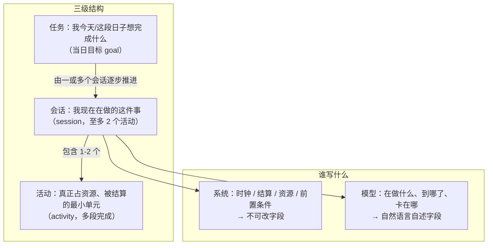
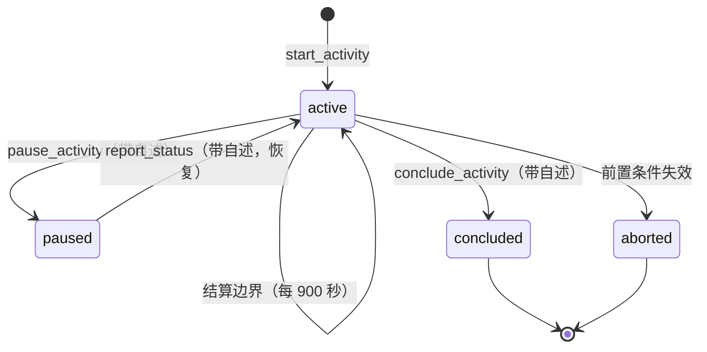
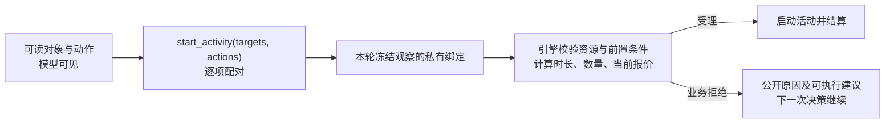
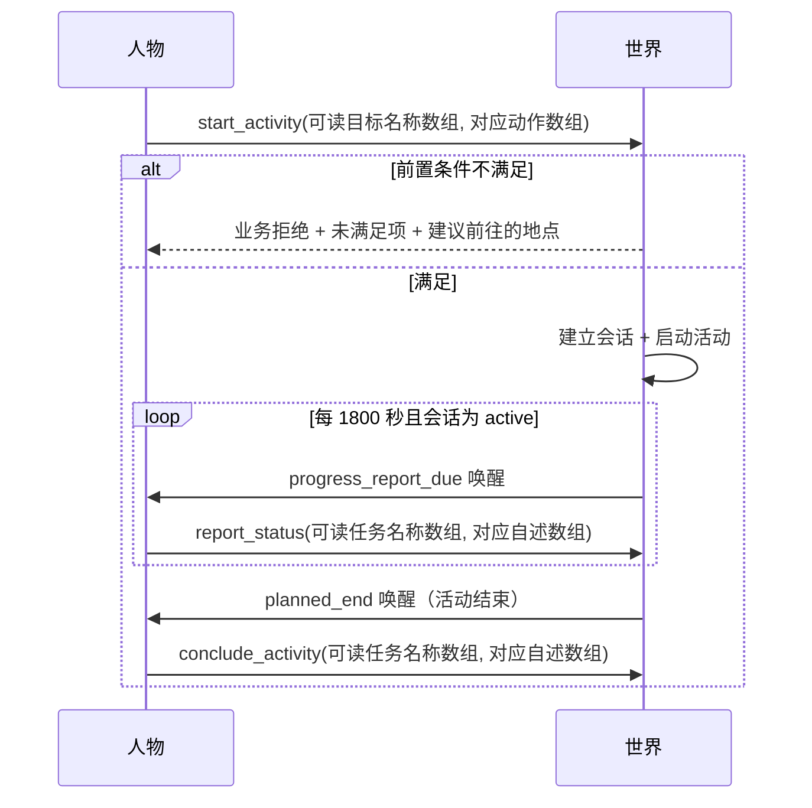
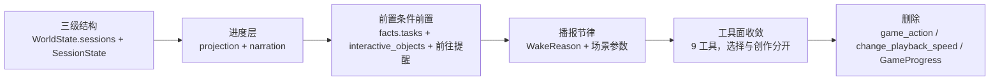

# 特性规格：数字人交互（会话层、上下文分层与稳定工具面）

> 状态：**FROZEN**；2026-09-23 按 issue #1 的运行证据及用户裁决修订。
> 来源：[数字人交互方案](PROPOSAL-agent-interaction.md)。裁决后本规格取代该提案的全部行为定义。
> 字段与 Schema 由 [接口合同](../CONTRACTS.md) 承载；设计职责由既有设计文档承载。
> 本规格显式修订与旧交互工具、观察结果、预算和业务拒绝相关的冻结条款，见「冻结条款修订」。
> 原先阻断冻结的对象动作绑定、登记工具、目标层进展归属均已裁决；本版按最新裁决执行。
> 本规格描述最终行为；实现状态及文档同步以验收台账逐项核对，不能把规格冻结视为已实现。

## 心智模型

人物过日子不是「一次做一件事、做完再想」，而是**同时挂着若干件事、隔一阵回看进展**。
系统掌握时间、身体、报价、结算与资源；人物选择可读对象和动作，撰写自己的进展与通信内容。



**一条硬边界**：模型写的任何文字都不承载状态转移。会话的进行、暂停、结束由系统字段单独推出；
模型的进展自述只改变「人物怎么理解这件事」，永不作为完成证据。

**模型与引擎的执行契约**：`start_activity` 只提交等长的 `targets` 和 `actions`，逐项配对。模型可读取系统公开的
路线方式、报价和前置条件以作选择，但不回填价格、报价版本、时长、数量或内部身份。
引擎从产生该次观察的冻结状态解析对象和动作，并计算执行参数。已结算动作的公开结果属于
**进度层**：系统写客观结果，人物写主观进展；这不增加上下文层。

## 权威来源与范围裁决

| 内容 | 权威 |
| --- | --- |
| 会话、决策轮循环、进度层字段 | 本规格 |
| 人物工具 Schema、字段闭集、枚举 | [接口合同](../CONTRACTS.md) |
| 状态归属、结算与资源、共享时钟 | [life-runtime 规格](SPEC-life-runtime.md) |
| 决策所见、两阶段决策、预算 | [decision-context 规格](SPEC-decision-context.md) |
| 工具与活动类型准入、地点菜单 | [interaction-menu 规格](SPEC-interaction-menu.md) |
| 记忆合同、巩固与反思 | [life-realism 规格](SPEC-life-realism.md) |
| 当日目标 | [day-plan-goals 规格](SPEC-day-plan-goals.md) |
| 事件、检查点、导出 | [记录引擎设计](../design/05-recording-engine.md) |

**范围**：三级结构、会话生命周期、上下文分层与进度层、稳定工具面、决策轮循环与播报节律、
前置条件前置与前往提醒、并发上限、容量与午夜浓缩、游戏简化。

**跨规格边界**：评估、LabelKit 交付、画像、语料、品类与账本的领域规则分别由其规格负责；
本规格要求交付链读取与实际模型请求一致的公开投影，不能再从原始观察重组一份不同的输入。

## 三级结构与概念边界

系统里**已经有**三个不同生命周期的概念；本规格**不新增第四个**，而是明确它们的从属关系。

| 概念 | 谁创建 | 谁结束 | 可暂停 | 进展来源 | 生存期 | 状态位置 |
| --- | --- | --- | --- | --- | --- | --- |
| **任务**（当日目标 `PlanGoal`） | 人物（`plan_day`） | 系统（跨日失效 `day_end`） | 否 | 环境活动证据（语义不变） | 当日 | `AgentState.day_plan`（冻结，不改） |
| **会话**（`SessionState`） | 人物（`start_activity`） | 人物（`conclude_activity`）或系统（前置条件失效） | **是** | 系统字段 + 模型自述 | 跨多个结算边界，随目标失效 | `WorldState.sessions`（**新增**） |
| **活动**（`ActivityState`） | 人物（经会话） | 系统（`planned_end`）或人物 | 是（既有） | 结算证据 | 单次执行 | `WorldState.activities`（冻结，不改） |

### 任务与会话的关系

**任务由一或多个会话逐步推进。** 会话携带 `task_kind` 与 `task_ref` 指向它服务的任务：

| `task_kind` | `task_ref` 取值 | 说明 |
| --- | --- | --- |
| `"goal"` | `PlanGoal.intent_kind`（如 `"工作"`） | 当日目标；跨日随 `day_plan` 归零会话随之失效 |
| `"work_task"` | `task_id`（如 `backend-hourly-2026-01-05`） | 场景声明的多日工作合同 |
| `"none"` | `null` | 不服务任何已知任务（如临时散步） |

**目标层的证据规则不变**：`PlanGoal` 仍只由「正时长结算的活动」推进，`progress_activity_id` 仍是单值。
**会话层不参与目标证据的判定**——它只是人物视角的进展容器。
（推论：同一目标的多个会话不会各自改写目标证据，目标证据仍由第一个匹配活动一次性盖章。）

### 会话与活动的关系

**一个会话承载 1–2 个活动**（对应人物的「同时进行两个 activity」上限），
**一个活动可分多段完成**。

「多段」在记录里对应既有的**暂停/恢复语义**，不新增概念：
一个 `ActivityState` 记录跨多次暂停/恢复累积 `elapsed_seconds`，
暂停期间不计入；每次恢复重算 `planned_end_at`。



**会话状态闭集**：`active` / `paused` / `concluded` / `aborted`。

### 会话的状态位置

会话住在 `WorldState` 内，随 `life` 快照一起提交与恢复——检查点参与者键集是
`{"life"} ∪ {agent:N}`（`footprints/validation.py:110-111`），**会话不需要新的快照键**。

| 项 | 值 |
| --- | --- |
| 字段 | `WorldState.sessions: dict[str, SessionState]`，带 `default_factory` |
| 结构版本 | `WORLD_SCHEMA_VERSION` **5 → 6**（定义在 `src/worldmock/life/models.py:21`，`WorldState.schema_version` 是 `Literal[WORLD_SCHEMA_VERSION]` 且**无默认值**） |
| 场景声明 | **不需要**（会话是运行期生成物，同 `activities` / `deliveries`） |
| 旧检查点 | **拒绝加载**：`schema_version` 是 `Literal[WORLD_SCHEMA_VERSION]` 且**无默认值**；**不提供迁移或降级读取路径**，既有运行目录的检查点一律视为作废，需重跑而非恢复 |

## 会话字段

```json
{
  "session_id": "internal-session-key",
  "agent_id": 1,
  "task_kind": "work_task",
  "task_ref": "internal-task-key",
  "task_name": "周会纪要",
  "session_name": "周会纪要：上午九点在办公室开始的工作",
  "status": "active",
  "started_at": 1767585601,
  "ended_at": null,
  "targets": ["internal-task-key"],
  "activity_ids": ["activity-...-action:0001"],
  "segments": [[1767585601, 1767590401], [1767591301, 1767594001]],
  "invested_seconds": 7500,
  "effective_seconds": 6000,
  "remaining_contract_seconds": 14400,
  "preconditions_unmet": [],
  "progress_note": "锁粒度那块卡住了，先把接口对完再回头啃。",
  "note_updated_at": 1767594001,
  "note_history": []
}
```

| 字段 | 归属 | 说明 |
| --- | --- | --- |
| `session_id` / `agent_id` / `task_kind` / `task_ref` / `status` / `started_at` / `ended_at` | **系统，不可改** | 会话身份与生命周期 |
| `task_name` / `session_name` | **系统从冻结场景和开始时刻生成** | 分别用于任务归组、模型可读的唯一会话定位 |
| `targets` / `activity_ids` / `segments` | **系统，不可改** | 承载对象、活动集合、分段区间 |
| `invested_seconds` / `effective_seconds` / `remaining_contract_seconds` | **系统，不可改** | 由 `segments` 投影的结算证据 |
| `preconditions_unmet` | **系统，不可改** | 未满足的前置条件与建议动作 |
| `progress_note` / `note_updated_at` / `note_history` | **模型撰写** | 结论固定标**未经核验** |

上例是**引擎私有状态**，字段名和身份不得原样序列化给模型。模型所见的进度层按
可读任务或会话名称展示当前状态、已结算结果、客观累计进展、未经核验的自述与临近截止提醒。
`scene` 可以给当前会话一句话概括，不重复完整结果。原始结果、内部身份、活动分段、
账户状态和检查点只保存在事件与世界状态；模型只得到可理解且允许公开的业务反馈。
**自述永不出现在「已核验经历」区段。**

| 容量 | 上限 | 承载物 |
| --- | --- | --- |
| **进展自述** | 500 字符 | **会话级**：`SessionState.progress_note`，由模型在 `report_status` / `pause_activity` / `conclude_activity` 的对应 `summary[]` 项里撰写 |
| **目标单句进展** | 500 字符 | **目标级**：关联当日 `PlanGoal.progress_note`；控制工具提交时写入同一段原文，仍是独立字段 |
| 长期记忆 | 8000 字符 | 人设层派生视图的既定窗口，**不删任何记录**（见下）；与进度层容量触发无关 |

进度层**没有固定的会话数量上限或总字符上限**。其模型可见投影按下文的整次请求 token
阈值浓缩，权威会话和事件保持完整；不得简单截去旧会话或已结算反馈。

**「进展自述」与「目标单句进展」属于两个独立对象**：前者挂在会话上、随会话结束而归档；后者挂在当日目标上、跨日随目标归零。控制工具遇到关联当日目标的会话时，将对应原文同时写入两个对象；未关联目标时只更新会话。二者恰好共用 500 字符这一上限，客观目标证据仍仅由正时长活动结算推进。

## 稳定工具面

人物动作工具**一次性收敛为 9 个**：5 个**会话动作**工具、2 个当日目标**登记动作**工具，
以及独立的工作交付和消息正文工具。工作成果与通信内容仍由人物创作；它们不挤进
`start_activity` 的对象与动作选择接口。

**名词定义**：**会话动作**指操纵会话生命周期的五个工具——`start_activity`、`recall_task_summary`、`report_status`、`pause_activity`、`conclude_activity`；**登记动作**指 `plan_day` 与 `revise_day_plan`，它们只登记计划、不启动活动、不消耗生活时间。
记忆工具与 `finish` 保持原样（它们不是生活动作）。

原 17 个工具里的游戏命令和播放中变速删除；`plan_day`、`revise_day_plan` 继续独立。
`submit_work` 和 `send_message` 使用独立工具名并复用既有领域处理器；不存在旧工具的兼容入口。

| 工具 | 可见性 | 收 | 语义 |
| --- | --- | --- | --- |
| `start_activity` | 永恒可见 | `targets: list[str]`、`actions: list[str]`（等长 1–2 项，各对象与动作均可读） | 逐项启动活动并建立会话；整组原子受理，不接收内部身份、时长、价格、数量、正文或成果 |
| `recall_task_summary` | 永恒可见 | `task_name: str` | 只读回看可读任务名称或唯一会话名称；不改变世界 |
| `report_status` | 有 `active` 或 `paused` 会话时 | `task: list[str]`、`summary: list[str]`（等长，1–2 项） | 各摘要对应一项当前任务或会话；播报进行中会话，已暂停会话恢复进行 |
| `pause_activity` | 有 `active` 会话时 | `task: list[str]`、`summary: list[str]`（等长，1–2 项） | 各摘要对应一项当前任务或会话；暂停所选会话及其进行中活动 |
| `conclude_activity` | 有 `active` 会话时 | `task: list[str]`、`summary: list[str]`（等长，1–2 项） | 各摘要对应一项当前任务或会话；只结束选中的进行中会话 |
| `submit_work` | 可见工作任务满足提交前置条件时 | `task_name: str`、`deliverable: MeetingMinutes` | 提交人物撰写的成果，执行现有验收与返工结算；结果归进度层 |
| `send_message` | 可联系人物可见时 | `recipient_name: str`、`text: str` | 发送人物撰写的正文，执行现有通讯结算；结果归进度层 |
| `plan_day` | **清醒**日首且尚无计划时 | `goals[]`（零至八条） | **登记**当日目标；不启动活动、不消耗生活时间 |
| `revise_day_plan` | 当日已有计划时（**含已提交空清单后追加**） | `goals[]`（替换全部未推进目标） | **修订**当日目标；规则同既有规格 |

`task_name`、`task[]` 中每项与 `recipient_name` 都只能取本轮冻结观察中展示的唯一可读名称。
同名对象由类型、地点或自然语言开始时间消歧，不能用内部编号、哈希、奇怪字符或索引后缀。
会话持有基础 `task_name` 与唯一 `session_name`：前者用于同一任务的进度汇总，后者用
任务名称、自然语言开始时间和必要地点定位具体会话。`recall_task_summary.task_name`
接受任务名称或唯一会话名称；两类名称共享同一唯一性检查，冲突时不设隐含优先级。
名称至内部身份的映射只存于私有观察绑定，提交时按原观察解析；名称不存在或不唯一则
业务拒绝并指出可选名称，绝不任选一个。三个会话控制工具的 `task[]`
每项可用当前任务名称或唯一会话名称，必须在本轮当前会话范围内唯一解析；同名任务有多个
当前会话时须使用各自可读的唯一会话名称。两数组顺序一一对应，长度均为一至二且任务不重复。
`summary` 和 `deliverable` 是人物原创内容，
不是系统状态回填；`plan_day` / `revise_day_plan` 的目标内容仍由人物撰写。
播报先校验全部任务名称和阶段，接受进行中或已暂停会话；暂停与结束只接受进行中会话。
整组通过才依对应关系写入各会话的 `progress_note`，有关联当日目标时把同一原文写入
该目标独立的 `progress_note`；任一项不合法则整组业务拒绝且世界状态不变。
播报已暂停会话时同时恢复会话及其暂停活动。结束只取消所选会话仍在进行的活动；
未选会话保持原状。没有进行中会话时结束工具业务拒绝，已暂停会话须先恢复才能主动结束。

**`plan_day` 与 `revise_day_plan` 保留为独立工具**（用户裁决，2026-09-22）：
二者是**登记动作**，不启动活动、不消耗生活时间，与「会话动作」语义不同，
因此不作为 `start_activity` 的 `actions[]` 取值。其请求形状、生命周期与修订规则不变，
沿用 [当日目标规格](SPEC-day-plan-goals.md) 与 [接口合同](../CONTRACTS.md)「当日目标请求」。

### 对象与动作选择

`facts.interactive_objects` 每行只提供唯一可读的 `object`、对象种类、可读 `actions` 和
可公开的前置条件。人可以直接理解每个活动，例如「张江办公室」配「步行前往」「乘地铁前往」，
「午餐套餐」配「到店购买」「配送到当前位置」，「项目周会纪要」配「开始工作」。
动作短语携带人物真正需要选择的出行方式和履约方式；票价、版本、时长、库存、数量由系统
告知或内部计算，不成为模型参数。`submit_work` 和 `send_message` 不列为 `start_activity`
动作；其名称、成果、正文由独立工具处理。



冻结观察中的私有 `interaction_bindings` 只供宿主解析：可读对象和动作映射到内部对象身份、
标准动作、路线方式及该对象的冻结报价。该绑定不进入模型提示或工具返回。
私有 `session_bindings` 把唯一可读 `session_name` 映射到会话身份与当前生命周期；
模型仍只见 `facts.progress.sessions[].session_name`。
对同一个对象的多个合法动作逐一展示；`targets[i]` 与 `actions[i]` 逐项对应，
每个对象只需支持自己选中的动作。两项可以是不同动作，例如步行与观看；
引擎验证组合能否并行，任一项不合法则整组不启动。
每项出行都须对应自己的目的地；每项购买都读取该供给自己的冻结报价，不能把一件商品的
报价版本套给另一件。所选对象已不在本轮绑定或绑定不唯一，返回业务拒绝，不猜内部身份。

**引擎派生参数政策**：

| 动作 | 不由模型填写的执行参数 |
| --- | --- |
| 前往 | 由所选目的地与方式解析冻结路线，使用路线精确秒数和票价；展示分钟数仅供阅读 |
| 工作 | 时长取剩余合同秒数、距截止秒数与活动允许上限中的最小值；30 分钟播报边界可在活动进行中唤醒 |
| 观看 | 正常续看取剩余内容秒数向下取整，重看取完整内容时长；速度固定为 1 倍 |
| 游戏内容 | 取内容剩余时长；场景游戏取场景 `activity_feedback_seconds` |
| 生活活动 | 取目录 `typical_duration_minutes` 换算的秒数 |
| 浏览、阅读邮件、等待 | 取场景 `activity_feedback_seconds` |
| 交谈、通话 | 取场景 `activity_feedback_seconds` 向下取整到完整分钟，并受领域 120 分钟上限约束 |
| 睡眠 | 人物当前 `sleep_need_hours × 3600`，按最近整数秒取整 |
| 购买、食用或使用持有物 | 每个所选对象数量为一份；购买使用各自冻结报价及所选动作对应的履约方式；持有物从目录 `use_modes` 展示「食用」或「使用」，引擎按冻结绑定的 `eat` / `use` 结算；余额、库存、地点和组合相容性在结算时重验 |

时长换算为正整数秒后还须通过领域原有的最短 60 秒、最长 86400 秒、资源、地点、
截止时间和能量校验；无法成立时返回说明具体约束的业务拒绝，不改用猜测值或静默截短。
无时长动作不虚构会话时长。领域内部请求仍可带 `planned_duration_seconds`、
`price_version` 等字段，但由引擎从同一冻结观察填充，模型永不回填。

**Schema 约束**：模型工具只包含 `targets` 与 `actions` 两个必填数组。
两数组等长一至二项；`actions[i]` 的合法性按 `targets[i]` 对象本轮动作闭集验证，
不能在模型工具 Schema 中加入动作专属参数。

DeepSeek strict 模式**禁用六个 Schema 键**（`life/models.py:1015` `_DEEPSEEK_UNSUPPORTED_SCHEMA_KEYS`）：
`oneOf`、`minLength`、`maxLength`、`minItems`、`maxItems`、`default`。

由此产生一条硬约束：**字符上限与「至多 2 个」的并发上限都不能写在工具 Schema 里**，
只能在提示词与业务规则中表达。故并发上限的 Schema 侧无约束，
`SESSION_LIMIT_EXCEEDED` 由业务规则独立兜住。
所有属性必须必填（strict 模式要求），不设缺省值（`default` 亦在禁用清单内）。

**一次决策仍只提交一个工具请求**（`SPEC-life-runtime.md` 不变）。
一个 `start_activity` 请求可逐项启动一至两个活动；两项按既有资源和身体约束共同校验，
不相容则整组拒绝。`plan_day` / `revise_day_plan` 是独立登记工具，
**不是** `actions` 的取值。

### 保护项修订

保护集随工具面收敛为四类：

| 类别 | 成员 | 为什么必须保护 |
| --- | --- | --- |
| 永恒可见 | `start_activity`、`recall_task_summary` | 不保留则人物无法开始任何事、无法回看进展 |
| 会话的退出通道 | `report_status`、`pause_activity`、`conclude_activity` | **有会话时必须可见**：三者是结束会话的**唯一**手段，剪掉会让会话永久挂起 |
| 「自身」对象的动作 | `wait`、`sleep` | 不保留则无法等待与睡眠 |
| 当日目标登记 | `plan_day`、`revise_day_plan` | 不保留则无法登记或修订当日目标；二者的条件可见性不变（**清醒**日首尚无计划时只开放 `plan_day`，已有计划时开放 `revise_day_plan`） |
| 创作内容出口 | `submit_work`、`send_message` | 可提交工作成果与通信正文，不能由 `start_activity` 捏造内容 |

**地点菜单不再剪裁工具，只剪裁对象的 `actions` 枚举。** `InteractionMenu` 的声明
只有 `allowed_actions`，地点与人物声明求交集后再与各对象能力结合。九个工具的条件可见性
由工具层判断，不放进地点菜单，也不恢复 `allowed_tools` 或 `allowed_activity_kinds`。

## 决策轮循环与播报节律



| 触发 | 来源 | 是否调用模型 |
| --- | --- | --- |
| 会话持续超过 `progress_report_interval_seconds` | **新增** `progress_report_due` | 是（一次决策机会） |
| 活动返回结果（`planned_end`） | 既有成员 | 是 |
| 某任务的 DDL 临近 | 既有 `task_due_soon` + `commitment_threatened` | 是 |
| 会话暂停中 | 不触发 | 否 |
| 人物睡眠中 | 被 `SLEEP_ALLOWED_REASONS` 过滤 | 否 |

**实现要点**：`SLEEP_ALLOWED_REASONS`（`schedule.py:54`）存的是 **`WakeReason` 枚举成员**而非字符串，当前 3 项（`planned_end`、`run_start`、`wake_from_sleep`）。过滤在 `schedule.py:303`，写法是**白名单**：

```python
if snap.is_asleep:
    reasons = [r for r in reasons if r in SLEEP_ALLOWED_REASONS]
```

因此新增的 `progress_report_due` **天然被睡眠过滤掉，不需要额外代码**。真正的风险是反向的：若有人把它加进 `SLEEP_ALLOWED_REASONS`，人物就会在睡眠中被播报唤醒。故验收断言是「**该成员不在集合内**」，而不是「加一份过滤逻辑」。

| 参数 | 值 | 性质 |
| --- | --- | --- |
| `progress_report_interval_seconds` | **1800** | **场景参数**（与 `reconsideration_interval_seconds` 同类）；非正整数被拒 |

**播报同时是一次决策机会**：人物可在播报时顺手暂停、切换或结束会话，与「一次决策一个动作」不冲突。
**沉默边界仍不调用模型**：结算边界照常产生 `activity_progress`，只有唤醒条件命中才提供决策。

**业务拒绝不是运行故障**：地点、资源、余额、库存、提交返工、名称不可解析等拒绝保留
`ActionStatus.REJECTED` 和公开原因，进入进度层并给人物下一次决策机会。连续拒绝达到既有
阈值时按场景 `activity_feedback_seconds` 冷却后继续，不能生成 `run_failed`。
若拒绝源于本人已有活动的 `RESOURCE_CONFLICT`，下一次机会按更早的活动结束或反馈间隔安排，
避免活动状态尚未改变就逐秒重试。交互对象前置条件使用与执行器相同的资源声明检查当前占用。
模型协议无效、无法计费或世界不变量损坏仍按各自真正的故障路径处理。

## 前置条件前置与前往提醒

**规则一：前置条件必须在动作前进入提示**，不靠撞墙学习。

| 前置条件 | 判定处 | 是否已在提示中 |
| --- | --- | --- |
| 必需地点 `required_location_id` | `work.py:61` `WORK_LOCATION_REQUIRED` | 以**地点名称**进入 `facts.tasks` |
| 必需技能与门槛 | `work.py:59` `WORK_SKILL_INSUFFICIENT` | **否 → 进入** |
| 合同最长时长 | `work.py:69` `WORK_DURATION_EXCEEDS_CONTRACT` | 部分（`remaining_contract_seconds`） |
| 地点营业状态 | `basket.py:144-146` | 已在 `scene.reachable_places` |
| 地点资格 `required_qualifications` | `basket.py:140` `LOCATION_ACCESS_DENIED` | **否 → 进入** |
| 能量可行性 | `engine.py:1205` `INSUFFICIENT_ENERGY` | **有意不进提示**（不变） |

**规则二：前置条件不满足时，拒绝必须给出可执行的下一步，并点名具体地点。**
这是本规格新增的强制要求：人不是碰壁才知道，而是被明确告知「去那里」。

| 错误码 | `data` 必含 | 说明 |
| --- | --- | --- |
| `ACTIVITY_PRECONDITION_UNMET` | 引擎私有结果含未满足规则与目的地身份；公开结果含可读原因及 `suggested` 地点名称、可读前往动作 | 未满足项含地点时必须点名具体可到达地点，不能暴露 `destination_id` |

**呈现规则**：
- `facts.tasks[]` 呈现任务名称、可读必需地点、技能、门槛、剩余工时和截止时间；不呈现任务或地点内部身份；
- `facts.interactive_objects[]` 只列当前可执行的对象与动作，每项带可读 `object`、`actions` 与
  `preconditions_met`；未满足条件的任务仍在 `facts.tasks[]` 说明，不作为可选动作；
- `scene` 在前置条件未满足时补一句中文说明并点名地点
  （例如「这份工作要在办公室做，先去张江高科技园区办公室」）。

## 游戏简化

**游戏不再有命令回路。** 人物选择一个游戏名称，之后按播报节律自述「玩的时候做了什么」。

| 项 | 处理 |
| --- | --- |
| `game_action` 工具 | **删除** |
| `GameActionRequest` | **删除** |
| `_game_action` / `_store_game_outcome` handler | **删除** |
| `run_game_command` 与 TextWorld 回放 | **删除** |
| `AgentState.game_sessions` / `GameProgress` | **删除** |
| `game_boundary` 合同（`engine.py:184`、`:198`、`:202`、`:213`；`catalog/affordances.py:101`、`:275-278`、`:444-458`） | **须一并收敛，但它是另一条链路**：`game_boundary` 表达「该活动允许继续交互」，与命令回路不是一回事。本次 11 路审计中「命名冲突」那一路特意分开了二者，实现时不要混同 |
| 启动期 `verify_game_progress`（`engine.py:733-734`） | **删除**（校验对象随 `game_sessions` 消失） |
| `play_game` 活动 | **保留**：与 `watch` 同形——有目标、有时长、有进度结算、有进展自述 |
| 游戏内容（30 个 `games` 声明 + 80 条 `game_session` 内容） | **保留**，成为 `play` 动作的合法目标 |
| `playback_speed` | 固定为 1 倍；**播放中改速的能力删除**（`change_playback_speed` 一并删） |

## 上下文分层

提示仍由确定性代码渲染，分七层，**全部落在既有的 `persona_card` / `scene` / `facts` 三段之内**，
不新增顶层段（`SPEC-life-runtime.md:637` 的三段划分不变）。

| 层 | 落点 | 说明 |
| --- | --- | --- |
| system | system 消息 | 沿用 `_LIFE_INSTRUCTIONS`；回合预算块不动 |
| 人设层 | `persona_card` + 记忆段 | 卡片与长期记忆沿用各自既定窗口；不参与进度浓缩 |
| 目标层 | `facts.day_plan` + `scene` 一句 | 目标对象持有独立 `progress_note`，不新增优先级字段；关联目标的会话在控制工具提交时把同一段人物自述写入目标字段。该句属于**未经核验的主观叙述**，不是会话客观字段的投影，也不改变目标结算证据 |
| 环境层 | `scene` | 体感只给分级（不变），数值仍不进提示 |
| 交互对象层 | `facts.interactive_objects` | 每个对象有可读唯一 `object` 与 `actions`、前置条件；私有绑定不进入提示 |
| 进度层 | `facts.progress` | `sessions`、`results`、`alarms` 同属一层；客观结果与模型自述标明归属 |
| 工具层 | 工具 Schema | 9 工具；`start_activity` 仅收等长的可读对象名称与动作短语数组 |

**进度层内部结构**（用户裁决）：`sessions` 提供当前或暂停会话的可读名称、系统核算的
客观进度、人物自述及其「未经核验」标记；`results` 提供自上次实际发送进度提示以来所有新的公开
结算结果；`alarms` 提供临近截止等提醒。结果由系统生成并在下一次模型请求中呈现，
不是人物自述，也不逐条永久追加到会话记录。原始事件永久保留；旧结果可在后续进度浓缩中
变成带来源的摘要。`scene` 只说明当前环境，不再复制最近一条执行结果。
模型不见内部身份、哈希、账户、段区间、报价版本和完整世界状态。
同一条规则适用于 `facts.tasks`、`facts.routes`、`facts.products`、`facts.inventory`、
`facts.inbox`、目标层和联系人：人物看到名称、地点、方式、时间、费用、数量等业务事实，
不看到 `task_id`、`route_id`、`supply_id`、`product_id`、`message_id`、
`contact_id` 等仅供引擎定位的键。全部模型工具根据冻结观察中的可读名称私有绑定解析，
不得让人物从奇怪字符、编号或索引猜测对象。
工作任务名称取场景必填的 `WorkTaskConfig.title`，不缺省为内部 `task_id`；
提交工作时引擎使用冻结观察中的私有绑定定位合同。

`sessions` 的每一行固定为 `task_name`、`session_name`、`phase`、`objective_progress`、
`subjective_progress`、`subjective_status`；`phase` 用自然语言表达进行中、已暂停、
已结束或中断，`subjective_status` 固定为「未经核验」。活动秒数、合同余额等可公开的
计算结果在 `objective_progress` 里写成人能理解的短句。行顺序为进行中、已暂停、
已结束或中断；终态按结束时间由近到远，同组再按可读名称稳定排序。触发容量浓缩前，
所有历史会话都有对应行，不能静默取前两条。`results` 以事件顺序包含上次实际发送进度提示后
全部新公开结果；`alarms` 包含当前仍有效的临近截止提醒。

`results` 每行只含 `occurred_at`、`status`、`error_code`、`message`，有对应事实时加
`details` 或 `work_review`。`details` 按动作只列可读对象或商品名称、购买份数与实付金额、
到达地点名称与时间、浏览返回的条目名称等人物需要理解的结果；`work_review` 沿用
既有 `public_work_review` 的公开判定和理由。`action_id`、`event_id`、`order_id`、
`product_id`、`supply_id`、`session_id`、`route_id`、`price_version`、账户身份、
私有评审参考、哈希和完整状态均不进入该行。每条新结果仍占一行，不能因去除内部字段
而丢失一个动作的反馈。
容量预检失败时不得推进该人物的结果观察水位；下次成功组装请求时，这些结果仍须出现。

## 容量、浓缩与遗忘

### 发送前 token 计数与进度浓缩

每次实际模型请求，包括决策自述、行动和只读调用，在发送前按所选模型的上下文窗口计数。
计数对象是完整请求：最终 system 消息、人物卡、场景、目标、交互对象、进度、其他事实、
记忆、工具定义、已发生的原生消息与工具返回，加上本次预留的最大输出 token。
不能用 `facts.sessions` 的字符数代替整次请求 token 数，也不能假定选用模型一定有
256k 窗口；模型窗口与输出能力须在运行前从实际所用模型的权威元数据确定。
完整请求计数及达到阈值后浓缩的分界可参考
[Claude 官方上下文说明](https://platform.claude.com/docs/en/build-with-claude/context-windows)与
[阈值浓缩说明](https://platform.claude.com/docs/en/build-with-claude/compaction-threshold)；
本规格的 85% 与只浓缩进度层是本项目自己的裁决，不依赖某供应商专用接口。

当上述总数达到上下文窗口的 **85%** 时，只浓缩本次发送给模型的**进度层派生投影**：
先把较旧终态会话按可读任务名称合并为带来源的短摘要，保留每组最新客观结论、
最新人物自述和合并会话数；若重算后仍达阈值，再把这些历史摘要合为一条总体历史摘要，
保留总会话数及最近客观结论与自述。当前与暂停会话完整行、当前提醒、以及本次尚未回灌的
`results` **完整公开字段与原顺序**始终保留。合并前后均不让模型产生新的事实。
浓缩不改 `WorldState.sessions`、原始事件、人物目标或长期记忆；不任意按会话数裁断。
每步后重新计算整次请求；若最终仍达到 **85%**，或超过模型输入额度，
以**容量故障**停止该次请求，英文日志记录各层 token 占用与预留输出，
不静默删除新结果，也不压缩其余层。
旧 user 40000 字符、system 3000 字符、scene 800 汉字的独立致命容量闸门废止；
人物自述 500 字符等领域字段限额继续生效。场景按地点合并重复前置条件提醒。
模型返回的实际 token 用量用于校核预估器；下一次请求仍须先完成全量计数。

### 午夜浓缩

模拟时钟跨过当日 `day_end_seconds` 时，仍执行既定记忆巩固与目标单句更新；
已结束会话的摘要进入长期记忆派生视图。午夜处理与上述 **85% 发送前进度浓缩**
是两个不同触发条件，均不得改写客观结算、已核验经历或原始事件。

### 遗忘是派生视图，不是销毁

长期记忆上限 **8000 字符**由装配时裁剪呈现窗口实现，**不删任何记录**：

- `episodes.jsonl` 只追加，`episode_counter == len(records)` 不变；
- `episodes_sha256` 证据链不变；
- `MEMORY.md` 装配公式可扩展，但已核验经历与身份区段不可被模型改写；
- 「模型自行选择遗忘」的语义是**选择哪些进呈现窗口**，不是删除记录。

## 事件与重建约束

硬约束：**SQLite 记录是唯一提交权威，导出时活动会从事件重建并逐字节比对**
（`footprints/validation.py:33-34`），质量报告也必须能仅从事件复现（`:42-54`）。

**结论：不需要新增事件类型。** 九个工具的请求沿用各自既有动作记录路径，
两个当日目标登记工具继续按既有 `plan_day` / `revise_day_plan` 路径落库；
人物动作请求随既有 `action_requested` 事件落库
（含完整 `request` 与 `request_sha256`）：

| 内容 | 审计路径 |
| --- | --- |
| 会话的开始 / 暂停 / 继续 / 结束 | `action_requested`（`tool_name` + `request`） |
| 模型的进展自述 | 同上；播报、暂停、结束都写 `request.task[]` 与等长 `request.summary[]` |
| 会话的客观结算 | 既有 `activity_progress` |
| 会话快照与分段区间 | 世界状态，随 `life` 快照保存 |
| 可读名称至内部身份及冻结报价 | 私有观察绑定与已登记动作证据，不能进入模型提示 |
| 实际模型请求与交付输入 | 保存同一份最终公开请求视图；交付时不从原始观察重组另一版本 |

**这同时确认**：进展自述一旦提交就永久留在 append-only 记录里，提示层的浓缩只改变
下一次所见，不会删除原始记录。

## 冻结条款修订

| # | 被修订条款 | 原文 | 修订后 | 连带改动 |
| --- | --- | --- | --- | --- |
| 1 | `WakeReason` 冻结词表 | 「唤醒原因是冻结词表，成员不可增删」 | **增加成员** `progress_report_due`，并把条款改为「不可改名、不可删除，新增须走版本表」 | **代码同步点共五处**（三处生产代码 + 两处测试），唯一权威定义见[文档影响](research/agent-interaction-document-impact.md)「唤醒词表的五处同步点」节。其中 `footprints/quality.py:384-399` 的「未识别」分桶最易漏——**它不报错，只让质量报告的数字变错**。另需同步 `CONTRACTS` 枚举表与 life-runtime 冻结词表 |
| 2 | 活动组合准入 | 「活动准入**仅**按占用交集判定」 | 保留占用交集，**追加**并发上限：`active` 会话 ≤2，由场景参数 `max_concurrent_sessions`（缺省 2）给出，超限报 `SESSION_LIMIT_EXCEEDED` | `rules.validate_start`、`interaction_menu`、错误码闭集、场景参数表 |
| 3 | 主观巩固触发 | 「为**三选一**」 | 改为**四选一**，增加「跨过当日 `day_end_seconds` 边界」 | `should_consolidate`、`SPEC-life-realism.md`「记忆合同」、`CONTRACTS` |
| 4 | 观察投影三段**与不得进入提示的内容** | 「user 消息由 `persona_card`、`scene`、`facts` 三部分组成」+「完整可供性合同不得进入提示」 | **三段划分不变**；只公开逐对象可读 `actions`，私有 `interaction_bindings` 与完整可供性合同仍禁止进入提示 | `projection.py`、`narration.py`、`CONTRACTS`「观察投影字段」与「禁止进入提示的字段」 |
| 5 | 决策结果回灌 | `SPEC-decision-context.md` 规定最近公开结果独立进入事实清单且场景概括最近一条 | 改为 `facts.progress.results` 归进度层；`scene` 不复制结果；私有观察仍可存原始关联证据 | `projection.py`、`result_projection.py`、`SPEC-decision-context.md`、`CONTRACTS.md` |
| 6 | 字符预算与超限 | `SPEC-decision-context.md` 以 user 40000 字符、system 3000 字符、scene 800 汉字单独熔断 | 模型调用以完整请求 token 加预留输出计数；达到所用模型窗口 85% 先只浓缩进度派生投影，重算仍达 85% 即报告容量故障；人物自述等字段语义上限另按其合同执行 | `life_context.py`、`life_agent.py`、`narration.py`、`SPEC-decision-context.md`、`CONTRACTS.md` |
| 7 | 连续业务拒绝 | 业务拒绝连续达到阈值终止整次运行 | 保留拒绝事实与阈值观察，按既有 `activity_feedback_seconds` 冷却再给决策机会；不生成 `run_failed` | `engine.py`、`SPEC-life-runtime.md`、测试 |

**未被修订的既有语义**：只有环境能改世界状态；一次决策一个生活动作；沉默边界不调用模型；
体感数值不进提示；已核验经历只由已提交事件确定性投影；SQLite 记录是唯一提交权威。

## 实现顺序

用户裁决：**一次性替换旧人物工具面**，不分期、不保留兼容入口。
建议的内部顺序仅描述同一变更集内的依赖：



## 与既有文档的一致性核对

本规格是交互行为的权威定义；同一变更集必须同步下列合同，不能留下互相矛盾的旧表述。

| 文档 | 必须同步的内容 |
| --- | --- |
| `docs/CONTRACTS.md` | 九个模型可见工具的精确字段与可读名称绑定；`facts.progress` 的公开字段；完整请求 token 预算与禁用内部身份；工作评审和新结果回灌 |
| `docs/dev/SPEC-decision-context.md` | 结果在进度层回灌一次、容量触发只浓缩进度投影、旧字符闸门与新 token 预算关系 |
| `docs/dev/SPEC-life-runtime.md` | 业务拒绝冷却后继续、引擎派生执行参数、会话状态和播报原因 |
| `docs/dev/SPEC-life-realism.md` | 午夜记忆巩固仍不篡改事件与已核验经历；游戏命令回路删除 |
| `docs/dev/SPEC-labelkit-delivery.md` 与 `docs/EXPERIMENT.md` | 交付输入采用实际发送给模型的公开请求视图，保留其记忆与自述来源；不得把私有观察或工作评审请求混进样本 |
| `docs/design/04-simulation-engine.md` | 对象与动作选择、冻结报价、引擎派生时长和资源前置条件、非致命业务拒绝 |
| `docs/design/05-recording-engine.md` | 会话和公开结果的事件归属、模型请求及交付输入的可重建性、世界结构版本 |
| `docs/design/06-delivery.md` | LabelKit 输入只采用实际人物请求的公开视图，私有观察、重复前置状态和独立工作评审请求不混入 |
| `docs/design/08-configuration.md` | 保护项改为九个工具与当前会话退出通道，场景已有节律参数的归属 |
| `docs/design/09-io-formats.md` | 模型请求与引擎内部请求分离、私有名称绑定、公开进度结构、世界结构版本 |
| `docs/design/00-overview.md`、`docs/design/01-architecture.md` | 七层心智模型与三段消息载体的关系、规格修订权威 |

原提案和只读审计是历史证据，不再作为最终行为合同。`docs/dev/implementation-status.md`
记录当前代码实况，仅在行为实现并验证后更新，不能提前写成已落地。

## 文件修改清单

| 职责 | 文件 |
| --- | --- |
| 模型工具与可读名称绑定 | `custom/agents/life_agent.py`、`src/worldmock/life/models.py`、`src/worldmock/life/observe.py`、`src/worldmock/life/session_actions.py` |
| 对象、进度和容量投影 | `src/worldmock/life/projection.py`、`src/worldmock/life/narration.py`、`custom/agents/life_context.py` |
| 结算、失败分类和执行反馈 | `src/worldmock/life/engine.py`、`src/worldmock/life/rules.py`、`src/worldmock/life/result_projection.py` |
| 交付输入与公开结果一致性 | `src/worldmock/delivery/windows.py`、`training.py`、`pipeline.py` 与 `src/worldmock/evaluation/public_evidence.py`；不新增独立输入副本 |
| 合同与设计文档 | 上节表中的所有文档，以及 `docs/dev/implementation-status.md` 的实际实现状态 |
| 验证 | `tests/life/` 的对象绑定、活动参数、非致命拒绝、进度容量测试；`tests/integration/` 的真实人物工具与交付输入往返测试 |

## 验收台账

| 契约点 | 必须通过的验证 |
| --- | --- |
| 会话生命周期 | 一个任务经多个会话推进；单会话最多两个兼容活动；三个控制工具的 `task[]` 与 `summary[]` 各项一一对应；播报能恢复暂停会话，暂停与恢复累计活动时段；结束只影响选中的进行中会话，已暂停会话先恢复后才能主动结束；自述不改变客观结算字段 |
| 目标与会话自述 | 每条播报、暂停或结束摘要各自写入所选 `SessionState.progress_note`；关联当日目标时同一原文也写该目标独立的 `PlanGoal.progress_note`；整组校验失败不部分写入 |
| 模型工具 Schema | `start_activity` 只含必填且等长的 `targets[]` 与 `actions[]`，不含内部身份、价格、报价版本、时长、数量、正文和成果；`report_status` / `pause_activity` / `conclude_activity` 都只含等长的 `task[]`、`summary[]`；`submit_work` / `send_message` 另有可读名称和原创内容字段 |
| 名称绑定 | 同名对象由自然语义消歧；所有模型可见对象与动作可被人理解；冻结观察能唯一解析，未知或歧义名称业务拒绝，内部编号不出现在提示、工具参数或公开结果 |
| 冻结执行参数 | 出行按所选方式使用冻结路线的精确秒数与票价；双供给购买各自使用冻结报价；各活动时长和单份数量按本规格表计算，状态变化时仍经引擎校验 |
| 工作与消息创作 | `submit_work(task_name, deliverable)` 进入现有工作评审，返工为业务反馈；`send_message(recipient_name, text)` 使用既有通讯结算；二者不经过 `start_activity` 的隐藏内容参数 |
| 业务拒绝 | 连续超过阈值仍无 `run_failed`，冷却后可继续；真正协议或世界故障保持故障路径；拒绝原因和可执行建议在下一观察的进度层出现 |
| 进度层归属 | `facts.progress` 同时含客观会话进度、全部本轮新执行结果、当前提醒与标记「未经核验」的人物自述；`scene` 不复制结果；旧两个独立字段不进模型提示 |
| 完整 token 计数 | 对自述、行动、只读的每次实际请求，计入最终 system、全部 user 片段、记忆、工具定义、历史消息与预留输出；与提供者实际 usage 抽样核对 |
| 85% 进度浓缩 | 触发前全部历史会话可见；触发后只合并旧终态会话，保留进行中与暂停会话、当前提醒及全部新结果；事件和权威状态字节不变；仍超限则带分层 token 用量报容量故障 |
| 决策节律 | 播报间隔缺省 1800 秒；睡眠中不因播报唤醒；沉默边界不调用模型；到截止或活动结束提供下一次决策机会 |
| 前置条件 | 任务所需地点与技能先于动作进入提示；不满足时具体说明去向；并发上限与资源占用交集分别验证 |
| 游戏与旧接口 | `game_action`、播放中变速和旧模型工具签名全链路不存在，游戏仍可选择、结算和自述 |
| 记忆与检查点 | 午夜目标单句与长期记忆巩固不改已核验经历；旧世界结构检查点被拒，未做迁移或兼容读取 |
| 事件与交付 | 人物请求及系统结算可由事件审计；交付输入与实际发送给模型的公开请求视图一致，私有观察和评审模型请求不进入人物样本 |
| 文档一致性 | 上节每份冻结合同同步；相互链接可解析，旧 7 工具、单会话 4000 字符、只计 user 字符和独立结果层的表述均不存在 |

## 版本表

| 版本 | 日期 | 修订内容 |
| --- | --- | --- |
| 1.0–1.2 | 2026-09-22 | 三级结构、七层上下文、旧七工具方案、播报、并发与午夜巩固的历史裁决 |
| 1.3 | 2026-09-23 | issue #1 后收敛模型与引擎的执行契约；九工具区分选择和原创内容；进度层承载执行结果；整次请求 token 计数与 85% 进度浓缩；业务拒绝不终止运行；交付输入一致性 |
