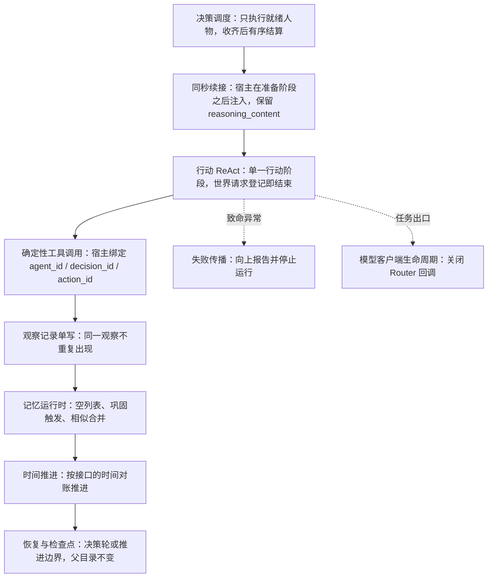

<a name="spec-as2-integration-特性规格agentsociety-2-集成与改动"></a>
# 特性规格：AgentSociety 2 集成与改动

> 状态：FROZEN——条款已裁决并冻结；AS2 分支改动与确定性测试守卫均已落地，正式 DeepSeek 十二周运行仍待真实运行（测试基线与收据见 `docs/dev/implementation-status.md#implementation-status-worldmock-实现状态`）；2026-09-27 按人物 Prompt 规格修订（[人物 Prompt 规格](SPEC-life-realism.md#persona-prompt-七层请求)「冻结条款修订」第 5、17 行；AS2 锁定提交不改），修订部分已实现并通过离线验收（证据见[人物 Prompt 验收记录](../archive/persona-prompt/persona-prompt-verification.md)）；2026-09-29 按[一日运行保真规格](../VERIFICATION.md#verification-incremental-evidence)「冻结条款修订」第 14 行补登三个 LifeAgent 覆写点（AS2 锁定提交不改），修订部分已实现并通过离线验收；2026-10-02 按[个人事务与工作安排规格](../VERIFICATION.md#verification-incremental-evidence)修订（[实施计划](../archive/errands-workday/errands-workday-implementation-plan.md)作业 AS1–AS14）：补登就寝反思 `_run_reflection`、`LifeAgent.step` 与工具分发日志、环境 actor 与代理子类（AS2 锁定提交不改），同步控制请求 `errands` 与 `query_world` 六键；修订部分已实现并通过离线验收（证据见[个人事务与工作安排验收记录](../archive/errands-workday/errands-workday-verification.md)）
> 日期：2026-10-05
> 实施基线：WorldMock `9b7fbc8`；AS2 分支 `vendor/agentsociety2` 的 `worldmock-life`（锁定提交 `8768e14`，基线提交 `670c94ff`）；人物 Prompt 修订的代码基线 `3ea5b06`
> 范围：WorldMock 对 AgentSociety 2（下称 AS2）的选型理由与复用边界、分层职责，以及 AS2 核心链路为本次场景必须发生的确定性改动

本文定义 WorldMock 对 AS2 的改动行为与改动理由。接口签名、字段、枚举与提示词模板只在
`docs/CONTRACTS.md#contracts-worldmock-接口合同` 定义，本文引用而不重复。

> 2026-10-01 按[工具交互规格](SPEC-life-runtime.md#tool-interaction-工具请求)修订当前工具请求、查询与错误合同；本次设计已冻结，生产代码已实现，旧验收证据不覆盖新增条款。
> 本特性首次受影响的发布升级为场景 4、地图 3、目录 5.0、品类与规则绑定 3，世界结构仍为 8。各阶段独立发布；后续格式或内容再次变化时另升相应版本，禁止同目录版本覆盖内容。
> 个人事务与工作安排规格首次受影响的发布为世界结构 9 与质量报告结构 4（阶段 2）、场景结构 5 与卡片结构 3（阶段 3）；该历史发布当时未改 AS2，本次源码来源与最终摘要以 SERIES 为准。

<a name="spec-as2-integration-共享规则与可重建环境修订"></a>
## 共享规则与可重建环境修订

按[共享规则与可重建环境规格](SPEC-shared-rules-and-rebuildable-env.md)修订。
当前补丁源码摘要为 `bb655cb3b4d7a68c725431a507192389b4e6770015e9673d6f5e9ef92dba1c46`，固定来源与补丁顺序见 `patches/agentsociety2/SERIES`。

AS2 的调度、故障传播、恢复、完整直接环境合同注册校验与模型生命周期保留必要补丁；人物记忆业务规则与观察单写由 WorldMock 扩展承担。
LifeEnv 经实际扫描注册并供运行装配、环境 actor 与只读查询使用；完整方法集合决定注册接受，不按生活环境类名特批。
源码先精确重建历史身份，再缩小并发布唯一新摘要；历史提交和行号只描述当时实施证据。


<a name="spec-as2-integration-选型理由与分层职责"></a>
## 选型理由与分层职责

<a name="spec-as2-integration-为什么选择-as2"></a>
### 为什么选择 AS2

AgentSociety 2 提供已验证的人物决策、模型调用、记忆检索和工作区管理能力。复用这些能力可避免重写 Agent 框架。

**复用边界**：

| AS2 能力 | 复用范围 |
| --- | --- |
| `EnvBase` 子类注册 | LifeEnv 使用现有环境注册、工具声明和生命周期；环境 actor 与代理是 WorldMock 对锁定 AS2 `DirectEnvActor`、`EnvRouterProxy` 的子类 `LifeEnvActor`、`LifeEnvProxy`，各只新增 `read_query` 一个方法 |
| `PersonAgent` 决策与记忆 | 保留模型客户端、ReAct 执行和记忆检索；不重写人物循环；世界请求登记即结束本次决策，同秒续接的消息由 LifeAgent 在准备阶段之后注入 |
| Ray actor 共享环境 | 复用为世界状态的单一写入进程；actor 类固定 `max_concurrency=1`，不提供参数 |
| `to_workspace` / `restore` | 承载自定义业务状态的持久化与恢复 |

**不复用的 AS2 模块**：
- `EconomySpace`：本场景资金由实际活动与合同结算，不使用按日自动加收入减消费
- `SimpleSocialSpace`：社交在 LifeEnv 内实现，状态进入本项目足迹事务

<a name="spec-as2-integration-分层职责"></a>
### 分层职责

```
AS2 调度层
  ├─ Society.step：根据环境给出的可决策人物执行 batch；收齐动作后有序结算
  ├─ Router：确定性工具调用、时钟同步、身份绑定
  └─ PersonAgent：模型决策、记忆、工具调用

LifeEnv（唯一生活规则环境）
  ├─ 观察：当前可见状态、到达通知与内容接触的完成结果
  ├─ 动作接收：经 submit_action 登记，宿主绑定 agent_id/decision_id/action_id
  ├─ 结算：活动推进、资源结算、内容提供
  ├─ 只读查询：经 read_query 在本决策已提交的观察上应答，不写事件
  └─ 数字足迹：事件、素材、检查点的事务写入

LifeAgent（七层请求与工具约束）
  ├─ 七层请求：系统层 system 与六层 user JSON
  ├─ 生活动作工具：只暴露七个世界请求工具、两个世界查询工具与三个记忆查询工具，整次运行不变；世界请求登记即结束本次决策
  ├─ 同秒续接：在准备阶段之后注入上一决策的消息
  └─ 证据回调：保留原模型调用与 ReAct 机制
```

<a name="spec-as2-integration-as2-核心改动清单"></a>
## 框架改动与 WorldMock 扩展

AS2 是基础框架，本项目在其上新增 LifeEnv 与 LifeAgent 两个扩展模块，并保留 AS2 核心链路的必要确定性补丁；人物记忆与观察的业务改动归 WorldMock 扩展。
每一项给出问题、改动行为与算法；**可观察结果与取证位置统一登记在验收矩阵**，本节不重复列出。
本节引用的 `agent/…` 是 AS2 分支包内路径，包根为 `vendor/agentsociety2/packages/agentsociety2/agentsociety2/`。



图中的「时间推进」一步按 `docs/CONTRACTS.md#contracts-worldmock-接口合同`「生命周期」的时间对账推进，推进量与该步结束时间的判定以该节为准。

<a name="spec-as2-integration-决策调度改动"></a>
### 决策调度改动

**问题**：AS2 原 `step` 调用所有人物、再调用环境、最后增加时间，不适合直接跨过新启动活动的结束时刻。

**改动行为**：
1. 环境用 `scheduling_state()` 给出可决策人物与下一个事件时刻
2. 有人就绪就执行一轮：Society 只执行就绪人物的 batch，收齐动作提案后环境有序结算
3. 结算后再查询；仍有人就绪则不推进，同一时刻再执行一轮
4. 无人就绪时才取下一时间边界并 `env.step`；每步形成共同检查点

锁定的 AS2 有序补丁重建源码已如此实现。

**算法**：
```
while 未到场景终点:
    sync_time_and_wait_completion()
    ready_agents = env.scheduling_state().decidable_agents
    if ready_agents:
        execute_batch(ready_agents)
        env.commit_decision_round(round_id)
    if not env.scheduling_state().decidable_agents:  # 再查询；仍有人就绪则不推进
        next_time = env.scheduling_state().next_event_time
        env.step(tick=next_time - current_time, t=next_time)
    checkpoint()  # 每步一个共同检查点
```

**验证**：睡眠人物不反复调用模型；新活动的较早结束时间不会被跨过。接口见 `docs/CONTRACTS.md#contracts-worldmock-接口合同`「生命周期」。

<a name="spec-as2-integration-时间约定统一"></a>
### 时间约定统一

**问题**：`step` 文档称 `t` 为步结束时间，实际调用传入当前开始时间，各模块分别猜测。

**改动行为**：
- 统一约定：`step(tick, t)` 的第一个参数按秒给出推进量，第二个参数取推进后的结束时刻
- 对账条件：结束时刻与上次已确认时刻之差等于本次推进秒数（接口表述见 `docs/CONTRACTS.md#contracts-worldmock-接口合同`「生命周期」）
- AS2 路由、Society 与 LifeEnv 的校验共享这一约定

**验证**：时间连续性检查通过，事件时间严格递增。

<a name="spec-as2-integration-确定性工具调用与身份绑定"></a>
### 确定性工具调用与身份绑定

**问题**：需要确定性工具结果、调度状态传递、身份绑定。

**改动行为**：
1. Router 增加确定性工具调用和调度状态传递
2. 宿主绑定 `agent_id`、`decision_id`、`action_id`，工具参数不能改变调用者
3. 工具结果未经第二个模型改写

**算法**：
```python
context = DecisionContext(
    run_id=..., round_id=..., decision_id=...,
    agent_id=..., observed_at=..., world_state_version=...
)
action_id = generate_action_id()
result = env.submit_action(call, context=context, action_id=action_id)
# 结果直接返回，不再次调用模型改写
```

**验证**：人物不能指定他人身份读写其资源；请求到达时钟一致。

<a name="spec-as2-integration-失败传播改动"></a>
### 失败传播改动

**问题**：
- `to_workspace` 捕获环境保存异常并只告警
- ReAct 预算耗尽会合成结果
- 部分记忆异常只告警或宽松转换
- 同批工具调用包含 `finish` 时只保留结束调用

**改动行为**：
1. 保存失败、必要观察失败、人物执行失败向上报告并停止运行
2. 删除合成结束结果和只保留 `finish` 的路径
3. 生活决策在世界请求登记后由 LifeAgent 覆写的 `_run_react_turn` 结束本次决策，其后不向模型追加 tool 消息，AS2 锁定提交不改；回合预算耗尽仍无登记的世界请求即失败。只读问答保留 `finish`，`finish` 不得与其他工具同批返回
4. 记忆校验失败、必要归纳失败与保存失败向上传播；就寝反思输出不合严格工具合同属于协议违约，不是业务拒绝：先按与零点计划同形的有界校验重试——在原始消息之后加一条 user 消息，带上一次不合法的工具调用、英文校验错误与重新提交的指令，总是基于原始消息、不逐次累积；首次之外至多三次（连同首次至多四次模型调用，另设独立常量，与零点计划的次数同值），与传输重试分开计数；工作验收的协议纠正次数不作先例。每次尝试是 AS2 记忆调度下的一次独立模型调用，请求与响应照常留证并各自计入模型用量，校验错误随下一次请求的附回消息留证，WorldMock 不覆写 AS2 的记忆调度。耗尽即运行故障、本轮中止，最后一次错误写进故障原因，不写入任何洞见、不登记 `memory_updated`、不降级为空反思
5. 必要观察和证据保存的致命异常穿过原有 catch 分支传播，不把空观察或持久化故障转换成可继续的普通工具结果

**算法**：
```python
# 环境保存
try:
    env.to_workspace(path)
except Exception as e:
    # 改前：logger.warning，继续运行
    # 改后：raise，终止运行并保存失败证据
    raise RuntimeError(f"Environment save failed: {e}")

# 生活决策：LifeAgent 覆写 _run_react_turn，世界请求登记即结束本次决策，不追加 tool 消息
if world_request_registered:
    return end_turn()

# ReAct 预算耗尽：生活决策无登记的世界请求，只读问答无有效 finish
if remaining_turns == 0 and not (world_request_registered or has_valid_finish):
    # 改前：synthesize_result()
    # 改后：raise DecisionBudgetExhausted
    raise DecisionBudgetExhausted("No registered world request or valid finish within budget")

# 只读问答：finish 与其他工具冲突
if 'finish' in tool_calls and len(tool_calls) > 1:
    # 改前：keep_only_finish()
    # 改后：reject_all_with_protocol_error()
    return [], ProtocolError("finish cannot appear with other tools")
```

**验证**：没有登记的动作不能变为成功记忆；协议冲突不静默丢动作；不生成缺失必要记忆的成功检查点。

<a name="spec-as2-integration-恢复与检查点改动"></a>
### 恢复与检查点改动

**问题**：
- 原实现把环境恢复失败兜住，随后照新建环境的路径启动
- 现有恢复入口复用原目录
- 自定义业务状态不会自动获得完整恢复能力

**改动行为**：
1. `society/society.py` 的恢复入口改为接收父运行检查点与新的目标目录
2. 全部恢复成功才启动
3. 删除恢复失败后新建环境继续的路径
4. 每个决策轮或推进边界收一个共同检查点；恢复时校验世界、人物和时钟

共同检查点材料、存储校验与分支保存以[记录引擎](../design/05-recording-engine.md#recording-engine-恢复与反事实分支)为准；
参与者恢复、启动顺序与失败停止属于[模拟引擎的恢复编排](../design/04-simulation-engine.md#simulation-engine-恢复与反事实运行编排)，
本节登记 AS2 侧的接入要求。

**算法**：
```python
def restore(workspace_path):
    # 改前：try restore, except -> create_new()
    # 改后：
    checkpoint = read_and_validate_checkpoint(workspace_path)
    verify_all_snapshots_and_versions(checkpoint)
    if not valid:
        raise CheckpointInvalid("Missing snapshots or version mismatch")
    
    # 在新目录恢复，父目录不变
    new_run_dir = create_branch_directory()
    restore_world_and_agents(checkpoint, new_run_dir)
    return new_env_instance
```

**验证**：缺少快照或校验失败立即终止；不把较新的世界状态与较旧的记忆混合恢复。

<a name="spec-as2-integration-同秒续接与推理内容保留"></a>
### 同秒续接与推理内容保留

**问题**：DeepSeek 思考模式下，请求带 `tools` 时此前每个 assistant 回合的 `reasoning_content` 都须原样回传，否则返回 400；
AS2 每次决策从工作区重建人物对象，消息在准备阶段清空，同一秒的下一次决策拿不到上一决策的消息。

**改动行为**：
- 删除 LifeAgent 对决策自述钩子的覆写；AS2 基类钩子返回 `None`，一次决策只有一个行动阶段；
  续接逻辑由 LifeAgent 承担，不要求改动 AS2 的通用决策循环。
- 同一人物同一模拟秒、同一 session 的相邻决策续接：环境从模型证据重建上一决策的末次请求与响应，在观察事件提交后经观察返回体的私有键交给宿主；
  LifeAgent 在 `prepare_react_loop` 之后把上一决策末次请求的全部消息、其最终 assistant 消息与一条对应其世界请求 `tool_call_id` 的
  tool 消息注入 AS2 的 `_react_messages`。AS2 只在 `_react_messages` 为空时构造初始消息，注入后不再重建。
- 同一决策内的后续请求与续接链中的每个 assistant 消息都保留 `reasoning_content`；缺失时不伪造该字段。发送前检查续接链，
  缺失即断链；本次决策内缺失时以明确的英文错误失败。
- 时间推进、session 切换或反事实分支后不续接，上一秒的思考不再出现。

**验证**：没有决策自述请求；续接请求的前缀等于上一决策末次请求的消息，assistant 原样带思考；带 `tools` 的后续请求
不因缺少 `reasoning_content` 被拒。续接与断链条件见[人物 Prompt 规格「同秒续接」](SPEC-life-realism.md#persona-prompt-决策回复正文与思考-同秒续接)。

<a name="spec-as2-integration-记忆运行时改动"></a>
### 记忆运行时改动

记忆规则本身见 [生活可信性规格](SPEC-life-realism.md)「记忆合同」。
WorldMock 人物扩展负责空记忆数组、收尾与反思来源、阈值巩固、人物卡片文案、相似同类合并和主观视图，
经 `_new_memory_runtime` 建立专用运行时与存储扩展；AS2 保留模型调度、基础存储与检查点恢复合同。
控制工具的 memories 与 views 按 activity_name 展平，写入前剥掉 subject；请求级 errands 不是记忆写入点。
被业务拒绝请求的 memories 仍按既有登记规则处理，个人事务变更不生效；记忆类型与来源不变。

就寝反思只写 `type=reflection`，快照带反思来源。严格工具 `submit_reflection`、洞见范围、引用校验与原校验重试预算不变，
没有主观输入时不调用模型。反思的模型调度仍关闭思考、不带 purpose；它不进人物工具 Schema，不新增决策事件，
只由代码身份绑定。共同的快照校验归 `life.memory_evidence`。

验证覆盖空数组、阈值、人物卡片、相似合并、严格反思、存储恢复与单次观察，测试位置统一为 `tests/as2/` 和 WorldMock 集成测试。

<a name="spec-as2-integration-模型客户端生命周期管理"></a>
### 模型客户端生命周期管理

**问题**：连续 worker 任务会积累已结束 Router 的回调，超过 LiteLLM `MAX_CALLBACKS` 限制。

**改动行为**：
1. 每次 Ray worker 任务结束时，通过 `ServiceProxy` 显式关闭该任务的模型客户端
2. `LLMClient` 使用 `Router.discard()` 移除全局回调，再释放运行时引用
3. 正常返回、任务异常与取消均经过清理路径

**算法**：
```python
class LLMClient:
    def close(self):
        if self.router:
            self.router.discard()  # 移除全局回调
            self.router = None

# Worker 任务出口
def agent_step(...):
    try:
        result = execute_agent_decision()
        return result
    finally:
        service_proxy.close_client()  # 确保清理
```

**验证**：连续创建并关闭超过回调上限数量的实例，核对回调不增长、旧实例可回收、无上限警告。

<a name="spec-as2-integration-观察记录单写"></a>
### 观察记录单写

**问题**：AS2 观察记录同时写入结构化 `data` 和 JSON 字符串副本，导致同一观察在 user 消息中出现两次。

**改动行为**：`LifeAgent._observation_record` 覆写上游的观察组装，只保留结构化 `data`；AS2 的 `agent/person.py` 恢复上游通用实现。该行为规则见 `docs/dev/SPEC-life-runtime.md`「观察投影行为规则」；观察事件的字段面见 `docs/design/05-recording-engine.md`「事件字段」。
同秒续接时每次决策仍只读取一次观察，观察记录仍单写；续接所需的上一决策消息只经观察返回体的私有键交给宿主，不写进观察事件，也不导出。

**算法**：
```python
# 改前
observation_record = {
    "data": structured_obs,
    "json_string": json.dumps(structured_obs)  # 删除此行
}

# 改后
observation_record = {
    "data": structured_obs
}
```

**验证**：一次决策的 user 消息中同一观察只出现一次；续接链内复用链首的 user，不另写一份观察。

<a name="spec-as2-integration-依赖与版本管理"></a>
## 依赖与版本管理

<a name="spec-as2-integration-as2-基线与分支"></a>
### AS2 基线与分支

**基线提交**：`670c94fff7c64c4f79b632125f2ccf968155e746`（AS2 版本 2.8.7）

**源码供应**：仓库内固定上游基线归档与有序 Git 补丁，清单为 `patches/agentsociety2/SERIES`

**锁定源码**：以 `SERIES` 登记的最终源码摘要核对；生成到 `vendor/agentsociety2/packages/agentsociety2`，不依赖 fork 子模块

**运行身份**：哈希实际导入的 AS2 包目录（除 `__pycache__` 外的全部文件），为空、导入失败或与 `SERIES` 最终摘要不符即拒绝启动

**业务覆写点**（生活业务改动由 WorldMock 子类承担，AS2 通用合同保留必要补丁）：本规格各节已登记的 LifeAgent 与记忆运行时覆写点——`_run_react_turn`
（「失败传播改动」，世界请求登记即结束本次决策）、`prepare_react_loop` 之后注入续接消息（「同秒续接与推理内容保留」）与记忆快照记录与就寝反思 `_run_reflection`
（「记忆运行时改动」）——之外，[一日运行保真规格](SPEC-life-runtime.md#dayrun-fidelity-身体与需要)第四章与 7.2 补登四个 LifeAgent 覆写：
- `_protocol_feedback_content`（AS2 `vendor/agentsociety2/packages/agentsociety2/agentsociety2/agent/base/agent_runtime.py::AgentRuntimeMixin._protocol_feedback_content` 的静态方法）：宿主协议纠错改为与环境共用的错误结构
  （`error_code`、`reason`、`fix`、`items`、`unmet`），`instruction` 使用 `No world request was registered. Correct the reported parameters and submit again.`，不回传 Pydantic 转储；
- `_parse_react_responses`：保留工具调用完整位置、原文与 JSON 解析行列，覆盖缺调用、缺调用名、无效调用句柄、非对象参数与不完整 JSON；
  `finish_reason=length` 且正文为空时继续按既有规则丢弃截断回合并发 `OUTPUT_TRUNCATED`；
- `_validate_react_tool_names`：未知工具定位 `function.name`，返回本次实际提供的工具枚举，不依赖上游英文错误串反解析；
- `_append_react_protocol_feedback`：相同的纠错替换、不叠加；随后的一次重试关闭思考并 `tool_choice=required`，
  `max_tokens` 不变，`reasoning_effort` 仍不发送；结构化反馈同时保存于 `model_response.data.protocol_feedback`

[个人事务与工作安排规格](SPEC-as2-integration.md#errands-workday-运行修复入库) 1.4 另登记两个 LifeAgent 覆写点：
- `step`：决策失败时写一条带完整异常链的英文 error 日志后原样上抛，异常对象与类型不变；
- `_execute_react_tool`：工具分发失败先写英文 error 日志，再按现行实现的失败阶段码 `TOOL_SERVICE_FAILED` 抛出；该码与 `MODEL_SERVICE_FAILED`、
  `EVIDENCE_WRITE_FAILED`、`MEMORY_QUERY_FAILED` 只标出失败阶段与调用位置，不是对请求参数的协议纠错，四码随个人事务与工作安排规格阶段 1
  补登进接口合同的宿主错误码表。两处日志走标准 logging，不是持久证据，不新增事件，不改变失败分类。

**环境 actor 与代理的 Life 扩展**：`LifeEnvActor(DirectEnvActor)` 与 `LifeEnvProxy(EnvRouterProxy)` 各只新增 `read_query(context, tool, request)`，
代理等待远端并返回结果对象，actor 把查询交给唯一的生活环境；不 monkey patch、不改 AS2、不做多版本兼容。
对 `DirectEnvActor._router`、`DirectRouter._environment()`、`EnvRouterProxy._actor` 三个私有成员的依赖登记为随 SERIES 重建后的固定源码验证的耦合点，
升级固定上游或补丁集时逐项复核。

**锁定依赖**：使用该上游提交的锁文件
- MCP 1.26.0
- LiteLLM 1.89.2
- Ray 2.55.1

**新增依赖**：统一进入 WorldMock 锁文件，不改变 AS2 上游锁文件

<a name="spec-as2-integration-改动管理原则"></a>
### 改动管理原则

**禁止的做法**：
- 运行时 monkey patch
- 复制整个 AS2 调度器
- 保持两套人物决策循环
- 为了接入而重写 Agent 框架

**允许的做法**：
- 在原有路径加明确钩子
- 抽取短小辅助函数
- 新增接口方法（如 `scheduling_state`、`commit_decision_round`）
- 删除不适合本场景的自动转换路径

<a name="spec-as2-integration-与-labelkit-的进程隔离"></a>
### 与 LabelKit 的进程隔离

**问题**：AS2 的 pycityproto 需要 protobuf <6，LabelKit 的 OR-Tools 需要 protobuf 6.33，两者不能安装进同一个 Python 环境。

**解决方案**：
1. WorldMock 锁定 AS2 生活仿真依赖
2. `vendor/labelkit` 由固定提交的 HTTPS 源制品恢复，核对制品哈希并使用独立哈希锁和环境
3. WorldMock 不在进程内 import LabelKit
4. 使用独立环境的 LabelKit CLI 处理固定文件

**验证**：交付程序严格验证 CLI 的退出状态、产物、运行身份和哈希。接口见 `docs/CONTRACTS.md#contracts-worldmock-接口合同`「LabelKit 输入结构与窗口编码」。

<a name="spec-as2-integration-扩展模块职责"></a>
## 扩展模块职责

<a name="spec-as2-integration-lifeenv-职责"></a>
### LifeEnv 职责

继承 `EnvBase`，实现生活环境：
- 观察、动作接收、活动推进、资源结算
- 内容提供、数字足迹
- 使用现有环境注册、工具声明和生命周期；actor 与代理为 WorldMock 子类 `LifeEnvActor`、`LifeEnvProxy`
- 只读查询：`read_query(context, tool, request)` 按决策身份取本决策唯一一条已提交观察，应答 `recall_task_summary`（及 `query_world` 的第二入口）；工具与请求类型不符、找不到唯一观察是协议违约；不写事件、不改世界版本与时钟、不计同刻轮数

**不做的事**：
- 不代替 AS2 管理人物的模型调用
- 不维护独立的人物工作区
- 不重写决策循环

零点计划 `plan_day` 与联系人回复一样，是运行时的后台模型调用，由 LifeEnv 在推进之后、启动路径的检查点之后与普通恢复的
`init` 中调用，不经人物、不改人物工作区。

<a name="spec-as2-integration-lifeagent-职责"></a>
### LifeAgent 职责

继承 `PersonAgent`，实现七层请求与生活动作：
- 七层请求：系统层 system 与工具、人设、记忆、待办、环境、进度六层 user JSON
- 生活动作工具，原生工具定义整次运行不变
- 同秒续接：在准备阶段之后注入上一决策的消息
- 依据事件形成记忆

**复用边界**：
- 保留现有模型客户端
- 保留 ReAct 执行
- 保留记忆检索
- 不重写人物循环

<a name="spec-as2-integration-工具交互规格的当前覆写边界"></a>
### 工具交互规格的当前覆写边界

LifeAgent 的全部请求模型按严格 JSON 类型及各字段既有范围、格式校验；不转换数字、布尔值、空串或字符串 null。
请求模型只接受当前逐项对象 `start_activity` 与当前控制请求形状（`items` 加请求级必填 `errands`），删除旧 `actions` 和旧控制读取；缺 `errands` 键按缺字段拒绝。
`query_world` 的 `name`、`way`、`category`、`from`、`available_only`、`offset` 六键均必填；前四键为 `str|null` 且至少一个非空白，`available_only` 为严格 JSON 布尔、不单独构成查询条件。
`way` 取现有方式闭集（写「购买」等同「到店」与「远程下单」），`from` 与购买请求的 `from` 共用同一来源解析纯函数，`category` 匹配公开 `callable_index` 的类别标签；`offset` 是严格非负 JSON 整数（拒绝布尔值、数字字符串及浮点数），首批显式写 `0`。
`prefer` 的错误枚举按已合法的方式判定：含购买项返回 `["最快拿到", "到手价最低"]`，没有购买项返回 `[null]`；
方式尚不能判定时返回声明的三值类型闭集并说明跨字段条件，不猜后续依赖条件。
`query_world` 固定返回 `{matches, total_count, next_offset}`，每项是冻结目标的无损紧凑投影，只含权限内公开能力事实，只省略 null 与空集合，不再逐项附完整请求候选（候选只出现在错误合同里）；
每批沿用现有 `candidate_presentation_limit=20`；`total_count` 为全部筛选交集后的完整权限内匹配数，`next_offset` 必填，剩余结果的下一偏移或 `null`，可遍历权限内全集。
查询工具集合包括 `query_world`、`recall_task_summary` 与三个记忆查询；`query_world` 由宿主在本次冻结观察上本地求值，`recall_task_summary` 经 `LifeEnvProxy.read_query` 送到环境 actor 并等待真实结果，环境侧 `query_world` 分支是同一组纯函数的第二入口、两入口逐值相等；同批查询全部校验后即时返回，
不提交宿主绑定世界动作、不结束本次决策、不改变世界时间或同刻轮数，仍占用实际模型回合预算。
世界请求仍单独提交，与查询混批及多个世界请求均整批拒绝、不部分执行。
错误结构保留完整 `path`、`allowed_values`、英文 `expected`、英文 `why` 与完整 `{tool, arguments, note}` 候选，
包括控制工具的嵌套记忆、关系参数与 `errands[j]` 各键，不能因 Pydantic 校验落在模型根而丢失参数位置。
`protocol_feedback` 在事件中持久化，操作备忘由本人当天证据推导；AS2 生成源码目录与记忆运行时不增加兼容状态。
本轮改动的具体生产文件与行为、变异验收见[工具交互规格](SPEC-life-runtime.md#tool-interaction-工具请求)和[实际验收记录](../archive/tool-interaction/tool-interaction-verification.md)。


<a name="persona-prompt-统一修复的程序错误"></a>
## 统一修复的程序错误

这些错误都通过改程序修复，不靠提示让模型补救。每项保留一条能复现旧错误的回归用例：把修复改回去时用例必须失败。

| 程序错误 | 根因 | 修复 | 七层呈现 |
| --- | --- | --- | --- |
| 直接消息截断，没有全文入口 | 收件头取 `text[:40]`（`src/worldmock/life/projection.py`），直接消息不可阅读（:1024-1033），一经展示即记为已读（`src/worldmock/life/same_moment.py`） | 直接消息以全文进入进度层；「已读」改为全文已呈现 | 进度层 `message_arrival.text`；之后记忆层 settled |
| 恢复工作越过合同截止 | `_resume` 只算「现在＋剩余」（`src/worldmock/life/activities.py::_resume`），截止约束只在开工时生效（`src/worldmock/life/session_actions.py`） | 恢复上限取 min（距截止，合同上限减已累计），由 `_resume_at_start_location`（`src/worldmock/life/session_actions.py::ActionHandlers._resume_at_start_location`）算出传入；不足 60 秒以 `ACTIVITY_DURATION_INVALID` 业务拒绝；截止同秒仍按「晚于截止才算迟交」 | task 目标 `contract.deadline`；恢复结果的计划时长 |
| 工时达标与提交状态不一致 | 私有 `submission_ready` 把「已达标」与「未在做」合成一个布尔（`src/worldmock/life/observe.py`），提示里没有已完成的有效工时 | 三件事分开：`contract.remaining` 写达标情况，activity 目标 `state` 写进行中，`submit_work` 标不可用并写英文 `End the active work activity first.`；不新增唤醒原因 | 工具层三个字段各说一件事 |
| 逾期工作从观察和工具中消失 | 观察跳过已过截止的任务（`src/worldmock/life/observe.py`、:286-287、:623-625） | 未付款的逾期任务保留到截止当日结束；`outlook` 写「已过截止」；提交以 `WORK_SUBMISSION_LATE` 业务拒绝（代码已有，登记进接口合同）；不新增迟交规则，不把没有提交说成提交失败 | task 目标保留 |
| 不足一份的食物无法消费 | 执行固定一份（`src/worldmock/life/session_actions.py`），按一份核库存后拒绝（`src/worldmock/life/basket.py`） | 第五章「进食」 | 商品目标 `consume` 的 `quantity`、`duration` |
| 混合动作的购买记录遗漏 | 并行结果整体为 `in_progress`，订单在顶层 `data.orders`；数据集侧 `simulate_phone.py` 只收整体 `completed` | 导出新增购买事实（第七章），按订单去重，与整体状态无关；数据集侧改读它 | 不在七层 |
| 零条最近记忆失效 | 覆写 `build_context` 时丢了 `>0` 守卫（`custom/agents/life_memory.py::WorldMockMemoryRuntime.build_context`），AS2 又把 0 改回 8 | 恢复守卫：零条返回空列表 | 记忆层不再单列最近条目；零值仍按零处理 |

| 缺口 | 修复 | 七层呈现 |
| --- | --- | --- |
| 进食提前结束只显示「已收尾」 | 收尾结果写终局与已吃、丢弃、剩余份量 | 收尾调用结果的 `details.outcome` |
| 提示菜单与受限工具不一致 | 可用性只有一个来源，列出即可提交，受限项标不可用 | 工具层 `available`、`reason` |
| 未完成浏览被写成采购完成 | 收尾结果写「提前结束，未取得浏览结果」；购买句只由订单生成 | 各自调用的结果；settled 只有订单购买句 |
| 联系人回复缺少双方历史 | 第五章「联系人往来」 | 不在人物七层 |
| 把没有订单当作没有使用应用 | 购买事实区分浏览、尝试下单与成功购买；报告写「没有成功购买凭据」 | 不在七层 |

<a name="dayrun-fidelity-错误合同"></a>
## 错误合同

**规则。** 宿主协议纠错、查询错误与环境业务拒绝共用 `{error_code, reason, fix, items, unmet}`。
`reason`、`fix`、`message`、`expected`、`why` 与错误日志使用英文，中文对象名保留原样；不带内部身份、Pydantic 转储或网址。
每次接口错误都返回具体位置与合法有限枚举，不再只提供粗略顶层字段。

```json
{
  "error_code": "ARGUMENTS_INVALID",
  "reason": "The purchase preference is invalid.",
  "fix": "Choose one of the purchase preference values.",
  "items": [
    {
      "path": [
        "tool_calls",
        0,
        "function",
        "arguments",
        "prefer"
      ],
      "written": "最快",
      "error_code": "ARGUMENTS_INVALID",
      "allowed_values": [
        "最快拿到",
        "到手价最低"
      ],
      "expected": "A purchase item requires an explicit preference; null is not allowed.",
      "why": "The value is outside the allowed purchase choices.",
      "candidates": [
        {
          "tool": "start_activity",
          "arguments": {
            "items": [
              {
                "target": "牛肉炒面",
                "way": "购买",
                "from": null,
                "to": null
              }
            ],
            "answering": null,
            "prefer": "最快拿到"
          },
          "note": null
        }
      ]
    }
  ],
  "unmet": []
}
```

| 字段或错误边界 | 当前合同 |
| --- | --- |
| `items[].path` | 从工具调用根开始的完整位置数组，替代旧 `index`、`field`；嵌套下标全部保留 |
| `items[].allowed_values` | 该错误参数的完整合法有限枚举；无枚举时为 `[]`，名称不是封闭枚举，不列全量商品；个人事务更新或取消的 `name` 错误是例外：本人未完成事务至多 8 条，是此刻的有限集合，全部列出（个人事务与工作安排规格 2.3，阶段 2 落地） |
| `items[].expected` | 英文类型、范围、格式、字段关系或当前世界条件；不得只写通用失败句 |
| `items[].why` | 该位置的英文参数、名称或业务原因 |
| `items[].candidates` | 至多三条 `{tool, arguments, note}`，`note` 为英文说明或 `null`；参数使用当前完整接口，可原样提交；个人事务变更的名称与商品名称错误不带候选（与控制工具活动名错误的现行做法相同，完整请求候选要回显人物刚写的 summary 与记忆文字）：新增的 `item` 解析不到唯一商品时，最接近的至多三个商品名写在 `why`，不把全量商品名放进 `allowed_values`；上限类错误的上限写在 `why`，`expected` 给类型与格式（个人事务与工作安排规格 2.3，阶段 2 落地） |
| 参数与名称错误 | 所有可独立确定的错误一次报告；方式先校验，再定位名称，不把方式错误报成名称不存在 |
| 未知工具 | 定位 `function.name`，枚举本次实际提供的工具；不能只列整次运行工具全集 |
| 不完整 JSON | 定位该调用的 `function.arguments`；`expected` 含解析器行列及该工具参数的必要闭集，不猜截断参数位 |
| 缺少工具或组合错误 | 定位 `tool_calls`，列合法工具与调用组合；世界请求混查询或多个世界请求均整批未执行 |
| 业务前置条件 | 所有可独立确定的问题按原准入顺序列出，定位有关请求参数，返回合法方式或下一步 |

`from=null` 在购买时表示不额外限定卖方或渠道，完整商品标签仍限定标签门店；其他方式的来源由引擎推导，只允许 `null`。
`to=null` 始终表示本人，购买收货地沿用当前地点规则，不等于本人住处；只有购买或给予给他人时写真实人物名称。
食用、使用、制作及其他方式的 `to` 只允许 `null`；给予必须写他人，不能给予本人。
不接受在 `to` 填「自己」或本人姓名的旧写法；出行目的地由 `target` 与方式确定，`from/to` 不承载路线起止地点。

所有请求参数按严格 JSON 类型校验，不把数字、布尔值、空串或字符串 `null` 转成另一种类型；
名称归一只用于既有名称识别。`prefer` 显式必填可空：只要含「购买」「到店」或「远程下单」项，就必须写「最快拿到」或「到手价最低」；没有购买项时必须为 `null`。`null` 不再默认最快，不接受旧英文或短名。不接受嵌套引号、空串或字符串 `null`。
`prefer` 的错误枚举按已合法的方式判定：含购买项返回 `["最快拿到", "到手价最低"]`，
没有购买项返回 `[null]`；尚不能判明方式时列声明的三值并说明跨字段约束，不猜购买类型。
`views`、`memories` 与三个控制工具的请求级 `errands`（个人事务与工作安排规格 2.2，阶段 2 落地）都显式必填，允许空数组；字段遗漏返回完整路径与数组要求，不设置缺省受理。
名称归一仍用于识别现有对象，不是旧参数形状的兼容层。

宿主错误码闭集保持 `ARGUMENTS_NOT_JSON`、`ARGUMENTS_INVALID`、`TOOL_CALL_REQUIRED`、`TOO_MANY_TARGETS`、
`NAME_NOT_FOUND`、`NAME_AMBIGUOUS`、`WAY_NOT_OFFERED`、`ROUTE_FIELDS_INVALID`、`SUPPLY_SOURCE_MISMATCH`、
`SUBJECT_NOT_KNOWN`、`OUTPUT_TRUNCATED`。以上十一码是给模型的协议纠错。`HOST_ERROR_CODES` 另有四个失败阶段码 `MODEL_SERVICE_FAILED`、`EVIDENCE_WRITE_FAILED`、
`MEMORY_QUERY_FAILED`、`TOOL_SERVICE_FAILED`（共十五码），只标出失败阶段与调用位置，不是参数纠错：`MODEL_SERVICE_FAILED` 记入模型调用失败的证据，
`EVIDENCE_WRITE_FAILED`、`TOOL_SERVICE_FAILED` 随异常传播为运行故障、不转成业务拒绝，`MEMORY_QUERY_FAILED` 标在失败的记忆查询工具结果上。
四码此前只存在于代码，接口合同宿主错误码表随[个人事务与工作安排规格](SPEC-as2-integration.md#errands-workday-运行修复入库)阶段 1 补登；同阶段起决策失败与工具分发失败先写带完整异常链的英文日志再传播，
码与失败分类不变（该规格 1.4，阶段 1 落地）。`instruction` 使用
`No world request was registered. Correct the reported parameters and submit again.`
`LifeAgent` 在自身覆写点中保留解析器位置、当前合法工具与结构化反馈，不通过解析英文错误串重建丢失的位置。
AS2 锁定提交不变。结构化宿主反馈存于 `model_response.data.protocol_feedback`，不新增事件类型。

环境拒绝的公开 `message` 直接取 `reason`，与工具层不可用的 `reason` 同源同文；
`fix` 表示怎样改本次请求，`next_step` 表示世界里下一步可以做什么，二者可同时存在。
`Refusal`、`result_projection` 与续接结果保留全部新错误字段；`narration` 只在评估证据的具体路径禁止 `expected`，
不得拦截错误合同的 `items[].expected`。

**世界事实。** 名称错误区分同类名称相近、对象存在但时间或地点不满足、本人可知范围内没有该对象；
不检查或泄露人物未知的全量世界。原因与候选复用冻结观察的判定，候选不跨意图；
食用找不到手边物品时，恢复候选可以是权限范围内取得食物的完整请求。
活动结束结果说明实际物品变化；没有产出时明确说明没有物品变化，不能把人物自述当作产物。

**验收。** 覆盖全部世界请求、活动控制、世界查询、任务回看、记忆查询与只读 `finish`；
嵌套记忆类型、重复目标、items 项数越界、未知工具、缺字段、不完整 JSON、混批及多个独立错误均有行为测试。
错误枚举与实际请求模型及冻结方式闭集一致，候选可原样提交，宿主与环境在同一冻结观察下判定一致。
变异测试须杀死删除完整路径、漏列枚举、只报首个参数错误、部分执行混批或放行旧字段的变异；
新功能未实现前，既有运行统计不能记为本条验收通过。

<a name="dayrun-fidelity-评审模型调用与叙述"></a>
## 评审、模型调用与叙述

<a name="dayrun-fidelity-评审模型调用与叙述-中文逐字摘录按字数核对"></a>
### 中文逐字摘录按字数核对

**规则。** 先做 NFKC 与大小写归一，把非词字符换成空格，再删除与汉字、假名相邻的空格；有效长度 = 字母数字串个数 + 汉字与假名字数 ÷ 2，至少为 3；
纯英文时行为逐位不变（拉丁词仍按「至少 3 个」计）。边界：5 个汉字仍然拒绝，6 个汉字通过；改动一个字就不匹配。评审模型的判定仍须经此核对，核对不通过仍拒绝。
life-runtime 规格「内容提供行为」（:536-541，接受同义改写、没有自动重试）与接口合同「经来源核实的原文片段」（:916-919）不变。

**验收。** 在 BIZ 的 6 次评审记录上重算：第 2、3、4、6 次（评审模型判接受）按新规则 17/17、17/17、17/17、18/18 通过，第 1、5 次仍拒；WC 的英文评审结果不变。

<a name="dayrun-fidelity-评审模型调用与叙述-输出截断与思考螺旋"></a>
### 输出截断与思考螺旋

**来源。** `ACTION_MAX_TOKENS = 8000`（`custom/agents/life_agent.py`）由 `_model_request`写进每次 LifeAgent 请求（行动与只读问答都经它），并冻结进阶段身份
（`src/worldmock/runtime.py`）；行动阶段开启思考。思考 token 计入 `max_tokens` 是提供商行为，不在代码里：本次被截断的回复都是 `finish_reason=length`、
思考用满、正文与工具调用为空。`src/worldmock/life/prompt_capacity.py` 的 85% 阈值管整次请求的输入，`max_tokens` 作为预留输出计入这个预算，两者相关但不是同一个限制。
演变见接口合同版本表：400→2000→8000 发生在已删除的决策自述阶段（:1807-1808），OpenRouter 的思考软上限（:1809-1810），改 DeepSeek 直连后行动阶段定为 8000（:1823）。
DeepSeek 的 `max_tokens` 同时覆盖思考与输出（默认 64K，`reasoning_effort=max` 时 128K），8000 是默认值的八分之一。

**规则**（裁决 D10）。

1. `LifeAgent` 覆写 `_parse_react_responses` 与 `_append_react_protocol_feedback`（后者是「替换不叠加」所必需，LifeAgent 已自行重设 `self._react_messages`，`custom/agents/life_agent.py::LifeAgent._append_react_protocol_feedback`）：
   `finish_reason=length` 且正文为空时丢弃截断的回合，改发第四章结构的纠错（`error_code=OUTPUT_TRUNCATED`，`reason` 为英文截断说明，
   `fix` 为英文提交单个世界请求的说明）；相同的纠错替换，不叠加。
2. 重试一次时关闭思考并强制工具调用：`thinking.type=disabled` 加 `tool_choice=required`，与工作验收、零点计划两个阶段现行的组合相同（接口合同「生成参数」）；
   只在这一次重试发送，按状态而不是按请求种类判定，因为 `_model_request` 也服务只读问答。DeepSeek 文档（2026-09-29 核对）：没有独立的思考 token 预算，`max_tokens`
   同时覆盖思考与输出（默认非思考 8K、思考 64K、`reasoning_effort=max` 128K，上限 384K）；`reasoning_effort` 是 `thinking` 对象内的字段，取 `none`、`low`、`high`、`max`，
   只改变思考的多少，不保证出结果；`required` 与指名工具在思考模式下返回 400，必须先关闭思考；文档没有写达到 `max_tokens` 时会强制给出结果。
   所以「限制思考预算并强制给出结果」只有关闭思考这一条路；提案的 `reasoning_effort=low` 保留思考但不能保证，列为 D10 的另一选项。
   [接口合同「模型身份」](../CONTRACTS.md#contracts-model-identity)「`reasoning_effort` 不发送」不变；重试请求没有 `reasoning_content`，续接链按无思考回合处理。
3. 质量报告记截断次数、浪费的输出 token 与 `usage.completion_tokens_details.reasoning_tokens`（第九章）；`finish_reason` 已在 `model_response.data.response` 里，
   AS2 也按回复记录协议错误串（`vendor/agentsociety2/packages/agentsociety2/agentsociety2/agent/base/agent_runtime.py::AgentRuntimeMixin._record_react_response`），不需要新证据。
4. 上限保持 8000；有数据后再决定是否提高（例如 16000）。提高上限牵动阶段身份、测试与文档（`src/worldmock/run_setup.py::stage_model_identity`、`src/worldmock/run_setup.py::validate_stage_model_identity`、
   `tests/integration/test_life_agent_protocol.py`、所属现行合同、[人物 Prompt 规格「预算」](SPEC-life-realism.md#persona-prompt-预算)），且每次螺旋的花费成倍增加。
5. 根本的修复是去掉让模型犹豫的陷阱：第三章、5.3 与数据集方案。

**合同。** [接口合同「生成参数」](../CONTRACTS.md#contracts-generation-parameters)行动阶段行补「截断重试：`thinking` 关闭、`tool_choice=required`、`max_tokens` 不变」；[「回合预算」](../CONTRACTS.md#contracts-turn-budget)与[「思考回传」](../CONTRACTS.md#contracts-reasoning-return)补
「截断回合丢弃、纠错替换、无思考的重试回合不回传 `reasoning_content`」；阶段身份 `action` 的键不变，`reasoning_effort` 仍不发送。

**验收。** 截断回合不进入后续请求；纠错只出现一次；重试请求关闭思考且 `tool_choice=required`，其余请求不变；重试仍无工具调用时按现行回合预算处理；质量报告计数与运行记录一致。

<a name="dayrun-fidelity-评审模型调用与叙述-联系人回复不虚构到场"></a>
### 联系人回复不虚构到场

**规则**（裁决 D11）。

- **提示**：写明联系人只通过消息来往；不说自己在赶来或已到场，不约当面；不说已替对方做完什么，也不揽下对方的活；打算只写成打算。中文模板登记进接口合同「联系人回复」。
- **请求**：`model` 回复请求字段（所属现行合同）增加 `sender_name`、`now`（场景本地时刻）、`presence: "remote"`、`receive_location`（收货地名，可空）。
- **后验守卫**：四类正则（到达或在路上、已完成或带来、揽活、保证结果）作为闭集登记进接口合同；命中就重试一次，仍命中则用固定兜底句（「我这边先看看，稍后回你。」）。
  重试在同一次结算内、`_commit_contact_reply`（`src/worldmock/runtime.py::_commit_contact_reply`）之前完成，仍只写一条 `model_npc_reply`（幂等键不变），事件 `data` 增 `attempts[]`（每次的请求、回复与命中类别）
  与 `guard_applied`（所属现行合同与记录引擎设计的事件表同步）。在真实回复上命中 WC 5 条中的 5 条和 BIZ 1 条，放过 7 条无害样本；守卫不是保证，兜底句才是。
  这改写时间与能量规格「联系人回复本身不附回重试」的旧描述；现行约束见[联系人回复合同](../CONTRACTS.md#contracts-contact-reply)，客户端定义于 `src/worldmock/runtime.py::ContactReplyClient`。
- **人物侧**：系统层第 4 条补「消息只核验了对方这样说过，说已经做了、正在赶来，都不等于发生了」；第 17 条补「联系人只能发消息或通话，不会来到你身边」。
- `SPEC-life-realism.md:468` 要求同事映射到真实人物，两份场景都把同事写成模型联系人，由数据集决定是否改正（数据集方案 3.8）。

**验收。** 五条越界样本各被守卫命中并重试；无害样本不命中；兜底句只在两次都命中时出现且事件带 `guard_applied`；请求带 `sender_name`、`now`、`presence`；每条来信仍只有一条回复事件。

<a name="dayrun-fidelity-评审模型调用与叙述-时间线只出现中文名称"></a>
### 时间线只出现中文名称

时间线的工作、通话、交谈、生活与媒体活动使用实际任务、联系人、人物或资源的中文名称；无法解析关联时只显示中文活动种类，不泄漏英文内部种类或任务身份。
中文词表由 `src/worldmock/life/readable.py` 维护，实际活动标题由 `src/worldmock/life/activity_titles.py` 构建。
`scripts/render_day.py` 使用同一名称与词表渲染，质量报告逐项检查英文种类和内部身份形态。
地点重名由加载时的分店标签消歧，不借坐标或内部身份充当公开名称。

验收走真实导出和渲染，工作、通话与交谈具有正确标题，无法解析对象仍为中文种类，质量报告的外泄计数正确。

<a name="dayrun-fidelity-评审模型调用与叙述-strict-端点"></a>
### strict 端点

**规则**（裁决 D14、S6）。

1. **探针**（只读脚本，放 `scripts/`）：同一个带 `strict: true` 的函数在 Schema 里故意放一个文档不支持的关键字（绕过本地的 `src/worldmock/life/models.py::deepseek_strict_schema`），
   分别发到主站与 `/beta`：`/beta` 按文档应返回校验错误，主站若照常返回 200 就说明主站不执行 strict；再在 `/beta` 的思考模式下连发 50 次收尾场景，统计非法 JSON 与形状错误；
   同时确认思考模式下 `tool_choice=required` 返回 400、关闭思考后可用（7.2）。结论写入验收记录。
2. **切换**：探针成立后把 `DEEPSEEK_BASE_URL` 常量改为 `/beta`（画像抽取随之切换），同步接口合同「模型身份」:1244 与相关测试。
3. **不做每次运行的在线自检**：提案的「启动时发送故意不合规的 Schema、没收到 400 就中止」要在每次运行发一条目的不在闭集、证据路径之外的模型请求（所属现行合同、:1234），
   且要绕过本地 Schema 校验；`base_url` 已冻结进阶段运行身份并在 `validate` 时核对（:1267），端点变了会被清单发现。列为 S6 的另一选项。
4. **本地校验不变**（`custom/agents/life_agent.py`）：strict 只是第一道防线。

**验收。** 探针在主站与 `/beta` 的结果写入验收记录；切换后 `validate` 核对的模型身份含新端点；本地校验用例不变。

<a name="errands-workday-运行修复入库"></a>
## 运行修复入库

四项修复只改变 `code_sha256`；`prompt_sha256`、`tool_schema_sha256`、世界结构、场景结构与 AS2 锁定摘要都不变。
它们修的是已标为已实现的行为（工具交互规格的回看任务、时间与能量规格的就寝反思），因此作为独立阶段先行入库，不与后续行为变化混在一个提交里。

<a name="errands-workday-运行修复入库-就寝反思经严格工具提交"></a>
### 就寝反思经严格工具提交

**通道。** 就寝反思的模型调用只带一个工具 `submit_reflection`（`strict`，`tool_choice="required"`）。思考由 AS2 记忆调度关闭，请求不带 `purpose`。
没有可反思的主观记忆时不调用模型。工具参数为 `{insights: [{insight, refs}]}`，两层对象全部属性必填、封闭，Schema 用内联方式生成，不含 `$ref`、`$defs`，也不在生成后改写。

**校验（本地为准）。**

- 响应恰好一次工具调用且函数名为 `submit_reflection`；`message.content` 不读取，自由文本、其他工具、多次调用都不接受。
- `insights` 一至五条，上限五条由 WorldMock 的 `MEMORY_REFLECTION_MAX_INSIGHTS` 定义（裁决 R1）。
- 每条 `refs` 非空、元素非空白、条内不重复，且全部属于本次输入的记忆身份；不同洞见可以引用同一条记忆。
- `insight` 与收尾记忆的文字同一校验：至多一千字符，不含八位以上十六进制串。被复用的校验函数改为公开名，由收尾记忆、看法与反思三处共用，英文错误原文不变。反思是唯一把记忆身份交给模型的调用，正文又会进入记忆层，这条校验补齐「记忆字段」对全部条目的既有要求。
- 通过后的条目固定为 `type=reflection`、`source=reflection`、`importance=0.8`、`keywords=[]`，认知状态由存储固定为主观。

**文案。** 反思的 system 文案由 WorldMock 自持为模块常量并在接口合同「请求组成」逐字登记，测试逐字比对。保留现行合同的三个引导问题与「人物自己的语言」，只把输出格式段换成调用工具（裁决 R1）：

提示的唯一权威文本见 `docs/CONTRACTS.md#contracts-model-request`。

**失败。** 输出不合合同属于协议违约，不是业务拒绝：不写入任何洞见、不登记 `memory_updated`、不降级为空反思。
处理方式取与零点计划同形的有界校验重试（裁决 R2）：附回英文校验错误重新请求，首次之外至多三次（连同首次至多四次模型调用，另设独立常量，与零点计划的次数同值），与传输重试分开计数；耗尽即运行故障，本轮中止。工作验收的协议纠正次数不同，不作先例。

- 附回消息的形状与零点计划相同：在原始消息之后加一条 user 消息，带上一次不合法的工具调用、英文校验错误与重新提交的指令；总是基于原始消息，不逐次累积。
- 每次尝试是 AS2 记忆调度下的一次独立模型调用，请求与响应照常留证，各自计入模型用量；校验错误随下一次请求的附回消息留证，耗尽时最后一次错误写进运行故障原因。不覆写 AS2 的记忆调度。
- 反思发生在本步世界请求已登记、收尾记忆已写入人物工作区之后，验收以 Society 层「本轮中止、不提交、无 `memory_updated`」为准。

**身份与判定。** `submit_reflection` 不属于人物工具面，不进 `tool_schema_sha256`；反思文案不进 `prompt_sha256`；二者由 `code_sha256` 绑定，与 `submit_day_plan` 同一处理。
行动请求的判定不变（不带 `purpose`、工具中有 `start_activity`、思考开启），反思请求不产生 `decision_started`；凡以「不带 `purpose` 且带工具」筛选行动请求的读者与用例都改为按 `start_activity` 判定。
交付窗口选取决策提示的现行做法保持：取动作之前最后一份不带 `purpose` 的请求，并核对其工具含该动作的工具名，不满足是完整性故障，不回退到更早的请求；截断重试请求照此被选中，反思请求晚于动作登记、不会被选中。
接口合同、人物 Prompt 规格与 LabelKit 交付规格里「交付窗口取最后一次行动请求」一类表述与这一实现不符（按行动请求的判定，截断重试不是行动请求），随本特性更正，不是新行为。

<a name="errands-workday-运行修复入库-只读查询转发"></a>
### 只读查询转发

- `LifeEnvActor(DirectEnvActor)` 与 `LifeEnvProxy(EnvRouterProxy)` 各只新增 `read_query(context, tool, request)` 一个方法：代理等待远端并返回结果对象，actor 把查询交给唯一的生活环境。actor 类固定 `max_concurrency=1`，不提供参数。运行装配以这两个类建立环境 actor 与代理；`3b4afe5` 装配 AS2 原类正是回看任务到不了环境的原因。
- 这是锁定 AS2 提交上的 Life 扩展：不 monkey patch、不改 AS2、不做多版本兼容。对 `DirectEnvActor._router`、`DirectRouter._environment()`、`EnvRouterProxy._actor` 三个私有成员的依赖登记为随锁定提交验证的耦合点；升级固定上游或补丁集时逐项复核。
- **执行位置。** `recall_task_summary` 经代理送到环境 actor；`query_world` 由宿主在本次冻结观察上本地求值，`LifeEnv.read_query` 的同名分支是同一组纯函数的第二入口。受理时两入口结果逐值相等，拒绝时两入口给出同一份校验报告；这条等价已有登记用例与变异守着，阶段 1 把它参数化并登记进本特性台账，不另写远端的 `query_world` 断言。
- `read_query` 的合同：`tool` 取 `query_world`、`recall_task_summary` 之一，`request` 是对应请求模型的实例，按决策身份取本决策唯一一条已提交观察；工具与请求类型不符、找不到唯一观察是协议违约。回看的业务拒绝以错误结构作为返回值。不写事件、不改世界版本与时钟、不计同刻轮数。
- **证据分工。** 真实 Ray 用例守「跨进程返回真实结果、世界状态与事件序号不变」，驱动侧与 worker 侧各调用一次代理（后者守住代理随任务序列化）；另加一条进程内用例直接构造未经 `ray.remote` 包装的 `LifeEnvActor` 并调用 `read_query`，守住函数体与私有成员依赖；并发度另用一条不启动 Ray 的主进程断言；运行装配得到的代理具有 `read_query` 另有一条断言。覆盖率门禁只计主进程执行的行，变异执行器也只对主进程生效，所以这几类用例缺一不可；不加 `pragma`，不改覆盖率配置。

<a name="errands-workday-运行修复入库-计划重复意图"></a>
### 计划重复意图

零点计划与 `revise_day_plan` 共用同一校验函数：

- 每个重复的意图，同时定位首次出现与其后每次出现的条目（`goals[i].intent_kind`）。
- 条数超过八条与重复意图在同一次校验里一并报告，定位在 `goals`；不因超限提前返回。
- 修订入口照错误合同给完整 `path`、`written`（该意图字符串；超限时为提交的 `goals`）与 `allowed_values`（全部意图）；零点计划入口的附回文本逐条列位置与原因。
- 英文原因：`intent_kind '<kind>' may occur only once; keep one goal for this intent and merge these entries into it`。原文里的 `tasks` 一词删去，避免被读成把个人事务并进当日目标。
- 至多八条、每意图一条的合同不变（裁决 R3 选择改代码以符合当日目标规格现行条款，而不是改条款迁就实现）。

<a name="errands-workday-运行修复入库-异常日志"></a>
### 异常日志

`LifeAgent.step` 在决策失败时写一条带完整异常链的英文 error 日志后原样上抛，异常对象与类型不变；工具分发失败先写日志，再按现行实现的失败阶段码 `TOOL_SERVICE_FAILED` 抛出。
日志走标准 logging，不是持久证据，不新增事件，不改变失败分类。`step` 是新的公共覆写点，登记进 AS2 集成规格的覆写点清单。

四个失败阶段码此前只存在于代码，随阶段 1 照现行实现补登进接口合同的宿主错误码表：模型服务失败记进该次模型证据的失败阶段；证据写入失败与工具服务失败以运行故障上抛；记忆查询失败作为失败的查询结果回给模型，可在剩余回合重试。四码都只标出失败阶段与调用位置，不是对请求参数的协议纠错。

<a name="errands-workday-运行修复入库-工作树里不属于本特性的修改"></a>
### 工作树里不属于本特性的修改

提示与模板的唯一权威文本见 `docs/CONTRACTS.md#contracts-model-request`。


<a name="spec-as2-integration-验收矩阵"></a>
## 验收矩阵

验收矩阵逐项给出该改动必须通过的可观察结果与取证位置。状态列三档：`代码层已验证` 指确定性测试守卫已在
`docs/dev/implementation-status.md` 记录的测试基线下通过；`待真实运行` 指还要等正式十二周的真实模型运行或隔离盲评；
`本次离线验收待执行` 指按人物 Prompt 规格修订的行，其测试守卫在该特性实现后复跑通过前的状态；这三行已在最终代码上复跑通过，改记 `代码层已验证`（证据见[人物 Prompt 验收记录](../archive/persona-prompt/persona-prompt-verification.md)）。按个人事务与工作安排规格修订的「严格反思」「只读查询转发」两行在其所在阶段代码入库之前另记未实现一档；该规格阶段 1 已实现，两行在 `d8a41d3` 的代码与测试上核对（所列节点在最终代码与测试提交 `a7e2fdc` 的全量测试中通过），改记 `代码层已验证`（证据见[个人事务与工作安排验收记录](../archive/errands-workday/errands-workday-verification.md)）。
下表的 AS2 专用测试已纳入 `tests/as2/`，根测试和完整覆盖率门禁直接执行。

| 要求 | 必须通过的观察 | 证据位置 | 状态 |
| --- | --- | --- | --- |
| 决策调度 | 只对就绪人物执行 batch；收齐动作后按环境顺序结算；有人就绪不推进，无人就绪才取下一时间边界；下一边界必须是未来时刻且不含重复人物 | `tests/as2/test_society_decision_round.py`（`test_society_uses_environment_order_then_commits`、`test_society_redecides_before_advancing_when_agent_remains_ready`）、`tests/as2/test_decision_round.py`（`test_scheduling_state_requires_future_boundary`、`test_scheduling_state_rejects_duplicate_agents`） | 代码层已验证 |
| 时间约定统一 | 推进同时满足三条：`tick` 严格为正、**时间对账成立**（见 `docs/CONTRACTS.md`「生命周期」）、且命中下一个调度边界 | `tests/life/test_engine_branch_coverage.py::test_advance_rejects_tick_consistent_jump_past_next_scheduling_boundary`、`tests/integration/test_env_lifecycle_coverage.py`（`env.step(tick, next_event_at)` 调用形） | 代码层已验证 |
| 确定性工具调用与身份绑定 | 决策上下文不可变且身份完整；直接工具调用必须携带已校验请求；一次决策只提交一个宿主绑定动作，宿主字段不出现在工具 Schema | `tests/integration/test_life_agent_protocol.py`（`test_native_react_submits_one_host_bound_life_action`、`test_life_agent_schema_is_closed_and_host_fields_are_hidden`）、`tests/as2/test_decision_round.py`（`test_decision_context_is_immutable_and_complete`、`test_direct_tool_call_requires_validated_request`） | 代码层已验证 |
| 工具面与证据回调 | 只暴露七个世界请求工具、两个世界查询工具与三个记忆查询工具，原生工具整次运行逐字节不变（只剩最后一个回合时与输出截断后的那次重试时去掉全部查询工具）且不带逐轮名称枚举，工具 Schema 指纹与注册表摘要绑定；生活决策请求的 system 为系统层、user 为六层 JSON 数组，观察写一次 | `tests/integration/test_life_agent_protocol.py`（`test_life_tool_schema_fingerprint_pins_registry_digest`、`test_react_messages_are_system_layer_and_six_layer_user`）、`tests/integration/test_seven_layer_request.py`（`test_native_tools_are_stable_purpose_only_and_drop_memory_only_on_the_last_turn`）；截断重试见 `tests/integration/test_output_truncation.py`（`test_a_truncated_turn_is_dropped_and_retried_once_without_thinking`、`test_readonly_questions_keep_their_parameters_and_a_truncated_answer_is_retried_with_finish_only`） | 代码层已验证 |
| 失败传播 | 回合预算耗尽仍无登记的世界请求、工具执行失败、证据写入失败均致命且不触发新的模型调用；只读问答的 `finish` 与其他工具同批时整批拒绝且无部分执行 | `tests/as2/test_agent_react_validation.py`（`test_loop_exhaustion_is_fatal`、`test_finish_mixed_with_action_is_rejected_atomically`、`test_mixed_batch_is_rejected_without_partial_execution`、`test_tool_execution_failure_is_fatal_without_new_model_call`）、`tests/integration/test_life_agent_protocol.py::test_memory_persistence_failure_aborts_society_before_commit` | 代码层已验证 |
| 必要观察与证据保存 | 响应证据写入失败是致命错误且不再发起模型调用；空观察或持久化故障不转换成可继续的普通工具结果 | `tests/as2/test_agent_react_validation.py`（`test_response_evidence_failure_is_fatal_without_new_model_call`、`test_unserializable_response_is_fatal_without_protocol_feedback`） | 代码层已验证 |
| 恢复与检查点 | 缺少快照、校验失败或记忆损坏时立即终止，不发布子分支；完整检查点保留父目录与精确工作区 | `tests/integration/test_runtime.py`（`test_restore_rejects_corrupt_used_memory_before_branch_publish`、`test_counterfactual_branch_freezes_intervention_before_publish`）、`tests/footprints/test_store.py`（`test_complete_checkpoint_branch_preserves_parent_and_exact_workspace`、`test_incomplete_checkpoint_never_creates_child`）、`tests/life/test_counterfactual.py` | 代码层已验证 |
| 同秒续接与推理内容保留 | 没有决策自述请求，没有只读查询或协议纠错的决策恰好一次模型请求；带 `tools` 的后续请求与协议反馈保留 `reasoning_content`；无推理时省略该键；推理与回复正文作为模型响应证据落库；同秒续接请求的前缀等于上一决策末次请求的消息，assistant 原样带思考，缺思考时断链；时间推进后请求中没有上一秒的原生回合与思考 | `tests/as2/test_worldmock_life_hooks.py`（`test_reasoning_content_survives_into_followup_request`、`test_reasoning_content_survives_protocol_feedback_request`、`test_assistant_message_without_reasoning_omits_key`）、`tests/integration/test_life_agent_protocol.py::test_reasoning_content_is_persisted_in_model_response_evidence`、`tests/integration/test_seven_layer_request.py::test_a_decision_without_memory_queries_sends_exactly_one_request_and_no_prelude`、`tests/integration/test_same_second_continuation.py` | 代码层已验证 |
| 记忆运行时改动 | `conclude_activity.items[].memories` 由宿主按 `activity_name` 展平后经 `after_step` 写入，空数组合法；三种巩固触发条件各自生效而单条偏好不触发；巩固提示携带人物卡片且不含示例身份；相似同类记忆在窗口内合并只增加计数 | `tests/as2/test_worldmock_life_hooks.py`（`test_step_finish_with_empty_memories_is_legal`、`test_after_step_accepts_empty_memory_list`、`test_consolidation_triggers_importance_accumulation`、`test_consolidation_triggers_pending_threshold`、`test_consolidation_triggers_sleep_boundary`、`test_single_preference_does_not_trigger_consolidation`、`test_consolidation_prompt_carries_persona_card_without_example_identity`、`test_similar_same_type_memory_merges_within_window`）；`tests/integration/test_conclude_memories.py::test_conclusion_memories_flatten_by_task_with_system_source`、`tests/integration/test_life_agent_protocol.py::test_person_step_records_conclusion_memory_update` | 代码层已验证 |
| 模型客户端生命周期 | 连续超过一百轮 worker 任务后不残留 Router 回调；任务异常与取消同样经过清理；跨事件循环重建只丢弃前一个 Router | `tests/as2/test_llm_callback_lifecycle.py`（`test_more_than_one_hundred_task_loops_leave_no_router_callbacks`、`test_worker_task_cleanup_covers_failure_and_cancellation`、`test_cross_loop_rebuild_discards_only_previous_router`） | 代码层已验证 |
| 观察记录单写 | 一次决策的 user 消息中同一结构化观察只出现一次，不再额外出现 JSON 字符串副本；续接链内复用链首 user，续接消息不写进观察事件 | `tests/integration/test_life_agent_protocol.py::test_react_messages_are_system_layer_and_six_layer_user`、`tests/as2/test_worldmock_life_hooks.py::test_structured_observation_appears_once_in_user_message`、`tests/integration/test_same_second_continuation.py` | 代码层已验证 |
| 与 LabelKit 的进程隔离 | 交付程序校验独立环境 CLI 的调用生命周期与最终判定，产物清单与来源绑定不匹配时拒绝交付 | `tests/delivery/test_labelkit_process.py`（`test_trace_binding_requires_successful_lifecycle_and_final_verdicts`、`test_process_rejects_candidate_source_mismatch`）、`tests/delivery/test_host_delivery_coverage.py`（`test_deliver_success_path_publishes_full_manifest`、`test_file_inventory_rejects_symbolic_artifacts`） | 代码层已验证 |
| 严格反思 | 就寝反思恰一次 `submit_reflection` 调用；洞见一至五条，引用非空、条内不重复且全部取自输入；自由文本、其他工具、多次调用、未知引用不被接受；校验重试首次之外至多三次，耗尽即运行故障，本轮中止、不提交、无 `memory_updated`；请求关闭思考 | `tests/integration/test_strict_reflection.py`（`test_runtime_submits_reflection_through_the_only_strict_tool`、`test_runtime_feeds_each_contract_violation_back_and_stores_only_the_corrected_reflection`、`test_runtime_stops_with_a_run_fault_after_three_validation_retries_and_stores_no_reflection`、`test_runtime_propagates_transport_failures_without_validation_retries`、`test_exhausted_reflection_leaves_evidence_but_no_memory_update_in_the_run_database`、`test_reflection_retry_bound_is_its_own_constant_with_the_plan_day_value`）、`tests/integration/test_life_agent_protocol.py::test_reflection_contract_failure_aborts_society_before_commit`；其余节点见[个人事务与工作安排规格](../VERIFICATION.md#verification-incremental-evidence)验收台账「严格反思」行的登记（`tests/errands_workday_acceptance.py`） | 代码层已验证 |
| 只读查询转发 | 真实 Ray 下 `recall_task_summary` 经代理返回结果字典而非对象引用，世界状态与事件序号不变；worker 侧经代理调用成功；主进程内直接调用未经 `ray.remote` 包装的 `LifeEnvActor.read_query` 等于环境直调；`query_world` 两入口逐值相等；actor 并发度为 1 | `tests/integration/test_read_query_runtime.py`（`test_task_recall_crosses_real_ray_without_world_mutation`、`test_unwrapped_actor_read_query_equals_direct_environment_call`、`test_life_env_actor_class_fixes_single_concurrency_without_parameters`、`test_runtime_assembly_builds_life_actor_and_a_proxy_with_read_query`）、`tests/life/test_world_query.py::test_environment_read_query_keeps_world_clock_round_and_store_unchanged`；[个人事务与工作安排规格](../VERIFICATION.md#verification-incremental-evidence)验收台账「只读查询转发」行 | 代码层已验证 |
| 真实端点集成 | 全部改动通过真实 AS2 与 DeepSeek 端点的集成测试，不用模拟模型或手工 JSON 替代 | `docs/dev/implementation-status.md#implementation-status-worldmock-实现状态` 记录的正式十二周运行与隔离盲评收据 | 待真实运行 |

<a name="spec-as2-integration-版本表"></a>
## 版本表

以下记录保留当时的变更与验证证据；当前接口约束以正文和工具交互规格为准。

| 版本 | 日期 | 修订内容 |
| --- | --- | --- |
| 1 | 2026-09-18 | AS2 集成与改动条款从主设计单体拆分并冻结为本规格；头、章节命名与证据位置按本轮文档重构口径收口 |
| 2 | 2026-09-18 | 记忆运行时改动节只保留 AS2 侧改动与验证，记忆规则本身改为引用 `docs/dev/SPEC-life-realism.md#spec-life-realism-特性规格人物决策与画像`「记忆合同」 |
| 3 | 2026-09-18 | 消除与 `docs/dev/SPEC-life-runtime.md#spec-life-runtime-特性规格lifeenv-运行时行为与结算规则`、`docs/design/05-recording-engine.md#recording-engine-worldmock-产品设计说明书-记录引擎`、`docs/dev/SPEC-life-realism.md#spec-life-realism-特性规格人物决策与画像` 的逐字复述：观察记录单写改为登记 AS2 侧模块改动并引用本规格外的行为与字段权威，恢复与检查点改动的行为语义改为引用 `docs/design/05-recording-engine.md#recording-engine-worldmock-产品设计说明书-记录引擎`「保存共同检查点」与「恢复与反事实分支」，调度、预算、记忆验证与验收矩阵前言各条目改写为 AS2 侧措辞。改动归属、技术结论与验收标准未变。 |
| 4 | 2026-09-18 | 时间对账不再复述接口原文：时间约定统一的对账条件改按本规格措辞描述，接口表述引用 `docs/CONTRACTS.md#contracts-worldmock-接口合同`「生命周期」。改动归属、技术结论与验收标准未变。 |
| 5 | 2026-09-18 | 代码围栏与验收矩阵内不再复述接口原文：分层职责图的观察行与动作接收行改按本规格措辞描述，时间推进流程图节点改为描述性措辞并在图邻近文字引用 `docs/CONTRACTS.md#contracts-worldmock-接口合同`「生命周期」，验收矩阵的时间约定统一观察项以「时间对账成立」承载同一条义务。改动归属、技术结论与验收标准未变。 |
| `2026-09-20-decision-context` | 2026-09-20 | 对齐决策上下文特性规格：统一决策自述命名，明确登记与结算结果的通道、场景信息和预算边界 |
| `2026-09-24-time-and-energy` | 2026-09-24 | 按[时间与能量规格](SPEC-life-runtime.md#time-and-energy-决策不耗时时间只在做事时流动)「冻结条款修订」第 26 行修订：实施基线改为锁定提交 `8768e14`；有人就绪就执行一轮，不推进，每个决策轮或推进边界收一个共同检查点；LifeAgent 覆写 `_run_react_turn`，世界请求登记后结束本轮，只读问答保留 `finish`，AS2 锁定提交不改；`conclude_activity` 可提交空记忆数组；零点计划 `plan_day` 是运行时后台任务（同联系人回复），不经人物，LifeEnv 不代替 AS2 管理人物的模型调用；验收矩阵相应改写 |
| `2026-09-25-time-and-energy-stage-6` | 2026-09-25 | 按时间与能量规格阶段 6（运行身份）落地修订第 26 行的「AS2 基线与分支」：补锁定提交 `8768e14`（子模块指针，运行身份按它的源码摘要比对）；运行身份哈希实际导入的 AS2 包目录（除 `__pycache__` 外的全部文件），为空、导入失败或与锁定提交不符即拒绝启动。上游基线不改 |
| `2026-09-26-time-and-energy-stage-7` | 2026-09-26 | 按时间与能量规格阶段 7 文档一致性核对：「决策调度改动」算法按锁定 AS2 `vendor/agentsociety2/packages/agentsociety2/agentsociety2/society/society.py::AgentSociety.step` 改为每步一个共同检查点（执行一轮后再查询，无人就绪才在同一步推进）；验收矩阵「记忆运行时改动」的证据位置由阶段 3 占位说明改为已落地用例。改动归属、技术结论与验收标准未变 |
| `2026-09-27-persona-prompt` | 2026-09-27 | 按[人物 Prompt 规格](SPEC-life-realism.md#persona-prompt-七层请求)「冻结条款修订」第 5、17 行修订，修订部分待实现（人物 Prompt 台账 AS1–AS4）；AS2 锁定提交 `8768e14` 与运行身份不变。理由：决策自述阶段删除，一次决策只有一个行动阶段；同一秒的相邻决策按提供商协议续接，须原样回传思考。改动：文件头；复用边界、分层职责图与流程图删决策自述节点，写明世界请求登记即结束本次决策、续接消息由 LifeAgent 在准备阶段之后注入；「失败传播改动」登记后不追加 tool 消息；「决策自述与推理内容保留」改为「同秒续接与推理内容保留」（删自述钩子覆写，AS2 基类钩子返回 `None`；续接缓冲由环境从模型证据重建，宿主在 `prepare_react_loop` 之后注入 `_react_messages`；缺思考断链）；「记忆运行时改动」补 `subject` 在写入 AS2 前剥掉、记忆层与看法偏好由环境派生、零条最近记忆返回空列表、巩固摘要不进提示、反思快照带来源；「观察记录单写」补续接时观察仍每次决策一次、单写；锁定提交与 LifeAgent 职责相应改写；验收矩阵「工具面与证据回调」「同秒续接与推理内容保留」「观察记录单写」三行的观察项与测试名改写，状态记「本次离线验收待执行」，状态列增加该档 |
| `2026-09-28-persona-prompt-implemented` | 2026-09-28 | 人物 Prompt 七层规格实现后文档（人物 Prompt 台账阶段 8，按最终代码 `f798ea7` 核对）：状态头改为修订部分已实现并通过离线验收；验收矩阵「工具面与证据回调」「同秒续接与推理内容保留」「观察记录单写」三行在最终代码上复跑通过，状态由「本次离线验收待执行」改为「代码层已验证」，状态说明随之补一句；「工具面与证据回调」注明最后一个回合去掉记忆查询工具。AS2 锁定提交 `8768e14` 与运行身份不变 |
| `2026-09-29-dayrun-fidelity` | 2026-09-29 | 按[一日运行保真规格](../VERIFICATION.md#verification-incremental-evidence)「冻结条款修订」第 14 行修订（一日运行保真 AS1，随该规格冻结）：「AS2 基线与分支」新增「覆写点」一段，列出本规格已登记的 `_run_react_turn`、`prepare_react_loop` 之后的续接注入与记忆快照记录，并补登 `_protocol_feedback_content`（统一错误结构与新的 `instruction`）、`_parse_react_responses`（截断回合丢弃并发 `OUTPUT_TRUNCATED`）、`_append_react_protocol_feedback`（相同纠错替换不叠加，随后关闭思考并 `tool_choice=required` 重试一次）三个 LifeAgent 覆写；「记忆运行时改动」第 1 条注明控制工具改为 `items` 后宿主仍按同一路径展平写入；AS2 锁定提交 `8768e14` 与运行身份不变；文件头补修订说明，日期改写 |
| `2026-09-29-dayrun-fidelity-implemented` | 2026-09-29 | 一日运行保真规格实现后（按 `34a41ee` 的代码核对）：三个 LifeAgent 覆写均已落地，文件头「定稿不等于已实现」改为修订部分已实现并通过离线验收；验收矩阵「工具面与证据回调」注明输出截断后的那次重试同样去掉记忆查询工具，证据补 `tests/integration/test_output_truncation.py` 的两个用例；AS2 锁定提交 `8768e14` 与运行身份不变 |
| `2026-10-01-tool-interaction` | 2026-10-01 | 按工具交互规格直接修订当前条款：逐项对象请求、方式推导、严格中文购买枚举与完整错误定位、即时只读查询、当天操作备忘及紧凑呈现；合同已实现，验收证据另列，历史验收不证明新增功能。 |
| `2026-10-01-tool-interaction-review` | 2026-10-01 | 按附件复核定稿：开始活动改逐项对象、购买偏好用精确中文枚举且非购买为 null、to=null 统一本人、查询四键与二十项分页；合同已实现，验收证据另列，错误语言仍待澄清且暂维持英文。 |
| `2026-10-02-errands-workday` | 2026-10-02 | 按[个人事务与工作安排规格](../VERIFICATION.md#verification-incremental-evidence)修订（[实施计划](../archive/errands-workday/errands-workday-implementation-plan.md)作业 AS1–AS15），修订部分在冻结时未随文实现（该规格阶段 1、2、4 实现后的核对见 `2026-10-04-errands-workday-implemented` 行）：环境 actor 与代理改为 WorldMock 子类并只新增 `read_query` 转发，登记三个私有成员耦合点；「失败传播改动」写明反思输出与零点计划同形的有界校验重试（首次之外至多三次，每次是 AS2 记忆调度下的独立调用，不覆写记忆调度）；「记忆运行时改动」新增第 7 条严格反思覆写，第 1 条补控制请求 `errands` 不是记忆写入点；「覆写点」补登 `step`、`_execute_react_tool` 与 `_run_reflection`，注明失败阶段码只标出失败阶段；`query_world` 改六键、返回不再附候选、写明两类查询的执行位置；验收矩阵新增「严格反思」「只读查询转发」两行与一档状态说明。补记：「补登三个 LifeAgent 覆写」的计数更正为四个；`_execute_react_tool` 的覆写此前未登记。AS2 锁定提交 `8768e14` 与运行身份不变；文件头补修订说明，日期改写 |
| `2026-10-04-errands-workday-implemented` | 2026-10-04 | 个人事务与工作安排规格实现后文档（[实施计划](../archive/errands-workday/errands-workday-implementation-plan.md)作业 AS16，按 `d8a41d3` 的代码与测试核对）：就寝反思的 `_run_reflection` 覆写（`custom/agents/life_memory.py`、`custom/agents/life_reflection.py`）、`LifeAgent.step` 与工具分发日志、`LifeEnvActor` 与 `LifeEnvProxy`（`src/worldmock/life/read_query_runtime.py`）均已落地，文件头改为修订部分已实现并通过离线验收，链接[个人事务与工作安排验收记录](../archive/errands-workday/errands-workday-verification.md)；验收矩阵「严格反思」「只读查询转发」两行的证据位置改为实际登记的测试节点，状态改记 `代码层已验证`，状态说明随之改写；`2026-10-02-errands-workday` 行里的冻结期状态注记改为指向本行；条款正文不变。AS2 锁定提交 `8768e14` 与 AS2 源码摘要不变（`vendor/agentsociety2` 仍在该提交，`AS2_LOCKED_SOURCE_SHA256` 未改）。证据为离线测试，「真实端点集成」行仍为 `待真实运行` |

| `2026-10-05-layering-and-test-tiers` | 2026-10-05 | 五项已验收增量行为并回所属正文；提示唯一文本、机器验收登记与稳定引用同步，历史过程归档 |
