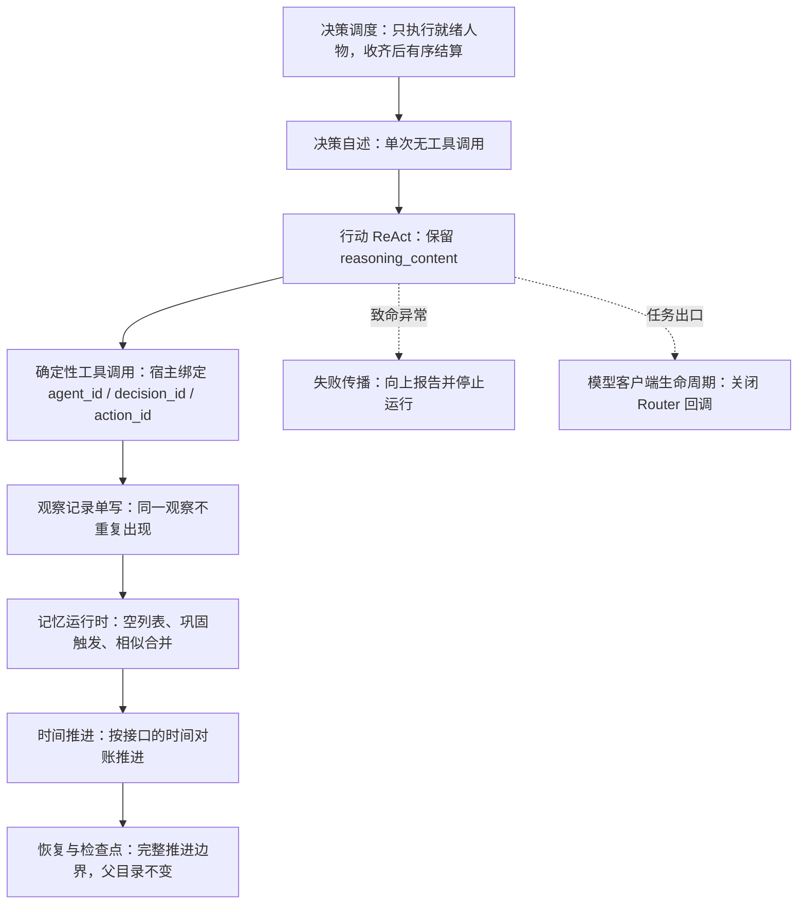

# 特性规格：AgentSociety 2 集成与改动

> 状态：FROZEN——条款已裁决并冻结；AS2 分支改动与确定性测试守卫均已落地，正式 DeepSeek 十二周运行仍待真实运行（测试基线与收据见 `docs/dev/implementation-status.md`）
> 日期：2026-09-18
> 实施基线：WorldMock `9b7fbc8`；AS2 分支 `vendor/agentsociety2` 的 `worldmock-life`（`849bac78`，基线提交 `670c94ff`）
> 范围：WorldMock 对 AgentSociety 2（下称 AS2）的选型理由与复用边界、分层职责，以及 AS2 核心链路为本次场景必须发生的确定性改动

本文定义 WorldMock 对 AS2 的改动行为与改动理由。接口签名、字段、枚举与提示词模板只在
`docs/CONTRACTS.md` 定义，本文引用而不重复。

## 选型理由与分层职责

### 为什么选择 AS2

AgentSociety 2 提供已验证的人物决策、模型调用、记忆检索和工作区管理能力。复用这些能力可避免重写 Agent 框架。

**复用边界**：

| AS2 能力 | 复用范围 |
| --- | --- |
| `EnvBase` 子类注册 | LifeEnv 使用现有环境注册、工具声明、共享 actor 和生命周期 |
| `PersonAgent` 决策与记忆 | 保留模型客户端、ReAct 执行和记忆检索；不重写人物循环 |
| Ray actor 共享环境 | 复用为世界状态的单一写入进程 |
| `to_workspace` / `restore` | 承载自定义业务状态的持久化与恢复 |

**不复用的 AS2 模块**：
- `EconomySpace`：本场景资金由实际活动与合同结算，不使用按日自动加收入减消费
- `SimpleSocialSpace`：社交在 LifeEnv 内实现，状态进入本项目足迹事务

### 分层职责

```
AS2 调度层
  ├─ Society.step：根据环境给出的可决策人物执行 batch；收齐动作后有序结算
  ├─ Router：确定性工具调用、时钟同步、身份绑定
  └─ PersonAgent：模型决策、记忆、工具调用

LifeEnv（唯一生活规则环境）
  ├─ 观察：当前可见状态、到达通知与内容接触的完成结果
  ├─ 动作接收：经 submit_action 登记，宿主绑定 agent_id/decision_id/action_id
  ├─ 结算：活动推进、资源结算、内容提供
  └─ 数字足迹：事件、素材、检查点的事务写入

LifeAgent（人格与工具约束）
  ├─ 人格提示：卡片、需求、记忆
  ├─ 生活动作工具：只暴露生活与记忆工具
  └─ 证据回调：保留原模型调用与 ReAct 机制
```

## AS2 核心改动清单

AS2 是基础框架，本项目在其上新增 LifeEnv 与 LifeAgent 两个扩展模块，并对 AS2 核心链路作以下确定性改动。
每一项给出问题、改动行为与算法；**可观察结果与取证位置统一登记在验收矩阵**，本节不重复列出。
本节引用的 `agent/…` 是 AS2 分支包内路径，包根为 `vendor/agentsociety2/packages/agentsociety2/agentsociety2/`。



图中的「时间推进」一步按 `docs/CONTRACTS.md`「生命周期」的时间对账推进，推进量与该步结束时间的判定以该节为准。

### 决策调度改动

**问题**：AS2 原 `step` 调用所有人物、再调用环境、最后增加时间，不适合直接跨过新启动活动的结束时刻。

**改动行为**：
1. 环境用 `scheduling_state()` 给出可决策人物与下一个事件时刻
2. Society 只执行就绪人物的 batch
3. 收齐动作提案后环境有序结算
4. Society 查询新的下一时间边界并推进

**算法**：
```
while 未到场景终点:
    sync_time_and_wait_completion()
    ready_agents = env.scheduling_state().decidable_agents
    execute_batch(ready_agents)
    env.commit_decision_round(round_id)
    next_time = env.scheduling_state().next_event_time
    env.step(tick=next_time - current_time, t=next_time)
```

**验证**：睡眠人物不反复调用模型；新活动的较早结束时间不会被跨过。接口见 `docs/CONTRACTS.md`「生命周期」。

### 时间约定统一

**问题**：`step` 文档称 `t` 为步结束时间，实际调用传入当前开始时间，各模块分别猜测。

**改动行为**：
- 统一约定：`step(tick, t)` 的第一个参数按秒给出推进量，第二个参数取推进后的结束时刻
- 对账条件：结束时刻与上次已确认时刻之差等于本次推进秒数（接口表述见 `docs/CONTRACTS.md`「生命周期」）
- AS2 路由、Society 与 LifeEnv 的校验共享这一约定

**验证**：时间连续性检查通过，事件时间严格递增。

### 确定性工具调用与身份绑定

**问题**：需要确定性工具结果、调度状态传递、身份绑定。

**改动行为**：
1. Router 增加确定性工具调用和调度状态传递
2. 宿主绑定 `agent_id`、`decision_id`、`action_id`，工具参数不能改变调用者
3. 工具结果未经第二个模型改写

**算法**：
```python
context = DecisionContext(
    run_id=..., round_id=..., decision_id=...,
    agent_id=..., observed_at=..., world_state_version=...
)
action_id = generate_action_id()
result = env.submit_action(call, context=context, action_id=action_id)
# 结果直接返回，不再次调用模型改写
```

**验证**：人物不能指定他人身份读写其资源；请求到达时钟一致。

### 失败传播改动

**问题**：
- `to_workspace` 捕获环境保存异常并只告警
- ReAct 预算耗尽会合成结果
- 部分记忆异常只告警或宽松转换
- 同批工具调用包含 `finish` 时只保留结束调用

**改动行为**：
1. 保存失败、必要观察失败、人物执行失败向上报告并停止运行
2. 删除合成结束结果和只保留 `finish` 的路径
3. 决策预算用尽即失败；`finish` 不得与其他工具同批返回
4. 记忆校验失败、必要归纳失败与保存失败向上传播
5. 必要观察和证据保存的致命异常穿过原有 catch 分支传播，不把空观察或持久化故障转换成可继续的普通工具结果

**算法**：
```python
# 环境保存
try:
    env.to_workspace(path)
except Exception as e:
    # 改前：logger.warning，继续运行
    # 改后：raise，终止运行并保存失败证据
    raise RuntimeError(f"Environment save failed: {e}")

# ReAct 预算耗尽
if remaining_turns == 0 and not has_valid_finish:
    # 改前：synthesize_result()
    # 改后：raise DecisionBudgetExhausted
    raise DecisionBudgetExhausted("No valid finish within budget")

# finish 与其他工具冲突
if 'finish' in tool_calls and len(tool_calls) > 1:
    # 改前：keep_only_finish()
    # 改后：reject_all_with_protocol_error()
    return [], ProtocolError("finish cannot appear with other tools")
```

**验证**：没有登记的动作不能变为成功记忆；协议冲突不静默丢动作；不生成缺失必要记忆的成功检查点。

### 恢复与检查点改动

**问题**：
- 原实现把环境恢复失败兜住，随后照新建环境的路径启动
- 现有恢复入口复用原目录
- 自定义业务状态不会自动获得完整恢复能力

**改动行为**：
1. `society/society.py` 的恢复入口改为接收父运行检查点与新的目标目录
2. 全部恢复成功才启动
3. 删除恢复失败后新建环境继续的路径
4. 每个完整推进边界收一个共同检查点；恢复时校验世界、人物和时钟

共同检查点材料、存储校验与分支保存以[记录引擎](../design/05-recording-engine.md#恢复与反事实分支)为准；
参与者恢复、启动顺序与失败停止属于[模拟引擎的恢复编排](../design/04-simulation-engine.md#9-恢复与反事实运行编排)，
本节登记 AS2 侧的接入要求。

**算法**：
```python
def restore(workspace_path):
    # 改前：try restore, except -> create_new()
    # 改后：
    checkpoint = read_and_validate_checkpoint(workspace_path)
    verify_all_snapshots_and_versions(checkpoint)
    if not valid:
        raise CheckpointInvalid("Missing snapshots or version mismatch")
    
    # 在新目录恢复，父目录不变
    new_run_dir = create_branch_directory()
    restore_world_and_agents(checkpoint, new_run_dir)
    return new_env_instance
```

**验证**：缺少快照或校验失败立即终止；不把较新的世界状态与较旧的记忆混合恢复。

### 决策自述与推理内容保留

**问题**：决策需要一段人物私有的、不带工具的决策自述作为行动阶段的输入；DeepSeek 思考模式下带 `tools` 的后续请求
必须回传 assistant 消息的 `reasoning_content`。

**改动行为**：
1. AS2 `agent/base/agent_runtime.py` 的 ReAct 入口增加决策自述钩子：单次模型调用，不带工具（决策自述请求暴露工具即抛错）
2. 决策自述文本落库，并作为行动阶段请求的一段输入
3. 后续请求保留 assistant 消息的 `reasoning_content`；缺失时不伪造该字段

**验证**：决策自述落库并进入行动请求；带 `tools` 的后续请求不因缺少 `reasoning_content` 被拒。
决策自述的内容规则与信息范围合同见 `docs/dev/SPEC-life-realism.md`「两阶段决策」。

### 记忆运行时改动

**问题**：AS2 原实现把空记忆列表当作错误，巩固触发只认单条偏好记忆，巩固提示携带示例身份，相似的同类记忆被重复追加。

**改动行为**：记忆规则本身见 `docs/dev/SPEC-life-realism.md`「记忆合同」，本节只登记 AS2 侧改动：
1. `agent/memory_runtime.py`、`agent/memory.py` 允许 `finish` 提交空记忆列表
2. 巩固触发改按「记忆合同」的条件判定，不再由单条偏好记忆触发
3. 巩固提示改传人物卡片、改用人物语言、去掉示例身份
4. 写入前改按「记忆合同」的相似度窗口合并

**验证**：同一偏好不重复写入；长期记忆文件中没有示例身份残留。

### 模型客户端生命周期管理

**问题**：连续 worker 任务会积累已结束 Router 的回调，超过 LiteLLM `MAX_CALLBACKS` 限制。

**改动行为**：
1. 每次 Ray worker 任务结束时，通过 `ServiceProxy` 显式关闭该任务的模型客户端
2. `LLMClient` 使用 `Router.discard()` 移除全局回调，再释放运行时引用
3. 正常返回、任务异常与取消均经过清理路径

**算法**：
```python
class LLMClient:
    def close(self):
        if self.router:
            self.router.discard()  # 移除全局回调
            self.router = None

# Worker 任务出口
def agent_step(...):
    try:
        result = execute_agent_decision()
        return result
    finally:
        service_proxy.close_client()  # 确保清理
```

**验证**：连续创建并关闭超过回调上限数量的实例，核对回调不增长、旧实例可回收、无上限警告。

### 观察记录单写

**问题**：AS2 观察记录同时写入结构化 `data` 和 JSON 字符串副本，导致同一观察在 user 消息中出现两次。

**改动行为**：`agent/person.py` 组装观察记录时去掉 JSON 字符串副本，只留结构化 `data`。该行为规则见 `docs/dev/SPEC-life-runtime.md`「观察投影行为规则」；观察事件的字段面见 `docs/design/05-recording-engine.md`「事件字段」。

**算法**：
```python
# 改前
observation_record = {
    "data": structured_obs,
    "json_string": json.dumps(structured_obs)  # 删除此行
}

# 改后
observation_record = {
    "data": structured_obs
}
```

**验证**：一次决策的 user 消息中同一观察只出现一次。

## 依赖与版本管理

### AS2 基线与分支

**基线提交**：`670c94fff7c64c4f79b632125f2ccf968155e746`（AS2 版本 2.8.7）

**维护分支**：`vendor/agentsociety2` 的 `worldmock-life` 分支，基于上述提交

**锁定依赖**：使用该上游提交的锁文件
- MCP 1.26.0
- LiteLLM 1.89.2
- Ray 2.55.1

**新增依赖**：统一进入 WorldMock 锁文件，不改变 AS2 上游锁文件

### 改动管理原则

**禁止的做法**：
- 运行时 monkey patch
- 复制整个 AS2 调度器
- 保持两套人物决策循环
- 为了接入而重写 Agent 框架

**允许的做法**：
- 在原有路径加明确钩子
- 抽取短小辅助函数
- 新增接口方法（如 `scheduling_state`、`commit_decision_round`）
- 删除不适合本场景的自动转换路径

### 与 LabelKit 的进程隔离

**问题**：AS2 的 pycityproto 需要 protobuf <6，LabelKit 的 OR-Tools 需要 protobuf 6.33，两者不能安装进同一个 Python 环境。

**解决方案**：
1. WorldMock 锁定 AS2 生活仿真依赖
2. `vendor/labelkit` 固定已核验提交并使用其自己的锁文件和环境
3. WorldMock 不在进程内 import LabelKit
4. 使用独立环境的 LabelKit CLI 处理固定文件

**验证**：交付程序严格验证 CLI 的退出状态、产物、运行身份和哈希。接口见 `docs/CONTRACTS.md`「LabelKit 输入结构与窗口编码」。

## 扩展模块职责

### LifeEnv 职责

继承 `EnvBase`，实现生活环境：
- 观察、动作接收、活动推进、资源结算
- 内容提供、数字足迹
- 使用现有环境注册、工具声明、共享 actor 和生命周期

**不做的事**：
- 不代替 AS2 管理模型调用
- 不维护独立的人物工作区
- 不重写决策循环

### LifeAgent 职责

继承 `PersonAgent`，实现人格与需求提示：
- 人格与需求提示
- 生活动作工具
- 依据事件形成记忆

**复用边界**：
- 保留现有模型客户端
- 保留 ReAct 执行
- 保留记忆检索
- 不重写人物循环

## 验收矩阵

验收矩阵逐项给出该改动必须通过的可观察结果与取证位置。状态列两档：`代码层已验证` 指确定性测试守卫已在
`docs/dev/implementation-status.md` 记录的测试基线下通过；`待真实运行` 指还要等正式十二周的真实模型运行或隔离盲评。
下表 `AS2 分支测试目录` 指 `vendor/agentsociety2/packages/agentsociety2/tests/`，该目录的测试在本仓库根目录下可直接收集运行。

| 要求 | 必须通过的观察 | 证据位置 | 状态 |
| --- | --- | --- | --- |
| 决策调度 | 只对就绪人物执行 batch；收齐动作后按环境顺序结算，再取下一时间边界；下一边界必须是未来时刻且不含重复人物 | `AS2 分支测试目录/test_society_decision_round.py`（`test_society_uses_environment_order_then_commits`、`test_society_redecides_before_advancing_when_agent_remains_ready`）、`AS2 分支测试目录/test_decision_round.py`（`test_scheduling_state_requires_future_boundary`、`test_scheduling_state_rejects_duplicate_agents`） | 代码层已验证 |
| 时间约定统一 | 推进同时满足三条：`tick` 严格为正、**时间对账成立**（见 `docs/CONTRACTS.md`「生命周期」）、且命中下一个调度边界 | `tests/life/test_engine_branch_coverage.py::test_advance_rejects_tick_consistent_jump_past_next_scheduling_boundary`、`tests/integration/test_env_lifecycle_coverage.py`（`env.step(tick, next_event_at)` 调用形） | 代码层已验证 |
| 确定性工具调用与身份绑定 | 决策上下文不可变且身份完整；直接工具调用必须携带已校验请求；一次决策只提交一个宿主绑定动作，宿主字段不出现在工具 Schema | `tests/integration/test_life_agent_protocol.py`（`test_native_react_submits_one_host_bound_life_action`、`test_life_agent_schema_is_closed_and_host_fields_are_hidden`）、`AS2 分支测试目录/test_decision_round.py`（`test_decision_context_is_immutable_and_complete`、`test_direct_tool_call_requires_validated_request`） | 代码层已验证 |
| 工具面与证据回调 | 只暴露生活与记忆工具，工具 Schema 指纹与注册表摘要绑定；一次决策的模型消息为三段，观察写一次 | `tests/integration/test_life_agent_protocol.py`（`test_life_tool_schema_fingerprint_pins_registry_digest`、`test_react_messages_are_three_parts_and_observation_written_once`） | 代码层已验证 |
| 失败传播 | 预算耗尽、工具执行失败、证据写入失败均致命且不触发新的模型调用；`finish` 与其他工具同批时整批拒绝且无部分执行 | `AS2 分支测试目录/test_agent_react_validation.py`（`test_loop_exhaustion_is_fatal`、`test_finish_mixed_with_action_is_rejected_atomically`、`test_mixed_batch_is_rejected_without_partial_execution`、`test_tool_execution_failure_is_fatal_without_new_model_call`）、`tests/integration/test_life_agent_protocol.py::test_memory_persistence_failure_aborts_society_before_commit` | 代码层已验证 |
| 必要观察与证据保存 | 响应证据写入失败是致命错误且不再发起模型调用；空观察或持久化故障不转换成可继续的普通工具结果 | `AS2 分支测试目录/test_agent_react_validation.py`（`test_response_evidence_failure_is_fatal_without_new_model_call`、`test_unserializable_response_is_fatal_without_protocol_feedback`） | 代码层已验证 |
| 恢复与检查点 | 缺少快照、校验失败或记忆损坏时立即终止，不发布子分支；完整检查点保留父目录与精确工作区 | `tests/integration/test_runtime.py`（`test_restore_rejects_corrupt_used_memory_before_branch_publish`、`test_counterfactual_branch_freezes_intervention_before_publish`）、`tests/footprints/test_store.py`（`test_complete_checkpoint_branch_preserves_parent_and_exact_workspace`、`test_incomplete_checkpoint_never_creates_child`）、`tests/life/test_counterfactual.py` | 代码层已验证 |
| 决策自述与推理内容保留 | 决策自述钩子恰好发起一次不带工具的调用；带 `tools` 的后续请求与协议反馈请求都保留 `reasoning_content`；无推理时省略该键而不伪造；决策自述文本作为模型响应证据落库 | `AS2 分支测试目录/test_worldmock_life_hooks.py`（`test_prelude_decision_statement_hook_runs_one_toolless_call`、`test_reasoning_content_survives_into_followup_request`、`test_reasoning_content_survives_protocol_feedback_request`、`test_assistant_message_without_reasoning_omits_key`）、`tests/integration/test_life_agent_protocol.py::test_reasoning_content_is_persisted_in_model_response_evidence` | 代码层已验证 |
| 记忆运行时改动 | 空记忆列表合法；三种巩固触发条件各自生效而单条偏好不触发；巩固提示携带人物卡片且不含示例身份；相似同类记忆在窗口内合并只增加计数 | `AS2 分支测试目录/test_worldmock_life_hooks.py`（`test_step_finish_with_empty_memories_is_legal`、`test_after_step_accepts_empty_memory_list`、`test_consolidation_triggers_importance_accumulation`、`test_consolidation_triggers_pending_threshold`、`test_consolidation_triggers_sleep_boundary`、`test_single_preference_does_not_trigger_consolidation`、`test_consolidation_prompt_carries_persona_card_without_example_identity`、`test_similar_same_type_memory_merges_within_window`） | 代码层已验证 |
| 模型客户端生命周期 | 连续超过一百轮 worker 任务后不残留 Router 回调；任务异常与取消同样经过清理；跨事件循环重建只丢弃前一个 Router | `AS2 分支测试目录/test_llm_callback_lifecycle.py`（`test_more_than_one_hundred_task_loops_leave_no_router_callbacks`、`test_worker_task_cleanup_covers_failure_and_cancellation`、`test_cross_loop_rebuild_discards_only_previous_router`） | 代码层已验证 |
| 观察记录单写 | 一次决策的 user 消息中同一结构化观察只出现一次，不再额外出现 JSON 字符串副本 | `tests/integration/test_life_agent_protocol.py::test_react_messages_are_three_parts_and_observation_written_once`、`AS2 分支测试目录/test_worldmock_life_hooks.py::test_structured_observation_appears_once_in_user_message` | 代码层已验证 |
| 与 LabelKit 的进程隔离 | 交付程序校验独立环境 CLI 的调用生命周期与最终判定，产物清单与来源绑定不匹配时拒绝交付 | `tests/delivery/test_labelkit_process.py`（`test_trace_binding_requires_successful_lifecycle_and_final_verdicts`、`test_process_rejects_candidate_source_mismatch`）、`tests/delivery/test_host_delivery_coverage.py`（`test_deliver_success_path_publishes_full_manifest`、`test_file_inventory_rejects_symbolic_artifacts`） | 代码层已验证 |
| 真实端点集成 | 全部改动通过真实 AS2 与 DeepSeek 端点的集成测试，不用模拟模型或手工 JSON 替代 | `docs/dev/implementation-status.md` 记录的正式十二周运行与隔离盲评收据 | 待真实运行 |

## 版本表

| 版本 | 日期 | 修订内容 |
| --- | --- | --- |
| 1 | 2026-09-18 | AS2 集成与改动条款从主设计单体拆分并冻结为本规格；头、章节命名与证据位置按本轮文档重构口径收口 |
| 2 | 2026-09-18 | 记忆运行时改动节只保留 AS2 侧改动与验证，记忆规则本身改为引用 `docs/dev/SPEC-life-realism.md`「记忆合同」 |
| 3 | 2026-09-18 | 消除与 `docs/dev/SPEC-life-runtime.md`、`docs/design/05-recording-engine.md`、`docs/dev/SPEC-life-realism.md` 的逐字复述：观察记录单写改为登记 AS2 侧模块改动并引用本规格外的行为与字段权威，恢复与检查点改动的行为语义改为引用 `docs/design/05-recording-engine.md`「保存共同检查点」与「恢复与反事实分支」，调度、预算、记忆验证与验收矩阵前言各条目改写为 AS2 侧措辞。改动归属、技术结论与验收标准未变。 |
| 4 | 2026-09-18 | 时间对账不再复述接口原文：时间约定统一的对账条件改按本规格措辞描述，接口表述引用 `docs/CONTRACTS.md`「生命周期」。改动归属、技术结论与验收标准未变。 |
| 5 | 2026-09-18 | 代码围栏与验收矩阵内不再复述接口原文：分层职责图的观察行与动作接收行改按本规格措辞描述，时间推进流程图节点改为描述性措辞并在图邻近文字引用 `docs/CONTRACTS.md`「生命周期」，验收矩阵的时间约定统一观察项以「时间对账成立」承载同一条义务。改动归属、技术结论与验收标准未变。 |
| `2026-09-20-decision-context` | 2026-09-20 | 对齐决策上下文特性规格：统一决策自述命名，明确登记与结算结果的通道、场景信息和预算边界 |
