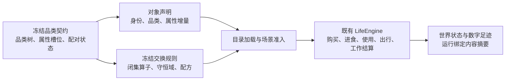

# 品类契约与交换规则开发规格

> 状态：FROZEN；本次特性完整实施的唯一行为规格。实现与验证状态另记，不以冻结等同已实现。
> 日期：2026-09-20
> 裁决：依据用户要求，对 `docs/dev/PROPOSAL-category-contract.md` 完成实现前裁决；本规格取代该提案。
> 范围：品类契约、属性继承、对象声明、配对准入、闭集交换算子、库存转换、细化建议、冻结身份及验证。

## 产品行为与边界

对象归属一个品类；共享属性和交换规则写在品类上，对象只声明差异。
资源引擎与交换引擎读取同一份冻结品类契约，人物仍只选择动作，环境仍独占结算与世界状态提交。

本次范围内的要求全部实现并以测试验证，不设置待补算子、未接线接口或跳过用例。
本次不改变人物决策协议，不增加模型调用；不引入运行中契约热更新、多重品类归属、自动定价或模型补规则。
这些是功能边界，不是延期项。现有正式十二周运行和真实模型交付的整体验收仍归 `docs/VERIFICATION.md`。

## 裁决依据

| 待裁决问题 | 最终行为 | 理由 |
| --- | --- | --- |
| 根节点未声明的配对 | 未定义；禁止视为已验证不作用 | 保留知识缺口与已审核结果的区别 |
| 新品类与全矩阵 | 只保存显式配对，缺项查询返回未定义 | 不要求写全部品类的笛卡尔积 |
| 深层覆盖与双端继承 | 唯一最具体声明生效；不可比较的同时命中拒绝 | 禁止以文件顺序决定语义 |
| 静态检查与场景启动 | 静态只报告未定义；场景可能触达的未定义拒绝启动 | 提前检查所有已配置机会，而非预测模型会选择什么 |
| 已验证不作用 | 场景可以加载；对应动作拒绝且不改状态 | 不把不作用解释成免费购买或免费资源 |
| 对象与运行视图 | 原始对象只存增量，加载后得到已解析对象 | 复用现有模块边界；旧原始对象格式直接拒绝 |
| 变换配方 | 使用动作完成时，一个输入品类转换为一个输出品类 | 与当前使用动作单对象请求一致；不是资金转账的别称 |
| 拆分与归属建议 | 只读影响报告和新版本发布；不改写历史目录或运行 | 不提供旧格式适配或自动重写历史数据的脚本 |
| 外部分类体系 | 借用分类与属性机制，不宣称分类标准提供经济或药物作用规则 | 理论依据必须和实际支持范围一致 |

业界证据与排除理由见 `docs/dev/research/category-contract-feasibility.md`。
现有依赖 Pydantic、JSON Schema、Decimal、hashlib 和资源账本足够；不增加依赖、不执行任意表达式。

## 冻结产物与品类树

目录新增 `catalog/category-contract.json` 与 `catalog/exchange-rules.json`。
契约含格式版本、契约版本、品类节点、属性槽位、属性增量和显式配对；不含结算公式。
规则文件含格式版本、所绑定契约版本和规则。目录清单绑定两份产物的 SHA-256 与契约版本。
读取时校验文件字节摘要，禁止同版本异内容静默生效。

品类节点有唯一 `category_id`、自然语言名称、至多一个 `parent_id`。
恰有一个根，禁止重复身份、孤儿、环、多根和跨对象形态继承。
树内声明 `person` 作为动作参与者；它不是商品，也不新增人物账户体系。
对象子树仍区分 `product`、`service`、`contract`；对象只能归属其中一个节点。
纯牛奶归属于乳制品，不归属于酸奶。

品类值沿根到叶解析。子节点的槽位约束与祖先约束共同成立，不得悄悄放宽祖先范围。
节点只声明新增槽位或确有不同的值；无规则差异的子节点直接继承。
只读解析结果不得通过修改嵌套字典、对象或数组改变其他调用者读取的冻结语义。

## 属性槽位与对象增量

槽位声明采用 JSON Schema 表达类型、必填性、单位说明、枚举与数值范围。
默认值属于品类；如食品密度窗属于品类槽位范围，不保留在生成器的品类常量表中。
数值拒绝布尔值冒充数字、NaN、无穷值、越界值和不符合整数要求的结果。

品类与对象均支持绝对赋值、`relative` 加法增量、`proportional` 乘法增量。
同一层同一槽位至多选择一种；增量必须基于已定义数值；非数值增量拒绝。
逐层先读取父层已解析值，再施加本层增量，再校验全部有效槽位约束。
修改父品类值后，子类的相对关系必须保持；对象自身覆盖不影响其他对象。
对象显式写入与继承值相同的重复值应被拒绝，避免品类型数值重新复制到对象中。

原始 `objects.jsonl` 每行只含对象身份、名称、`category_id`、属性赋值或增量、来源和对象版本。
禁止对象携带 `edges`、内联公式或品类结构定义。对象版本沿用目录追加版本检查。
目录加载后编译成现有运行期所需的已解析对象与 typed edges；已解析视图不作为可写原始格式。
新增同品类对象只改对象清单和相应目录版本，不需要修改契约或规则文件。
对象归属变更必须重新验证全部有效属性，不能改变契约或规则。
目录维护必须保留世界素材品类要求及全部契约身份字段；验证失败不能留下半条对象或提升后的清单。

## 来源分类与审核证据

沿用 `fact`、`anchored`、`assumption`、`scenario` 四类来源。
新契约、规则和对象声明中的每个静态数值必须恰好被一份来源记录覆盖，不能用空来源路径蒙混过关。
版本、索引和来源记录内部的元数据不作为模拟静态数值重复追溯。
槽位范围、默认值、增量、系数、配方数量都属于数值覆盖范围。

来源记录明确生产者是人工、数据源还是模型，保留来源、材料与方法。
模型生产者不得直接声明 `fact`；模型抽取的 `anchored` 数值必须有可核对的来源材料和方法。
品类结构和规则的发布还必须有审核身份、审核依据和变更理由。
审核人可以是人工或用户明确委托的审查 agent；必须注明身份种类与授权来源，禁止将 agent 审查写成人工审查。
本次用户明确要求并发 agent 审查与实现，因此使用委托审查记录，不虚构人工已经阅读了每份数据。
审核记录是可审计证据，不宣称仅凭字符串能够验证现实人员身份或证据的真实性。
规则未定义时，加载、准入、运行和细化工具均不得调用模型或制造默认规则。

## 配对解析与可触达检查

配对键为有向的 `(actor_category_id, target_category_id, action)`。
动作采用现有语义：`purchase`、`consume:eat`、`consume:use`、`work:settle`、
`travel:walking`、`travel:driving`。正反方向不自动等同。
显式记录只有 `defined`、`no_effect`、`undefined` 三种状态；缺项返回 `undefined`。
`defined` 必须引用存在、目标品类和动作一致的规则；其他状态不能携带生效规则。
`no_effect` 必须带审核证据，显式 `undefined` 可遮蔽祖先定义。

查询沿两个参与品类的祖先链匹配相同动作。
若一个命中在两端都不比另一个更浅且至少一端更深，它更具体。
只保留唯一未被更具体声明覆盖的命中；出现多个不可比较的命中时报告歧义并拒绝。
禁止按累加深度、字典插入顺序或首条匹配裁决歧义。

静态报告可以按请求的品类对返回未定义结果，并统计显式声明与未定义覆盖；不落盘全矩阵。
场景准入从全部场景商品、初始持有物、预排商品发布、任务合同、路线方式及配方输出递归闭包推导配对。
不得只看初始可见商品，不得相信调用方手写一个更小的触达清单。
任何可能触达的配对为未定义或歧义，必须在创建运行产物、请求模型之前失败。
运行动作受理和配方执行复查配对，任何未定义或已验证不作用均不改变世界状态。

## 闭集算子与真实结算

规则挂在品类节点上，规则正文不含具体对象身份。
闭集涵盖购买转账、食品能量来源、耐用品使用、出行费率、按时计酬、按件计酬、总包计酬及库存转换。
每条规则声明守恒域；准入把声明与资源定义、算子实际输入输出对照。
closed 金额只能在既有账户间转移，不能由 source/drain 产生或销毁；open 身体资源仍受其上下界守卫。
未知算子、任意公式字符串、未声明资源域、同域单位不一致和不守恒变换均拒绝。

| 算子行为 | 数值与接线要求 |
| --- | --- |
| 购买 | 用已解析品类价格及配对系数计算单价，再经现有整单购买与账本提交 |
| 食品能量来源 | 品类热量及配对系数进入现有进食时长、库存扣减与身体结算 |
| 耐用品使用 | 保留既有使用效果语义；有库存配方时执行配方 |
| 出行费率 | 零费率或最小金额与每米费率的闭集计算，驱车取上整分；删除文本表达式解析器 |
| 按时计酬 | 实际秒数按小时折算，受合同最大时长约束，取下整分 |
| 按件计酬 | 验收 oracle 的实际件数乘单价，缺件数拒绝 |
| 总包计酬 | 验收通过才支付合同金额 |
| 库存转换 | 输入和输出数量在一个事务内变更，详见下节 |

配对系数是非负有限值，必须有来源；规则没有系数时的单位系数也必须由冻结声明给出。
系数只影响相应算子的命名数量参数，不能自行决定验收通过或绕过余额、库存与身体约束。
整数货币用 Decimal 计算，购买和出行向上取整，合同付款向下取整；食品能量保留有限数值。
合同实例将实际报酬与时长绑定到冻结槽位，计算按规则的槽名取值；不能声明一个槽而读取另一个硬编码字段。
无法提供规则所需实例槽值时在启动前拒绝。
食品使用时长与耐用品使用效果同样按规则命名的槽位编译并进入实际动作。
购买算子从买方付款；声明其他付款角色时拒绝场景准入，不暗中改用人物账户。
必须验证改动品类参数或配对系数后，真实 LifeEngine 购买、进食、出行或工作结算产生对应变化。
不得以孤立解释器测试替代运行路径证据。合同支付只能有一条闭集计算路径。

## 库存转换配方

本次配方为 `consume:use` 的一个输入品类、一个输出品类的原子转换；输入使用现有请求对象。
规则只写输入品类、输出品类、正输入数量和正输出数量、库存守恒域及来源。
场景的 `recipe_output_bindings` 把输出品类明确绑定到一个已发布对象；不能按名称猜测或自动选首个对象。
输出对象须属于输出品类或其子类，单位相符；声明 closed 库存域时输入输出的数量必须相等。
输入数量按请求份数与配对系数缩放，输出同倍率缩放；从人物当前地点扣输入并加输出。
配方输入输出要求为正，因此配方命中的系数必须大于零；零系数在启动前拒绝，不静默忽略。
配方只能在使用活动完整结束时执行一次，暂停和取消不产生半件输出。
不足库存、输出绑定错误、守恒失败或提交失败时，库存、活动进度和足迹事务全部保持原值。
生产代码通过现有 LifeEngine 动作与提交路径执行配方，测试必须覆盖实际库存前后状态及重复动作幂等性。

## 新品类、细化与发布

提供可调用的品类检查、细化影响报告与新版本发布能力，并接入 `worldmock category` 命令。
细化输入为旧目录、待发布新契约与规则、被细化的父品类；不修改旧目录。
报告列出受影响对象、当前归属、依据属性满足的新子品类、唯一建议或歧义/无匹配、规则增量及配对变化。
建议只使用已验证属性，不调用模型；多子节点同时匹配必须如实报告，不能随意分配。
运行触达统计按品类和命中规则聚合；高频但仅命中同一祖先规则的节点可列为细化线索，报告原始次数，不自动拆分。

发布为一个新的完整目录路径：目标已存在则拒绝；契约版本必须递增；审核材料及委托授权来源必须齐全。
对象归属由显式确认清单给出，对象仍保留时允许继续归属父节点；不能未经确认批量改归属。
发布前完成结构、槽位、来源、规则、配对、对象与场景准入验证，再原子公开目录。
发布失败不产生可加载的半成品，不改写源目录、旧版本、运行或导出。
回滚通过选择先前的不可变目录版本完成，不提供历史数据改写或格式迁移工具。

## 运行身份与导出

运行清单记录品类契约版本、契约文件 SHA-256、交换规则文件 SHA-256 与目录内容摘要。
摘要覆盖本次结算依赖的对象、资源、规则及目录清单，不能只哈希版本号。
新运行与恢复均在副作用之前核对内容身份；open、resume、replay 遇到同版本异内容必须明确拒绝。
运行中的语义来自已装配只读对象，外部文件变化不改变当前运行。
已有 checkpoint manifest 摘要与导出的 frozen_run_manifest 继续承载身份，不另造第二条证据链。
已发布导出不读取当前品类文件来重写其含义；改变新目录不能改变既有导出字节或来源身份。

## 文件修改清单

下表列出功能责任；实现可以在责任内拆小文件，最终清单必须与实际 diff 核对。

| 文件或目录 | 修改目的 |
| --- | --- |
| `src/worldmock/categories/` | 契约模型、严格来源、继承与槽位校验、稀疏配对、算子解析、细化与发布 |
| `src/worldmock/catalog/` 的 `__init__.py`、`models.py`、`loader.py`、`compiler.py`、`builder.py`、`admission.py`、`inspect.py` | 原始对象增量、编译视图、绑定摘要、对象发布完整性及准入 |
| `catalog/category-contract.json`、`catalog/exchange-rules.json`、`catalog/objects.jsonl`、`catalog/manifest.json` | 正式冻结数据与全部现有对象重新生成 |
| `catalog/rules/travel-fare.toml`、`scripts/build_catalog.py` | 删除任意文本公式和代码里的品类密度窗；生成新格式 |
| `catalog/resources.jsonl`、`catalog/rules/travel-time.toml` | 明确库存数量资源，出行时长改为数值配置 |
| `src/worldmock/life/semantics.py`、`scenario.py`、`engine.py`、`work.py`、`basket.py` | 真实准入、闭集结算、库存配方与运行身份 |
| `src/worldmock/life/category_contract.py`、`inventory_recipe.py`、`run_identity.py`、`travel_time.py`、`activity_evidence.py`、`projection.py`、`rules.py` | 拆分品类准入、配方、身份、数值时长与事件证据；区分商店商品和持有库存 |
| `src/worldmock/runtime.py`、`footprints/`、`delivery/` | 核查并按需要贯通恢复、导出与交付身份 |
| `src/worldmock/cli.py`、`scenarios/*.json` | 品类维护命令、目录版本和配方输出绑定 |
| `tests/categories/`、`tests/catalog/`、`tests/life/`、`tests/integration/`、`tests/footprints/` | 反例、真实运行边界、恢复与导出测试 |
| `tests/corpora/`、`tests/test_style_gate.py` | 语料对照有效对象与减少既有风格债务 |
| `scripts/coverage_gate.py`、`scripts/migrate_scenarios.py` | 覆盖率产物路径与文档一致；删除过时场景迁移脚本 |
| `docs/INDEX.md`、`CONTRACTS.md`、`ARCHITECTURE.md`、`EXPERIMENT.md`、`VERIFICATION.md`、`docs/design/`、`docs/dev/`、`catalog/README.md` | 规范、数据格式、职责、状态、测试追溯与来源一致性 |

## 验收与需求台账

每行均为必须闭合的要求；状态和准确测试函数记录在 `docs/dev/category-contract-verification.md`。

| 要求 | 必须证伪的反例 |
| --- | --- |
| 品类树与只读语义 | 环、孤儿、重复、跨形态继承或嵌套写入能污染后续结果 |
| 属性继承与增量 | 父值变化后关系丢失；冲突增量、未知槽位、越界与重复默认值被接受 |
| 对象零规则新增 | 新增同品类对象要改规则，或 raw edges 仍可加载 |
| 来源与模型边界 | 静态数值无来源/双重覆盖；模型直接 fact；审核缺失可发布 |
| 三态和稀疏存储 | 缺失等同零；加载因无关未定义失败；需要落盘全矩阵 |
| 唯一最具体配对 | 深层不覆盖、方向被交换、歧义按顺序裁决 |
| 场景可触达准入 | 初始隐藏、未来发布、初始库存、配方输出的未定义可绕过启动门禁 |
| 算子及守恒 | 任意公式或未知算子可生效；closed 资源可凭空增加 |
| 真实结算与系数 | 只修改孤立计算结果，实际购买/能量/出行/合同付款不变 |
| 库存转换 | 无实际输出、半笔状态、取消也转换、重复请求重复转换 |
| 细化影响与触达统计 | 对象遗漏、建议随意分配、规则变化漏报、统计没有原始次数 |
| 新版本发布 | 无审核、版本不递增、失败残留半目录、源目录被改写 |
| 运行绑定与导出 | 同版本篡改后恢复成功，既有导出身份被当前目录改写 |
| 文档及文件一致性 | 提案仍是规范依赖、旧公式/旧原始对象仍是现行说明、文件清单与 diff 不符 |

验证依次为针对性测试、真实离线 LifeEngine 动作、全部 pytest、目录再生成检查、文档链接门禁、覆盖率门禁，
再由独立 agent 按本规格执行 `uncle-bob-review` 的干净提交与隔离语义突变。
任何存活突变都需补充有效断言并重新执行原突变；禁止修改规格来掩盖缺失功能。
实施前基线：提交 `426af3b` 上 2746 passed、1 failed，已有工具 Schema 固定摘要不一致；单独核对并修复后重验。
