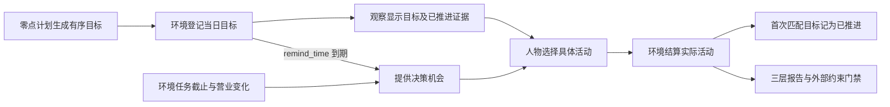

# 当日目标特性开发规格

> 状态：已实现并通过本特性确定性验收；行为合同已冻结，证据见文末台账。日期：2026-09-21。
> 生成方式、提醒与部分节律由[时间与能量规格](SPEC-time-and-energy.md)修订；修订条款已实现并通过离线验收，台账中被修订两行的证据见[时间与能量验收记录](research/time-and-energy-verification.md)。
> 「人物可见内容与工具」按[人物 Prompt 规格](SPEC-persona-prompt.md)修订，修订部分已实现并通过离线验收（证据见[人物 Prompt 验收记录](persona-prompt-verification.md)）；修订记录见「版本表」。
> 「心智模型与范围」「提交与修订」「实际推进与情绪」「度量输出合同」按[一日运行保真规格](SPEC-dayrun-fidelity.md#冻结条款修订)「冻结条款修订」第 9、23 行修订（一日运行保真 DP1，2026-09-29）：
> 目标条目增大致时刻 `around_time`，推进要求同家族活动在该时刻前后 90 分钟内进行，零点计划不重述作息，推进比例只计非例行意图；修订部分已实现并通过离线验收，
> 台账中被修订的五行已按新行为重验改记「通过」（证据见表后说明与该规格验收台账「目标推进」「系统层」两行）。
> 来源：[语义改造提案](PROPOSAL-day-plan-goals.md)。本规格取代原「日程骨架」行为；
> 字段与错误码由 [接口合同](../CONTRACTS.md) 承载，设计职责由既有设计文档承载。

## 心智模型与范围

当日目标清单由零点计划 `plan_day` 生成，人物可 `revise_day_plan` 修订；只有 `remind_time` 产生提醒边界。
清单不是全天时刻表，也不驱动活动自动执行。计划只写今天与平常不同的事和要办的事：人设层作息里已有的事（睡觉、起床、上下班、吃饭）不写，
除非今天与平常不同或需要提醒；作息是默认，今日计划的具体安排优先于作息，身体的感觉只在较强一档才改；平常的一天可以没有目标
（[一日运行保真规格](SPEC-dayrun-fidelity.md) 2.2、2.3，裁决 S11）。每条目标的大致时刻 `around_time` 只用于推进判定，不产生提醒，也不驱动活动。
列表顺序就是优先级，不增加另一套优先级字段。环境只证明相关活动实际推进，不能证明自然语言目标完成。

本次不接入参考数据集、不创建预约系统、不生成默认全天轮廓、不引入自然语言目标判定器，
不改变其他活动的资格与资源结算。旧时段字段、段起点唤醒、段级照做函数和偏离分钟指标直接删除，
不提供兼容形状、迁移或回退。

## 当日目标与生命周期

### 提交与修订

- 场景本地零点先结算旧日、使旧计划失效，再由零点后台任务 `plan_day` 生成；中途启动时在首个决策前生成；
  同日一次（`plan_submitted_dates`）；允许空清单，表示今天没有刻意目标。
- 初次及修订后清单均为零至八条；上限沿用已有提示容量边界，不宣称是人的目标数量基率。
- 条目接受 `intent_kind`、`goal`、可空 `remind_time` 与必填可空的大致时刻 `around_time`。`intent_kind` 沿用十一值意图闭集；同一清单每种意图最多一条。
  `goal` 为非空白文本，最多三百字符；不另设备注。`remind_time`（场景本地 `HH:MM`，须晚于生成或修订时刻、
  早于次日零点）是条目唯一的提醒时刻字段。`around_time`（场景本地 `HH:MM`）由写计划的模型填，零点计划模板要求每条目标都写
  （不确定就写大致时段的中点）；格式错误报 `ACTION_REQUEST_INVALID`；它不要求晚于修订时刻，也不触发任何决策（一日运行保真规格 8.2，裁决 D12）。
  禁止时长和旧字段；`goal` 可写粗略时段，但环境不解读文字：「睡前」「上午」这类说法由模型换算成 `around_time`，环境只比对时刻。
- 环境附加 `registered_at`、`progressed_at`、`progress_activity_id`，以及提醒时刻 `remind_at`（无提醒时为空）、
  提醒状态 `reminded_at`（未触发时为空）与大致时刻换算成的当日绝对时刻 `around_at`（无大致时刻时为空）。`progressed_at` 与 `progress_activity_id` 同时为空表示未推进，
  同时有值表示已推进；登记时刻与推进证据属于环境事实，不是人物的时间计划。提醒与推进无关：到点触发一次，
  只在修订替换或删除该目标、或当日结束时失效。
- 修订请求替换全部未推进条目。已推进条目按原相对顺序保留在前，不能删除、改写或重复提交；
  请求条目依列表顺序接在其后，合并后仍满足条数上限与意图唯一性。
- `intent_kind`、`goal`、`remind_time`、`around_time` 四个字段完全相同的未推进条目保留登记时刻与提醒状态，不重校时刻；只改
  `remind_time` 的条目保留登记时刻并换成新提醒；只改 `around_time` 的条目保留登记时刻；改变文字、删除或重新加入表示替换或新承诺，旧提醒取消，
  旧未推进条目在报告中保留为丢弃，不能靠修订删除统计分母。
- 计划在场景本地次日零点失效，不在就寝后隐藏。环境保存 `day_end` 用于生命周期；
  不再校验覆盖就寝、重叠或时段顺序。旧检查点形状直接拒绝。

### 实际推进与情绪

- 只有登记之后、同一人物、同一本地日内的正时长 `activity_progress` 结算可证明推进。
  仅登记动作、零时长、失败或取消活动、其他人物活动、登记之前的历史均不能证明推进。
- 目标带 `around_time` 时，还要求活动在当日内的进行区间与 `[around − 90 分钟, around + 90 分钟] ∩ [00:00, 24:00)` 有交集；
  只看活动落在当日内的那一段，所以零点前开始、零点后结算的睡眠不推进当日的睡眠目标。`around_time` 为空的条目沿用上一条的判定。
  容差 `GOAL_TIME_TOLERANCE_SECONDS = 5400` 是实验假设（敏感区间 3600–7200），登记在 `docs/EXPERIMENT.md`「实验假设声明」。
- 使用既有意图到活动家族映射；生活活动由实际目录品类解析，缺失品类不能猜测。
- 每个 `activity_id` 在同一人物当日最多推进一条目标。按清单顺序选择首个未推进且家族匹配的目标，
  避免通勤与外出、晨间例程与休息共享家族时重复计数；后续结算不能重复消费同一活动证据。
- 同一真实区间并行推进的每条活动各自提供目标证据，所有进度均参加匹配；同一目标仍只首次推进，
  不因活动集合顺序重复产生情绪脉冲。
- 首次推进原子保存推进时刻和活动标识，并产生一次 `+0.05` 情绪脉冲。原「完成计划段」脉冲删除，
  跨结算、修订、保存恢复均不得重复奖励。
- 结算事件携带目标推进后的当日清单；零点计划的登记 `environment_event`（`data.kind="day_plan_generated"`）
  与修订的 action_result 也保存完整清单；所有写入与世界状态使用既有事务边界，不创建新的事件类型。
  零点先结算旧日的有效区间、清除过期计划，再执行零点计划。

## 事件驱动的决策节律

`plan_block_boundary` 与所有段起点候选删除。保留既有具体唤醒原因，新增
`commitment_threatened` 表达在手承诺受到已有环境约束威胁，不取代具体原因。

在手承诺包括未推进当日目标、未完成且可见的工作任务、暂停活动与进行中活动（进行中的等待除外）；
单纯消息、历史目标与已完成活动不构成在手承诺。人物只在等待且没有上述承诺时用空闲间隔。常规重估沿用场景参数
`reconsideration_interval_seconds`（默认五千四百秒）；新增
`idle_reconsideration_interval_seconds`（默认一万零八百秒），必须大于等于常规间隔。
均为环境场景参数，不进入人物工具请求。

| 情形 | 决策机会 |
| --- | --- |
| 已有工作任务进入截止前三十分钟 | 精确在预警边界唤醒，保留 task_due_soon，追加 commitment_threatened |
| 当前地点进入闭店前十五分钟，且有绑定本地点的未完成任务或闭店会使其失去准入的活动 | 精确在预警边界唤醒，保留 location_hours_change，追加 commitment_threatened |
| 当前活动失去可行性 | `activity_infeasible` 保留名称，当前无来源 |
| `remind_time` 到期 | 精确在提醒时刻唤醒，记 `plan_reminder_due`，同时到期的合并；睡眠中结束睡眠 |
| 有在手承诺而无威胁 | 使用常规间隔，其他更早事件仍先发生 |
| 无在手承诺 | 使用较长间隔，身体、消息、配送、营业、到达等现有事件仍先发生 |

临近截止与临近闭店只在新事实首次实际提供给人物时提醒。签名分别包含任务及
截止、地点及本次闭店和受威胁承诺。自由文字目标和其他地点任务不证明本地点闭店威胁。持续成立不重复；消失后再次成立
重新提醒。所有可见未完成任务均参加判定，睡眠过滤未交付理由不消耗签名。完整规则见
[一日行为可信性规格](SPEC-dayrun-behavior.md#持续活动与必要唤醒)。

下一决策候选和实际唤醒判定必须使用同一间隔与威胁边界。不得把重估定时当成轮询唯一来源，
也不得虚构通用预约或同行人承诺。睡眠只接受睡眠允许原因（含 `plan_reminder_due`），不被重估唤醒。
游戏保留逐回合反馈。零点计划、修订和目标推进本身不推进世界时钟。

## 人物可见内容与工具

- 人物看到的当日计划只在待办层 `day_plan`：零点计划生成前或当日结束后为 `null`，之后为 `{date, goals}`；
  `goals` 至多八条，保持计划顺序，每条写 `intent_kind`、`goal`、`progressed`、`remind_time`（`HH:MM` 或 `null`），
  有大致时刻时另写「约 HH:MM」（一日运行保真规格 8.2）；空清单仍以对象表示。
- 不再有场景叙述：目标文字、推进状态与提醒时刻只在待办层出现，提醒到时进度层的 `plan_reminder` 只写目标名；
  登记时刻与推进活动等环境证据不进提示。`progressed` 为真只表示目标得到推进，不等于完成；目标行不显示人物自述，
  `progress_note` 照存，不进提示。不出现当前计划段。
- 移除只为计划换算而存在的 `day_start_epoch`、`day_end_epoch`、`bedtime_epoch` 提示锚点；
  提示中也不再有 `current_epoch`，此刻由环境层 `observed_at` 表示；人物卡片的作息与环境营业时刻继续保留。
- 实际模型工具 Schema、工具说明、本地校验、环境请求模型和冻结观察必须完全一致。
  人物工具只有 `revise_day_plan`，有清单即开放，可改提醒，允许空清单后追加目标。
- 零点计划与 LifeAgent 修订各自到 LifeEngine、SQLite、下一次观察、检查点恢复必须有完整路径测试；
  只检查纯函数或字符串不算贯通。

## 三层度量与质量导出

三层分别输出，不再输出 `plan_actual_deviation`，不能把人物遵守自己叙述当作真实性证据。
指标按代码摘要分组，各层使用下文指定的运行、人物、动作或情境键；目标按本地日归属，
习惯在同一运行的不同本地日间比较。结果必须确定性，缺样本返回 null 并注明。

| 层 | 度量与证据 | 判定 |
| --- | --- | --- |
| 习惯 | 相同人物、地点、本地小时的已结算活动家族一致率；至少两个不同本地日才有可比较情境，按每个活动首次正时长结算取样 | 只报告；这是情境重复性代理，不声称识别心理习惯 |
| 外部结构 | 动作终态的外部约束受阻次数与成功率；仅计下方冻结错误码闭集中的营业、地点/路线与工作约束拒绝，幂等重放不重复计数 | 受阻次数必须为零；正确拒绝仍是该次运行的受阻证据，不叫引擎校验缺陷 |
| 刻意目标 | 全部成功登记的目标中有真实推进证据的比例，按初始优先级分组，保留未推进的丢弃条目与分母 | 只报告；命名为目标推进率，不叫文字目标完成率 |

目标无外部实测分布时参照值为 null 并说明未接入，不编造兑现阈值；
「低优先级更少兑现」「失败更可能丢弃」仅为未来可验证的预期，不能强制生成行为。

三层报告必须实际进入 `worldmock export` 生成的 `quality.json`，同时供既有行为评估入口使用。
不借此新增其他行为门禁或改写无关记忆协议。外部约束错误码闭集、输出字段与无样本规则由
下面的输出合同冻结，接口合同和验证文档只按职责引用。

### 度量输出合同

运行事件表不重复存代码摘要；质量导出从冻结 manifest 的 `code_sha256` 向统计输入注入同源身份，
行为评估输入按自带摘要分组，缺失时明确归入 `code_sha256_unreported`。

新增纯事件模块 `src/worldmock/evaluation/goal_metrics.py`，提供
`day_plan_metrics(events, timezone)`，由行为评估与质量导出共同调用。
`quality.json.day_plan_metrics` 按代码摘要分组，每组有 `habitual_consistency`、
`external_constraints`、`deliberate_goals` 和 `gates.external_constraint_block_count`。
既有行为评估将三层放入 `reports`，将相同约束门禁放入 `gates`；不把既有其他协议门禁强接进质量导出。

- `habitual_consistency` 按 `(run_id, agent_id, location_id, 本地小时)` 分组。
  来源为活动快照中的地点与每项活动首次正时长结算；以该区间的 `interval_start` 定本地日和小时，
  每活动只取一个样本。
  至少覆盖两个不同本地日才计算同情境家族一致率，分子为同家族有序样本对，分母为全部有序样本对。
  总值按可比样本对加权；输出 `consistency_rate`、`comparable_pair_count`、`groups` 与 `missing_samples`。
  习惯统计沿用既有评估的活动家族聚合口径，映射如下；目标推进则按接口合同中的实际活动令牌匹配，
  不用这一统计聚合去证明目标。未知生活活动品类不进入有效样本。

  | 原始活动或生活品类 | 评估活动家族 |
  | --- | --- |
  | sleep | sleep |
  | travel、lifestyle:outdoor | commute |
  | work | work |
  | consume | meal |
  | wait、lifestyle:wellness | rest |
  | watch、play_game、browse、read_mail、lifestyle:hobby、lifestyle:learning | entertainment |
  | chat、call、lifestyle:social、lifestyle:volunteer | social |
  | lifestyle:household、lifestyle:pet | chore |
  | lifestyle:sport | exercise |

- `deliberate_goals` 回放零点计划的登记事件（`day_plan_generated`）、修订结果与活动推进后的清单；推进判定与环境同一口径
  （含 `around_time` 前后 90 分钟的窗口，见「实际推进与情绪」）。例行意图 `ROUTINE_INTENT_KINDS`（睡眠、晨间例程、通勤、用餐）的目标
  照常判定与记录，另计一行；推进比例只计非例行意图的目标（一日运行保真规格 2.3、8.2）。
  用首次登记事件与意图区别目标实例；完全相同的未推进条目保留实例；只改 `remind_time` 或只改 `around_time` 的条目保留原实例，
  不产生新实例，也不记为丢弃；文字改变或删除使旧实例成为 `discarded`，再加入产生新实例。
  推进必须关联真实正时长结算事件和 `progress_activity_id`，不能相信孤立的状态字段。
  输出 `per_agent_day`（键含 run_id）、`summary`、`reference=null` 和口径说明；
  每组保留 `goals`（首次优先级、登记及推进事件、pending/progressed/discarded）、
  `goal_count`、`progressed_count`、`discarded_count`、`family_progress_rate`、`by_priority`。
  空目标分母为零且比率为 null。
- `external_constraints` 从 `action_rejected` 及动作终态按 `(run_id, action_id)` 去重；
  外部约束错误码闭集只保留营业、到达准入、路线与工作可用性：`MERCHANT_CLOSED`、`MERCHANT_OPENING_UNKNOWN`、
  `LOCATION_ACCESS_DENIED`、`WORK_TASK_NOT_AVAILABLE`、`WORK_SUBMISSION_LATE`、
  `FROZEN_ROUTE_NOT_FOUND`、`ROUTE_UNREACHABLE`、`ROUTE_INFORMATION_UNKNOWN`、
  `DELIVERY_ROUTE_NOT_FOUND`、`DELIVERY_ROUTE_UNREACHABLE`、`DELIVERY_ROUTE_INFORMATION_UNKNOWN`。
  引导性拒绝码 `ACTIVITY_PRECONDITION_UNMET`、`ACTIVITY_CONCLUSION_REQUIRED`、`SESSION_LIMIT_EXCEEDED`
  与其他协议或参数拒绝列为 `other_rejections`，不冒充外部约束。
  输出 `block_count`、`by_error_code`、`source_event_ids`、`evidence_complete`、
  `observed_action_acceptance_rate`。接受率的分母为有确定终态的唯一动作，分子为其中未被拒绝的动作；
  无动作时为 null。拒绝缺 action_id 或 error_code 时证据不完整，门禁 value=null、pass=false；
  完整且无外部受阻时门禁 value=0、pass=true。仅正当业务拒绝不表示软件实现缺陷。

活动快照需保存生活活动目录 `category`，用于真实家族核验；不是从目标文字推测品类。
`render_day` 保留实际活动时间线，本次不新建目标可视化界面。

## 文件修改清单与模块责任

| 模块 | 文件 | 必须修改的内容 |
| --- | --- | --- |
| 目标与节律 | `src/worldmock/life/schedule.py`、`models.py`、`rhythm.py`、`scenario.py`、`engine.py`、`felt.py` | 目标模型、生命周期、修订、实际推进、单次情绪、威胁边界和双间隔；删除旧段逻辑 |
| 观察与人物 | `src/worldmock/life/projection.py`、`narration.py`、`custom/agents/life_agent.py`、`custom/envs/life_env.py` | 目标事实、叙述、旧锚点删除、实际工具 Schema、工具说明与可见性 |
| 足迹与评估 | `src/worldmock/footprints/models.py`、`quality.py`、`src/worldmock/evaluation/behavior_metrics.py`、新 `goal_metrics.py` | 唤醒枚举、结算证据消费、三层报告、实际质量导出 |
| 接口权威 | `docs/CONTRACTS.md` | 目标请求/状态/结果、错误码、观察字段、唤醒枚举、间隔配置和报告字段 |
| 行为权威 | 本文、`docs/dev/SPEC-life-realism.md`、`SPEC-life-runtime.md`、`SPEC-decision-context.md`、`SPEC-interaction-menu.md` | 去掉旧时段语义并按职责引用本规格，保留无关已冻结条款 |
| 设计文档 | `docs/design/04-simulation-engine.md`、`05-recording-engine.md`、`07-evaluation.md`、`08-configuration.md`、`09-io-formats.md`；其他设计命中处 | 模拟负责时间/推进，记录负责原子证据，评估负责三层统计，配置与输入输出对齐；禁止重复建权威 |
| 索引与证据 | `docs/INDEX.md`、`docs/VERIFICATION.md`、`docs/dev/ANALYSIS-spec-coverage.md`、`implementation-status.md`、提案及研究入口 | 链接最终规格、更新条款到测试映射、写真实门禁证据、提案改为历史依据 |
| 领域测试 | `tests/life/test_day_plan.py`、`test_revision_contract.py`、`test_wake_reasons.py`、`test_engine_feedback.py`、`test_felt_states.py` 及引用旧字段的测试 | 新合同边界、跨日/恢复、单次证据与脉冲、精确威胁、删除旧段断言 |
| 接口测试 | `tests/integration/test_observation_agent_seam.py`、`test_life_agent_protocol.py`、`test_activity_schema.py`、相关菜单/观察测试 | 实际工具闭环、空计划、修订、旧请求拒绝、提示与 schema 同源 |
| 评估测试 | `tests/evaluation/test_behavior_metrics.py`、新 `test_goal_metrics.py`、新 `tests/footprints/test_goal_export.py` | 三层正确分母/隔离/去重/缺样本、导出实接线、旧指标删除 |

仅为通过既有门禁而需要迁移的夹具随所属测试修改；新增生产文件只用于上述职责分离。
最终验收记录必须给出相对开发基线的实际完整文件清单，不能用此预估表替代 diff。

## 验收台账

| 要求 | 验证证据 | 状态 |
| --- | --- | --- |
| 目标闭集、零至八条、文本长度、拒绝旧形状 | 请求 Schema、领域模型、环境拒绝测试 | 通过 |
| 零点计划生成、同日一次、跨日、修订与提醒 | 真实引擎与保存恢复测试 | 通过 |
| 正时长推进、身份隔离、一次活动一次目标、一次脉冲 | 结算与组合反例测试 | 通过 |
| 威胁精确边界、双间隔（进行中的等待不算在手承诺）、睡眠与游戏不回归 | 调度纯函数和引擎测试 | 通过 |
| 冻结观察、工具与环境贯通 | 原生人物工具到 SQLite 与下一观察 | 通过 |
| 三层度量与质量导出 | 确定性报告、错误码闭集与实际导出 | 通过 |
| 文档单一权威与全部旧语义移除 | 文档一致性审查、链接门禁、生产代码引用扫描 | 通过 |
| 完整功能与测试有效性 | 全量测试、分支和公共接口覆盖、风格门禁、独立 Uncle Bob 语义突变 | 通过 |

第一、二、三、五、六行被[一日运行保真规格](SPEC-dayrun-fidelity.md#验收台账)修订（大致时刻 `around_time`、四字段等价、按时刻窗口推进、
待办层「约 HH:MM」、推进比例只计非例行意图），已按新行为重验通过，判据见该规格验收台账「目标推进」「系统层」两行：
`tests/life/test_goal_around_time.py`（零点前开始的睡眠、早间浏览与午餐窗口三例经真实引擎结算）、`tests/life/test_day_plan.py`（大致时刻的必填可空格式、
窗口推进、四字段等价与只改 `around_time` 保留登记、例行意图闭集、空计划）、`tests/life/test_day_planning.py`（零点计划模板、条目带 `around_time`、
格式错误重试、收尾记下的起床时刻仍成提醒）、`tests/life/test_todo_layer.py`（待办层「约 HH:MM」）、`tests/evaluation/test_goal_metrics.py` 与
`tests/footprints/test_goal_export.py`（同一推进口径、例行意图另计、导出推进比例只计非例行意图）、`tests/integration/test_seven_layer_request.py`（系统层 18 条与模板逐字）。
全部行的具体测试、固定提交门禁和独立突变证据见 [验收记录](research/day-plan-goals-verification.md)；被时间与能量规格修订的「零点计划生成、同日一次、跨日、修订与提醒」与「威胁精确边界、双间隔」两行按新行为重验，用例与门禁证据见[时间与能量验收记录](research/time-and-energy-verification.md)（该规格验收台账「零点计划与提醒」「候选时刻」两行）。

本特性所有行都必须有实现与测试，禁止 skip、xfail、占位或延期。已有十二周正式运行、
盲评与完整自然日 LabelKit 交付仍属项目总体验收，不能由本特性离线门禁替代。

## 版本表

| 版本 | 日期 | 修订内容 |
| --- | --- | --- |
| `2026-09-21-dayrun-behavior` | 2026-09-21 | 补记 `d998a31` 的就地改动（当时未入表）：「实际推进与情绪」补同一真实区间并行推进的每条活动各自提供目标证据；闭店预警条件由「存在在手承诺」改为「有绑定本地点的未完成任务或闭店会使其失去准入的活动」；补预警签名与首次提醒规则 |
| `2026-09-24-time-and-energy` | 2026-09-24 | 新增版本表。按[时间与能量规格](SPEC-time-and-energy.md)「冻结条款修订」第 22 行修订：当日计划由零点后台任务 `plan_day` 生成，同一人物同一本地日一次，允许空清单；目标可带 `remind_time`，提醒与推进无关，到期以 `plan_reminder_due` 唤醒并可结束睡眠；人物工具只有 `revise_day_plan`；进行中的等待不算在手承诺；`activity_infeasible` 当前无来源，删活动不可行签名；外部约束闭集删 `PICKUP_LOCATION_REQUIRED` 与 `WORK_LOCATION_REQUIRED`（代码中为 `ACTIVITY_PRECONDITION_UNMET`，属既有漂移），引导性拒绝归 `other_rejections`；台账两行改待重验 |
| `2026-09-26-time-and-energy-stage-7` | 2026-09-26 | 时间与能量规格阶段 7 文档一致性核对（DP1–DP9 已落地）：「人物可见内容与工具」的场景叙述补提醒时刻，与代码及接口合同「场景段落与事实清单」一致；「事件驱动的决策节律」的「提交清单」改为「零点计划」 |
| `2026-09-26-time-and-energy-stage-9` | 2026-09-26 | 时间与能量规格实现后（阶段 9）：「验收台账」中被该规格修订、由 DP8 记「待重验」的两行（零点计划生成、同日一次、跨日、修订与提醒；威胁精确边界、双间隔、睡眠与游戏不回归）在最终源码 `ef13dc5` 通过门禁后改记「通过」，证据指向时间与能量验收记录；文件头去掉「修订条款验收前，台账对应行只代表旧行为」 |
| `2026-09-27-persona-prompt` | 2026-09-27 | 按[人物 Prompt 规格](SPEC-persona-prompt.md)「冻结条款修订」第 28 行修订（人物 Prompt 台账 DP1），修订部分待实现：「人物可见内容与工具」删场景叙述与 facts 中的目标文字；当日计划只在待办层 `day_plan{date, goals[{intent_kind, goal, progressed, remind_time}]}`，生成前或当日结束后为 `null`；提醒到时进度层 `plan_reminder` 只写目标名；`progressed` 不等于完成，`progress_note` 照存不进提示；提示中不再有 `current_epoch`；文件头注明修订待实现 |
| `2026-09-28-persona-prompt-implemented` | 2026-09-28 | 人物 Prompt 七层规格实现后文档（人物 Prompt 台账阶段 8，按最终代码 `f798ea7` 核对）：状态头「修订部分待实现」改为已实现并通过离线验收，链接人物 Prompt 验收记录；正文不变 |
| `2026-09-29-dayrun-fidelity` | 2026-09-29 | 按[一日运行保真规格](SPEC-dayrun-fidelity.md#冻结条款修订)「冻结条款修订」第 9、23 行修订（一日运行保真 DP1，随该规格冻结）：「心智模型与范围」补零点计划不重述作息、三级优先与大致时刻只用于推进判定（裁决 S11）；「提交与修订」目标条目增必填可空的 `around_time`（`HH:MM`，模板要求每条都写，格式错误报 `ACTION_REQUEST_INVALID`，不要求晚于修订时刻、不触发决策），环境附加 `around_at`，修订等价改为四字段、只改 `around_time` 保留登记时刻（裁决 D12）；「实际推进与情绪」补按大致时刻前后 90 分钟、当日内裁剪的推进窗口（容差为实验假设），跨零点的睡眠不推进当日的睡眠目标；「人物可见内容与工具」待办层补「约 HH:MM」；「度量输出合同」的 `deliberate_goals` 按同一推进口径，例行意图另计、推进比例只计非例行意图，只改 `around_time` 保留原实例；验收台账五行改为尚待按新行为重新验收，并在表后注明；文件头补修订说明 |
| `2026-09-29-dayrun-fidelity-implemented` | 2026-09-29 | 一日运行保真规格实现后（按 `34a41ee` 的代码与测试核对）：验收台账中由 DP1 标为尚待重新验收的五行按新行为重验，改记「通过」；表后说明改为逐项列出证据测试（真实引擎的大致时刻推进、条目格式与四字段等价、零点计划模板、待办层「约 HH:MM」、推进比例只计非例行意图与导出一致）；文件头「定稿不等于已实现」改为修订部分已实现并通过离线验收；条款正文不变 |
