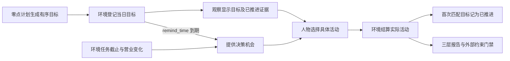
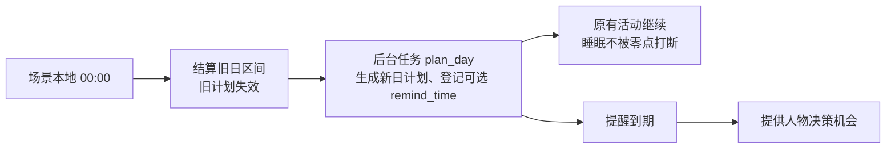

# 当日目标特性开发规格

> 状态：已实现并通过本特性确定性验收；行为合同已冻结，证据见文末台账。日期：2026-09-21。
> 生成方式、提醒与部分节律由[时间与能量规格](SPEC-life-runtime.md#time-and-energy-决策不耗时时间只在做事时流动)修订；修订条款已实现并通过离线验收，台账中被修订两行的证据见[时间与能量验收记录](../archive/time-and-energy/time-and-energy-verification.md)。
> 「人物可见内容与工具」按[人物 Prompt 规格](SPEC-life-realism.md#persona-prompt-七层请求)修订，修订部分已实现并通过离线验收（证据见[人物 Prompt 验收记录](../archive/persona-prompt/persona-prompt-verification.md)）；修订记录见「版本表」。
> 「心智模型与范围」「提交与修订」「实际推进与情绪」「度量输出合同」按[一日运行保真规格](../VERIFICATION.md#verification-incremental-evidence)「冻结条款修订」第 9、23 行修订（一日运行保真 DP1，2026-09-29）：
> 目标条目增大致时刻 `around_time`，推进要求同家族活动在该时刻前后 90 分钟内进行，零点计划不重述作息，推进比例只计非例行意图；修订部分已实现并通过离线验收，
> 台账中被修订的五行已按新行为重验改记「通过」（证据见表后说明与该规格验收台账「目标推进」「系统层」两行）。
> 来源：[语义改造提案](PROPOSAL-day-plan-goals.md)。本规格取代原「日程骨架」行为；
> 字段与错误码由 [接口合同](../CONTRACTS.md#contracts-worldmock-接口合同) 承载，设计职责由既有设计文档承载。

> 2026-10-01 按[工具交互规格](SPEC-life-runtime.md#tool-interaction-工具请求)修订当前工具请求、查询与错误合同；本次设计已冻结，生产代码已实现，旧验收证据不覆盖新增条款。
> 本特性首次受影响的发布升级为场景 4、地图 3、目录 5.0、品类与规则绑定 3，世界结构仍为 8。各阶段独立发布；后续格式或内容再次变化时另升相应版本，禁止同目录版本覆盖内容。

> 「心智模型与范围」「提交与修订」「事件驱动的决策节律」「人物可见内容与工具」「三层度量与质量导出」「当前工具交互约束」按[个人事务与工作安排规格](../VERIFICATION.md#verification-incremental-evidence)「冻结条款修订」修订
> （作业 DP2–DP14，编号见该规格配套的[实施计划](../archive/errands-workday/errands-workday-implementation-plan.md)，2026-10-02）：当日目标与个人事务分工，零点失效与修订不波及事务；
> 事务提醒另记 `errand_reminder_due`、不结束睡眠，未完成事务不计在手承诺；今日计划优先只对作息习惯成立，改不了场景声明的工作安排；
> 重复意图逐条定位、超限同批报告；事务与工作负荷度量不并入三层。修订部分已实现并通过离线验收（证据见[个人事务与工作安排验收记录](../archive/errands-workday/errands-workday-verification.md)）。
> 文中「个人事务与工作安排规格裁决 X」指该规格「裁决记录」的编号。

> 按[让「等待」成为例外规格](SPEC-idle-fillers.md#spec-idle-fillers-让等待成为例外开发规格)修订「心智模型与范围」「事件驱动的决策节律」「验收台账」（阶段 1）、「心智模型与范围」（阶段 2）与「心智模型与范围」「提交与修订」、「零点计划与计划提醒」的「计划与提醒」、「当日目标带大致时刻，只有在那前后进行的活动才算推进」（阶段 3）。

## 共享规则与可重建环境修订

按[共享规则与可重建环境规格](SPEC-shared-rules-and-rebuildable-env.md)修订；验收结果独立记录。

计划、相关度与指标读取同一个活动家族函数；缺品类不猜进度，外部参照保留缺证或未归类。实际推进的有效区间为非布尔整数秒且起点小于终点。本次不改变 around_time、登记后的活动起点和同秒推进合同。

## 心智模型与范围

当日目标清单由零点计划 `plan_day` 生成，人物可 `revise_day_plan` 修订；当日目标清单里只有 `remind_time` 产生提醒边界；
个人事务自带的 `remind_time` 是另一显式字段：人物清醒时它进入下一边界与下一次决策机会的候选、精确到点，以 `errand_reminder_due` 提供一次决策机会；
睡眠中不入候选、不形成静默边界、不结束睡眠，在人物醒来的那个边界交付（[个人事务与工作安排规格](SPEC-as2-integration.md#errands-workday-运行修复入库) 2.5，其裁决 E5）。
清单不是全天时刻表，也不驱动活动自动执行。计划只写今天与平常不同的事、要办的事和要提醒的事：人物档案与背景里天天如此的事（睡觉、起床、上下班、吃饭、休息、每天的消遣）不写成目标，
除非今天与平常不同或照模板第三条需要提醒；作息是默认，今日计划的具体安排优先于作息，身体的感觉只在较强一档才改；
作息里的钟点、目标文字里的钟点与大致时刻都只是大概，系统层写明临近即可去做、略早略晚都算照常
（[让「等待」成为例外规格](SPEC-idle-fillers.md#spec-idle-fillers-让等待成为例外开发规格)）；
计划优先只对作息习惯成立：场景声明的工作安排（环境层 `duty`）是环境核验的事实，不是习惯，零点计划、`revise_day_plan` 与工作提交都改不了它，
手上的工作交了 `duty` 仍是当班中；班次与休息时段的起止只给清醒的人物各一次决策机会（唤醒原因 `shift_start`、`shift_end`、`break_start`、`break_end`，
[让「等待」成为例外规格](SPEC-idle-fillers.md#spec-idle-fillers-让等待成为例外开发规格)），不结束任何活动、不叫醒睡着的人，也不是提醒；环境不因此新增任何拒绝，出行照常列出、照常受理，声明的例外（班次内声明的休息时段、
前往本人已开放且未结清的工作任务的要求地点）只影响行为评估的指标口径，当日不当班不产生班次
（个人事务与工作安排规格 4.5、4.6，其裁决 W1，收窄一日运行保真裁决 S11）；清单可以很短，零条仍然合法
（[一日运行保真规格](SPEC-life-runtime.md#dayrun-fidelity-身体与需要) 2.2、2.3，裁决 S11）。每条目标的大致时刻 `around_time` 只用于推进判定，不产生提醒，也不驱动活动。
列表顺序就是优先级，不增加另一套优先级字段。环境只证明相关活动实际推进，不能证明自然语言目标完成。
当日目标只回答今天打算重点做什么；跨日保留、由环境按结算结果结束的事登记为个人事务（个人事务与工作安排规格第二章）：
事务存在人物状态 `AgentState.errands`，不放进 `DayPlan`，不写进 `goals`；事务的「已完成」只由环境按结算证据写入，
与目标的 `progressed` 是两套状态，互不推导。

本次不接入参考数据集、不创建预约系统、不生成默认全天轮廓、不引入自然语言目标判定器，
不改变其他活动的资格与资源结算。旧时段字段、段起点唤醒、段级照做函数和偏离分钟指标直接删除，
不提供兼容形状、迁移或回退。

## 当日目标与生命周期

### 提交与修订

- 场景本地零点先结算旧日、使旧计划失效，再由零点后台任务 `plan_day` 生成；中途启动时在首个决策前生成；
  同日一次（`plan_submitted_dates`）；允许空清单，表示今天没有刻意目标。
- 初次及修订后清单均为零至八条；上限沿用已有提示容量边界，不宣称是人的目标数量基率。
- 条目接受 `intent_kind`、`goal`、可空 `remind_time` 与必填可空的大致时刻 `around_time`。`intent_kind` 沿用十一值意图闭集；同一清单每种意图最多一条。
  `goal` 为非空白文本，最多三百字符；不另设备注。`remind_time`（场景本地 `HH:MM`，须晚于生成或修订时刻、
  早于次日零点）是条目唯一的提醒时刻字段。`around_time`（场景本地 `HH:MM`）由写计划的模型填，零点计划模板要求每条目标都写
  （不确定就写大致时段的中点）；格式错误报 `ACTION_REQUEST_INVALID`；它不要求晚于修订时刻，也不触发任何决策（一日运行保真规格 8.2，裁决 D12）。
  禁止时长和旧字段；`goal` 可写粗略时段，零点计划模板要求只给和人约好的事写钟点（环境不校验）；环境不解读文字：「睡前」「上午」这类说法由模型换算成 `around_time`，环境只比对时刻。
- 环境附加 `registered_at`、`progressed_at`、`progress_activity_id`，以及提醒时刻 `remind_at`（无提醒时为空）、
  提醒状态 `reminded_at`（未触发时为空）与大致时刻换算成的当日绝对时刻 `around_at`（无大致时刻时为空）。`progressed_at` 与 `progress_activity_id` 同时为空表示未推进，
  同时有值表示已推进；登记时刻与推进证据属于环境事实，不是人物的时间计划。提醒与推进无关：到点触发一次，
  只在修订替换或删除该目标、或当日结束时失效。
- 修订请求替换全部未推进条目。已推进条目按原相对顺序保留在前，不能删除、改写或重复提交；
  请求条目依列表顺序接在其后，合并后仍满足条数上限与意图唯一性。
- `intent_kind`、`goal`、`remind_time`、`around_time` 四个字段完全相同的未推进条目保留登记时刻与提醒状态，不重校时刻；只改
  `remind_time` 的条目保留登记时刻并换成新提醒；只改 `around_time` 的条目保留登记时刻；改变文字、删除或重新加入表示替换或新承诺，旧提醒取消，
  旧未推进条目在报告中保留为丢弃，不能靠修订删除统计分母。
- 计划在场景本地次日零点失效，不在就寝后隐藏。环境保存 `day_end` 用于生命周期；
  不再校验覆盖就寝、重叠或时段顺序。旧检查点形状直接拒绝。
- 当日计划的生命周期不波及个人事务：零点使旧计划失效、`revise_day_plan` 整表替换未推进条目以及目标推进，都不读写 `AgentState.errands`；
  零点计划 `plan_day` 对未完成事务只读（输入键「个人事务」：名称、要办成什么、已办到哪、备注、提醒时刻），不创建、不更改、不终结事务，
  事务也不经修订请求增删（个人事务与工作安排规格 2.1、2.8）。

### 实际推进与情绪

- 只有登记之后、同一人物、同一本地日内的正时长 `activity_progress` 结算可证明推进。
  仅登记动作、零时长、失败或取消活动、其他人物活动、登记之前的历史均不能证明推进。
- 目标带 `around_time` 时，还要求活动在当日内的进行区间与 `[around − 90 分钟, around + 90 分钟] ∩ [00:00, 24:00)` 有交集；
  只看活动落在当日内的那一段，所以零点前开始、零点后结算的睡眠不推进当日的睡眠目标。`around_time` 为空的条目沿用上一条的判定。
  容差 `GOAL_TIME_TOLERANCE_SECONDS = 5400` 是实验假设（敏感区间 3600–7200），登记在 `docs/EXPERIMENT.md#experiment-worldmock-实验设置`「实验假设声明」。
- 使用既有意图到活动家族映射；生活活动由实际目录品类解析，缺失品类不能猜测。
- 每个 `activity_id` 在同一人物当日最多推进一条目标。按清单顺序选择首个未推进且家族匹配的目标，
  避免通勤与外出、晨间例程与休息共享家族时重复计数；后续结算不能重复消费同一活动证据。
- 同一真实区间并行推进的每条活动各自提供目标证据，所有进度均参加匹配；同一目标仍只首次推进，
  不因活动集合顺序重复产生情绪脉冲。
- 首次推进原子保存推进时刻和活动标识，并产生一次 `+0.05` 情绪脉冲。原「完成计划段」脉冲删除，
  跨结算、修订、保存恢复均不得重复奖励。
- 结算事件携带目标推进后的当日清单；零点计划的登记 `environment_event`（`data.kind="day_plan_generated"`）
  与修订的 action_result 也保存完整清单；所有写入与世界状态使用既有事务边界，不创建新的事件类型。
  零点先结算旧日的有效区间、清除过期计划，再执行零点计划。

## 事件驱动的决策节律

`plan_block_boundary` 与所有段起点候选删除。保留既有具体唤醒原因，新增
`commitment_threatened` 表达在手承诺受到已有环境约束威胁，不取代具体原因。

在手承诺包括未推进当日目标、未完成且可见的工作任务、暂停活动与进行中活动（进行中的等待除外）；
单纯消息、历史目标、已完成活动与未完成的个人事务不构成在手承诺（个人事务与工作安排规格 2.5，其裁决 E6：
事务不改变常规与空闲重估间隔，也不作为闭店预警的受威胁承诺）。人物只在等待且没有上述承诺时用空闲间隔。常规重估沿用场景参数
`reconsideration_interval_seconds`（默认五千四百秒）；新增
`idle_reconsideration_interval_seconds`（默认一万零八百秒），必须大于等于常规间隔。
均为环境场景参数，不进入人物工具请求。

| 情形 | 决策机会 |
| --- | --- |
| 已有工作任务进入截止前三十分钟 | 精确在预警边界唤醒，保留 task_due_soon，追加 commitment_threatened |
| 当前地点进入闭店前十五分钟，且有绑定本地点的未完成任务或闭店会使其失去准入的活动 | 精确在预警边界唤醒，保留 location_hours_change，追加 commitment_threatened |
| 当前活动失去可行性 | `activity_infeasible` 保留名称，当前无来源 |
| `remind_time` 到期 | 精确在提醒时刻唤醒，记 `plan_reminder_due`，同时到期的合并；睡眠中结束睡眠 |
| 个人事务的 `remind_time` 到期 | 人物清醒时精确在提醒时刻提供一次决策机会，记 `errand_reminder_due`；同一边界到期的多条事务合并为一次机会、该原因只计一次，每条事务各写一条 `errand_reminded` 事件，不改变事务状态；与 `plan_reminder_due` 同刻到期时按枚举顺序并列；睡眠中不入候选、不形成静默边界、不交付也不消耗，在人物醒来的那个边界交付 |
| 声明了工作安排的人物，班次或休息时段开始、结束 | 人物清醒时精确在起止时刻提供一次决策机会，记 `shift_start`、`shift_end`、`break_start` 或 `break_end`（[让「等待」成为例外规格](SPEC-idle-fillers.md#spec-idle-fillers-让等待成为例外开发规格)）；同一秒重合的起止各记一次，与同秒的其他原因按枚举顺序并列；不结束任何活动、不写事件，也不是提醒；睡眠中不入候选、不形成静默边界、不叫醒，睡过的起止醒来后不补 |
| 有在手承诺而无威胁 | 使用常规间隔，其他更早事件仍先发生 |
| 无在手承诺 | 使用较长间隔，身体、消息、配送、营业、到达等现有事件仍先发生 |

临近截止与临近闭店只在新事实首次实际提供给人物时提醒。签名分别包含任务及
截止、地点及本次闭店和受威胁承诺。自由文字目标和其他地点任务不证明本地点闭店威胁。持续成立不重复；消失后再次成立
重新提醒。所有可见未完成任务均参加判定，睡眠过滤未交付理由不消耗签名。完整规则见
[一日行为可信性规格](SPEC-dayrun-behavior.md#spec-dayrun-behavior-持续活动与必要唤醒)。

下一决策候选和实际唤醒判定必须使用同一间隔与威胁边界。不得把重估定时当成轮询唯一来源，
也不得虚构通用预约或同行人承诺。睡眠只接受睡眠允许原因（含 `plan_reminder_due`，不含 `errand_reminder_due` 与班次边界的四个成员），不被重估唤醒。
游戏保留逐回合反馈。零点计划、修订和目标推进本身不推进世界时钟。

## 人物可见内容与工具

- 人物看到的当日计划只在待办层 `day_plan`：零点计划生成前或当日结束后为 `null`，之后为 `{date, goals}`；
  `goals` 至多八条，保持计划顺序，每条写 `intent_kind`、`goal`、`progressed`、`remind_time`（`HH:MM` 或 `null`），
  大致时刻字段只显示 `HH:MM` 或 `null`，与请求可直接照抄的合法写法相同；空清单仍以对象表示。
  待办层另有与 `day_plan` 并列的必填键 `errands`（未完成的个人事务，没有时为 `[]`；每行 `name, done_when, progress, memo, remind_time, noted_on`，
  见个人事务与工作安排规格 2.6）；事务不写进 `goals`，目标也不写进 `errands`，`day_plan` 的形状与取值不变。
- 不再有场景叙述：目标文字、推进状态与提醒时刻只在待办层出现，提醒到时进度层的 `plan_reminder` 只写目标名
  （事务提醒另记 `errand_reminder`，环境确认办成另记 `errand_completed`，都只写事务名，不与它混用）；
  登记时刻与推进活动等环境证据不进提示。`progressed` 为真只表示目标得到推进，不等于完成；目标行不显示人物自述，
  `progress_note` 照存，不进提示。不出现当前计划段。
- 移除只为计划换算而存在的 `day_start_epoch`、`day_end_epoch`、`bedtime_epoch` 提示锚点；
  提示中也不再有 `current_epoch`，此刻由环境层 `observed_at` 表示；人物卡片的作息与环境营业时刻继续保留。
- 实际模型工具 Schema、工具说明、本地校验、环境请求模型和冻结观察必须完全一致。
  人物工具只有 `revise_day_plan`，有清单即开放，可改提醒，允许空清单后追加目标。
- 零点计划与 LifeAgent 修订各自到 LifeEngine、SQLite、下一次观察、检查点恢复必须有完整路径测试；
  只检查纯函数或字符串不算贯通。

## 三层度量与质量导出

三层分别输出，不再输出 `plan_actual_deviation`，不能把人物遵守自己叙述当作真实性证据。
行为评估 `reports` 另增的 `workload` 与 `routine_deviation`（个人事务与工作安排规格 6.2）不属于三层，也不是被删除的偏离分钟指标的恢复：
`routine_deviation` 的参照是覆盖后的作息窗口或场景班次，不是当日计划，不使用 `plan_actual_deviation` 及其字段名，只报告，不进 `quality.json`。
指标按代码摘要分组，各层使用下文指定的运行、人物、动作或情境键；目标按本地日归属，
习惯在同一运行的不同本地日间比较。结果必须确定性，缺样本返回 null 并注明。

| 层 | 度量与证据 | 判定 |
| --- | --- | --- |
| 习惯 | 相同人物、地点、本地小时的已结算活动家族一致率；至少两个不同本地日才有可比较情境，按每个活动首次正时长结算取样 | 只报告；这是情境重复性代理，不声称识别心理习惯 |
| 外部结构 | 动作终态的外部约束受阻次数与成功率；仅计下方冻结错误码闭集中的营业、地点/路线与工作约束拒绝，幂等重放不重复计数 | 受阻次数必须为零；正确拒绝仍是该次运行的受阻证据，不叫引擎校验缺陷 |
| 刻意目标 | 全部成功登记的目标中有真实推进证据的比例，按初始优先级分组，保留未推进的丢弃条目与分母 | 只报告；命名为目标推进率，不叫文字目标完成率 |

目标无外部实测分布时参照值为 null 并说明未接入，不编造兑现阈值；
「低优先级更少兑现」「失败更可能丢弃」仅为未来可验证的预期，不能强制生成行为。

三层报告必须实际进入 `worldmock export` 生成的 `quality.json`，同时供既有行为评估入口使用。
不借此新增其他行为门禁或改写无关记忆协议。外部约束错误码闭集、输出字段与无样本规则由
下面的输出合同冻结，接口合同和验证文档只按职责引用。

### 度量输出合同

运行事件表不重复存代码摘要；质量导出从冻结 manifest 的 `code_sha256` 向统计输入注入同源身份，
行为评估输入按自带摘要分组，缺失时明确归入 `code_sha256_unreported`。

新增纯事件模块 `src/worldmock/evaluation/goal_metrics.py`，提供
`day_plan_metrics(events, timezone)`，由行为评估与质量导出共同调用。
`quality.json.day_plan_metrics` 按代码摘要分组，每组有 `habitual_consistency`、
`external_constraints`、`deliberate_goals` 和 `gates.external_constraint_block_count`。
既有行为评估将三层放入 `reports`，将相同约束门禁放入 `gates`；不把既有其他协议门禁强接进质量导出。
`day_plan_metrics` 的键集与分母不因个人事务改变：质量报告结构 4 新增的 `errand_metrics`、`conclusion_memories` 是与它并列的顶层分组；
`errand_metrics` 以有新增事件的不同事务数（`registered_count`）为分母，两个分组都不使用 `goal_count`、`progressed_count`、`family_progress_rate`
等当日目标指标的键名，不以目标数为分母，也不写进 `day_plan_metrics`；没有样本时整组为 null（个人事务与工作安排规格 6.1）。

- `habitual_consistency` 按 `(run_id, agent_id, location_id, 本地小时)` 分组。
  来源为活动快照中的地点与每项活动首次正时长结算；以该区间的 `interval_start` 定本地日和小时，
  每活动只取一个样本。
  至少覆盖两个不同本地日才计算同情境家族一致率，分子为同家族有序样本对，分母为全部有序样本对。
  总值按可比样本对加权；输出 `consistency_rate`、`comparable_pair_count`、`groups` 与 `missing_samples`。
  习惯统计沿用既有评估的活动家族聚合口径，映射如下；目标推进则按接口合同中的实际活动令牌匹配，
  不用这一统计聚合去证明目标。未知生活活动品类不进入有效样本。

  | 原始活动或生活品类 | 评估活动家族 |
  | --- | --- |
  | sleep | sleep |
  | travel、lifestyle:outdoor | commute |
  | work | work |
  | consume | meal |
  | wait、lifestyle:wellness | rest |
  | watch、play_game、browse、read_mail、lifestyle:hobby、lifestyle:learning | entertainment |
  | chat、call、lifestyle:social、lifestyle:volunteer | social |
  | lifestyle:household、lifestyle:pet | chore |
  | lifestyle:sport | exercise |

- `deliberate_goals` 回放零点计划的登记事件（`day_plan_generated`）、修订结果与活动推进后的清单；推进判定与环境同一口径
  （含 `around_time` 前后 90 分钟的窗口，见「实际推进与情绪」）。例行意图 `ROUTINE_INTENT_KINDS`（睡眠、晨间例程、通勤、用餐）的目标
  照常判定与记录，另计一行；推进比例只计非例行意图的目标（一日运行保真规格 2.3、8.2）。
  用首次登记事件与意图区别目标实例；完全相同的未推进条目保留实例；只改 `remind_time` 或只改 `around_time` 的条目保留原实例，
  不产生新实例，也不记为丢弃；文字改变或删除使旧实例成为 `discarded`，再加入产生新实例。
  推进必须关联真实正时长结算事件和 `progress_activity_id`，不能相信孤立的状态字段。
  输出 `per_agent_day`（键含 run_id）、`summary`、`reference=null` 和口径说明；
  每组保留 `goals`（首次优先级、登记及推进事件、pending/progressed/discarded）、
  `goal_count`、`progressed_count`、`discarded_count`、`family_progress_rate`、`by_priority`。
  空目标分母为零且比率为 null。
- `external_constraints` 从 `action_rejected` 及动作终态按 `(run_id, action_id)` 去重；
  外部约束错误码闭集只保留营业、到达准入、路线与工作可用性：`MERCHANT_CLOSED`、`MERCHANT_OPENING_UNKNOWN`、
  `LOCATION_ACCESS_DENIED`、`WORK_TASK_NOT_AVAILABLE`、`WORK_SUBMISSION_LATE`、
  `FROZEN_ROUTE_NOT_FOUND`、`ROUTE_UNREACHABLE`、`ROUTE_INFORMATION_UNKNOWN`、
  `DELIVERY_ROUTE_NOT_FOUND`、`DELIVERY_ROUTE_UNREACHABLE`、`DELIVERY_ROUTE_INFORMATION_UNKNOWN`。
  引导性拒绝码 `ACTIVITY_PRECONDITION_UNMET`、`ACTIVITY_CONCLUSION_REQUIRED`、`SESSION_LIMIT_EXCEEDED`
  与其他协议或参数拒绝列为 `other_rejections`，不冒充外部约束。
  输出 `block_count`、`by_error_code`、`source_event_ids`、`evidence_complete`、
  `observed_action_acceptance_rate`。接受率的分母为有确定终态的唯一动作，分子为其中未被拒绝的动作；
  无动作时为 null。拒绝缺 action_id 或 error_code 时证据不完整，门禁 value=null、pass=false；
  完整且无外部受阻时门禁 value=0、pass=true。仅正当业务拒绝不表示软件实现缺陷。

活动快照需保存生活活动目录 `category`，用于真实家族核验；不是从目标文字推测品类。
`render_day` 保留实际活动时间线，本次不新建目标可视化界面。

## 当前工具交互约束

`around_time` 与 `remind_time` 的请求和结构化显示都只使用场景本地 `HH:MM` 或 `null`，不在字段值加「约」字，
不新增中文时刻、空串或字符串 `null` 的归一。大致时刻的前后九十分钟只用于目标推进判定，
不能当成工作可开始的时间窗；普通工作从通知送达即开放，预约活动才有约定开始时刻，具体规则见[工具交互规格](SPEC-life-runtime.md#tool-interaction-工具请求)。
修订参数错误须返回完整 `path`、合法 `intent_kind` 枚举与具体 `expected`：重复意图同时定位首次出现与其后每次出现的条目
（`goals[i].intent_kind`，`written` 为该意图，`allowed_values` 为全部意图）；条数超过八条与重复意图在同一次校验里一并报告，
超限定位在 `goals`，不因超限提前返回；零点计划与 `revise_day_plan` 共用同一校验函数，英文原因见个人事务与工作安排规格 1.3；
时刻格式与已推进目标约束仍一次报告全部可独立确定的参数问题。
`goal` 不承担状态转移，通知、任务开放、计划提醒与大致时刻分别使用各自明确字段；本节已实现：重复意图的逐条定位与超限同批报告以外的各项，
证据见[工具交互验收记录](../archive/tool-interaction/tool-interaction-verification.md)；这两项已实现并通过离线验收（证据见[个人事务与工作安排验收记录](../archive/errands-workday/errands-workday-verification.md)）。

## 文件修改清单与模块责任

| 模块 | 文件 | 必须修改的内容 |
| --- | --- | --- |
| 目标与节律 | `src/worldmock/life/schedule.py`、`models.py`、`rhythm.py`、`scenario.py`、`engine.py`、`felt.py` | 目标模型、生命周期、修订、实际推进、单次情绪、威胁边界和双间隔；删除旧段逻辑 |
| 观察与人物 | `src/worldmock/life/projection.py`、`narration.py`、`custom/agents/life_agent.py`、`custom/envs/life_env.py` | 目标事实、叙述、旧锚点删除、实际工具 Schema、工具说明与可见性 |
| 足迹与评估 | `src/worldmock/footprints/models.py`、`quality.py`、`src/worldmock/evaluation/behavior_metrics.py`、新 `goal_metrics.py` | 唤醒枚举、结算证据消费、三层报告、实际质量导出 |
| 接口权威 | `docs/CONTRACTS.md#contracts-worldmock-接口合同` | 目标请求/状态/结果、错误码、观察字段、唤醒枚举、间隔配置和报告字段 |
| 行为权威 | 本文、`docs/dev/SPEC-life-realism.md#spec-life-realism-特性规格人物决策与画像`、`docs/dev/SPEC-life-runtime.md#spec-life-runtime-特性规格lifeenv-运行时行为与结算规则`、`docs/dev/SPEC-decision-context.md#spec-decision-context-特性规格决策上下文与工具结果`、`docs/dev/SPEC-interaction-menu.md#spec-interaction-menu-特性规格交互菜单` | 去掉旧时段语义并按职责引用本规格，保留无关已冻结条款 |
| 设计文档 | `docs/design/04-simulation-engine.md#simulation-engine-worldmock-产品设计说明书-模拟引擎`、`05-recording-engine.md`、`07-evaluation.md`、`08-configuration.md`、`09-io-formats.md`；其他设计命中处 | 模拟负责时间/推进，记录负责原子证据，评估负责三层统计，配置与输入输出对齐；禁止重复建权威 |
| 索引与证据 | `docs/INDEX.md#index-worldmock-文档入口`、`docs/VERIFICATION.md#verification-worldmock-验收标准`、`docs/dev/ANALYSIS-spec-coverage.md#analysis-spec-coverage-规格测试用例覆盖率追溯矩阵`、`implementation-status.md`、提案及研究入口 | 链接最终规格、更新条款到测试映射、写真实门禁证据、提案改为历史依据 |
| 领域测试 | `tests/life/test_day_plan.py`、`test_revision_contract.py`、`test_wake_reasons.py`、`test_engine_feedback.py`、`test_felt_states.py` 及引用旧字段的测试 | 新合同边界、跨日/恢复、单次证据与脉冲、精确威胁、删除旧段断言 |
| 接口测试 | `tests/integration/test_observation_agent_seam.py`、`test_life_agent_protocol.py`、`test_activity_schema.py`、相关菜单/观察测试 | 实际工具闭环、空计划、修订、旧请求拒绝、提示与 schema 同源 |
| 评估测试 | `tests/evaluation/test_behavior_metrics.py`、新 `test_goal_metrics.py`、新 `tests/footprints/test_goal_export.py` | 三层正确分母/隔离/去重/缺样本、导出实接线、旧指标删除 |

仅为通过既有门禁而需要迁移的夹具随所属测试修改；新增生产文件只用于上述职责分离。
最终验收记录必须给出相对开发基线的实际完整文件清单，不能用此预估表替代 diff。

## 零点计划与计划提醒

### 运行时机

`plan_day` 不再是人物工具，改为运行时在场景本地零点执行的独立后台任务，由它生成当日计划。场景本地 `00:00` 加入下一
边界候选（`src/worldmock/life/time_advance.py::TimeAdvanceCoordinator._next_epoch`），无论这一刻有无活动变化。在该边界，世界照常结算前一日区间、使旧计划
失效，然后为每个人物执行 `plan_day`，根据下述输入生成新日计划。

`plan_day` 无论人物在睡觉、工作还是做别的都执行。它不是决策，不占用决策轮，也不调用人物：

- 不提供生活决策机会，不暂停、结束或重启活动，睡眠不被零点打断；
- 不调用 LifeAgent，不读写人物工作区与记忆运行时（`custom/agents/life_memory.py` 不因 `plan_day` 改动）；
- 不产生 `observation`、`decision_started`、`memory_updated`，不计同刻轮数；
- 不改 `last_decision_time`、`felt_bands_at_last_decision`、`people_at_last_decision`、`known_task_ids`、
  `pending_wake_reasons`、`next_decision_at`。
- 对个人事务只读：未完成事务作为输入「个人事务」进入请求，`plan_day` 不创建、不更改、不终结事务；零点边界结算旧日、
  使旧计划失效时也不清空 `AgentState.errands`（个人事务与工作安排规格 2.1、2.8）。

零点边界上，`advance` 只结算旧日区间、使旧计划失效并提交；随后执行 `plan_day`；该秒的唤醒原因与下一决策候选由节律在
`plan_day` 提交之后判定（在手承诺按新计划计，新计划的提醒进入下一边界候选），然后才提供决策。运行终点恰为零点时不执行
`plan_day`，节律照旧在 `advance` 内判定。

- **执行位置**（裁决 #24，已定）。照搬联系人回复的后台调用方式（`src/worldmock/runtime.py` 的 `settle_pending_model_replies`）：
  - 运行时新增与它并列的后台任务，调用方式同联系人回复（LifeEnv 在引擎提交之后 await 运行时函数），但挂点不同：零点由
    `LifeEnv.step` 在 `engine.advance` 提交之后调用；启动路径（见下）的新建运行与反事实分支由 `LifeEnv.checkpoint` 在初始
    或干预检查点提交之后调用；普通恢复（子清单 `branch_kind` 为 `resume`，`src/worldmock/footprints/checkpoint.py`）由 `LifeEnv.init`
    在引擎打开之后、首次决策之前调用，因为锁定的 AS2 在恢复模式不形成初始检查点，首轮决策
    又先于推进；该调用早于 AS2 `Society.init` 登记故障的 `try`（:162、:164），任务异常由 `init` 先经 `engine.fail_run`
    登记运行故障再抛出。联系人回复挂在 `commit_decision_round`（`custom/envs/life_env.py::LifeEnv.commit_decision_round`），而零点无人就绪时只经
    `step` 推进、没有决策轮（锁定的 AS2 `vendor/agentsociety2/packages/agentsociety2/agentsociety2/society/society.py::AgentSociety.step`），所以不挂在那里。没有人物缺当日计划时，不建客户端
    即返回；
  - 独立客户端使用运行清单中的模型身份，身份核对与联系人回复相同；
  - 计划经引擎系统入口 `src/worldmock/life/engine.py::LifeEngine.register_day_plan` 写入世界状态，
    由引擎的 `clock` 协作对象委托 `src/worldmock/life/time_advance.py::TimeAdvanceCoordinator.register_day_plan` 登记；
    后台计划不走动作派发，不进人物工具面，不产生 `action_requested`；
  - 零点边界的计划与证据在该边界的共同检查点之前提交，该边界照常形成共同检查点；启动路径的计划在初始（或反事实干预）
    检查点之后、普通恢复的计划在 `init` 中提交，由下一个共同检查点封存。
- **终点。** 运行终点恰为本地零点时，该边界只结算旧日并结束运行，不执行 `plan_day`。
- **启动路径。** 新建运行时，在初始共同检查点之后、首个 `run_start` 决策之前执行，生成时刻就是起点。
  起点恰为零点时，只按启动路径执行一次。恢复与反事实分支按世界状态中既有的 `AgentState.plan_submitted_dates`
  （`src/worldmock/life/models.py::AgentState.plan_submitted_dates`，本地日期集合）判定当日是否已执行：已执行不重复；未执行则在首次决策之前执行，反事实分支在干预之后执行。
  启动路径之后的首个决策仍带 `run_start`。

`plan_day` 不写记忆；既有的阈值巩固与就寝反思保留（第七章）。

### 输入、调用、失败与记录

- **输入**（只读，全部来自世界状态与足迹记录，不读人物工作区）：
  - 场景声明的人物档案（输入键「人物」：名字、背景原文 `background_story`、健康习惯、社交风格与午饭、晚饭、就寝时段，未声明的省略；
    不读人物工作区里编译后的卡片）；个人事务与工作安排规格 4.2 增「下班时段」「到家时段」，取场景的 `leave_work_window`、
    `arrive_home_window`，未声明省略，只来自卡片的下班与到家时刻不进入输入；
  - 当日已核验经历的句子（第七章口径）；
  - 本人当日已结算的公开动作结果（消息送达、订单受理与交付、成果评审）；
  - 当日 `conclude_activity` 请求中记录的 `summary` 与 `memories`（标「你自己记下的，未经核验」）。所以睡前收尾时写下
    「明早 7:30 起」，零点计划就能据此生成提醒；
  - 零点可见的事实子集：可见的工作任务（输入键「待办任务」）、收件箱、在途订单及预计送达、联系人、旧日目标的推进情况。
  - 未完成的个人事务（输入键「个人事务」）：名称、要办成什么、已办到哪、备注、提醒时刻，取自 `AgentState.errands`，不含内部身份；
    输入键「待办任务」含义不变，仍指工作任务（个人事务与工作安排规格 2.8）。
  - 计划日期当天的上班安排（输入键「上班安排」）：与环境层 `duty` 同源，不含 `status`；人物没有工作安排时为 `null`。
    这里的当天是输入键「计划日期」所指的本地日（零点边界上即新开始的一日），不是下文回顾经历所说的「当日」
    （个人事务与工作安排规格 4.6）。

  不读：身体数值、交互对象、私有绑定、未到期的预排事件、人物的主观记忆库。来源由系统登记为这些事件，模型
  不填身份。「当日」在零点边界指刚结束的本地日（前一日 00:00 至本次零点），在启动路径指生成时刻所在本地日中生成
  时刻之前的部分。
- **调用与输出。** 与联系人回复一样，由独立客户端使用运行清单中的模型身份。不新增模型阶段键：阶段运行身份
  `stage_model_identity` 的 `stages` 恰为 `action`、`work_review`（人物 Prompt 规格第七章），`plan_day` 不在其中。生成参数必须给出 `max_tokens`（第八章 `-rerun` 就是因为缺它而失败）；
  参数、中文模板与输出 Schema 写入接口合同「请求组成」「生成参数」。输出为唯一严格工具 `submit_day_plan`（`tool_choice=required`）的参数 `{goals: [{intent_kind, goal, remind_time, around_time}]}`
  （`around_time` 按[一日运行保真规格](SPEC-life-runtime.md#dayrun-fidelity-身体与需要) 8.2 增加），没有记忆。请求照常按整次 token 计数；达到窗口 85% 时先裁掉较早的当日经历句子，仍超限则按容量故障处理。
- **失败。** 输出不是合法计划时（JSON、条数、意图唯一性、文字长度、`remind_time` 的格式或时刻、`around_time` 的格式有误），
  其中重复意图的错误同时定位首次出现与其后每次出现的条目，条数超限与重复意图同批报告，零点计划与 `revise_day_plan`
  共用同一校验函数（个人事务与工作安排规格 1.3）；把英文错误附回模型重试，至多 3 次。这是 `plan_day` 自有的校验重试计数，数值与接口合同「模型身份」的 `transport_max_retries` 相同，
  但分开计数，不借用传输预算（该节规定协议错误不得借用）；联系人回复不附回校验错误重试，只在后验守卫命中越界说法（到达或在路上、
  已完成或带来、揽活、保证结果）时在同一结算内重试一次、仍命中则用固定兜底句（一日运行保真规格 7.3；原引的 `src/worldmock/runtime.py` 已过期），
  瞬时传输失败与它一样另用调度器的传输预算。次数登记在「生成参数」。校验重试或传输重试耗尽时，按联系人回复的同一边界作运行故障，
  并保留请求、响应与错误证据；不用空计划或丢弃字段兜底。这属于协议或模型错误，不是业务情形，不受第九章「不得新增故障路径」约束。
- **记录**（不新增事件类型）：

  | 内容 | 事件 | 要点 |
  | --- | --- | --- |
  | 模型请求与响应 | `model_request`、`model_response` | `visibility=system`，`data.purpose="plan_day"`，计入 `model_usage`；交付窗口、决策 token 统计与行为指标的决策请求按 `purpose` 排除它们 |
  | 计划登记 | `environment_event` | `data.kind="day_plan_generated"`，`visibility=system`；`data.day_plan` 与修订结果同形（含 `remind_time`，目标的 `registered_at` 为该事件时刻）；`data.source_event_ids` 为输入来源；`goal_metrics` 以它作为登记来源 |

  计划、提醒、来源与模型证据在同一次提交中写入；幂等键为既有字段 `AgentState.plan_submitted_dates`，
  不新增字段，同一人物同一本地日只生成一次。事件字段登记在记录引擎设计「事件正文与资源证据」。

### 计划与提醒

- 零至八条有序目标，沿用 `intent_kind`、`goal` 与意图唯一性。`goal` 可写粗略时段与准备动作，零点计划模板要求只给和人约好的事写钟点（环境不校验）；文字不驱动活动。
  计划只写今天与平常不同的事（提前、推迟、取消、和谁一起）、要办的事（截止的任务、要回的消息、要买的东西、要去的地方）与需要的提醒；
  已经记成个人事务的事不必照抄成目标，今天打算去办的可以写一条目标说明什么时候办（零点计划模板第七条，个人事务与工作安排规格 2.8）；
  人物档案与背景里天天如此的事（睡觉、起床、上下班、吃饭、休息、每天的消遣）不写成目标，除非今天与平常不同或照模板第三条需要提醒，写时写清楚哪里不同；清单可以很短，零条仍然合法
  （[一日运行保真规格](SPEC-life-runtime.md#dayrun-fidelity-身体与需要) 2.3，裁决 S11）。零点计划不为就寝写提醒：要按时起床的写起床时刻的提醒，
  出门去上班、上课、接人、赴约这类要按时到的事写该出门时刻的提醒（一条目标含多件时填最早的），只打算在某个时段做的事填 null；
  在家进行的约定（例如约好的通话）模板不单列，由零点计划按第三条「到点提醒他」自行判断，环境不校验
  （模板第三、五、六条按[让「等待」成为例外规格](SPEC-idle-fillers.md#spec-idle-fillers-让等待成为例外开发规格)改写）。
  输入里有上班安排的日子，目标不安排在上班时间离开上班地点，写明的休息时段和工作要求去别处的外出除外：今日计划改不了场景声明的工作安排
  （零点计划模板第八条与系统层第 14 条，个人事务与工作安排规格 4.6，收窄一日运行保真规格裁决 S11）。
- 每条目标带 `remind_time: str | null`：必填、可为空，取场景本地 `HH:MM`（小时 00–23，分钟 00–59）。格式错误报
  `ACTION_REQUEST_INVALID`。换算为该日绝对时刻后，若不晚于生成或修订时刻、或不早于次日零点，报新错误码
  `PLAN_REMIND_TIME_INVALID`（加入接口合同「当日目标请求」的错误码表）。`plan_day` 的输出不合法时按「失败」重试。当日目标里只有这个
  字段触发定时决策，系统不从目标文字推断时刻；个人事务自带的 `remind_time` 是另一显式字段，换算为受理时刻之后第一次到达该钟点的绝对时刻，
  不适用 `PLAN_REMIND_TIME_INVALID`（个人事务与工作安排规格 2.5）。`PlanGoal` 增加 `remind_at: int | null` 与 `reminded_at: int | null`。
- 每条目标另带大致时刻 `around_time: str | null`（一日运行保真规格 8.2，裁决 D12）：必填、可为空，取场景本地 `HH:MM`，由写计划的模型填，
  零点计划模板要求每条目标都写（不确定就写大致时段的中点）；格式错误报 `ACTION_REQUEST_INVALID`；不要求晚于修订时刻，也不触发任何决策。
  `PlanGoal` 另增 `around_at: int | null`（当日绝对时刻），待办层 `around_time` 只写 `HH:MM` 或 `null`。推进要求同家族、登记后的正时长结算，且活动在当日内的进行区间
  与 `[around − 90 分钟, around + 90 分钟] ∩ [00:00, 24:00)` 有交集；`around_time` 为空的条目沿用原判定。容差 90 分钟是实验假设。
  例行意图（睡眠、晨间例程、通勤、用餐）的目标照常受理、判定与记录，提醒为空的也一样（模板第五条不进校验器），质量报告的推进比例只计非例行意图的目标。
- 新计划、提醒与来源证据同一次提交；恢复和重放不得重复生成。
- `revise_day_plan` 是人物清醒时的瞬时动作，可改未推进的目标及其提醒。
  - 与原条目 `intent_kind`、`goal`、`remind_time`、`around_time` 四个字段完全相同的条目：保留登记时刻与提醒状态，不重校时刻，所以原样重发
    已触发提醒的目标不会被拒绝。
  - 只改了 `remind_time` 的条目：保留登记时刻，换成新提醒。只改了 `around_time` 的条目：保留登记时刻（一日运行保真规格 8.2）。
  - 被替换或删除的目标：旧提醒取消。
- 提醒与推进无关：到点就触发一次；只在修订替换或删除该目标、或当日结束时失效。睡眠或等待推进了「睡眠」「晨间例程」
  目标，不会让闹钟失效。
- 提醒到期只提供一次带对应目标的决策机会，同时到期的合并，`plan_reminder_due` 只计一次。非睡眠活动继续进行。呈现上：
  提醒时刻只在待办层 `day_plan.goals[].remind_time`（如 `08:15`）；到点时进度层记一条 `plan_reminder`，只写目标名，
  在本会话内保留（人物 Prompt 规格第一章「进度层」）。提醒触发不另写事件，由该轮 `decision_started.data.wake_reasons`
  中的 `plan_reminder_due` 与 `PlanGoal.reminded_at` 记录；提醒结束的睡眠由其终态（`boundary_type=plan_reminder`）记录。
- 人物在睡觉时，提醒结算并结束睡眠：`status=completed`，`ended_at` 为提醒时刻，`boundary_type` 与 `interruption_reason`
  都记 `plan_reminder`（与 `experiment_end` 同形），按实际时长结算。该边界的唤醒原因含 `planned_end`、`wake_from_sleep`、
  `plan_reminder_due`，并按第一章规则 5 含 `no_active_activity`（睡眠已结束，不按睡眠允许集合过滤），就寝后的巩固与反思
  照常做一次。睡眠随即成为待收尾，人物按第七章收尾，再按第一章决定下一件事。
  计划结束与提醒落在同一秒时，记 `boundary_type=planned_end`，提醒记为已触发。零点的 `plan_day` 本身不唤醒任何人。
- 次日零点之后才要起床的时刻，由人物在睡前收尾（`conclude_activity` 的 `summary` 或 `memories`）中写明；零点的 `plan_day`
  依据这些收尾记录与人物卡片生成带 `remind_time` 的目标。
- `plan_reminder_due` 进入唤醒闭集与睡眠允许集合，既参与下一边界预测，也参与唤醒判定。个人事务的提醒记 `errand_reminder_due`：
  进入唤醒闭集、不进入睡眠允许集合。人物清醒时，未提醒的事务提醒时刻进入下一边界与下一次决策机会的候选，精确在该时刻到点，
  预测与唤醒共用同一事实生成器；睡眠中的人物不计入候选、不形成静默边界、不交付也不消耗。每个为清醒人物提供决策机会的边界
  （含人物刚醒来的那个边界）都把该人物全部已到点未提醒的事务一并交付：`errand_reminder_due` 与该边界的其他原因（含同刻到期的
  `plan_reminder_due`）按枚举顺序并列、只计一次，每条事务各写一条 `errand_reminded` 事件（`environment_event`，人物可见，
  决策与动作身份都为空）；睡眠期间错过的提醒因此在醒来的边界交付，不另起边界。只在实际交付决策机会时记账并写事件，零点边界同理；
  到点只提供一次机会、不改变事务状态，更新时写新的 `remind_time` 重新计一次，事务完成或取消后不再提醒；进度层记一条
  `errand_reminder`，只写事务名。想在某个时刻起床仍只用当日目标的提醒（个人事务与工作安排规格 2.5、2.7，其裁决 E5）。

例：人物 05:57 入睡、原定 13:57 醒，目标 `remind_time` 为 08:15，则 08:15 结束睡眠并提供决策；没有提醒时不从「八点起床」推断。

验收：跨零点的长睡眠中没有生活决策；零点成为边界，其后已有新计划；同一日只生成一次（恢复、反事实分支也不重复）；
从计划尚未生成的检查点普通恢复时，首次决策之前生成一次；终点为零点的场景没有 `plan_day` 请求，`run_ended` 之后没有事件；
`plan_day` 不改 `last_decision_time`、`felt_bands_at_last_decision`、`people_at_last_decision`（重估、体感与在场的参照），
零点该秒的唤醒原因与 `next_decision_at` 在计划提交之后判定，在手承诺按新计划计；空提醒不唤醒；提醒准确唤醒且只唤醒
一次；带提醒的目标被睡眠或等待推进后，提醒仍按时触发；被提醒叫醒后照常做一次就寝后反思；非睡眠活动不被停止；修订会取消旧提醒，原样重发已触发的目标不被拒绝；睡眠按实际结束时刻结算；23:00 前在收尾中记下的次日
起床时刻，由零点的 `plan_day` 生成对应提醒；运行记录以 `purpose` 区分 `plan_day` 与人物决策，交付窗口与决策 token 统计不含
`plan_day` 请求，`model_usage` 含它；`plan_day` 请求带 `max_tokens`，达到窗口 85% 时先裁掉较早的当日经历句子；`plan_day`
输出不合法时附回错误重试，至多 3 次，重试耗尽或传输失败为运行故障并保留证据；`plan_day` 不调用 LifeAgent，人物工作区与
记忆的字节不变，不产生 `observation`、`decision_started`、`memory_updated`；运行清单的阶段键为 `action`、`work_review` 两个，
`plan_day` 不新增阶段键；
`revise_day_plan` 的 `remind_time` 格式错误报
`ACTION_REQUEST_INVALID`，不晚于修订时刻或不早于次日零点报 `PLAN_REMIND_TIME_INVALID`；计划结束与提醒同秒时记
`boundary_type=planned_end`，提醒记为已触发。

## 加载校验与当日目标推进

### 场景加载时就该拒绝的问题

**规则。** `load_runtime_scenario` 在加载时一并检查：

- 所选地点的 `kind` 属于 `PLACE_TYPES`（以环境层的表为唯一来源，不另建闭集）；越界即拒绝，写明地点与类别；
- 可见标签唯一；同名地点由地图可选字段 `LocationConfig.branch_label` 消歧（显示名为「名称（branch_label）」），重名且无法消歧即拒绝；地图文件结构版本随新字段升级
  （接口合同「冻结地图与场景引用」:432、所属现行合同的发布校验表）；
- 配送供给到每个声明目的地没有 `reachable` 驾车路线的，发输入警告 `DELIVERY_ROUTE_UNAVAILABLE` 列出（供给，目的地），不拒绝：`unreachable`、`unknown` 是地图的合法状态
  （所属现行合同、所属现行合同），人物看到的是 5.3 分开的原因（裁决 D19）；
- 显示名带坐标或标识形态（如「（31.2, 121.5）」「-sim-01」）时发输入警告 `LOCATION_NAME_SUSPICIOUS`，不拒绝（裁决 D19）。

**验收。** 越界类别、重名标签各一例在加载时被拒并写明原因；`branch_label` 消歧后同名地点可加载并在提示中可区分；配送路线 unknown 与可疑显示名只警告。

### 当日目标带大致时刻，只有在那前后进行的活动才算推进

**规则。** 目标条目包含大致时刻 `around_time`（场景本地 `HH:MM`，必填可空），由写计划的模型填：零点计划的 `submit_day_plan` 输出与人物的 `revise_day_plan`
都带它，零点计划模板要求每条目标都写（不确定就写大致时段的中点）；模板不把天天如此的事写成目标，只为今天不同或要提醒的作息写目标（2.3，零点计划模板第三、五条），所以大致时刻主要落在今天特有的目标和带提醒的目标上。推进判定改为：同家族、登记后的正时长结算，且活动在当日内的进行区间与
`[around − 90 分钟, around + 90 分钟] ∩ [00:00, 24:00)` 有交集；`around_time` 为空的条目沿用现行判定。容差 `GOAL_TIME_TOLERANCE_SECONDS = 5400` 是实验假设
（敏感区间 3600–7200），登记进 `docs/EXPERIMENT.md#experiment-worldmock-实验设置`，复跑后按数据校准。

- 格式错误报 `ACTION_REQUEST_INVALID`；不像 `remind_time`，大致时刻不要求晚于修订时刻，也不触发任何决策。修订的等价比较含 `around_time`，四字段相同才保留登记与提醒状态。
- `PlanGoal` 包含 `around_at: int | null`（当日绝对时刻）；待办层 `day_plan.goals[]` 只显示 `HH:MM` 或 `null`（`src/worldmock/life/todo_layer.py` 旁，`src/worldmock/life/prompt_schemas.py` 的 Schema 同步）；`goal_metrics` 与质量报告用同一判定。
- 「睡前」「上午」这类文字仍不由环境解读：模型把它换算成大致时刻写进 `around_time`，环境只比对时刻。
- 提案「忽略登记前已开始的活动」的规则不再需要：跨零点的睡眠只有落在当日内的那一段参与判定。大致时刻在就寝前后的睡眠目标不被跨零点的睡眠推进；
  带起床提醒、大致时刻在起床前后的睡眠目标会被当夜睡眠推进；两者都按同一判定，计入 `routine_goals`，不入推进比例。
- 推进比例只计非例行意图的目标（2.3）；例行意图的目标照常判定与记录，另计一行（`routine_goals`）。
- `tool_schema_sha256`（`revise_day_plan` 的 Schema）与 `prompt_sha256`（待办层 Schema）随之重钉。

**验收。** 零点前开始、零点后结算的睡眠不推进大致时刻为 23:30 的睡眠目标；08:40 的浏览不推进大致时刻为 23:00 的娱乐目标；大致时刻 12:00 的午餐目标被 10:20–10:45 的进食推进
（进行区间与窗口有交集）、被 09:30–09:55 的不推进；`around_time` 为空的目标沿用现行判定；`revise_day_plan` 与零点计划的条目带 `around_time`，格式错误报 `ACTION_REQUEST_INVALID`；
只改 `around_time` 的修订保留登记时刻；待办层只显示 `HH:MM` 或 `null`；`goal_metrics` 与推进判定一致；例行意图的目标不计入推进比例。

## 验收台账

| 要求 | 验证证据 | 状态 |
| --- | --- | --- |
| 目标闭集、零至八条、文本长度、拒绝旧形状 | 请求 Schema、领域模型、环境拒绝测试 | 通过 |
| 零点计划生成、同日一次、跨日、修订与提醒 | 真实引擎与保存恢复测试 | 通过 |
| 正时长推进、身份隔离、一次活动一次目标、一次脉冲 | 结算与组合反例测试 | 通过 |
| 威胁精确边界、双间隔（进行中的等待不算在手承诺）、睡眠与游戏不回归 | 调度纯函数和引擎测试 | 通过 |
| 冻结观察、工具与环境贯通 | 原生人物工具到 SQLite 与下一观察 | 通过 |
| 三层度量与质量导出 | 确定性报告、错误码闭集与实际导出 | 通过 |
| 文档单一权威与全部旧语义移除 | 文档一致性审查、链接门禁、生产代码引用扫描 | 通过 |
| 完整功能与测试有效性 | 全量测试、分支和公共接口覆盖、风格门禁、独立 Uncle Bob 语义突变 | 通过 |

第一、二、三、五、六行被[一日运行保真规格](../VERIFICATION.md#verification-incremental-evidence)修订（大致时刻 `around_time`、四字段等价、按时刻窗口推进、
旧待办层「约 HH:MM」、推进比例只计非例行意图），当时已按旧显示口径重验通过；2026-10-01 的新显示（待办层 `around_time` 只写 `HH:MM` 或 `null`）已实现，重复意图的逐条定位已实现并通过离线验收（证据见[个人事务与工作安排验收记录](../archive/errands-workday/errands-workday-verification.md)），判据见一日运行保真规格验收台账「目标推进」「系统层」两行：
`tests/life/test_goal_around_time.py`（零点前开始的睡眠、早间浏览与午餐窗口三例经真实引擎结算）、`tests/life/test_day_plan.py`（大致时刻的必填可空格式、
窗口推进、四字段等价与只改 `around_time` 保留登记、例行意图闭集、空计划）、`tests/life/test_day_planning.py`（零点计划模板、条目带 `around_time`、
格式错误重试、收尾记下的起床时刻仍成提醒）、`tests/life/test_todo_layer.py`（待办层 `around_time` 只写 `HH:MM` 或 `null`，带「约」字的值被层 Schema 拒绝）、`tests/evaluation/test_goal_metrics.py` 与
`tests/footprints/test_goal_export.py`（同一推进口径、例行意图另计、导出推进比例只计非例行意图）、`tests/integration/test_seven_layer_request.py`（系统层 18 条与模板逐字）。
全部行的具体测试、固定提交门禁和独立突变证据见 [验收记录](research/day-plan-goals-verification.md)；被时间与能量规格修订的「零点计划生成、同日一次、跨日、修订与提醒」与「威胁精确边界、双间隔」两行按新行为重验，用例与门禁证据见[时间与能量验收记录](../archive/time-and-energy/time-and-energy-verification.md)（该规格验收台账「零点计划与提醒」「候选时刻」两行）。

本文按[个人事务与工作安排规格](SPEC-as2-integration.md#errands-workday-运行修复入库)修订的条款（事务提醒与在手承诺、待办层 `errands`、今日计划改不了工作安排、重复意图逐条定位、度量边界）
不在上表的验证范围内，证据登记在该规格验收台账「计划重复意图」「事务提醒」「跨夜可见」「事务与收尾记忆指标」「计划与义务」「工作负荷与作息偏离」各行；
上表各行状态不变。修订部分已实现并通过离线验收（证据见[个人事务与工作安排验收记录](../archive/errands-workday/errands-workday-verification.md)）。

本文按[让「等待」成为例外规格](SPEC-idle-fillers.md#spec-idle-fillers-让等待成为例外开发规格)修订的条款不在上表的验证范围内，证据登记在该规格的[验收台账](SPEC-idle-fillers.md#spec-idle-fillers-验收台账)；上表各行状态不变。

本特性所有行都必须有实现与测试，禁止 skip、xfail、占位或延期。已有十二周正式运行、
盲评与完整自然日 LabelKit 交付仍属项目总体验收，不能由本特性离线门禁替代。

## 版本表

以下记录保留当时的变更与验证证据；当前接口约束以正文和工具交互规格为准。

| 版本 | 日期 | 修订内容 |
| --- | --- | --- |
| `2026-09-21-dayrun-behavior` | 2026-09-21 | 补记 `d998a31` 的就地改动（当时未入表）：「实际推进与情绪」补同一真实区间并行推进的每条活动各自提供目标证据；闭店预警条件由「存在在手承诺」改为「有绑定本地点的未完成任务或闭店会使其失去准入的活动」；补预警签名与首次提醒规则 |
| `2026-09-24-time-and-energy` | 2026-09-24 | 新增版本表。按[时间与能量规格](SPEC-life-runtime.md#time-and-energy-决策不耗时时间只在做事时流动)「冻结条款修订」第 22 行修订：当日计划由零点后台任务 `plan_day` 生成，同一人物同一本地日一次，允许空清单；目标可带 `remind_time`，提醒与推进无关，到期以 `plan_reminder_due` 唤醒并可结束睡眠；人物工具只有 `revise_day_plan`；进行中的等待不算在手承诺；`activity_infeasible` 当前无来源，删活动不可行签名；外部约束闭集删 `PICKUP_LOCATION_REQUIRED` 与 `WORK_LOCATION_REQUIRED`（代码中为 `ACTIVITY_PRECONDITION_UNMET`，属既有漂移），引导性拒绝归 `other_rejections`；台账两行改待重验 |
| `2026-09-26-time-and-energy-stage-7` | 2026-09-26 | 时间与能量规格阶段 7 文档一致性核对（DP1–DP9 已落地）：「人物可见内容与工具」的场景叙述补提醒时刻，与代码及接口合同「场景段落与事实清单」一致；「事件驱动的决策节律」的「提交清单」改为「零点计划」 |
| `2026-09-26-time-and-energy-stage-9` | 2026-09-26 | 时间与能量规格实现后（阶段 9）：「验收台账」中被该规格修订、由 DP8 记「待重验」的两行（零点计划生成、同日一次、跨日、修订与提醒；威胁精确边界、双间隔、睡眠与游戏不回归）在最终源码 `ef13dc5` 通过门禁后改记「通过」，证据指向时间与能量验收记录；文件头去掉「修订条款验收前，台账对应行只代表旧行为」 |
| `2026-09-27-persona-prompt` | 2026-09-27 | 按[人物 Prompt 规格](SPEC-life-realism.md#persona-prompt-七层请求)「冻结条款修订」第 28 行修订（人物 Prompt 台账 DP1），修订部分待实现：「人物可见内容与工具」删场景叙述与 facts 中的目标文字；当日计划只在待办层 `day_plan{date, goals[{intent_kind, goal, progressed, remind_time}]}`，生成前或当日结束后为 `null`；提醒到时进度层 `plan_reminder` 只写目标名；`progressed` 不等于完成，`progress_note` 照存不进提示；提示中不再有 `current_epoch`；文件头注明修订待实现 |
| `2026-09-28-persona-prompt-implemented` | 2026-09-28 | 人物 Prompt 七层规格实现后文档（人物 Prompt 台账阶段 8，按最终代码 `f798ea7` 核对）：状态头「修订部分待实现」改为已实现并通过离线验收，链接人物 Prompt 验收记录；正文不变 |
| `2026-09-29-dayrun-fidelity` | 2026-09-29 | 按[一日运行保真规格](../VERIFICATION.md#verification-incremental-evidence)「冻结条款修订」第 9、23 行修订（一日运行保真 DP1，随该规格冻结）：「心智模型与范围」补零点计划不重述作息、三级优先与大致时刻只用于推进判定（裁决 S11）；「提交与修订」目标条目增必填可空的 `around_time`（`HH:MM`，模板要求每条都写，格式错误报 `ACTION_REQUEST_INVALID`，不要求晚于修订时刻、不触发决策），环境附加 `around_at`，修订等价改为四字段、只改 `around_time` 保留登记时刻（裁决 D12）；「实际推进与情绪」补按大致时刻前后 90 分钟、当日内裁剪的推进窗口（容差为实验假设），跨零点的睡眠不推进当日的睡眠目标；「人物可见内容与工具」待办层补「约 HH:MM」；「度量输出合同」的 `deliberate_goals` 按同一推进口径，例行意图另计、推进比例只计非例行意图，只改 `around_time` 保留原实例；验收台账五行改为尚待按新行为重新验收，并在表后注明；文件头补修订说明 |
| `2026-09-29-dayrun-fidelity-implemented` | 2026-09-29 | 一日运行保真规格实现后（按 `34a41ee` 的代码与测试核对）：验收台账中由 DP1 标为尚待重新验收的五行按新行为重验，改记「通过」；表后说明改为逐项列出证据测试（真实引擎的大致时刻推进、条目格式与四字段等价、零点计划模板、待办层「约 HH:MM」、推进比例只计非例行意图与导出一致）；文件头「定稿不等于已实现」改为修订部分已实现并通过离线验收；条款正文不变 |
| `2026-10-01-tool-interaction` | 2026-10-01 | 按工具交互规格直接修订当前条款：逐项对象请求、方式推导、严格中文购买枚举与完整错误定位、即时只读查询、当天操作备忘及紧凑呈现；合同已实现，验收证据另列，历史验收不证明新增功能。 |
| `2026-10-01-tool-interaction-review` | 2026-10-01 | 按附件复核定稿：开始活动改逐项对象、购买偏好用精确中文枚举且非购买为 null、to=null 统一本人、查询四键与二十项分页；合同已实现，验收证据另列，错误语言仍待澄清且暂维持英文。 |
| `2026-10-02-errands-workday` | 2026-10-02 | 按[个人事务与工作安排规格](../VERIFICATION.md#verification-incremental-evidence)「冻结条款修订」修订（个人事务与工作安排 DP1–DP14，随该规格冻结）：「心智模型与范围」把「只有 `remind_time` 产生提醒边界」限定在当日目标清单内，补当日目标与个人事务的分工，写明今日计划优先只对作息习惯成立、改不了场景声明的工作安排（收窄一日运行保真裁决 S11）；「提交与修订」补零点失效、`plan_day` 与修订都不读写个人事务；「事件驱动的决策节律」写明未完成事务不计在手承诺，决策机会表增事务提醒 `errand_reminder_due`（不进睡眠允许集合）；「人物可见内容与工具」补待办层 `errands` 与 `day_plan` 并列；「三层度量与质量导出」「度量输出合同」写明 `workload`、`routine_deviation` 与 `errand_metrics`、`conclusion_memories` 不并入三层；「当前工具交互约束」重复意图改为逐条定位、超限同批报告，并更正「尚未实现」的过期说法；验收台账表后说明更正两处过期说法并注明新证据登记在该规格验收台账，各行状态不变；文件头补修订说明。修订部分在冻结时未随文实现（该规格阶段 1（重复意图）、阶段 2（个人事务）、阶段 3（工作安排）实现后的核对见 `2026-10-04-errands-workday-implemented` 行）。 |
| `2026-10-04-errands-workday-implemented` | 2026-10-04 | 个人事务与工作安排规格实现后文档（[实施计划](../archive/errands-workday/errands-workday-implementation-plan.md)作业 DP15，按 `d8a41d3` 的代码与测试核对）：文件头、「当前工具交互约束」末句与「验收台账」表后两处说明里的未实现说法统一改为已实现并通过离线验收，链接[个人事务与工作安排验收记录](../archive/errands-workday/errands-workday-verification.md)（证据是离线测试；该规格阶段 6 的配对全天复跑只报告，没有执行）；`2026-10-02-errands-workday` 行里的冻结期状态注记改为指向本行。证据测试登记在该规格验收台账各行：「计划重复意图」`tests/life/test_revise_day_plan_json.py`、`tests/life/test_plan_day_duplicate_feedback.py`（修订入口经真实引擎、零点计划经真实后台任务，重复意图逐条定位、超限同批报告）；「事务提醒」`tests/life/test_errand_reminder.py`（清醒时到点提醒一次、睡眠中不交付不消耗、未完成事务不改变重估间隔与闭店预警）；「跨夜可见」`tests/life/test_errand_overnight.py`、`tests/life/test_day_planning.py`（零点失效、零点计划与修订之后事务不变，零点计划输入只读事务）；「事务与收尾记忆指标」`tests/evaluation/test_errand_metrics.py`、`tests/footprints/test_errand_export.py`、`tests/footprints/test_goal_export.py`（两个分组不并入 `day_plan_metrics`，当日目标报告的键集不变）；「计划与义务」`tests/integration/test_seven_layer_request.py`、`tests/life/test_day_planning.py`（系统层第 1、14 条与模板第八条逐字，零点计划输入的上班安排）；「工作负荷与作息偏离」`tests/evaluation/test_workload_metrics.py`、`tests/life/test_workload_report.py`。上表各行状态与条款正文不变 |
| `2026-10-05-layering-and-test-tiers` | 2026-10-05 | 五项已验收增量行为并回所属正文；提示唯一文本、机器验收登记与稳定引用同步，历史过程归档 |
| 共享规则与可重建环境 | 2026-10-05 | 同步唯一规则归宿、固定源码补丁和平台验收合同 |
| `2026-10-05-idle-fillers-c` | 2026-10-05 | 按[让「等待」成为例外规格](SPEC-idle-fillers.md#spec-idle-fillers-让等待成为例外开发规格)阶段 1 修订：「心智模型与范围」写明班次与休息时段的起止只给清醒的人物各一次决策机会，不结束任何活动、不叫醒睡着的人，也不是提醒；「事件驱动的决策节律」的决策机会表在事务提醒一行之后增班次与休息时段起止一行（`shift_start`、`shift_end`、`break_start`、`break_end`，清醒时精确到点、同秒重合的各记一次并按枚举顺序并列、不写事件，睡眠中不入候选、不形成静默边界、不叫醒，睡过的不补），睡眠允许原因的括注写明不含 `errand_reminder_due` 与班次边界的四个成员；验收台账表后说明补一句：按该规格修订的条款不在上表的验证范围内，证据登记在该规格的验收台账，上表各行状态不变；文件头补修订说明；版本表并回表外的末两行 |
| `2026-10-05-idle-fillers-a` | 2026-10-05 | 按[让「等待」成为例外规格](SPEC-idle-fillers.md#spec-idle-fillers-让等待成为例外开发规格)阶段 2 修订「心智模型与范围」：作息是默认、较强一档才改之后补一句，作息里的钟点、目标文字里的钟点与大致时刻都只是大概，系统层写明临近即可去做、略早略晚都算照常；验收台账表后说明沿用阶段 1 的那一句；文件头修订说明补本阶段 |
| `2026-10-05-idle-fillers-b` | 2026-10-05 | 按[让「等待」成为例外规格](SPEC-idle-fillers.md#spec-idle-fillers-让等待成为例外开发规格)阶段 3 修订：「心智模型与范围」天天如此的事改为人物档案与背景里的六项（睡觉、起床、上下班、吃饭、休息、每天的消遣），除非今天与平常不同或照模板第三条需要提醒才写成目标，清单可以很短、零条仍然合法；「提交与修订」写明 `goal` 可写粗略时段，零点计划模板要求只给和人约好的事写钟点（环境不校验），环境不解读文字；「零点计划与计划提醒」的「计划与提醒」同样改写天天如此的事与清单长度，零点计划不为就寝写提醒，要按时起床的写起床时刻的提醒，要按时到的事写该出门时刻的提醒（一条目标含多件时填最早的），只打算在某个时段做的事填 null，在家进行的约定由零点计划按模板第三条自行判断、环境不校验，提醒为空的例行意图目标照常受理；「当日目标带大致时刻，只有在那前后进行的活动才算推进」写明大致时刻主要落在今天特有的目标和带提醒的目标上，大致时刻在就寝前后的睡眠目标不被跨零点的睡眠推进，带起床提醒、大致时刻在起床前后的睡眠目标会被当夜睡眠推进，都按同一判定、计入 `routine_goals`、不入推进比例；验收台账表后说明沿用阶段 1 的那一句；文件头修订说明补本阶段 |
