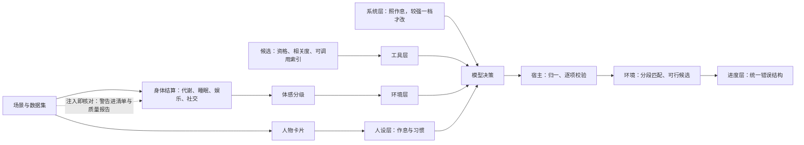

# 特性规格：一日运行保真——作息、需要、按名调用与错误合同

> 状态：**FROZEN**。2026-09-29 用户指示实施本规格、不延后任何尚未完成的工作，并采纳全部推荐：「裁决记录」中尚未裁定的 D2–D7、D9–D11、D14–D17、D19、S1、S3–S10 据此按「推荐」列定为已定（S10 采纳，3.5 的「收敛」一段是其定稿），`docs/INDEX.md` 状态列同步；「冻结条款修订」随冻结生效；本规格条款已全部实现并通过离线验收（证据见[一日运行保真验收记录](dayrun-fidelity-verification.md)），真实复验（阶段 7）未执行。本文把一日运行保真修复方案的 G1–G22 写成可实施、可验收的条款。
> 日期：2026-10-02
> 来源：[一日运行保真修复方案](PROPOSAL-dayrun-fidelity.md)（已裁决）；WorldMock-Dataset 仓库的 `RUN_REPORT_2026-09-29.md`（白领林悦、商务赵铭两次全天运行，代码 `4a5b0e6`，模型 `deepseek-flash`，模拟日 2026-09-28）与 `PROPOSAL_2026-09-29_DATASET_FIXES.md`（下称「数据集方案」）；六路只读核查（身体与人设、工具面、评审与模型调用、冻结规格与合同、设计文档影响、跨文档一致性）。
> 代码基线：`4a5b0e6`。`98eb34b` 只增加文档，代码相同；代码与文档的行号都取 `4a5b0e6`。AS2 行号取锁定提交 `8768e14`。
> 本文只写现行设计；证据、文献与被放弃的方案见提案，各分岔的取舍记在「裁决记录」，演变见「版本表」。
> 配套：文档同步作业与文件修改清单在本文「文档同步作业」「文件修改清单」两章；冻结时不另拆独立实施计划，两章留在本文作实施台账，随各阶段维护。

> 2026-10-01 按[工具交互规格](SPEC-tool-interaction.md)修订当前工具请求、查询与错误合同；本次设计已冻结，生产代码已实现，旧验收证据不覆盖新增条款。
> 本特性首次受影响的发布升级为场景 4、地图 3、目录 5.0、品类与规则绑定 3，世界结构仍为 8。各阶段独立发布；后续格式或内容再次变化时另升相应版本，禁止同目录版本覆盖内容。
> 2026-10-02 按[个人事务与工作安排规格](SPEC-errands-workday.md#冻结条款修订)修订：1.3 `PERSONA_AGREEMENT_LOW` 泛指画像编译留下的警告；2.1 场景作息覆盖字段由五项扩为七项，覆盖与冲突规则不变并一体适用于下班、到家两个新槽（冲突时该槽保留卡片值并记 `CARD_FIELD_CONFLICT`）；2.2 系统层第 14 条末尾追加上班安排一句并收窄三级优先（裁决 S11）；2.3 计划与个人事务的边界、零点计划模板输入说明两处改写与新增的第七、第八条；3.3 来源解析与 `query_world` 共用；第四章 `errands` 必填、个人事务名称类错误的载体与四个失败阶段码；第六章三个控制工具增请求级 `errands`；「工具交互修订的实施边界」`query_world` 改六键并精简返回。修订部分未实现，见该规格阶段 1（失败日志与阶段码补登）、阶段 2（个人事务）、阶段 3（作息与工作安排）、阶段 4（查询）；3.3、3.5 的来源写法与「验收台账」「输入警告」行的警告码个数属既有漂移，分别随该规格阶段 4、阶段 3 的提交更正。该规格另把世界结构升为 9、场景结构升为 5、卡片结构升为 3、质量报告结构升为 4；本文「九、下游与质量报告」与「实施计划」所记的版本是本特性发布时的记录，不改。

## 摘要

| 主题 | 要改什么 | 章节 |
| --- | --- | --- |
| 身体与需要 | 社交账与共同用餐按本区间共同身体结算所用的活动集合判定清醒，睡眠在边界结束的区间不再计为清醒；不喜欢的内容仍有下限缓解，有缓解时不再累积娱乐需要；困意档界按主观量表重标定；不适脉冲按实际计费小时施加；睡眠中不读消息 | 一 |
| 运行输入警告 | 口味与题材对不上、权重全零、没有内容却有观看习惯、卡片作息被场景覆盖等，创建运行时逐条警告，冻结进清单与质量报告，不让运行失败 | 一 |
| 人设与系统层 | 场景显式声明的作息字段覆盖卡片抽取值；系统层新增「照作息过日子」规则并改写饥饿、困意两条，只有较强一档才改作息；零点计划只写今天与平常不同的事和要办的事，计划里的具体安排优先于作息里的习惯，但改不了环境层写明的上班安排（个人事务与工作安排规格 4.6，阶段 3 落地）；不对人物写的文字作语言要求 | 二 |
| 按名调用 | 所有目录类对象都可直接写名称；无损归一后唯一即受理，相似度只给候选、永不替换；候选按此刻可行过滤并写成可照填的请求；名称类拒绝不计同刻轮数 | 三 |
| 指名购买与渠道 | `from` 是可选约束不是语法：完整标签配一致的 `from` 照常受理；分段匹配把「没有这件商品」「这家店不卖」「不支持这种方式」「送不到」分开报；App 名按场景钉定的手机配置解析为成员门店；只写商品名、`to` 与请求级 `prefer` 也能买，方式「购买」由系统定到店或远程下单，多家可服务时按 `prefer` 选一家（3.5） | 三 |
| 错误合同 | 宿主与环境共用一个错误结构：`error_code`、`reason`、`fix`、`items[]`（逐项 `candidates`）、`unmet`；不带内部转储，错误说明使用英文；补全所有码的具体默认原因 | 四 |
| 呈现与浏览 | 生活活动施加地点类资格；排序键加相关度、决胜键改哈希，轮转按每个对象的上次呈现时刻；工具层另给只列名称的可调用索引；浏览结果列完整标签，下一步提示只指向可达地点 | 五 |
| 控制工具 | 结束、播报、暂停改为 `items[{activity_name, summary, memories, views}]`，看法与偏好单独放 `views`，普通记忆没有 `subject`；三个工具另带请求级必填字段 `errands`（个人事务的新增、更新、取消，可为 `[]`；个人事务与工作安排规格 2.2，阶段 2 落地）；`start_activity` 使用 `items[{target, way, from, to}]`，购买偏好使用严格中文枚举 | 六 |
| 评审、调用与叙述 | 中文逐字摘录按字数核对；输出截断时丢弃截断回合、给结构化纠错，并以关闭思考、强制工具调用的请求重试一次；联系人回复不虚构到场，加后验守卫；时间线只出现中文名称 | 七 |
| 加载校验与目标推进 | 地点类别、可见标签唯一、配送路线可达在加载时校验；同名地点由 `branch_label` 消歧；目标带大致时刻，只有在该时刻前后进行的同家族活动才算推进 | 八 |
| 下游 | 质量报告增输入警告、截断、时间线标签、联系人守卫、名称类拒绝各一节；订单载荷记渠道；实验假设登记四项；`quality.json` 与清单版本升级，世界结构版本不升 | 九 |

## 心智模型

人物按自己的作息过日子：到了平常的钟点、在平常的地方，就照平常做；今天与平常不同的事和要办的事写在零点计划里；跨天还没办完、能由结算确认的事（取得或吃掉一件具体商品）记成个人事务留在待办层，办没办成由环境按实际结算确认，不靠零点计划延续（个人事务与工作安排规格第二章，阶段 2 落地）；计划里的具体安排优先于作息里的习惯，场景声明、环境层写明的上班安排不由计划改变（该规格 4.6，阶段 3 落地）；身体信号只在够强时才改写日程。
系统只管三件事：把身体账算对（睡眠不算清醒，不喜欢的内容也有一点缓解），让作息成为默认（系统层写明、
场景作息优先于抽取值），以及在人物写错名字时给出最接近的可行候选、由人物自己决定。数据集负责「有什么、叫什么」；
注入的数据与人物对不上时，系统发出警告而不是静默算成零。



## 证据与范围

### 证据口径

- 两次全天运行的逐决策模型请求与回复、世界事件（`body_settlement`、`action_rejected`）与冻结输入，见 `RUN_REPORT_2026-09-29.md`；
  数字在提案各节引用，本文只在「验收台账」复述目标值。
- 对 `4a5b0e6` 源码的只读核对与用仓库函数做的离线复算；本文写作时的六路核查把提案里与源码不符的说法改正在相应条款，并在「版本表」0.1 行登记。
- 文献与业界资料只作机制依据，不把文献里的数值当常数；凡未注明文献出处的数值都是按 WorldMock 现行公式反推的实验假设，登记进 `docs/EXPERIMENT.md`「实验假设声明」。

### 决定方案形状的事实

| 现象（WC 白领 / BIZ 商务） | 直接原因 | 章节 |
| --- | --- | --- |
| 一醒来就「想和人说说话」 | 在边界结束的睡眠被当成清醒计入社交需要，醒来一次跳 +0.30 / +0.26 | 一 1.1 |
| 晚上连看 6 部短剧，一直「很想放松」 | 口味词对不上题材，权重全零，观看缓解 = 速率 × 0；没有任何警告 | 一 1.2、1.3 |
| 21:45 就「困」，22:45 上床，早于惯常就寝约 2.4 小时 | 困意档界比主观量表早约 1–2 分 | 一 1.4 |
| 10:00 点午饭，14:33 再吃一顿 | 系统层只有「饿了趁早弄吃的」「困了就去睡」，没有一句要人守作息；每轮人设层读的是卡片值，与场景作息不一致 | 二 |
| 不做饭、不洗碗、没喝上咖啡；自造的名称一律被拒 | 每类只列 20 条，零口味时按对象标识字母序；生活活动没施加地点类资格；名称逐字匹配 | 三、五 |
| 能送到家的番茄、鸡蛋被说成「没有找到这个名字的商品」 | `from=盒马App` 在「查无此物」之前就把商品过滤掉；照抄候选又撞上「完整标签带 `from`」的规则 | 三 |
| 协议错误 WC 63/181、BIZ 390/606 | 收尾参数的形状与模型的自然写法相反；名称必须逐字照抄；错误不给改法；思考耗尽 8000 输出上限 | 四、六、七 |
| BIZ 纪要 6 次提交都没被接受 | 中文逐字摘录按空格切词永远通不过核对 | 七 |
| 同事说「马上到」，人物在工位干等 | 联系人回复不知道自己只是远程联系人 | 七 |
| BIZ 在两地之间往返 17 段，最后睡在餐馆 | 以数据集为主（数据集方案）；系统侧浏览结果不带店名、提示不看可达性 | 五 |

### 权威来源与范围

- 行为规则以本文为准；字段、枚举、Schema、提示词模板登记在 `docs/CONTRACTS.md`；实验假设登记在 `docs/EXPERIMENT.md`；
  门禁登记在 `docs/VERIFICATION.md`。冻结时按「冻结条款修订」逐条改写被取代的条款。
- **在范围内**：G1–G20、G22 的系统侧修复；数据集侧的路线、供给、命名、题材词表、活动池与预跑校验在数据集方案，本文只写接口。
- **不在范围**（见「范围外登记」）：工作材料正文进提示（G21）；社交账的在场折减与醒来减半；饥饿随惯常饭点起伏；把 S/C 常数改成个体值；`start_activity` 改形；数据集方案第五章向系统提出而本文不做的事项。
- **不改变的既有语义**：只有环境能改世界状态；一次决策恰好一个世界请求；身体数值不进提示；睡眠只接受睡眠允许的唤醒原因；
  软偏好只改序不出局；指名购买不自动替换（人物 Prompt 规格裁决 #19）；五项体感分级的名称与个数不变（裁决 #10）。

## 一、身体与需要

### 1.1 区间事实只有一个来源：社交账与共同用餐

**规则。** 一段结算区间里有哪些活动，以该区间共同身体结算（`body_settlement.activity_ids`）所用的活动集合为准；
社交账的「是否在睡」、交谈与通话的覆盖判断、共同用餐判定都改用这个集合，不在推进后重新推断。社交账的计费小时取本边界的区间
（`inputs.interval_seconds`，与现行相同），活动集合取该区间的共同身体结算草稿。代谢账不变：基础代谢与
额外代谢不分清醒睡眠照常扣除，饥饿在睡眠中照常上升；娱乐需要在睡眠中不增长。

**现状与修法。** 引擎 `_advance_activities`（`engine.py:1455-1489`）先取推进前进行中的活动集合再调用 `settle_shared_body`
（`body.py:189-218`），本区间活动集合写在 `body_settlement` 事件的 `activity_ids`；社交账却在推进后的节律结算里
（`rhythm.py:252-268`）用 `active_activities(推进后状态)` 判断此刻是否在睡，于是在边界结束的睡眠（已 COMPLETED）整段按清醒计，
每小时 +0.04，醒来一次跳 +0.30（WC）/ +0.26（BIZ）；`_shared_meal`（`rhythm.py:285-290`）同一写法。
`_next_epoch`（`engine.py:1655-1671`）把每个活动的计划结束、未触发的提醒和预排事件都当作边界，所以一段区间内的活动集合恒定，
不会出现「睡了一半」。

- `rhythm.py` 新增 `_interval_activities(agent, inputs)`：从 `RhythmInputs.progress_data` 携带的本边界 `body_settlement` 草稿
  （`rhythm.py:573-581`，零点路径也经过）取 `activity_ids`；没有草稿时（直接调用或单测）兜底为「ACTIVE，或 COMPLETED 且 `ended_at == now`」，
  与 `_woke_from_sleep`（`rhythm.py:506-513`）已采用的口径一致。
- 社交账、交谈与通话覆盖、`_shared_meal` 都改用该集合。`_social_activity_covered`（`rhythm.py:271-282`）现已按「ACTIVE 或 COMPLETED 且 `ended_at == now`」判定，
  改用集合对交谈、通话是语义不变的统一。不改 Schema，不新增事件字段（裁决 D2 方案 A）。现有节律测试经 `engine_rhythm_inputs` 构造输入、不带 `progress_data`
  （`tests/life/test_engine_branch_coverage.py:718-720`），走的正是兜底路径；本次另加带草稿的用例。现行没有任何测试把睡眠活动与 `social_need` 放在一起。
- 冻结条款：life-runtime 规格「其他体感分级」的社交需要（:323-328）与 `docs/EXPERIMENT.md`「需求状态」的「清醒每小时 +0.04」补一句「清醒按本区间共同身体结算所用的活动集合判定」；
  一日行为规格「共同时间与身体结算」（`body_settlement` 携带 `activity_ids`）与时间与能量规格「交谈」的「以推进前的状态判定」是本条的依据，不改。

**验收。** 睡眠在边界完成：社交不变，能量按基础代谢乘小时数下降，睡眠压力下降；睡眠被提醒提前结束：同上；醒后第一段清醒区间：
社交增加 0.04 × 0.25；性质测试：社交账的清醒分类与共同身体结算所用集合一致；在边界吃完的一餐仍算共同用餐；没有草稿时走 `ended_at == now` 兜底。

### 1.2 下限缓解与累积口径

**规则。** 偏好只调幅度，不决定有无。实际缓解使用有效偏好

```
relief_preference(w, f) = f + (1 − f) · w        0 < f < 1，对 w 严格单调，w = 1 时不变
```

- `w` 是现行口味权重（`compute_taste_weights`，`profile/taste.py:24-28`，精确交集）；`f` 是下限偏好，缺省 **0.5**（实验假设，敏感区间 0.3–0.7；
  文献只能确定 0 < f < 1）。取 0.5 时喜欢的内容仍比不喜欢的快一倍，口味差异保留。
- 只作用于实际缓解（`activities._entertainment_relief`，`activities.py:298-318`：内容按 `:316` 速率 × 偏好 ÷ 接触次数，游戏按 `:317-318` 偏好 × 基础速率）
  和评分器里口径相同的缓解预演（`motivation.py:806-821`，游戏在 `:816-819`；观看预演 `:992`）。所有排序仍用原始权重 `w`，零权重照旧排在最后（`candidates.py:233-241`）。
  不用 `max(w, f)`：低于 `f` 的权重会被拉成并列。
- 游戏与内容同一算法（裁决 S1）：`runtime._card_taste_weights` 也为游戏条目计算口味权重（现行 `runtime.py:1083-1095` 只算内容，游戏缓解恒为 0）；
  没有题材声明的条目权重为零，走下限。
- **累积口径统一为「有缓解的活动进行时不再累积娱乐需要」**。生产路径只有共同区间一条：`settle_shared_body`（`engine.py:1466`）与 `advance_activity_shared`
  （`engine.py:1511`）经 `body._shared_entries`（`body.py:231-232`）按「累积减缓解」结算；单活动路径 `body._entertainment_entries`（`:545-551`，有缓解时不累积）
  只经 `activities.advance_activity` 与 `social_actions.advance_social` 到达，源码里没有生产调用方，只有测试在用。统一口径改在 `_shared_entries` 一处，
  单活动路径随之对齐。统一后从 1.0 降到「有点想放松」以下所需的观看时间（缓解速率 0.30/小时，清醒累积 0.08/小时）：
  `f=0.5` 时不喜欢的内容 2.7 小时、喜欢的 1.3 小时；不统一口径时 0.5 在现行引擎下要看 5.7 小时，一整晚仍会连看。
- **存放位置**（裁决 D3）：放场景层身体实例配置 `BodyInstanceConfig`（`scenario.py:560` 的 `body`）新增字段 `entertainment_relief_preference_floor`，
  缺省 0.5、取值 (0, 1)，经 `semantics._assemble_body`（`semantics.py:370-406`）并入 `BodyConfig`（`scenario.py:60-76`）；带缺省值，现有场景文件不必改，目录与数据集副本都不变。
  这沿用接口合同「场景常量」把常量放场景层以避免触发目录版本变更、以及时间与能量规格把 `APPETITE_STARVING_KCAL` 放代码常量「不进目录」的先例。
  提案推荐的目录方案（`catalog/resources.jsonl` 的 `entertainment_need` 消耗规则新增该键，同改 `catalog/models.py` 的 `DrainRules` `:142-155`、目录小版本升级、场景重钉、数据集重冻结）列为另一选项。
  两种放法都在 `docs/EXPERIMENT.md`「实验假设声明」登记假设与敏感区间。

**验收。** 不喜欢的内容按下限缓解；缓解随口味权重单调；游戏走下限；评分器预演与引擎一致；零权重仍排在最后；
两条结算路径对同一内容给出相同净效果；`f` 的取值与来源在场景层字段说明与 `docs/EXPERIMENT.md` 各登记一次。

**冻结条款。** 现行文档两边说法不一致：人物规格「画像编译」（:383-384）与接口合同 :891、:1429 写 `taste_weights`「只供内部评分器与浏览排序使用」；
life-runtime 规格「转换效率算法」（:410-414，娱乐需要变化 = 内容效果 × 人物偏好 ÷ 接触次数）、「验收矩阵」:608 与 `docs/EXPERIMENT.md`「需求状态」（:187，按偏好减少）写实际缓解乘以偏好，
代码按后者实现。统一为：排序用原始权重，实际缓解用有效偏好；两边都改写。

### 1.3 运行输入警告

**规则。** 注入即核对。人物口味与内容题材对不上、权重全为 0、没有内容却有观看习惯、场景作息与卡片抽取不一致时，
创建运行时逐条发出警告；警告冻结进运行清单、写进质量报告、逐条写一条 ops 警告，`validate` 同时打印。**运行路径永不因警告失败。**

- 新建纯函数模块 `src/worldmock/profile/injection.py`，在创建运行时计算（`runtime.py:754-764`）；运行清单（`engine.py:1741-1755`）
  增加 `input_warnings` 键；`quality.json` 增加 `input_warnings` 一节（第九章）。
- 警告正文同时列出卡片的 `content_genres` 与 `media`，以及语料中最常见的几个题材，由数据集决定改卡片还是补题材标签
  （题材词表归数据集，系统只做精确匹配：裁决 D1，用户已定）。`runtime._card_taste_weights` 只用 `content_genres` 参与匹配，
  「B站视频」这类平台词无论写在哪个字段都对不上题材。
- 警告码闭集（登记进接口合同「人物卡片覆盖率产出」旁的新小节「运行输入警告」）：

  | 码 | 条件 |
  | --- | --- |
  | `TASTE_GENRES_UNMATCHED` | 人物口味与场景内容题材没有交集 |
  | `CONTENT_WEIGHTS_ALL_ZERO` | 有内容，但权重全为 0 |
  | `CONTENT_EMPTY_WITH_MEDIA_TASTES` | 没有内容，但卡片或习惯里有看、刷、听 |
  | `GAMES_WITHOUT_TASTE_WEIGHTS` | 有游戏，但没有算口味权重 |
  | `COVERAGE_BELOW_THRESHOLD` | 复用 `validate_coverage`（`profile/coverage.py:60-99`，现只由 `validate` 与 `profile validate` 两个子命令经 `validation.py:91`、`:222` 调用）的覆盖率低于 80%，并改为不允许用 App 名子串算命中（现行 `coverage.py:73-74` 与 `_keyword_hit` `:102-105` 双向子串匹配，把「B站视频」按应用名「B站」判为覆盖，WC 算出 0.92 而权重全零；接口合同「人物卡片覆盖率产出」的「习惯反应与目标关键词互为子串」随之收紧为不含 App 名） |
  | `CARD_FIELD_OVERRIDDEN` / `CARD_FIELD_CONFLICT` | 场景作息覆盖了卡片值 / 覆盖后锚点冲突（第二章 2.1） |
  | `PERSONA_AGREEMENT_LOW` | 透传画像编译的警告（现行 `runtime._compile_persona`，`runtime.py:1114-1120`，把编译警告丢掉了）；该码泛指画像编译留下的警告（三次一致性偏低的字段、下班与到家锚点的降级说明等），消息不预设原因是一致性偏低，`details.compiler_warning` 带原文；警告码闭集仍为十个（个人事务与工作安排规格 4.1，阶段 3 落地） |

- `validate` 在覆盖率低于 80% 时继续失败（沿用现行合同，裁决 D4）；运行路径只警告。

**验收。** 每个警告码各一例；警告冻结进清单并计入质量报告；警告不会让创建失败；App 名子串不再算覆盖命中。

### 1.4 困意档界

**规则。** 困意 `f = (S − L(t)) / (H(t) − L(t))`（`sleep.py:96-101`）不变，只改档界；档的名称与个数不变（人物 Prompt 规格裁决 #10）。
按 KSS 等价刻度 `K = 7 + 7.6 · (f − 1)`（斜率由 Shochat 等 2021 的两个锚点对三个人物的工作日稳态拟合，得 7.47–7.81，取 7.6；
就寝前 4 小时 KSS 约 4，入睡时约 7），在 K = 5.5、6.5、7.5、8.4 切档：

| 档 | 现行下界 | 新下界 |
| --- | --- | --- |
| 有点乏 | 0.5 | **0.80** |
| 困 | 0.75 | **0.93** |
| 很困 | 0.9 | **1.07** |
| 撑不住 | 1.0 | **1.18**（留 0.02 余量，不与截断上界 1.2 重合） |

- 现行「有点乏」一档 0.25 宽（「困」0.15、「很困」0.10），晚上 `f` 每小时约升 0.10，「困」出现在模型自身入睡点之前约 2.4 小时（WC 21:45、BIZ 20:56），
  「撑不住」恰落在惯常就寝时刻；两份运行的人物都在「困」时上床。
- 不采用清醒维持区抑制项：文献显示这段时间主观困意并不下降，而且单加它修不好（裁决 D5）。
- 已知局限：两过程常数的周期解本身约睡 7.9 小时，需要量越短、模型入睡点越早，BIZ（7 小时）的「困」在新档界下仍比就寝早 1:20；改 S/C 标定不在本次范围，由第二章的系统层规则兜底。
- 早晨不受影响：醒来只由「睡够」（睡眠活动的计划时长 `sleep_need_hours × 3600`，`session_actions.py:389`）或提醒触发，不由压力触发；所有正常早晨 `f < 0.4`，两套映射都是「清醒」。
- 困意的不适档 `SLEEPY_BANDS` 从「困」起算（`rhythm.py`），「困」后移到 0.93 也就推迟了困意不适脉冲的起点；这是有意的。
- 档界标定是实验假设（KSS 等价刻度与斜率 7.6），登记进 `docs/EXPERIMENT.md`「实验假设声明」。
- 档界有两份常数（`felt.py:59-64`，与只有测试在用的 `sleep.py:43-46`），同步修改并加一条两者一致的测试；`felt.py:57-58` 的注释随之改写
  （:57 写「输入为 sleep.py 演化的原始压力值」，实际输入是 `sleep.sleepiness` 归一后的 `f`，`body.py:428-429`；:58 写「修订合同冻结阈值，无文献出处」）。
- life-runtime 规格「两过程睡眠模型」的困意分级（:261-266）与预期行为示例（:268-272）重算。按模型自身公式（默认中点 04:00，07:00 起床且起床时压力等于当时的醒来阈值），
  新档界下约 21:30 起「有点乏」、22:40 起「困」、00:05 起「很困」、01:25 起「撑不住」；现行示例所写的 20:00/21:00/22:00/22:45 与同一假设下的
  18:33/21:00/22:24/23:23 不符（`test_sleep_two_process.py:239-241` 的注释已指出 22:00 是「困」不是「很困」），本次一并以计算值改写并写明假设。
  该测试的锚点轨迹（20:00 f=0.644、21:00 0.750、22:00 0.857、22:45 0.937）在新档界下为清醒、清醒、有点乏、困，`:211-252` 要改写而不只是换阈值。

**验收。** 五档名称不变；两份常数一致；WC/BIZ 工作日稳态的各档起点与提案表一致（WC 22:13/23:26/00:51/02:09，BIZ 21:25/22:40/00:04/01:18）；
`test_felt_states.py:286-302`、`test_sleep_two_process.py:192-252`、`:528-547` 按新档界改写。

### 1.5 不适脉冲与睡眠中的消息

- **不适脉冲的门槛被算了两次。** `rhythm.py:216` 已按连续不适时长减去 2 小时触发门槛（`felt.MOOD_DISCOMFORT_TRIGGER_HOURS`）得到可计费小时，`:217` 取新增部分
  （通常 0.25 小时）传给 `apply_discomfort_pulse`；`felt.discomfort_pulse`（`felt.py:350-356`）却对传入的小时数再施加一次 2 小时门槛（已复核：0.25 小时→0，1.99→0，2.0→−0.2），
  而且 `:221` 在脉冲为 0 时照样把这些小时记为已计费。只有单个边界的新增计费小时不少于 2 小时时才会触发，边界间隔不超过 2 小时的运行里从未生效。
  改为：`discomfort_pulse` 直接返回 `MOOD_PULSES["discomfort_hourly"] × hours`，2 小时门槛只在 `rhythm.py:216` 判定一次；不适档不变
  （饥饿 `HUNGRY_BANDS`：饿、很饿、饿得难受、饿得发慌；困意 `SLEEPY_BANDS`：困、很困、撑不住）；life-runtime 规格「其他体感分级」脉冲表
  （:344，连续两小时以上，−0.1/小时）不变，本项是恢复对它的符合。
- **睡眠中不读消息。** 判定段对每个边界无条件调用 `read_new_messages`（`rhythm.py:131`；`:129-130` 的注释只说睡眠中过滤唤醒），睡眠中送达的消息被标为已读、
  社交需要 −0.05（`felt.SOCIAL_NEED_MESSAGE_RELIEF`）、情绪 +0.1（`MOOD_PULSES["message_received"]`），与 life-runtime「阅读」的语义（:327）、
  接口合同「已读指全文已呈现」（:749，人物 Prompt 规格第六章）和时间与能量规格「睡眠中不唤醒，醒后在观察中看到消息」（:182-184）不符。
  改为睡眠中不读，醒来后的第一个边界再读（裁决 D15）。

**验收。** 连续饿 2.25 小时、边界间隔 0.25 小时时施加 −0.025 的脉冲，1.75 小时不施加，且未施加时不消耗计费小时；睡眠中送达的消息在醒来后的第一个边界才计阅读效果。

## 二、人设与系统层

### 2.1 场景作息覆盖卡片抽取值

**规则**（裁决 D16：场景优先）。结构化字段优先：场景显式声明的作息字段覆盖 LLM 从背景故事抽取的卡片值；未声明的字段仍取卡片值。
同一次运行只有一套作息：身体结算、零点计划与每轮人设层读同一组值。（下班、到家两项身体结算不读；零点计划只在场景声明时带「下班时段」「到家时段」，
只来自卡片的与起床、出门一样不进零点计划的结构化输入；个人事务与工作安排规格 4.2，阶段 3 落地。）

**现状。** 同一次运行里有三套作息：身体按场景值结算（`engine.py:1729-1730`），零点计划读场景值（`day_plan_inputs.py:103-109`），
每轮人设层却读卡片值（`custom/agents/life_persona.py:95-102`）。WC 卡片的睡眠中点 4.0 是 `persona-mapping.toml:99-101` 的缺省值（故事没提到中点时由缺省补齐），
场景值是 4.75；午餐、晚餐窗口两边也不一致。卡片有 7 个作息子字段（起床、出门、午餐、晚餐、就寝、睡眠中点、睡眠需要），场景人物只有 5 个
（`chronotype_midsleep`、`sleep_need_hours`、`lunch_window`、`dinner_window`、`bedtime_window`，`scenario.py:209-218`）。接口合同 :891 写「人物身体常量 `chronotype_midsleep`
与 `sleep_need_hours` 属于人物状态与人物档案，驱动世界层结算……（人设层 `rhythm` 以可读短语写睡眠中点与睡眠需要）」，现行实现里人设层写的是卡片值。

**修法。**

- 在 `runtime._agent_specs` 渲染卡片之前（`runtime.py:1091-1095`）调用新纯函数 `apply_scenario_rhythm(card, agent)`：
  只覆盖场景显式声明的字段，即 `agent.model_fields_set` 与七个作息字段的交集：上述五项加 `leave_work_window`、`arrive_home_window`（个人事务与工作安排规格 4.2，阶段 3 落地）
  （`runtime.py:1088` 直接遍历加载的 `scenario.agents`，`model_fields_set` 在这里可靠；
  经过一次 dump/validate 往返的对象会把全部字段记为已设，所以覆盖必须在原始加载对象上做）；按卡片格点量化（中点与睡眠需要 0.25 小时，窗口 0.5 小时，
  场景的午餐、晚餐窗口现只查重叠不查格点）；重建锚点顺序（`TimeAnchors.validate_order`，起点非递减），出现冲突的那一槽保留卡片值。
  窗口槽由午餐、晚餐、就寝三个扩为五个。下班、到家两槽可为 null，不进入五锚点的回绕归一与全序校验，另按该规格 4.1 校验：`leave_work` 非空时出门起点 ≤ 下班起点，
  两者都非空时下班起点 ≤ 到家起点，`leave_work` 为 null 而 `arrive_home` 非空时出门起点 ≤ 到家起点，任一非空时其起点 ≤ 归一后的就寝起点。
  覆盖与冲突规则不变并一体适用于新槽：场景声明的窗口落下后违反顺序约束，或量化后写不成合法窗口时，该槽保留卡片值（新槽的卡片值可以是 null）并记 `CARD_FIELD_CONFLICT`。
  卡片槽为 null 时覆盖与告警照常处理，覆盖结果仍是不动点；仍只用 `CARD_FIELD_OVERRIDDEN`、`CARD_FIELD_CONFLICT`，警告码闭集不变，只扩 `details.field` 的取值。
  覆盖在 `_render_card`（`:1093`）之前生效，人设层文本与 `persona_card_struct`（`:1094`）都取覆盖后的卡片。
- 每处覆盖记 `CARD_FIELD_OVERRIDDEN`，冲突记 `CARD_FIELD_CONFLICT`（1.3 的警告通道）。`validate` 路径调用同一个函数。
- 取场景优先而不是卡片优先：场景字段是数据集按规格显式声明的，身体与零点计划已经按它结算；卡片是 LLM 从散文里抽取的，缺省时还会补默认值。
- `persona_card_struct`（人物档案里冻结的卡片结构）保存覆盖后的值，恢复时校验一致；`prompt_sha256` 不受影响（它只绑定系统层与 Schema）。
- 冻结条款：人物规格「画像编译」（:374「作息……由卡片承载」）与接口合同「人格与卡片字段」（:1414）改为「由卡片承载，场景显式声明的作息字段优先」；
  人物 Prompt 规格「人设层」（:219）与接口合同 :1457「卡片编译、三次一致性、`render_card` 与冻结恢复不变」改为「`render_card` 不变，输入的卡片先经场景作息覆盖」；
  人物规格验收矩阵 :535「作息落在人物卡片声明的就寝窗口内」改为「落在覆盖后的就寝窗口内」。调研稿中「不一致时以卡片为准」的意见列为 D16 的另一选项。

**验收。** 场景只声明睡眠中点时，人设层显示场景中点、其余字段仍为卡片值；覆盖后锚点乱序时保留卡片值并记冲突警告；
身体结算、零点计划输入与人设层三处读到同一组值；`validate` 与运行路径结果一致。

### 2.2 系统层：照作息过日子，较强一档才改

**规则**（裁决 D6、S3）。系统层 `rules` 新增一条作息默认规则（插在现行第 13 条之后，成为第 14 条），并改写现行第 14 条（饥饿，改为第 15 条）与第 15 条
（困意，改为第 16 条）；其余条目顺延，共 18 条。档位名必须与 `felt.py` 的分级文本逐字一致。定稿文案（每条一项）：

> 14. 人设层的作息和习惯是你平常的过法：到了平常的钟点、在平常的地方，就照平常做；今日计划写明今天与平常不同的安排时，按计划；身体的感觉没到更强的一档，就不为它改作息。人设层没写作息，或者今天不在平常的环境里，就按身体的感觉来。环境层写了上班安排的日子，那是定下的安排，不是习惯：今日计划改不了它，手上的工作交了也还在班上，写明的休息时段和工作要求去别处的外出除外。

第 14 条末句由[个人事务与工作安排规格](SPEC-errands-workday.md) 4.6 追加，修订部分未实现，见该规格阶段 3：`custom/agents/life_prompt.py`、人物 Prompt 规格「系统层」编号列表与接口合同「请求组成」三处受测试逐字比对的副本随阶段 3 的代码同一提交改写，在那之前现行系统层第 14 条没有这一句；条数仍为 18，第 15、16 条不变。

> 15. 你会饿、会困、会累，饿着或困着做事会慢，走路比坐车更费力。只是「有点想吃」时，等平常的饭点再吃正餐，离饭点还早可以喝点东西或吃点手边的零食；到了「饿」，离平常饭点一小时以内可以提前准备或下单，更早就先垫一点；到了「很饿」或更饿，别等饭点，马上弄吃的。手边的、在路上的、这里能买的、能送到这里的都算；下单后要等送到，拿到手才能吃。每个饭点的正餐只吃一次，提前吃过的那顿就算吃过了。

> 16. 晚上照人设层作息里的就寝时间去睡（没写就寝时间，就困了再睡）：有点乏、困是睡前的常态，不必因此提早上床；很困或撑不住了可以提前，精神还好也可以晚些。想在某个时刻起来，就给今日计划的目标写上提醒时刻；睡着时只有提醒或睡够了才会醒，早睡也就早醒。

- 三级优先（裁决 S11，经个人事务与工作安排规格 4.6 收窄）：作息是默认；今日计划写了今天不同的具体安排就按计划；身体只在较强一档才改。计划优先只对作息里的习惯成立：环境层写明的上班安排是场景声明的事实，
  今日计划改不了它，手上的工作交了也还在班上，写明的休息时段和工作要求去别处的外出除外。计划不重述作息（2.3），两者一般不重叠，重叠时以计划为准。
- 仲裁档位：饥饿取「很饿」（食欲 ≥ 0.6），困意取「很困」；「饿」时允许提前一小时，这一小时覆盖外卖 20–40 分钟的送达
  （实验假设，敏感区间 30–120 分钟，登记进 `docs/EXPERIMENT.md`）。「每个饭点的正餐只吃一次」针对本次 10:20 与 14:53 两顿「午饭」。
- 系统层文案在人物 Prompt 规格第一章「系统层」逐字定稿，逐字登记进接口合同「请求组成」（`docs/CONTRACTS.md:1102-1130` 的 JSON 块）；
  `tests/integration/test_seven_layer_request.py:113-145` 从接口合同的 JSON 块与规格的编号列表读出文案并断言与 `LIFE_SYSTEM_LAYER` 相同且恰为 17 条，
  三处与该断言（改为 18 条）同批修改。`prompt_sha256` 只计算、不钉常量（`life_prompt.py:125-131`），随之变化；旧运行本来就按模型身份与 `code_sha256` 拒绝恢复。
- 冻结条款：时间与能量规格裁决 #4（已定）的原则「能量不阻断，靠饥饿每档唤醒……让人趁早吃」保留「不阻断、每档唤醒」两半，「趁早吃」改为「按档位与饭点吃」；
  该规格「让人物趁早吃」第 3 条所引的原句改为本条第 15 条；人物 Prompt 规格修订 #19（吃饭途径由工具层与系统层表达）不变。
- 时间与能量规格「让人物趁早吃」第 3 条所引的系统层原句随之改写；该规格「能量不拦人」的原则不变：仍然不阻断、不停止任何活动。
- 现行第 4 条、第 17 条各补一句联系人的说法（第七章 7.3）；不加语言要求（裁决 D18，用户裁定：中英文都可以，只要行为对）。

**依据。** 习惯由情境与时刻线索触发，对短期动机不敏感；进餐时刻主要由时刻决定，只有大的能量缺口才覆盖；同类模拟都以计划为默认、需要越过阈值才中断
（提案二、三章）。这与人物 Prompt 规格裁决 #10（沿用五项体感分级）不冲突：档不变，只改规则怎样用档。

**验收。** `LIFE_SYSTEM_LAYER.rules` 与规格、接口合同逐字相同；档位名与 `felt.py` 分级文本逐字一致（测试从 `felt.py` 取词表核对规则文案）；
`prompt_sha256` 重钉；复跑指标见「验收台账」。

### 2.3 零点计划只写今天与平常不同的事

**规则**（裁决 S11，用户裁定）。作息在人设层，零点计划不重述它。计划只写今天与平常不同的事（提前、推迟、取消、和谁一起）和要办的事（截止的任务、要回的消息、
要买的东西、要去的地方），以及需要的提醒（起床、出门、约定的时刻）。跨天还没办完、能由结算确认的事（取得或吃掉一件具体商品）记成个人事务留在待办层，
不靠零点计划延续（个人事务与工作安排规格 2.1、2.8，阶段 2 落地）：零点计划的输入带只读的「个人事务」，计划不创建、不更改、不终结事务，也不必把事务照抄成目标，今天打算去办的可以写一条目标说明什么时候办；
目标的 `progressed` 仍只表示获得过活动推进，不表示事务办成。三级优先写进系统层第 14 条：作息是默认，今日计划的具体安排优先于作息，身体的感觉只在较强一档才改；
环境层写明的上班安排不在此列，今日计划改不了它（第 14 条末句，个人事务与工作安排规格 4.6，阶段 3 落地）。

- **零点计划模板**（接口合同「请求组成」:1174-1187）新增两条：「五、人物档案的作息里已经有的事（睡觉、起床、上下班、吃饭）不写，除非今天与平常不同或需要提醒；写的时候写清楚哪里不同」；
  「六、每条目标写大致时刻 `around_time`」（8.2）。模板开头输入说明的末行另改为「以及此刻他能看到的待办任务、还没办完的个人事务、收件箱、在途订单、联系人和上一天目标的推进情况。」，
  并新增第七条「七、个人事务已经记在待办里，不必照抄成目标；今天打算去办的，可以写一条目标说明什么时候办。」（个人事务与工作安排规格 2.8；修订部分未实现，见该规格阶段 2，接口合同的模板登记块随该阶段代码同一提交）。
  输入说明首行另加「当天的上班安排」（「……只含世界已经记下的事实：人物档案与背景原文、当天的上班安排、」），
  并在第七条之后新增第八条「八、输入里有上班安排的日子，目标不要安排在上班时间离开上班地点，写明的休息时段和工作要求去别处的外出除外。」（同规格 4.6；修订部分未实现，见该规格阶段 3）。
  零条目标仍然合法：平常的一天可以没有计划。
- **例行意图**：`ROUTINE_INTENT_KINDS = {睡眠, 晨间例程, 通勤, 用餐}`（十一种意图闭集的子集，登记进接口合同「当日目标请求」）。这类目标照常受理、判定与记录，
  但质量报告的推进比例只计非例行意图的目标；作息本身是否被遵守由复跑指标直接对作息量（午饭时刻、就寝时刻），不经计划。
- **就寝提醒撤回**（S2）：计划不再为就寝写提醒。就寝前的决策机会来自进行中活动每 `progress_report_interval_seconds`（缺省 1800 秒）一次的播报与活动结束，不需要闹钟；
  提醒只留给起床、出门与约定的时刻（模板第三条不变）。这里说的是当日目标的 `remind_time`。个人事务另有自己的 `remind_time`（个人事务与工作安排规格 2.5，阶段 2 落地）：
  由人物在新增或更新事务时写明，到点只提供一次决策机会、不改变事务状态，唤醒原因 `errand_reminder_due` 不进睡眠允许集合（睡眠中到点不交付也不消耗，在醒来的那个边界交付），
  系统不替人物记下事务或写提醒时刻；想在某个时刻起床仍只用当日目标的提醒。
- **现状**：两份运行的计划大半是重述作息的目标（「按零点十分左右的作息入睡」「睡前刷会儿B站」），正是 8.2 现状里被误判推进的那些；模板没有说不写作息，意图闭集又含作息类。
  计划文字本来就不驱动活动（接口合同 :184），冲突只出现在人物读到两处不一致的安排时；本条把来源分开。

**验收。** 模板用例：作息里已有的事不进计划，今天不同的写明差异，收尾记下的起床时刻仍生成提醒；例行意图的目标不入推进比例；系统层第 14 条含今日计划优先句；
平常的一天可以是零条目标。

### 2.4 语言不作要求

人物写的正文、summary、记忆与人设层看法用中文还是英文不作要求（裁决 D18，用户裁定）。本次运行里 WC 记为 `self_note` 的 10 条中 5 条、BIZ 18 条中 2 条是英文，
全部进入了 LabelKit 输入；是否需要统一语言由数据集在交付侧决定，系统不加系统层语言句、不在质量报告计数。其他调用点已有的中文要求（联系人回复 `runtime.py:62`、
零点计划 `day_planning.py:44`、记忆归纳 `custom/agents/life_memory.py:28`、画像抽取 `profile/extractor.py:85`）不变；思考只保留在私有证据里。

## 三、按名调用与指名购买

### 3.1 统一名称解析

**规则。** 所有目录类对象（商品与供给、生活活动、内容、游戏、地点、联系人与人物、任务、活动）都可以直接写名称。
无损归一后唯一就受理；相似度只用来给候选，永不自动替换（人物 Prompt 规格裁决 #19）；候选按「此刻可行」过滤并写成可以照填的请求；
宿主逐项收集全部失败项，环境逐项解析后合并成一次拒绝。

**历史证据（2026-09）。** 名称检查分散在约 9 处：宿主 `custom/agents/life_agent.py:597-642`，路由 `routing.py:63-143`（宿主 `life_agent.py:641` 与环境 `session_actions.py:125` 共用），
交互菜单 `interaction_menu.py:132-160`，环境 `session_actions.py:121-159`（`_offered_selection` 找不到即裸 `ACTION_REQUEST_INVALID`，`_named_selection` 只管指名购买）、
`:253-270`、`:482-490`、`:547-559`。每一处都是逐字匹配、遇到第一个错误就停（`routing.combination_error`，`routing.py:72-77`，算出了全部逐项错误却只返回一个）；
宿主报错是英文；环境拒绝虽有中文 `reason`，`message` 仍是英文，除 `SUPPLY_*` 两码外都不给候选。只有商品有指名购买，且只在 `obtain` 且方式恰好是「到店」或「远程下单」时放行
（`life_agent.py:633-640`、`interaction_menu.py:158-160`）。名称与组合类协议错误 WC 26 次、BIZ 216 次。

**设计。** 复用纯函数模块 `src/worldmock/life/name_resolution.py`，宿主与环境共用（与 `routing.py` 同一模式）：

1. **精确匹配。**
2. **无损归一**，结果唯一就受理，并写进 `details.resolved`（形如 `[{"written": "沈昊", "as": "联系人：沈昊"}]`）：
   - 统一全半角与括号；
   - 按方式推导的内部动词增补或去掉「地点：」「联系人：」「活动：」「内容：」「持有物：」「工作：」等前缀；
   - 去掉活动名里的「（9月28日 08:25 起）」（与 `memory_layer.py:53` 的 `_START_SUFFIX` 同一正则）和邮件时间戳；
   - 比对时忽略「（模拟）」；
   - 「家」「住处」→ `home_location_id`（现行提示里家只以「地点：<场景名称>」出现，没有「家」的写法）；不新增地点别名字段：场景不复制地点名称
     （接口合同「冻结地图与场景引用」:418-420、地图与门店规格 :41），其余写法交给候选；
   - 每个现有方式只属于一个内部动词（`WAYS`，`interaction_menu.py:24-35`，「制作」属于 `obtain`）；由方式唯一推导动词，人物请求不再带 `actions`。不适用于目标的方式报 `WAY_NOT_OFFERED`，完整候选只含新请求字段；
   - 现有 `WAY_SYNONYMS` 仅是既有方式闭集的名称识别合同（登记进接口合同「请求模型的闭集与字面边界」），不新增旧接口或偏好兼容写法，只有在目标列出的方式里恰好命中一个时才受理；
   - 名称归一只识别现有名称；来源与去向严格按方式判定，食用、使用、制作的两端须为 `null`，不接受「自己」等固定值的兼容写法。
3. **相似度永不自动替换**：先按方式确定对象类别，在同类中计算单字加二字的 Dice 相似度（把 `named_purchase.near_candidates`，`named_purchase.py:65-78`，移进本模块并加可行性过滤）；
   多字名称须至少共用一个二字词，单字名称只接受同类相同单字；可行的在前，至多 3 个候选；每个候选写成完整的 `{tool, arguments, note}`（`note` 为英文说明或 `null`，例如 `Estimated duration: 20 minutes`）。
4. **分工**：私有绑定和已冻结的地点表由宿主判定，重试不花钱（宿主协议错误不进引擎）；存在但没列出的对象（未呈现的供给、生活活动、内容，以及没有路线的地点）由环境判定。
   按方式唯一推导的动词与对象类别把 `is_named_purchase` 泛化为 `named_kind`：宿主 `_selected_actions`（`life_agent.py:645-655`）与环境 `_named_selection` 都以
   「目标不在本轮对象且 `is_named_purchase`」为键，`storefront_runtime._purchase(named=…)`（`storefront_runtime.py:18-25`）靠 `named` 标志跳过可见凭据；
   `named_kind` 取代这一对判定，`named` 标志保留。
5. **报告全部失败项**：宿主逐项收集；环境逐项解析后合并成一次拒绝（第四章的 `items[]`）。接口合同 :226「多条不成立时报第一条」改为「逐项报告全部参数与名称问题；业务前置条件中所有可独立确定的问题按既定准入顺序列出并定位参数」。
6. **同刻预算**：见 3.4。
7. **性质测试**：宿主判为可受理的，环境在同一冻结观察下也必须受理（`tests/life/test_name_resolution.py`）。

**预估**（在两次运行的真实失败项上离线模拟）：WC 约 55% 自动受理、10% 交给环境、35% 需要候选；BIZ 约 38% / 33% / 22%（22% 里约 8% 是
「只有一个方式的目标写了自由文本方式」，只能给候选）。不可达的地点和不存在的门店归一解决不了，只能变成更清楚的拒绝，根本修复在数据集方案。

**规格与合同。** 系统层第 12 条改为「名称照工具层、待办层中的写法填写；商品、生活活动、内容、地点都可以直接写名称，即使此刻没有展示；写得不准时会返回最接近的候选，不会替你改」。
「其余动词的目标须是本轮列出的名称，不是时由宿主按协议错误纠正」在冻结文档里有十处镜像（接口合同 :55-57、:226-228、:287-301、:691；人物 Prompt 规格 :456 与修订 #24、裁决 #26；
交互菜单规格 :108、:123；life-runtime :729；决策上下文规格 :61；时间与能量规格 :508、:1056；数字人交互规格 :246；人物规格 :342-343），统一改为
「宿主归一后唯一即受理，否则按第四章给候选」。数字人交互规格 :196「同名对象由自然语义消歧」不变。

### 3.2 指名购买：`from` 是约束，不是语法

**现状。** 指名购买（裁决 #19）已实现并给候选；本次失败在 `from` 与标签的规则和判定顺序（白领根因研究 :259「咖啡和盒马食材没有购买｜未进入轮转窗口」在本次运行里的原因已变）。
WC 18:15 请求番茄、鸡蛋并写 `from:"盒马App"`：`named_purchase.py:47-53` 先按 `from` 与能否服务过滤，再判断「没有这个商品」，于是能送到家的番茄被说成
`SUPPLY_NOT_FOUND`「没有找到这个名字的商品」；照抄候选并写与标签一致的 `from` 又撞上裸 `ACTION_REQUEST_INVALID`（`named_purchase.py:44-46` → `guidance.py:21` 的默认句）；
同刻受限轮随即关闭购买（`same_moment.py:36`）。三样能送到家的菜全天都没买成。
对**列出的**标签写 `from` 时，宿主给免费纠错（`routing.py:120`，"from is null when the target already names its store"），模型每次都立刻改对。
`_serves`（`named_purchase.py:96-102`）要求到店供给在人物当前地点、配送目的地在 `delivery_destination_ids`，所以另一家店的到店商品也被报成 `SUPPLY_NOT_FOUND`，
而不是「去那家店」；`near_candidates`（`:65-78`）扫全部供给，不做可行性过滤。
#890 的拒绝正是人物 Prompt 规格「来源与去向」表（:422，目标本身是「<门店>出售的<商品>」时 `from` 为 null）与接口合同 :311、:278-279 所规定的；本条改写该表。

**设计。**

- **(a) 放宽门槛**：用 3.1 的 `named_kind` 加方式同义表；「点冰美式」「下单购买」只要方式能映射到「到店」或「远程下单」，就按 `obtain` 处理
  （接口合同 :295「指名购买取「到店」或「远程下单」」随之写入同义表）。
- **(b) `from` 当作约束**：

  | 写法 | 处理 |
  | --- | --- |
  | 完整标签，`from` 是同一家店 | 受理，`details.notes` 说明 `from` 可以写 null |
  | 完整标签，`from` 是另一家已知门店 | `SUPPLY_SOURCE_MISMATCH`，候选就是这个标签 |
  | 商品名，`from` 是已知门店但它不卖 | `SUPPLY_NOT_AT_STORE`；该店完全没有供给时原因写英文 `No products are available for purchase at this store.` |
  | `from` 不是任何门店的名字（如 App 名） | 见 3.3 |

  人物 Prompt 规格「来源与去向」表与接口合同「请求模型的闭集与字面边界」的 `obtain` 行改为「`from` 为 null，或与标签门店一致」。
- **(c) 分段匹配**（替换 `named_purchase.py:43-61`）：
  1. M0 按名称匹配，为空才报 `SUPPLY_NOT_FOUND`（只表示「没有这件商品」）；
  2. M1 = M0 ∩ `from`，为空报 `SUPPLY_NOT_AT_STORE`；
  3. M2 = M1 ∩ 所选方式，为空报 `FULFILLMENT_NOT_SUPPORTED`，并说明英文原因（如 `Remote ordering is the only supported fulfillment method.`）；
  4. M3 = M2 ∩ 能服务（到店：人在店里；远程下单：能送到收货地），为空时以 `ACTIVITY_PRECONDITION_UNMET` 说明要去哪里、或哪家送不到哪里，并附能送到的同名候选；
  5. M3 多于一个时按请求级 prefer 选定一家，details.notes 说明门店与方式；不以商品重名拒绝。
     prefer 的 最快拿到/到手价最低/null 闭集与决胜顺序见购买请求合同；删除旧歧义规则和分类分支。
- **(d) 多件购买**：逐项解析、逐项报错（第四章 `items[]`）；受理仍然整组原子。
- 三个新码登记进接口合同「活动受理拒绝码」（:257-275），按时间与能量规格「对新增行为的约束」（:1081-1085）的要求全部登记。

按此设计，WC 18:15 的三次请求（#882、#890、#994）都会被受理。

**先行的小修**（不依赖渠道，约 20 行，阶段 1）：完整标签加上一致的 `from` 照常受理（环境 `named_purchase.py:44-46` 与宿主 `routing.py:119-120` 两处，宿主也要停止拒绝
「列出的标签加同店 `from`」）；写了不存在的门店或 App 时，候选给门店名与 App 称呼，而不是商品标签。

### 3.3 购买渠道：App 名解析为成员门店

**规则。** App 是门店的入口，不是交付对象（裁决 D8：把 App 连到门店，不给 App 订单默认配送时长）。`from=<App 称呼>` 解析为该渠道成员门店的供给；
送达时刻仍由供给的备货时长与冻结路线决定（`basket.py:177-179`：最慢备货加出发时刻的计划驾车时长），不设服务范围与 SLA 字段；
App 级默认时长只用于数据集构建与质检（数据集方案 3.4）。渠道内多家成员门店都能服务时按请求级 prefer 选定一家；
渠道内外多家可服务均按请求级 prefer 选定，不保留商品重名拒绝。

**渠道的来源**（裁决 S7）。一个渠道是 `{channel_id, names[], store_location_ids[]}`。

- **采用（裁决 S7）：从场景钉定的手机配置派生，不新增场景字段。** 场景已可选钉定手机配置（`phone_simulation_config` 与其 sha256，`scenario.py:557-558`），WorldMock 只读它的投影
  `PhoneSimulationCoverage`（`profile/coverage_apps.py:17-28`）：`purchase_apps_by_seller`（卖家账户→App）与 `app_display_names`（App→称呼），并已核验每个卖家有在售供给
  （`:81-101`）。渠道由此派生：`channel_id` 取 App 标识，`names` 取其称呼，成员门店取该卖家有供给的地点。手机配置缺省时没有渠道，App 名报 `SOURCE_NOT_FOUND`。
  该投影现只用于覆盖率核验，本条使它参与运行行为；它已由 sha256 钉进场景与清单，运行身份不变。
- **另一选项：场景新增可选字段 `purchase_channels`**（提案 G9 的形状，含 `store_choice` 与 `source`）：要与手机配置重复维护卖家→App 映射，两处可能不一致，
  场景结构版本随之升级（接口合同「冻结地图与场景引用」）。
- **准入**（两种来源相同）：`names` 在渠道之间不重复，也不等于任何地点的名称；成员门店必须是场景里选入的地点，并且至少有一条供给。

**解析规则**（`named_purchase.resolve_named_supply` 及其调用处）：

1. `from` 决定来源范围，依次判断：为空→全部门店；等于门店名→该门店；等于渠道称呼（去掉空白、不分大小写，其余逐字比较）→该渠道的成员门店，并记下 `channel_id`；
   都不是→新码 `SOURCE_NOT_FOUND`（登记进「活动受理拒绝码」），候选为最相近的门店名与 App 称呼（名称类拒绝，3.4）。
   `query_world` 的 `from` 与本条经同一个不依赖环境上下文的纯函数解析（入参为所写来源、地点名表、住处、渠道表），同一写法在购买侧与查询侧得到的门店集合逐一相等
   （个人事务与工作安排规格 5.2，阶段 4 落地）；查询侧解析不到时是查询参数错误 `ARGUMENTS_INVALID`（`path` 为 `from`），不带环境码 `SOURCE_NOT_FOUND`；解析成功而该来源没有权限内供给时是合法空页。
2. 目标是完整标签：`from` 为空、等于该门店、或是包含该门店的渠道时照常受理，否则按 3.2 处理。
3. 目标是商品名：在来源范围内按 3.2 分段匹配；多家成员门店都卖时选最近的一家（裁决 D8，用户裁定）：远程下单按到收货地的预计送达最早（最慢备货加出发时刻的计划驾车时长），
   到店按从当前地点出发的路线最短；并列时取到手价最低，再取门店标识；所选门店写进 `details.notes`。这在渠道内改写地图与门店规格 :11「不替人物选择」与接口合同 :321、:274：
   写了 App 称呼就是把挑店交给平台。单一成员门店的渠道（本次两份场景都是）不受影响。
   〔3.5「收敛」第 5 条把本条推广为按请求级 `prefer` 选定：`prefer` 明确为 `最快拿到` 时即本条，为 `到手价最低` 时取到手价最低的一家；`from` 为空或方式为「购买」时同样适用。〕
4. 订单记录 `channel_id`：写在 `action_result.data.orders[]` 与 `purchases.jsonl`（`footprints/purchases.py:24-36`）各一列，不进 `DeliveryState`（`models.py:497-520`，持久化进世界状态），
   世界结构版本不因它升级；数据集手机合成优先用它，卖家映射作为回退。

**以 WC 18:15 走一遍**：「番茄、鸡蛋」`from=盒马App` 命中盒马渠道，范围是模拟生鲜出货点；两样商品各自唯一、都能送到家，合成一单，`channel_id` 为盒马，约 18:46 送到。

**冻结条款**：life-runtime 规格「随身持有与远程订购」的「远程订购复用既有交付语义，不新增渠道对象」（:933）改为「渠道只是门店集合的称呼，不带交付语义」；
接口合同「供给结算与事件载荷」（:508-511）的订单字段加 `channel_id`。

### 3.4 名称类拒绝不计同刻轮数

**规则**（裁决 D7）。名称类拒绝码不计同刻轮数，不施加 `service_refused` 情绪脉冲，每人每秒至多 2 次；第 3 次起照常计轮、照常施加脉冲。
名称类拒绝码闭集：宿主的 `NAME_NOT_FOUND`、`NAME_AMBIGUOUS`、`WAY_NOT_OFFERED`、`SUPPLY_SOURCE_MISMATCH`、`SUBJECT_NOT_KNOWN`；
环境的 `SUPPLY_NOT_FOUND`、`SUPPLY_NOT_AT_STORE`、`FULFILLMENT_NOT_SUPPORTED`、`SOURCE_NOT_FOUND`、`TASK_NOT_FOUND`。
「每秒 2 次」是实验假设，登记进 `docs/EXPERIMENT.md`。

**现状。** 每个 `BusinessRuleError` 都进 `_after_rejection`（`engine.py:921`、`:980-994`）：`count_round` 计一轮，`refusal_pulse_key`（`same_moment.py:215-221`）
对除 `WORK_REQUIRES_REWORK` 与两个品类配对码以外的所有码给 `SERVICE_REFUSED`（同一秒至多一次）；宿主协议错误不进引擎，只耗回合。
同刻上限缺省 3（`scenario.py:545`）加 3 轮受限轮（`same_moment.py:64`），受理、拒绝与重放都计轮（`:91-93`），受限轮关闭购买（`:36`）。
WC 18:15 的第 3 轮一用完，购买就在受限轮被关闭，原因写得再好也已经买不了了。改动点还包括 `latest_rejection_code` 与 `exhausted_schedule`（`engine.py:974-976`）读最近拒绝码的逻辑。
3.2 受理 #882 之后这一次耗尽本不会发生；本条是对其余名称错误（BIZ 216 次）的兜底。

**冻结条款。** 接口合同「动作状态与动作结果」:212 与 :342、人物 Prompt 规格 :326（链长上界）与 :475、时间与能量规格第一章规则 3（:116-118）与裁决 #2、
数字人交互规格 :328 的「同刻轮数照旧计入成功、拒绝与重放」补「名称类拒绝不计，每秒至多 2 次」；life-runtime :346 与时间与能量规格「拒绝的情绪代价」:206 的
「业务拒绝 −0.05」补「名称类拒绝不施加」。

**验收。** 同一秒两次名称类拒绝后同刻轮数不变、情绪不变；第三次照常计轮；宿主与环境的名称类拒绝口径一致。

### 3.5 更简单的购买请求（裁决 S10）

用户提出、冻结时采纳（裁决 S10）：人物只写 `obtain`、商品名、`to` 与偏好（最快或最便宜），系统在全部门店里找可得的供给，按偏好挑一家成交；找不到就报错并给最接近的候选。本文的评估与定稿：

- **不再必须写的**：商品的完整标签「<门店>出售的<商品>」、`from`（改为可选约束）、`obtain` 的方式选择（写「购买」时到店、远程下单由系统按人物所在、收货人与可配送性决定：人在店里、东西在那里交得到收货人手上就到店，
  否则能送到收货地就远程下单，都不行就拒绝，`next_step` 写能到店买的最近门店，送给别人时写先送到自己这里再当面给）、浏览作为购买前提（本来就不是）。这些写法仍然有效，处理见下面的「收敛」。
- **保留的**：`to`（收货人）、指名不替换（找不到只给最接近的候选，裁决 #19）、结算与送达规则（备货加路线、当前报价、库存、余额）、渠道称呼作为可选 `from`、`制作` 方式。
- **新增的**：请求级 `prefer`（`最快拿到` | `到手价最低`，必填可空，购买时不接受空值），方式闭集增「购买」（表示由系统决定到店或远程下单）；`start_activity` 删除 `actions` 和旧平行数组，使用 `items[{target, way, from, to}]` 一至两项及请求级 `answering`、`prefer`。
- **真实性**：人物仍决定买什么、给谁、多急；「在哪家店买」交给偏好，与用 App 排序下单的日常一致；数据集的手机轨迹仍由成交门店的卖家→App 映射合成。失去的是人物主动挑店的情节，本次两份运行里没有出现过有效的挑店。
- **与本章的关系**：3.2 的分段匹配保留为错误报告的骨架（没有 `from` 与方式时 M1、M2 两段跳过），3.3 的「最近的一家」就是 `prefer=最快拿到` 的定义，`到手价最低` 按到手价；3.1 的名称归一与候选照用。
- **冻结条款**：改写地图与门店规格 :11「不替人物选择」、接口合同 :321、人物 Prompt 规格「来源与去向」表与接口合同「请求模型的闭集与字面边界」的 `obtain` 行、方式闭集与 `tool_schema_sha256`。
- **采纳**（裁决 S10）：本次名称与来源类错误里，写错标签、写错 `from`、方式与来源不配的那几类在结构上消失，规则比 3.2（b）（c）与 3.3 的解析规则少；3.2、3.3 按下面的「收敛」执行。另一选项（维持显式 `from`、方式与标签）记在「裁决记录」。

**收敛**（冻结时对「采纳后 3.2、3.3 按本节收敛」的定稿，实现照此执行）：

1. **请求形状。** `start_activity` 增一个请求级字段 `prefer`：取 `最快拿到` 或 `到手价最低`，严格模式下必填可空，购买时必须明确选择，非购买时必须 `null`。当前接口为 `items[{target, way, from, to}]` 一至两项与请求级 `answering`、`prefer`；含购买项必须选明确中文偏好，无购买项必须 `null`，`null` 不默认最快。删除旧平行数组、`actions` 和英文偏好，不读旧请求。
2. **方式「购买」。** 方式闭集增「购买」，属于 `obtain`，表示由系统定方式（在 `from` 限定的来源范围内判断），且不定一个交不到收货人手上的方式：人在出售该商品、支持到店的门店里，
   东西在那里交得到收货人手上（收货人是自己，或此刻也在那家店里：同世界人物在店里、联系人的收货地点就是那家店，与给予的同处规则一致）就到店；否则能送到收货地就远程下单。
   两者都不行以 `ACTIVITY_PRECONDITION_UNMET` 拒绝：送给自己而范围内有能到店买的出售门店时，`next_step` 写从当前地点出发路线最短的那家能到店买的出售门店（只能远程下单的门店去了也买不到，不写）；
   范围内的出售门店都只能远程下单时，与远程下单的拒绝同一说法，下一步只指向能送达且从此地可达的地点；送给别人时不指向门店，`next_step` 为英文 `Deliver the item to yourself first, then give it in person.`。
   「到店」「远程下单」仍可显式写，按所写方式处理。「购买」对任何商品目标都受理，不论目标是本轮列出的还是按名写的；工具层的呈现不变（商品目标的动作不增加「购买」）。
3. **`from` 是可选约束。** 取 `null`（全部门店）、门店名（该门店）或渠道称呼（该渠道的成员门店，按 3.3 解析）；其他写法报 `SOURCE_NOT_FOUND`。
4. **分段匹配仍是错误骨架。** 3.2（c）的 M0–M3 照旧依次判定、各报各的码；`from` 为 `null` 时跳过 M1，方式为「购买」时跳过 M2；M3 的「能服务」对「购买」取第 2 条两种方式之一。
5. **多于一个可服务的匹配时按 `prefer` 选定。** `最快拿到`：远程下单取预计送达最早者（最慢备货加出发时刻的计划驾车时长），到店取从当前地点出发路线最短者；`到手价最低`：取到手价最低者；
   并列时先比到手价，再比门店标识。所选门店写进 `details.notes`。这是 3.3「最近的一家」的推广，不论 `from` 是 `null`、门店名还是渠道称呼；因此商品购买不再以 `SUPPLY_NAME_AMBIGUOUS` 拒绝，
   3.3 渠道与3.2分段匹配均采用此处的prefer选店规则；旧歧义规则直接删除。

**验收。** `prefer` 两个取值各一例，含并列时先比到手价、再比门店标识；「购买」在出售门店里到店、不在店里而能送到时远程下单、两者都不行时报 `ACTIVITY_PRECONDITION_UNMET` 且 `next_step` 为路线最短的能到店买的出售门店，各一例；
出售门店都只能远程下单时与远程下单的拒绝同一说法，收货人不在店里时不定为到店、都不行时 `next_step` 为先送到自己这里再当面给，各一例；
「购买」对本轮列出与按名写的商品目标都受理，工具层动作不含「购买」；`from` 为 `null`、门店名、渠道称呼与其他写法各一例（最后一种报 `SOURCE_NOT_FOUND`）；
多家可服务时按 `prefer` 选定并写进 `details.notes`，不报 `SUPPLY_NAME_AMBIGUOUS`；方式为「购买」时 M2 跳过、`from` 为 `null` 时 M1 跳过，其余各段照常报码。

## 四、错误合同

**规则。** 宿主协议纠错、查询错误与环境业务拒绝共用 `{error_code, reason, fix, items, unmet}`。
`reason`、`fix`、`message`、`expected`、`why` 与错误日志使用英文，中文对象名保留原样；不带内部身份、Pydantic 转储或网址。
每次接口错误都返回具体位置与合法有限枚举，不再只提供粗略顶层字段。

```json
{
  "error_code": "ARGUMENTS_INVALID",
  "reason": "The purchase preference is invalid.",
  "fix": "Choose one of the purchase preference values.",
  "items": [
    {
      "path": [
        "tool_calls",
        0,
        "function",
        "arguments",
        "prefer"
      ],
      "written": "最快",
      "error_code": "ARGUMENTS_INVALID",
      "allowed_values": [
        "最快拿到",
        "到手价最低"
      ],
      "expected": "A purchase item requires an explicit preference; null is not allowed.",
      "why": "The value is outside the allowed purchase choices.",
      "candidates": [
        {
          "tool": "start_activity",
          "arguments": {
            "items": [
              {
                "target": "牛肉炒面",
                "way": "购买",
                "from": null,
                "to": null
              }
            ],
            "answering": null,
            "prefer": "最快拿到"
          },
          "note": null
        }
      ]
    }
  ],
  "unmet": []
}
```

| 字段或错误边界 | 当前合同 |
| --- | --- |
| `items[].path` | 从工具调用根开始的完整位置数组，替代旧 `index`、`field`；嵌套下标全部保留 |
| `items[].allowed_values` | 该错误参数的完整合法有限枚举；无枚举时为 `[]`，名称不是封闭枚举，不列全量商品；个人事务更新或取消的 `name` 错误是例外：本人未完成事务至多 8 条，是此刻的有限集合，全部列出（个人事务与工作安排规格 2.3，阶段 2 落地） |
| `items[].expected` | 英文类型、范围、格式、字段关系或当前世界条件；不得只写通用失败句 |
| `items[].why` | 该位置的英文参数、名称或业务原因 |
| `items[].candidates` | 至多三条 `{tool, arguments, note}`，`note` 为英文说明或 `null`；参数使用当前完整接口，可原样提交；个人事务变更的名称与商品名称错误不带候选（与控制工具活动名错误的现行做法相同，完整请求候选要回显人物刚写的 summary 与记忆文字）：新增的 `item` 解析不到唯一商品时，最接近的至多三个商品名写在 `why`，不把全量商品名放进 `allowed_values`；上限类错误的上限写在 `why`，`expected` 给类型与格式（个人事务与工作安排规格 2.3，阶段 2 落地） |
| 参数与名称错误 | 所有可独立确定的错误一次报告；方式先校验，再定位名称，不把方式错误报成名称不存在 |
| 未知工具 | 定位 `function.name`，枚举本次实际提供的工具；不能只列整次运行工具全集 |
| 不完整 JSON | 定位该调用的 `function.arguments`；`expected` 含解析器行列及该工具参数的必要闭集，不猜截断参数位 |
| 缺少工具或组合错误 | 定位 `tool_calls`，列合法工具与调用组合；世界请求混查询或多个世界请求均整批未执行 |
| 业务前置条件 | 所有可独立确定的问题按原准入顺序列出，定位有关请求参数，返回合法方式或下一步 |

`from=null` 在购买时表示不额外限定卖方或渠道，完整商品标签仍限定标签门店；其他方式的来源由引擎推导，只允许 `null`。
`to=null` 始终表示本人，购买收货地沿用当前地点规则，不等于本人住处；只有购买或给予给他人时写真实人物名称。
食用、使用、制作及其他方式的 `to` 只允许 `null`；给予必须写他人，不能给予本人。
不接受在 `to` 填「自己」或本人姓名的旧写法；出行目的地由 `target` 与方式确定，`from/to` 不承载路线起止地点。

所有请求参数按严格 JSON 类型校验，不把数字、布尔值、空串或字符串 `null` 转成另一种类型；
名称归一只用于既有名称识别。`prefer` 显式必填可空：只要含「购买」「到店」或「远程下单」项，就必须写「最快拿到」或「到手价最低」；没有购买项时必须为 `null`。`null` 不再默认最快，不接受旧英文或短名。不接受嵌套引号、空串或字符串 `null`。
`prefer` 的错误枚举按已合法的方式判定：含购买项返回 `["最快拿到", "到手价最低"]`，
没有购买项返回 `[null]`；尚不能判明方式时列声明的三值并说明跨字段约束，不猜购买类型。
`views`、`memories` 与三个控制工具的请求级 `errands`（个人事务与工作安排规格 2.2，阶段 2 落地）都显式必填，允许空数组；字段遗漏返回完整路径与数组要求，不设置缺省受理。
名称归一仍用于识别现有对象，不是旧参数形状的兼容层。

宿主错误码闭集保持 `ARGUMENTS_NOT_JSON`、`ARGUMENTS_INVALID`、`TOOL_CALL_REQUIRED`、`TOO_MANY_TARGETS`、
`NAME_NOT_FOUND`、`NAME_AMBIGUOUS`、`WAY_NOT_OFFERED`、`ROUTE_FIELDS_INVALID`、`SUPPLY_SOURCE_MISMATCH`、
`SUBJECT_NOT_KNOWN`、`OUTPUT_TRUNCATED`。以上十一码是给模型的协议纠错。`HOST_ERROR_CODES` 另有四个失败阶段码 `MODEL_SERVICE_FAILED`、`EVIDENCE_WRITE_FAILED`、
`MEMORY_QUERY_FAILED`、`TOOL_SERVICE_FAILED`（共十五码），只标出失败阶段与调用位置，不是参数纠错：`MODEL_SERVICE_FAILED` 记入模型调用失败的证据，
`EVIDENCE_WRITE_FAILED`、`TOOL_SERVICE_FAILED` 随异常传播为运行故障、不转成业务拒绝，`MEMORY_QUERY_FAILED` 标在失败的记忆查询工具结果上。
四码此前只存在于代码，接口合同宿主错误码表随[个人事务与工作安排规格](SPEC-errands-workday.md)阶段 1 补登；同阶段起决策失败与工具分发失败先写带完整异常链的英文日志再传播，
码与失败分类不变（该规格 1.4；日志一句未实现，见该规格阶段 1）。`instruction` 使用
`No world request was registered. Correct the reported parameters and submit again.`
`LifeAgent` 在自身覆写点中保留解析器位置、当前合法工具与结构化反馈，不通过解析英文错误串重建丢失的位置。
AS2 锁定提交不变。结构化宿主反馈存于 `model_response.data.protocol_feedback`，不新增事件类型。

环境拒绝的公开 `message` 直接取 `reason`，与工具层不可用的 `reason` 同源同文；
`fix` 表示怎样改本次请求，`next_step` 表示世界里下一步可以做什么，二者可同时存在。
`Refusal`、`result_projection` 与续接结果保留全部新错误字段；`narration` 只在评估证据的具体路径禁止 `expected`，
不得拦截错误合同的 `items[].expected`。

**世界事实。** 名称错误区分同类名称相近、对象存在但时间或地点不满足、本人可知范围内没有该对象；
不检查或泄露人物未知的全量世界。原因与候选复用冻结观察的判定，候选不跨意图；
食用找不到手边物品时，恢复候选可以是权限范围内取得食物的完整请求。
活动结束结果说明实际物品变化；没有产出时明确说明没有物品变化，不能把人物自述当作产物。

**验收。** 覆盖全部世界请求、活动控制、世界查询、任务回看、记忆查询与只读 `finish`；
嵌套记忆类型、重复目标、items 项数越界、未知工具、缺字段、不完整 JSON、混批及多个独立错误均有行为测试。
错误枚举与实际请求模型及冻结方式闭集一致，候选可原样提交，宿主与环境在同一冻结观察下判定一致。
变异测试须杀死删除完整路径、漏列枚举、只报首个参数错误、部分执行混批或放行旧字段的变异；
新功能未实现前，既有运行统计不能记为本条验收通过。

## 五、呈现与浏览

### 5.1 生活活动的地点类资格与排序

**现状。**

- 地点类资格没有在候选生成时施加：生活活动窗口以 `moment=False` 取候选（`observe.py:206-207`），`local_hour` 为空，`candidates._location_reason`（`:405-408`）提前返回；
  与 `presentation.py:480-482` 的说明和 life-runtime 规格「统一候选契约」（:817 资格段含地点要求）、「两条排除纪律」（:832 地点类交集为空可排除）不一致。
  工具层随后用 `refusal_for_code("ELIGIBILITY_LOCATION_KIND_MISMATCH")`（`tool_layer.py:217-223`）给其中大部分标「这里不适合做这件事」，环境在开始时同样拒绝（`activities.py:111-116`）：
  条目占了窗口名额却不能做。WC 2080 行里 1201 行（58%），BIZ 43%，在办公室占 67%。
- 零口味时按对象标识排序：排序键是（非零口味、−口味×注意力、对象标识）（`candidates.py:240-241`），零口味时就是字母序：WC 104 次观察里 17 条始终固定，
  183 项里 40 项从没出现，包括洗碗和家常做饭。
- 轮转按人物级偏移量进行：`_rotation_offset`（`observe.py:512-519`）取该人物已呈现记录的条数，内容、游戏、生活活动（`:200`）与商品（`:495`）共用。
  WC 只有 42 个不同窗口，17 + 42 × 3 = 143 正好等于出现过的条目数；走完一圈约需 56 个窗口，一天走不完。
  life-runtime 规格「曝光轮转」（:874-875）与接口合同「派生量字段」（:1013-1016）要求轮转以每个对象的 `last_presented_at` 判定、换新名额留给长期未呈现的对象，
  「不按检索分区记游标」；现行的共享偏移量是实现偏差，不是规格。

**设计。**

1. **施加地点类资格**（裁决 S8）：生活活动窗口按当前地点与时刻取候选，地点类不符的条目不进窗口，排除项记 `ELIGIBILITY_LOCATION_KIND_MISMATCH`（闭集内已有）。
   这是世界事实，不是软偏好；被排除的条目仍可按名调用（第三章）。人物 Prompt 规格「工具层」:199 与接口合同 :684-685「运行内可能满足的条件照常列出并标原因」
   只约束进了窗口的目标的动作，不要求把地点类不符的条目放进窗口；时间与能量规格裁决 #11「动作不按状态隐藏」针对的是身体与占用状态，不是地点类。两处补一句说明。
2. **相关度层**（裁决 S4）：排序键改为（非零口味，−口味×注意力，−相关度，哈希）。相关度只取人物自己的事实与目录事实：
   - 目录 `time_window` 覆盖此刻：+2；
   - 属于当日未推进目标的活动家族：+2；
   - 人设层习惯签名的反应文本命中条目名或品类：+1。
   决胜键改为 `sha256(场景|人物|日期|对象)`，不再用对象标识（对象标识使零口味时的顺序退化为字母序；人物规格「候选确定性」:308「同分时以稳定的对象标识决胜」随之改写）。
   `ORDER_KEY_VERSION`（`candidates.py:85`）升到 2：它只参与游标身份（`:349-354`），不在运行清单里，升版使在途游标失效；接口合同「排序键与游标」（:966-974）同步。
   提案另有「今天已经做过 −1」「在家时的家务与自理类 +1」与「20 条里至多留 4 条例行名额」三项：第一项把互动记录当排序输入，与 life-runtime :884「禁止把互动次数当作判据」相抵；
   后两项是系统替人物做的偏好，与「规则只限制物理、经济和任务可行性，不替人物优化人生」相抵，且与 0.15 的换新名额（`rotation_quota_ratio`）竞争。本文不采用，列为 S4 的另一选项。
3. **轮转按冻结条款实现**：每个对象记 `last_presented_at`，换新名额按场景 `rotation_quota_ratio` 留给该分区内最久未呈现的对象，其余按排序键；
   不新增分区游标（提案「每个分区各自一个游标」不采用）。`⌈N ÷ k⌉` 的上界（:878、:882）按分区成立。

与数据集方案 3.6 的关系：数据集收窄池子，系统保证排序不退化。两边都做。

### 5.2 只列名称的可调用索引

工具层新增字段 `callable_index`（裁决 S5；Schema 登记进 `prompt_schemas.py` 与接口合同「七层字段」:661）：此地此刻可做的生活活动只列名称（家中 107 条、约 415 字）；
内容和商品只给品类计数与示例名（每类至多 3 个）。它不是目标，不带动作与条件；写在索引里的名称按第三章按名调用，受理时照常做资格与准入判定。
索引不计入单次呈现上限（它不是候选条目；life-runtime「两级上限」:849、人物规格「呈现上限与下推游标」:319-322 与接口合同「场景常量」:1004 补一句「上限只约束目标条目」），
但计入整次请求的容量计数（第四章预算不变）。

**验收。** 索引里每个名称都能按名调用；索引不含被地点类资格排除的活动；容量计数含索引。

### 5.3 浏览结果与提示看可达性

**现状**（BIZ 午餐往返 17 段的系统侧原因）：浏览是全局的（`rules.py:63-66`、`observe.py:491`），每次 56 条供给里的 20 条，其中 17 条全天在任何地方都买不到；
进度层的浏览结果只列商品名不带店名（`result_projection.py:78-81`），模型把全局目录当成了当前餐馆的菜单；商品可见性绑定在浏览的地点（`projection.py:71-74`，有效期 1800 秒），
人一离开商品就从工具层消失（在场门店的供给不经浏览就进入商品池，`observe.py:523-525`；指名路径本就不查可见凭据，`storefront_runtime.py:18-25`）；
下一步提示只看供给声明的目的地、不看可达性（到店 `admission.py:190-192`「去{place}」，配送 `:207-212`「去 X 或 Y 再下单」）；
「暂时送不到这里」同时覆盖 4 个 `DELIVERY_*` 码（`guidance.py:29-32`，`admission.py:211` 是第五处）。反证：14:59 商品和地点同时出现在工具层时，模型 5 分钟内就完成了购买。

**设计。**

- 浏览结果列**完整标签**「<门店>出售的<商品>」而不是裸商品名：仍是「只列名称」（人物 Prompt 规格「唯一出现原则」:141、接口合同 :766、地图与门店规格 :119），
  不另标可得性（可得性在工具层的 `available`）。结果进入进度层，session 结束后随 `settled` 进记忆层。
- 下一步提示先检查可达性与配送路线：不可达时用英文说明经由哪里可以到（如 `Travel via 满松科技园 to reach the store.`），没有可达的就说 `The store cannot be reached from your current location.`。
- 「送达地不对」和「配送路线缺失」分成两个原因：`ACTIVITY_PRECONDITION_UNMET` 的 `unmet` 取 `delivery_destination` 或 `delivery_route`，原因句各写一句
  （接口合同 :270 与时间与能量规格 :978 的固定句「暂时送不到这里」改写；地图与门店规格 :484「履约不支持、路径不可达、资料未知必须可区分」是依据）。
- **可见性绑定不放宽**（裁决 D17）：地图与门店供给提案 :75 已裁决「直接下钻和有时长浏览只授权实际窗口」，地图与门店规格 :86-90、接口合同 :897 与 life-runtime :722-724
  的 1800 秒与离开呈现地点失效不变；离开后人物凭进度层、记忆层里带店名的浏览结果按名下单（第三章）。提案「商品可见性不只绑定在浏览地点」列为另一选项。
- **不可达的路线不列出**（裁决 S9）：`projection.py:288-291` 只列 `reachable` 路线是人物 Prompt 规格「工具层」:199「永久不能满足的不列」与时间与能量规格 :583
  的规定，不改；去不了的地点由被拒时的 `reason`、`next_step` 与本节的下一步提示说明。提案「照常列出并标 `available=false`」列为另一选项。

**验收。** 浏览结果为完整标签；离开浏览地点后同名商品仍可按名下单；下一步提示只指向从当前地点可达的地点；两种配送原因各一例。

## 六、结束、播报、暂停改为一项一个对象

**现状。** `conclude_activity` 用三组平行数组 `task[]`、`summary[]`、`memories[][]`（`models.py:1133-1166`）；`subject` 在类型不是 relationship 或 preference 时必须为 null，
否则拒绝（`:1118-1120`），字段说明却写「这条记忆关于的人或事物」（`:1112`），等于邀请模型填写。协议错误 BIZ 138 次（112 次校验失败、26 次 JSON 解析失败）、WC 23 次：
把记忆写成一维列表（BIZ 97 行、WC 14 行）、违反 `subject` 规则（BIZ 87 行、WC 6 行）、`summary` 写成裸字符串导致 JSON 非法。BIZ 69 次收尾里 60 次首发失败，平均 3.3 次才成功。
原平行数组曾较少出错，但仍允许错位，当前请求直接以逐项对象关联各字段。
这个形状是时间与能量规格裁决 #10（已定，`finish` 并入 `conclude_activity(task[], summary[], memories[][])`）与修订 #18 定下的；本条改写它，理由是被裁决时没有本次的错误数据。

**新形状**（行为不变：1–2 项活动，记忆合计 ≤ 8 条，关系与偏好必须写对象；裁决 D9）：

```json
{"items": [{"activity_name": "食用牛肉炒面（9月28日 10:20 起）",
            "summary": "10:20–10:45 在工位把一份牛肉炒面吃完…",
            "memories": [{"type": "routine", "text": "…", "importance": 0.4, "keywords": ["午饭"]}],
            "views": [{"type": "relationship", "about": "王磊", "text": "…", "importance": 0.6, "keywords": ["同事"]}]}],
 "errands": []}
```

- 一项活动一个对象，不再靠下标对齐三组数组。
- 看法与偏好单独放进 `views`，用 `about` 写对象；`memories[].type` 只取另外 7 类（commitment、goal、conflict、resolution、identity、routine、reflection），没有 `subject` 字段。
  「一维与二维混淆」和「`subject` 误填」在结构上无法写出。宿主把 `views` 转回现行的 `subject` 再写入记忆，存储形状与接口合同「记忆字段」（:1466-1476）不变：
  请求里叫 `about`、存储里叫 `subject`，两个名字指同一件事，接口合同注明对应关系。
- 字段名 `activity_name` 取代 `task`，避免与工作任务混淆。
- 每个字段写一句「格式与来源」说明（如「照待办层或进度层原样抄写，包括『（9月28日 12:05 起）』这样的开始时刻」）；现行请求模型的多数字段没有 `description`
  （`purpose_only_schema`，`models.py:44-57`，只替换对象级说明，字段级说明保留，`subject` 就带着一句）。工具 description 仍只写用途（接口合同 :52-53、:1098）；
  字段说明是参数 Schema 的一部分，不是 description，两处各补一句区分。
- `report_status`、`pause_activity` 改为 `{"items": [{"activity_name", "summary"}], "errands": [...]}`。
- 三个控制工具各带请求级必填字段 `errands`（与 `items` 平级，可为 `[]`）：个人事务的新增、更新、取消，一条一个封闭对象，`change`、`name`、`outcome`、`item`、`quantity`、`memo`、`remind_time`、`reason`
  八个键全部必填（备注键叫 `memo`，不与拒绝结果里环境给出的 `next_step` 同名）；不放进 `items[]`（事务不属于某项活动）；一次请求至多 4 条变更，同一条未完成事务至多被一条更新或取消点名，
  两条新增不得同名，同一请求内按取消、更新、新增的次序求值；条数与长度上限在本地校验（个人事务与工作安排规格 2.2、2.3，阶段 2 落地）。
- 外层键用 `items`，不用 `activities`（后者在提示字段黑名单里，`narration.py:34`）；嵌套对象以 `WithJsonSchema` 内联（现行记忆对象已如此，`models.py:1144-1148`），
  `views[]` 同样内联：`tests/integration/test_activity_schema.py:91` 禁止 `$ref` 与 `$defs`。
- 数量与长度上限继续在本地校验（`life_agent.py:453-456`）：仓库的严格 Schema 禁止 `oneOf`、`minLength`、`maxLength`、`minItems`、`maxItems`、`default`（`models.py:1227-1234`），
  受约束解码也可能欠约束，本地校验是最终权威；因此 `views`、`memories` 与 `errands` 都是必填字段，允许空列表。
- `start_activity` 直接使用 `items[{target, way, from, to}]` 一至两项，删除旧平行数组和 `actions`；方式唯一推导内部动词。

**当前读取。** `control_items(tool, request)` 只读取当前形状（`items` 加请求级 `errands`），
`task[]`、`summary[]`、`memories[][]` 与旧 `subject` 请求字段直接拒绝。缺 `errands` 键的控制请求同样按完整性故障直接拒绝。
进度层、记忆层、交付窗口、质量报告、零点计划输入、宿主与环境控制，以及运行查看器统一改用当前形状，都要求请求带 `errands` 键（个人事务与工作安排规格 2.3、2.9，阶段 2 落地）；
不保留旧形状读取、迁移或回退。`views.about` 转成存储记忆的 `subject`，属于当前接口的字段映射。

**验收。** 新形状经本地校验的上限（1–2 项、≤ 8 条记忆、文本长度）；`views` 写入后的持久记忆带 `subject`；`control_items` 对旧形状直接报错；
查看器、交付窗口、质量报告、进度层、零点计划输入与记忆层都不再直接读 `task`/`memories`。

## 七、评审、模型调用与叙述

### 7.1 中文逐字摘录按字数核对

**现状。** `_excerpt_in_source`（`work_review.py:345-355`）要求每段摘录按空格切分后至少 3 个词（`:349`；`_normalize_excerpt` `:353-355` 用 `\w` 保留汉字并 `casefold`）；
中文整句只算 1 个词，`_excerpt_in_source('我们下周三之前把报价单发过来', '张总：我们下周三之前把报价单发过来…')` 返回 False。
评审模型的判定被本地核对覆盖（`:191-197`，`accepted = references_ok and deliveries_ok`），核对结果还决定 `source_excerpt` 是否回给人物（`:252`、`:264`）。
BIZ 的纪要 6 次提交都没被接受，其中 4 次评审模型已判接受（运行报告 :135 写「前五次返工，最后一次因同刻轮数被拒」，与事件不符，以事件为准）。

**规则。** 先做 NFKC 与大小写归一，把非词字符换成空格，再删除与汉字、假名相邻的空格；有效长度 = 字母数字串个数 + 汉字与假名字数 ÷ 2，至少为 3；
纯英文时行为逐位不变（拉丁词仍按「至少 3 个」计）。边界：5 个汉字仍然拒绝，6 个汉字通过；改动一个字就不匹配。评审模型的判定仍须经此核对，核对不通过仍拒绝。
life-runtime 规格「内容提供行为」（:536-541，接受同义改写、没有自动重试）与接口合同「经来源核实的原文片段」（:916-919）不变。

**验收。** 在 BIZ 的 6 次评审记录上重算：第 2、3、4、6 次（评审模型判接受）按新规则 17/17、17/17、17/17、18/18 通过，第 1、5 次仍拒；WC 的英文评审结果不变。

### 7.2 输出截断与思考螺旋

**来源。** `ACTION_MAX_TOKENS = 8000`（`custom/agents/life_agent.py:50`）由 `_model_request`（`:212`）写进每次 LifeAgent 请求（行动与只读问答都经它），并冻结进阶段身份
（`runtime.py:376`）；行动阶段开启思考（`:47`、`:213`）。思考 token 计入 `max_tokens` 是提供商行为，不在代码里：本次被截断的回复都是 `finish_reason=length`、
思考用满、正文与工具调用为空。`life/prompt_capacity.py:24` 的 85% 阈值管整次请求的输入，`max_tokens` 作为预留输出计入这个预算（`:67`、`:156`），两者相关但不是同一个限制。
演变见接口合同版本表：400→2000→8000 发生在已删除的决策自述阶段（:1807-1808），OpenRouter 的思考软上限（:1809-1810），改 DeepSeek 直连后行动阶段定为 8000（:1823）。
DeepSeek 的 `max_tokens` 同时覆盖思考与输出（默认 64K，`reasoning_effort=max` 时 128K），8000 是默认值的八分之一。

**现状。** WC 3/177、BIZ 26/599 次截断（分母只计行动决策的回复，不含零点计划与评审调用），BIZ 单次决策最多用掉 16 个回合中的 13 个。
截断集中在世界陷阱前（回不去的家、没有「拜访」动作、没有菜单的餐馆）。AS2 没有截断专用路径：`_parse_react_responses`（`agent_runtime.py:1086-1106`）在没有工具调用时返回
"native tool_calls are required"，`_append_react_protocol_feedback`（`:754-777`）把纠错追加为 user 消息、不追加 assistant 消息（思考随之丢弃），
每次截断消耗 16 个回合中的一个（`:535`），连续截断叠加相同的纠错（`:824-831` 每次重建）。

**规则**（裁决 D10）。

1. `LifeAgent` 覆写 `_parse_react_responses` 与 `_append_react_protocol_feedback`（后者是「替换不叠加」所必需，LifeAgent 已自行重设 `self._react_messages`，`life_agent.py:288`）：
   `finish_reason=length` 且正文为空时丢弃截断的回合，改发第四章结构的纠错（`error_code=OUTPUT_TRUNCATED`，`reason` 为英文截断说明，
   `fix` 为英文提交单个世界请求的说明）；相同的纠错替换，不叠加。
2. 重试一次时关闭思考并强制工具调用：`thinking.type=disabled` 加 `tool_choice=required`，与工作验收、零点计划两个阶段现行的组合相同（接口合同「生成参数」）；
   只在这一次重试发送，按状态而不是按请求种类判定，因为 `_model_request` 也服务只读问答。DeepSeek 文档（2026-09-29 核对）：没有独立的思考 token 预算，`max_tokens`
   同时覆盖思考与输出（默认非思考 8K、思考 64K、`reasoning_effort=max` 128K，上限 384K）；`reasoning_effort` 是 `thinking` 对象内的字段，取 `none`、`low`、`high`、`max`，
   只改变思考的多少，不保证出结果；`required` 与指名工具在思考模式下返回 400，必须先关闭思考；文档没有写达到 `max_tokens` 时会强制给出结果。
   所以「限制思考预算并强制给出结果」只有关闭思考这一条路；提案的 `reasoning_effort=low` 保留思考但不能保证，列为 D10 的另一选项。
   接口合同「模型身份」:1250「`reasoning_effort` 不发送」不变；重试请求没有 `reasoning_content`，续接链按无思考回合处理。
3. 质量报告记截断次数、浪费的输出 token 与 `usage.completion_tokens_details.reasoning_tokens`（第九章）；`finish_reason` 已在 `model_response.data.response` 里，
   AS2 也按回复记录协议错误串（`_record_react_response`，`:1016-1039`），不需要新证据。
4. 上限保持 8000；有数据后再决定是否提高（例如 16000）。提高上限牵动阶段身份、测试与文档（`runtime.py:360-376`、`validation.py:176-192`、
   `test_life_agent_protocol.py:603-607`、接口合同 :1215-1216、人物 Prompt 规格 :287），且每次螺旋的花费成倍增加。
5. 根本的修复是去掉让模型犹豫的陷阱：第三章、5.3 与数据集方案。

**合同。** 接口合同「生成参数」行动阶段行补「截断重试：`thinking` 关闭、`tool_choice=required`、`max_tokens` 不变」；「回合预算」（:1204-1210）与「思考回传」（:1276）补
「截断回合丢弃、纠错替换、无思考的重试回合不回传 `reasoning_content`」；阶段身份 `action` 的键不变，`reasoning_effort` 仍不发送。

**验收。** 截断回合不进入后续请求；纠错只出现一次；重试请求关闭思考且 `tool_choice=required`，其余请求不变；重试仍无工具调用时按现行回合预算处理；质量报告计数与运行记录一致。

### 7.3 联系人回复不虚构到场

**现状。** WC 的王磊 6 条回复里 5 条越界（替对方分工、约当面、声称已完成并赶来、声称在路上、声称到场并保证结果），人物因此在工位干等、写下承诺记忆、
第一次提交以对方的版本为准被退回；BIZ 的刘洋说「我9点到公司」，人物从 07:48 等到 09:30。
联系人回复的提示（`runtime.py:60-63`：「你是消息收件人通讯录里的一名联系人。根据你的联系人档案与收到的消息，以你本人的口吻写一条自然、简短的中文回复……」）没有说
「你只通过消息来往」；`_contact_profile`（`runtime.py:909-919`）只带 `contact_id`、`salutation`、`relation`、`closeness`、`channels`，丢掉了 `receive_location_id` 与 `reply_policy`；
请求（`prepare_contact_reply`，`:831-847`）已带双方往来 `history[{speaker, time, text}]` 与 `received`（人物 Prompt 规格裁决 #24，已实现），
但没有本次来信的发件人姓名、当前时刻与「对方在远程」这一事实（发件人只作为更早消息的 `speaker` 出现；第一条回复把「林悦」写成「林月」）。

**规则**（裁决 D11）。

- **提示**：写明联系人只通过消息来往；不说自己在赶来或已到场，不约当面；不说已替对方做完什么，也不揽下对方的活；打算只写成打算。中文模板登记进接口合同「联系人回复」。
- **请求**：`model` 回复请求字段（接口合同 :568）增加 `sender_name`、`now`（场景本地时刻）、`presence: "remote"`、`receive_location`（收货地名，可空）。
- **后验守卫**：四类正则（到达或在路上、已完成或带来、揽活、保证结果）作为闭集登记进接口合同；命中就重试一次，仍命中则用固定兜底句（「我这边先看看，稍后回你。」）。
  重试在同一次结算内、`_commit_contact_reply`（`runtime.py:922-953`）之前完成，仍只写一条 `model_npc_reply`（幂等键不变），事件 `data` 增 `attempts[]`（每次的请求、回复与命中类别）
  与 `guard_applied`（接口合同 :577-578 与记录引擎设计的事件表同步）。在真实回复上命中 WC 5 条中的 5 条和 BIZ 1 条，放过 7 条无害样本；守卫不是保证，兜底句才是。
  这改写时间与能量规格「联系人回复本身不附回重试」（:396；该句内引的 `runtime.py:689` 已过期，客户端现在 `:800-847`）。
- **人物侧**：系统层第 4 条补「消息只核验了对方这样说过，说已经做了、正在赶来，都不等于发生了」；第 17 条补「联系人只能发消息或通话，不会来到你身边」。
- `SPEC-life-realism.md:468` 要求同事映射到真实人物，两份场景都把同事写成模型联系人，由数据集决定是否改正（数据集方案 3.8）。

**验收。** 五条越界样本各被守卫命中并重试；无害样本不命中；兜底句只在两次都命中时出现且事件带 `guard_applied`；请求带 `sender_name`、`now`、`presence`；每条来信仍只有一条回复事件。

### 7.4 时间线只出现中文名称

- 唯一的时间线渲染器 `scripts/render_day.py`：通话显示成英文 `call`（`_PLAIN_KIND_LABELS`，`:26`，只收录 wait、sleep、work；`:185` 回退到种类名）；
  工作显示成「工作（task-zhaoming-client-a）」（`_short_ref`，`:148-153`，只折叠 16 位以上的十六进制串）。
- 修法：中文种类表收进已有的 `src/worldmock/life/readable.py`（现只有时刻、时长、金额、份量短语）作为单一来源，合并 `environment_layer.py:21-28` 的 `PLACE_TYPES`、`ACTION_PHRASES`、
  `interaction_menu` 的 `TRAVEL_WAYS` 与 `render_day` 的 `BROWSE_LABELS`；引擎 `_activity_title`（`engine.py:1109-1118`，现只给生活活动、观看、游戏起标题）也给工作、通话、交谈生成标题
  （接口合同 :864「`title` 无关联时为 null」随之收窄）；渲染器建名称索引；质量报告增加时间线标签检查（英文种类名、内部标识形态各计一项）。
- 坐标后缀是数据集为了避开重名校验加进地名的，系统负责同名地点消歧（第八章 8.1）。

**验收。** 时间线里没有 `call`、`work` 等英文种类名，没有 `task-` 形态的标识；质量报告的检查项为零。

### 7.5 strict 端点

**现状。** DeepSeek 文档写明 strict 是 Beta 功能，`base_url` 须为 `https://api.deepseek.com/beta`；WorldMock 自 `eee89fc`（2026-09-24）起用主站
`https://api.deepseek.com`（`model_endpoint.py:4` 的代码常量，经 `runtime.py:217`、`:220` 进入 AS2 环境变量，也用于 `ModelIdentity`、`validation.py:181` 与画像抽取 `extractor.py:43`），
每个函数却仍声明 `strict: true`（`life_agent.py:666`）。本次 BIZ 26 次、WC 5 次把 `summary` 写成不带引号的裸字符串，受约束解码下不应出现。更可能的原因是主站没有开 strict，
而不是思考模式不执行 strict；尚未用真实调用确认。

**规则**（裁决 D14、S6）。

1. **探针**（只读脚本，放 `scripts/`）：同一个带 `strict: true` 的函数在 Schema 里故意放一个文档不支持的关键字（绕过本地的 `deepseek_strict_schema`，`models.py:1237-1245`），
   分别发到主站与 `/beta`：`/beta` 按文档应返回校验错误，主站若照常返回 200 就说明主站不执行 strict；再在 `/beta` 的思考模式下连发 50 次收尾场景，统计非法 JSON 与形状错误；
   同时确认思考模式下 `tool_choice=required` 返回 400、关闭思考后可用（7.2）。结论写入验收记录。
2. **切换**：探针成立后把 `DEEPSEEK_BASE_URL` 常量改为 `/beta`（画像抽取随之切换），同步接口合同「模型身份」:1244 与相关测试。
3. **不做每次运行的在线自检**：提案的「启动时发送故意不合规的 Schema、没收到 400 就中止」要在每次运行发一条目的不在闭集、证据路径之外的模型请求（接口合同 :1087、:1234），
   且要绕过本地 Schema 校验；`base_url` 已冻结进阶段运行身份并在 `validate` 时核对（:1267），端点变了会被清单发现。列为 S6 的另一选项。
4. **本地校验不变**（`life_agent.py:453-456`）：strict 只是第一道防线。

**验收。** 探针在主站与 `/beta` 的结果写入验收记录；切换后 `validate` 核对的模型身份含新端点；本地校验用例不变。

## 八、加载校验与当日目标推进

### 8.1 场景加载时就该拒绝的问题

**现状。** 运行时环境层只认 9 类地点（`environment_layer.py:21-23` 的 `PLACE_TYPES`：home、office、merchant、restaurant、convenience_store、supermarket、wet_market、fitness、park），
其他类别要等人物停留时才抛 `IntegrityError("Location kind has no place type label")`（`:56-58`）；`LocationConfig.kind` 是自由字符串（`map_models.py:149`），
只有 `location_kinds` 按闭集检查（`:164-165`，不是同一个概念）。WC 有 15 个可到达地点越界，本次没去所以没触发。
BIZ 的 r2 分支运行到一半因 `ValueError("interactive object labels must be unique")`（`projection.py:242`，投影时；`tool_layer.py:355` 另有一处）崩溃。
BIZ 的咖啡和晚餐供给声明了配送，但门店到目的地的路线是 unknown，全天送不了；`validate_supply`（`map_models.py:188-198`）只查目的地范围与方式，不查路线。
`load_runtime_scenario`（`semantics.py:266-286`）与 `assemble_semantics`（`:293-329`）现查目录钉定、身体、活动、物品、账户、可达品类、契约绑定与路线费率，不查地点名唯一。

**规则。** `load_runtime_scenario` 在加载时一并检查：

- 所选地点的 `kind` 属于 `PLACE_TYPES`（以环境层的表为唯一来源，不另建闭集）；越界即拒绝，写明地点与类别；
- 可见标签唯一；同名地点由地图可选字段 `LocationConfig.branch_label` 消歧（显示名为「名称（branch_label）」），重名且无法消歧即拒绝；地图文件结构版本随新字段升级
  （接口合同「冻结地图与场景引用」:432、地图与门店规格 :52 的发布校验表）；
- 配送供给到每个声明目的地没有 `reachable` 驾车路线的，发输入警告 `DELIVERY_ROUTE_UNAVAILABLE` 列出（供给，目的地），不拒绝：`unreachable`、`unknown` 是地图的合法状态
  （地图与门店规格 :82、一日行为规格 :150-151），人物看到的是 5.3 分开的原因（裁决 D19）；
- 显示名带坐标或标识形态（如「（31.2, 121.5）」「-sim-01」）时发输入警告 `LOCATION_NAME_SUSPICIOUS`，不拒绝（裁决 D19）。

**验收。** 越界类别、重名标签各一例在加载时被拒并写明原因；`branch_label` 消歧后同名地点可加载并在提示中可区分；配送路线 unknown 与可疑显示名只警告。

### 8.2 当日目标带大致时刻，只有在那前后进行的活动才算推进

**现状。** `progress_day_plan`（`schedule.py:417-439`）只看意图家族，以及结算区间的结束是否晚于 `max(区间起点, 目标登记时刻)`（`:432`；`start` 是结算区间起点，`rhythm.py:302-303`，
不是活动开始时刻）：WC 零点登记的「睡眠」目标在 00:30 就被 00:00 开始的那段睡眠推进；「睡前刷会儿B站」被 08:40 的一次浏览推进；BIZ 的「工作（含途中加油）」在 10:45 被判已推进，
18:18 模型据此放弃了加油。当日目标规格「实际推进与情绪」:55-56 只要求「登记之后的正时长结算」，所以现行行为不违反它。目标条目现在只有 `intent_kind`、`goal`、`remind_time`
（`PlanGoalInput`，`models.py:902-908`）；环境「不从目标文字推导时刻」（接口合同 :184）。代价是当日计划不再起「晚间待办」的作用，质量报告「7 类目标 5 类有进展」被高估。

**规则**（裁决 D12，用户裁定）。目标条目增加大致时刻 `around_time`（场景本地 `HH:MM`，必填可空），由写计划的模型填：零点计划的 `submit_day_plan` 输出与人物的 `revise_day_plan`
都带它，零点计划模板要求每条目标都写（不确定就写大致时段的中点）；模板不再写作息里已有的事（2.3），所以大致时刻主要落在今天特有的目标上。推进判定改为：同家族、登记后的正时长结算，且活动在当日内的进行区间与
`[around − 90 分钟, around + 90 分钟] ∩ [00:00, 24:00)` 有交集；`around_time` 为空的条目沿用现行判定。容差 `GOAL_TIME_TOLERANCE_SECONDS = 5400` 是实验假设
（敏感区间 3600–7200），登记进 `docs/EXPERIMENT.md`，复跑后按数据校准。

- 格式错误报 `ACTION_REQUEST_INVALID`；不像 `remind_time`，大致时刻不要求晚于修订时刻，也不触发任何决策。修订的等价比较含 `around_time`（「三字段相同才保留登记与提醒状态」改为四字段）。
- `PlanGoal` 增 `around_at: int | null`（当日绝对时刻）；待办层 `day_plan.goals[]` 只显示 `HH:MM` 或 `null`（`todo_layer.py:67` 旁，`prompt_schemas.py:144` 的 Schema 同步）；`goal_metrics` 与质量报告用同一判定。
- 「睡前」「上午」这类文字仍不由环境解读：模型把它换算成大致时刻写进 `around_time`，环境只比对时刻。
- 提案「忽略登记前已开始的活动」的规则不再需要：跨零点的睡眠因不在当日窗口内而不推进；计划不再写作息类目标（2.3），跨零点睡眠目标的问题随之消失，模型仍写了的按同一判定。
- 推进比例只计非例行意图的目标（2.3）；例行意图的目标照常判定与记录，另计一行。
- `tool_schema_sha256`（`revise_day_plan` 的 Schema）与 `prompt_sha256`（待办层 Schema）随之重钉。

**验收。** 零点前开始、零点后结算的睡眠不推进大致时刻为 23:30 的睡眠目标；08:40 的浏览不推进大致时刻为 23:00 的娱乐目标；大致时刻 12:00 的午餐目标被 10:20–10:45 的进食推进
（进行区间与窗口有交集）、被 09:30–09:55 的不推进；`around_time` 为空的目标沿用现行判定；`revise_day_plan` 与零点计划的条目带 `around_time`，格式错误报 `ACTION_REQUEST_INVALID`；
只改 `around_time` 的修订保留登记时刻；待办层只显示 `HH:MM` 或 `null`；`goal_metrics` 与推进判定一致；例行意图的目标不计入推进比例。

## 九、下游与质量报告

| 位置 | 变化 |
| --- | --- |
| 运行清单 | 新键 `input_warnings`（1.3；接口合同「模型身份」:1258-1268 的清单内容表同步）；`prompt_sha256`、`tool_schema_sha256` 重钉；清单版本升级 |
| `quality.json` | 新节 `input_warnings`、`truncations`（次数、浪费 token、思考 token）、`timeline_labels`（英文种类名与标识形态计数）、`contact_reply_guard`（命中、重试、兜底计数）、`name_rejections`（名称类拒绝计数，与协议错误分开）；`schema_version` 由 2 升 3（`quality.py:58`），分组表在记录引擎设计「质量报告」（`design/05-recording-engine.md:783-785`）登记；全部只报告不放行 |
| 事件 | `model_npc_reply.data` 增 `attempts[]`、`guard_applied`；`action_result.data.orders[]` 增 `channel_id`；`action_result.data` 增 `resolved`、`notes`、`items`；`OUTPUT_TRUNCATED` 作为协议错误串记录 |
| 世界状态 | 不升版：`channel_id` 不进 `DeliveryState`；`f` 在场景层；`branch_label` 属地图文件结构 |
| 导出 | `purchases.jsonl` 增 `channel_id`；时间线按 7.4 渲染 |
| 查看器 | `tools/run-viewer.html` 经 `control_items` 只读当前控制工具形状；显示 `input_warnings` |
| 实验假设 | `docs/EXPERIMENT.md`「实验假设声明」登记：下限偏好 `f=0.5`（敏感区间 0.3–0.7）、困意档界的 KSS 标定（斜率 7.6）、「饿」时提前一小时（30–120 分钟）、名称类拒绝每秒 2 次、目标大致时刻的判定容差 ±90 分钟（60–120） |
| 数据集仓库 | `prepare_labelkit_input.py` 改用同一归一规则裁掉记忆与看法；`simulate_phone.py` 优先读 `channel_id`；只写接口，改动在数据集仓库单独提交 |

## 工具交互修订的实施边界

工作场景输入只保留显式必填的 `appointment`：普通工作写 `null`，真实预约写 `{starts_at, reason}`；
删除输入 `available_at`、`availability_kind`、`appointment_reason`。内部 `RuntimeWorkTask.available_at`
由最早发给本人且关联该任务的邮件 `sent_at` 或预约 `starts_at` 派生，不写回输入、不增加检查点字段。
普通工作收到通知后，在地点及既有截止、技能、素材条件满足时即可开始；任务的 `contract.opens` 使用同一派生时刻。
每封 `related_task_id` 非空的邮件都必须关联已存在的任务，且收件人必须是该任务受派人；另外，每个任务都至少有一封本人关联邮件。
预约只要求最早本人关联通知的 `sent_at <= appointment.starts_at`，后续合法提醒可晚于预约开始，不改变内部 `available_at`。
邮件到达不公开正文；阅读结果保留实际所读正文，仅不重复任务合同时间、地点或验收答案。


当前新增行为以[工具交互规格](SPEC-tool-interaction.md)为准；下文旧运行统计、预估与既有验收仅说明旧实现。
`query_world` 的 `name`、`way`、`category`、`from`、`available_only`、`offset` 六键均必填、无缺省，旧四键请求按缺字段拒绝；`name`、`way`、`category`、`from` 为 `str|null`、
非 null 不得为空白且至少一个非 null（四者全空时在四个位置各报一条），`available_only` 是严格布尔（true 只留已确认此刻可执行的条目），不单独构成查询条件。
`way` 取现有方式闭集，写「购买」（及其同义写法）等同于同时写「到店」与「远程下单」；`from` 写地点显示名（含「家」「住处」）或渠道称呼，与购买请求的 `from` 同一来源解析（3.3），只匹配供给条目；
`category` 匹配公开 `callable_index` 的类别标签；`offset` 是严格非负 JSON 整数（拒绝布尔值、数字字符串及浮点数），首批显式写 `0`。
`query_world` 固定返回 `{matches, total_count, next_offset}`，每项是冻结目标的无损紧凑投影（`name, kind, phase, state, contract`（仅任务）`, actions, tools`，紧凑规则复用工具层分组的实现），
只省略 null 与空集合，false、零值与明确的未知原因逐值保留；不再逐项附完整请求候选，候选只出现在错误合同里；
每批沿用现有 `candidate_presentation_limit=20`；`total_count` 为全部筛选交集后的完整匹配数，`offset` 合法范围按它计算，`next_offset` 必填，剩余结果的下一偏移或 `null`，可遍历筛选后的完整匹配集；
除两种查询参数错误（`from` 既不是地点显示名也不是渠道称呼；`from` 为 null、`name` 无任何匹配且其写法恰是一个渠道称呼）外，任何筛选组合无匹配时返回 `matches=[]`、`total_count=0`、`next_offset=null`，
不报错、不自动放宽、不换来源。
任务回看与 `query_world(name, way, category, from, available_only, offset)` 是即时只读查询，可与记忆查询同批，不登记世界请求、不推进时间、不计同刻轮数；
每次实际模型回复仍占用十六回合预算，最后一个回合与输出截断重试只提供世界请求工具。
世界查询复用名称解析、与购买同一的来源解析、工具层可用性（`available_only` 取本轮冻结观察里该条目动作的 `available`，不另算）与现有可调用索引，筛选在排序与切页之前施加，
不能替代浏览活动揭示新信息（个人事务与工作安排规格第五章，原为四键；修订部分未实现，见该规格阶段 4）。
操作备忘 `rejected_today` 从本人当天持久化的结构化宿主纠错与业务拒绝推导，每条恰为 `{written, why, times, last, accepted_as}`，至多八条、每条英文 `why` 至多六十字符，
跨会话保留、跨本地日期清空，不新增检查点字段、不迁入人物记忆；续接以整体替换更新备忘。
公开工具层为 `{layer, groups, callable_index}`，每组为 `{kind, action, way, shared, targets}`；控制对象 `action/way` 为 `null`。解组逐值恢复全部公开字段，冲突元信息是渲染错误；只省略 `null` 或空集合，保留 `false`、零值及明确未知原因。私有观察保留 `targets`，名称权限和可调用索引不变。

## 范围外登记

- **工作材料正文进提示（G21，裁决 D13）。** WC 09:00–17:00 一直在「工作」，会议材料正文却在 17:00 的评审请求里才第一次出现，第一次提交按虚构的分工写成；
  已在人物 Prompt 规格「范围外登记」（:533）登记，另立规格时优先处理（提案引用的 `projection.py:690` 字数字段已删除，材料正文仍不进提示）。
- **社交账的第二步。** 「有同事在场的区间乘 0.25」需要数据集给地点标注在场同事，`_people_here` 只看同世界人物（`projection.people_here_views`）；「醒来时社交需要减半」只作消融开关。
  两项都是实验假设，默认关闭；开关也会进入运行身份，本次不做。
- **饥饿随惯常饭点起伏（提案 G4 第二步）。** 饭前爬坡、吃过即撤、跳餐门控与环境层写出餐次，要改身体模型、餐窗项、环境层五键与卡片字段，作为第二步另议；
  本次只靠系统层规则与场景作息。
- **S/C 常数按人物标定。** 两过程常数的周期解约睡 7.9 小时，需要量越短入睡点越早；改标定不在本次范围。
- **提高输出上限到 16000。** 等质量报告有截断数据后再裁决（7.2）。
- **数据集方案第五章向系统提出的事项**，本文的对应：1 呈现排序→五；2 按名调用与 App→三；3 注入警告→1.3；4 联系人节律字段 `contact_rhythm`→不做，
  联系人往来由消息驱动，节律写在背景故事与习惯签名里；5 地点类别扩到 school、canteen 等→不做，本次只在加载时拒绝越界（8.1），扩类要改环境层与交互菜单，另立规格；
  6 内容 `platform` 字段与短视频类型→不做，`media` 口味与平台词的匹配属于数据集题材词表（D1）；7 抽取采用场景作息→2.1；用题材闭集约束口味抽取→不做，D1 已定系统只做精确匹配，
  抽取提示带题材表是画像编译的改动，登记为可选后续；8 饥饿随用餐习惯校准→第二步（上文）；车辆油量→不做；9 通用 `validate` 按场景需求判定→不做，本次只加 1.3 的警告与 8.1 的加载校验。
- **研究材料。** 提案里的文献表与业界对照是裁决依据，不进本文。

## 裁决记录

「已定」为会话中用户已确认的方向。第二张表列本文的推荐与另一选项；2026-09-29 用户指示实施本规格、不延后任何尚未完成的工作并采纳全部推荐，
尚未裁定的各行据此整体采纳「推荐」列定为已定（S10 采纳；不是逐行裁定），「另一选项及后果」列保留作取舍记录；S2 撤回、D13 登记不变。正文在相应位置以裁决编号标注：
D1–D14 沿用提案编号，D15–D19 是提案正文里标了待裁决却没有列入决策表的事项（本次补入提案），S1–S9 是本文核查后新增的分岔，S10、S11 由用户在会话中提出。

| # | 事项 | 结论 | 状态 |
| --- | --- | --- | --- |
| D1 | 题材词表归属 | 数据集提供；系统只做精确匹配，加下限缓解和注入警告 | 已定 |
| U1 | 睡眠与需要 | 睡眠中社交需要不增长，但饥饿、体力照常变化，代谢不停 | 已定 |
| U2 | 按名调用 | 名称写得不准时返回最接近的结果，由模型自己决定；按名调用推广到整个系统 | 已定 |
| U3 | 作息与身体 | 身体冲动压过作息是系统提示的问题：改系统层 | 已定 |
| U4 | 小睡 | 不为小睡另加机制 | 已定 |

| # | 事项 | 推荐 | 另一选项及后果 | 状态 |
| --- | --- | --- | --- | --- |
| D2 | 社交账与代谢分开 | 方案 A：社交账从本区间的 `body_settlement` 取活动集合，不改 Schema（1.1） | 方案 B：清醒社交增长并入 `settle_shared_body`；`body_settlement.after` 的语义要改，交谈缓解要去掉重复的清醒计时 | 已定 |
| D3 | 下限缓解的口径、数值与位置 | 统一为「有缓解时不累积」；`f = 0.5`；常数放场景层 `BodyInstanceConfig`，带缺省值，目录与数据集不变（1.2） | 保持「累积减缓解」：`f` 要取到约 0.7 才有同样效果，且两条路径口径仍不一致；或按提案放目录 `resources.jsonl`：与「参数管理」条款贴合，但目录小版本升级、场景重钉、数据集重冻结 | 已定 |
| D4 | 覆盖率低于 80% | 运行路径只警告；`validate` 继续失败（1.3） | 两处都只警告：不再挡准备流程，但失去一道门槛 | 已定 |
| D5 | 困意档界 | 只改档界 0.80 / 0.93 / 1.07 / 1.18，不改 S/C 动力学（1.4） | 加清醒维持区抑制项：文献显示主观困意并不下降，单靠它修不好 | 已定 |
| D6 | 作息与身体信号 | 系统层写明「照作息，只有较强一档才改」（2.2） | 让饥饿随惯常用餐时刻起伏：更贴近生理，改动大，作为第二步 | 已定 |
| D7 | 名称类拒绝 | 不计同刻轮数，不施加情绪脉冲，每人每秒至多 2 次（3.4） | 照常计轮：3.2 受理后 WC 18:15 的耗尽不会再发生，但 BIZ 216 次名称错误仍逐次耗轮 | 已定 |
| D8 | App 名写在 `from` | 把 App 挂到门店：`from=<App>` 解析为成员门店的供给，送达仍由备货与路线决定，多家都卖时选最近的一家（3.3） | 人物直接向 App 下单、用默认送达时长：要为 App 另建报价、库存、卖家账户与送达事件，送达与距离、备货脱钩，与「从不替换」冲突，并不更简单 | 已定（2026-09-29 用户裁定：多家都卖时选最近的一家） |
| D9 | 控制工具的参数形状 | 结束、播报、暂停改为 `items[{activity_name, summary, memories, views}]`；`start_activity` 不改（六） | 只改错误合同并把 `subject` 由拒绝改为归一：不动约 48 个测试文件与十余处读者，但一维与二维的混淆仍在，首发失败率不会降 | 已定 |
| D10 | 输出上限 | 截断时丢弃截断回合，结构化纠错，关闭思考并 `tool_choice=required` 重试一次；质量报告计数；有数据后再决定是否提高（例如 16000）（7.2） | 直接提高上限：每次思考螺旋的花费成倍增加，根因还在；或按提案以 `reasoning_effort=low` 重试：保留思考但不保证出结果，DeepSeek 没有独立的思考预算 | 已定 |
| D11 | 联系人回复 | 改提示、补齐请求事实、加后验守卫并允许重试一次，兜底句进事件（7.3） | 只改提示：成本低，但对「马上到」一类说法没有兜底 | 已定 |
| D12 | 当日目标推进 | 目标条目加大致时刻 `around_time`（`HH:MM`，必填可空），由写计划的模型填；同家族活动只在该时刻前后 90 分钟内进行才算推进，容差为实验假设（8.2） | 忽略目标登记之前就已开始的活动（提案）：只修跨零点一种情形；或加起止时间窗：多一个字段，模型更难填对 | 已定（2026-09-29 用户裁定：加大致时刻；容差数值待复跑校准） |
| D13 | 工作材料正文 | 另立规格（范围外登记） | 本文一并处理：范围过大 | 登记 |
| D14 | strict 端点 | 先用探针确认主站是否执行 strict；若不执行，切换到 `/beta`（7.5） | 去掉 `strict` 声明只靠本地校验：诚实，但失去受约束解码 | 已定 |
| D15 | 睡眠中的消息 | 睡眠中不读，醒来后的第一个边界再读（1.5） | 维持现状：睡眠中「阅读」并得到缓解，与阅读语义不符 | 已定 |
| D16 | 卡片作息与场景不一致 | 场景显式声明的字段优先（2.1） | 以卡片为准（调研稿意见）：身体与零点计划已按场景值结算，三处仍不一致 | 已定 |
| D17 | 商品可见性 | 不放宽：商品目标仍只在浏览地点的可见期内列出，离开后凭进度层、记忆层的完整标签按名下单（5.3） | 按提案放宽「不只绑定在浏览地点」：要回到地图与门店供给提案「只授权实际窗口」的裁决 | 已定 |
| D18 | 人物自述与系统错误语言 | 人物自述不作语言要求；系统错误与可用性原因统一英文，中文对象名原样保留 | 旧错误语言不统一会与当前英文错误合同冲突 | 已定；按工具交互规格修订并实现，验收证据另列 |
| D19 | 同名地点、可疑显示名与配送路线 | 重名由 `branch_label` 消歧；坐标或标识形态的显示名、没有可达路线的配送供给只发输入警告（8.1） | 按提案在加载时拒绝：数据集必须先改名、补路线才能跑，且 `unknown` 是地图的合法状态 | 已定 |
| S1 | 游戏的口味权重 | 游戏与内容同一算法计算口味权重，没有题材声明的走下限（1.2） | 游戏一律走下限、不算权重：少一处改动，但 `GAMES_WITHOUT_TASTE_WEIGHTS` 警告永远命中 | 已定 |
| S2 | 就寝提醒的落点 | （原推荐）零点计划模板写就寝目标的 `remind_time` | 引擎按惯常就寝时刻自动登记提醒 | 撤回（2026-09-29，并入 S11：计划不重述作息，就寝前的决策机会来自每 30 分钟的播报与活动结束） |
| S3 | 系统层新规则的位置 | 新规则插在第 13 条之后成为第 14 条，饥饿、困意顺延为第 15、16 条（2.2） | 追加在末尾：作息规则离饥饿、困意两条太远 | 已定 |
| S4 | 相关度层的取项 | 只取目录时间窗、当日未推进目标家族、习惯签名命中三项；决胜键改哈希（5.1） | 按提案再加「今天已做过 −1」「在家家务与自理 +1」与 20 条里至多 4 条例行名额：做饭、洗碗更早可见，但前者以互动记录排序、后两者是系统替人物做的偏好 | 已定 |
| S5 | 可调用索引 | 工具层新增 `callable_index`：此地此刻可做的生活活动只列名称，内容与商品只给品类计数与示例（5.2） | 不加索引：人物无从得知未呈现的名称，按名调用只对它见过的名称有用 | 已定 |
| S6 | strict 探针与自检 | 探针脚本只读、只报告；探针成立后改端点常量；不做每次运行的在线自检（7.5） | 按提案在每次运行启动时发故意不合规的 Schema、未收到 400 即中止：多一条目的外的模型请求，要绕过本地校验 | 已定 |
| S7 | 购买渠道的来源 | 从场景钉定的手机配置派生（卖家→App、App→称呼），不新增场景字段、不设 `store_choice`、`channel_id` 只记在订单载荷与导出（3.3） | 场景新增字段 `purchase_channels` 并把 `channel_id` 存进 `DeliveryState`：与手机配置重复维护映射，场景结构与世界结构都要升版 | 已定 |
| S8 | 地点类不符的生活活动 | 不进窗口（记排除项），仍可按名调用（5.1） | 照常列出并标「这里不适合做这件事」（现行）：窗口一半以上是做不了的条目 | 已定 |
| S9 | 不可达的路线 | 不列出（现行冻结条款），被拒时与下一步提示写明经由与去不了（5.3） | 按提案照常列出并标 `available=false`：人物能看到「那里去不了」，但要改写「永久不能满足的不列」 | 已定 |
| S10 | 更简单的购买请求（用户 2026-09-29 提出） | 采用：`obtain` 只写商品名、`to` 与请求级 `prefer`（「最快拿到」或「到手价最低」），系统按人物所在与可配送性决定到店或远程下单并按偏好挑一家，找不到给最接近的候选；`from` 改为可选约束（3.5） | 维持显式 `from`、方式与完整标签（3.2、3.3）：规则更多，写错标签、来源与方式的错误类仍在 | 已定 |
| S11 | 零点计划的内容 | 计划只写今天与平常不同的事和要办的事，不重述作息；作息默认、今日计划的具体安排优先、身体强档才改；推进比例只计非例行意图；`around_time` 落在今天特有的目标上；撤回 S2（2.2、2.3、8.2）〔个人事务与工作安排规格 4.6 收窄：「今日计划的具体安排优先」只对作息里的习惯成立，对场景声明、环境层呈现的上班安排不成立〕 | 维持现状：计划重述作息，卡片、场景与计划三处来源可能冲突，推进比例被例行目标抬高 | 已定（2026-09-29 用户裁定） |

## 冻结条款修订

修订随本规格冻结生效；逐句改法以「文档同步作业」为准。行号取 `4a5b0e6`。标〔S〕〔D〕的行只在对应裁决取推荐时落地；冻结时各裁决都取推荐（S10 采纳），这些行全部落地。

| # | 文档与条款 | 修订后 |
| --- | --- | --- |
| 1 | life-runtime「其他体感分级」社交需要 :323-328、脉冲表 :344、:346；`docs/EXPERIMENT.md`「需求状态」:187-188 | 清醒按本区间共同身体结算所用的活动集合判定；睡眠中不读消息；脉冲表不变但注明门槛只判一次；「业务拒绝 −0.05」补名称类拒绝不施加〔D7〕；娱乐按有效偏好减少（1.1、1.5、3.4、1.2） |
| 2 | life-runtime「转换效率算法」:410-414、验收矩阵 :608-610；人物规格「画像编译」:383-393；接口合同 :891、:1429（`tastes` 行） | 排序用原始权重、实际缓解用有效偏好 `f + (1 − f)·w`；有缓解时不累积；游戏同一算法；两边说法统一（1.2） |
| 3 | life-runtime「两过程睡眠模型」困意分级 :261-266、预期行为示例 :268-272；`felt.py:57-58` 注释所引的「修订合同」 | 档界 0.80 / 0.93 / 1.07 / 1.18；示例按公式重算并写明假设（1.4） |
| 4 | 接口合同「人物卡片覆盖率产出」:1689、:1717（互为子串）；人物规格「画像编译」覆盖率 :404-410、默认裁决 :471 | 不允许用 App 名子串算命中；运行路径只警告、`validate` 继续失败〔D4〕；新增「运行输入警告」小节登记警告码闭集与清单键 `input_warnings`（1.3） |
| 5 | 接口合同「模型身份」清单内容 :1258-1268 | 运行清单增 `input_warnings`（1.3、九） |
| 6 | 人物规格「画像编译」:374；接口合同「人格与卡片字段」:1414、:1457；人物 Prompt 规格「人设层」:219；人物规格验收矩阵 :535 | 作息由卡片承载，场景显式声明的字段优先；`render_card` 不变、输入的卡片先经场景作息覆盖；验收改为覆盖后的窗口〔D16〕（2.1） |
| 7 | 人物 Prompt 规格第一章「系统层」:153-178 的规则列表；接口合同「请求组成」:1102-1130 的 JSON 块；`tests/integration/test_seven_layer_request.py:145` 的 17 条 | 新第 14 条作息默认规则，第 15、16 条改写，第 4、12、17 条补句，共 18 条；`prompt_sha256` 重钉（2.2、2.4、3.1、7.3） |
| 8 | 时间与能量规格裁决 #4（已定）、「让人物趁早吃」:312-325 第 3 条；人物 Prompt 规格修订 #19 | 「不阻断、每档唤醒」保留；「趁早吃」改为「按档位与饭点吃」，所引原句改为新第 15 条；修订 #19 不变（2.2） |
| 9 | 接口合同「请求组成」零点计划模板 :1174-1187、「当日目标请求」:124-197；时间与能量规格「计划与提醒」:409-453、「输入、调用、失败与记录」:377-409；当日目标规格「心智模型与范围」:9-31、「度量输出合同」:131-184 | 模板新增第五条「作息里已有的事不写，除非今天与平常不同或需要提醒」与第六条「每条目标写大致时刻」；例行意图闭集 `ROUTINE_INTENT_KINDS`（睡眠、晨间例程、通勤、用餐）登记；推进比例只计非例行意图；系统层第 14 条写明今日计划的具体安排优先于作息〔S11〕（2.2、2.3、8.2） |
| 10 | 接口合同「人物工具与管理接口」:55-57、「请求字段与结算检查」:226-228、「请求模型的闭集与字面边界」:287-301、:691；人物 Prompt 规格 :456 与修订 #24、裁决 #26；交互菜单规格 :108、:123；life-runtime :729；决策上下文规格 :61；时间与能量规格 :508、:1056；数字人交互规格 :246；人物规格 :342-343 | 全部目录类对象可按名调用：归一后唯一即受理，否则给候选；:226「多条不成立时报第一条」改为全部独立参数形状与名称错误逐项报，返回完整 `path`、`allowed_values` 与 `expected`；方式同义闭集表登记（3.1） |
| 11 | 人物 Prompt 规格「来源与去向」:422、「指名购买」:448-456；接口合同 :240-243、:278-279、:295、:311、「活动受理拒绝码」:257-275；life-runtime :725-729；决策上下文规格 :60-61；人物规格 :342；数字人交互规格 :245；地图与门店规格 :86；一日行为规格 :157-159；交互菜单规格 :88 | `from` 为 null 或与标签门店一致；分段匹配与新码 `SUPPLY_NOT_AT_STORE`、`SUPPLY_SOURCE_MISMATCH`、`FULFILLMENT_NOT_SUPPORTED`、`SOURCE_NOT_FOUND`；`SUPPLY_NAME_AMBIGUOUS` 改为「可服务的匹配多于一个，候选为完整标签」；方式同义映射到到店与远程下单（3.2、3.3）。其中 `SUPPLY_NAME_AMBIGUOUS` 一项对商品已被 3.5「收敛」取代：多于一个可服务的匹配时按 `prefer` 选定并写 `details.notes`；`obtain` 另有请求级 `prefer` 与方式「购买」，`from` 为可选约束〔S10〕 |
| 12 | life-runtime「随身持有与远程订购」:933；接口合同「供给结算与事件载荷」:508-511、「地点发现与购买身份」:405-406 | 渠道只是门店集合的称呼，不带交付语义；订单载荷与 `purchases.jsonl` 增 `channel_id`；渠道由钉定的手机配置派生〔S7〕；渠道内多家都卖时选最近的一家，地图与门店规格 :11 与接口合同 :321、:274 在渠道内不适用〔D8〕（3.3）；按 3.5「收敛」推广为按 `prefer` 选定，:11 改写为人物可以把挑店交给系统〔S10〕 |
| 13 | 接口合同「动作状态与动作结果」:212、:342；人物 Prompt 规格 :326、:475；时间与能量规格第一章规则 3 :116-118、裁决 #2、「拒绝的情绪代价」:206；数字人交互规格 :328；`docs/EXPERIMENT.md`「活动节奏与同刻决策上限」:232 | 名称类拒绝不计同刻轮数、不施加脉冲，每人每秒至多 2 次；登记为实验假设〔D7〕（3.4） |
| 14 | 接口合同「工具返回通道」:907-916、「进度层」`details` 键闭集 :750-770、:765、:279；决策上下文规格「登记确认与结算结果」:106-108；数字人交互规格 :457-459；人物 Prompt 规格 :273、「范围外登记」:534；AS2 集成规格「基线」覆写点表 | 统一错误结构 `error_code`、`reason`、`fix`、`items`、`unmet`；公开键增 `items`、`resolved`、`notes`；宿主错误码闭集；`message` 直接取 `reason`；补登 `_protocol_feedback_content`、`_parse_react_responses`、`_append_react_protocol_feedback` 三个覆写点（四、7.2） |
| 15 | life-runtime「统一候选契约」:817-822、「两条排除纪律」:832、「曝光轮转」:874-884；人物规格「候选确定性」:308、「呈现轮转」:353；接口合同「排序键与游标」:966-974、「派生量字段」:1013-1016；人物 Prompt 规格「工具层」:199；接口合同 :684-685；时间与能量规格裁决 #11 | 生活活动施加地点类资格〔S8〕；排序键加相关度三项、决胜键改哈希、`ORDER_KEY_VERSION=2`〔S4〕；轮转按每个对象的 `last_presented_at` 实现、不共享偏移量、不设分区游标；「照常列出并标原因」只约束进窗口的目标（5.1） |
| 16 | life-runtime「两级上限」:849；人物规格「呈现上限与下推游标」:319-322；接口合同「场景常量」:1004、「七层字段」工具层 :661、「七层 Schema」:815-840 | 工具层增 `callable_index`，不计入单次呈现上限〔S5〕（5.2） |
| 17 | 人物 Prompt 规格「唯一出现原则」:141；接口合同 :766；地图与门店规格 :119；接口合同「活动受理拒绝码」:270、时间与能量规格 :978、`guidance.py:29-32` 的固定句 | 浏览结果列完整标签；「送达地不对」与「配送路线缺失」分成两个 `unmet` 与两句原因；可见性绑定与「不可达路线不列」不变〔D17〕〔S9〕（5.3） |
| 18 | 时间与能量规格裁决 #10（已定）、「`finish` 并入 `conclude_activity`」:837-846、修订 #18；接口合同 :65-67、:228、:301-303、「记忆字段」:1466-1476；交互菜单规格 :110；数字人交互规格 :186-188、:601；人物 Prompt 规格裁决 #33、「人设层」:224-226 | 结束、播报、暂停改为 `items[{activity_name, summary, memories, views}]`；`views.about` 存储为 `subject`；字段级说明与 description 的区分〔D9〕（六） |
| 19 | 接口合同「模型身份」:1250、:1244；「回合预算」:1204-1210；「思考回传」:1276；`validation.py:191-192`；人物 Prompt 规格 :287 | 截断重试关闭思考并 `tool_choice=required`，`reasoning_effort` 仍不发送；截断回合丢弃、纠错替换；探针成立后 `base_url` 改 `/beta`〔D10〕〔D14〕（7.2、7.5） |
| 20 | 时间与能量规格「输入、调用、失败与记录」:396；接口合同「联系人回复」:562-580（请求字段 :568、事件 :577-578）；记录引擎设计事件表 | 回复请求增 `sender_name`、`now`、`presence`、`receive_location`；中文模板与守卫正则闭集登记；事件增 `attempts[]`、`guard_applied`；「不附回重试」改为「守卫命中时在同一结算内重试一次」〔D11〕（7.3） |
| 21 | 接口合同 :864（`title` 无关联时为 null）；人物规格「呈现与导出」:447、验收 :534；查看器名称规格「活动标题」 | 工作、通话、交谈也有标题；中文种类表单一来源；质量报告时间线标签检查（7.4） |
| 22 | 接口合同「冻结地图与场景引用」:418-420、:432；地图与门店规格 :35、:41、:52、:82；一日行为规格 :150-151 | 加载时校验地点类别与标签唯一；`branch_label` 与地图文件结构版本；配送路线不可达只警告〔D19〕（8.1） |
| 23 | 当日目标规格「提交与修订」:34-53、「实际推进与情绪」:55-56、「度量输出合同」:131-184；时间与能量规格「计划与提醒」:409-453；接口合同「当日目标请求」:124-197（条目字段 :136、修订等价 :141-142、投影 :196-197）、「人物工具与管理接口」:68、「请求字段与结算检查」:231、「请求模型的闭集与字面边界」:304、「七层字段」待办层 :720、「请求组成」零点计划模板与 `submit_day_plan` Schema :1183-1189；`prompt_schemas.py:144` | 目标条目增 `around_time`（`HH:MM`，必填可空）；推进要求同家族活动在该时刻前后 90 分钟内进行（当日内裁剪）；修订等价含它；待办层只显示 `HH:MM` 或 `null`；零点计划模板要求每条目标写大致时刻；`tool_schema_sha256` 与 `prompt_sha256` 重钉〔D12〕（8.2） |
| 24 | 记录引擎设计「质量报告」:766、:783-785；`quality.py:58` 的 `schema_version`；人物 Prompt 规格第七章下游 | 新节五个，`schema_version` 3；`OUTPUT_TRUNCATED` 作协议错误串（九） |
| 25 | `docs/EXPERIMENT.md`「实验假设声明」:305-322、「场景参数」身体常量 | 登记下限偏好 `f`、KSS 档界标定、「饿」时提前一小时、名称类拒绝每秒 2 次、目标大致时刻的容差 ±90 分钟；`f` 的场景层字段〔D3〕（1.2、1.4、2.2、3.4、8.2） |
| 26 | `docs/VERIFICATION.md`「工程门禁」:266、:295-299；「地图与门店供给」:89；「报告项」:329-332；「测试矩阵」:397-408 | 英文错误规定覆盖错误输出与日志，面向模型的原因、改法与候选说明同样使用英文，中文对象名保留原样；游标身份含 `order_key_version` 2、最大未呈现间隔按分区；:89「只授权实际呈现供给」不变；推进口径；测试矩阵各行补本规格条款；新增本特性门禁一节（四、五、八） |
| 27 | 一日行为规格「共同时间与身体结算」:141-147；时间与能量规格「交谈」:616；地图与门店规格 :11、:106；接口合同 :321、:484 | 不改：作为 1.1、3.3、5.3 的依据引用；其中地图与门店规格 :11 与接口合同 :321 按 3.5 改写（第 12 行）〔S10〕 |

**未被修订的既有语义**：只有环境能改世界状态；一次决策恰好一个世界请求；身体数值不进提示；睡眠只接受睡眠允许的唤醒原因；软偏好只改序不出局；
指名购买不自动替换；五项体感分级的名称与个数不变；能量不阻断任何活动；`start_activity` 的逐项对象数组；商品可见性只授权实际窗口；永久不能满足的路线不列出。

## 文档同步作业

每份文档一张表；「时机」为【冻】（冻结变更集，只含文档）、【同】（随所在阶段的代码变更集）、【后】（实现后文档）。行号取 `4a5b0e6`。
各文档的文件头与版本表行随该文档的修订同批落地。裁决取另一选项时，对应作业按「裁决记录」改写或取消；冻结时各裁决都取推荐，没有作业被改写或取消。

### 1. `docs/CONTRACTS.md`

| 作业 | 条款（行） | 改法 | 时机 |
| --- | --- | --- | --- |
| C1 | 「人物工具与管理接口」:55-57、:65-67 | 全部目录类可按名调用、归一后唯一即受理；三个控制工具改 `items[{activity_name, summary, memories, views}]`，`views.about` 对应存储的 `subject`；字段级说明与 description 的区分 | 【同】阶段 3、5 |
| C2 | 「当日目标请求」:124-197（:136、:141-142、:180、:191-193、:196-197）、「人物工具与管理接口」:68、「请求字段与结算检查」:231、「请求模型的闭集与字面边界」:304 | 目标条目增 `around_time`；推进匹配加「在大致时刻前后 90 分钟内进行」；修订等价比较含 `around_time`；零点计划模板新增不重述作息与每条目标写大致时刻两条；例行意图闭集与非例行推进比例 | 【同】阶段 2、5 |
| C3 | 「请求字段与结算检查」:226、:228、:240-244 | 全部独立参数形状与名称错误逐项报，返回完整 `path`、`allowed_values` 与 `expected`；指名购买段重写为 `from` 约束表、分段匹配 M0–M3 与渠道解析；控制工具行改 `items` | 【同】阶段 3、5 |
| C4 | 「活动受理拒绝码」:257-283 | 新码 `SUPPLY_NOT_AT_STORE`、`SUPPLY_SOURCE_MISMATCH`、`FULFILLMENT_NOT_SUPPORTED`、`SOURCE_NOT_FOUND`；`SUPPLY_NAME_AMBIGUOUS` 改定义；`ACTIVITY_PRECONDITION_UNMET` 的 `unmet` 增 `delivery_destination`、`delivery_route`；拒绝结构 `error_code/reason/fix/items/unmet`，受理写 `details.resolved`、`notes`；名称类拒绝码闭集 | 【同】阶段 3、4 |
| C5 | 「请求模型的闭集与字面边界」:287-289、:295、:301-303、:309-313 | 「必须在本轮可见投影中唯一」放宽为无损归一唯一；方式同义闭集表；`from` 可为渠道称呼且可与标签门店一致；`task/summary/memories` 三行改 `items` | 【同】阶段 3、5 |
| C6 | 「动作状态与动作结果」:212、:342 | 名称类拒绝不计同刻轮数、不施加脉冲，每秒至多 2 次 | 【同】阶段 3 |
| C7 | 「联系人回复」:565-578 | 请求补 `sender_name`、`now`、`presence`、`receive_location`；中文模板；守卫正则闭集、同一结算内重试一次、兜底句；事件增 `attempts[]`、`guard_applied` | 【同】阶段 5 |
| C8 | 「七层字段」:661、:691、:699、:720、:737、:749-770 | 工具层增 `callable_index`；待办层 `day_plan.goals[]` 增 `around_time`；展示不是资格上限推广到全部目录类；人设层 `rhythm` 来源为场景优先；睡眠中不「已读」；`result.details` 键闭集增 `fix`、`items`、`resolved`、`notes`；`browse_items` 列完整标签；`candidates` 改可照填形状 | 【同】阶段 1–4 |
| C9 | 「七层 Schema」:815-840 | `prompt_sha256`、`tool_schema_sha256` 重钉；`callable_index` 与待办层 `around_time` 的 Schema | 【同】阶段 2、4、5 |
| C10 | 「体感与动机证据」:891；「人格与卡片字段」:1414、:1426、:1429、:1457 | `taste_weights` 改为「排序信号，另调实际缓解幅度」；场景显式作息优先；`render_card` 输入先经覆盖 | 【同】阶段 2 |
| C11 | 「可见期与提示预算」:897 | 不改；加一句「离开后凭进度层、记忆层的完整标签按名下单」 | 【同】阶段 4 |
| C12 | 「候选对象与来源」:936、「排除原因码」:952、「排序键与游标」:966-974、「场景常量」:1004、「派生量字段」:1013-1016 | 生活活动窗口施加 `ELIGIBILITY_LOCATION_KIND_MISMATCH`；排序键加相关度三项、决胜键 sha256、`order_key_version` 2；轮转按 `last_presented_at`；上限只约束目标条目 | 【同】阶段 4 |
| C13 | 「地点类词表」:1020-1032 | 另立地点 `kind` 闭集，与 `PLACE_TYPES` 同源、与 `location_kinds` 区分 | 【同】阶段 1 |
| C14 | 「请求组成」:1102-1130 | 规则 4、12、17 补句，新第 14 条，第 15、16 条改写，共 18 条，JSON 块逐字更新；零点计划模板第五、六条（不重述作息、大致时刻）；第 14 条的今日计划优先句 | 【同】阶段 2、5 |
| C15 | 「回合预算」:1206、「生成参数」:1215-1218、「模型身份」:1244、:1249-1250、:1258-1268、「思考回传」:1276、「工具返回通道」:907-916 | 截断回合丢弃、纠错替换；截断重试关闭思考并 `tool_choice=required`，`reasoning_effort` 仍不发送；`base_url` 按探针结论改 `/beta`；清单增 `input_warnings`；宿主错误码闭集与结构 | 【同】阶段 2、3、5 |
| C16 | 「记忆字段」:1466-1476、「窗口声明与字段字典编码」:1577 | `subject` 由 `views.about` 供给；`self_notes` 取 `items[]`；裁剪规则按新形状 | 【同】阶段 5 |
| C17 | 「人物卡片覆盖率产出」:1683-1689、:1717 | 匹配规则禁 App 名子串；运行只警告；新增小节「运行输入警告」（九个警告码、清单键、质量报告节） | 【同】阶段 2 |
| C18 | 「供给结算与事件载荷」:508-511、「地点发现与购买身份」:405-406 | 订单载荷增 `channel_id`；渠道由钉定的手机配置派生 | 【同】阶段 3 |
| C19 | 「CLI 命令接口」:1736、「运行诊断输出」:1777-1786 | `validate` 打印输入警告 | 【同】阶段 2 |
| C20 | 版本表 | 追加 C1–C19 | 随各阶段 |

### 2. `docs/dev/SPEC-life-runtime.md`

| 作业 | 条款（行） | 改法 | 时机 |
| --- | --- | --- | --- |
| LR1 | 「两过程睡眠模型」:261-272 | 新档界；示例重算并写明假设 | 【冻】 |
| LR2 | 「其他体感分级」:323-328、:344、:346 | 清醒按结算活动集合判定；睡眠中不读消息；脉冲门槛只判一次；名称类拒绝不施加脉冲 | 【冻】 |
| LR3 | 「转换效率算法」:410-414、验收矩阵 :608-610 | 有效偏好；有缓解不累积 | 【冻】 |
| LR4 | 「内容提供行为」:536-541 | 不改；补一句摘录核对按字数 | 【冻】 |
| LR5 | 「观察投影行为规则」:722-729 | 全部目录类可按名；可见性不放宽 | 【冻】 |
| LR6 | 「统一候选契约」:817-822、「两条排除纪律」:832、「两级上限」:849、「曝光轮转」:874-884 | 地点类资格施加；相关度与哈希决胜；索引不计上限；轮转按 `last_presented_at` | 【冻】 |
| LR7 | 「随身持有与远程订购」:933 | 渠道只是门店集合的称呼 | 【冻】 |
| LR8 | 验收矩阵、版本表 | 对应行改写 | 【冻】 |

### 3. `docs/dev/SPEC-life-realism.md`

| 作业 | 条款（行） | 改法 | 时机 |
| --- | --- | --- | --- |
| RL1 | 「候选确定性」:308、「呈现轮转」:342-343、:353 | 决胜键改哈希；按名调用推广；轮转口径 | 【冻】 |
| RL2 | 「画像编译」:374、:383-393、:404-410 | 场景作息优先；`taste_weights` 另调缓解；覆盖率运行只警告 | 【冻】 |
| RL3 | 「呈现与导出」:447、「默认裁决与备选」:468、:471 | 时间线中文标题；同事映射由数据集决定；覆盖率行补警告 | 【冻】 |
| RL4 | 验收矩阵 :534-535、版本表 | 覆盖后的窗口；时间线 | 【冻】 |

### 4. `docs/dev/SPEC-time-and-energy.md`

| 作业 | 条款（行） | 改法 | 时机 |
| --- | --- | --- | --- |
| TE1 | 第一章规则 3 :116-118、「人物之间的消息」:182-187、「拒绝的情绪代价」:206 | 名称类拒绝不计轮、不施脉冲；睡眠中不读 | 【冻】 |
| TE2 | 「让人物趁早吃」:312-325 第 3 条、裁决 #4 注 | 原句改为新第 15 条；原则保留两半 | 【冻】 |
| TE3 | 「输入、调用、失败与记录」:396、「计划与提醒」:409-453 | 守卫重试；目标条目增 `around_time` 与推进口径；计划不重述作息 | 【冻】 |
| TE4 | 「五类生活动作与并行准入」:508、「动作照常列出」:583、「交谈」:616 | 按名调用推广；不可达路线不列不变；「推进前的状态」作依据 | 【冻】 |
| TE5 | 「`finish` 并入 `conclude_activity`」:837-846、裁决 #10 注、修订 #18 | 新形状 | 【冻】 |
| TE6 | 「呈现」:973-978、「对新增行为的约束」:1081-1085、:1056 | 两句配送原因；新码登记 | 【冻】 |
| TE7 | 版本表 | 追加 | 【冻】 |

### 5. `docs/dev/SPEC-persona-prompt.md`

| 作业 | 条款（行） | 改法 | 时机 |
| --- | --- | --- | --- |
| PP1 | 「唯一出现原则」:141、「系统层」:153-178、「工具层」:199 | 浏览结果列完整标签；18 条规则全文；地点类不符不进窗口的说明 | 【冻】 |
| PP2 | 「人设层」:219、:224-226、「进度层」:273、「预算」:287、「同秒续接」:326 | 覆盖后的卡片；`views/about`；公开键；`max_tokens` 注；链长上界补名称类拒绝 | 【冻】 |
| PP3 | 「来源与去向」:422、「指名购买」:448-456、「联系人往来」:466-470、「失败后强制等待与跨决策预算」:475 | `from` 约束；分段匹配与新码；请求字段；名称类不计轮 | 【冻】 |
| PP4 | 「范围外登记」:533-534、裁决 #22、#26、#33 注、修订 #19、#24 注 | :534 不变；工作材料仍范围外；各裁决注明被本规格修订的部分 | 【冻】 |
| PP5 | 版本表 | 追加 | 【冻】 |

### 6–13. 其余规格

| 作业 | 文档与条款 | 改法 | 时机 |
| --- | --- | --- | --- |
| DP1 | `docs/dev/SPEC-day-plan-goals.md`「提交与修订」:34-53、「实际推进与情绪」:55-56、「度量输出合同」:131-184 | 目标条目增 `around_time`；推进要求在大致时刻前后 90 分钟内进行；度量按同一口径，推进比例只计非例行意图 | 【冻】 |
| MS1 | `docs/dev/SPEC-map-and-storefront.md` :11、:35、:41、:52、:82、:86-90、:106、:119 | 不替人物选择（依据）；`branch_label` 与地图结构版本；配送路线不可达只警告；可见性不变；浏览结果完整标签 | 【冻】 |
| IM1 | `docs/dev/SPEC-interaction-menu.md` :88、:108、:110、:123 | 按名调用推广；控制工具行改 `items` | 【冻】 |
| AI1 | `docs/dev/SPEC-agent-interaction.md` :186-188、:196、:246、:328、:457-459、:601 | 控制工具形状；按名调用；名称类不计轮；公开键 | 【冻】 |
| DC1 | `docs/dev/SPEC-decision-context.md` :60-61、:106-108 | 指名购买口径；结果键 | 【冻】 |
| AS1 | `docs/dev/SPEC-as2-integration.md`「基线」覆写点表 | 补登 `_protocol_feedback_content`、`_parse_react_responses`、`_append_react_protocol_feedback` 覆写；AS2 锁定不改 | 【冻】 |
| DR1 | `docs/dev/SPEC-dayrun-behavior.md` :141-147、:150-151、:157-159 | 作为依据引用；指名购买口径 | 【冻】 |
| RV1 | `docs/dev/SPEC-run-viewer-names.md`「活动标题」 | 工作、通话、交谈有标题 | 【冻】 |

### 14. `docs/design/04-simulation-engine.md`

| 作业 | 条款（行） | 改法 | 时机 |
| --- | --- | --- | --- |
| SE1 | 「人物所见与可做之事」:219、:222-224 | 睡眠中送达的消息醒来才「已读」；`from` 可写渠道称呼 | 【同】阶段 1、3 |
| SE2 | 「发现与比较门店供给」:241-246 | 浏览结果列完整标签；可见性不放宽 | 【同】阶段 4 |
| SE3 | 「调用并等待人物决策」:291-292、:297-298 | 记忆经 `items[].memories/views`；截断回合丢弃、结构化纠错、关闭思考并强制工具调用的重试一次；名称类拒绝不计轮 | 【同】阶段 3、5 |
| SE4 | 「接收当日目标并记录实际推进」:304-311 | 目标条目带大致时刻，推进按该时刻前后 90 分钟判定 | 【同】阶段 5 |
| SE5 | 「校验与占用安排」:351-355、「失败处理」:655 | 按名调用推广；新拒绝码与逐项 `items`、候选 | 【同】阶段 3 |
| SE6 | 「一轮运行」:396 | 名称类拒绝不计轮、不施脉冲、每秒至多 2 次 | 【同】阶段 3 |
| SE7 | 「实际区间、身体变化与效率」:474-477 | 社交账与共同用餐按 `body_settlement.activity_ids` 判定；有效偏好；有缓解不累积 | 【同】阶段 1、2 |
| SE8 | 「结算边界与决策机会」:586 | 睡眠中不标已读、不施消息脉冲 | 【同】阶段 1 |

### 15. `docs/design/05-recording-engine.md`

| 作业 | 条款（行） | 改法 | 时机 |
| --- | --- | --- | --- |
| RE1 | 「共同身体结算与决策证据」:161-170 | `activity_ids` 是社交账口径来源 | 【同】阶段 1 |
| RE2 | 「事件正文与资源证据」:217-218 | `action_requested.request` 新形状（`control_items` 只读当前形状）；`action_rejected` 带 `fix/items/resolved/notes`；`model_npc_reply.data` 增 `attempts[]`、`guard_applied` | 【同】阶段 3、5 |
| RE3 | 「地图与门店供给证据」:240、:253-256 | 指名购买解析口径；订单载荷记 `channel_id`；浏览结果列完整标签 | 【同】阶段 3、4 |
| RE4 | 「已核验经历与主观记忆」:299-300 | `views`→`subject` 由宿主转换，存储形状不变 | 【同】阶段 5 |
| RE5 | 「导出行为」:728、「调试工具」:863-884 | 时间线标签取 `readable.py` 中文种类表；工作、通话、交谈有标题 | 【同】阶段 5 |
| RE6 | 「质量报告」:775-800 | 新节 `input_warnings`、`truncations`、`timeline_labels`、`contact_reply_guard`、`name_rejections`；`schema_version` 3 | 【同】阶段 2–5 |

### 16–20. `docs/design/02`、`03`、`06`–`09`

| 作业 | 文档与条款 | 改法 | 时机 |
| --- | --- | --- | --- |
| EX1 | `02-exchange-engine.md`「校验交换条件」:213、「门店供给的时态与履约判断」:234、「不同交换的计算依据」:267 | 逐项 `items` 报错、整组原子；配送来源可为渠道成员门店、两句配送原因；内容使用按有效偏好、有缓解不累积 | 【同】阶段 2、3 |
| RS1 | `03-resource-engine.md`「轮转与可达性」:414-420、「地点发现与供给比较」:433 | 地点类资格先于排序、哈希决胜、轮转按 `last_presented_at`、可调用索引；按名调用推广、分段匹配、`from` 约束、渠道解析、可照填候选 | 【同】阶段 3、4 |
| DL1 | `06-delivery.md`「dreaming 窗口提取规则」:147-148 | 「裁去 `conclude_activity.memories`」改按 `items[].memories/views` | 【同】阶段 5 |
| EV1 | `07-evaluation.md`「报告项」:111、:114-115、「适配器职责」:258 | 目标推进口径；截断计数入 `quality.json`；按 `items[].activity_name` 逐活动投影 | 【同】阶段 5 |
| CF1 | `08-configuration.md`「文件位置与合同」:138（目标条目字段）、:143-152、「人物差异与衍生体感」:226-230、「校验清单」:307-316、「错误分类与提示」:329-335 | 场景层 `entertainment_relief_preference_floor`、地图 `branch_label`、手机配置派生渠道；场景作息覆盖卡片；加载校验新行与输入警告；目标条目增 `around_time` | 【同】阶段 1–3、5 |
| IO1 | `09-io-formats.md`「WorldState」:97、:136-137、「AgentState」:158、:162、:167-168、:181、「BodyState」:198 | 候选形状 `{tool, arguments, note}`；浏览结果完整标签；`same_moment_rounds` 不计名称类拒绝；`read_message_ids` 睡眠中不写；`social_need` 累积口径；`DeliveryState` 不变 | 【同】阶段 1、3、4 |

### 21–26. 用户手册 `docs/manual`

| 作业 | 页面与小节 | 改法 | 时机 |
| --- | --- | --- | --- |
| MN1 | `personas.md`「写出一个能够生活的人」:51、「在场景中填写人物」:109-111、「正文与实际世界条件要一致」:140-145、「预览与校验」:189-193 | 口味题材须与场景内容 `genre` 词表精确匹配，平台名不是题材；零点计划为每条目标写大致时刻，背景里的钟点是它的来源；场景声明的作息字段覆盖卡片进入人设层并记警告；`validate` 打印输入警告，覆盖率不按 App 名子串计 | 【后】 |
| MN2 | `scenarios.md`「看懂场景的组成」:38-50、「修改日期与模拟节奏」:86-96、「限制人物可以做什么」:171、「校验自己的场景」:270-278 | 手机配置派生渠道的说明与准入；`entertainment_relief_preference_floor`；相关度排序一句；当日目标条目带大致时刻；名称类拒绝不计受限轮；新拒绝与警告行 | 【后】 |
| MN3 | `resources.md`「编写地点与营业时间」:103-106、「编写门店供给与商品」:189、「编写生活活动」:275、「编写内容与工作材料」:346、「验证修改」:537-548 | `kind` 九值闭集、显示名规则、`branch_label`；渠道下单送达仍为备货加路线；缓解乘有效偏好；`genre` 与卡片同词表；新错误与警告行 | 【后】 |
| MN4 | `rules.md`「身体规则」:383、:391、「活动声明」:197、「人物映射表」:340-352 | 下限偏好的场景层字段（目录不变）；困意档界；两通道都受下限；缺省锚点只在场景未声明时进入人设层 | 【后】 |
| MN5 | `runtime.md`「哪些模型参数可配置」:58-61、:71、「从校验到新建运行」:93；`README.md`「创建自己的第一个场景」:91-96 | 端点按探针结论；截断重试关闭思考；校验输出警告清单 | 【后】 |
| MN6 | `evaluation.md`、`delivery.md` | 无需改动 | — |

### 27–31. 其余文档

| 作业 | 文档与条款 | 改法 | 时机 |
| --- | --- | --- | --- |
| EXP1 | `docs/EXPERIMENT.md`「交互菜单与运行身份」:61-69、「两过程睡眠」:161、「需求状态」:187-188、「决策点节奏」:252、「实验假设声明」:305-322 | 指纹变化，新旧运行不可合并比较；档界与 KSS 标定；娱乐下限与不累积、社交清醒口径；上界按分区；登记四项新假设 | 【冻】 |
| VF1 | `docs/VERIFICATION.md`「地图与门店供给」:89、「工程门禁」:266、:295-299、「报告项」:329-332、「测试矩阵」:397-408 | :89 不变（可见性不放宽）；:266 明确错误输出与日志均使用英文，面向模型的原因、改法与候选说明不例外，中文对象名保留原样；游标身份含 `order_key_version` 2、最大未呈现间隔按分区；推进口径；测试矩阵各行补本规格条款；新增「一日运行保真特性门禁」一节指向本文验收台账 | 【冻】 |
| AN1 | `docs/dev/ANALYSIS-spec-coverage.md` | 按约定新增本特性台账章，不改旧行；D8、DEV4 端点断言随探针结论；E32、X7 注明面向模型的原因不在英文报错之列 | 【后】 |
| IX1 | `docs/INDEX.md` | 登记本规格（未冻结提案→冻结时改 FROZEN）、验收记录入口与阅读路径；版本表 | 【冻】【后】 |
| IS1 | `docs/dev/implementation-status.md` | 新增「一日运行保真开发状态」一节 | 【后】 |
| AR1 | `docs/ARCHITECTURE.md`「核心决策」:74 | 一句：宿主与环境共用名称解析与错误结构 | 【冻】 |
| DD1 | `docs/design/worldmock-design.html` | 任一设计章节或接口合同作业落地后运行 `scripts/build_design_doc.py` 重新汇编并同一提交（附录 A 随合同变化）；`--check` 是工程门禁 | 随各阶段 |

## 文件修改清单

按实施阶段列出；「其他调用方」是六路核查用 grep 找到、提案没有点名的耦合点。测试文件后的数字是现有引用行数，供估算改动面，不是必须逐行改。

### 阶段 1：程序错误与探针

| 条款 | 源文件 | 测试 |
| --- | --- | --- |
| 1.1 睡眠计费 | `src/worldmock/life/rhythm.py`（`_apply_awake_social_ledger` :252-268、`_social_activity_covered` :271-282、`_shared_meal` :285-290、新增 `_interval_activities`；`active_activities` 在本文件 9 处，另 13 个模块引用不改） | `tests/life/test_felt_states.py`（social_need 13）、`test_shared_body.py`（6）、`test_engine_branch_coverage.py`（11）、`test_social_rounds.py`（4）、`test_activity_effects.py`（5）；新增 6 例（含带 `progress_data` 草稿的用例） |
| 1.5 不适脉冲与睡眠中的消息 | `src/worldmock/life/felt.py`（`discomfort_pulse` :350-356）、`rhythm.py`（:131、:216-221）、`same_moment.py`（`read_new_messages` 2 处） | `test_felt_states.py`（discomfort_pulse 7）、`test_scheduling.py`（1）；新增睡眠中消息与计费小时用例 |
| 7.1 中文摘录 | `src/worldmock/life/work_review.py`（`_excerpt_in_source` :345-355、`_normalize_excerpt` :353-355） | 无直接单测；`source_excerpt` 在 `test_work_review.py`（4）等 6 文件；新增 5/6 汉字边界与 BIZ 记录重算用例 |
| 8.1 加载校验 | `src/worldmock/life/semantics.py`（`load_runtime_scenario` :266-286、`assemble_semantics` :293-329；调用方 engine 3、runtime 3、scenario 2、categories/maintenance 2）、`environment_layer.py`（`PLACE_TYPES` :21-23 作唯一来源）、`map_models.py`（`LocationConfig.branch_label`、显示名检查、地图结构版本）、`profile/injection.py`（`DELIVERY_ROUTE_UNAVAILABLE`、`LOCATION_NAME_SUSPICIOUS`） | `load_runtime_scenario` 14 文件/41 行（`tests/delivery/test_host_delivery_coverage.py` 8、`test_scheduling.py` 5 …）、`test_environment_layer.py`（2）、`test_scenario.py`、`test_map_dataset.py`；新增拒绝与警告用例 |
| 3.2 先行小修 | `src/worldmock/life/named_purchase.py`（:44-46）、`routing.py`（:119-120） | `tests/life/test_named_purchase.py`、`tests/test_start_activity_contract.py`（combination_error 5） |
| 7.5 探针 | 新增 `scripts/probe_deepseek_strict.py`（只读、只报告，绕过 `deepseek_strict_schema`） | 无；结论写入验收记录 |

### 阶段 2：身体与规则

| 条款 | 源文件 | 测试 |
| --- | --- | --- |
| 1.2 下限缓解与口径 | `src/worldmock/life/activities.py`（`_entertainment_relief` :298-318）、`body.py`（`_shared_entries` :231-232、`_entertainment_entries` :545-551）、`motivation.py`（:806-821、:992）、`scenario.py`（`BodyInstanceConfig`、`BodyConfig` :60-76）、`semantics.py`（`_assemble_body` :370-406）、`runtime.py`（`_card_taste_weights` 也算游戏 :1083-1095） | `tests/life/test_motivation.py`（relief 6/taste 20）、`test_taste_seam.py`（13）、`test_candidates.py`（7）、`tests/catalog/test_affordance_shadow.py`（5）、`test_body_flows.py`（1）、`test_wait_passive_entertainment.py`（2）、`test_scenario.py`（场景 Schema）；新增单调性、游戏下限、两路径一致用例 |
| 1.3 输入警告 | 新增 `src/worldmock/profile/injection.py`；`runtime.py`（创建路径 :754-764、`_compile_persona` :1114-1120 透传警告）、`profile/coverage.py`（:60-99、`_keyword_hit` :102-105）、`validation.py`（`validate_coverage`、`_compile_persona` 各 2）、`engine.py`（`_run_manifest` :1741-1755）、`footprints/quality.py`、`profile/__init__.py`、`cli.py`（`validate` 打印） | `tests/profile/test_coverage.py`（8）、`test_taste.py`（8）、`tests/integration/test_runtime.py`（`_compile` 3/`taste_weights` 6/`_agent_specs` 10）、`tests/footprints/test_validation.py`（10）、`tests/footprints/test_quality.py`；新增每个警告码一例 |
| 1.4 困意档界 | `src/worldmock/life/felt.py`（:57-66）、`sleep.py`（:41-46） | `tests/life/test_sleep_two_process.py`（:192-252、:528-547 改写）、`test_felt_states.py`（:286-302）、`test_prompt_layers.py`（1）、`tests/integration/test_life_agent_protocol.py`（1）；新增两表一致测试 |
| 2.1 场景作息 | `src/worldmock/runtime.py`（`_agent_specs` :1088-1095，新增 `apply_scenario_rhythm`）、`validation.py`（同路径）、`profile/injection.py`（两个警告码）；`custom/agents/life_persona.py`（:95-102 不改，读覆盖后的卡片） | `tests/life/test_persona_layer.py`（5）、`test_persona_upgrade.py`（6）、`tests/integration/test_persona_profile.py`（2）、`test_runtime.py`（10）、`test_same_second_continuation.py`（4）、`test_scenario.py`（5） |
| 2.2–2.3 系统层 | `custom/agents/life_prompt.py`（`LIFE_SYSTEM_LAYER` :23-50，18 条）、`life/day_planning.py`（模板句） | `prompt_sha256` 断言 17 文件/24 行（`tests/integration/test_seven_layer_request.py` 3 与 :145 的条数、`test_life_agent_protocol.py` 2、`test_run_manifest.py` 2、`tests/delivery/test_windows.py` 2 …）；系统层原文断言在 `test_life_agent_protocol.py`、`tests/persona_prompt_acceptance.py`；新增档位名与 `felt.py` 词表一致的测试 |

### 阶段 3：按名调用

| 条款 | 源文件 | 测试 |
| --- | --- | --- |
| 3.1 名称解析 | 新增 `src/worldmock/life/name_resolution.py`；`custom/agents/life_agent.py`（:597-655）、`routing.py`（`combination_error` :63-143；调用方 session_actions、giving、request_linking、models）、`interaction_menu.py`（`WAYS` :24-35 有 14 个模块引用、`resolve_selection` :132-160、`is_named_purchase`→`named_kind`）、`session_actions.py`（:121-159、:253-270、:482-490、:547-559）、`storefront_runtime.py`（:18-25 `named` 标志）、`memory_layer.py`（:53 正则共用） | 新增 `tests/life/test_name_resolution.py`（含宿主与环境一致的性质测试）；`test_named_purchase.py`（resolve_selection 5/near_candidates 8）、`tests/test_start_activity_contract.py`（5）、`tests/integration/test_interaction_menu.py`（4）、`test_parallel_rejection_contract.py`（2）、`test_interaction_menu_invariants.py`（6）、`test_social.py`（3）；宿主英文纠错断言在 `test_life_agent_protocol.py` 改写 |
| 3.2 指名购买 | `named_purchase.py`（`resolve_named_supply` :43-61、`_serves` :96-102、`near_candidates` 迁出）、`guidance.py`（:21 默认句）、`session_actions.py`（`_named_selection` :133-159）、`life_agent.py`（:633-640） | `test_named_purchase.py`（resolve 9/NOT_FOUND 5/AMBIGUOUS 5）、`tests/integration/test_storefront_tools.py`（1）、`test_engine_branch_coverage.py`（2）、`test_storefront_commerce.py`（1）、`test_giving.py`（1）、`persona_prompt_acceptance.py`（5）；新增 M0–M3 各段与 WC 18:15 重放用例 |
| 3.3 购买渠道 | `profile/coverage_apps.py`（渠道派生投影）、`named_purchase.py`（`from` 三分支、`SOURCE_NOT_FOUND`）、`engine.py`/`basket.py`（订单载荷 `channel_id`，`basket.py:166-180` 的送达计算不改）、`footprints/purchases.py`（:24-36 增列） | `test_named_purchase.py`、`tests/footprints/test_purchases.py`、`tests/profile/test_coverage_apps.py`；新增渠道解析四例与准入 |
| 3.4 名称类预算 | `engine.py`（`_after_rejection` :980-994、`latest_rejection_code`/`exhausted_schedule` :974-976）、`same_moment.py`（`refusal_pulse_key` :215-221、`count_round`） | `tests/life/test_same_moment_decisions.py`（rounds 41/pulse 4）、`test_decision_budget.py`（5）、`test_rerun_metrics.py`（3）、`tests/time_and_energy_acceptance.py`（4）；新增每秒 2 次用例 |
| 四 错误合同 | `guidance.py`（`Refusal` :70-90、`_DEFAULT_REASONS` :18-64 补 67 码、`_PUBLIC_SUGGESTIONS` :67）、`result_projection.py`（:34）、`engine.py`（:980-996 `message`）、`models.py`（`rejection_reason_text`）、`custom/agents/life_agent.py`（:344-345、新覆写 `_protocol_feedback_content`）；`Refusal(` 构造方 admission（14）、activity_control（7）、giving、tool_layer、work、social_actions、request_linking；`refusal_for_code` 调用方 tool_layer（24）、activity_control（7）、work（5）、named_purchase（3）、giving（2）、same_moment（2） | `tests/life/test_tool_layer.py`（8）、`test_giving.py`（8）、`test_parallel_admission.py`（3）、`test_dayrun_restaurants.py`（1）、`tests/integration/test_host_branch_coverage.py`（error_type 3）、`test_work_review_protocol.py`（5）、`test_same_second_continuation.py`（2）、`test_category_runtime_edges.py`（3）、`tests/footprints/test_status.py`（1）；英文 `message` 子串断言散布 `tests/life`、`tests/integration`，逐码核对 |

### 阶段 4：呈现与浏览

| 条款 | 源文件 | 测试 |
| --- | --- | --- |
| 5.1 资格、排序与轮转 | `src/worldmock/life/observe.py`（`_menu_windows` :191-210、`_rotation_offset` :512-519）、`candidates.py`（`order_key` :233-241、`_location_reason` :405-408、`ORDER_KEY_VERSION` :85）、`presentation.py`（:480-482、`order_key` 5 处）、`rotation.py`、`evaluation/public_evidence.py`（`order_key` 3） | `tests/life/test_candidates.py`（order_key 6/version 2/ELIGIBILITY 4）、`test_rotation.py`（21）、`test_activity_location_kinds.py`（5）、`test_candidate_contract_boundaries.py`（1）、`test_coverage_closure_projection.py`（1）、`test_storefront_arrival.py`、`test_storefront_discovery.py`、`test_candidate_wiring.py`、`test_tool_layer.py`；新增哈希决胜、按分区上界、`last_presented_at` 轮转用例 |
| 5.2 可调用索引 | `tool_layer.py`、`prompt_schemas.py`、`prompt_capacity.py`（容量计数含索引） | `test_tool_layer.py`、`test_prompt_layers.py`、`tests/integration/test_seven_layer_request.py`；新增索引可按名调用用例 |
| 5.3 浏览与提示 | `result_projection.py`（:78-81 完整标签）、`admission.py`（`_place_refusal` :184-194、`_delivery_refusal` :207-212）、`guidance.py`（:29-32 两句原因）；`rules.py`（:63-66）、`observe.py`（:487-502）、`projection.py`（:68-74、:283-291）不改 | `test_prompt_layers.py`（browse_items 9）、`test_progress_layer_projection.py`（1）、`test_same_moment_decisions.py`（2）；「暂时送不到」4 文件/13 行；`test_storefront_discovery.py`（visible_supplies 11 不改）；新增可达性提示用例 |

### 阶段 5：协议与叙述

| 条款 | 源文件 | 测试 |
| --- | --- | --- |
| 六 控制工具改形 | `src/worldmock/life/models.py`（`ConclusionMemory` :1118-1120、`ConcludeActivityRequest` :1133-1166、`ReportStatusRequest` :1042-1066、`PauseActivityRequest` :1068-1092、`purpose_only_schema` :44-57、`deepseek_strict_schema` :1227-1245）、新增 `control_items(tool, request)`（放 `activity_control.py` 或新模块）；读者 `progress_layer.py`（:148-155）、`delivery/windows.py`（:221-223）、`footprints/quality.py`（:451-460、:471、:622）、`memory_layer.py`（:158、:338-341）、`memory_evidence.py`（:19-22）、`day_plan_inputs.py`（:182）、`custom/agents/life_agent.py`（:509-519、:614-619、`TOOL_DESCRIPTIONS`）、`custom/agents/life_memory.py`（:69）、`session_actions.py`（三请求类各 2）、`tools/run-viewer.html`（:599-652）；`narration.py:34` 不改 | 构造控制工具参数的测试约 57 文件/396 行（按工具名 62 文件/441 行；并上请求类与键 63 文件/659 行），多数经 `tests/life/conftest.py:274-279`（27 文件/100 次调用）；最重：`test_same_moment_decisions.py`（42）、`test_location_sessions.py`（41）、`test_memory_layer.py`（30）、`test_progress_layer_projection.py`（27）、`tests/integration/test_conclude_memories.py`（16）、`test_meal_outcome.py`（15）、`tests/test_start_activity_contract.py`（12）；`subject` 23 文件/60 行；`tests/integration/test_activity_schema.py:91`；`tests/tools/test_run_viewer.py` |
| 7.2 截断处理 | `custom/agents/life_agent.py`（:50、:198-219 `_model_request` 的重试参数、新覆写 `_parse_react_responses`、`_append_react_protocol_feedback`）、`footprints/quality.py`（截断计数）；`runtime.py`、`validation.py` 的 `reasoning_effort` 检查不变 | `tests/integration/test_host_branch_coverage.py`（4）、`test_life_agent_protocol.py`（:603-607 不变，新增重试参数用例）、`tests/footprints/test_quality.py`；新增截断回合丢弃与替换用例 |
| 7.3 联系人回复 | `src/worldmock/runtime.py`（`_CONTACT_REPLY_PROMPT` :60-63、`_contact_profile` :909-919、`prepare_contact_reply` :831-847、守卫与 `_commit_contact_reply` :922-953）、`social.py`/`social_actions.py`（事件字段）、`custom/agents/life_prompt.py`（规则 4、17，随阶段 2 的指纹） | `tests/integration/test_host_branch_coverage.py`（_contact_profile 4/model_npc_reply 3）、`test_export_integration.py`（6）、`tests/time_and_energy_acceptance.py`（2）、`test_social_rounds.py`（1）、`test_contact_exchange.py`（1）；新增五条越界样本与七条无害样本 |
| 7.4 时间线 | `scripts/render_day.py`（:26、:148-153、:185、:200）、`src/worldmock/life/readable.py`（13 个模块导入）、`environment_layer.py`（:21-28 表迁出）、`interaction_menu.py`（`TRAVEL_WAYS`）、`engine.py`（`_activity_title` :1109-1118）、`activities.py`/`social_actions.py`/`work.py`（标题）、`footprints/quality.py`（标签检查） | `tests/footprints/test_render_day.py`（4）、`test_export.py`（4）、`test_export_integration.py`（3）、`test_branch_coverage.py`（2）、`persona_prompt_acceptance.py`（1） |
| 7.5 端点切换 | `src/worldmock/model_endpoint.py`（:4；调用方 runtime 6、validation 2、profile/extractor 2、life/models 2） | `api.deepseek.com` 36 文件/61 行（`tests/integration/test_host_branch_coverage.py` 15、`test_work_review.py` 6、`test_runtime.py` 3 …）、`tests/life/test_coverage_closure_models.py`（3）、`test_restored_model_identity.py` |
| 8.2 目标的大致时刻 | `src/worldmock/life/models.py`（`PlanGoalInput` :902-908 增 `around_time`；`PlanGoal` 增 `around_at`）、`schedule.py`（`progress_day_plan` :417-439 的时刻判定、`around_time` 换算）、`day_planning.py`（模板与 `submit_day_plan` Schema）、`todo_layer.py`（:67 只显示 `HH:MM` 或 `null`）、`prompt_schemas.py`（:144）、`evaluation/goal_metrics.py`（同一口径）；`GOAL_TIME_TOLERANCE_SECONDS` 常量 | `tests/life/test_day_plan.py`（progress 8/progressed 28）、`test_day_planning.py`（4）、`test_todo_layer.py`（5）、`tests/evaluation/test_goal_metrics.py`（26）、`tests/integration/test_observation_agent_seam.py`（8）、`tests/footprints/test_goal_export.py`（7）；`tool_schema_sha256` 断言随之重钉；新增容差边界与跨零点用例 |

### 阶段 6 突变审查的目标

睡眠计费的清醒分类、有效偏好的单调性与下限、档界常数、系统层条数与档位名、名称归一唯一才受理、候选不替换、分段匹配的段序、名称类拒绝不计轮、
错误结构键闭集、地点类资格、哈希决胜、轮转判据、控制工具的上限校验与 `views`→`subject`、摘录字数门槛、截断回合丢弃、守卫命中即重试、加载拒绝、推进的开始时刻。

## 实施计划

阶段沿提案的路线图，按 `docs/VERIFICATION.md` 的门禁合入，并在复跑中验证。与数据集方案的阶段互不阻塞，各自可独立合入；复跑（阶段 8）需要两边都落地。

| 阶段 | 内容 | 依赖 | 完成判据 |
| --- | --- | --- | --- |
| 冻结 | 裁定 D2–D19、S1–S9；规格改 FROZEN；「冻结条款修订」与「文档同步作业」【冻】作业落地；不动代码 | — | 文档门禁通过；变更集只含文档 |
| 0 基线 | 在冻结提交上全量测试 | — | `pytest tests` 全绿；AS2 锁定副本可导入 |
| 1 程序错误与探针 | 1.1 睡眠计费、1.5 不适脉冲与睡眠中的消息、7.1 中文摘录、8.1 加载校验、3.2 的先行小修；7.5 的 strict 探针 | 无 | 醒来不再「想和人说说话」；BIZ 纪要 11:15 通过；场景问题在运行前暴露；探针结论写入验收记录 |
| 2 身体与规则 | 1.2 下限缓解与口径、1.3 输入警告、1.4 困意档界、2.1 场景作息、2.2–2.3 系统层 | 数据集方案的题材词表（D1） | 不再连看短剧；午饭回到 12 点前后；就寝回到惯常时刻 |
| 3 按名调用 | 3.1 名称解析、3.2 指名购买、3.3 购买渠道、3.4 名称类预算、四 错误合同 | 数据集方案 3.4 | 名称类协议错误与误导性拒绝大幅下降 |
| 4 呈现与浏览 | 5.1 资格、排序与轮转、5.2 可调用索引、5.3 浏览与提示 | 阶段 3 | 做饭、洗碗、咖啡可见；不再被引向回不去的地方 |
| 5 协议与叙述 | 7.5 端点切换、六 控制工具改形、7.2 截断处理、7.3 联系人回复、7.4 时间线、8.2 目标的大致时刻 | 阶段 1 的探针结论；阶段 3 的错误合同 | 收尾错误、非法 JSON 与截断回合下降；不再有虚构到场 |
| 6 全量门禁与突变审查 | 全量测试、风格、覆盖率、文档门禁；独立语义突变审查 | 阶段 1–5 | 全部门禁通过；覆盖率报告重新生成并提交 |
| 7 真实复验（只报告） | 用同一份模型身份和修复后的数据集复跑 WC 与 BIZ 全天 | 数据集方案落地 | 「验收台账」复跑指标写入验收记录；不作门禁 |
| 8 实现后文档 | 全部【后】作业，实现状态最后 | 阶段 6 | 文档门禁通过；实现状态是最后一个提交 |

先后约束与门禁：

- **先合同后代码。** 冻结变更集只含文档；此后每个阶段先提交本阶段的【同】作业，再改代码。
- **原一日运行保真特性的发布记录。** 质量报告 `schema_version` 在阶段 2 升到 3，后续阶段的新节并入同一版本；地图文件结构版本在阶段 1 随 `branch_label` 升一次；
  这批原有行为不再单独升版；2026-10-01 工具交互首次受影响发布为场景 4、地图 3、目录 5.0、品类与规则绑定 3，世界结构保持 8。
- **文件行数。** `engine.py`、`projection.py`、`life_agent.py` 都接近风格门禁上限 2,000 行：名称解析、注入警告、错误结构、可调用索引都放新模块，引擎与宿主只接线。
- **不新增故障路径。** 模型输入或世界状态能触发的情形一律表达为业务拒绝或状态转换；`ProtocolError` 只留给协议违约；输入警告永不失败。
- **门禁。** 每阶段合入前全量测试（含风格门禁与查看器回归）、`scripts/coverage_gate.py`（分支覆盖率不低于 85%，未覆盖公共接口为零）与 `scripts/documentation_gate.py` 都通过。
- **实现状态最后更新。** `docs/dev/implementation-status.md` 只在实现并验证后更新。

## 验收台账

每行必须有实际运行证据；纯结构匹配不能替代真实请求或环境结算路径。复跑指标只报告，不作门禁。

本表不因[个人事务与工作安排规格](SPEC-errands-workday.md)增删行，该规格的验收登记在它自己的验收台账；「输入警告」行所写的警告码个数以警告码闭集为准（十个），该行文字随该规格阶段 3 的提交更正。

| 契约点 | 必须通过的验证 |
| --- | --- |
| 睡眠计费 | 睡眠在边界完成、被提醒提前结束两种情形社交不变；醒后第一段 +0.04 × 0.25；性质测试：社交账分类与 `body_settlement.activity_ids` 一致；边界吃完的一餐算共同用餐；无草稿走 `ended_at == now` 兜底 |
| 下限缓解 | 不喜欢的内容按 `f` 缓解；缓解随权重单调；游戏走下限；评分器预演与引擎一致；零权重仍最后；两条路径净效果相同；`f` 在场景层字段与 `docs/EXPERIMENT.md` 各登记一次 |
| 输入警告 | 九个警告码各一例；冻结进清单并计入质量报告；不让创建失败；App 名子串不算覆盖命中；`validate` 打印同一组警告 |
| 困意档界 | 五档名称不变；两份常数一致；WC/BIZ 稳态各档起点与 1.4 的表一致；受影响测试改写 |
| 不适脉冲与消息 | 2.25 小时施加 −0.025、1.75 小时不施加且不消耗计费小时；睡眠中送达的消息醒后第一个边界才计 |
| 场景作息 | 只覆盖显式声明字段；冲突保留卡片值并记警告；身体、零点计划、人设层三处同值；`validate` 与运行一致 |
| 系统层 | `LIFE_SYSTEM_LAYER.rules` 与规格、接口合同逐字相同且为 18 条；档位名与 `felt.py` 词表逐字一致；`prompt_sha256` 重钉；零点计划模板用例：作息里已有的事不进计划，今天不同的写明差异 |
| 名称解析 | 精确、归一、候选三段各有用例；每种前缀与去时间戳各一例；「家」映射；方式唯一推导动词；目标不支持的方式报 `WAY_NOT_OFFERED` 并给完整新请求候选；方式同义只在唯一命中时受理；候选可行在前且可照填；宿主受理的环境也受理（性质测试）；全部名称类失败项都报 |
| 指名购买 | `from` 表四种写法各一例；M0–M3 各段的拒绝码各一例；多件逐项报错、整组原子；WC 18:15 的三次请求在离线重放中被受理 |
| 购买渠道 | 渠道解析四种 `from` 各一例；多家成员门店都卖时按显式 `prefer` 选定并写进 `details.notes`：`最快拿到` 比送达或到店时长，`到手价最低` 比到手价，并列规则见购买解析；订单载荷与 `purchases.jsonl` 带 `channel_id`；手机配置缺省时 App 名报 `SOURCE_NOT_FOUND` |
| 名称类预算 | 同一秒两次名称类拒绝不计轮、不施加脉冲，第三次照常 |
| 更简单的购买请求 | `prefer` 两个取值各一例，含并列时先比到手价、再比门店标识；「购买」在出售门店里到店、不在店里而能送到时远程下单、两者都不行时报 `ACTIVITY_PRECONDITION_UNMET` 且 `next_step` 为路线最短的能到店买的出售门店，各一例；出售门店都只能远程下单时与远程下单的拒绝同一说法，收货人不在店里时不定为到店、都不行时 `next_step` 为先送到自己这里再当面给，各一例；「购买」对本轮列出与按名写的商品目标都受理，工具层动作不含「购买」；`from` 为 `null`、门店名、渠道称呼与其他写法各一例（最后一种报 `SOURCE_NOT_FOUND`）；多家可服务时按 `prefer` 选定并写进 `details.notes`，不报 `SUPPLY_NAME_AMBIGUOUS`；方式为「购买」时 M2 跳过、`from` 为 `null` 时 M1 跳过，其余各段照常报码 |
| 错误合同 | 每个宿主与环境拒绝码各有具体 `reason`；`items` 覆盖第二项出错；候选原样提交可受理；纠错不含转储 |
| 呈现 | 生活活动窗口不含地点类不符的条目且排除项带原因码；零口味时顺序不是字母序且跨日期变化；轮转以 `last_presented_at` 判定、换新名额留给最久未呈现的对象、`⌈N ÷ k⌉` 上界按分区成立；`ORDER_KEY_VERSION=2`；索引名称都可按名调用 |
| 浏览与提示 | 浏览结果为完整标签；离开后仍可按名下单；下一步提示只指向可达地点；两种配送原因各一例；不可达路线仍不列出 |
| 控制工具 | 新形状本地上限校验；`views` 写入的记忆带 `subject`；`control_items` 拒绝旧运行的控制请求形状；查看器、交付窗口、质量报告、进度层、零点计划输入与记忆层不直接读旧键 |
| 中文摘录 | 五个汉字拒、六个通过、改一字不匹配；BIZ 6 次记录重算结果如 7.1；英文逐位不变 |
| 截断处理 | 截断回合不进后续请求；纠错只出现一次；重试关闭思考且 `tool_choice=required`；质量报告计数 |
| 联系人回复 | 越界样本命中并重试；无害样本放过；兜底句带 `guard_applied`；请求带 `sender_name`、`now`、`presence`；每条来信只有一条回复事件 |
| 时间线 | 无英文种类名与标识形态；质量报告检查为零 |
| 加载校验 | 越界类别、重名各一例被拒；`branch_label` 消歧；路线 unknown 与可疑显示名只警告 |
| 目标推进 | 带大致时刻的目标只被该时刻前后 90 分钟内进行的同家族活动推进；零点前开始、零点后结算的睡眠不推进当日的睡眠目标；无大致时刻的目标沿用现行判定；`revise_day_plan` 与零点计划的条目带 `around_time`，格式错误报 `ACTION_REQUEST_INVALID`；只改它的修订保留登记时刻；待办层只显示 `HH:MM` 或 `null`；`goal_metrics` 与推进判定一致；例行意图的目标另计、不入推进比例 |
| strict 端点 | 探针在主站与 `/beta` 的结果写入验收记录；切换后 `validate` 核对的模型身份含新端点 |
| 复跑指标（只报告） | 醒来时社交需要 ≈ 0（本次 0.30 / 0.26）；晚间「很想放松」看内容后能回落；首次「困」距惯常就寝约 −0:45（本次 WC −2:25、BIZ −3:04）；午饭在规格窗口 ±30 分钟内（本次 10:20 / 15:19）；就寝在惯常 ±45 分钟且在家（本次 22:45 / 21:13 餐馆）；协议错误按收尾形状类、名称类分别计数并显著下降（本次 63/181、390/606，分母含零点计划与评审调用）；截断下降（本次 3/177、26/599，分母只计行动决策）；规格消费全部可成交；联系人回复越界 0（本次 5/6、1） |
| 文档一致性 | 「冻结条款修订」与「文档同步作业」逐条完成；带锚点的链接指向现有标题；`scripts/documentation_gate.py` 通过 |
| 工程门禁 | 风格、覆盖率与文档门禁通过；覆盖率报告重新生成并提交 |

## 版本表

以下记录保留当时的变更与验证证据；当前接口约束以正文和工具交互规格为准。

| 版本 | 日期 | 修订内容 |
| --- | --- | --- |
| 0.1 | 2026-09-29 | 初稿：由一日运行保真修复方案收敛为开发规格；六路只读核查确认实现细节、冻结条款与文档影响，与源码不符的说法已改正在相应条款（不适脉冲门槛算了两次、生产只有共同区间一条娱乐结算路径、系统层规则数被测试钉为 17、次日零点后的就寝写不成提醒、`order_key_version` 不在清单里、指名购买的候选已实现、联系人回复已带双方往来、`projection.py:690` 字数字段已删除、无每次运行的在线自检）；提案 D1–D14 保留编号，补 D15–D19，核查新增分岔 S1–S9 各给推荐，其中 D3、S6、S7、S8、S9 与相关度层、轮转、浏览结果取比提案更小的改动以不抵触冻结条款；「冻结条款修订」按真实条款标题与行号排列；文档同步作业与文件修改清单随本文 |
| 0.2 | 2026-09-29 | 用户裁定：D8 渠道内多家都卖时选最近的一家（已定）；D18 不作语言要求（已定），删除 2.4 的语言句、错误合同与纠错的语言要求、质量报告英文计数；D10 按 DeepSeek 文档核对改推荐为关闭思考并 `tool_choice=required` 的重试（无独立思考预算，`required` 在思考模式下返回 400，`reasoning_effort` 是 `thinking` 内字段）；新增 S10 更简单的购买请求（用户提出，推荐采用，待裁决）与 3.5 |
| 0.3 | 2026-09-29 | 用户裁定 D12：目标条目加大致时刻 `around_time`，由写计划的模型填，推进只认该时刻前后（容差 ±90 分钟为实验假设，复跑后校准）；撤回「忽略登记前已开始的活动」；8.2、摘要、冻结条款修订 23 与 25、文档同步作业 C2、C8、C9、C14、TE3、DP1、SE4、EV1、CF1、MN1、MN2、文件修改清单与实施计划（8.2 移到阶段 5）、验收台账同步 |
| 0.4 | 2026-09-29 | 用户裁定 S11：零点计划只写今天与平常不同的事和要办的事，不重述作息；系统层第 14 条加「今日计划的具体安排优先于作息」；例行意图闭集与非例行推进比例；撤回 S2；2.2、2.3、8.2、摘要、心智模型、冻结条款修订 9、文档同步作业 C2、C14、TE3、DP1、验收台账同步 |
| 0.5 | 2026-09-29 | 冻结：用户指示实施本规格、不延后任何尚未完成的工作并采纳全部推荐，「裁决记录」第二张表中尚未裁定的 D2–D7、D9–D11、D14–D17、D19、S1、S3–S10 据此整体采纳「推荐」列定为已定（S10 采纳，不是逐行裁定），S2 撤回、D13 登记不变，表前说明随之改写；状态改 FROZEN，「冻结条款修订」随冻结生效，定稿不等于已实现；来源中的提案注明已裁决；正文「推荐」标注改为裁决编号（1.2 存放位置、3.3 渠道来源、5.1、5.3）；3.5 改为采纳并增「收敛」一段与验收：`start_activity` 增请求级 `prefer`（`fastest`｜`cheapest`，必填可空，空为 `fastest`），五个等长数组不变；方式闭集增属于 `obtain` 的「购买」，由系统在来源范围内定到店或远程下单，都不行报 `ACTIVITY_PRECONDITION_UNMET` 并在 `next_step` 写路线最短的出售门店，「到店」「远程下单」仍可显式写，工具层呈现不变；`from` 为可选约束（`null`、门店名或渠道称呼，其他报 `SOURCE_NOT_FOUND`）；M0–M3 仍是错误骨架，`from` 为 `null` 时跳过 M1、方式为「购买」时跳过 M2；多于一个可服务的匹配按 `prefer` 选定（`fastest` 为远程下单预计送达最早、到店路线最短，`cheapest` 为到手价最低，并列先比到手价再比门店标识）并写进 `details.notes`，商品购买不再以 `SUPPLY_NAME_AMBIGUOUS` 拒绝；3.2（c）第 5 步、3.3 的 `from` 为空时报歧义一句与 3.3 解析规则第 3 条就地标注被 3.5 取代或推广（原文保留）；摘要「指名购买与渠道」「控制工具」两行与第六章 `start_activity` 一句随 3.5 改写；「冻结条款修订」表前说明与第 11、12、27 行补 S10 的收敛；「文档同步作业」「文件修改清单」留在本文作实施台账，不另拆实施计划（原配套说明改写）；【冻】作业随本次冻结落地，改动记在各文档的版本表 |
| 0.6 | 2026-09-29 | 冻结后补登一行验收台账：3.5「更简单的购买请求」（裁决 S10）冻结时写入了「验收」一句，「验收台账」却没有对应行；按该句逐字补「更简单的购买请求」一行（插在「名称类预算」之后），使验收登记表 `tests/dayrun_fidelity_acceptance.py` 与完整性守卫 `tests/test_dayrun_fidelity_acceptance.py` 逐行核对它。条款正文、裁决与其余台账行不变 |
| 0.7 | 2026-09-29 | 实现复核后细化 3.5「收敛」第 2 条（方式「购买」）：冻结时写的「两者都不行……`next_step` 写从当前地点出发路线最短的那家出售门店」照字面会把人指向买了也没用的门店——只能远程下单的出售门店去了也买不到，送给不在店里的人时去了也交不到对方手上。改为系统不定交不到收货人手上的方式：到店只在东西在店里交得到收货人手上（收货人是自己，或此刻也在那家店里）时才算能服务，否则能送到收货地就远程下单；都不行时，送给自己的 `next_step` 写路线最短的那家能到店买的出售门店，出售门店都只能远程下单时与远程下单的拒绝同一说法，送给别人时为「先送到自己这里，再当面给」。「不再必须写的」一句、3.5 的验收句与「验收台账」「更简单的购买请求」一行随之改写；人物 Prompt、时间与能量、一日行为三份规格的镜像句同步（接口合同与设计文档已随实现改写）。裁决 S10 与其余条款不变 |
| `2026-10-01-tool-interaction` | 2026-10-01 | 按工具交互规格直接修订当前条款：逐项对象请求、方式推导、严格中文购买枚举与完整错误定位、即时只读查询、当天操作备忘及紧凑呈现；合同已实现，验收证据另列，历史验收不证明新增功能。 |
| `2026-10-01-tool-interaction-review` | 2026-10-01 | 按附件复核定稿：开始活动改逐项对象、购买偏好用精确中文枚举且非购买为 null、to=null 统一本人、查询四键与二十项分页；合同已实现，验收证据另列，错误语言仍待澄清且暂维持英文。 |
| `2026-10-02-errands-workday` | 2026-10-02 | 按[个人事务与工作安排规格](SPEC-errands-workday.md#冻结条款修订)修订，修订部分未实现，见该规格阶段 1、2、3、4：1.3 `PERSONA_AGREEMENT_LOW` 泛指画像编译留下的警告、消息不预设原因；2.1 场景作息覆盖由五项扩为七项（增 `leave_work_window`、`arrive_home_window`，新锚点可空、另行校验，覆盖与冲突规则不变：冲突时该槽保留卡片值并记 `CARD_FIELD_CONFLICT`）；2.2 第 14 条末尾追加上班安排一句、三级优先收窄为只对习惯成立（裁决 S11 就地加注）；2.3 补计划与个人事务的边界、模板输入说明两处改写与新增的第七条（个人事务）、第八条（上班安排）、个人事务提醒不叫醒睡眠；3.3 来源解析与 `query_world` 的 `from` 同一函数；第四章 `errands` 必填、个人事务名称类错误的载体（未完成事务名列入 `allowed_values`，不带候选）；第六章三个控制工具增请求级 `errands`（备注键 `memo`）、缺键的控制请求被拒；「工具交互修订的实施边界」`query_world` 改六键、返回不再逐项附候选；摘要「人设与系统层」「控制工具」两行与「心智模型」首段同步。顺带更正既有漂移：状态行的实现状态、2.3 模板第五条引文、3.1 第 12 条引文、第四章宿主错误码补四个失败阶段码（接口合同随该规格阶段 1 补登）。3.3 与 3.5 的来源写法（地点显示名含「家」「住处」）随该规格阶段 4、「验收台账」「输入警告」行的警告码个数（十个）随阶段 3 的提交更正，各自另记一行。本文「冻结条款修订」「文档同步作业」「文件修改清单」三章是一日运行保真特性自己的历史台账，不追加行；验收台账不增删行，表前加一行修订指针 |
