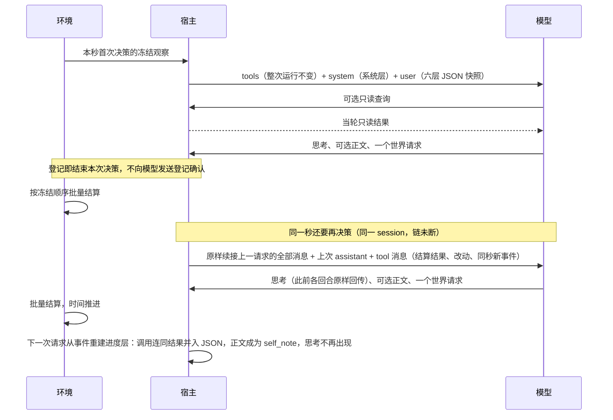

# 特性规格：决策上下文与工具结果

> 状态：FROZEN；2026-09-20 根据当前调用链、独立审查与官方协议裁决；2026-09-27 按人物 Prompt 规格修订（[人物 Prompt 规格](SPEC-persona-prompt.md)「冻结条款修订」第 2–7、14、27 行），修订部分已实现并通过离线验收（证据见[人物 Prompt 验收记录](persona-prompt-verification.md)）；2026-09-29 按[一日运行保真规格](SPEC-dayrun-fidelity.md#冻结条款修订)修订（「冻结条款修订」第 10、11、14 行与其 3.5：按名调用、指名购买口径与公开结果键），修订部分已实现并通过离线验收。
> 范围：人物每次决策所见、动作登记与结算结果的通道、同秒续接与只读路径、七层归属和预算。
> 本规格的所有实现与验收属于本次开发，不设延期项。全项目十二周实验等既有验收另按原规格执行。

> 2026-10-01 按[工具交互规格](SPEC-tool-interaction.md)修订当前工具请求、查询与错误合同；本次设计已冻结，生产代码已实现，旧验收证据不覆盖新增条款。
> 本特性首次受影响的发布升级为场景 4、地图 3、目录 5.0、品类与规则绑定 3，世界结构仍为 8。各阶段独立发布；后续格式或内容再次变化时另升相应版本，禁止同目录版本覆盖内容。

> 2026-10-02 按[个人事务与工作安排规格](SPEC-errands-workday.md#冻结条款修订)修订：任务回看经环境 actor 转发的执行位置，同秒续接 `events` 的口径，公开结果 `details.errands`，`query_world` 六键与返回精简；修订部分未实现，见个人事务与工作安排规格阶段 1（只读查询转发）、阶段 2（个人事务）、阶段 4（查询）。

## 心智模型

人物每次决策选择一个世界请求，决策就是这次工具调用，回复正文可有可无。环境等本轮人物都提交后统一结算。
同一秒接着决策时，人物从续接的 tool 消息得知上次请求的结果，并保留刚才的思考；时间一旦推进，结果写进进度层，旧的思考不再出现。
查询本轮世界信息、回看任务与查询自己的记忆可以立即得到答案；登记成功不代表事情成功。

一次决策只有一个行动阶段：可以先做只读查询，也可能有协议纠错回合，世界请求登记即结束本次决策。
每次实际请求都计入同一回合预算。世界时间、批量结算及世界写入权仍由环境独占。

## 权威来源与裁决

字段、消息模板和预算的唯一来源是 [接口合同](../CONTRACTS.md#观察投影字段)。
七层请求、单一行动阶段、回复正文与同秒续接的行为以[人物 Prompt 规格](SPEC-persona-prompt.md)为准，
决策、回复正文与思考见其[第二章](SPEC-persona-prompt.md#二决策回复正文与思考)；本规格保留动作登记、回执隔离、
公开结果字段与递归泄漏校验等约束，并定义此次行为变化及验收；人物其他行为沿用 [人物规格](SPEC-life-realism.md)，
环境其他行为沿用 [生活运行规格](SPEC-life-runtime.md)。
[研究记录](research/decision-context-feasibility.md)是裁决证据，不另立行为合同。

| 提案问题 | 冻结裁决 |
| --- | --- |
| 所有工具都异步 | 世界请求的结果延后；世界查询、任务回看与记忆查询立即返回，动作登记受理即结束本次决策 |
| 工作验收当轮回灌 | 验收可以在提交期间准备，但人物结果仍在批量结算后的下一次观察可见 |
| 动作前存在 finish | 生活决策无 finish；只读问答保留只读 finish |
| 句柄不进上下文意味着删 tool 消息 | 保留提供商要求的 tool_call_id 配对；清除消息正文中的内部登记回执。登记确认从不发给模型：登记后不追加 tool 消息；同秒续接时，对应该世界请求 `tool_call_id` 的 tool 消息是结算结果 |
| 所有上限同一种失败方式 | 展示选择、协议重试、提示硬预算分别遵循所属合同 |

## 地点发现与供给比较

地点发现与购买都是生活动作；模型在 `start_activity` 中提交目标的可读名称与方式，由方式唯一推导内部动词，世界请求登记即结束本次决策，
不向模型发送登记确认。结算结果通过 `action_result` 进入同秒续接的 tool 消息或此后的进度层，不能在同一次决策内同步读取新世界事实并再购买。
系统向模型展示实际返回供给及其报价、路线预计时间和费用；内部供给身份与报价版本由宿主绑定，
购买与出行使用冻结观察中的报价结算（指名购买本轮未列出的商品时按当前报价结算），不让模型猜价格、版本或精确秒数。

一次观察只冻结人物实际可见的比较事实；轮转与可见期只管展示与比较，不是购买资格的上限。
`obtain` 的目标不在本轮列出时按场景供给指名解析（[一日运行保真规格](SPEC-dayrun-fidelity.md) 3.2、3.3、3.5）：`from` 是可选约束
（`null`、地点显示名（含住处的「家」「住处」写法）或渠道称呼），分段匹配依次以 `SUPPLY_NOT_FOUND`（没有这件商品，附至多 3 个可照填的候选）、`SUPPLY_NOT_AT_STORE`、
`FULFILLMENT_NOT_SUPPORTED` 与 `ACTIVITY_PRECONDITION_UNMET` 业务拒绝；方式可写「购买」由系统定到店或远程下单，多于一个可服务的匹配时
按请求级 `prefer` 选定一家并写进 `details.notes`，不再以 `SUPPLY_NAME_AMBIGUOUS` 拒绝；不自动换成别的商品。其余动词的目标也可以直接写名称：
宿主与环境共用同一名称解析，无损归一后唯一即受理，否则以名称类错误给可照填的候选（该规格 3.1）。
道路状态、营业未知、公开供给库存、来源和假设说明是实际返回结果的一部分；全量库存和未接触结果不进提示。
菜单和阶段限制、原生工具配对、单动作、回合预算、结果回灌及只读人物查询边界保持原义。

## 同秒续接与只读路径

生活决策的请求由原生 `tools`、系统层 system 与六层 user 组成（[人物 Prompt 规格](SPEC-persona-prompt.md#一七层请求)第一章）。
system 整次运行逐字节不变；user 在每个时间点构造一次，同一行动阶段内动作前后逐字节相同。后续 assistant/tool 消息、
只读查询结果与协议纠错可以增加，不能据此重建世界观察。

同一人物在同一模拟秒、同一 session 内的相邻两次决策成链：决策 k+1 的消息是决策 k 末次请求的全部消息，
加上决策 k 的最终 assistant 消息（原样带 `reasoning_content`）与一条对应其世界请求 `tool_call_id` 的 tool 消息，链首快照 user 逐字节不变。
tool 消息是一个 JSON 对象 `{result, changes, events}`，空键省略：`result` 是该世界请求的公开结果，`changes` 是相对于模型当前所见的改动（含待办层 `errands` 的 `added` 与 `removed`：`added` 为新增或内容有变的完整行，`removed` 为名称；键闭集见接口合同「工具返回通道」），
`events` 是上一决策的观察之后同秒发生、且不是本结果的进度层事件（不含调用记录，也不含由截止时刻与当日目标提醒时刻推导、没有来源事件的 `task_deadline`、`plan_reminder`；个人事务的 `errand_reminder`、`errand_completed` 由人物可见的事件派生，有来源事件，属于这里的同秒事件；同一条只在一条 tool 消息中出现）。续接缓冲由环境从模型证据重建，在观察事件提交后经观察返回体的私有键交给宿主，
不另存、不导出。两次决策之间有反事实干预、此前某个 assistant 回合缺 `reasoning_content`、上一决策不是以恰好一个世界请求结束，
或时间推进、session 切换、开关 `same_second_continuation` 关闭、模型证据或上一世界请求的结果记录缺失时断链，下一次请求从新快照构造，
进度层写到此刻，此前的思考不再出现。普通恢复可以续接；反事实分支在分支起点一律断链，分支内此后同一秒的相邻决策照常成链。

一次决策只向环境读取一次观察，续接时也是如此；轮内各人物读取批量结算前的同一世界版本。
动作登记和独立工作验收不得提前改变任何人物下一次观察中的世界事实。
可提交的动作先受冻结观察中的有效交互菜单约束；同刻阶段、待收尾与准入条件只由工具层 `available`、`reason` 标注，
原生 `tools` 整次运行不变（只剩最后一个回合时与输出截断后的那次重试时去掉全部查询工具，后者见一日运行保真规格 7.2）。同一行动阶段不因纠错或只读查询重算菜单；地点变化后的新菜单只在下一次观察生效。
当日目标由零点计划生成，不开放 `plan_day`；世界请求登记后决策结束。

只读提问的 system 为只读系统层，user 为人设层与记忆层两个对象组成的 JSON 数组，外部问题作为其后一条 user 消息原样给出；
两层取自最近一次生活决策保存在人物工作区的快照，运行开始后尚无决策时记忆层的两个列表都为空。
仅开放预算允许的 `memory_recent`、`memory_search`、`memory_time_range` 与只读 finish，不写生活世界或人物记忆。
只读与生活决策的人设层同源，卡片派生字段遵守相同汉字上限。

## 登记确认与结算结果

生活动作返回宿主的 `ActionReceipt` 继续完整保存和校验，用于审计与幂等；世界请求登记后不向模型追加任何 tool 消息，
同秒续接时对应该请求的 tool 消息只含公开结算结果、改动与同秒事件，不包含回执的 `request_sha256`、`run_id`、`round_id`、
`decision_id`、`agent_id`、`action_id` 或 `status=submitted` 字段，也不得把登记说成动作已受理或完成。
提供商的 `tool_call_id` 必须原样保留，它不是世界身份。
记忆查询的结果只序列化一次，不再同时写入 observation 与 data 两处。
即时记忆查询返回持久主观自述并固定标明 epistemic_status=subjective；即时世界查询与任务回看只返回本轮冻结权限内的环境事实。
动作后的感受、打算或错误认识仍是主观自述，不能进入结构化已核验经历或客观完成指标。
记忆不带来源引用，来源由系统登记。

世界请求的公开结算结果在本 session 内一直留在进度层：`tool_call` 记录把调用、参数与公开结果合为一条，按事件顺序排列，
回复正文作为该调用的 `self_note`；同秒续接时结果先随 tool 消息返回，时间推进后从事件并入进度层。
session 结束后，结果按 `settled` 写法进入记忆层（[人物 Prompt 规格](SPEC-persona-prompt.md#三进度与记忆的更新)第三章）。
原始结果证据保持完整，模型只看到公开字段及可读对象名称；内部动作身份只供宿主关联，
不给模型任何调用编号，也不把 `action_id` 或其他内部索引当作模型选择任务的入口；工具调用的协议位置下标只用于精确错误定位，不属于世界身份。
公开结果字段为 `occurred_at`、`status`、`error_code`、`message` 与 `details`，工作结果另带公开 `work_review`；
`details` 只放本次新产生的可读事实（商品、份数、付款、送达地点与时刻、计划时长、进食的实际份量、终局 `outcome`、
近似候选 `candidates`；另有给予、到达、浏览得到的商品名、读完的邮件、已关联的订单与控制请求受理的个人事务回执 `errands`（`[{errand, change}]`，`errand` 为事务名称；
被拒结果没有该键；进度层的调用参数略去 `errands`，回执是它在本 session 内的名称引用），键闭集见接口合同「七层字段」），不复述参数。
按一日运行保真规格第四章，宿主纠错与环境拒绝共用一个错误结构（`error_code`、`reason`、`fix`、`items`、`unmet`）：`details` 在拒绝时另可含
`fix` 与逐项明细 `items[]`（每项含完整 `path`、`allowed_values`、英文 `expected`、英文 `why` 与至多三个完整 `{tool, arguments, note}` 候选），受理时另可含归一结果 `resolved` 与说明 `notes`；英文 `message` 直接取同源英文 `reason`。
这些新键同样只写可读事实，不含内部身份，照常经递归泄漏校验。
存在工作验收反馈时，另保留 `work_review`，只使用现有 `public_work_review` 的公开字段，
包括通过与否、缺项、逐项判断、可公开原文片段与理由。
没有工作验收时不制造该字段。不复制原始 `result` 或 `data` 整棵树。
两类逐项理由均不得含任何内部参考身份或 SHA-256 摘要。评审解析阶段确定性拒绝此类输出，
复用既有评审纠错次数与原始证据保存路径；公开投影入口也必须验证，防止绕过解析器。
生成要求明确只用公开内容品类说明理由；不截短理由，不生成替代理由。

内部参考身份、答案对象、哈希、资源账户、数值身体状态、完整活动快照不得通过结果重新泄漏。
公开结果字段为第一道防线，递归渲染校验为第二道防线；`expected` 的禁键只限评估证据路径，不能阻止错误合同 `items[].expected` 进入提示。结果不再只在「上次发送以来」的下一次请求中回灌一次：
本 session 内每次请求的进度层都含已有的全部结果，结果游标删除。
进度层接近上下文容量时按「预算与失败」浓缩；不删除或改写权威事件。

### 即时查询、操作备忘与紧凑结果

`query_world(name, way, category, from, available_only, offset)`、`recall_task_summary` 与三个记忆查询可以同批；查询不登记世界请求、不结束决策、
不推进时间、不计同刻轮数，实际模型回复仍占用 `MAX_REACT_TURNS=16`。世界请求与查询混批时所有调用均未执行。

执行位置：`query_world` 由宿主在本次冻结观察上本地求值；`recall_task_summary` 经 `LifeEnvProxy.read_query` 送到单写入的环境 actor
（`LifeEnvActor`，`max_concurrency=1`）并等待结果对象，环境按决策身份取本决策唯一一条已提交观察应答，不写事件、不改世界版本与时钟、
不计同刻轮数，也不构成第二次观察。回看的业务拒绝以错误结构作为返回值；工具与请求类型不符、找不到唯一观察是协议违约。
`LifeEnv.read_query` 的 `query_world` 分支是同一组纯函数的第二入口：受理时两入口结果逐值相等，拒绝时两入口给出同一份校验报告
（个人事务与工作安排规格 1.2、5.6）。

`query_world` 的 `name`、`way`、`category`、`from`、`available_only`、`offset` 六键均必填、无缺省，旧四键请求按缺字段拒绝；
前四键为 `str|null`，至少一个非 null 且非 null 不得为空白，四者全空时在四个位置各报一条；`available_only` 为严格 JSON 布尔，不单独构成查询条件。
`way` 取现有方式闭集，写「购买」等同于同时写「到店」与「远程下单」；`category` 匹配公开 `callable_index` 的类别标签；
`from` 写地点显示名或渠道称呼，与购买请求共用同一来源解析，只匹配供给条目；`offset` 是严格非负 JSON 整数（拒绝布尔值、数字字符串及浮点数），首批显式写 `0`。
`prefer` 的错误枚举按已合法的方式判定：含购买项返回 `["最快拿到", "到手价最低"]`，没有购买项返回 `[null]`；
方式尚不能判定时返回声明的三值类型闭集并说明跨字段条件，不猜后续依赖条件。
`query_world` 固定返回 `{matches, total_count, next_offset}`，不新增说明键；`matches` 每项是冻结目标的无损紧凑投影，只含权限内公开能力事实，
只省略 `null` 与空集合，不再逐项附完整请求候选（候选只出现在错误合同里）；
每批沿用现有 `candidate_presentation_limit=20`；筛选先于排序与切页，`total_count` 为全部筛选交集后的完整匹配数，`next_offset` 必填，剩余结果的下一偏移或 `null`，可遍历筛选后的全集；
除来源认不出、渠道称呼误写进 `name` 这两种参数错误（个人事务与工作安排规格 5.5）外，任何筛选组合无匹配时返回 `matches=[]`、`total_count=0`、`next_offset=null`，
不报错、不自动放宽、不换来源。
世界查询只使用本轮冻结观察权限，不能提前得知浏览揭示、未读邮件正文或未知世界库存；
外部只读问答仍只开放人物记忆与 `finish`，不能调用世界查询。
当天 `rejected_today` 从本人已持久化的 `protocol_feedback` 与非重放业务拒绝确定性推导，跨会话保留，
每条恰为 `{written, why, times, last, accepted_as}`，至多八条、每条英文 `why` 至多六十字符；不新增检查点状态、不迁入人物记忆，跨本地日期清空。
公开工具层为 `{layer, groups, callable_index}`，每组为 `{kind, action, way, shared, targets}`；
控制对象 `action/way` 为 `null`，冻结观察仍保留 `targets`。解组逐值恢复全部公开信息，元信息冲突为渲染错误；
只省略 `null` 或空集合，保留 `false`、零值与未知原因。
紧凑工具层和 `changes` 的分组编码必须无损且确定性，`changes.rejected_today` 对备忘整体替换；
链首 user 字节稳定、单次冻结观察、完整证据与容量上界保持原合同。

## 七层归属

原 `scene` 与 `facts` 的各项内容按唯一出现原则分入七层，归属见[人物 Prompt 规格「唯一出现原则」](SPEC-persona-prompt.md#唯一出现原则)。
邮件到达不公开正文；正文须经阅读活动结算后才可知，阅读结果保留实际所读正文，仅不重复任务合同时间、地点或验收答案。

## 预算与失败

发送每一次实际模型请求前，以所用模型的上下文窗口计算整次请求的 token 占用：原生 `tools`、系统层、六层 JSON、
续接消息（含回传的 `reasoning_content`）与预留输出。达到窗口的百分之八十五时依次：先提前结束本秒续接，本次请求改为从新快照构造；
再从旧到新去掉未受保护记录的 `self_note`；再把最旧一段未受保护、已有结果的记录折成一条 `condensed` 记录；每步之后重新计数。
始终完整保留工具层的进行中与刚结束活动、待办层的暂停活动、未了结订单相关的记录与上次请求之后的新记录；
工具层、人设层、待办层与环境层不浓缩，记忆层只受自身 8000 字符窗口约束；不改写权威会话、事件与结算记录，不静默删减。
仍达阈值或超出输入额度时按容量故障停止，按系统层、工具定义、各 user 层、续接消息、预留输出分层记录 token 用量与英文错误日志。
生活与只读各入口均执行相同发送前检查。材料揭示与商品可见期遵循原合同，不能与提示容量混为一谈。

## 文件修改清单

| 责任 | 生产文件 | 验证文件 |
| --- | --- | --- |
| 人物循环与消息 | `custom/agents/life_agent.py`、`custom/agents/life_context.py`，新增 `custom/agents/life_prompt.py`、`custom/agents/life_continuation.py`；AS2 锁定提交不改 | `tests/integration/test_life_agent_protocol.py`、`tests/integration/test_decision_context_protocol.py`，新增 `tests/integration/test_same_second_continuation.py` |
| 七层与结果 | 新增 `src/worldmock/life/tool_layer.py`、`todo_layer.py`、`environment_layer.py`、`progress_layer.py`、`prompt_schemas.py`、`continuation.py`；`projection.py`、`observe.py`、`narration.py`、`result_projection.py`、`prompt_capacity.py` | `tests/life/test_decision_context_projection.py`，新增 `tests/life/test_tool_layer.py`、`test_progress_events.py`、`test_prompt_layers.py` |
| 决策证据与下游 | `life/decision_start.py`、`life/engine.py`、`footprints/models.py`、`footprints/quality.py`、`footprints/store.py`、`runtime.py`、`validation.py`、`delivery/windows.py`、`evaluation/behavior_metrics.py` | 事件字段、运行清单、足迹质量、观察重复门禁与 delivery 窗口测试 |
| 规范一致性 | `CONTRACTS.md`、相关 `SPEC-*.md`、`INDEX.md`、`VERIFICATION.md`、实现状态、覆盖追溯、模拟／记录／交付设计 | 文档链接与锚点、条款到测试的双向核对 |

逐文件的改动见[实施计划「文件修改清单」](research/persona-prompt-implementation-plan.md#文件修改清单)。
新增模块只为拆分独立职责或满足生产文件长度限制，不增加框架或依赖。

## 验收台账

每行必须有实际运行证据；纯结构匹配不能替代真实请求或环境结算路径。

| 要求 | 必须通过的观察 |
| --- | --- |
| 单一行动阶段 | 没有只读查询或协议纠错的决策恰好一次模型请求，参数符合生成参数表；不产生自述请求；`decision_started` 与首个行动请求同批且在前，`data` 为闭集；新建、打开、恢复、从工作区加载与校验五个入口拒绝含 `decision_statement` 的清单 |
| 句柄隔离 | 登记后不追加 tool 消息；实际后续模型请求没有登记字段及其值；宿主证据仍可追踪；tool_call_id 和 reasoning_content 完整 |
| 即时查询 | 全部只读查询结果当轮可用且只序列化一次，没有被当成登记句柄清除 |
| 单一观察与批量结算 | 原生 runner 每人每次决策观察一次，续接时也是如此；多人提交不提前可见；工作验收结果不提前回流 |
| 同秒续接 | 第二次决策的前缀等于上一决策末次请求的消息，assistant 原样带思考，tool 消息含 `result`、`changes`、`events` 且不含登记确认与内部身份，链首 user 字节不变；时间推进后请求中没有原生 assistant/tool 回合、上一秒的思考原文不出现；出发后同秒、反事实分支、缺思考、证据缺失时断链；从中秒检查点普通恢复与不中断运行一致 |
| 只读 | system 为只读系统层，user 为工作区快照中的人设层与记忆层，外部问题单列；无世界写入；记忆查询与只读 finish 可用 |
| 完整结果 | 结果在整个 session 保留、有序、无重复；失败原因及工作公开反馈进入进度层，私有字段不进入；session 结束后按 `settled` 写法进入记忆层 |
| 七层归属与指名购买 | 请求中没有 `scene`、`facts`；邮件正文只在阅读结果中；被轮转隐藏但存在的商品按名称可买并按当前报价结算，不存在时给至多 3 个近似候选且不替换，多店同名时报歧义（该项已被一日运行保真规格改为多于一家可服务时按 `prefer` 选定，按其验收台账「指名购买」「购买渠道」验证） |
| 所有预算 | 阈值时先断链，再依次去 `self_note`、折叠为 `condensed`；受保护项完整保留；仍超限时容量故障并分层记日志；不静默裁剪 |
| 文档一致 | 字段、行为、预算、工具时序和状态无矛盾；现行规范链接与锚点均解析成功 |
| 工程与突变门禁 | 相关测试、全量根测试、AS2 相关门禁、源码风格、覆盖率门禁及独立语义突变审查通过 |

2026-09-20 版本逐项实现与实际通过的证据见 [验收记录](research/decision-context-verification.md)，
包含完整 Git 修改清单、固定源码身份和两份独立源码突变报告；按人物 Prompt 规格修订的各行另以
[该规格「验收台账」](SPEC-persona-prompt.md#验收台账)为准。

## 版本表

以下记录保留当时的变更与验证证据；当前接口约束以正文和工具交互规格为准。

| 版本 | 日期 | 修订内容 |
| --- | --- | --- |
| 1 | 2026-09-20 | 将提案裁决为可实现合同；修正调用次数与工具时序，明确无兼容改名、无损公开结果、场景与预算边界 |
| 2 | 2026-09-20 | 独立审查补全公开理由的文本边界、全部恢复入口的阶段身份验证和原生 runner 单次观察断言 |
| 3 | 2026-09-20 | 对齐交互菜单作为冻结观察中的基础准入约束，保留日首计划、单动作阶段和只读路径 |
| `2026-09-24-time-and-energy` | 2026-09-24 | 按[时间与能量规格](SPEC-time-and-energy.md)「冻结条款修订」第 23 行修订：一轮决策为自述加一个世界请求，登记即结束，生活决策无 finish，只读问答保留只读 finish；动作写为动词与方式；删日首 `plan_day` 与来源引用句，当日目标由零点计划生成；进度层改为活动客观进度并按会话浓缩已收尾活动；饿时吃饭途径句是场景只保留名称与营业状态的例外。补记未入表的就地改动：2d97d3d（新增「当日目标边界」）、d998a31（自述输入含本轮已核验经历与主观记忆，记忆查询标明主观，来源引用句）、2913546（`start_activity` 可读名称与宿主绑定报价，`facts.progress.results` 公开结果字段与进度浓缩，邮件以可读名称选择，发送前整次 token 计数与 85% 浓缩） |
| `2026-09-27-persona-prompt` | 2026-09-27 | 按[人物 Prompt 规格](SPEC-persona-prompt.md)「冻结条款修订」第 2–7、14、27 行修订，修订部分待实现（人物 Prompt 台账 DC1–DC7）。理由：决策自述阶段删除后，一次决策只有一个行动阶段，决策就是所选的世界请求；请求改为七层，`scene`、`facts` 退出；同秒续接改变了结果回到模型的通道。改动：文件头与范围；「心智模型」删自述节点与「两次请求」，时序改为同秒续接；「权威来源与裁决」删「第一次、第二次等于两次调用」「收件箱只有三条」「改名零风险」三行，句柄一行注明登记确认从不发给模型、续接时 tool 消息是结算结果，并指向人物 Prompt 规格第二章；「唯一命名」整节删除（原 :62 的 1.3 与 400 与合同和代码不符，一并消除）；「地点发现与供给比较」按指名购买改写，登记后不发送登记确认；「上下文与阶段相互独立」改名为「同秒续接与只读路径」，写续接链、tool 消息 `{result, changes, events}`、续接缓冲来源与断链条件，只读路径改为只读系统层、人设层与记忆层快照和外部问题；「登记确认与结算结果」保留回执隔离、`tool_call_id`、公开结果字段与递归泄漏校验，结果在本 session 内留在进度层、session 结束后进入记忆层，删结果游标；「场景信息」改为「七层归属」，只留邮件正文须阅读后可知一句；「预算与失败」按人物 Prompt 规格第四章；文件修改清单与验收台账改写并指向人物 Prompt 规格 |
| `2026-09-28-persona-prompt-implemented` | 2026-09-28 | 人物 Prompt 七层规格实现后文档（人物 Prompt 台账阶段 8，按最终代码 `f798ea7` 核对）：状态头改为修订部分已实现并通过离线验收；续接 tool 消息的 `events` 改为上一决策观察之后的新记录（不含调用与推导记录，同一条只出现一次），断链条件补开关关闭、模型证据或上一结果记录缺失，反事实分支在分支起点断链；原生 `tools` 注明最后一个回合去掉记忆查询工具；`details` 指向接口合同的键闭集 |
| `2026-09-29-dayrun-fidelity` | 2026-09-29 | 按[一日运行保真规格](SPEC-dayrun-fidelity.md#冻结条款修订)「冻结条款修订」第 10、11、14 行与其 3.5 修订（一日运行保真 DC1，随该规格冻结）：「地点发现与供给比较」的指名购买改为 `from` 可选约束、分段匹配、方式「购买」与按 `prefer` 选定，不再报 `SUPPLY_NAME_AMBIGUOUS`，其余动词也按名调用（归一唯一即受理，否则给候选）；「登记确认与结算结果」补统一错误结构、`details` 的 `fix`、`items`、`resolved`、`notes` 与 `message` 取 `reason`，新键照常经递归泄漏校验；验收台账「七层归属与指名购买」行注明歧义一项被修订；文件头补修订说明 |
| `2026-09-29-dayrun-fidelity-implemented` | 2026-09-29 | 一日运行保真规格实现后（按 `e377669` 的代码核对）：文件头改为修订部分（按名调用、指名购买的 `from` 约束、分段匹配、方式「购买」与按 `prefer` 选定、公开结果键与统一错误结构）已实现并通过离线验收；「同秒续接与只读路径」原生 `tools` 的例外补输出截断后的那次重试同样去掉记忆查询工具（该规格 7.2，冻结时漏改）；验收台账不改 |
| `2026-10-01-tool-interaction` | 2026-10-01 | 按工具交互规格直接修订当前条款：逐项对象请求、方式推导、严格中文购买枚举与完整错误定位、即时只读查询、当天操作备忘及紧凑呈现；合同已实现，验收证据另列，历史验收不证明新增功能。 |
| `2026-10-01-tool-interaction-review` | 2026-10-01 | 按附件复核定稿：开始活动改逐项对象、购买偏好用精确中文枚举且非购买为 null、to=null 统一本人、查询四键与二十项分页；合同已实现，验收证据另列，错误语言仍待澄清且暂维持英文。 |
| `2026-10-02-errands-workday` | 2026-10-02 | 按[个人事务与工作安排规格](SPEC-errands-workday.md#冻结条款修订)修订，修订部分未实现，见个人事务与工作安排规格阶段 1（只读查询转发）、阶段 2（个人事务）、阶段 4（查询）（逐条作业见[实施计划](research/errands-workday-implementation-plan.md)的文档同步作业 DC1–DC7）。改动：文件头；「同秒续接与只读路径」写明 `changes` 含待办层个人事务的增改删、`events` 只排除没有来源事件的推导记录；「登记确认与结算结果」`details` 增个人事务回执 `errands`；「即时查询、操作备忘与紧凑结果」写明 `query_world` 本地求值与 `recall_task_summary` 经环境 actor 转发的执行位置，`query_world` 改六键、筛选先于切页、返回不再逐项附候选、两种参数错误之外无匹配为合法空页。顺带更正既有漂移：把落在「当日目标边界」之后的两条 2026-10-01 版本行移回本表 |
| `2026-10-03-errands-workday-source` | 2026-10-03 | 随个人事务与工作安排规格阶段 4 更正既有漂移：购买来源的合法写法为地点显示名（含住处）与渠道称呼（个人事务与工作安排规格 5.2，实施计划 DC10）。「地点发现与供给比较」指名购买句的 `from` 由「门店名」改为地点显示名（含住处的「家」「住处」写法），依据现行 `purchase_offers.source_scope`；分段匹配各句不改，行为不变 |

## 当日目标边界

当日目标由零点计划生成，人物只可修订未推进目标及其提醒，遵循 [当日目标规格](SPEC-day-plan-goals.md)；
实际进展只来自已结算活动。
