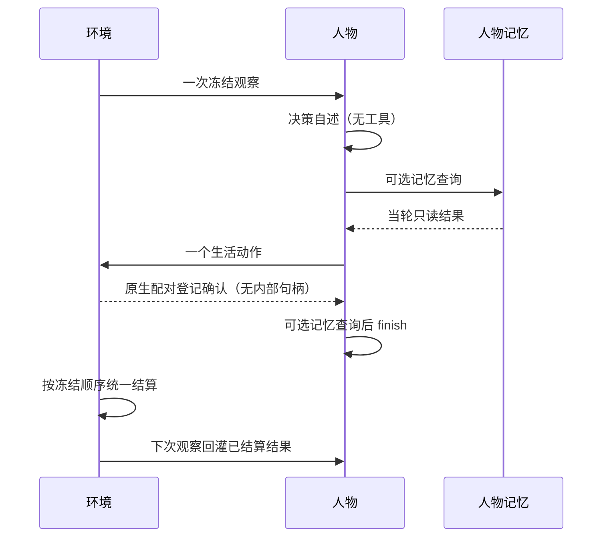

# 特性规格：决策上下文与工具结果

> 状态：FROZEN；2026-09-20 根据当前调用链、独立审查与官方协议裁决。
> 范围：人物每次决策所见、决策自述命名、动作登记与结算结果的通道、场景信息和预算。
> 本规格的所有实现与验收属于本次开发，不设延期项。全项目十二周实验等既有验收另按原规格执行。

## 心智模型

人物先说出此刻的感受与打算，再通过工具提交一件事。环境等本轮人物都提交后统一结算，
人物在下一次决策知道结果。查询自己的记忆可以立即得到答案；登记成功不代表事情成功。

两阶段指决策自述和行动循环，不是固定两次模型请求。正常无查询、无纠错时需要自述、动作、
finish 三次请求。每次实际请求都计入同一回合预算。世界时间、批量结算及世界写入权仍由环境独占。

## 权威来源与裁决

字段、消息模板和预算的唯一来源是 [接口合同](../CONTRACTS.md#观察投影字段)。
本规格定义此次行为变化及验收；人物其他行为沿用 [人物规格](SPEC-life-realism.md)，
环境其他行为沿用 [生活运行规格](SPEC-life-runtime.md)。
[研究记录](research/decision-context-feasibility.md)是裁决证据，不另立行为合同。

| 提案问题 | 冻结裁决 |
| --- | --- |
| 所有工具都异步 | 只有生活动作的世界结果延后；记忆查询立即返回，finish 结束本次人物决策 |
| 工作验收当轮回灌 | 验收可以在提交期间准备，但人物结果仍在批量结算后的下一次观察可见 |
| 第一次、第二次等于两次调用 | 自述一次成功调用后进入可多回合的行动循环，失败自述最多重试一次 |
| 动作前存在 finish | 动作前没有 finish；动作后撤下生活动作，只保留预算允许的记忆查询及 finish |
| 句柄不进上下文意味着删 tool 消息 | 保留提供商要求的 tool_call_id 配对；清除消息正文中的内部登记回执 |
| 收件箱只有三条 | 完整事实清单无此限制；场景只概括最近三条，并提示未展示的未读消息 |
| 改名零风险 | 名称贯穿调用钩子、事件、运行清单、质量报告与交付；整体改名，不保留旧接口 |
| 所有上限同一种失败方式 | 展示选择、协议重试、提示硬预算分别遵循所属合同 |

## 唯一命名

第一阶段统一称「决策自述」，英文统一使用 `decision_statement`。
替换原阶段名、字段、函数、常量、测试名称和当前规范措辞，不新增别名、迁移或兼容读取。
`thinking` 只表示提供商生成参数，`reasoning_content` 保持提供商原生字段名。

事件为 `decision_started.data.decision_statement`；运行清单阶段为 `decision_statement`；
质量计数为 `decision_started_with_decision_statement` 与 `decision_started_missing_decision_statement`。
AS2 调用钩子同步更名，生产路径不得调用旧钩子。
新建、打开既有运行、恢复和从工作区加载均校验当前阶段身份；含旧阶段名称的清单必须拒绝。
显式不使用模型身份的引擎直驱测试路径沿用既有合同，不为生产运行生成替代身份。

决策自述请求显式要求一至三句第一人称中文、表达此刻感受和打算、最多二百汉字。
确定性协议校验非空和汉字上限；第一人称与句意是生成要求，不引入语义分类器冒充确定性校验。
参数仍为 `thinking=disabled`、`temperature=1.3`、`max_tokens=400`，不带工具。
协议失败消耗实际回合，最多重试一次；传输或证据保存故障直接失败并留英文错误日志。
引擎直驱测试路径没有模型自述时，仍写一次不含该可选字段的决策事件，不生成替代自述。

## 上下文与阶段相互独立

同一构造路径按是否包含事实清单决定 user 内容；生活动作是否开放只由行动阶段决定。
自述输入是人物卡片、场景和记忆；行动初始 user 再加入事实清单与已产生的决策自述。
同一行动循环只构造一次初始 user，动作前后逐字节相同。后续 assistant/tool 消息、记忆查询结果、
协议纠错和 system 回合预算可以增加或改变，不能据此重建世界观察。

一次决策只向环境读取一次观察；轮内各人物读取批量结算前的同一世界版本。
动作登记和独立工作验收不得提前改变任何人物下一次观察中的世界事实。
日首且当日无计划仍先开放 `plan_day`；工具身份枚举、可见引用与预算收窄规则保持有效。

只读提问不运行决策自述，不读取场景和事实清单，只携带人物卡片、持久记忆及外部问题。
仅开放预算允许的记忆查询和只读 finish，不写生活世界或人物记忆。
只读人物卡与生活人物卡遵守相同汉字上限。

## 登记确认与结算结果

生活动作返回宿主的 `ActionReceipt` 继续完整保存和校验，用于审计与幂等；进入模型的对应
tool 消息只有固定的登记确认语义，不包含其 `request_sha256`、`run_id`、`round_id`、
`decision_id`、`agent_id`、`action_id` 或 `status=submitted` 字段，也不得声称动作已受理或完成。
提供商的 `tool_call_id` 必须原样保留，它不是世界身份。
不能只清 observation 而留下 data，因为 AS2 会把两者都写入模型消息。
即时记忆查询仍返回真实查询内容。动作后的记忆只能记录观察与意图，不能虚构尚未结算的成功结果。

下一次观察的 `facts.recent_action_results` 包含该人物上次观察以后所有 agent 可见结算结果，
按事件顺序排列，不再以五条上限静默丢弃。原始证据保持完整，提示使用显式公开字段投影。
共同字段保留 `action_id`、`occurred_at`、`status`、`error_code`、`message`；
这里的动作身份用于关联已经发生的结果，不是复制登记回执。
存在工作验收反馈时，另保留 `work_review`，只使用现有 `public_work_review` 的公开字段，
包括通过与否、缺项、逐项判断、可公开原文片段与理由。
没有工作验收时不制造该字段。不复制原始 `result` 或 `data` 整棵树。
两类逐项理由均不得含任何内部参考身份或 SHA-256 摘要。评审解析阶段确定性拒绝此类输出，
复用既有评审纠错次数与原始证据保存路径；公开投影入口也必须验证，防止绕过解析器。
生成要求明确只用公开内容品类说明理由；不截短理由，不生成替代理由。

内部参考身份、答案对象、哈希、资源账户、数值身体状态、完整活动快照不得通过结果重新泄漏。
公开结果字段为第一道防线，递归渲染校验为第二道防线。场景仅概括最近一条结果，
完整公开结果进入事实清单。结果仅在下一次观察回灌一次；观察后无新结果时该列表为空。
若全量公开结果导致 user 超出预算，明确失败，不删旧结果、不截短错误原因。

## 场景信息

场景可达地点保留地点名称与营业状态，不再重复路线分钟数；分钟数仍由事实清单与工具支持行提供。
地点名是营业状态的对象，不能为了去重删除；自述阶段没有工具，仍需要可理解的场景。

暂停活动使用自然中文描述「之前做到一半的……还没收尾」，保留活动标题与已完成进度。
待办继续单独描述尚未完成的工作合同，包含已经开始但仍欠工时的合同，不等同于未开始任务。

场景收件头选择按 `created_at`、`id` 稳定排序后的最近三条，展示顺序保持时间先后。
`inbox_has_older_unread` 表示未展示集合是否存在未读项；仅为真时增加「更早还有未读消息」。
事实清单继续保留完整可见收件箱与 read 状态；邮件正文仍须经阅读活动结算后才可知。
阅读工具描述明确使用 `facts.inbox` 中 `kind=mail` 的 `id` 启动 `read_mail`，不能引用不存在的提示字段。

## 预算与失败

user 四万字符、最终 system 三千字符、场景八百汉字、人物卡六百汉字，等于上限允许，
超出明确报错并记录英文错误日志；system 上限必须在附加本次预算块后检查。
生活、只读、自述和行动各入口均执行对应预算。不截断、不自动移除段落。
收件头三条是公开展示选择，材料揭示与商品可见期继续遵循原合同，不能与提示超限混为一谈。

## 文件修改清单

| 责任 | 生产文件 | 验证文件 |
| --- | --- | --- |
| 人物循环与消息 | `custom/agents/life_agent.py`、`custom/agents/life_context.py`；AS2 `agent/base/agent_runtime.py` | `tests/integration/test_life_agent_protocol.py`、新增决策上下文协议测试与真实跨轮测试；AS2 钩子测试 |
| 场景与结果 | `src/worldmock/life/projection.py`、`observe.py`、`narration.py`、`models.py`、`result_projection.py`、`work_review.py` | `tests/life/test_narration.py`、工作验收、轮次、反馈与新增投影合同测试 |
| 决策证据与下游 | `life/decision_start.py`、`life/engine.py`、`footprints/models.py`、`footprints/quality.py`、`runtime.py`、`validation.py`、`delivery/windows.py`、`evaluation/behavior_metrics.py` | 事件字段、运行清单、足迹质量与 delivery 窗口测试 |
| 规范一致性 | `CONTRACTS.md`、相关 `SPEC-*.md`、`INDEX.md`、`VERIFICATION.md`、实现状态、覆盖追溯、模拟／记录／交付设计 | 文档链接、命名残留、条款到测试的双向核对 |

具体变更以最终 Git diff 为准。新增模块只为拆分独立投影职责或满足生产文件长度限制，不增加框架或依赖。

## 验收台账

每行必须有实际运行证据；纯结构匹配不能替代真实请求或环境结算路径。

| 要求 | 必须通过的观察 |
| --- | --- |
| 唯一命名 | 调用钩子、事件、清单、质量与 dreaming 全链使用新名；旧接口无别名，旧清单不被接受 |
| 自述协议 | 请求含生成要求且不带 tools；正常、空、超长、一次重试、二次失败和传输失败符合合同 |
| 句柄隔离 | 实际后续模型请求没有登记字段及其值；宿主证据仍可追踪；tool_call_id 和 reasoning_content 完整 |
| 即时查询 | 记忆查询结果当轮可用，没有被当成登记句柄清除 |
| 单一观察与批量结算 | 原生 runner 每人每次决策观察一次；多人提交不提前可见；工作验收结果不提前回流 |
| 阶段正交 | 初始 user 不随动作提交变化；自述无 facts，行动有 facts；动作前无 finish、动作后无生活动作 |
| 只读 | 无自述、无场景事实、无世界写入；记忆查询与只读 finish 可用，人物卡预算不能绕过 |
| 完整结果 | 超过五条仍完整、有序、无重复；失败原因及工作公开反馈进入下次提示，私有字段不进入 |
| 场景 | 真实最近收件头、未展示未读提示、读邮件身份、独立待办与暂停活动、地点营业信息与分钟数归属正确 |
| 所有预算 | 各入口边界允许、超限失败；追加预算块后的 system 仍受限；不静默裁剪 |
| 文档一致 | 字段、行为、预算、工具时序和状态无矛盾；现行规范链接均解析成功 |
| 工程与突变门禁 | 相关测试、全量根测试、AS2 相关门禁、源码风格、覆盖率门禁及独立 Uncle Bob 审查通过 |

逐项实现与实际通过的证据见 [验收记录](research/decision-context-verification.md)，
包含完整 Git 修改清单、固定源码身份和两份独立源码突变报告。

## 版本表

| 版本 | 日期 | 修订内容 |
| --- | --- | --- |
| 1 | 2026-09-20 | 将提案裁决为可实现合同；修正调用次数与工具时序，明确无兼容改名、无损公开结果、场景与预算边界 |
| 2 | 2026-09-20 | 独立审查补全公开理由的文本边界、全部恢复入口的阶段身份验证和原生 runner 单次观察断言 |
