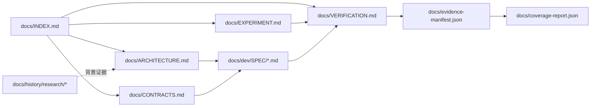
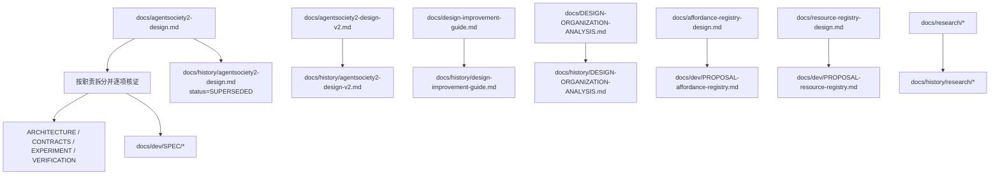

<!-- worldmock-doc: {"authority":"governance","canonical_path":"docs/dev/SPEC-document-governance.md","implementation_state":"NOT-COMPLETE","kind":"SPEC","owner":"WorldMock maintainers","replaces":[],"schema":"worldmock.document.metadata.v1","status":"FROZEN","superseded_by":null,"version":"2026-09-18"} -->

# WorldMock 文档治理规格

**Status: FROZEN**
**Implementation state: NOT-COMPLETE**
**Scope: 文档目录、权威关系、状态元数据、迁移、证据身份、验收门禁**
**Non-goals: 不扩大运行时范围；不修改运行时代码、数据格式或业务行为；不在本规格中实现可供性注册表或资源注册表；不删除历史文件；不建立旧路径重定向、转发文件或兼容适配层**
**Authority: 本文件是 WorldMock 文档治理的唯一规范；接口签名和字段合同仍只在 FROZEN `docs/CONTRACTS.md` 定义**
**Owner: WorldMock maintainers**

## 版本表

| 版本 | 日期 | 修订内容 |
| --- | --- | --- |
| `2026-09-18` | 2026-09-18 | 冻结文档职责、目录、迁移、状态、快照身份、四项协议门禁、机器验收和后续文件所有权。 |

## 结论与裁决

WorldMock 采用按职责拆分的文档集，不再把架构、接口、实验、验收和真实性合同继续放在一个权威单体中。现有 `docs/agentsociety2-design.md` 是迁移完成前的过渡权威，迁移完成后只保留在 `docs/history/` 作为不可引用的历史快照；迁移后的规范权威由根目录文档和 `docs/dev/SPEC/` 中的 FROZEN 特性规格组成。

以下裁决立即生效，并且不得被后续实现代理重新解释：

- `docs/CONTRACTS.md` 是所有接口签名、字段、枚举、文件格式和提示词模板的唯一权威；实现、测试和其他文档只能引用它。
- `docs/ARCHITECTURE.md` 记录系统 WHY、职责边界、算法选择和数据流；它不重新定义接口字段。
- `docs/EXPERIMENT.md` 记录实验身份、依赖、场景、时间窗、样本和外部参照；它不把实验结果写成行为合同。
- `docs/VERIFICATION.md` 记录验收条款、协议门禁、报告项、测试矩阵和证据要求；行为分布指标不得被写成放行条件，除非本 SPEC 明确将其列为协议门禁。
- `docs/dev/SPEC/` 记录已经裁决的特性行为和算法；`docs/dev/PROPOSAL/` 记录尚未冻结的提案；`docs/dev/ANALYSIS/` 记录分析，不拥有规范权威。
- `docs/history/` 和 `docs/history/research/` 只保存历史事实、失败原件、调研和被替代文档，不拥有当前规范权威。
- 当前实现状态仍为 `NOT-COMPLETE`。确定性代码和测试层已经完成，不等同于真实 DeepSeek 十二周运行、三次隔离盲评和完整自然日 LabelKit 交付完成。
- `behavior_metrics` 的协议门禁固定为四项。`plan_actual_deviation` 及所有未列入四项的行为指标均为 report-only，不参与放行，不反馈成行动脚本。
- `coverage-report.json` 是生成物，会被覆盖写入；每份报告必须携带并校验同一 `snapshot_id` 和 evidence manifest 身份，禁止把不同快照的 JSON、Markdown 或测试结果拼成一个结论。
- 两个注册表文档只在迁移后作为 `PROPOSAL` 索引项存在；本 SPEC 不冻结其 schema，不实现其运行时，不为其创建代码入口。

## 文档流与迁移流

### 文档流



### 迁移流



## 权威层级

权威按关注面分层；不同层不重复定义同一接口。发生冲突时，先按关注面选择权威文件，再以较高层级的冻结文本为准；代码和测试是执行证据，不是行为真值来源。

| 层级 | 权威文件 | 允许定义的内容 | 明确禁止 |
| --- | --- | --- | --- |
| 治理 | 本文件 | 目录、状态、迁移、快照身份、治理门禁 | 定义运行时接口或业务算法 |
| 接口 | `docs/CONTRACTS.md` | 函数签名、类型、字段、枚举、文件格式、提示词模板 | 解释 WHY；在其他文件复制接口定义 |
| 架构与算法 | `docs/ARCHITECTURE.md`、`docs/dev/SPEC/*.md` | WHY、职责边界、算法和当前特性行为 | 另造接口版本；把实验结果当合同 |
| 实验 | `docs/EXPERIMENT.md` | 依赖、场景、时间窗、采样、外部参照、实验身份 | 宣称未完成真实验收已经完成 |
| 验收 | `docs/VERIFICATION.md` | 测试矩阵、门禁、报告项、证据和结论边界 | 把 report-only 项变成放行条件 |
| 状态与证据 | `docs/implementation-status.md`、`docs/evidence-manifest.json`、生成的报告 | 当前实现状态、快照、原始证据索引 | 改写 FROZEN 合同或省略未完成真实验收 |
| 历史与调研 | `docs/history/**` | 来源、失败、被替代设计、行业背景 | 作为当前实现依据或规范引用 |

迁移期间，`docs/agentsociety2-design.md` 仅作为未拆分内容的过渡权威；新的接口或特性不得继续写入该文件。迁移验收完成后，`docs/INDEX.md` 必须把它标为 `SUPERSEDED`，所有当前文档链接指向拆分后的目标文件。

## 状态集合

### 文档状态

`status` 只允许使用下列值：

- `FROZEN`：已裁决的当前规范，可作为实施依据。
- `PROPOSAL`：尚未冻结，只能作为待裁决输入。
- `DRAFT`：正在编辑的非权威文本，只能在其所属工作流内使用。
- `SUPERSEDED`：已由 `superseded_by` 指向的新文件替代，只能位于 `docs/history/` 或其子目录。
- `DEPRECATED`：仍保留但不应被新实现使用，必须有明确替代文件。
- `REMOVED`：只允许作为 `docs/INDEX.md` 的历史登记值，不创建空文件、不创建重定向。

### 实现状态

`implementation_state` 只允许使用 `COMPLETE`、`NOT-COMPLETE`、`UNVERIFIABLE`。它与 `status` 正交：本文件可以是 `FROZEN` 而实现状态仍是 `NOT-COMPLETE`。

- `COMPLETE` 只表示该文件声明的确定性实施项和所需证据均已通过门禁。
- `NOT-COMPLETE` 表示至少一个声明的实施或真实验收尚未完成；当前 WorldMock 的真实 DeepSeek 十二周、三次隔离盲评和完整自然日 LabelKit 交付必须保持此值。
- `UNVERIFIABLE` 表示证据不足以判定完成；不得向上改写成 `COMPLETE`。

状态元数据必须通过首行 JSON marker 表达，不使用行号作为身份。标准 marker 形状如下，键名和枚举值固定：

```text
<!-- worldmock-doc: {"authority":"...","canonical_path":"...","implementation_state":"...","kind":"...","owner":"...","replaces":[],"schema":"worldmock.document.metadata.v1","status":"...","superseded_by":null,"version":"..."} -->
```

`canonical_path` 必须是仓库相对 POSIX 路径；`superseded_by` 在 `SUPERSEDED` 或 `DEPRECATED` 时必须是相对路径，在其他状态为 `null`；`replaces` 必须是相对路径数组。文件名不得携带 `v1`、`v2` 或其他版本后缀，版本演进只写入版本表和 marker 的 `version`。

## 目标目录与职责

迁移后的唯一目标树如下：

```text
docs/
├── INDEX.md
├── ARCHITECTURE.md
├── CONTRACTS.md
├── EXPERIMENT.md
├── VERIFICATION.md
├── evidence-manifest.json
├── coverage-report.json
├── dev/
│   ├── SPEC-document-governance.md
│   ├── SPEC/
│   ├── PROPOSAL/
│   └── ANALYSIS/
└── history/
    ├── research/
    └── ...
```

`docs/specs/`、`docs/spec/` 和任何平行特性规格目录均不是目标目录。`docs/dev/SPEC-document-governance.md` 是治理规格的固定路径例外；其他特性规格必须位于 `docs/dev/SPEC/`。

| 目标 | 职责 | 状态要求 |
| --- | --- | --- |
| `docs/INDEX.md` | Start-here 导航、权威层级索引、迁移映射 JSON、文件 owner、状态登记 | `FROZEN` |
| `docs/ARCHITECTURE.md` | WHY、系统分层、职责、数据流、算法裁决 | `FROZEN` |
| `docs/CONTRACTS.md` | 所有接口和数据合同的唯一来源 | `FROZEN` |
| `docs/EXPERIMENT.md` | 实验、依赖、场景、时间窗、快照输入和外部参照 | `FROZEN` |
| `docs/VERIFICATION.md` | 验收、四项协议门禁、report-only 边界、测试和证据规则 | `FROZEN` |
| `docs/dev/SPEC/*.md` | 已裁决的特性 WHY、算法和行为规格 | `FROZEN` 或 `DRAFT` |
| `docs/dev/PROPOSAL/*.md` | 未冻结的方案和待裁决问题 | `PROPOSAL` |
| `docs/dev/ANALYSIS/*.md` | 技术分析、审查和推导，不拥有规范权威 | `DRAFT` 或 `SUPERSEDED` |
| `docs/history/research/*` | 调研、失败原件、外部依据和历史验收材料 | `SUPERSEDED` 或 `DEPRECATED` |
| `docs/evidence-manifest.json` | 单次运行的规范、代码、依赖、场景和测试身份及证据索引 | 生成身份文件 |
| `docs/coverage-report.json` | 绑定快照身份的覆盖率生成物，每次覆盖写入 | 生成物，不是规范 |

## 精确迁移映射

### 主设计单体的职责映射

迁移以职责为单位，不按原文行号建立永久引用。下表中的“来源职责”必须完整出现于 `docs/INDEX.md` 的 `worldmock-migration` JSON marker 中；原文行号只可用于迁移时定位，不能成为新文档身份。

| 来源职责 | 当前权威来源 | 唯一目标 | 迁移规则 |
| --- | --- | --- | --- |
| 设计结论、目标、范围、整体数据流 | `docs/agentsociety2-design.md` | `docs/ARCHITECTURE.md` | 保留 WHY、边界和总流程；接口字段转交 CONTRACTS。 |
| AS2 选型、LifeEnv/LifeAgent 分层和改动理由 | 主设计单体 | `docs/ARCHITECTURE.md`、`docs/dev/SPEC/as2-integration.md` | WHY 进入 ARCHITECTURE；确定性行为和算法进入特性 SPEC。 |
| LifeEnv 状态归属、生命周期、工具和动作结果 | 主设计单体 | `docs/CONTRACTS.md`、`docs/dev/SPEC/life-runtime.md` | 类型、签名、枚举和结果字段只进 CONTRACTS；行为规则进 life-runtime。 |
| 资源、需求、活动结算、共享时钟、并发和加速 | 主设计单体 | `docs/dev/SPEC/life-runtime.md` | 只保留已裁决算法；接口引用 CONTRACTS，不复制字段定义。 |
| 语料进入环境、内容目录、工作反馈、导航和配送 | 主设计单体 | `docs/ARCHITECTURE.md`、`docs/dev/SPEC/life-runtime.md` | 数据流和选择理由进 ARCHITECTURE；准入和结算行为进 life-runtime。 |
| 数字足迹保存边界、事件结构、持久化、事务、检查点和恢复 | 主设计单体 | `docs/CONTRACTS.md`、`docs/dev/SPEC/footprints.md` | 事件/文件/恢复字段只进 CONTRACTS；一致性和算法进 footprints。 |
| LifeAgent 人格、记忆和 dreaming 边界 | 主设计单体 | `docs/CONTRACTS.md`、`docs/dev/SPEC/life-realism.md` | 可见字段和窗口格式进 CONTRACTS；边界和决策逻辑进 life-realism。 |
| LabelKit 输入范围、加工责任、来源关联、标签和交付格式 | 主设计单体 | `docs/CONTRACTS.md`、`docs/dev/SPEC/labelkit-delivery.md` | 数据合同唯一落 CONTRACTS；加工流程和验收行为落 labelkit-delivery。 |
| 一条完整生活经历的数据流 | 主设计单体 | `docs/ARCHITECTURE.md` | 只保留从人物决策到足迹、LabelKit 和交付的系统流。 |
| 实现组织和交付顺序 | 主设计单体 | `docs/INDEX.md`、`docs/VERIFICATION.md` | 文件 owner 进 INDEX；可验证顺序和门禁进 VERIFICATION。 |
| 验证矩阵、测试入口和覆盖口径 | 主设计单体 | `docs/VERIFICATION.md` | 转成机器可执行 TEST-MATRIX；不得只保留表格描述。 |
| 实验边界、依赖和外部参照 | 主设计单体 | `docs/EXPERIMENT.md` | 实验身份与样本绑定 evidence manifest。 |
| 依据、核对记录、独立审查依据 | 主设计单体 | `docs/history/research/*` | 作为历史来源保存；不作为当前合同。 |
| 实验与依赖、运行数据接口、场景绑定 | 主设计单体的开发合同部分 | `docs/EXPERIMENT.md`、`docs/CONTRACTS.md` | 实验设置进 EXPERIMENT；接口定义进 CONTRACTS。 |
| 场景与身体规则、内容与消费生产绑定 | 主设计单体的开发合同部分 | `docs/dev/SPEC/life-runtime.md`、`docs/dev/SPEC/life-realism.md` | 行为算法进入特性 SPEC；场景身份进入 EXPERIMENT。 |
| LabelKit 最终数据合同 | 主设计单体的开发合同部分 | `docs/CONTRACTS.md`、`docs/dev/SPEC/labelkit-delivery.md` | 字段和格式只在 CONTRACTS；生产和验证步骤在特性 SPEC。 |
| 真实性评估、结论边界和最终门禁 | 主设计单体的开发合同部分 | `docs/VERIFICATION.md` | 四项协议门禁和 report-only 集合在此唯一维护。 |
| 人物真实性修订合同的决策节律、身体语义、观察投影、两阶段决策、记忆、动机、日程、社交、素材、画像、商务进食和导出 | 主设计单体末尾修订合同 | `docs/dev/SPEC/life-realism.md`、`docs/CONTRACTS.md` | 行为和算法进 life-realism；字段、工具和投影格式进 CONTRACTS。 |
| 人物真实性修订合同的验收指标与门禁 | 主设计单体末尾修订合同 | `docs/VERIFICATION.md` | 精确保留四个协议门禁和 report-only 边界。 |
| 文件修改清单、实施顺序和已选裁决 | 主设计单体末尾修订合同 | `docs/INDEX.md`、`docs/VERIFICATION.md`、对应特性 SPEC | 文件归属进 INDEX；实施顺序进 VERIFICATION；备选方案不进入当前合同，历史理由进 research。 |
| 修订合同依据 | 主设计单体末尾修订合同 | `docs/history/research/*` | 仅保留来源和审查证据，不重定义当前行为。 |

### v2、指南和组织分析的历史化

| 来源文件 | 目标文件 | marker 状态 | 处理规则 |
| --- | --- | --- | --- |
| `docs/agentsociety2-design-v2.md` | `docs/history/agentsociety2-design-v2.md` | `SUPERSEDED` | 保留原文快照；`superseded_by` 指向拆分后的当前文件；禁止继续作为全量开发合同。 |
| `docs/design-improvement-guide.md` | `docs/history/design-improvement-guide.md` | `SUPERSEDED` | 保留改进建议的历史依据；当前目录和职责以本 SPEC 为准。 |
| `docs/DESIGN-ORGANIZATION-ANALYSIS.md` | `docs/history/DESIGN-ORGANIZATION-ANALYSIS.md` | `SUPERSEDED` | 保留组织分析和其方案演进；不可作为当前目录定义。 |
| `docs/agentsociety2-design.md` | `docs/history/agentsociety2-design.md` | `SUPERSEDED` | 完成逐项迁移和证据核对后移动，不删除、不建重定向；当前文档不得再链接其规范段落。 |
| `docs/research/*` | `docs/history/research/*` | `SUPERSEDED` 或 `DEPRECATED` | 保留研究文件和失败原件；文件内容不改写成当前结论。 |
| `docs/history/mobile-prototype-lessons.md` | `docs/history/mobile-prototype-lessons.md` | `SUPERSEDED` | 保持历史经验位置，不恢复手机运行时。 |

### 两个注册表提案

- `docs/affordance-registry-design.md` 移至 `docs/dev/PROPOSAL-affordance-registry.md`，marker 为 `status=PROPOSAL`。
- `docs/resource-registry-design.md` 移至 `docs/dev/PROPOSAL-resource-registry.md`，marker 为 `status=PROPOSAL`。
- 两个提案只在 `docs/INDEX.md` 登记标题、owner、状态、`superseded_by=null` 和 Non-goals；本 SPEC 不定义 registry schema、字段闭集、生成器、校验器、运行时入口或迁移脚本。
- 在提案被单独裁决为 FROZEN 以前，任何 CONTRACTS、代码、测试和验收结论不得依赖其未冻结内容。

## snapshot_id 与 evidence-manifest 合同

### 身份对象

每次测试、覆盖率导出、场景运行和真实验收都必须绑定一个 `docs/evidence-manifest.json`。manifest 的 `identity` 对象必须包含以下键，键外不得增加未定义的身份含义：

```json
{
  "schema": "worldmock.snapshot.identity.v1",
  "code": {
    "git_commit": "<full git object id>",
    "tree_sha256": "sha256:<64 lowercase hex>"
  },
  "spec": {
    "path": "docs/dev/SPEC-document-governance.md",
    "sha256": "sha256:<64 lowercase hex>"
  },
  "dependencies": {
    "lockfiles": [
      {"path": "uv.lock", "sha256": "sha256:<64 lowercase hex>"}
    ],
    "environment": "<declared interpreter and platform identity>"
  },
  "scenario": {
    "path": "scenarios/<file>.json",
    "sha256": "sha256:<64 lowercase hex>"
  },
  "tests": {
    "command": "<exact command>",
    "selection": "<exact selection or all>",
    "runner": "<runner and version>"
  },
  "real_acceptance_claim": {
    "status": "NOT-COMPLETE|COMPLETE|UNVERIFIABLE",
    "scope": "<claim scope>",
    "evidence_ids": []
  }
}
```

`code.git_commit` 必须是完整 Git object id；所有 hash 必须是小写十六进制并带 `sha256:` 前缀；所有 `path` 必须是仓库相对 POSIX 路径，禁止绝对路径、`..` 和临时目录；manifest 本身不得被身份递归包含。

### canonical JSON 和 snapshot_id

canonical JSON 的唯一序列化规则是 UTF-8 编码、对象键按 Unicode 码点升序、数组保持声明顺序、无空白分隔符、禁止 NaN/Infinity、字符串不转义非 ASCII 字符。等价 Python 规则是 `json.dumps(value, ensure_ascii=False, sort_keys=True, separators=(",", ":"), allow_nan=False).encode("utf-8")`。身份对象的 `snapshot_id` 定义为：

```text
snapshot_id = "sha256:" + SHA256(canonical_json(identity)).hexdigest()
```

manifest 顶层必须包含 `snapshot_id`、`identity`、`evidence` 和 `schema`。`evidence` 是对象数组，每个条目必须含 `id`、`kind`、`path`、`sha256`、`captured_at`、`claim` 和 `status`；`status` 只允许 `OBSERVED`、`FAILED`、`UNVERIFIABLE`。证据条目的 `claim` 必须明确是确定性测试、真实运行、盲评、自然日加工或其他已声明范围；没有原始文件或命令输出的 claim 必须为 `UNVERIFIABLE`。

`real_acceptance_claim` 的 `evidence_ids` 必须引用 manifest 中真实存在的 `OBSERVED` 或 `FAILED` 条目；`NOT-COMPLETE` 可以包含失败证据和未完成范围，不能被空数组伪装为完成。当前三项真实验收必须分别登记为 `NOT-COMPLETE` 或 `UNVERIFIABLE`，直到有完整原始证据：DeepSeek 十二周、三次隔离盲评、完整自然日 LabelKit 交付。

### coverage report 绑定

`docs/coverage-report.json` 每次生成都覆盖写入，但必须包含：

```json
{
  "snapshot_id": "sha256:<64 lowercase hex>",
  "evidence_manifest": "docs/evidence-manifest.json",
  "evidence_manifest_sha256": "sha256:<64 lowercase hex>"
}
```

生成器必须在写入报告前重新读取 manifest，校验 `snapshot_id` 和 manifest SHA-256；任一不匹配、manifest 缺失、路径为绝对路径或报告缺少上述三个字段，命令必须失败。Markdown、JSON 和终端输出只有在共享同一 `snapshot_id` 时才可进入同一验收结论。

## 四项协议门禁和 report-only 边界

以下键名是机器合同，必须与 `src/worldmock/evaluation/behavior_metrics.py` 的 `gates` 输出及 `docs/VERIFICATION.md` 的 JSON marker 完全相同：

| 机器名称 | 精确条件 | 结论用途 |
| --- | --- | --- |
| `observation_repetition` | 同一 user 观察重复率必须为 `1` | 协议门禁，失败即不放行 |
| `silent_boundary_ratio` | 清醒活动的静默边界占比必须 `>= 0.5` | 协议门禁，失败即不放行 |
| `memory_repetition_ratio` | 同类型记忆 bigram Jaccard 重复率必须 `<= 0.2` | 协议门禁，失败即不放行 |
| `memory_md_identity_residue` | `MEMORY.md` 中示例身份或示例编号残留必须为 `0` | 协议门禁，失败即不放行 |

行为指标如决策 token 中位数、有效自主决策率、唤醒原因分布、等待和早到分钟、睡眠时刻、进食多样性、活动分布距离、人格可区分性、社交分钟和消息数，以及 `plan_actual_deviation`，全部为 report-only。`plan_actual_deviation` 不得出现在 gate predicate、放行汇总或行动脚本反馈中。`code_sha256` 只用于报告分组和追溯，不改变四项门禁集合。

`docs/implementation-status.md` 和旧覆盖矩阵中写成“三项协议门禁”的文本属于待纠正的历史口径；当前 FROZEN 口径以本节四项为准。确定性测试通过不能替代真实验收，真实验收未完成时整体实现状态必须保持 `NOT-COMPLETE`。

## 机器可执行 MUST 条款

以下十二项条款是本 SPEC 的实施门禁。每项都指定目标文件、检查命令或测试、失败条件和验收标准。门禁使用 JSON marker、路径和内容身份，不使用易变行号；所有测试必须真实执行，不得使用跳过或预期失败标记。

### `GOV-MUST-01` 文档 marker 可解析且路径自洽

- **目标文件**：`docs/dev/SPEC-document-governance.md`、`docs/INDEX.md`、`docs/ARCHITECTURE.md`、`docs/CONTRACTS.md`、`docs/EXPERIMENT.md`、`docs/VERIFICATION.md`、`docs/dev/SPEC/*.md`、`docs/dev/PROPOSAL/*.md`、`docs/dev/ANALYSIS/*.md`、`docs/history/**/*.md`。
- **检查命令/测试**：`uv run pytest -q tests/documentation/test_governance.py -k metadata_markers`。
- **失败条件**：首行缺少 `worldmock-doc` marker、JSON 无法解析、必需键缺失、`canonical_path` 与实际路径不一致、hash/path 使用绝对路径或状态值不在集合内。
- **验收标准**：所有目标文档各有且仅有一个可解析 marker，marker 的 canonical path、状态和实现状态全部通过 schema 校验。

### `GOV-MUST-02` 目录集合和状态目录一致

- **目标文件**：`docs/INDEX.md`、`docs/dev/`、`docs/history/`。
- **检查命令/测试**：`uv run pytest -q tests/documentation/test_governance.py -k directory_and_status_rules`。
- **失败条件**：存在 `docs/specs/` 或 `docs/spec/`、PROPOSAL 文件不在 `docs/dev/PROPOSAL/`、SUPERSEDED 文件不在 `docs/history/`、DRAFT 文件没有所属 ANALYSIS/SPEC 工作目录。
- **验收标准**：目标目录只出现本 SPEC 定义的集合；目录与 marker status 双向一致。

### `GOV-MUST-03` 接口定义唯一归属 CONTRACTS

- **目标文件**：`docs/CONTRACTS.md` 及所有其他 canonical 文档。
- **检查命令/测试**：`uv run pytest -q tests/documentation/test_governance.py -k contract_definition_ownership`。
- **失败条件**：`contract-definition` JSON marker 出现在 CONTRACTS 以外、接口 key 重复、其他文档重新声明同一签名/字段合同。
- **验收标准**：每个接口 key 只在 `docs/CONTRACTS.md` 声明一次；其他文档只通过相对路径和接口 key 引用。

### `GOV-MUST-04` 主单体迁移映射完整且无旧路径转发

- **目标文件**：`docs/INDEX.md` 的 `worldmock-migration` JSON marker、`docs/history/`、`docs/ARCHITECTURE.md`、`docs/CONTRACTS.md`、`docs/EXPERIMENT.md`、`docs/VERIFICATION.md`、`docs/dev/SPEC/`。
- **检查命令/测试**：`uv run pytest -q tests/documentation/test_governance.py -k migration_map_and_no_redirects`。
- **失败条件**：任一主设计职责没有唯一目标、同一职责有两个当前权威目标、历史化文件仍被当前文档作为规范链接、旧文件路径存在 redirect/front matter 转发内容。
- **验收标准**：迁移 marker 覆盖主设计全部职责、v2/guide/组织分析和 research；每个职责只有一个规范目标；旧文件只作为历史快照存在，不提供重定向。

### `GOV-MUST-05` 注册表提案保持未冻结且不进入运行时

- **目标文件**：`docs/dev/PROPOSAL-affordance-registry.md`、`docs/dev/PROPOSAL-resource-registry.md`、`docs/INDEX.md`、`docs/CONTRACTS.md`、`src/`、`custom/`、`tests/`。
- **检查命令/测试**：`uv run pytest -q tests/documentation/test_governance.py -k registry_proposal_scope`。
- **失败条件**：提案 marker 不是 `PROPOSAL`、提案被 CONTRACTS 当作冻结接口引用、出现 registry runtime import/entrypoint、提案内容声称 schema 已冻结。
- **验收标准**：两个提案均有唯一索引记录和 Non-goals；代码与测试没有由本 SPEC 新增的 registry 运行时依赖。

### `GOV-MUST-06` snapshot_id 使用固定 canonical JSON

- **目标文件**：`docs/evidence-manifest.json`、生成 manifest 的工具和 `tests/documentation/test_snapshot_identity.py`。
- **检查命令/测试**：`uv run pytest -q tests/documentation/test_snapshot_identity.py`。
- **失败条件**：canonical JSON 改变键序、空白、Unicode 或数值规则后仍生成相同身份；`snapshot_id` 不是身份对象 canonical JSON 的 SHA-256；任何 path 不是相对 POSIX 路径。
- **验收标准**：同一 identity 在重复运行中生成相同 `snapshot_id`；修改代码、规范、依赖、场景或测试身份会生成不同 `snapshot_id`。

### `GOV-MUST-07` evidence manifest 包含完整身份和真实验收 claim

- **目标文件**：`docs/evidence-manifest.json`、`docs/implementation-status.md`、`docs/EXPERIMENT.md`。
- **检查命令/测试**：`uv run pytest -q tests/documentation/test_snapshot_identity.py -k manifest_fields_and_claims`。
- **失败条件**：缺少 code/spec/dependencies/scenario/tests 任一身份、证据条目缺少 hash 或 claim、真实验收 claim 没有 evidence id、将未完成真实运行写为 `COMPLETE`。
- **验收标准**：manifest 通过固定 schema；DeepSeek 十二周、三次隔离盲评、完整自然日 LabelKit 三项 claim 均明确状态和证据 id，当前状态保持 `NOT-COMPLETE` 或 `UNVERIFIABLE`。

### `GOV-MUST-08` coverage report 绑定同一 manifest 身份

- **目标文件**：`docs/coverage-report.json`、coverage 生成器、`docs/evidence-manifest.json`。
- **检查命令/测试**：`uv run pytest -q tests/documentation/test_snapshot_identity.py -k coverage_report_binding` 与 `uv run python scripts/coverage_gate.py`。
- **失败条件**：报告的 `snapshot_id`、manifest 相对路径或 manifest SHA-256 与当前 manifest 不符；报告跨运行复用旧身份；覆盖写入后缺少绑定字段。
- **验收标准**：coverage gate 退出码为 `0` 时报告和 manifest 身份逐字段一致；身份不一致时 coverage gate 退出码非 `0`。

### `GOV-MUST-09` 四项协议门禁名称和阈值精确一致

- **目标文件**：`src/worldmock/evaluation/behavior_metrics.py`、`docs/VERIFICATION.md`、`tests/evaluation/test_behavior_metrics.py`。
- **检查命令/测试**：`uv run pytest -q tests/evaluation/test_behavior_metrics.py -k protocol_gate_names_and_thresholds`。
- **失败条件**：gate 集合不是四项、名称或阈值发生变化、旧“三项”口径仍被当作当前合同、`plan_actual_deviation` 被加入 gate。
- **验收标准**：输出键集合精确等于 `observation_repetition`、`silent_boundary_ratio`、`memory_repetition_ratio`、`memory_md_identity_residue`，阈值分别为 `1`、`>=0.5`、`<=0.2`、`0`。

### `GOV-MUST-10` report-only 指标不能影响放行

- **目标文件**：`src/worldmock/evaluation/behavior_metrics.py`、`docs/VERIFICATION.md`、`tests/evaluation/test_behavior_metrics.py`。
- **检查命令/测试**：`uv run pytest -q tests/evaluation/test_behavior_metrics.py -k report_only_boundary`。
- **失败条件**：`plan_actual_deviation` 或其他 report-only 指标出现在 gate predicate、放行汇总或行动脚本反馈路径；报告结果改变协议门禁判定。
- **验收标准**：改变 report-only 输入只改变报告字段，不改变四项 gate 判定；测试覆盖 `plan_actual_deviation` 的 report-only 属性。

### `GOV-MUST-11` 真实验收状态不得被确定性绿证覆盖

- **目标文件**：`docs/implementation-status.md`、`docs/evidence-manifest.json`、`docs/VERIFICATION.md`。
- **检查命令/测试**：`uv run pytest -q tests/documentation/test_governance.py -k real_acceptance_state`。
- **失败条件**：确定性 pytest/coverage 通过后将整体状态写成 `COMPLETE`；十二周、三次隔离盲评或完整自然日 LabelKit 任一没有完整原始证据却标为完成。
- **验收标准**：三项真实 claim 的状态与 manifest 证据一致；缺少真实证据时整体 marker 和状态记录仍为 `NOT-COMPLETE`，不使用单条短窗口或测试夹具替代。

### `GOV-MUST-12` TEST-MATRIX 与 FILE-OWNERSHIP 可执行且无跳过

- **目标文件**：`docs/VERIFICATION.md`、`docs/INDEX.md`、`tests/documentation/`、本 SPEC 的 TEST-MATRIX 和 FILE-OWNERSHIP。
- **检查命令/测试**：`uv run pytest -q tests/documentation/test_governance.py tests/documentation/test_snapshot_identity.py tests/evaluation/test_behavior_metrics.py`。
- **失败条件**：矩阵行缺少目标测试或验收条件、两个 owner 的文件集合相交、测试使用 skip/xfail、门禁命令未执行或失败结果被隐藏。
- **验收标准**：矩阵每行均有真实测试和失败条件；所有 owner 文件集合两两不相交；命令退出码为 `0`；测试收集结果没有 skip/xfail。

## 交付完成标准

文档治理实施只有同时满足下列条件才可把治理交付登记为 `COMPLETE`：

- `docs/INDEX.md`、`ARCHITECTURE.md`、`CONTRACTS.md`、`EXPERIMENT.md`、`VERIFICATION.md` 和所有目标开发文档均有合法 marker，且 marker 与目录、状态和 owner 一致。
- 主设计单体的每项来源职责都在 migration marker 中有唯一目标；v2、指南、组织分析和 research 均已历史化；两个 registry 文件位于 `docs/dev/PROPOSAL/` 且保持 `PROPOSAL`。
- `docs/CONTRACTS.md` 成为接口定义的唯一来源；任何历史文件、提案和分析文件都不再被当前文档当作接口权威。
- evidence manifest 以固定 canonical JSON 生成 `snapshot_id`，同时携带代码、规范、依赖、场景、测试和 real-acceptance claim 身份；每项证据有可追溯原件。
- coverage report 的 `snapshot_id`、manifest 路径和 manifest SHA-256 通过绑定门禁；覆盖写入不会丢失身份。
- 四项协议门禁的名称、阈值、放行边界和 report-only 集合通过 GOV-MUST-09 与 GOV-MUST-10；`plan_actual_deviation` 保持 report-only。
- GOV-MUST-01 至 GOV-MUST-12 全部通过，测试无 skip/xfail，失败输出没有被吞掉。
- 本治理交付完成不改变 WorldMock 的产品实现状态；真实 DeepSeek 十二周、三次隔离盲评和完整自然日 LabelKit 仍须各自有完整证据后，才能更新产品实现状态。

## FILE-OWNERSHIP

后续实现代理必须使用下列互不相交的文件集合。代理只能编辑自己集合中的文件；跨集合变更通过移交记录完成，不直接越权编辑。

| Owner | 唯一文件集合 | 责任 |
| --- | --- | --- |
| `root-governance` | `docs/INDEX.md`、`docs/ARCHITECTURE.md`、`docs/CONTRACTS.md`、`docs/EXPERIMENT.md`、`docs/VERIFICATION.md` | 根文档和导航 marker；不编辑 feature SPEC、提案或历史文件。 |
| `feature-specs` | `docs/dev/SPEC/*.md`（不含 `docs/dev/SPEC-document-governance.md`） | 已裁决特性规格；不编辑根文档或提案。 |
| `proposals` | `docs/dev/PROPOSAL/*.md` | 两个 registry 提案及后续提案；不编辑 FROZEN CONTRACTS 或运行时。 |
| `analysis` | `docs/dev/ANALYSIS/*.md` | 分析和审查；不将分析 marker 写成 FROZEN。 |
| `history` | `docs/history/**` | 迁移后的历史快照和 research；不改写为当前合同。 |
| `evidence` | `docs/evidence-manifest.json`、`docs/coverage-report.json` | 快照和生成报告；不编辑规范正文。 |
| `governance-tests` | `tests/documentation/**` | 文档、marker、迁移和快照门禁测试；不编辑生产代码。 |

`docs/dev/SPEC-document-governance.md` 在本次冻结后只由文档治理 owner 维护；本次交付不授权任何后续代理修改它。每个 owner 的文件集合必须在 `docs/INDEX.md` 以同一 JSON ownership marker 登记，测试必须验证集合两两不相交。

## TEST-MATRIX

| 能力 | 目标测试 | 失败条件 | 证据身份 |
| --- | --- | --- | --- |
| metadata marker | `tests/documentation/test_governance.py::test_metadata_markers` | marker 缺失、JSON 非法、路径不一致 | manifest 的 `tests.selection` |
| 目录和状态 | `tests/documentation/test_governance.py::test_directory_and_status_rules` | 目录越界、状态与目录冲突 | manifest 的 `tests.selection` |
| CONTRACTS 唯一归属 | `tests/documentation/test_governance.py::test_contract_definition_ownership` | 接口 marker 重复或出现在其他文件 | manifest 的 `tests.selection` |
| 迁移映射 | `tests/documentation/test_governance.py::test_migration_map_and_no_redirects` | 职责缺失、旧路径转发、当前链接指向历史 | manifest 的 `tests.selection` |
| registry 提案范围 | `tests/documentation/test_governance.py::test_registry_proposal_scope` | 提案冻结或进入运行时 | manifest 的 `tests.selection` |
| snapshot identity | `tests/documentation/test_snapshot_identity.py` | canonical JSON、hash 或路径规则不一致 | manifest 的 `snapshot_id` |
| manifest claim | `tests/documentation/test_snapshot_identity.py::test_manifest_fields_and_claims` | 缺身份、缺证据 id、虚报真实验收 | manifest 的 `real_acceptance_claim` |
| coverage binding | `tests/documentation/test_snapshot_identity.py::test_coverage_report_binding` | report 与 manifest 身份不一致 | report 的 `snapshot_id` |
| 四项协议门禁 | `tests/evaluation/test_behavior_metrics.py::test_protocol_gate_names_and_thresholds` | 名称、数量或阈值漂移 | manifest 的 code/spec hash |
| report-only 边界 | `tests/evaluation/test_behavior_metrics.py::test_plan_actual_deviation_is_report_only` | report-only 影响放行 | manifest 的 `snapshot_id` |
| 未完成真实验收 | `tests/documentation/test_governance.py::test_real_acceptance_state` | 确定性绿证覆盖真实缺口 | manifest 的 claim evidence ids |
| owner 和无跳过 | `tests/documentation/test_governance.py::test_ownership_is_disjoint`、全矩阵命令 | owner 集合相交、skip/xfail 或隐藏失败 | manifest 的 `tests.command` |

测试矩阵的 JSON marker 形状固定为 `{"schema":"worldmock.test-matrix.v1","rows":[{"id":"...","test":"...","failure":"...","evidence":"..."}]}`。矩阵行 id 必须唯一，`test` 必须对应真实可收集测试，`failure` 不得为空，`evidence` 必须指向 snapshot 或 manifest 字段。

## UNVERIFIABLE

下列事项在本 SPEC 冻结时不能被仓库内确定性代码和测试证明，故明确标记为 `UNVERIFIABLE` 或 `NOT-COMPLETE`，不得写成完成结论：

- 真实 DeepSeek 十二周窗口尚未启动并完成完整导出；确定性场景和短窗口不构成十二周证据。
- 三次隔离盲评尚未形成三份独立原始回答、盲评包身份和汇总记录；单次 smoke 运行不构成三次盲评证据。
- 完整自然日 LabelKit action、intent、dreaming、规则和训练加载交付尚未全部完成；单条语义通过不构成完整自然日交付。
- 本次只冻结治理规格，没有执行主设计拆分、文件移动、manifest 生成或 coverage report 重写；这些动作在对应 GOV-MUST 通过前不得声称完成。
- 行业资料只支持治理形态的选择，不是 WorldMock 运行结果证据；OpenAPI/AsyncAPI、Kubernetes KEP/Rust RFC/ADR、OpenTelemetry 和 Diataxis 不得替代本仓库的 manifest、测试或真实验收原件。

任何命令、原件或外部运行不可获得时，交付状态必须写 `UNVERIFIABLE`，并保留失败输出和缺失范围；不以猜测、默认值或空证据填补。
