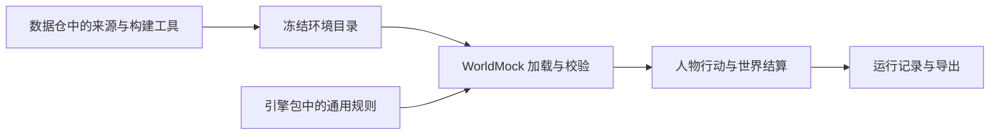

# 特性规格：环境数据归属

> 按[资源与规则引擎简化规格](SPEC-resource-and-rule-simplification.md#spec-rrs-资源与规则引擎简化开发规格)修订「归档引用」（阶段 1）。

> 状态：冻结；依据用户本会话确认的双仓职责实施。运行验证与最终状态另记验收文件。

## 用户目标

WorldMock-Dataset 管理具体世界的来源、地图、商品、内容、场景、离线采集构建和数据产物。
WorldMock 管理模拟器、数据结构、通用行为规则、加载校验、记录和导出。具体世界可由数据仓独立发布，
安装引擎后通过显式场景路径使用，不要求引擎源码目录中存在任何正式环境数据。



## 职责与接口

| 条款名称 | 冻结要求 | 验收依据 |
| --- | --- | --- |
| 正式环境归属 | WorldMock 根目录不再保留正式 corpora、catalog、scenarios；数据仓接收原张江环境及其来源、许可、冻结身份和构建工具 | 逐文件移交清单、字节核对、双方仓库目录核查 |
| 通用规则归属 | 分类、身体与交换常数、公式归 `worldmock.exchange` 并由 `RULES_VERSION` 绑定；活动、动机、人物映射读取包内三份 TOML，环境副本逐字节一致 | 独立导入、常数唯一归属与包资源身份测试 |
| 标题来自环境 | 内容标题、摘要、真实或合成来源直接写入 `catalog/contents.json`；场景结构 7 只引用环境，不另存内容标题 | 真实目录加载、严格旧字段拒绝与内容 app 绑定测试 |
| 活动效果来自环境 | LifestyleItem 必填 entertainment、social、health 三项 effects；候选预演读取实际条目；活动启动把效果冻结到既有 ActivityState.data，推进和恢复只读冻结效果 | 两个相同活动身份而效果不同的环境、结算和恢复测试 |
| 无隐式环境依赖 | 引擎导入不读取正式世界；不搜索 sibling 仓、不使用环境变量切换素材、不缓存另一世界的效果；缺输入明确失败 | 正式环境目录不存在时导入及完整生命周期测试 |
| 不可执行内容呈现 | 合法的短内容仍能被观察和查询；呈现真实时长并保留受理拒绝原因，不放宽一分钟活动下限 | 人工外部短内容的真实创建、观察、查询与受理拒绝测试 |
| 数据准备归属 | Dataset 准备七份目录 JSON、生活活动和联系人邮件语料、场景及来源；WorldMock 提供规范图生成器与统一登记检查 | 目录发布、重生成比较与双方职责门禁 |
| 测试输入归属 | 引擎人工环境重写为七地点、四 app、五食品、六内容、一主题、种子 7 图；完整回归通过 `--environment-root` 显式选重制后的发布环境 | 人工真实加载与完整回归输入字节回执 |
| 历史证据不可改写 | 已存运行、导出及其 frozen-inputs 是不可变证据；不重写历史字节，不提供旧格式运行兼容 | 历史输入摘要保持不变 |
| 双仓端到端 | Dataset 重制后的发布环境经过引擎真实加载、动作、关闭恢复和导出；最小新格式运行在资源与规则引擎简化阶段 5 闭合 | 真实引擎动作链与当前提交的独立回执 |
| 实施验收 | 不新增第三方依赖，不增加兼容层、migration、fallback 或多余配置；遵守中文注释和英文错误输出；新行为通过 Uncle Bob Review | 依赖差异、风格门禁、变异验收报告 |

## 发布与约束

Dataset 发布 app、地点、食品、内容、工作主题和图；三份包 TOML 只复制引擎的唯一资源字节。
分类、身体与交换常数不从环境读取；七份目录 JSON 的文件表绑定环境身份，场景用环境标识与版本钉定。
生产函数不得依赖测试环境。绝对路径只允许用于本次机器上的工具调用，不得写入源码、配置或交付清单。
收费模型模拟不属于此次整理验收；已有模型运行仅作为历史证据。

重写的人工小环境验证引擎独立安装后的生命周期，完整闭环在资源与规则引擎简化阶段 5 验证。购物、通勤、工作和多人互动的完整回归需要完整世界，
测试入口以 `--environment-root` 显式接收该输入，绑定目录、语料与场景的真实字节；未提供时只选择仓内人工输入，
不查找数据仓或获取在线素材。引擎运行接口不增加配置层。

## 实施结果与验收入口

| 条款名称 | 实施结果与验收依据 |
| --- | --- |
| 正式环境归属 | 引擎旧目录已删除；数据仓在 `environment/zhangjiang-baseline/` 接收正式数据并保留来源清单 |
| 通用规则归属 | 当前要求采用资源与规则引擎简化规格的 固定规则、重写人工环境和显式重制发布输入；阶段 1 真实环境加载与命令已实现，完整引擎、正式数据重建和最终放行另以所属阶段实际回执判定 |
| 标题来自环境 | 当前要求采用资源与规则引擎简化规格的 七份对象与绑定目录、内容标题来源；阶段 1 真实环境加载与命令已实现，完整引擎、正式数据重建和最终放行另以所属阶段实际回执判定 |
| 活动效果来自环境 | 已实现当前条目预演、启动冻结与恢复结算；真实双环境生命周期通过 |
| 无隐式环境依赖 | 人工外部环境完成真实创建、动作、恢复和导出 |
| 不可执行内容呈现 | 呈现与受理分别读取同一进度时长计算；受理继续拒绝不足一分钟活动，观察保留内容与拒绝原因 |
| 数据准备归属 | 当前要求采用资源与规则引擎简化规格的 固定规则、重写人工环境和显式重制发布输入；阶段 1 真实环境加载与命令已实现，完整引擎、正式数据重建和最终放行另以所属阶段实际回执判定 |
| 测试输入归属 | 当前要求采用资源与规则引擎简化规格的 固定规则、重写人工环境和显式重制发布输入；阶段 1 真实环境加载与命令已实现，完整引擎、正式数据重建和最终放行另以所属阶段实际回执判定 |
| 历史证据不可改写 | 数据仓核对历史运行与输入的 Git 对象、工作区差异及原有用户文件字节；引擎保留历史双日证明 |
| 双仓端到端 | 当前要求采用资源与规则引擎简化规格的 固定规则、重写人工环境和显式重制发布输入；阶段 1 真实环境加载与命令已实现，完整引擎、正式数据重建和最终放行另以所属阶段实际回执判定 |
| 实施验收 | 以双方当前提交的完整测试、重建、覆盖率、文档及独立变异回执为准；实现记录不替代成功回执 |

完整自然日使用原有脚本模型与真实 AS2 人物循环，保留全部业务断言；用实际存储逐字段核对当前导出并
重建完整时间线正文。旧格式摘要仅保留为历史证明，当前格式不宣称与旧格式输出逐字节相同，详见
[完整日验收边界](SPEC-layering-and-test-tiers.md#layering-baseline)。

引擎完整验收从仓库根目录显式运行：

```bash
python scripts/run_tests.py --tier full --workers 6 \
  --environment-root experiments/published-environment
```

完整入口生成同次运行的节点、分片、输入字节及覆盖率回执；被测代码、测试或外部正式输入在运行中变化则拒绝。
机器上的原始回执在 `.work/test-runs/`，新特性的独立变异证据在 `.work/environment-ownership/bob/`。

逐文件来源、原始 Git 对象与 SHA-256 见[环境数据移交清单](environment-data-ownership-handoff.json)。
