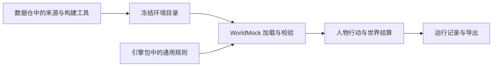

# 特性规格：环境数据归属

> 状态：冻结；依据用户本会话确认的双仓职责实施。运行验证与最终状态另记验收文件。

## 用户目标

WorldMock-Dataset 管理具体世界的来源、地图、商品、内容、场景、离线采集构建和数据产物。
WorldMock 管理模拟器、数据结构、通用行为规则、加载校验、记录和导出。具体世界可由数据仓独立发布，
安装引擎后通过显式场景路径使用，不要求引擎源码目录中存在任何正式环境数据。



## 职责与接口

| 条款名称 | 冻结要求 | 验收依据 |
| --- | --- | --- |
| 正式环境归属 | WorldMock 根目录不再保留正式 corpora、catalog、scenarios；数据仓接收原张江环境及其来源、许可、冻结身份和构建工具 | 逐文件移交清单、字节核对、双方仓库目录核查 |
| 通用规则归属 | 活动闭集、动机算法参数、人物动力学映射由引擎包资源提供；使用标准库 importlib.resources，不按仓库路径搜索规则 | 独立导入与安装后读取测试 |
| 标题来自环境 | ContentItemConfig 增加必填非空 title；场景结构由 5 发布为 6；标题由数据仓取已有来源元数据后写入场景；引擎直接投影 title，删除来源专属标题映射 | 外部环境标题测试、旧结构拒绝测试 |
| 活动效果来自环境 | LifestyleItem 必填 entertainment、social、health 三项 effects；候选预演读取实际条目；活动启动把效果冻结到既有 ActivityState.data，推进和恢复只读冻结效果 | 两个相同活动身份而效果不同的环境、结算和恢复测试 |
| 无隐式环境依赖 | 引擎导入不读取正式世界；不搜索 sibling 仓、不使用环境变量切换素材、不缓存另一世界的效果；缺输入明确失败 | 正式环境目录不存在时导入及完整生命周期测试 |
| 不可执行内容呈现 | 合法的短内容仍能被观察和查询；呈现真实时长并保留受理拒绝原因，不放宽一分钟活动下限 | 人工外部短内容的真实创建、观察、查询与受理拒绝测试 |
| 数据准备归属 | prepare-corpora 和具体来源采集、地图准备、食品翻译、正式目录生成、节目制作、交通校准由数据仓维护；WorldMock 删除旧入口、历史 migration 和过时说明 | 命令、源码归属、文档门禁 |
| 测试输入归属 | 引擎仅保留人工最小测试环境；正式数据来源、数量、冻结和重建验收归数据仓；完整引擎行为回归通过测试专用的显式环境路径消费数据仓发布环境，不能把完整正式数据复制为测试夹具 | 测试数据清单及引擎、数据仓独立门禁 |
| 历史证据不可改写 | 已存运行、导出及其 frozen-inputs 是不可变证据；不重写历史字节，不提供旧格式运行兼容 | 历史输入摘要保持不变 |
| 双仓端到端 | 数据仓发布的环境能够经真实加载器创建世界、执行动作、关闭、恢复和导出；先验证此路径再删除旧环境 | 零模型调用的真实引擎动作链与来源核对 |
| 实施验收 | 不新增第三方依赖，不增加兼容层、migration、fallback 或多余配置；遵守中文注释和英文错误输出；新行为通过 Uncle Bob Review | 依赖差异、风格门禁、变异验收报告 |

## 发布与约束

具体环境规则文件可由数据仓构建器从引擎包的唯一通用规则资源生成冻结副本，副本仅用于绑定输入身份，
不能成为另一份人工维护的规则来源。场景目录及地图的其他版本变化按现有发布入口计算并记录。
生产函数不得依赖测试环境。绝对路径只允许用于本次机器上的工具调用，不得写入源码、配置或交付清单。
收费模型模拟不属于此次整理验收；已有模型运行仅作为历史证据。

人工小环境验证引擎独立安装后的生命周期。购物、通勤、工作和多人互动的完整回归需要完整世界，
测试入口以 `--environment-root` 显式接收该输入，绑定目录、语料与场景的真实字节；未提供时只选择仓内人工输入，
不查找数据仓或获取在线素材。引擎运行接口不增加配置层。

## 实施结果与验收入口

| 条款名称 | 实施结果与验收依据 |
| --- | --- |
| 正式环境归属 | 引擎旧目录已删除；数据仓在 `environment/zhangjiang-baseline/` 接收正式数据并保留来源清单 |
| 通用规则归属 | 已实现包资源与三份冻结副本字节检查 |
| 标题来自环境 | 已实现必填标题与结构 6；数据仓发布场景及其正式加载验收负责标题来源 |
| 活动效果来自环境 | 已实现当前条目预演、启动冻结与恢复结算；真实双环境生命周期通过 |
| 无隐式环境依赖 | 人工外部环境完成真实创建、动作、恢复和导出 |
| 不可执行内容呈现 | 呈现与受理分别读取同一进度时长计算；受理继续拒绝不足一分钟活动，观察保留内容与拒绝原因 |
| 数据准备归属 | 引擎旧入口与制作源码已删除；数据仓 `tools/environment_prepare/` 维护来源准备，正式数据测试验证重建 |
| 测试输入归属 | 引擎保留人工小环境及显式外部回归入口；数据仓 `tests/zhangjiang/` 与准备测试负责正式质量 |
| 历史证据不可改写 | 数据仓核对历史运行与输入的 Git 对象、工作区差异及原有用户文件字节；引擎保留历史双日证明 |
| 双仓端到端 | 数据仓 `tests/test_environment_ownership_runtime.py` 验证正式环境生命周期；引擎完整回归显式消费发布目录 |
| 实施验收 | 以双方当前提交的完整测试、重建、覆盖率、文档及独立变异回执为准；实现记录不替代成功回执 |

完整自然日使用原有脚本模型与真实 AS2 人物循环，保留全部业务断言；用实际存储逐字段核对当前导出并
重建完整时间线正文。旧格式摘要仅保留为历史证明，当前格式不宣称与旧格式输出逐字节相同，详见
[完整日验收边界](SPEC-layering-and-test-tiers.md#layering-baseline)。

引擎完整验收从仓库根目录显式运行：

```bash
python scripts/run_tests.py --tier full --workers 6 \
  --environment-root ../WorldMock-Dataset/environment/zhangjiang-baseline
```

完整入口生成同次运行的节点、分片、输入字节及覆盖率回执；被测代码、测试或外部正式输入在运行中变化则拒绝。
机器上的原始回执在 `.work/test-runs/`，新特性的独立变异证据在 `.work/environment-ownership/bob/`。

逐文件来源、原始 Git 对象与 SHA-256 见[环境数据移交清单](environment-data-ownership-handoff.json)。
