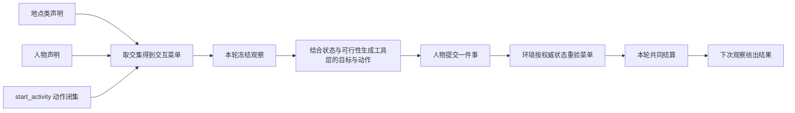

# 特性规格：交互菜单

> 按[动作与内容简化规格](SPEC-action-and-content-simplification.md#spec-acs-动作与内容简化开发规格)修订「固定规则、目录格式与加载边界」（阶段 1）。

> 2026-10-07：按[资源与规则引擎简化规格](SPEC-resource-and-rule-simplification.md#spec-rrs-资源与规则引擎简化开发规格)同步阶段 5 的工作主题上限准入。

> 引用出处：`src/worldmock/life/observe.py::ObservationBuilder._complete_product_browse` @ `d46b4d89898d687cc5cdf07e68f39df33a328081`

> 引用出处：`src/worldmock/life/admission.py::_delivery_refusal` @ `55e6a0f4c6ed6a015e334b01513767eefc227880`

> 按[资源与规则引擎简化规格](SPEC-resource-and-rule-simplification.md#spec-rrs-资源与规则引擎简化开发规格)修订「浏览结果与提示看可达性」、「地图地点与发现工具」（阶段 2）；「来源解析、只看此刻能做的、执行位置与保留约束、验收台账」（阶段 3）；再次修订「地图地点与发现工具、观察与人物工具、环境执行与拒绝、验收台账」（阶段 4）。

> 状态：FROZEN；2026-09-20，依据现有运行入口、并发独立审查和业界机制核查裁决。
> 部分条款按[人物 Prompt 规格](SPEC-life-realism.md#persona-prompt-七层请求)修订，修订部分已实现并通过离线验收（证据见[人物 Prompt 验收记录](../archive/persona-prompt/persona-prompt-verification.md)）；修订记录见「版本表」。
> 「地图地点与发现工具」与「观察与人物工具」中关于按名调用、指名购买与控制工具参数形状的条款按[一日运行保真规格](../VERIFICATION.md#verification-incremental-evidence)修订（2026-09-29，一日运行保真 IM1）；修订部分已实现并通过离线验收。
> 范围：按地点类与人物声明可选对象动作，并在观察、模型请求与环境执行中一致落实。
> 日期：2026-10-07
> 本规格全部实现、文档同步和验收属于本次开发，不设延期项；全项目既有真实实验门禁继续有效。
> 「观察与人物工具」中控制工具参数形状与 `query_world` 参数的条款按[个人事务与工作安排规格](../VERIFICATION.md#verification-incremental-evidence)修订（2026-10-02，逐条作业见[实施计划](../archive/errands-workday/errands-workday-implementation-plan.md)的文档同步作业 IM2–IM6）；修订部分已实现并通过离线验收（证据见[个人事务与工作安排验收记录](../archive/errands-workday/errands-workday-verification.md)）。工作安排是环境层呈现的事实，不进入交互菜单，不改 `allowed_actions`。

当前环境归属按[环境数据归属规格](SPEC-environment-data-ownership.md)执行：具体 `corpora/`、`catalog/`、`scenarios/`
及制作工具由 WorldMock-Dataset 维护，正式环境为 `environment/zhangjiang-baseline/`；通用活动、动机与人物映射
由 WorldMock 包资源提供，环境冻结副本须逐字节一致。当前场景结构为 `6`，单人物文件为 `single-person.json`。
本文中的新环境放行须另核对本次收据，历史验收数字不证明当前组合已经通过。

## 心智模型

地点决定这里允许做什么，人物声明决定这个人允许做什么，两者取交集。
人物每次决策看到的动作还要满足可见目标、阶段、同刻上限与预算；不按当前活动或能量隐藏，未满足条件的带说明。
例如同一游戏和任务都存在，住宅允许游戏和工作，办公室只允许工作；人物也可以声明不玩游戏。
换地点后下一次观察重新计算菜单，同一决策期间使用同一冻结观察；同一秒接着决策时，续接的每次决策仍各自冻结自己的观察。

菜单是准入约束，不是人物偏好评分，也不声称改善了长期人物真实性。
条目候选、排除原因、呈现上限、轮转、内容切片与人物生活活动启用声明保持原合同。
菜单不删除目录或候选；关闭工具不伪造条目的候选排除原因。

## 权威来源与范围裁决

固定模型工具由 `worldmock.life.models.REQUEST_MODELS` 定义（`plan_day` 已移出人物工具），新增固定只读工具 `query_world`。
地点菜单只剪裁 `start_activity` 经方式解析得到的内部动作，并约束 `query_world` 中对应领域的读取资格。
有时长地点发现仍作为可读对象和动作，不增加独立的有时长模型工具。
不新增动词、别名、策略语言、第三方依赖、迁移、兼容读取或缺省放行；人物的五个动词与方式经私有绑定映射为内部标准动作，
菜单按内部动作判定，不新增动作名（[时间与能量规格](SPEC-life-runtime.md#time-and-energy-决策不耗时时间只在做事时流动)第五章「请求形状与菜单」）。
[接口合同](../CONTRACTS.md#contracts-worldmock-接口合同)、[运行规格](SPEC-life-runtime.md#spec-life-runtime-特性规格lifeenv-运行时行为与结算规则)、[人物规格](SPEC-life-realism.md#spec-life-realism-特性规格人物决策与画像)
与[决策上下文规格](SPEC-decision-context.md#spec-decision-context-特性规格决策上下文与工具结果)的现行机制继续收窄菜单，不被菜单放宽。
研究依据见[可行性核查](research/interaction-menu-feasibility.md)。

| 提案中的问题 | 冻结裁决 |
| --- | --- |
| 动作面完全不随状态变化 | 动作照常列出并带说明，撤回 `2913546` 至 `778beca` 间按人物状态的剪裁；菜单只按地点类与人物声明剪裁 |
| 只筛工具名即可禁止游戏 | 地点菜单检查 `start_activity.items[].way` 解析出的内部动作，工具面保持稳定 |
| 地点粒度 | 只按现有 `LocationConfig.kind`，不新增具体地点覆盖或时段策略 |
| 人物维度 | 显式人物菜单与地点菜单求交集；人物 `null` 表示不追加限制 |
| 模板哈希不变即实验身份不变 | 菜单声明进入场景原始字节身份，源码变化也产生新身份；不同菜单不是相同实验条件 |
| 办公室散文提示 | 删除工具描述中固定的办公室娱乐偏好，以声明决定约束；不动态拼写工具描述 |
| 只隐藏模型工具 | 同时执行宿主校验与环境结算校验，直接调用不能绕过 |

## 声明与准入

场景文档与运行时场景都必须具有 `interaction_menus_by_location_kind`。
它是地点类字符串到 `InteractionMenu` 的映射，键集合必须恰好覆盖八个内置 `LocationKind`。
每个地点类必须显式声明，无通配键，无额外地点类，无 `null` 地点菜单。
每个 `agents[]` 必须显式具有 `interaction_menu`，取 `InteractionMenu` 或 `null`，字段不能缺失。

`InteractionMenu` 只有一个必填字段；禁止未知字段：

| 字段 | 形状 | 来源 |
| --- | --- | --- |
| `allowed_actions` | 无重复的非空字符串数组 | `START_ACTIVITY_ACTIONS` 的标准动作名（内部闭集，模型可见动词见[时间与能量规格](SPEC-life-runtime.md#time-and-energy-决策不耗时时间只在做事时流动)第五章） |

未知名称、空白名称、重复、空集合、错误类型、遗漏必填字段、地点类覆盖不完整均拒绝。
场景文件入口通过既有 `IntegrityError` 报告准入失败，并记录英文错误日志；内部 Pydantic 校验提供英文原因。
不声称注册表与场景拥有一个原本不存在的统一错误码。

为防止菜单切断等待和睡眠，每个非空声明必须显式保留：

| 集合 | 必须存在的值 |
| --- | --- |
| 自身动作 | `wait`、`sleep`（分别对应动词 `interact` 的「等待」与动词 `sleep`） |

缺少保护项直接拒绝，不自动补齐。活动控制、消息和回看工具不受地点菜单剪裁，
仍服从原状态、阶段与可见身份校验；状态校验不隐藏动作，不满足时拒绝并说明。`finish` 与记忆查询不属于生活动作菜单。
目标尚未发现时，声明允许动作不等于本轮开放；当前不可行时照常列出并附说明。
更新所有在版本控制内的正式场景及相应测试输入；旧缺字段场景拒绝，不写迁移脚本。

标准动作闭集只有 `travel_to`、`sleep`、`wait`、`purchase`、`do`；每份菜单继续保护 wait 与 sleep。

## 地图地点与发现工具

地图与门店供给特性中，场景只选择地点身份，菜单地点类来自目录中被选地点的 `kind`。活动环境由固定映射派生，地点不另声明 `business_kind` 或 `location_kinds`。地点发现从全目录发布图读取最短距离，路径可经过未被选择的节点。
只读 `query_world` 读取已经冻结公开的食品供给，不额外要求耗时活动，也不提供内容或 app 检索。
app 作为 `kind="app"` 的工具目标始终列出，人物用方式「打开」启动 `use_app`；实际内容由环境从所选 app 的绑定内容中选择，
没有绑定内容的 app 仍列出但以 `APP_CONTENT_EMPTY` 标为不可用。
查询只读冻结观察可读范围，不推进时间、不占活动名额，也不能读取未告知任务或他人私有状态。
它遵循冻结菜单、工具层列出的动作、本地校验、环境重验和 `INTERACTION_MENU_DENIED` 的合同。
禁止发现不得删除已存在地图事实；发现与呈现只管展示与比较，购买资格不以返回为限，`obtain` 可以按名称指名未返回的商品
（[人物 Prompt 规格](SPEC-life-realism.md#persona-prompt-七层请求)第五章「指名购买」，按[一日运行保真规格](SPEC-life-runtime.md#dayrun-fidelity-身体与需要) 3.2、3.3、3.5 改为 `from` 可选约束、
分段匹配与按请求级 `prefer` 选定）；购买消耗一次生活动作，结果结算后写进进度层，食品供给使用完整标签「<门店>出售的<商品>」。

## 观察与人物工具

工具定义整次运行不变，人物请求恰有一个世界请求，提交前可批量只读查询。工具层列出实际登记的动作和各自支持的 app；app 不是单独可打开的目标，内容标题不作为可提交目标。

| 工具 | 当前行为 |
| --- | --- |
| `start_activity` | `{items, answering}`，items 一至两项，每项恰为 `target, way, app, to, pay_app` 五个必填字段；原子解析、准入与执行，未使用值写 null |
| `query_world` | 六个必填键 `name, way, category, app, available_only, offset`；按完整冻结公开目标取交集再分页，实际 app 与方式共同决定可执行资格 |
| `recall_task_summary` | 只读回看当日目标文字或活动名，不接受内容标题、工作主题或会话名 |
| `report_status`、`pause_activity`、`conclude_activity` | 对实际活动名逐项控制，另有必填 errands 数组；恢复在原地点按内容、名额与占用检查，叙述不改客观进度 |
| `send_message` | 人物写正文并选择真实收件人；通信约束与驾车禁用沿当前准入规则 |
| `set_alarm` | 人物指定本地钟点；到期只响一次，可以唤醒真实睡眠 |

原生工具共十二个：七个世界请求、两个世界只读查询和三个记忆查询；稳定世界工具面九个。最终回合与截断重试去掉查询工具，控制和受限阶段仍由工具行 available/reason 与真实受理共同约束。
暂停不占活动名额，待收尾仍占；内容动作按类别和使用方式声明资源。社交不能暂停。

## 环境执行与拒绝

动作登记仍只确认提交，世界行为在共同结算时确定。环境依据权威场景、人物和当前结算状态重新计算菜单。
违反动作准入的直接请求在产生领域副作用前返回业务拒绝
`INTERACTION_MENU_DENIED`，写英文错误日志和既有 `action_rejected` / `action_result` 证据，
下次观察按现有公开结果通道交付。拒绝不能扣款、开始或恢复活动、推进 app 内容或全局内容进度、
改变推送状态、发送消息。
全部接口失败同时返回英文错误说明，`items[]` 每项包含
`path/written/error_code/allowed_values/expected/why/candidates`。
`path` 为从本次模型工具调用根开始的完整位置数组，例如
`["tool_calls", 0, "function", "arguments", "items", 0, "way"]`；闭集错误列全部合法枚举，名称候选仍按可读权限筛选。
`index/field` 旧错误形状直接删除；无枚举约束时 `allowed_values=[]`，`expected` 写明类型、长度、范围或前置条件，
`why` 写该参数、名称或世界前置条件的英文原因。
业务拒绝只产生公开结果并允许人物下一次决策；不因连续业务拒绝终止运行。
已结算请求的幂等重放不重做领域动作，也不重复计为新拒绝。
既有重放证据仍可追加，必须标记 `reused=true`，不能误报为一次新执行。
工作主题与其他持续活动共用菜单、地点、主题剩余上限、名额与占用校验；拒绝不累计工时。
活动控制保持原规则，任何菜单都不能放宽活动归属、反馈边界与 app 使用准入。
恢复请求的活动不存在或不属于当前人物时，由原活动身份校验拒绝；不以菜单错误掩盖既有领域错误。

## 实验身份与恢复

菜单声明保存在场景文件，原始 JSON 字节的 `scenario_sha256` 已将其纳入运行身份。
地点或人物菜单变化必须改变该身份，既有运行的打开和恢复入口必须拒绝不同场景身份。
恢复校验必须发生在复制或发布子分支之前，不能留待新环境启动后才拒绝。
代码身份继续绑定实际源码；不添加一个与场景哈希重复的新菜单版本层。

`prompt_sha256` 绑定生活与只读两份系统层以及七层 Schema，`tool_schema_sha256` 绑定人物工具面全部静态工具 Schema、描述和注册表摘要；
零点计划的后台严格工具 `submit_day_plan` 及其模板不在这两个指纹内，由 `code_sha256` 绑定；
个人事务与工作安排规格阶段 1 的就寝反思工具 `submit_reflection` 及其文案同样处理（该规格 1.1）。
方式推导代替 `actions`、新增固定 `query_world`、完整调用候选和错误字段都改变静态工具 Schema 与提示身份；
`tool_schema_sha256/prompt_sha256` 按实际新模板计算，旧工具身份不能恢复。
不同地点/人物的运行时菜单不改变静态模板哈希，也不改变整次运行不变的原生工具，但必须改变冻结观察中工具层列出的动作。
不得以两个模板哈希一致宣称场景等价，不做旧运行兼容、补写或迁移。

现行身份是目录格式 2、`RULES_VERSION = 2`、场景结构 8、世界结构 11、运行清单 4。
运行、检查点与恢复使用五字段 `environment_identity`：`environment_id`、`environment_version`、
`rules_version`、`catalog_content_sha256`、`map_sha256`。
规则文件只从引擎包读取，环境不发布副本，也不添加规则哈希；`code_sha256` 额外覆盖 `src/worldmock/data/` 下每个文件。
旧格式与旧结构号直接拒绝，不迁移、不双读。

## 文件修改清单

| 责任 | 文件 | 修改范围 |
| --- | --- | --- |
| 声明与共享计算 | `src/worldmock/life/interaction_menu.py`、`scenario.py`、`semantics.py` | 模型、准入、交集、动作资格与原样装配 |
| 观察与执行 | `src/worldmock/life/observe.py`、`tool_layer.py`、`admission.py`、`work.py` | 冻结有效菜单、环境重验、工作地点与主题剩余上限检查 |
| 提示字段 | `src/worldmock/life/narration.py` | 禁止观察工具支持菜单或整份地点声明被复制进 user |
| 恢复身份 | `src/worldmock/runtime.py` | 在复制检查点分支之前拒绝场景身份漂移 |
| 人物工具 | `custom/agents/life_agent.py`、`src/worldmock/life/models.py`、`session_actions.py`、`error_contract.py` | 删除动作数组、方式解析与菜单校验、固定只读查询派发、具体参数路径和合法约束 |
| 场景输入 | Dataset `../WorldMock-Dataset/environment/zhangjiang-baseline/scenarios/single-person.json`、`multi-person.json`、`multi-person-half-day.json` | 显式地点菜单及人物声明；Dataset `../WorldMock-Dataset/environment/zhangjiang-baseline/scenarios/evaluation.json` 是独立评估配置，不添加生活菜单 |
| 行为证据 | 新增生活菜单与人物菜单测试；相关观察夹具、清单和恢复测试 | 准入、地点、人物、Schema、绕过、控制、身份、真实跨轮边界 |
| 现行合同 | `docs/CONTRACTS.md#contracts-worldmock-接口合同`、`EXPERIMENT.md`、`VERIFICATION.md`；决策上下文、生活运行、人物规格 | 新字段、收窄顺序、身份与门禁 |
| 设计文档 | `docs/design/01-architecture.md#architecture-worldmock-产品设计说明书-总体架构`、`03-resource-engine.md`、`04-simulation-engine.md`、`05-recording-engine.md`、`08-configuration.md`、`09-io-formats.md` | 对齐职责、声明、观察、执行、记录与输入；不复制完整合同 |
| 导航与交付证据 | `docs/INDEX.md#index-worldmock-文档入口`、`docs/design/README.md#readme-worldmock-设计文档集`、`docs/dev/implementation-status.md#implementation-status-worldmock-实现状态`、`ANALYSIS-spec-coverage.md`、提案、冻结规格及研究记录 | 唯一权威入口、修改清单、条款到测试及实测结果 |

`docs/design/02-exchange-engine.md#exchange-engine-worldmock-产品设计说明书-交换引擎` 的交换职责不变，但须同步方式解析后的准入、具体错误路径与完整调用候选；
菜单仍由模拟引擎在规则执行前重验。
总体、交付、评估设计没有菜单行为变化时只核查现有引用，不为凑清单改写。
已存在的并发改动必须保留；每次编辑前重新读当前内容，不整文件恢复基线。

## 呈现与浏览

### 动作地点资格与商品排序

动作始终列出，不排序、不轮转。`exercise` 只允许 `home`、`outdoor`、`fitness`；人物分配的工作内容只在其工作地点执行。条件不满足时工具行写 available=false，与真实拒绝同码同文，拒绝不消费内容。

商品是唯一候选种类。名称或商品类别命中冻结习惯文本增加一分相关度，同分用场景、人物、本地日期和商品身份的确定性哈希排序；每个商品的真实曝光时刻决定轮换，不共享人物游标。

### 只列名称的可调用索引

`callable_index` 恰含 `goods`、`navigation_apps`、`payment_apps`、`query_categories`。商品按公开类别给计数及至多三个示例，导航与支付应用列登记名称；类别计数来自完整冻结集合，不随某次查询改变。
索引不占候选展示名额，不公开内部身份，也不替代活动准入。

### 浏览结果与提示看可达性

**改造前观察**（BIZ 午餐往返 17 段的系统侧原因；下列源码定位当前对应职责）：浏览是全局的（`src/worldmock/life/rules.py::LifeRuleEngine.validate_start`、`src/worldmock/life/observe.py::ObservationBuilder._complete_product_browse`），每次 56 条供给里的 20 条，其中 17 条全天在任何地方都买不到；
进度层的浏览结果只列商品名不带店名（`src/worldmock/life/result_projection.py`），模型把全局目录当成了当前餐馆的菜单；商品可见性绑定在浏览的地点（`src/worldmock/life/projection.py`，有效期 1800 秒），
人一离开商品就从工具层消失（在场门店的供给不经浏览就进入商品池，`src/worldmock/life/observe.py`；指名路径本就不查可见凭据，`src/worldmock/life/storefront_runtime.py`）；
下一步提示当时只看供给声明的目的地、不看可达性（到店 `src/worldmock/life/admission.py::_place_refusal`「去{place}」，配送 `src/worldmock/life/admission.py::_delivery_refusal`「去 X 或 Y 再下单」）；
「暂时送不到这里」当时同时覆盖 4 个 `DELIVERY_*` 码（原因映射对应 `src/worldmock/life/guidance.py::_DEFAULT_REASONS`，配送准入对应 `src/worldmock/life/admission.py::_delivery_refusal` 也使用了同句）。反证：14:59 商品和地点同时出现在工具层时，模型 5 分钟内就完成了购买。

**设计。**

- 浏览结果保留完整标签「<门店>出售的<食品>」，进度层记录实际返回名称，不生成额外世界事实。
- 地点发现查询发布图，当前地点到任何其他目录地点都有最短路；需要前往时只写 `Go to <place>.`。
- 外卖覆盖全地图，没有配送区域或配送路线缺失原因，不生成中转地点提示。
- 可见性和浏览结果归属仍按各自合同处理；图只提供距离与路径，不改变同一决策只能提交一个世界请求的边界。

**验收。** 地点提示使用完整地点名称，只有 `Go to <place>.` 句式；等长路径按冻结完整路径决胜；配送不返回区域或不可达原因。

## 查询筛选与返回精简

### 请求

`query_world(name, way, category, app, available_only, offset)` 六键全部必填，无缺省；前四键为非空白字符串或 null，至少一个非 null。available_only 是严格 JSON 布尔，offset 是非布尔的非负 JSON 整数。
名称、方式、公开类别和 app 筛选取交集；购买只有「购买」一种方式，不展开取得方式。`app` 只接受登记应用名，旧 from 字段被严格拒绝。

### 应用筛选

app 名按登记名称精确匹配。商品要求实际供给店铺绑定该购物 app；动作要求动作绑定该 app。店铺与地点名不是 app 值，查询不推断购物或付款应用。
完整冻结目标先取各筛选交集，商品只保留一个身份，不按店铺展开。未知 app 的候选只能是登记应用，不能混入地点。

### 只看此刻能做的

`available_only` 从本轮冻结观察的动作 `available` 读取，不另算。食品到店动作只按人物是否在店内，远程下单只按该店是否绑定所点 app；没有报价、营业、库存或配送区域条件。
保留条目仍返回全部动作与工具及各自原因；按方式过滤先于稳定排序与切页，`total_count` 为完整交集，空页不自动换来源或放宽。
本人远程收货只在停留中，路途中自送是实际前置条件拒绝；请求成功仍以环境受理时同一规则重验为准。

### 返回

- 顶层恒为 `{matches, total_count, next_offset}` 三键，不新增说明键。各键取值合法、`offset` 在范围内时，除 5.5 第二行外任何筛选组合无匹配都返回 `matches=[]`、`total_count=0`、`next_offset=null`，不报错、不自动放宽、不换来源；`total_count` 为 0 时合法的 `offset` 只有 0，越界仍按既有错误处理。
- 每项是冻结目标的无损紧凑投影：键取 `name, kind, phase, state, contract`（仅任务）`, actions, tools`；动作取 `action, way, available, reason, price, duration, quantity, note`。只省略 null 与空集合；false、零价格、零剩余与明确的未知原因逐值保留。紧凑规则复用工具层分组已有的实现。
- **不再逐项附 `candidates`**（裁决 Q2，修订工具交互规格刚冻结并实现的条款）：照抄 `name` 与所选动作的 `way` 即可提交；候选只出现在错误合同里。冻结条目里的候选与构造它的函数一并删除，不留双形状。门店商品的来源标记 `note` 首版保留。

### 错误

| 情形 | 处理 |
| --- | --- |
| `from` 既不是地点显示名也不是渠道称呼 | 查询参数错误：`path` 为 `from`，`allowed_values` 为 `[]`，`expected` 为 `null, a known place name, or a known channel name is required.`；`candidates` 至多三条换了 `from` 的完整 `query_world` 请求，候选来源只取权限内有供给条目的门店与渠道 |
| `from` 为 null，`name` 按对象名称解析无任何匹配，且其写法恰是一个渠道称呼（与其余筛选是否为空无关） | 查询参数错误：`path` 为 `name`，`expected` 为 `A channel name belongs in from; name takes an object name.`，`candidates` 给一条把该值移到 `from`、`name` 写 null 的完整请求；不自动改写 |
| `from` 解析成功但该来源没有权限内供给 | 合法空页，不泄露不可访问门店 |
| `name` 写完整标签而 `from` 写另一家店 | 合法空页（查询是交集筛选，不是购买请求） |

顶层与明细码都是 `ARGUMENTS_INVALID`，不把环境名称类码带进宿主协议反馈。来源错误与方式、品类错误一次全报；`offset` 范围只在全部筛选合法后计算。

### 执行位置与保留约束

- `query_world` 的权威求值点是宿主本地冻结观察；环境侧同名分支保留（裁决 Q3），其代码不必改。
- 本阶段不改系统层：只改 `query_world` 的用途句，两个新字段与现有四个字段一样不带字段说明。因此只变 `tool_schema_sha256` 与 `code_sha256`，可独立验收与归因。用途句唯一权威见 `docs/CONTRACTS.md#contracts-person-tools`。
- 筛选不更新呈现时刻、不扩大固定菜单读取权限；两个字段不引入否定、或、范围与表达式。
- 工具交互规格的既有条款带上两个新键后保持：同一模型回合内的多个只读查询整批先校验后执行，与世界请求混批整批拒绝；最终回合与截断重试不开放查询。
- 工具交互登记守卫的钉点：既有变异按真实定义符号定位，限定该定义内的唯一片段；搬移后生成字节与原基线逐项相同；查询请求字段集的四键断言随阶段 4 同批改为六键；工具交互规格的现行验收行与冻结简化规格同步退役，新增的查询验收只写在本文的验收台账。
- 查看器里的查询请求分支在真实运行下不可达（只读查询不登记为世界动作），不计入验收。

固定食品菜单查询保留宿主本地冻结观察与环境同名入口的执行位置约束；查询不是浏览揭示，不创建新的世界事实。

## 验收台账

每个要求必须有真实行为断言；测试存在、接口可导入、覆盖率百分比不能单独代替完成证据。

| 要求 | 必须观察到的结果 |
| --- | --- |
| 显式声明与准入 | 全部正式场景可加载；缺字段、未知、重复、空集合、坏类型、地点类漏项或多项、保护项缺失均拒绝并留日志 |
| 地点与人物交集 | 条目相同而地点菜单不同导致可读动作集合不同；同地点两个人物动作集合不同；`use_app` 与工作动作正确区分，app 目标只来自登记目录 |
| 观察冻结 | 相同状态输出确定性菜单；本轮查询使用同一冻结观察；同一秒续接的每次决策各自冻结观察；换地点后的下一次观察更新；记忆查询不需世界菜单，世界只读查询仍守领域读取边界 |
| 模型与本地一致 | 捕获实际模型请求验证稳定工具和可读动作；菜单禁止动作在本地和直接派发均拒绝 |
| 方式解析与错误 | 无 `actions` 仍正确解析内部动作；旧字段、非法方式与 prefer 全部拒绝，真实模型回执含完整位置数组 path、全部合法闭集、英文 expected 和 why，候选可整份通过请求校验 |
| 世界只读查询 | 模型可在决策内按公开品类和next_offset读取超过20条的完整冻结结果后提交一个世界请求；每条只出现一次；菜单禁止读取、未告知任务与他人私有食品持有不泄露，状态、时钟、呈现记录及活动名额不变 |
| 环境不可绕过 | 直接请求被禁止动作形成 `INTERACTION_MENU_DENIED`；无领域副作用；工作主题上限在名额与占用冲突之前核对，不调用独立评审 |
| 控制与阶段 | 当日计划由零点计划生成；等待/睡眠入口保留；活动控制保留，恢复须回到开始地点并受实际资源与地点约束；世界请求登记即结束本轮，只读阶段保持原规则 |
| 候选合同保持 | 菜单不删候选或排除统计；下钻和目标的游标、轮转校验仍生效，固定菜单不限制指名购买 |
| 身份与恢复 | 地点/人物声明变更改变场景哈希；不同场景拒绝打开/恢复；移除固定散文使工具模板哈希变化且旧身份被拒绝 |
| 最小端到端 | 使用真实 LifeAgent 与 LifeEngine、SQLite 及跨轮结果，通过允许动作、被禁止直接请求和到达新地点后的菜单更新 |
| 文档一致 | 提案不再与冻结规格争夺权威；设计、合同、配置与验收一致；Markdown 链接和路径可解析 |
| 工程与突变 | 相关测试、全量测试、风格、分支覆盖及公共接口覆盖门禁通过；固定源码的干净隔离 worktree 完成 Uncle Bob 语义突变 |

执行证据及逐条测试映射统一记于[交互菜单验收记录](research/interaction-menu-verification.md)。
该记录必须如实区分本特性离线完成与全项目尚未完成的正式长期实验。

本阶段食品查询和购买按同类型菜单、全店同价、店铺 app 绑定验证；app 打开只使用所选 app 的绑定内容，空内容 app 拒绝，商店 app 绑定仍用于食品来源。不再验收私有店铺库存、报价版本、营业或旧游戏动作。历史执行记录按其原始代码身份保留，不能代替本阶段节点。

## 版本表

| 版本 | 日期 | 修订内容 |
| --- | --- | --- |
| `2026-10-01-tool-interaction` | 2026-10-01 | 冻结尚未实现的一项一个items对象、方式推导、中文购买偏好与null本人语义、公开品类偏移query_world、完整调用候选及位置数组path/allowed_values/expected/why错误；菜单仍按内部动作判定，旧数组和值删除 |
| 1 | 2026-09-20 | 纠正提案事实与身份判据，冻结地点类和人物交集、工具及活动类型双重约束、控制保护、执行拒绝及全部验收 |
| `2026-09-24-time-and-energy` | 2026-09-24 | 按[时间与能量规格](SPEC-life-runtime.md#time-and-energy-决策不耗时时间只在做事时流动)「冻结条款修订」第 24 行修订：菜单仍以内部能力名判定，人物所选动词与方式经私有绑定映射后判定；删能量与日首计划门控；不按人物状态隐藏动作，未满足条件的带说明；控制作用于活动，恢复须回到开始地点；`plan_day` 移出人物工具，不再有保护资格，模型工具改为八项。补记未入表的就地改动：2d97d3d（新增「当日目标保护项」）、d998a31（并行启动工具的菜单要求、已有活动时相容启动照常开放、活动控制按点名身份开放）、2913546（工具面改为九项稳定工具，菜单只剪裁 `start_activity` 的动作闭集，`InteractionMenu` 改为单字段 `allowed_actions`，保护项改为 `wait`、`sleep`，控制按可读名称，不因连续业务拒绝终止运行） |
| `2026-09-26-time-and-energy-stage-7` | 2026-09-26 | 时间与能量规格阶段 7 文档一致性核对（IM1–IM9 已落地）：「观察与人物工具」的 `recall_task_summary` 行补「当日目标名」，与时间与能量规格第七章及代码一致 |
| `2026-09-27-persona-prompt` | 2026-09-27 | 按[人物 Prompt 规格](SPEC-life-realism.md#persona-prompt-七层请求)「冻结条款修订」第 24、28 行修订（人物 Prompt 台账 IM1、IM2），修订部分待实现：菜单条款的载体改为七层，菜单排除的动作不列入工具层，场所固定规则写在环境层 `location.fixed_rules`，删「完整候选与 `scene` / `facts` 保持原合同」及候选合同中的「事实」；同一秒续接的每次决策仍各自冻结观察，登记不回显，结算结果经续接 tool 消息交还；展示与购买资格分开，`obtain` 可以指名未列出或未返回的商品，其余动词的对象须是本轮列出的名称；原生工具整次运行不变，不逐轮绑定名称枚举，菜单控制落在工具层、本地校验与宿主派发校验，恢复条件由待办层 `available`、`reason` 说明并由环境以同一原因拒绝；运行时菜单只改变冻结观察；文件头注明修订待实现 |
| `2026-09-27-persona-prompt-stage-4` | 2026-09-27 | 按[人物 Prompt 规格](SPEC-life-realism.md#persona-prompt-七层请求)「冻结条款修订」第 28 行修订（人物 Prompt 台账 IM3，随阶段 4 代码），修订部分待实现：下钻品类表「物品」行补给予：`to` 写人物名时显示“给予”，内部标准动作仍为 `consume`，菜单、可供性目录与品类配对不变，不新增动作名 |
| `2026-09-28-persona-prompt-implemented` | 2026-09-28 | 人物 Prompt 七层规格实现后文档（人物 Prompt 台账阶段 8，按最终代码 `f798ea7` 核对）：状态头改为修订部分已实现并通过离线验收；「观察与人物工具」注明原生工具只在最后一个回合去掉记忆查询工具 |
| `2026-09-29-dayrun-fidelity` | 2026-09-29 | 按[一日运行保真规格](../VERIFICATION.md#verification-incremental-evidence)「冻结条款修订」第 10、11、18 行与其 3.5 修订（一日运行保真 IM1，随该规格冻结）：「地图地点与发现工具」的指名购买改为 `from` 可选约束、分段匹配与按 `prefer` 选定，浏览结果列完整标签；「观察与人物工具」`start_activity` 行改为全部目录类按名调用（归一唯一即受理，否则给候选、不替换），按名写的对象照常经菜单判定，`obtain` 可写方式「购买」并有请求级 `prefer`；三个控制工具行改为 `items[]`（`conclude_activity` 另带 `memories`、`views`）；可见性不限制按名调用；文件头补修订说明 |
| `2026-09-29-dayrun-fidelity-implemented` | 2026-09-29 | 一日运行保真规格实现后（按 `e377669` 的代码核对）：文件头改为修订部分（按名调用、指名购买的 `from` 约束、分段匹配、方式「购买」与请求级 `prefer`、控制工具参数形状）已实现并通过离线验收；「观察与人物工具」原生工具的例外补输出截断后的那次重试同样去掉记忆查询工具（该规格 7.2，冻结时漏改）；条款正文不变 |
| `2026-10-02-errands-workday` | 2026-10-02 | 按[个人事务与工作安排规格](../VERIFICATION.md#verification-incremental-evidence)修订，修订部分在冻结时未随文实现（该规格阶段 1（就寝反思的后台严格工具）、阶段 2（控制工具的 `errands`）、阶段 4（`query_world` 六键）实现后的核对见 `2026-10-04-errands-workday-implemented` 行；逐条作业见[实施计划](../archive/errands-workday/errands-workday-implementation-plan.md)的文档同步作业 IM1–IM6）。改动：文件头；「观察与人物工具」`query_world` 行改六键并写来源与可执行筛选，三个控制工具行增请求级 `errands`（不受地点菜单剪裁）。顺带更正既有漂移：只读问答不开放 `query_world`；最后一个回合与截断重试去掉的是全部查询工具；`prompt_sha256` 绑定两份系统层与七层 Schema、`tool_schema_sha256` 只绑定人物工具面，后台严格工具由 `code_sha256` 绑定。工作安排不进入交互菜单，菜单声明、交集与拒绝条款不变 |
| `2026-10-04-errands-workday-implemented` | 2026-10-04 | 个人事务与工作安排规格实现后文档（[实施计划](../archive/errands-workday/errands-workday-implementation-plan.md)作业 IM7，按 `d8a41d3` 的代码核对）：文件头改为修订部分（就寝反思的后台严格工具、控制工具的请求级 `errands`、`query_world` 六键）已实现并通过离线验收，链接[个人事务与工作安排验收记录](../archive/errands-workday/errands-workday-verification.md)（证据是离线测试；该规格阶段 6 的配对全天复跑只报告，没有执行）；`2026-10-02-errands-workday` 行里的冻结期状态注记改为指向本行；条款正文不改 |
| `2026-10-06-rrs-map` | 2026-10-07 | 随机连通加权图、最短距离出行与环境恢复身份；对应正文按资源与规则引擎简化规格地图阶段修订 |
| `2026-10-06-rrs-store` | 2026-10-07 | 食品、店铺 app 来源、固定价格与单订单结算；类别消费、六个输入警告和目录覆盖率，删除本阶段退役正文 |
| `2026-10-06-rrs-app` | 2026-10-07 | 阶段 4：交互菜单验收改为 `use_app`、所选 app 的内容绑定与空内容拒绝；删除旧游戏动作验收。 |
| `2026-10-06-rrs-work` | 2026-10-07 | 同步工作主题上限准入 |
| `2026-10-07-acs-rules` | 2026-10-07 | 固定规则版本 2；目录格式 2、场景结构 8、世界结构 11、运行清单 4；环境仅发布目录与场景，规则只从包读取。 |

## 当日目标保护项

`revise_day_plan` 名称与菜单保护资格保留，具体开放条件按 [当日目标规格](SPEC-day-plan-goals.md#spec-day-plan-goals-当日目标特性开发规格) 执行，
已有计划允许修订未推进目标；`plan_day` 不在人物工具与菜单中，当日计划由零点后台任务 `plan_day` 经引擎的系统登记入口写入。
菜单不得绕过目标请求的本地与环境校验。

| `2026-10-05-layering-and-test-tiers` | 2026-10-05 | 五项已验收增量行为并回所属正文；提示唯一文本、机器验收登记与稳定引用同步，历史过程归档 |
