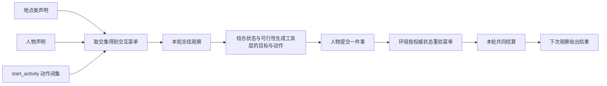

# 特性规格：交互菜单

> 状态：FROZEN；2026-09-20，依据现有运行入口、并发独立审查和业界机制核查裁决。
> 部分条款按[人物 Prompt 规格](SPEC-persona-prompt.md)修订，修订部分已实现并通过离线验收（证据见[人物 Prompt 验收记录](persona-prompt-verification.md)）；修订记录见「版本表」。
> 「地图地点与发现工具」与「观察与人物工具」中关于按名调用、指名购买与控制工具参数形状的条款按[一日运行保真规格](SPEC-dayrun-fidelity.md#冻结条款修订)修订（2026-09-29，一日运行保真 IM1）；修订部分已实现并通过离线验收。
> 范围：按地点类与人物声明可选对象动作，并在观察、模型请求与环境执行中一致落实。
> 日期：2026-10-01。工具交互修订已冻结，已实现；本次生产验收单独记录；新请求形状、只读查询和错误字段以[工具交互规格](SPEC-tool-interaction.md)为准，旧离线证据只证明修订前行为。
> 本规格全部实现、文档同步和验收属于本次开发，不设延期项；全项目既有真实实验门禁继续有效。
> 「观察与人物工具」中控制工具参数形状与 `query_world` 参数的条款按[个人事务与工作安排规格](SPEC-errands-workday.md#冻结条款修订)修订（2026-10-02，逐条作业见[实施计划](research/errands-workday-implementation-plan.md)的文档同步作业 IM2–IM6）；修订部分已实现并通过离线验收（证据见[个人事务与工作安排验收记录](errands-workday-verification.md)）。工作安排是环境层呈现的事实，不进入交互菜单，不改 `allowed_actions`。

## 心智模型

地点决定这里允许做什么，人物声明决定这个人允许做什么，两者取交集。
人物每次决策看到的动作还要满足可见目标、阶段、同刻上限与预算；不按当前活动或能量隐藏，未满足条件的带说明。
例如同一游戏和任务都存在，住宅允许游戏和工作，办公室只允许工作；人物也可以声明不玩游戏。
换地点后下一次观察重新计算菜单，同一决策期间使用同一冻结观察；同一秒接着决策时，续接的每次决策仍各自冻结自己的观察。

菜单是准入约束，不是人物偏好评分，也不声称改善了长期人物真实性。
条目候选、排除原因、呈现上限、轮转、内容切片与人物生活活动启用声明保持原合同。
菜单不删除目录或候选；关闭工具不伪造条目的候选排除原因。

## 权威来源与范围裁决

固定模型工具由 `worldmock.life.models.REQUEST_MODELS` 定义（`plan_day` 已移出人物工具），新增固定只读工具 `query_world`。
地点菜单只剪裁 `start_activity` 经方式解析得到的内部动作，并约束 `query_world` 中对应领域的读取资格。
有时长地点发现仍作为可读对象和动作，不增加独立的有时长模型工具。
不新增动词、别名、策略语言、第三方依赖、迁移、兼容读取或缺省放行；人物的五个动词与方式经私有绑定映射为内部标准动作，
菜单按内部动作判定，不新增动作名（[时间与能量规格](SPEC-time-and-energy.md)第五章「请求形状与菜单」）。
[接口合同](../CONTRACTS.md)、[运行规格](SPEC-life-runtime.md)、[人物规格](SPEC-life-realism.md)
与[决策上下文规格](SPEC-decision-context.md)的现行机制继续收窄菜单，不被菜单放宽。
研究依据见[可行性核查](research/interaction-menu-feasibility.md)。

| 提案中的问题 | 冻结裁决 |
| --- | --- |
| 动作面完全不随状态变化 | 动作照常列出并带说明，撤回 `2913546` 至 `778beca` 间按人物状态的剪裁；菜单只按地点类与人物声明剪裁 |
| 只筛工具名即可禁止游戏 | 地点菜单检查 `start_activity.items[].way` 解析出的内部动作，工具面保持稳定 |
| 地点粒度 | 只按现有 `LocationConfig.kind`，不新增具体地点覆盖或时段策略 |
| 人物维度 | 显式人物菜单与地点菜单求交集；人物 `null` 表示不追加限制 |
| 模板哈希不变即实验身份不变 | 菜单声明进入场景原始字节身份，源码变化也产生新身份；不同菜单不是相同实验条件 |
| 办公室散文提示 | 删除工具描述中固定的办公室娱乐偏好，以声明决定约束；不动态拼写工具描述 |
| 只隐藏模型工具 | 同时执行宿主校验与环境结算校验，直接调用不能绕过 |

## 声明与准入

场景文档与运行时场景都必须具有 `interaction_menus_by_location_kind`。
它是地点类字符串到 `InteractionMenu` 的映射，键集合必须恰好等于解析后地点的 `kind` 的不同值集合。
这里的单值地点类不是候选资格合同的 `location_kinds` 能力集合，不复用或扩展其词表。
每个地点类必须显式声明，无通配键，无额外地点类，无 `null` 地点菜单。
每个 `agents[]` 必须显式具有 `interaction_menu`，取 `InteractionMenu` 或 `null`，字段不能缺失。

`InteractionMenu` 只有一个必填字段；禁止未知字段：

| 字段 | 形状 | 来源 |
| --- | --- | --- |
| `allowed_actions` | 无重复的非空字符串数组 | `START_ACTIVITY_ACTIONS` 的标准动作名（内部闭集，模型可见动词见[时间与能量规格](SPEC-time-and-energy.md)第五章） |

未知名称、空白名称、重复、空集合、错误类型、遗漏必填字段、地点类覆盖不完整均拒绝。
场景文件入口通过既有 `IntegrityError` 报告准入失败，并记录英文错误日志；内部 Pydantic 校验提供英文原因。
不声称注册表与场景拥有一个原本不存在的统一错误码。

为防止菜单切断等待和睡眠，每个非空声明必须显式保留：

| 集合 | 必须存在的值 |
| --- | --- |
| 自身动作 | `wait`、`sleep`（分别对应动词 `interact` 的「等待」与动词 `sleep`） |

缺少保护项直接拒绝，不自动补齐。活动控制、消息和回看工具不受地点菜单剪裁，
仍服从原状态、阶段与可见身份校验；状态校验不隐藏动作，不满足时拒绝并说明。`finish` 与记忆查询不属于生活动作菜单。
目标尚未发现时，声明允许动作不等于本轮开放；当前不可行时照常列出并附说明。
更新所有在版本控制内的正式场景及相应测试输入；旧缺字段场景拒绝，不写迁移脚本。

## 地图地点与发现工具

地图与门店供给特性中，场景只选择地点身份，菜单地点类来自冻结地图中被选地点的 `kind`。
`business_kind` 表示经营业态，`location_kinds` 表示活动环境，均不能替代菜单分类。
商品目录浏览是 `interact` 的浏览对象，正式场景和人物菜单仍以 `browse` 动作限制。
只读 `query_world` 读取已经冻结公开的供给不额外要求 `browse` 菜单，指名购买本已允许的商品可查同等公开事实；
真实耗时浏览仍须 `browse` 准入，查询不能揭示未知供给、给 `data.supplies` 或工具层目标添加条目或可见凭据。
查询只读冻结观察可读范围，不推进时间、不占活动名额，也不能读取未告知任务或他人私有状态。
它遵循冻结菜单、工具层列出的动作、本地校验、环境重验和 `INTERACTION_MENU_DENIED` 的合同。
禁止发现不得删除已存在地图事实；发现与呈现只管展示与比较，购买资格不以返回为限，`obtain` 可以按名称指名未返回的商品
（[人物 Prompt 规格](SPEC-persona-prompt.md)第五章「指名购买」，按[一日运行保真规格](SPEC-dayrun-fidelity.md) 3.2、3.3、3.5 改为 `from` 可选约束、
分段匹配与按请求级 `prefer` 选定）；它消耗一次生活动作，结果结算后写进进度层，浏览结果列完整标签「<门店>出售的<商品>」。

## 观察与人物工具

观察顶层工具支持数据新增必填 `interaction_menu`，形状就是 `allowed_actions` 的有效菜单。
它由地点菜单和人物菜单求交集后确定性排序生成；人物为 `null` 时使用地点菜单。
按权威 `agent.location_id` 查到地点类；缺地点、缺菜单或损坏菜单作为完整性故障记录并终止。
不得把所有人物的原始菜单声明送给当前人物。

完整的 `affordance_contract` 保持原义，不因菜单删去条目；完整候选保持原合同。人物请求的载体是七层：
菜单排除的动作不列入工具层目标，所在场所的固定规则以可读说法写在环境层 `location.fixed_rules`（菜单全开时为 `[]`）。
工具支持块进入冻结观察与审计证据，不在 user 的七层中重复序列化。
菜单解析缺失、未知名称、重复、坏类型或缺保护项时，宿主失败关闭并记录英文错误，不使用全量工具替代。
提示的递归字段校验必须拒绝误入的 `interaction_menu` 和 `interaction_menus_by_location_kind`，
不靠提示组装当前恰好未复制这些字段来代替合同校验。
只读记忆路径不需要世界菜单；只读问答阶段只开放记忆查询与 `finish`，不开放 `query_world`。
生活决策中的 `query_world` 读取世界领域事实仍按冻结菜单和归属校验。

| 工具路径 | 菜单要求 |
| --- | --- |
| 稳定模型工具 | 地点菜单不剪裁工具；状态、阶段、同刻上限和预算仍门控具体可用性 |
| `start_activity` | 必填items/answering/prefer；items一至两项，每项恰为全键必填的{target,way,from,to}，整组原子受理；删除actions和平行targets/ways/from/to数组。宿主与环境共用方式解析，再核对allowed_actions；按名称调用仍检查菜单。to=null统一表示本人，其他人物写实名，旧“自己”值拒绝；食用、使用、制作与非转移动作两端null，给予from=null且to为其他人物。含到店/远程下单/购买项时prefer必须为“最快拿到”或“到手价最低”，否则必须为null；null不默认最快，旧英文枚举拒绝。失败候选为{tool,arguments,note}完整合法调用，不代人物执行 |
| `query_world` | 稳定只读工具；name/way/category/from/available_only/offset 六键全部必填、无缺省，旧四键请求按缺字段拒绝；name、way、category、from 可空但至少一个非 null，available_only 为布尔且不单独构成查询条件，offset 为非负整数；from 写地点显示名或渠道称呼，与购买请求共用同一来源解析，只匹配供给条目，不按需求反查门店、不计算路线；available_only=true 只留已确认此刻可执行的条目，可执行取冻结观察里该条目动作的 available，筛选先于排序与切页（个人事务与工作安排规格第五章，阶段 4 落地）；category只取callable_index已展示的公开品类标签；返回matches/total_count/next_offset，next_offset必填可空，每页沿用现有上限20，按偏移可遍历全集；查询只限冻结观察可读事实，已公开供给不额外要求browse，真实耗时浏览仍须browse且查询不能揭示未知供给；任务检查已告知与归属，库存只读本人可读持有物；不提交世界请求、不推进时钟、不给data.supplies/工具层目标添加条目或可见凭据；不恢复discover_places或商品需求路线查询 |
| `recall_task_summary` | 接受可读任务名、当日目标名或活动名（会话名不在七层中出现，不接受）；找不到或不唯一时业务拒绝并列出可选名称 |
| `report_status`、`pause_activity`、`conclude_activity` | `items[]` 一至两项，一项活动一个对象：`report_status`、`pause_activity` 为 `{activity_name, summary}`，`conclude_activity` 为 `{activity_name, summary, memories, views}`（一日运行保真规格第六章）；三者另有请求级必填 `errands[]`（与 `items` 平级，可为 `[]`；新增、更新或取消个人事务，个人事务与工作安排规格 2.2，阶段 2 落地）；`activity_name` 为唯一可读活动名；先校验全部活动、阶段与事务变更，再原子更新；报告可以恢复暂停的活动，结束作用于选中的进行中、暂停或待收尾的活动；事务变更随活动控制提交，与活动控制一样不受地点菜单剪裁（见「声明与准入」），仍服从宿主与环境的同一校验 |
| `submit_work`、`send_message` | 分别在工作或通讯领域条件满足时开放，正文由人物写入，任务与收件人用可读名称定位 |

购买、出行、社交、商品目录浏览与游戏都由 `start_activity` 的私有绑定定位；相应标准动作按菜单限制。
交谈和通话不能暂停。任务或人物名称不展示内部编号、索引或标识符。
暂停的活动仍在观察与回看选项中可见；播报可在其开始地点恢复它，另核对当前资源与地点条件，能量不参与。
原生工具整次运行不变（只剩最后一个回合时与输出截断后的那次重试时去掉全部查询工具（`recall_task_summary`、`query_world` 与三个记忆查询），后者见一日运行保真规格 7.2），不逐轮绑定名称枚举；恢复条件由待办层控制工具的 `available`、`reason` 说明，
不满足时由环境以同一原因业务拒绝。
菜单控制必须同时出现在工具层（菜单排除的动作不列出）、本地决策校验和直接宿主派发校验，不能依赖模型自觉遵守。
一次决策的菜单冻结不变；动作登记即结束本次决策，不向模型发送登记确认，同一秒接着决策时结算结果经续接的 tool 消息交还；
只读工具、单动作协议与纠错预算保持原规格。
已有活动时，新启动和瞬时动作仍按正常菜单开放，按[时间与能量规格](SPEC-time-and-energy.md)第五章准入，不隐式暂停任何已有活动。
活动控制按可读活动名（做什么＋对象＋开始时刻）分别开放；恢复须回到活动开始的地点，另核对当前资源与地点条件，能量不参与。
双对象动作须一次校验全部对象，不能重新开放被菜单移除的动作；可见性只管展示与比较，不限制按名调用（含 `obtain` 的指名购买），
按名写的对象照常经菜单与准入判定。
完整并行行为见[一日行为规格](SPEC-dayrun-behavior.md#人物入口与独立控制)。

| 既有下钻品类 | 对应菜单资格（内部标准动作；人物动词：`play`、`work`、`watch`、`do` 属 `interact`，`consume` 属 `consume`，库存转换配方属 `obtain` 的「制作」） |
| --- | --- |
| `game_session` | `start_activity` 的 `play` 动作 |
| `work_contract` | `start_activity` 的 `work` 动作 |
| 注册表内容品类 | `start_activity` 的 `watch` 动作 |
| 现有生活活动品类 | `start_activity` 的 `do` 动作 |
| 物品 | `start_activity` 的 `consume` 动作；食物显示“食用”，耐用品显示“使用”；交给他人显示“给予”（`to` 写人物名），内部标准动作仍为 `consume`（收件人不是自己），菜单、可供性目录与品类配对不变，不新增动作名 |

品类真实存在性继续由现有观察和下钻入口判定；菜单不把任意字符串创造为生活活动品类。
不存在的下钻品类保留 `BROWSE_CATEGORY_NOT_FOUND`，只有真实存在但菜单禁止的品类才报告菜单拒绝。

## 环境执行与拒绝

动作登记仍只确认提交，世界行为在共同结算时确定。环境依据权威场景、人物和当前结算状态重新计算菜单。
违反动作准入的直接请求在产生领域副作用前返回业务拒绝
`INTERACTION_MENU_DENIED`，写英文错误日志和既有 `action_rejected` / `action_result` 证据，
下次观察按现有公开结果通道交付。拒绝不能扣款、消耗内容、开始或恢复活动、推进游戏、发送消息。
全部接口失败同时返回英文错误说明，`items[]` 每项包含
`path/written/error_code/allowed_values/expected/why/candidates`。
`path` 为从本次模型工具调用根开始的完整位置数组，例如
`["tool_calls", 0, "function", "arguments", "items", 0, "way"]`；闭集错误列全部合法枚举，名称候选仍按可读权限筛选。
`index/field` 旧错误形状直接删除；无枚举约束时 `allowed_values=[]`，`expected` 写明类型、长度、范围或前置条件，
`why` 写该参数、名称或世界前置条件的英文原因。
业务拒绝只产生公开结果并允许人物下一次决策；不因连续业务拒绝终止运行。
已结算请求的幂等重放不重做领域动作，也不重复计为新拒绝。
既有重放证据仍可追加，必须标记 `reused=true`，不能误报为一次新执行。
工作提交在独立工作验收调用前检查领域资格，拒绝不触发模型费用或评审证据。
活动控制保持原规则，任何菜单都不能放宽活动归属、反馈边界与游戏命令。
恢复请求的活动不存在或不属于当前人物时，由原活动身份校验拒绝；不以菜单错误掩盖既有领域错误。

## 实验身份与恢复

菜单声明保存在场景文件，原始 JSON 字节的 `scenario_sha256` 已将其纳入运行身份。
地点或人物菜单变化必须改变该身份，既有运行的打开和恢复入口必须拒绝不同场景身份。
恢复校验必须发生在复制或发布子分支之前，不能留待新环境启动后才拒绝。
代码身份继续绑定实际源码；不添加一个与场景哈希重复的新菜单版本层。

`prompt_sha256` 绑定生活与只读两份系统层以及七层 Schema，`tool_schema_sha256` 绑定人物工具面全部静态工具 Schema、描述和注册表摘要；
零点计划的后台严格工具 `submit_day_plan` 及其模板不在这两个指纹内，由 `code_sha256` 绑定；
个人事务与工作安排规格阶段 1 的就寝反思工具 `submit_reflection` 及其文案同样处理（该规格 1.1）。
方式推导代替 `actions`、新增固定 `query_world`、完整调用候选和错误字段都改变静态工具 Schema 与提示身份；
`tool_schema_sha256/prompt_sha256` 按实际新模板计算，旧工具身份不能恢复。
不同地点/人物的运行时菜单不改变静态模板哈希，也不改变整次运行不变的原生工具，但必须改变冻结观察中工具层列出的动作。
不得以两个模板哈希一致宣称场景等价，不做旧运行兼容、补写或迁移。

## 文件修改清单

| 责任 | 文件 | 修改范围 |
| --- | --- | --- |
| 声明与共享计算 | `src/worldmock/life/interaction_menu.py`、`scenario.py`、`semantics.py` | 模型、准入、交集、动作资格与原样装配 |
| 观察与执行 | `src/worldmock/life/observe.py`、`engine.py`、`menu_execution.py` | 冻结有效菜单、环境重验、工作验收前置检查 |
| 提示字段 | `src/worldmock/life/narration.py` | 禁止观察工具支持菜单或整份地点声明被复制进 user |
| 恢复身份 | `src/worldmock/runtime.py` | 在复制检查点分支之前拒绝场景身份漂移 |
| 人物工具 | `custom/agents/life_agent.py`、`src/worldmock/life/models.py`、`session_actions.py`、`error_contract.py` | 删除动作数组、方式解析与菜单校验、固定只读查询派发、具体参数路径和合法约束 |
| 场景输入 | `scenarios/white-collar-12-weeks.json`、`multi-person.json`、`multi-person-half-day.json` | 显式地点菜单及人物声明；`scenarios/evaluation.json` 是独立评估配置，不添加生活菜单 |
| 行为证据 | 新增生活菜单与人物菜单测试；相关观察夹具、清单和恢复测试 | 准入、地点、人物、Schema、绕过、控制、身份、真实跨轮边界 |
| 现行合同 | `docs/CONTRACTS.md`、`EXPERIMENT.md`、`VERIFICATION.md`；决策上下文、生活运行、人物规格 | 新字段、收窄顺序、身份与门禁 |
| 设计文档 | `docs/design/01-architecture.md`、`03-resource-engine.md`、`04-simulation-engine.md`、`05-recording-engine.md`、`08-configuration.md`、`09-io-formats.md` | 对齐职责、声明、观察、执行、记录与输入；不复制完整合同 |
| 导航与交付证据 | `docs/INDEX.md`、`docs/design/README.md`、`docs/dev/implementation-status.md`、`ANALYSIS-spec-coverage.md`、提案、冻结规格及研究记录 | 唯一权威入口、修改清单、条款到测试及实测结果 |

`docs/design/02-exchange-engine.md` 的交换职责不变，但须同步方式解析后的准入、具体错误路径与完整调用候选；
菜单仍由模拟引擎在规则执行前重验。
总体、交付、评估设计没有菜单行为变化时只核查现有引用，不为凑清单改写。
已存在的并发改动必须保留；每次编辑前重新读当前内容，不整文件恢复基线。

## 验收台账

每个要求必须有真实行为断言；测试存在、接口可导入、覆盖率百分比不能单独代替完成证据。

| 要求 | 必须观察到的结果 |
| --- | --- |
| 显式声明与准入 | 全部正式场景可加载；缺字段、未知、重复、空集合、坏类型、地点类漏项或多项、保护项缺失均拒绝并留日志 |
| 地点与人物交集 | 条目相同而地点菜单不同导致可读动作集合不同；同地点两个人物动作集合不同；游戏与工作动作正确区分 |
| 观察冻结 | 相同状态输出确定性菜单；本轮查询使用同一冻结观察；同一秒续接的每次决策各自冻结观察；换地点后的下一次观察更新；记忆查询不需世界菜单，世界只读查询仍守领域读取边界 |
| 模型与本地一致 | 捕获实际模型请求验证稳定工具和可读动作；菜单禁止动作在本地和直接派发均拒绝 |
| 方式解析与错误 | 无 `actions` 仍正确解析内部动作；旧字段、非法方式与 prefer 全部拒绝，真实模型回执含完整位置数组 path、全部合法闭集、英文 expected 和 why，候选可整份通过请求校验 |
| 世界只读查询 | 模型可在决策内按公开品类和next_offset读取超过20条的完整冻结结果后提交一个世界请求；每条只出现一次；菜单禁止读取、未告知任务与他人私有库存不泄露，状态、时钟、呈现凭据及活动名额不变 |
| 环境不可绕过 | 直接请求被禁止动作形成 `INTERACTION_MENU_DENIED`；无领域副作用；工作拒绝不调用评审 |
| 控制与阶段 | 当日计划由零点计划生成；等待/睡眠入口保留；活动控制保留，恢复须回到开始地点并受资源与资格约束；世界请求登记即结束本轮，只读阶段保持原规则 |
| 候选合同保持 | 菜单不删候选或排除统计；下钻和目标的原有可见性、游标、轮转校验仍生效，可见性不限制指名购买 |
| 身份与恢复 | 地点/人物声明变更改变场景哈希；不同场景拒绝打开/恢复；移除固定散文使工具模板哈希变化且旧身份被拒绝 |
| 最小端到端 | 使用真实 LifeAgent 与 LifeEngine、SQLite 及跨轮结果，通过允许动作、被禁止直接请求和到达新地点后的菜单更新 |
| 文档一致 | 提案不再与冻结规格争夺权威；设计、合同、配置与验收一致；Markdown 链接和路径可解析 |
| 工程与突变 | 相关测试、全量测试、风格、分支覆盖及公共接口覆盖门禁通过；固定源码的干净隔离 worktree 完成 Uncle Bob 语义突变 |

执行证据及逐条测试映射统一记于[交互菜单验收记录](research/interaction-menu-verification.md)。
该记录必须如实区分本特性离线完成与全项目尚未完成的正式长期实验。

## 版本表

| 版本 | 日期 | 修订内容 |
| --- | --- | --- |
| `2026-10-01-tool-interaction` | 2026-10-01 | 冻结尚未实现的一项一个items对象、方式推导、中文购买偏好与null本人语义、公开品类偏移query_world、完整调用候选及位置数组path/allowed_values/expected/why错误；菜单仍按内部动作判定，旧数组和值删除 |
| 1 | 2026-09-20 | 纠正提案事实与身份判据，冻结地点类和人物交集、工具及活动类型双重约束、控制保护、执行拒绝及全部验收 |
| `2026-09-24-time-and-energy` | 2026-09-24 | 按[时间与能量规格](SPEC-time-and-energy.md)「冻结条款修订」第 24 行修订：菜单仍以内部能力名判定，人物所选动词与方式经私有绑定映射后判定；删能量与日首计划门控；不按人物状态隐藏动作，未满足条件的带说明；控制作用于活动，恢复须回到开始地点；`plan_day` 移出人物工具，不再有保护资格，模型工具改为八项。补记未入表的就地改动：2d97d3d（新增「当日目标保护项」）、d998a31（并行启动工具的菜单要求、已有活动时相容启动照常开放、活动控制按点名身份开放）、2913546（工具面改为九项稳定工具，菜单只剪裁 `start_activity` 的动作闭集，`InteractionMenu` 改为单字段 `allowed_actions`，保护项改为 `wait`、`sleep`，控制按可读名称，不因连续业务拒绝终止运行） |
| `2026-09-26-time-and-energy-stage-7` | 2026-09-26 | 时间与能量规格阶段 7 文档一致性核对（IM1–IM9 已落地）：「观察与人物工具」的 `recall_task_summary` 行补「当日目标名」，与时间与能量规格第七章及代码一致 |
| `2026-09-27-persona-prompt` | 2026-09-27 | 按[人物 Prompt 规格](SPEC-persona-prompt.md)「冻结条款修订」第 24、28 行修订（人物 Prompt 台账 IM1、IM2），修订部分待实现：菜单条款的载体改为七层，菜单排除的动作不列入工具层，场所固定规则写在环境层 `location.fixed_rules`，删「完整候选与 `scene` / `facts` 保持原合同」及候选合同中的「事实」；同一秒续接的每次决策仍各自冻结观察，登记不回显，结算结果经续接 tool 消息交还；展示与购买资格分开，`obtain` 可以指名未列出或未返回的商品，其余动词的对象须是本轮列出的名称；原生工具整次运行不变，不逐轮绑定名称枚举，菜单控制落在工具层、本地校验与宿主派发校验，恢复条件由待办层 `available`、`reason` 说明并由环境以同一原因拒绝；运行时菜单只改变冻结观察；文件头注明修订待实现 |
| `2026-09-27-persona-prompt-stage-4` | 2026-09-27 | 按[人物 Prompt 规格](SPEC-persona-prompt.md)「冻结条款修订」第 28 行修订（人物 Prompt 台账 IM3，随阶段 4 代码），修订部分待实现：下钻品类表「物品」行补给予：`to` 写人物名时显示“给予”，内部标准动作仍为 `consume`，菜单、可供性目录与品类配对不变，不新增动作名 |
| `2026-09-28-persona-prompt-implemented` | 2026-09-28 | 人物 Prompt 七层规格实现后文档（人物 Prompt 台账阶段 8，按最终代码 `f798ea7` 核对）：状态头改为修订部分已实现并通过离线验收；「观察与人物工具」注明原生工具只在最后一个回合去掉记忆查询工具 |
| `2026-09-29-dayrun-fidelity` | 2026-09-29 | 按[一日运行保真规格](SPEC-dayrun-fidelity.md#冻结条款修订)「冻结条款修订」第 10、11、18 行与其 3.5 修订（一日运行保真 IM1，随该规格冻结）：「地图地点与发现工具」的指名购买改为 `from` 可选约束、分段匹配与按 `prefer` 选定，浏览结果列完整标签；「观察与人物工具」`start_activity` 行改为全部目录类按名调用（归一唯一即受理，否则给候选、不替换），按名写的对象照常经菜单判定，`obtain` 可写方式「购买」并有请求级 `prefer`；三个控制工具行改为 `items[]`（`conclude_activity` 另带 `memories`、`views`）；可见性不限制按名调用；文件头补修订说明 |
| `2026-09-29-dayrun-fidelity-implemented` | 2026-09-29 | 一日运行保真规格实现后（按 `e377669` 的代码核对）：文件头改为修订部分（按名调用、指名购买的 `from` 约束、分段匹配、方式「购买」与请求级 `prefer`、控制工具参数形状）已实现并通过离线验收；「观察与人物工具」原生工具的例外补输出截断后的那次重试同样去掉记忆查询工具（该规格 7.2，冻结时漏改）；条款正文不变 |
| `2026-10-02-errands-workday` | 2026-10-02 | 按[个人事务与工作安排规格](SPEC-errands-workday.md#冻结条款修订)修订，修订部分在冻结时未随文实现（该规格阶段 1（就寝反思的后台严格工具）、阶段 2（控制工具的 `errands`）、阶段 4（`query_world` 六键）实现后的核对见 `2026-10-04-errands-workday-implemented` 行；逐条作业见[实施计划](research/errands-workday-implementation-plan.md)的文档同步作业 IM1–IM6）。改动：文件头；「观察与人物工具」`query_world` 行改六键并写来源与可执行筛选，三个控制工具行增请求级 `errands`（不受地点菜单剪裁）。顺带更正既有漂移：只读问答不开放 `query_world`；最后一个回合与截断重试去掉的是全部查询工具；`prompt_sha256` 绑定两份系统层与七层 Schema、`tool_schema_sha256` 只绑定人物工具面，后台严格工具由 `code_sha256` 绑定。工作安排不进入交互菜单，菜单声明、交集与拒绝条款不变 |
| `2026-10-04-errands-workday-implemented` | 2026-10-04 | 个人事务与工作安排规格实现后文档（[实施计划](research/errands-workday-implementation-plan.md)作业 IM7，按 `d8a41d3` 的代码核对）：文件头改为修订部分（就寝反思的后台严格工具、控制工具的请求级 `errands`、`query_world` 六键）已实现并通过离线验收，链接[个人事务与工作安排验收记录](errands-workday-verification.md)（证据是离线测试；该规格阶段 6 的配对全天复跑只报告，没有执行）；`2026-10-02-errands-workday` 行里的冻结期状态注记改为指向本行；条款正文不改 |

## 当日目标保护项

`revise_day_plan` 名称与菜单保护资格保留，具体开放条件按 [当日目标规格](SPEC-day-plan-goals.md) 执行，
已有计划允许修订未推进目标；`plan_day` 不在人物工具与菜单中，当日计划由零点后台任务 `plan_day` 经引擎的系统登记入口写入。
菜单不得绕过目标请求的本地与环境校验。
