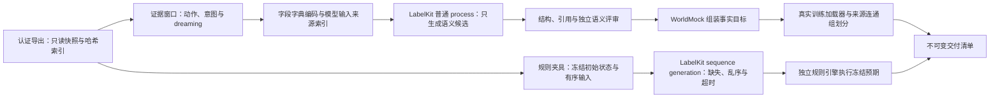
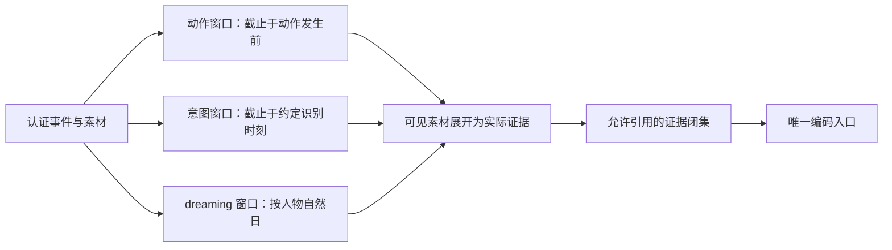

# 特性规格：数字足迹接入 LabelKit

> 状态：定稿冻结（FROZEN）；2026-09-27 按人物 Prompt 规格修订（[人物 Prompt 规格](SPEC-life-realism.md#persona-prompt-七层请求)「冻结条款修订」第 18 行），修订部分已实现并通过离线验收（证据见[人物 Prompt 验收记录](../archive/persona-prompt/persona-prompt-verification.md)）；按[个人事务与工作安排规格](../VERIFICATION.md#verification-incremental-evidence)修订「窗口构造规则」与验收矩阵「私有载体边界」（[实施计划](../archive/errands-workday/errands-workday-implementation-plan.md)作业 LK1–LK3、LK5）：决策提示的选取一句属更正既有表述；修订部分已实现并通过离线验收（该规格阶段 1 的就寝反思请求改带严格工具、阶段 2 的 `errands` 投影与个人事务事件；证据见[个人事务与工作安排验收记录](../archive/errands-workday/errands-workday-verification.md)）。数字足迹接入 LabelKit 的输入范围、加工责任、来源关联、信息范围、交付产物、长序列与数据划分，以及真实调用的生产与验证步骤以本规格为准；实现状态见 `docs/dev/implementation-status.md#implementation-status-worldmock-实现状态`；按[让「等待」成为例外规格](SPEC-idle-fillers.md#spec-idle-fillers-让等待成为例外开发规格)修订「下游」（阶段 1、阶段 2、阶段 3）。
> 日期：2026-10-05
> 实施基线：`9b7fbc8`
> 范围：`worldmock deliver` 从认证导出到不可变交付清单的全部加工与验证行为，`src/worldmock/delivery/` 与 `labelkit-projects/` 的模块行为，以及 `tests/delivery/` 覆盖的验收行为。

本规格只定义流程与验证行为，不重复定义接口。模型输入与窗口编码的字段与合同、五类交付产物的最小字段、语义候选的上限与标签取值、真实调用配置、命令行参数与运行状态的权威定义在 `docs/CONTRACTS.md#contracts-worldmock-接口合同`：「LabelKit 输入结构与窗口编码」「LabelKit 训练记录与交付格式」「LabelKit 语义候选与标签值」「LabelKit 调用配置」「CLI 命令接口」。数字足迹的事件结构与导出认证的权威定义在 `docs/design/05-recording-engine.md#recording-engine-worldmock-产品设计说明书-记录引擎`「数字足迹事件结构」，导出的一致性与校验行为见 `docs/design/05-recording-engine.md#recording-engine-worldmock-产品设计说明书-记录引擎`。

## 共享规则与可重建环境修订

按[共享规则与可重建环境规格](SPEC-shared-rules-and-rebuildable-env.md)修订；验收结果独立记录。

LabelKit 由固定提交的 HTTPS 源制品与哈希依赖锁建立独立环境；引导核对制品身份，不要求私有 SSH 子模块。WorldMock 不在进程内导入 LabelKit；交付进程的退出码、产物与身份校验继续执行。

## 产品行为

**数字足迹**是人物运行过程中写在模型与环境接口边界上的可追溯事件与素材；**认证导出**从一次运行中挑定截止事件与当时的完整状态，落成一批只读、不可改写的 JSONL 及其哈希索引，原轨迹保持原样。交付以一次认证导出为唯一输入：把事件切成动作、意图与 dreaming 三类**证据窗口**，每个窗口按 `docs/CONTRACTS.md#contracts-worldmock-接口合同`「窗口声明与字段字典编码」声明窗口字段；窗口经唯一编码入口转为模型可见输入，交 LabelKit 普通 process 只生成**语义候选**；候选先过结构、引用与独立语义评审，评审通过后由 WorldMock 一次性组装事实目标，再经真实训练加载器与独立规则引擎执行，全部校验通过后才发布不可变交付清单。

系统必须同时满足：

- LabelKit 侧不做任何运行中读取：交给它的永远是某次认证导出的冻结快照。
- 交给 LabelKit 的证据是展开后的实际内容，不是等它自己去打开路径。
- AS2 活动关联作为来源事实；LabelKit 可以发现更高层的行为任务，但不能覆盖原始活动、动作和时间。
- 四种输入形态是面向不同任务的显式选择，不是失败时自动替换的处理路径。
- 语义候选只含待标注目标；其余字段的组装时机与顺序、原始真值的暴露时机见 `docs/CONTRACTS.md#contracts-worldmock-接口合同`「LabelKit 训练记录与交付格式」。
- 规则夹具的预期结果来自冻结规范与独立检查器，不取待测规则引擎自己运行出的结果。
- 装不下的输入立即失败，不做静默截断；把任务按小时拆开各跑一遍，不等于长序列已经接续。
- 采集端不删除失败、取消、重复和无效选择；下游可以拒收，但保留拒收原因和来源。
- 数据划分服从 `docs/CONTRACTS.md#contracts-worldmock-接口合同`「数据集字段与划分」的来源连通组合同；逐行随机分割会泄漏，本规格不采用。
- 未完成或校验失败的集合不得交付；普通 process 不自动具备多文件提交保证。

## 设计裁决

| 机制 | 本项目裁决 |
| --- | --- |
| LabelKit 普通 process | 动作、意图与 dreaming 一律走普通 process 通道，配置项见 `docs/CONTRACTS.md#contracts-worldmock-接口合同`「LabelKit 调用配置」；只有需要机械时间约束与缺失、乱序、超时变体时才另用 sequence generation |
| LabelKit 保留的 `_meta.event` | 不得用来冒充 LabelKit 内部生成 stream，否则触发另一套严格摄入约束；输入正文走文本字段的对象序列化与顶层来源透传 |
| LabelKit 的 `extract` | 只适用于 UI 模态，不使用它重新猜测已经知道的动作 |
| 文本 stream 的跨中断能力 | 当前不直接保证按外部活动标识完成跨中断缝合；有权威边界的输入优先使用完整活动记录，纯足迹语义分段作为单独的比较研究 |
| sequence generation 的成功产物 | 必须验证成功清单的提交标志、运行身份、主文件与 stream 行数、文件哈希后才消费；文件存在不是成功判断 |
| 待测规则引擎 | 不提供预期结论；表达式、输入与预期分别冻结，预期取自冻结规范与独立检查器 |
| 逐行随机划分 | 禁止；划分按 `docs/CONTRACTS.md#contracts-worldmock-接口合同`「数据集字段与划分」的来源连通组合同执行，不为了凑比例制造泄漏 |
| 上下文容量 | 超限时明确失败；不接受自动裁剪正文，也不接受按小时切分后宣称长序列已被接续 |
| 编码表示 | 字段字典编码只是无损传输表示，不改变条目引用事件的含义；窗口身份与模型侧记录身份的绑定关系见 `docs/CONTRACTS.md#contracts-worldmock-接口合同`「窗口声明与字段字典编码」 |
| 人物自报目标 | 是一种标签来源而不是意图的无误答案；事后推断是另一种来源，两者在记录中区分 |
| 调研与验收依据 | 外部方法与容量依据只作为证据登记，不进入本规格正文；正文只写当前生效的行为 |

## 确定输入范围与加工责任

四种输入形态服务于不同任务，各自声明用途与加工路径，互不替代。

| 输入形态 | 服务的任务 | 加工路径 |
| --- | --- | --- |
| 每行一个事件 | 从连续足迹发现活动与意图的研究 | 文本 stream 分段、分类、标注、验证；已知动作保留在正文 |
| 每行一个事件及其必要历史 | 已定义预测时刻的在线意图样本 | 普通 process；每行自带截止该时刻的上下文，不假设自动读取前文 |
| 每行一个有明确边界的活动或经历窗口 | 已知活动标识、完整工作过程、dreaming 与训练样本加工 | 普通 process，有序事件保存在结构化证据中；不让语义分段重新定义权威动作归属 |
| 经历整理出的场景初态与规则配置 | 缺失、乱序、超时等规则测试扩展 | 进入 LabelKit 已有 sequence generation；需要项目的场景目录与约束绑定 |

跨活动意图允许引用多段经历，并保留原时间位置与中间发生的其他活动。

加工责任按事实来源划分，模型不负责重建世界事实。

| 内容 | 负责人 |
| --- | --- |
| 真实动作名、参数、事件标识、时间、资源变化、状态 | WorldMock 确定性导出；语义评审通过后组装和验证 |
| 活动语义、任务类别、意图及证据选择 | LabelKit 模型标注与独立验证 |
| dreaming 的反思与假设 | LabelKit 相应项目生成，保留来源和分支 |
| 规则预期结果 | 冻结规范与独立检查器，不能取待测规则引擎自己的结果作为答案 |
| 最终字段和文件格式 | LabelKit 语义候选 Schema、WorldMock 组装与目标加载器合同 |

普通 process 的模型只生成含待标注目标的语义候选；LabelKit 以原始输入和该候选完成结构、引用与独立语义评审；评审通过后，WorldMock 才组装真实动作、时间和来源字段。dreaming 的经验归纳与反思可由 process 加标注输出结构化派生结果，不要求先启用 sequence generation。需要机械时间约束和缺失、乱序、超时变体时，才使用独立的 sequence generation 项目。

## 证据窗口与输入结构

窗口只从认证导出构造，不读取运行中的数据库、人物工作区或外部模型侧日志。
认证导出中的实际人物 `model_request` 是动作与意图窗口的 prompt 权威来源；同秒续接的请求带本秒前序决策的原生消息，
其中 assistant 的 `reasoning_content` 随实际请求原样保留。
窗口声明与字段字典编码的字段与示例见 `docs/CONTRACTS.md#contracts-worldmock-接口合同`「LabelKit 输入结构与窗口编码」。

**窗口构造规则**：

- 动作窗口使用目标动作前同人物、同决策的最后一份不带 `purpose` 的 `model_request`，并核对其工具定义含该动作的工具名，不满足是完整性故障，不回退到更早的请求；输出截断后的重试请求照此被选中，保存模型真正收到的 system、user、工具定义和历史消息（同秒续接时含本秒前序决策的原生消息）；`self_note` 作为实际请求的一部分进入动作与意图窗口。原请求事件身份与 canonical 摘要随窗口发布。缺失或不匹配时失败，不从观察字典猜测 prompt，也不在交付时重新渲染观察。带 `purpose="plan_day"` 的零点计划请求不作动作 prompt；就寝反思请求（含其校验重试）发生在动作登记之后，不会被选中，含反思的决策其窗口提示仍是该动作之前的请求。
- 意图窗口沿用同一实际请求作为当时决策的上下文，知识截止可以包含后来已经发生且公开的结果；请求后的未来目标与私有模型输出不进入输入。
- 前置状态只在窗口开始前已经观察过时给出；若同一观察已在 `events` 中，只保留引用，不复制 `events[0].data`；没有可依据的观察时明确标为未观察。
- 边界类型区分活动完成、容量切断与实验结束，不从未来目标推测边界；窗口内的活动边界只保留真正观察到的完成、取消、失败与截断原因。
- 人物可见的素材引用在此展开为实际内容；文本与结构化素材给出正文，二进制素材保留模态引用；内容与引用摘要不符时立即失败。
- 动作与意图窗口仅从上述实际人物请求提取模型可见输入，不把原始私有事件、人物响应、reasoning、记忆更新或工作评审请求整体复制进证据；实际请求中续接的前序 assistant 消息（含 `reasoning_content`）是 prompt 的一部分，原样保留。dreaming 窗口按当日可见经历读取 `self_note` 与层 JSON，不再读决策自述与 `scene`：层 JSON 取窗口内每个动作请求所属决策、动作之前最后一份不带 `purpose` 且工具含该动作工具名的请求的首个 user（与动作窗口同一 prompt 权威与选取规则，不满足是完整性故障、不回退；截断重试请求照此被选中，就寝反思请求不会被选中），随请求事件身份与 canonical 摘要发布，字段见 `docs/CONTRACTS.md#contracts-worldmock-接口合同`「窗口声明与字段字典编码」；缺失时失败。`report_status`、`pause_activity`、`conclude_activity` 三个控制工具的请求在意图与 `dreaming` 输入中的投影逐项只留 `activity_name` 与 `summary`，恒不带各项的 `memories`、`views` 与请求级 `errands`（三者同等对待，投影函数签名不变；变的只是窗口事件中动作请求的投影，原事件不被原地修改）；控制请求经唯一读取入口读出，缺 `errands` 键即完整性故障；动作目标保留完整请求；实际请求与层 JSON 是模型收到的原文，照原样保留，其中可以含有进度层参数或记忆层 `self_notes` 里此前常规收尾写下的记忆原文，以及待办层里的个人事务。
- 观察事件按字段级公开投影，禁用的菜单、可供性合同、游戏目录与内部状态（旧导出另含能量可行性）不能因事件 `visibility=agent` 而进入输入。目标 `outcomes` 只收动作相关的公开结算事件，排除全部私有事件。观察的待办层原样进入窗口（含未完成个人事务的名称、办成条件、进度、备注、提醒钟点与记下的日期），事务的内部身份与私有绑定不进入输入。六种个人事务事件属于 `environment_event`，决策身份与动作身份都为空，只经 `caused_by` 关联：不进入任何动作窗口的目标与结果，也不落进任何决策的分组（触发它的证据可以是别人的动作）。`errand_registered`、`errand_updated`、`errand_cancelled`、`errand_progressed` 为 `system` 可见，只供审计与指标；被进度层消费的只有 `errand_completed` 与 `errand_reminded`，二者人物可见，满足下一条对进度层来源事件「同人物可见」的要求，在窗口里作为事件出现时公开投影仍为空对象；含事务提醒与办成记录的导出必须能构造动作、意图与 `dreaming` 三类窗口。
- 追溯性证据只并入当前观察的进度层来源事件（`progress_event_ids`）所指的先前结果，并且必须以截止前同人物可见的权威结果为准；引用不得指向观察本身或截止之后。
- 可见来源按请求人物核对，同一不透明标识跨人物复用时的判定见 `docs/CONTRACTS.md#contracts-worldmock-接口合同`「窗口声明与字段字典编码」；不依赖标识字符串的组成方式代替人物字段校验，也不静默删掉冲突来源后继续发布。
- 自然日归属由场景时区决定；排他实验终点的结算事件归入最后一天，不产生额外空白自然日。

## 来源关联

每个导出都要把样本标识与原始事件标识关联起来，逐事件导出还要额外记下它所在的输入文件、行号、人物与位置。

- 普通 process 用顶层来源字段透传来源；stream 用 LabelKit 的成员来源与成员位置回到输入文件，再回到原始事件。
- 不依赖主序列顶层原始字段透传所有成员字段，因为该序列本身没有原始行对象。
- 后处理阶段只搬运已经存在的事实并要求关联自洽，事件标识一律由产生它的那次运行给出，不由模型补写。
- sequence generation 产生的是生成分支：这些新事件不能当作原世界已经发生的事件来消费；交付程序保存生成场景、分支、目录记录与原始经历之间的映射，实际成员从那次成功交付的主文件与 stream 里取。
- 生成序列的整体后处理看不到完整的原始行上下文，因此恢复初始状态、成员与来源这件事不能交给它。
- 模型输入侧另存来源索引，逐一记录模型输入摘要与 LabelKit 记录身份的对应；身份绑定关系见 `docs/CONTRACTS.md#contracts-worldmock-接口合同`「窗口声明与字段字典编码」。不能拿原始行身份验收编码行输出。
- 动作与意图来源索引还绑定实际行动请求的事件身份及原始请求摘要；消费者从认证导出重算 prompt 与摘要，证明训练输入没有重建漂移。

## 信息范围与标签

- 动作预测的输入截止于动作发生前；意图预测的输入截止于约定识别时刻；结果与未来内容只能放在目标或评估证据中。
- 人物自报目标作为一种标签来源，事后推断作为另一种；不把人物自述当成人类意图的无误答案。
- 存在多个合理意图时，按任务 Schema 表达多标签或无法确定，不强迫模型选择不存在的唯一答案。
- 离线 dreaming 可以使用已发生的完整窗口，但需要声明其知识截止时间，不能污染更早时刻的预测样本。
- 事实、推断、假设与不确定性的标签取值和口径见 `docs/CONTRACTS.md#contracts-worldmock-接口合同`「LabelKit 语义候选与标签值」；本规格只规定评审行为：分类必须逐条核对，不能仅改标签保留无依据的断言，也不能把认识论上的无法确定降格成猜测措辞。
- 身份字段按 `docs/CONTRACTS.md#contracts-worldmock-接口合同`「LabelKit 语义候选与标签值」的不透明标识口径处理；评审阶段不得从身份字段里的数字或片段反推其对应的步骤、时间与结果。

## 交付产物与发布边界

训练记录、规则夹具与交付清单的最小字段见 `docs/CONTRACTS.md#contracts-worldmock-接口合同`「LabelKit 训练记录与交付格式」。

- 训练项目统一输出任务、输入、目标与来源，由目标训练加载器映射为其对话或张量格式；规则项目统一输出初始状态、有序事件、预期与来源。
- 这是本项目的交付合同建议，不宣称任意训练框架或任意规则引擎已经原生支持这些字段；首个实现同时提供真实训练加载器和目标规则引擎的夹具读取器，通过实际读取与执行定义「直接可用」。
- 规则夹具由项目交付程序确定性组装：从冻结场景目录取得初始状态，从已确认的原始事件或生成分支取得有序输入，从冻结规范和独立检查器取得预期结果，并关联规则、分支和来源；模型不负责重建这些事实。
- 交付目录在成功前不承载可消费成品：任一环节失败时保留失败诊断，不发布成功清单，也不复用不完整产物。
- 最终清单的绑定范围见 `docs/CONTRACTS.md#contracts-worldmock-接口合同`「运行报告」；下游只读取清单中通过身份、哈希和数量核验的文件。
- 运行报告的发布条件、计算依据、未知项口径与消费端重算要求见 `docs/CONTRACTS.md#contracts-worldmock-接口合同`「运行报告」。

## 长序列、截断与划分

LabelKit 的固定文件、进程内跨计算组处理与跨独立执行恢复状态是三件事，不能互相冒充。

- 普通 process 的每一行也必须装入一次请求，没有自动的跨记录记忆；超限的失败口径见 `docs/CONTRACTS.md#contracts-worldmock-接口合同`「窗口声明与字段字典编码」。
- 不能随意按小时独立运行 LabelKit，再声称跨小时任务一定被接起来。
- 长活动使用明确窗口、前置状态、来源事件与边界类型；上下文容量切断、实验结束和活动完成分别保存。
- 采集端不删除失败、取消、重复与无效选择；下游可以拒收，但保留拒收原因和来源。
- 训练、验证与测试三份 split 的判据不在本规格定义：WorldMock 只保证划分按来源连通组执行，同源样本不跨 split，逐行随机分割一律禁止。

## 生产与验证步骤

### 语义候选与独立评审

- 标注 Schema 只暴露待标注目标，候选面见 `docs/CONTRACTS.md#contracts-worldmock-接口合同`「LabelKit 训练记录与交付格式」；模型与评审者各自只读取一次完整可见输入。
- 候选先通过 LabelKit 结构校验、本地引用验证和独立评审，随后 WorldMock 按 `docs/CONTRACTS.md#contracts-worldmock-接口合同`「LabelKit 训练记录与交付格式」组装事实字段。
- 动作目标只留在原始行的目标字段里，不得作为动作前的历史发给模型；意图允许多个合理标签或无法确定。
- 逐条评审必须确认该条所列事件能够支持正文中的全部事实、数量、时间关系与因果描述，不能借用未列出的事件补全证据；正文在完整输入中为真但所列引用不足时仍需返工，修正引用或收窄结论。引用身份存在只是结构检查。
- 每轮评审必须完整检查主题聚合、逐项引用支持、事实与推断与假设的分类，以及意图与不确定性口径的一致性，一次列出发现的全部实质问题；发现一个问题不构成其他方面合格的证据。
- 三个任务的初稿、返工和评审必须收到逐字一致的证据支持、分类和聚合合同；角色专用的执行要求另行保留。
- 独立评审只看当前候选、完整可见输入与固定任务要求，不以此前通过、失败或评审措辞代替本轮判断。

### 语义返工与聚合

- 语义返工使用 LabelKit 既有返工策略，轮数上限、策略取值与每轮返工后的独立评审要求见 `docs/CONTRACTS.md#contracts-worldmock-接口合同`「LabelKit 调用配置」。
- 每次返工包含本记录此前全部评审意见、完整可见输入与当前候选；不只传最后一轮意见，也不重复放入历史候选。历史意见是待重新核对的要求，可能已经修复或存在误判；返工依据当前候选与来源核验，不得机械恢复已删除的错误。
- 返工仍只输出既定目标，不增设整改说明字段；返工用尽仍不合格时整份交付失败，不发布部分成品。
- 结构返工必须给出可执行的具体限制：数组超限的错误形态见 `docs/CONTRACTS.md#contracts-worldmock-接口合同`「LabelKit 语义候选与标签值」，错误说明只给字段路径与数量，候选原文不在里面重复展开。
- 普通 process 的结构返工使用 LabelKit 现有完整上下文路径，保留首轮系统任务与 Schema、可见输入、候选和违规反馈；完整输入与候选各出现一次，未来目标仍不得进入任何请求。
- 条目按活动阶段或因果主题合并，一条可以引用多个事件；不得逐事件、逐目录项、逐终态字段或逐条未变化状态复述。
- 聚合在输出前由模型完成以满足既定上限，工程不得裁剪原始事实或静默截取候选；重复发生的活动以共同阶段、发生次数或有意义的差异概括，不逐次建立同文条目。
- 评审因聚合不足判失败时，必须指出共享主体、关系与尚未概括的重复内容，不能仅因条目数量或条目来自同一观察判失败。
- 假设是明示合格的形态：假设条目的证据只需支持假设条件本身，字段口径与取值见 `docs/CONTRACTS.md#contracts-worldmock-接口合同`「LabelKit 语义候选与标签值」；评审不得对假设结果索要事件级证据，也不得因假设未证实判失败。不确定性字段只写一般性声明，不再重复假设条目已经回答过的那个问题。假设条件里的数值界限只能取自所列事件中可见的数值或其近似，评审不得因为用了近似值而判失败。

### 编码身份与 trace 绑定

- 普通窗口与真实重执行窗口共用同一编码入口，窗口声明、字典项与指针的编码合同见 `docs/CONTRACTS.md#contracts-worldmock-接口合同`「窗口声明与字段字典编码」。是否启用编码必须先按实际字节核对整体收益：赚不回来的字段直接留原值，任何内容都不因此被裁掉。
- 编码是无损传输表示：语义结果通过后恢复完整规范输入，最终训练样本只采用这一完整输入合同；实际加载器逐项验证还原结果，并把训练样本追溯到实际模型输入及其 trace。
- trace 必须是有效的 LabelKit JSONL，属于同一次运行并具有完整的成功开始与结束记录；每个来源索引中的记录身份都必须在该 trace 中具有最终通过的独立评审记录。
- 按 LabelKit 实际 trace 字段核对当前配置和项目文件摘要、模型身份、完整输入输出、用量及每轮调用关系；每轮评审前必须有本轮生成及独立评审调用，不能复用上一轮调用来证明返工完成；传输重试保持为零。
- 任意文件的存在或摘要一致不能替代 trace 证明；实际调用的截止、重试与响应校验口径见 `docs/CONTRACTS.md#contracts-worldmock-接口合同`「LabelKit 调用配置」，失败沿 LabelKit 既有拒绝与最后一次发布清单边界传播，不能发布部分成功成品。

### 反事实分支与规则扰动

- 交付侧必须能消费一次真正跑完的**反事实分支导出**，父子一致性判据与余额条件干预的施加时机见 `docs/CONTRACTS.md#contracts-worldmock-接口合同`「反事实与重演字段」。
- 按自然日产生的 dreaming 记录明确声明假设条件及重演世界，绑定字段见 `docs/CONTRACTS.md#contracts-worldmock-接口合同`「反事实与重演字段」；实际重演中的事实不能冒充原世界发生的事实。
- 没有经过环境重演的反事实材料必须留在未执行状态，字段取值与评审口径见 `docs/CONTRACTS.md#contracts-worldmock-接口合同`「反事实与重演字段」，不得说成已经执行或已经观察到想象结果。
- 规则扰动单独走 LabelKit 的 sequence generation 项目，变体覆盖范围与消费前核验项见 `docs/CONTRACTS.md#contracts-worldmock-接口合同`「反事实与重演字段」；夹具的预期结论一律由冻结规范与独立检查器给出，模型不参与。

### 恢复完整输入与发布

- 验收包含所有窗口逐字节往返、跨进程哈希稳定、引用篡改与未来泄漏拒绝、真实 LabelKit 行身份、普通与重执行共用入口、训练保存重载，以及真实模型对完整自然日编码输入的语义评审。
- 数据集保存与划分行为：字段守恒与来源连通组划分见 `docs/CONTRACTS.md#contracts-worldmock-接口合同`「数据集字段与划分」；数据集必须经保存后重新加载验证行守恒。
- 全部数据校验、语义校验、训练加载和规则执行通过后，才发布最后的不可变交付清单；未完成或校验失败的集合不得交付。
- 普通 process 不假定 LabelKit 为所有项目原生发布同样清单，其成品由 WorldMock 交付清单整体发布。

## 文件修改清单与实施顺序

| 模块与文件 | 必须完成的变化 |
| --- | --- |
| `src/worldmock/delivery/windows.py` | 只从认证导出构造动作、意图与 dreaming 窗口；动作与意图窗口排除私有载体，dreaming 窗口读取当日 `self_note` 与层 JSON；交付不重新渲染观察；前置状态只在窗口开始前已观察时给出 |
| `src/worldmock/delivery/replay.py` | 认证父子导出、共同前缀与一次实际干预，再逐自然日建立重演证据窗口；未发生环境重演的反事实材料不得声明已执行 |
| `src/worldmock/delivery/evidence_encoding.py` | 窗口的字段字典编码与解码共用唯一入口；指针取值形式与编码收益判定见 `docs/CONTRACTS.md#contracts-worldmock-接口合同`「窗口声明与字段字典编码」 |
| `src/worldmock/delivery/pipeline.py` | 在独立依赖环境调用固定项目与配置；模型输入、来源索引、提交标志核验、trace 绑定与最终清单的顺序执行；任一环节失败都不产生可消费成品 |
| `src/worldmock/delivery/semantics.py` | 语义候选的结构与引用验证、标签规则检查，以及评审通过后的事实组装 |
| `src/worldmock/delivery/trace_validation.py` | 校验单次成功运行的 trace 生命周期、逐记录最终通过评审、配置与项目摘要、模型身份和每轮调用关系 |
| `src/worldmock/delivery/training.py` | 真实加载器读取、字段守恒、来源连通组划分，保存后重新加载验证行守恒 |
| `src/worldmock/delivery/generation.py` | 以真实经历建立规则夹具目录与扰动变体；核验成功产物的提交标志、行数与哈希 |
| `src/worldmock/delivery/rules.py` | 用成熟规则引擎执行冻结表达式，并按声明支持字段检查因果约束 |
| `labelkit-projects/` | 只声明待标注目标 Schema、项目与钩子；调用配置与提示词模板的权威定义见 `docs/CONTRACTS.md#contracts-worldmock-接口合同`「LabelKit 调用配置」 |
| `src/worldmock/cli.py` 的交付命令 | 显式接受导出、输出与反事实分支导出；失败时的退出状态与产物边界见 `docs/CONTRACTS.md#contracts-worldmock-接口合同`「CLI 命令接口」 |
| `tests/delivery/` | 规格每条行为都有可独立观察的断言，含真实加载器与真实规则引擎路径 |

先完成公共窗口与编码的一条最小端到端路径：认证导出、动作与意图窗口、模型输入与来源索引、普通 process、独立评审、事实组装、真实加载器；随后补齐 dreaming 与反事实重演、规则扰动与独立规则引擎执行；最后接入 trace 绑定、行号往返与不可变清单。不得为实现尚未完成的复杂路径拆掉已通过的端到端路径。共享文件的改动由单一实施者串行维护，各实施单元获得明确文件所有权，不覆盖其他人的工作。

## 下游

- **事件。** `decision_started.data` 为闭集（第二章），带退役字段即以英文错误拒绝；`action_requested.data` 增 `self_note`；
  观察事件保存环境构建的工具层、待办层、环境层、记忆层与看法偏好原文，以及私有绑定与证据；进度层只存来源事件引用（`progress_event_ids`），
  完整 JSON 由实际请求的 `model_request` 保存。新增 `environment_event` 的 `decision_budget_exhausted`；事件外壳与类型闭集不变。
  个人事务与工作安排规格在 `environment_event` 下再登记六个 `kind`：`errand_registered`、`errand_updated`、`errand_cancelled`
  （控制请求受理时写，每条变更一条，`caused_by` 为请求事件，`visibility=system`）、`errand_progressed`（结算证据命中但未达数量，`system`）、
  `errand_completed`（达到数量，`agent`）、`errand_reminded`（提醒实际交付时写，`agent`）；结算两种的 `caused_by` 为证据事件；
  六种事件的决策身份与动作身份都为空，只经 `caused_by` 关联，不进入任何动作窗口的结果，也不落进别人那次决策的分组。
  人物可见的两种是进度层 `errand_completed`、`errand_reminder` 记录的来源，计入 `progress_event_ids`；其余四种只供审计与指标。
  载荷为 `{kind, errand}`（`errand` 为事务快照），结算两种另带 `quantity_added`，取消另带 `reason`；事件类型闭集仍不变。
  观察事件保存的待办层含 `errands`、环境层含 `duty`；私有绑定增 `errand_bindings`（名称、事务身份、结果种类、商品身份）与
  `errand_item_bindings`（全部商品名到商品身份），连同 `errand_id` 列入提示禁键；阶段 4 另增渠道索引 `world_query_channels`（列入提示禁键）
  与供给条目的私有键 `location_id`（已在禁键内）。
- **清单。** `stages` 只剩 `action`、`work_review`，`action` 增 `same_second_continuation`；`two_stage_model_identity` 改名为 `stage_model_identity`。
  新建、打开、恢复、从工作区加载与校验五个入口经同一校验函数拒绝含 `decision_statement` 的清单；恢复与重放继承开关。
- **质量与指标。** 删除 `decision_started_with_decision_statement`、`decision_started_missing_decision_statement`；dreaming 私有事件集等于私有事件集；
  统计 `decision_budget_exhausted`。观察重复门禁改按（人物，模拟秒）的续接链计：链内复用链首 user 合法，跨秒重复仍失败。
  一日运行保真规格为 `quality.json` 另增 `input_warnings`、`truncations`、`timeline_labels`、`contact_reply_guard`、`name_rejections` 五节，
  当前质量报告 `schema_version` 为 4，全部只报告不放行；`OUTPUT_TRUNCATED` 作为协议错误串记录。
  个人事务与工作安排规格为 `quality.json` 再增 `errand_metrics`、`conclusion_memories` 两个顶层分组，`schema_version` 升到 4（阶段 2 一次升完），
  全部只报告不放行，既有记忆重复比例门禁的口径与阈值不变；唤醒原因分桶把新增成员 `errand_reminder_due` 计入已知原因，[让「等待」成为例外规格](SPEC-idle-fillers.md#spec-idle-fillers-让等待成为例外开发规格)追加的 `shift_start`、`shift_end`、`break_start`、`break_end` 同样计入已知原因（分桶直接读足迹侧词表）；
  工作负荷 `workload` 与作息偏离 `routine_deviation` 进行为评估的 `reports`（结构标识 `behavior-metrics-1` 不变），不进质量报告。
- **交付。** 删除交付时的 `render_scene` 重渲染（`src/worldmock/delivery/windows.py`、:171-178）。动作与意图窗口仍以同人物、同决策、
  动作前最后一次实际行动请求为 prompt 权威（取动作之前最后一份不带 `purpose` 的请求，并核对其工具含该动作的工具名，不满足是完整性故障、不回退到更早的请求；
  截断重试请求照此被选中，就寝反思请求晚于动作登记、不会被选中），原样保留其中的 assistant `reasoning_content`（所属现行合同），续接请求自然带上本秒前序决策；
  dreaming 读 `self_note` 与实际请求中的层 JSON，不再读自述与 `scene`。意图与 dreaming 窗口对三个控制工具请求的投影恒不带请求级 `errands`
  （与 `memories`、`views` 同等对待），动作窗口的目标保留完整请求，观察里的待办层原样进入窗口；缺 `errands` 键的旧控制请求是完整性故障；
  六种事务事件都不带决策与动作身份，不进入任何窗口的目标与动作结果，含事务提醒与办成记录的导出须能构造动作、意图与 dreaming 三类窗口。
  交付清单升 2，交付入口按现行世界结构版本设门禁（个人事务与工作安排规格阶段 2 起为 9）。
- **查看器。** 删除自述阶段；system 为 JSON 且 `layer=系统层` 时判为行动请求；首个 user 按顶层数组无损切片，每片可解析且层序正确才分段，
  否则显示为未解析；工具层与进度层按真实字段下钻，`self_note` 标「未经核验」；一次决策的首个请求多于两条消息时判为续接，前序 assistant 按
  `tool_call` 身份匹配来源决策，回传的思考单列；旧运行的自述请求显示为「其他调用·未解析」。
  个人事务与工作安排规格：查看器是 `control_items` 的独立镜像实现，读取控制请求时缺 `errands` 键即报错，不留旧形状读取；
  世界结构 8 的旧运行（含配对复跑的基线臂）用基线提交的查看器查看。
- **导出。** 新模块 `footprints/purchases.py` 输出 `purchases.jsonl`：`purchase`（取结果顶层与各活动结果的订单，按订单去重，不看整体状态，
  重放回执不重复计）、`order_attempt`（方式为到店或远程下单的请求，带状态与错误码）、`app_browse`（方式为浏览的活动）。加入导出工件闭集与重算校验；
  导出清单与质量报告升 2。一日运行保真规格另给购买事实与订单载荷增 `channel_id`（写了渠道称呼时所用的渠道），不进世界状态。
- **续接对比（只报告）。** `scripts/inspect_run.py` 新增只读子命令 `continuation`：逐决策给出链位置、请求数、`reasoning_tokens`
  （缺失时报字符数，两者不混算）、协议错误与传输失败（400 单列）、缓存命中与计价成本、话题命中（如咖啡）、工具是否与链首相同、按订单去重后的重复下单、
  链完整性。对比协议：同一提交、同一场景文件、同一模型身份，两臂只有开关不同；`--baseline` 核对两份清单，其余不同即拒绝比较；每臂至少三次白领全天运行，
  另加一次双人半日，交替启动；`2026-09-28-c9a4fc1-day-r3` 带自述阶段，不能作关闭臂。
- **其他读者。** `scripts/render_day.py` 读取观察键（:99-134），随观察形状改读；零点计划输入改用共享句式（`src/worldmock/life/day_plan_inputs.py`）。
- **版本。** 世界结构版本由 7 升到 8，只升一次：`DeliveryState.recipient_id`、`request_message_id`，`WorldState.contact_holdings`，
  `AgentState.outbox`，`ActivityState.paused_at`，`SessionState.opened_by_action_id`，活动数据中的 `opened`，`SameMomentStage` 去掉 `wait_only`，
  观察形状改变。`prompt_sha256` 与 `tool_schema_sha256` 随模板与工具面改变；生活场景 `Contact` 增 `receive_location_id`（可空），场景与数据集场景同步，
  这批原有修改未改变 `catalog_version`；2026-10-01 工具交互首次受影响的发布使用目录 `5.0`、品类与规则绑定 `3`、场景 `4`、地图 `3`，世界结构仍为 `8`。一日运行保真规格的系统层 18 条、待办层 `around_time` 与工具层 `callable_index` 再改 `prompt_sha256`，控制工具的 `items`、
  `revise_day_plan` 的 `around_time` 与 `start_activity` 的 `prefer`、方式「购买」再改 `tool_schema_sha256`；世界结构版本不因它升级。
  个人事务与工作安排规格：阶段 1（运行修复）只变 `code_sha256`。世界结构版本由 8 升到 9，只升一次（阶段 2，人物状态增未完成的个人事务 `AgentState.errands`；
  版本 8 的检查点与导出按版本拒绝，不迁移）；场景结构由 4 升到 5（阶段 3，人物配置增必填可空的 `work_schedule` 与可选的 `leave_work_window`、`arrive_home_window`，
  仓库三份场景的 `scenario_sha256` 随之改变）；卡片结构由 2 升到 3、抽取提示 `card-v3`（阶段 3）；质量报告结构由 3 升到 4（阶段 2）。
  系统层第 1、4、6 条与待办层、进度层 Schema（阶段 2），系统层第 1、14 条与人设层、环境层 Schema（阶段 3）各改一次 `prompt_sha256`；
  三个控制工具的 `errands` 及用途句、字段说明（阶段 2）与 `query_world` 六键及用途句（阶段 4）各改一次 `tool_schema_sha256`；
  `submit_reflection` 与反思文案不进这两个指纹，由 `code_sha256` 绑定。地图 3、目录 5.3、品类合同与规则绑定 3、导出清单 2、运行清单 2、
  行为评估结构标识 `behavior-metrics-1` 与 AS2 锁定摘要不变。
  [让「等待」成为例外规格](SPEC-idle-fillers.md#spec-idle-fillers-让等待成为例外开发规格)的班次边界唤醒（阶段 1）只改变 `code_sha256`：`prompt_sha256`、`tool_schema_sha256`、世界结构 9、质量报告结构 4、场景结构 5、交付清单与 AS2 锁定摘要都不变。
  [让「等待」成为例外规格](SPEC-idle-fillers.md#spec-idle-fillers-让等待成为例外开发规格)的系统层第 7、14、15、16 条原位改写（阶段 2，仍为十八条）再改一次 `prompt_sha256`，`code_sha256` 随之改变；`tool_schema_sha256`、世界结构 9 与场景结构 5 不变；零点计划模板第三、五、六条的改写（阶段 3）只改变 `code_sha256`。

## 下游与质量报告

| 位置 | 变化 |
| --- | --- |
| 运行清单 | 新键 `input_warnings`（1.3；接口合同「模型身份」:1258-1268 的清单内容表同步）；`prompt_sha256`、`tool_schema_sha256` 重钉；清单版本升级 |
| `quality.json` | 新节 `input_warnings`、`truncations`（次数、浪费 token、思考 token）、`timeline_labels`（英文种类名与标识形态计数）、`contact_reply_guard`（命中、重试、兜底计数）、`name_rejections`（名称类拒绝计数，与协议错误分开）；`schema_version` 由 2 升 3（`src/worldmock/footprints/quality.py`），分组表在记录引擎设计「质量报告」（`design/05-recording-engine.md:783-785`）登记；全部只报告不放行 |
| 事件 | `model_npc_reply.data` 增 `attempts[]`、`guard_applied`；`action_result.data.orders[]` 增 `channel_id`；`action_result.data` 增 `resolved`、`notes`、`items`；`OUTPUT_TRUNCATED` 作为协议错误串记录 |
| 世界状态 | 不升版：`channel_id` 不进 `DeliveryState`；`f` 在场景层；`branch_label` 属地图文件结构 |
| 导出 | `purchases.jsonl` 增 `channel_id`；时间线按 7.4 渲染 |
| 查看器 | `tools/run-viewer.html` 经 `control_items` 只读当前控制工具形状；显示 `input_warnings` |
| 实验假设 | `docs/EXPERIMENT.md#experiment-worldmock-实验设置`「实验假设声明」登记：下限偏好 `f=0.5`（敏感区间 0.3–0.7）、困意档界的 KSS 标定（斜率 7.6）、「饿」时提前一小时（30–120 分钟）、名称类拒绝每秒 2 次、目标大致时刻的判定容差 ±90 分钟（60–120） |
| 数据集仓库 | `prepare_labelkit_input.py` 改用同一归一规则裁掉记忆与看法；`simulate_phone.py` 优先读 `channel_id`；只写接口，改动在数据集仓库单独提交 |

## 验收矩阵

| 要求 | 必须通过的观察 | 证据位置 | 状态 |
| --- | --- | --- | --- |
| 输入范围与认证导出 | 只有通过完成标志、运行身份、文件哈希、行数与因果引用的导出才进入加工；不完整或被篡改的导出永不进入 LabelKit | `tests/footprints/test_validation.py` 的 `test_production_windows_require_and_accept_complete_authenticated_export`、`test_incomplete_or_tampered_export_never_reaches_labelkit`；`tests/delivery/test_publication.py` 的 `test_invalid_source_never_creates_delivery_or_runs_model` | 复跑通过 |
| 知识截止与未来泄漏 | 动作输入看不到下一步动作的答案，意图截止时刻显式声明；被观察到的先前结果以直接证据并入而不移动截止；公开窗口身份不由未来目标决定 | `tests/delivery/test_windows.py` 的 `test_action_history_never_sees_future_answer_and_intent_cutoff_is_explicit`、`test_visible_prior_result_is_hydrated_as_direct_evidence_without_moving_cutoff`、`test_action_public_identity_is_independent_of_the_future_target` | 复跑通过 |
| 跨人物来源隔离 | 同一不透明标识跨人物复用时明确拒绝；不同人物分组与系统事实正常受理 | `tests/delivery/test_windows.py` 的 `test_authenticated_export_rejects_cross_agent_action_group`、`test_authenticated_export_accepts_distinct_agent_groups_and_system_facts` | 复跑通过 |
| 私有载体边界 | 动作与意图窗口不含私有的 `decision_started`，观察只给层原文，`self_note` 随实际请求进入窗口；dreaming 窗口读取当日 `self_note` 与层 JSON，交付不调用场景渲染器；意图与 `dreaming` 输入中三个控制工具请求的投影逐项只留 `activity_name` 与 `summary`，不含 `memories`、`views` 与 `errands`，原事件不被原地修改，缺 `errands` 的旧控制请求被拒，动作目标保留完整请求，含事务提醒与办成记录的导出能构造三类窗口，实际请求原文照原样保留 | `tests/delivery/test_windows.py` 的 `test_dreaming_window_reads_self_note_and_the_actual_request_layer_json`、`test_dreaming_rejects_an_action_without_the_recorded_layer_json`、`test_action_and_intent_windows_show_layers_and_self_note_but_never_decision_started`、`test_conclude_activity_with_memories_does_not_leak_memory_text`；`errands` 口径见同文件的 `test_intent_and_dreaming_projections_drop_memories_views_and_errands_and_leave_the_event_intact`（两项的收尾请求逐项裁去、原事件逐键不变）、`test_the_action_target_keeps_the_full_control_request`、`test_control_requests_without_errands_are_rejected_by_delivery`，`tests/life/test_control_items.py::test_a_current_request_without_errands_is_rejected`，以及 `tests/integration/test_errand_delivery_windows.py` 的 `test_control_requests_with_errands_reach_windows_without_them_and_legacy_requests_are_refused`、`test_an_export_with_errand_reminder_and_completion_builds_all_three_windows`（真实引擎与认证导出）；见[个人事务与工作安排规格](../VERIFICATION.md#verification-incremental-evidence)验收台账「交付边界」 | 复跑通过 |
| 观察结果引用的合法性 | 被引用的结果必须解析到同人物可见、且在观察之前的权威事件；摘要与权威事件不一致时拒绝 | `tests/delivery/test_windows.py` 的 `test_observed_result_must_resolve_to_exact_visible_same_agent_prior_event`、`test_observed_result_reference_may_not_reach_at_or_past_the_observation_itself` | 复跑通过 |
| 自然日归属 | 排他实验终点的结算不产生额外训练日 | `tests/delivery/test_windows.py` 的 `test_midnight_experiment_end_does_not_create_an_extra_training_day` | 复跑通过 |
| 语义候选与真值分离 | 生成与评审请求对目标盲视；候选不得包含未来事实或原始字段；四字段组装发生在评审通过之后 | `tests/delivery/test_labelkit_process.py` 的 `test_real_labelkit_annotate_and_verify_requests_are_target_blind`；`tests/delivery/test_training.py` 的 `test_candidate_cannot_include_future_facts_or_original_fields`、`test_target_candidate_is_validated_before_four_field_assembly`、`test_target_event_identities_are_added_only_after_semantic_review` | 复跑通过 |
| 独立评审门 | 语义评审未通过时不产生成品；评审通过后仍违约的候选被拒 | `tests/delivery/test_labelkit_process.py` 的 `test_failed_independent_semantic_verdict_blocks_process_output`、`test_failed_semantic_gate_never_publishes_delivery`；`tests/delivery/test_host_delivery_coverage.py` 的 `test_verify_process_rejects_semantic_violation_after_pass_verdict` | 复跑通过 |
| 来源行身份绑定 | 候选的来源文件、行号、摘要与记录身份必须与来源索引一致；重复行、越界行、篡改行与替换 trace 均被拒 | `tests/delivery/test_labelkit_process.py` 的 `test_process_rejects_candidate_source_mismatch`、`test_process_rejects_duplicate_source_line`、`test_process_rejects_model_source_tampering_before_cli`、`test_process_rejects_consistently_rewritten_model_source_before_cli`、`test_process_rejects_trace_changed_after_source_binding`、`test_process_rejects_another_valid_trace_after_source_binding` | 复跑通过 |
| trace 生命周期与逐轮调用关系 | 成功开始与结束、逐记录最终通过评审；末次判决之后不得再有模型调用；判官结构返工位于生成与判决之间且被如实记录 | `tests/delivery/test_labelkit_process.py` 的 `test_trace_binding_requires_successful_lifecycle_and_final_verdicts`、`test_trace_rejects_model_calls_after_the_final_passing_verdict`、`test_trace_accepts_judge_schema_repair_between_generation_and_verdict`、`test_trace_rejects_broken_judge_schema_repair_calls` | 复跑通过 |
| 全角色一致的语义与指针合同 | 所有 process 角色共享同一语义合同、同一评审合同与同一指针规则；目标 Schema 拒绝每个越界形态 | `tests/delivery/test_semantic_schema.py` 的 `test_all_process_roles_share_one_identical_semantic_and_pointer_contract`、`test_all_process_roles_share_one_identical_verify_contract`、`test_target_only_schema_rejects_each_declared_boundary`、`test_process_projects_use_target_only_schema_without_postprocessor` | 复跑通过 |
| 聚合与引用支持 | 提示要求先做主题聚合并满足既定上限；上限是上限而非目标；每条引用逐字取自允许集合，事实缺少引用时返回允许集合 | `tests/delivery/test_semantic_schema.py` 的 `test_process_prompt_requires_thematic_aggregation_before_output`、`test_default_output_limit_is_a_cap_for_bounded_semantic_summary`；`tests/delivery/test_training.py` 的 `test_semantic_prompt_requires_every_citation_to_use_the_exact_allowed_set`、`test_validator_rejects_every_identifier_outside_direct_visible_evidence`、`test_validator_returns_the_allowed_set_when_a_fact_has_no_citation` | 复跑通过 |
| 编码无损与隔离 | 字典编码往返逐值一致且在同窗口内可取回完整字段值；跨进程哈希稳定；篡改、未使用字典项、越界指针与未来或他人泄漏均被拒；无收益时保留原值 | `tests/delivery/test_evidence_encoding.py` 的 `test_profitable_dictionary_round_trip_preserves_every_logical_value`、`test_wire_bytes_are_identical_across_four_python_hash_seeds`、`test_decoder_rejects_tampered_or_misplaced_dictionary_evidence`、`test_per_record_dictionary_cannot_reveal_another_agent_or_future_canary`、`test_complete_encoding_is_strictly_smaller_when_dictionary_is_used`；`tests/delivery/test_host_delivery_coverage.py` 的 `test_encode_round_trip_guard_rejects_diverging_decode`、`test_verify_decoded_sources_rejects_count_mismatch` | 复跑通过 |
| 重演分支绑定 | 实际完成的分支绑定父检查点、一次干预与实际结果；原世界不得被标为实际重演；父前缀必须与来源导出一致 | `tests/delivery/test_replay.py` 的 `test_completed_actual_branch_binds_hypothesis_checkpoint_and_results`、`test_original_world_cannot_be_mislabeled_as_an_actual_replay`、`test_actual_replay_uses_the_same_versioned_model_input_entry`；`tests/delivery/test_host_delivery_coverage.py` 的 `test_replay_parent_prefix_must_match_source_export`、`test_replay_requires_exactly_one_intervention` | 复跑通过 |
| 规则扰动与独立预期 | 缺失、乱序、超时与重复在真实规则引擎上得出冻结预期；因果检查尊重声明支持字段；夹具拒绝重复事件身份、未声明变体与不完整成员 | `tests/delivery/test_rules.py` 的 `test_real_rule_engine_positive_missing_reordered_timeout_and_duplicate`、`test_common_causal_rules_respect_missing_support_and_detect_contradictions`；`tests/delivery/test_host_delivery_coverage.py` 的 `test_generation_fixtures_reject_duplicate_event_identities`、`test_generation_fixtures_reject_undeclared_variants`、`test_generation_fixtures_reject_incomplete_membership` | 复跑通过 |
| 成功产物核验 | 提交标志与摘要从实际字节核验；无效序列在进入消费者之前被拒 | `tests/delivery/test_generation.py` 的 `test_committed_sequence_digest_is_verified_from_actual_bytes`、`test_invalid_sequence_is_rejected_before_consumer` | 复跑通过 |
| 训练保存与划分无泄漏 | 真实加载器逐记录核对原值并保留缺失与空值的区别和高精度浮点；来源连通组只进一个 split；外部字段与篡改被拒 | `tests/delivery/test_training.py` 的 `test_real_dataset_loading_preserves_all_facts_and_separates_answer`、`test_shared_source_connects_different_declared_groups_into_one_split`、`test_run_identity_keeps_disjoint_event_windows_in_one_split`、`test_high_precision_floats_round_trip_through_real_dataset_loader`；`tests/delivery/test_host_delivery_coverage.py` 的 `test_training_rejects_empty_records_and_foreign_fields`、`test_training_rejects_loader_and_disk_tampering` | 复跑通过 |
| 交付清单与失败边界 | 清单绑定每个门禁与消费者文件；来源导出与重演导出摘要绑定；失败不创建成品且不运行模型；重复目标与符号链接被拒 | `tests/delivery/test_publication.py` 的 `test_manifest_inventory_binds_every_gate_and_consumer_file`；`tests/delivery/test_host_delivery_coverage.py` 的 `test_deliver_success_path_publishes_full_manifest`、`test_deliver_success_path_binds_counterfactual_replay_export`、`test_deliver_rejects_existing_destination_and_duplicate_replay`、`test_file_inventory_rejects_symbolic_artifacts` | 复跑通过 |
| 命令行与输入组合边界 | 语义任务与规则任务各自拒绝错误的输入组合；不支持或空的模型输入被拒 | `tests/delivery/test_host_delivery_coverage.py` 的 `test_run_labelkit_rejects_wrong_input_combinations`、`test_write_model_inputs_rejects_unsupported_or_empty_inputs` | 复跑通过 |

本轮复跑实测（2026-09-18）：`uv run pytest -q -p no:cacheprovider tests/delivery/` → 200 passed in 16.12s；`uv run pytest -q -p no:cacheprovider tests/footprints/test_validation.py` → 22 passed in 2.42s。

## 版本表

| 版本 | 日期 | 修订内容 |
| --- | --- | --- |
| `2026-09-18` | 2026-09-18 | 冻结数字足迹接入 LabelKit 的输入范围与加工责任、证据窗口与输入结构、来源关联、信息范围与标签、交付产物与发布边界、长序列与数据划分、生产与验证步骤，并补验收矩阵。 |
| `2026-09-18-revision-1` | 2026-09-18 | 接口去重：与 `docs/CONTRACTS.md#contracts-worldmock-接口合同` 逐字重复的窗口字段、交付字段、错误形态、重演绑定与调用配置句改为引用 CONTRACTS 对应章节；正文只保留生产流程、加工责任、来源关联行为、信息范围判定、长序列与划分与验证步骤。 |
| `2026-09-18-revision-2` | 2026-09-18 | 复述去重：窗口编码收益判定、编码身份绑定、连通组划分、候选组装时机、动作目标与调用配置句改为引用 `docs/CONTRACTS.md#contracts-worldmock-接口合同` 对应章节；导出原则、来源关联、语义评审与返工、假设标签、反事实材料与夹具备注改写为本规格措辞；验收矩阵列头保留与 `docs/VERIFICATION.md#verification-worldmock-验收标准`、`docs/design/05-recording-engine.md#recording-engine-worldmock-产品设计说明书-记录引擎` 一致的骨架形式。技术结论、参数、阈值与验收判定标准未变。 |
| `2026-09-18-revision-3` | 2026-09-18 | 降阈回声清扫：前几轮探针阈值（十二字符、八汉字）以下的合同复述句改为按 `docs/CONTRACTS.md#contracts-worldmock-接口合同` 章节名引用——运行报告口径、原始真值暴露时机、编码身份绑定、超限的失败口径、语义返工的独立评审要求、反事实干预的施加时机、指针取值形式、交付命令的失败状态与发布边界；本规格自有的评审要求（身份字段反推禁则）换用本文件措辞。技术结论、参数、阈值与验收判定标准未变。 |
| `2026-09-20-decision-context` | 2026-09-20 | 对齐决策上下文特性规格：统一决策自述命名，明确登记与结算结果的通道、场景信息和预算边界 |
| `2026-09-24-time-and-energy` | 2026-09-24 | 按[时间与能量规格](SPEC-life-runtime.md#time-and-energy-决策不耗时时间只在做事时流动)「冻结条款修订」第 27 行只作澄清，不改条款语义：带 `purpose="plan_day"` 的零点计划请求不作动作 prompt；`conclude_activity.memories` 不进意图与 `dreaming` 输入，动作目标保留完整参数；能量可行性只见于旧导出；验收矩阵的私有载体边界补同一口径。补记未入表的就地改动：2913546（动作与意图窗口以认证导出中的实际行动 `model_request` 为 prompt 权威来源，前置状态不复制已在 `events` 中的观察，观察事件按字段级公开投影，来源索引绑定实际请求身份与摘要） |
| `2026-09-26-time-and-energy-stage-7` | 2026-09-26 | 按时间与能量规格阶段 7 文档一致性核对：验收矩阵「私有载体边界」的证据位置由阶段 3 占位说明改为已落地用例 `test_conclude_activity_with_memories_does_not_leak_memory_text`。条款语义未变 |
| `2026-09-27-persona-prompt` | 2026-09-27 | 按[人物 Prompt 规格](SPEC-life-realism.md#persona-prompt-七层请求)「冻结条款修订」第 18 行修订，改语义而不只是澄清，修订部分待实现（人物 Prompt 台账 LK1）。理由：决策自述阶段删除，请求改为七层 JSON 并在同一秒内续接，观察不再有 `scene`。改动：文件头；「证据窗口与输入结构」动作与意图窗口仍以实际请求为 prompt 权威，原样保留续接中本秒前序 assistant 的 `reasoning_content`，`self_note` 随实际请求进入窗口；dreaming 窗口读取 `self_note` 与层 JSON，不再读决策自述与 `scene`；删交付时重新渲染观察；追溯性证据按观察的进度层来源事件引用并入；文件修改清单 `windows.py` 一行与验收矩阵「私有载体边界」改写，该行测试名换为新用例，状态记「本次离线验收待执行」 |
| `2026-09-28-persona-prompt-implemented` | 2026-09-28 | 人物 Prompt 七层规格实现后文档（人物 Prompt 台账阶段 8，按最终代码 `f798ea7` 核对）：状态头改为修订部分已实现并通过离线验收；窗口构造规则写明 dreaming 层 JSON 的来源与发布（字段见接口合同），裁去 `conclude_activity.memories` 只作用于窗口事件中动作请求的投影，实际请求与层 JSON 原样保留、可以含此前常规收尾的记忆原文；验收矩阵「私有载体边界」的测试名改为现行的 `test_dreaming_window_reads_self_note_and_the_actual_request_layer_json`，补 `test_dreaming_rejects_an_action_without_the_recorded_layer_json`，状态由「本次离线验收待执行」改为「复跑通过」 |
| `2026-10-02-errands-workday` | 2026-10-02 | 按[个人事务与工作安排规格](../VERIFICATION.md#verification-incremental-evidence)修订（[实施计划](../archive/errands-workday/errands-workday-implementation-plan.md)作业 LK1–LK3、LK5、LK6），修订部分在冻结时未随文实现（该规格阶段 1、2 实现后的核对见 `2026-10-04-errands-workday-implemented` 行）：决策提示的选取照现行实现写明（取动作之前同人物、同决策最后一份不带 `purpose` 的请求并核对工具名，不满足即完整性故障、不回退；截断重试请求照此被选中），属更正既有表述；就寝反思请求晚于动作登记，不作动作 prompt；三个控制工具请求在意图与 `dreaming` 输入中的投影逐项只留 `activity_name` 与 `summary`，恒不带 `memories`、`views` 与请求级 `errands`，缺 `errands` 的控制请求被拒；待办层个人事务随层原文进入窗口，六种个人事务事件不带决策与动作身份、输入侧投影为空对象，提醒与办成两种事件人物可见、可作进度层来源；验收矩阵「私有载体边界」改写。补记未入表的就地改动：一日运行保真把控制工具改为 `items` 并裁去 `views` 后本规格未同步（`windows.py` 已如此实现）；文件头日期自 2026-09-18 起未随修订更新，本次改写 |
| `2026-10-03-errands-workday-stage-1-review` | 2026-10-03 | 按[个人事务与工作安排规格](SPEC-as2-integration.md#errands-workday-运行修复入库)阶段 1 的独立复核只作更正，不改条款语义：「窗口构造规则」dreaming 层 JSON 的来源由「动作前最后一次实际行动请求」改写为现行实现的选取规则（动作之前最后一份不带 `purpose` 且工具含该动作工具名的请求，不满足是完整性故障、不回退；截断重试请求照此被选中，就寝反思请求不会被选中），与同一条中动作窗口的写法一致（该规格 1.1 末段「交付窗口取最后一次行动请求」一类表述的更正）；实现见 `src/worldmock/delivery/windows.py` 的 `_decision_prompt_source` |
| `2026-10-04-errands-workday-implemented` | 2026-10-04 | 个人事务与工作安排规格实现后文档（[实施计划](../archive/errands-workday/errands-workday-implementation-plan.md)作业 LK7，按 `d8a41d3` 的代码与测试核对）：文件头改为修订部分已实现并通过离线验收，链接[个人事务与工作安排验收记录](../archive/errands-workday/errands-workday-verification.md)；验收矩阵「私有载体边界」行状态改回「复跑通过」，证据列补 `errands` 口径的实际测试节点：逐项裁去且原事件不被修改（两项的收尾请求）、动作目标保留完整请求、缺 `errands` 键被拒（手写事件的窗口构造与唯一读取入口 `control_items`），以及真实引擎与认证导出上的投影、旧形状拒绝与三类窗口构造；`2026-10-02-errands-workday` 行里的冻结期状态注记改为指向本行；条款正文不变。本次复跑实测（2026-10-04，最终代码与测试提交 `a7e2fdc`）：`uv run --frozen --no-sync pytest tests/delivery/test_windows.py tests/integration/test_errand_delivery_windows.py tests/life/test_control_items.py -q -p no:cacheprovider` → 61 passed。证据为离线测试；完整自然日的真实 LabelKit 交付未执行 |
| `2026-10-05-layering-and-test-tiers` | 2026-10-05 | 五项已验收增量行为并回所属正文；提示唯一文本、机器验收登记与稳定引用同步，历史过程归档 |
| 共享规则与可重建环境 | 2026-10-05 | 同步唯一规则归宿、固定源码补丁和平台验收合同 |
| `2026-10-05-idle-fillers-c` | 2026-10-05 | 按[让「等待」成为例外规格](SPEC-idle-fillers.md#spec-idle-fillers-让等待成为例外开发规格)阶段 1 修订「下游」：「质量与指标」写明唤醒原因分桶把 `errand_reminder_due` 与新增的 `shift_start`、`shift_end`、`break_start`、`break_end` 都计入已知原因（分桶直接读足迹侧词表）；「版本」补：班次边界唤醒只改变 `code_sha256`，`prompt_sha256`、`tool_schema_sha256`、世界结构 9、质量报告结构 4、场景结构 5、交付清单与 AS2 锁定摘要都不变；状态行末补修订说明；版本表并回表外的末两行 |
| `2026-10-05-idle-fillers-a` | 2026-10-05 | 按[让「等待」成为例外规格](SPEC-idle-fillers.md#spec-idle-fillers-让等待成为例外开发规格)阶段 2 修订「下游」：「版本」补独立一句，系统层第 7、14、15、16 条原位改写（仍为十八条）再改一次 `prompt_sha256`，`code_sha256` 随之改变，`tool_schema_sha256`、世界结构 9 与场景结构 5 不变；状态行末的修订说明补本阶段 |
| `2026-10-05-idle-fillers-b` | 2026-10-05 | 按[让「等待」成为例外规格](SPEC-idle-fillers.md#spec-idle-fillers-让等待成为例外开发规格)阶段 3 修订「下游」：「版本」在系统层改写一句之后补半句，零点计划模板第三、五、六条的改写只改变 `code_sha256`；状态行末的修订说明补本阶段 |
