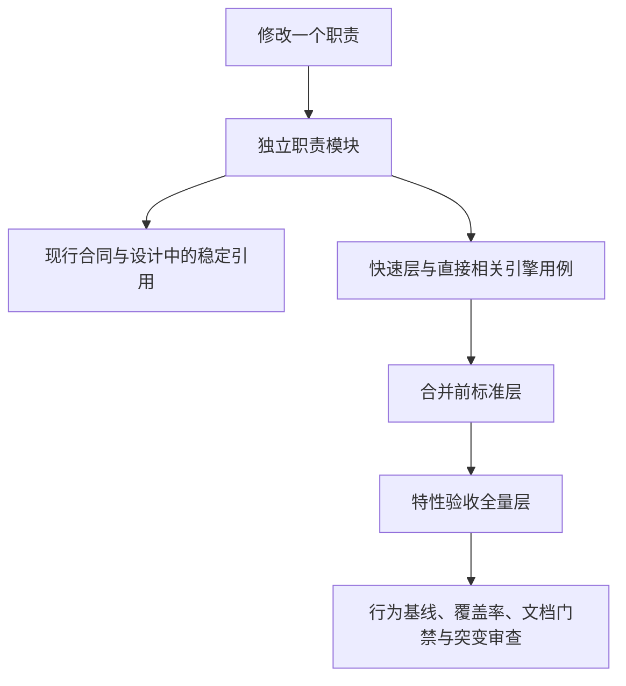
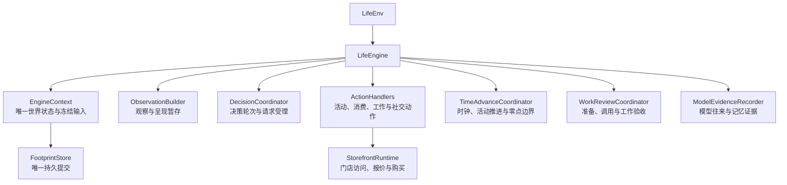

# 代码分层、文档引用与测试分层开发规格

> 状态：FROZEN；本次完整实现的开发合同，验收证据另行登记。
> 日期：2026-10-05。
> 代码基线：2cf230115f4084aef2376e9d77bc976efbed43ea。
> 来源：`docs/dev/PROPOSAL_2026-10-04_LAYERING_AND_TEST_TIERS.md`；本文完成实现细节裁定。
> 范围：消除生产依赖环、拆分生活引擎、解除文档与源码位置耦合、冻结输入测试缓存、测试分层和统一运行入口。

## 用户得到什么

修改一个职责时，可以直接看到它依赖什么、由哪个模块负责以及需要执行哪些测试。
现行文档指向当前定义和稳定章节；历史证据指向可重建的提交。
快速反馈、合并回归和特性完整验收共用同一套测试集合与运行入口，不能因分层遗漏用例。
人物行动、世界结算、事件顺序、提示、恢复、导出和数据交付的现有行为保持不变。

## 范围与最终裁定

本次交付覆盖提案的代码分层、文档与测试解耦、测试分层全部要求。
提案明确单独立项的生产观察缓存不属于本次功能；本次不增加生产缓存、不改变观察结果。
共享规则与可重建环境提案的其它功能不属于本次；覆盖率入口改用当前解释器属于本次统一运行入口。
不改 AS2、LabelKit 锁定提交、运行身份算法、事件和检查点结构、人物工具签名及业务合同。

| 提案中的安排 | 本次唯一实现 |
| --- | --- |
| 旧位置保留同名再导出 | 直接搬移定义并更新全部使用方，删除旧定义和旧导入 |
| `RELOCATED` 表与登记迁移脚本 | 登记直接使用当前定义的符号，不保留旧位置映射或迁移工具 |
| 已知依赖违例与仅报告门禁 | 最终完整导入图无环，正式门禁遇到违例失败，无遗留豁免表 |
| 为私有方法增加公开测试接缝 | 测试使用现有公开行为或新职责对象，不增加仅供测试的生产接口 |
| `{#章节}` 扩展语法 | 标题前使用 GitHub 支持的 ``，只支持这一种显式标识 |
| 场景副本写绝对资源路径 | 写相对引用，必要时跨卷复制资源；保存工件不得绑定机器路径 |
| 整体深拷贝冻结语义 | 复制可变分支，仅共享经过递归验证的不可变分支 |
| 仅删运行身份后比较完整日 | 固定或严格规范化随机身份、壁钟和临时位置，先证明同一基线运行可重复 |

实现时不得加入兼容层、旧址转发、fallback、空壳实现、延期标记或规范未描述的业务功能。
所有异常分支输出英文错误日志；注释与接口文档使用中文；生产代码遵守现有风格门禁。

## 生产依赖方向

`src/worldmock` 与 `custom` 全部运行期导入构成有向无环图，包含模块级及函数内导入，
只排除用于静态类型标注的 `TYPE_CHECKING` 分支。
相对导入、别名导入、包内成员模块导入和显式动态项目导入均须解析到真实模块，不能因语法不同遗漏回边。
禁止用函数内导入、动态导入、字符串查找或对象代理隐藏同一依赖。

函数内导入仅允许明确登记的命令行启动延迟及可选重依赖边界；每项记录模块、目标和实际原因。
其它函数内导入提到模块顶部。登记必须与实际导入对应，冗余或失效登记失败。
基础层包含 `life.models`、共享严格模型叶子 `worldmock.base_models`、共同区间叶子 `worldmock.footprints.intervals`，
以及明确列出的基础类型、词表和纯函数模块；这些模块不得依赖装配、引擎或执行模块。
生产代码中 `life.engine` 仅由 `custom/envs/life_env.py` 导入，测试不受这条使用边界限制。

| 依赖原因 | 定义归属与同步范围 |
| --- | --- |
| 交互方式、动作词表 | `life/vocabulary.py`；模型校验、名称解析、菜单、拒绝和路由统一导入 |
| 地点名称写法 | 已有 `life/object_labels.py`；名称解析与路由统一导入 |
| 来源与营业区间基础类型 | 基础类型模块；`models` 与 `map_models` 从同一处导入 |
| 社交占用及效率常量 | 已有纯函数模块 `life/social.py` |
| 时间文字与状态替换 | `life/readable.py` 与 `life/world_ops.py` |
| 场景读取、语义组装、准入和工作材料校验 | 顶层 `life/world_setup.py` 编排；底层解析和语义模块不回调装配层 |
| 足迹分支恢复 | `footprints/checkpoint.py` 编排，`store.py` 只承担存取 |
| 时间线渲染加载 | 由时间线渲染所属底层模块承担，不回调导出编排 |
| 进程配置、运行与阶段身份、人物输入准备 | `worldmock/run_setup.py`；提取实际依赖闭包，不能与 `validation` 重新成环 |
| 画像覆盖目标纯构造 | 独立画像基础模块；输入准备与校验共用，不借用上层运行入口 |

入口和定义搬移必须同步所有调用方、monkeypatch 位置、突变登记、代码文档引用及现行设计说明。

## 生活引擎的职责对象

`LifeEngine` 保留现有公开方法签名，作为 `LifeEnv` 使用的门面；不再继承三个业务 Mixin。
`engine.py` 不超过六百行。拆分后各生产文件和函数仍遵守原风格限制。
不增加按活动种类分派的处理器体系，逐项原子准入及首个不成立原因的既有规则保持不变。

`EngineContext` 只保存语义、场景摘要、语料根、存储、世界状态、规则、生活内容、标题、可供性合同和运行日志。
场景由语义派生，不保存第二份场景或状态。上下文不保存门面、任意服务字典或泛化回调注册表。
职责对象持有上下文和明确需要的具名协作者，不允许 `__getattr__`、字段转发、整门面注入或旧私有方法代理。

决策轮次与延迟决策开始归决策协调；呈现及可见供给暂存归观察构造；待提交动作事件归动作处理；
工作验收器归工作验收协调；请求事件索引归证据登记；零点边界归时间推进。
初始化、重新打开、检查点、反事实干预与关闭按实际职责由门面编排，不另立状态权威。
活动快照、名称和用餐窗口等纯投影下沉所属模块。
`continuation`、`rhythm` 和环境的只读查询必须接收所需状态或具名协作者，不回调引擎私有方法。

## 现行文档与历史证据

`docs/INDEX.md` 决定文档职责及状态，状态词表包含「归档」。未列入三列表格的设计十章、手册、
当前追溯矩阵及根 README 仍是现行文档；DRAFT 是设计状态，不表示历史证据。
全部文档须有可判定归属，不能因未登记而逃过检查。

现行文档不得出现源码行号引用。源码引用使用仓库相对 Python 路径、双冒号和限定名，
限定名按定义的类、函数、嵌套函数或赋值解析；再导出不能冒充定义。
历史文档允许源码行号，但文件头必须声明存在的完整四十位提交基线。
有真正执行源码基线的记录展开该提交；原始观察依赖未提交工作树而无法重建时，保留这个事实，
声明固定归档快照并明确「不是审查执行证明」，不能拿归档快照编造执行来源或计作可复现验收。
短提交、只有未提交工作树的说明及不存在的归档快照均不满足基线要求，不使用 HEAD 假装历史基线。
同一记录可分别声明实际执行源码基线与文档归档基线；源码引用和原文快照分别核对，不得互相替代证明。
有明确单独出处的历史引用按该路径绑定的完整提交核对，不在多个提交中试找可用来源。
历史引用按声明基线定位，已从工作树删除的历史路径不得使用无基线白名单放行。

生产代码与测试的规格引用统一使用仓库相对文档路径加显式稳定章节标识。
章节标识在标题前声明，全仓唯一到所属文档的解析可验证，正文搬移时标识随正文移动。
门禁扫描 `src`、`custom` 与 `tests` 的文档引用，缺文件、缺标识、重复标识和旧标题引用均失败。
普通 Markdown 链接、符号引用与仓库文档路径也必须可解析；历史文件按基线检查其历史来源。
汇编设计说明书识别同一显式标识，附录选择不再依赖会变化的中文标题，显示正文不泄露锚点标签。

## 已验收增量规格并入正文

本次固定整理时间与能量、人物 Prompt、一日运行保真、工具交互、个人事务与工作安排五份增量规格，
以及各自已登记提案、实施计划、验收和审查证据。
先走通工具交互的合同唯一文本、机器验收登记、稳定标识与归档，再按同一合同完成其它特性。
功能正文及约束并入现行所属合同、基础规格或设计章节；原增量规格和证据移到 `docs/archive/<特性>/`。
原路径不留转发文档，代码与测试不引用归档规格作为现行行为权威。
现行所属文档版本表记入此次整合，INDEX 和全部链接直接指向新归属。

合同提示与工具说明只在 `CONTRACTS.md` 保留权威文本，测试与模型常量比对这一份。
行为验收、阶段裁定和突变语义台账变成 `tests/` 下机器数据；测试不从增量散文解析验收表、
不逐字拼回突变句、不比对非权威提示副本。已有要求与行为证据不能因移除散文解析而消失。
原来「必须存在」的生产文本钉改为接口导入或 AST 结构检查；已有行为证据足够的文本钉直接删除。
「必须不存在」检查覆盖相关生产包，不能挪到另一文件就通过。
类型模块路径与 `__file__` 的文字断言改为类型或行为断言；正当风格、错误合同等结构门禁继续保留。
真实十二周、隔离盲评、LabelKit 交付和原有只报告复跑的状态继续在现行验收文档显示，不因归档变为完成。

## 突变登记按定义定位

`SourceMutation` 使用当前 `模块::限定名` 的 `symbol`，替代重复的模块和源码路径字段。
模块到文件映射仅依据项目固定包根，限定名必须定位真实定义的 AST 源码段。
`original` 在所定位定义内恰好出现一次，替换只作用于该段，变异后的模块必须仍能编译。
符号不存在、作用域不唯一、原文不唯一、替换等价或产生语法错误均拒绝并输出英文错误。
子进程隔离、完整基线、行为用例杀手及原回执证据保持不变；不编辑测试制造被杀死结论。
全部一百四十七项登记直接写现行定义，不保存旧址映射。
在定义搬移前证明符号定位生成的每一份变异源码与旧实现逐字节一致，再同步搬移对应登记。

## 测试只读输入缓存

运行身份从场景 JSON 读取人物身份、起止时刻和时区，不为生成身份完整组装世界。
缓存只用于测试工厂的正式冻结输入，不增加生产缓存入口。
缓存键覆盖场景、目录、地图、手机配置、语料清单及其所有实际文件的相对路径和真实字节，
不能仅检查声明摘要、mtime 或场景文件；输入字节变化必须使缓存失效。
只在工厂调用期间替换加载引用，不影响直接生产新建与恢复入口。

可变的 document、scenario、body、accounts 每次交给用例前复制；
catalog、travel_time_profile、motivation_transforms、affordances 等分支先递归证实不可变才共享。
字幕条目不可变才可共享。每个用例仍新建世界状态、事件暂存、日志与足迹存储。
mutate 场景和临时输入不走正式输入缓存，场景副本使用相对资源路径，资源复制不依赖硬链接跨卷成立。
会话末守卫重新核对输入字节摘要与缓存对象摘要；共享对象被污染必须失败。
保留不走缓存的新建与恢复用例，验证实际生产装配、语料清单和身份校验仍执行。

## 快速、标准与全量层

根 `conftest.py` 在收集后按实际 fixture 依赖及静态调用边界自动生成 `engine`、`mutation`、`day_run`、`external` 标记。
引擎夹具使用者及直接驱动 LifeEngine/LifeEnv 的用例标为 engine；实际源码变异执行标为 mutation，
登记格式与定位检查不带 mutation；完整自然日和多日运行标为 day_run；
需要 Node、LabelKit 独立环境或 TextWorld 执行的用例标为 external。
新增相关用例须自动归类，不要求作者手写标记；不得把整个测试文件的格式守卫误归为变异执行。

| 层 | 用例集合 | 使用时机 |
| --- | --- | --- |
| 快速 | 无上述四标记的用例，加直接导入被改生产模块的测试文件中 engine 用例；变异、完整日与外部执行不加入 | 修改和提交前 |
| 标准 | 全部用例除 mutation、day_run；包括 external | 合并前 |
| 全量 | 全部收集用例，包括突变、完整日及外部执行，加覆盖率与文档和汇编设计门禁 | 特性验收、发布前及请求的完整验证 |

被改模块由 Git 差异的生产路径求得，包含已暂存、未暂存与新增文件，并允许明确给定比较基线。
选择按测试的直接导入解析，不用传递依赖扩大为全仓；标准层负责跨模块影响。
标准层不是可省略的快速层补充，全量层不是仅比较用例总数。
当前六进程参考基准的默认快速集合目标为一百八十秒以内、标准层目标三十五分钟以内；
被改模块额外加入的引擎用例耗时单独列出，这些目标不宣称为所有机器与所有改动的普遍上界。
报告给出实测环境、各层耗时和超目标提醒，不把跳过或少选用例当作性能改进。

## 唯一运行入口与完整性

`scripts/run_tests.py` 只用标准库，支持 `--tier fast|standard|full`、`--workers N` 和比较基线。
用 `sys.executable -m pytest` 启动子进程，覆盖率模式用同一解释器的 `coverage run -p` 并合并。
不引入 pytest-xdist 或其它依赖，不改变 `uv.lock`。
先收集所选层全部节点，再按文件为原子调度单元，按全量耗时报告分配到最轻的分片。
每份测试文件的节点保持连续。worker 先收集目录自身的文件，再连续收集各子目录的文件，
使 pytest 按正常目录作用域加载 fixture；runner 不自行注册或注入 fixture。
尚未计时的新文件使用明确初始权重，只影响调度，不影响选择。
并行回执目录彼此隔离，collection、summary、worker 选择清单与完成回执绑定本次运行的唯一身份。
预收集集合与每个 worker 的选择、实际收集均非空且节点唯一；其全局多重集与完成回执精确相等，
不能以结果字典的键去重掩盖重复选择或重复收集。全量层必须包含每个全量收集节点，
每个节点的 setup、call、teardown 三阶段完整且均为 passed；未知结果、失败、缺失或失效回执均非零退出。

全量生成 `docs/dev/test-durations.json`，记录节点、标记、测试阶段耗时、文件汇总、
默认快速层超过一秒的用例及标准层合计和墙钟耗时。后续分片读取同一报告。
`coverage_gate.py` 使用同一 full runner，保留分支覆盖率至少百分之八十五及公共接口零缺口要求，
正常生产代码 coverage 与独立突变执行证据分开，不能把变异源码计入正常覆盖率。
失败测试、跳过、空集合、覆盖率报告缺失或输入身份变化仍失败关闭。
覆盖率门禁无参数及 `--shards N` 都调用这一 full runner，`--shards` 映射为 worker 数；
覆盖数据生成后，其实际字节摘要绑定到同次运行的 summary。`--from-json` 核对覆盖摘要和 collection、
summary、worker 选择清单及完成回执的运行身份与节点多重集；缺失或失效收据拒绝，
不能以其它运行的绿色覆盖文件或回执替代当前运行。输入摘要覆盖实际读取的源码、测试、设计、
依赖锁、源码补丁、场景与语料、根 `.gitattributes` 和交付 `labelkit-projects` 配置、hooks 与 schemas，
交付工程的 data、out 和 `__pycache__` 不纳入输入，自动生成的计时与覆盖报告仍按现有排除范围处理。
共享规则及可重建环境的其余要求见[所属冻结规格](SPEC-shared-rules-and-rebuildable-env.md#shared-rules-门禁可选部件与操作系统)。

## 行为不变基线

完整双人自然日使用已有脚本模型、真实人物循环、检查点与重新打开路径。
在未改业务代码上重复同一脚本两次，确认事件与导出摘要稳定后冻结基线。
测试侧可固定随机身份与壁钟；若规范化则明确列出字段，身份按首次出现映射并保持全部因果引用一致。
仅屏蔽代码身份、运行位置和实测壁钟差异；不能批量删除全部身份、摘要、事件类型、正文或因果字段。
资产内容、事件顺序、观察、工具参数、状态和资源变化、结果、提示和导出正文仍受比较约束。
重构后同一运行的规范化事件序列及导出逐字节摘要必须与基线一致。

主线分层历史基线 `tests/fixtures/dayrun-layering-baseline.json` 绑定代码基线
`2cf230115f4084aef2376e9d77bc976efbed43ea`，与原有 147 个变异生成结果迁移证明共同保留。
共享规则整合后的现行完整日回归使用 `tests/fixtures/dayrun-shared-rules-baseline.json`：
它由已验收共享特性 `06e3ea0e04bcbb3022eac820a08005ef32b6b1c8` 的隔离源码独立生成，
保留原有 61 个业务断言并使用相同的测试身份固定与摘要规范化；不能从合并后输出重录基线。
共享特性授权的目录身份和记忆归属变化由这两份来源分别表达；不删除业务字段或放宽摘要比较。

## 文件修改清单与所属文档

| 所有权 | 文件与修改内容 |
| --- | --- |
| 代码分层 | `src/worldmock/life/` 基础词表、类型、装配、状态操作、引擎上下文及职责对象；既有业务调用方；`src/worldmock/run_setup.py`、`runtime.py`、`validation.py`、画像覆盖目标；`footprints` 恢复与时间线；`custom/envs/life_env.py` |
| 分层测试 | `tests/test_import_graph.py`、既有引擎及集成测试的当前定义导入、协作者调用、monkeypatch 与完整日基线 |
| 文档正式门禁 | `scripts/documentation_gate.py`、`scripts/documentation_refs.py`、`scripts/documentation_owners.py`、`scripts/build_design_doc.py` 及对应测试；删除旧路径白名单和标题选择耦合 |
| 当前权威 | `docs/INDEX.md`、`ARCHITECTURE.md`、`CONTRACTS.md`、`VERIFICATION.md`、`EXPERIMENT.md`、`docs/dev/implementation-status.md`、`coverage-baseline.md`、`ANALYSIS-spec-coverage.md`；当前基础 SPEC 与手册同步所属正文和引用 |
| 总体设计 | `docs/design/00-overview.md`、`01-architecture.md`：唯一状态权威、门面与职责对象和单向依赖 |
| 交换与资源设计 | `docs/design/02-exchange-engine.md`、`03-resource-engine.md`：纯规则和基础词表、类型与资源装配边界 |
| 模拟设计 | `docs/design/04-simulation-engine.md`：上下文、职责对象、观察、受理、推进、工作验收和证据登记实际调用关系 |
| 记录设计 | `docs/design/05-recording-engine.md`：恢复由检查点编排、存储只存取、时间线加载归属和行为摘要证据 |
| 交付与评估设计 | `docs/design/06-delivery.md`、`07-evaluation.md`：现行正文引用、身份边界与完整验收证据；不改业务规则 |
| 配置与格式设计 | `docs/design/08-configuration.md`、`09-io-formats.md`：相对路径、冻结输入和身份不变；不增加运行配置或持久字段 |
| 设计入口与生成物 | `docs/design/README.md`、`SUMMARY.md`、`worldmock-design.html`：稳定章节、附录和重新汇编 |
| 归档 | `docs/archive/` 五项已验收增量规格及证据，删除原位置并同步全部现行引用；`tests/fixtures/archive-assets.json` 与现行所有者守卫核对固定历史原文和非 Markdown 资产字节 |
| 测试解耦 | `tests/fixtures/acceptance_requirements.json`、`current-feature-owners.json`、`layering-acceptance.json` 与固定行为基线；原文档读取与文本钉守卫、`mutation_runner.py`、两份突变登记及符号作用域行为测试 |
| 测试分层 | 根 `conftest.py`、`tests/engine_fixture.py`、`tests/life/conftest.py`、其它共享 fixture、分层与缓存守卫、`scripts/run_tests.py`、`scripts/coverage_gate.py`、对应测试、`pyproject.toml` 标记和耗时报告 |

## 与现有规格一致性

| 既有权威 | 本次同步的结构约束 | 必须保留的业务约束 |
| --- | --- | --- |
| 生活运行时与 AS2 接入 | Mixin 及引擎私有互调描述改为职责对象，运行准备与校验调用当前定义 | AS2 原人物循环、唯一共享环境、原公开协议与错误语义 |
| 时间与能量、人物 Prompt、一日运行保真 | 正文并入当前归属，验收数据与稳定标识替代散文和位置钉点 | 同秒续接、七层提示、身体结算、睡眠、进食和原子请求 |
| 工具交互、个人事务与工作安排 | 完整正文并入当前基础规格及合同，源码突变符号定位，归档不作为现行权威 | 请求形状、错误合同、世界查询、事务结算、工作安排和严格反思 |
| 地图门店、品类、当日计划及记录设计 | 基础类型、词表、装配与恢复归属变化，稳定引用随定义更新 | 来源证据、报价身份、可执行筛选、价格、活动归属和唯一事务 |
| 覆盖率与验证 | 三层选择、全量集合完整性、真实生产新建恢复、统一解释器入口 | 百分之八十五分支覆盖、公共接口零缺口、真实验收的未完成边界 |

现行正文不得仍要求文件级文本唯一、增量规格副本文字一致、旧 Mixin 或旧定义导入。
冲突条款在本次同步改写到所属正文和版本表；不能靠「本规格优先」留下两套同时有效的要求。

## 验收台账

所有下列要求必须实现并有可收集的行为或结构用例；登记到本特性机器台账。
台账必须与本表一一对应，用例不能以跳过、预期失败、空函数或只检查实现文本替代行为证据。

| 契约点 | 必须通过的验证 |
| --- | --- |
| 完整导入图 | 模块级、函数内、相对、别名及动态项目导入的环均被守卫拒绝，真实生产图无环 |
| 延迟与基础层 | 未登记局部导入、失效登记、基础层向执行层依赖、非环境生产方导入门面均失败 |
| 显式引擎协作 | 无三个 Mixin、无门面代理和测试专用接口；独立职责驱动最小完整请求与推进 |
| 完整日不变 | 同代码重复摘要稳定，重构后事件、资产、观察、导出及恢复摘要与冻结基线相同 |
| 当前引用门禁 | 行号、失效源码符号、再导出、缺文档、缺或重复章节标识和旧标题引用均失败 |
| 历史基线 | 完整执行提交或明确非执行证明的完整归档快照通过；短提交、无快照工作树和缺失来源失败 |
| 正文与归档 | 五份增量正文完整落入当前权威、旧址删除、源代码与测试引用新归属、真实未完成状态保留 |
| 文本与验收解耦 | 合同唯一提示比对、机器台账、接口或结构断言、包级删除守卫可检测反例 |
| 符号作用域突变 | 百四十七项搬移前变异字节一致；同文异作用域可定位，定位错误拒绝，全部行为突变被杀死 |
| 缓存隔离 | 输入变化失效、复制可变分支、世界与存储独立、mutate不缓存、会话污染守卫失败 |
| 真实装配 | 不缓存的新建与重新打开仍真实验证目录、语料与运行身份 |
| 自动分层 | 新增fixture及实际驱动用例自动标记，变异格式留快速层，直接导入加选正确 |
| 分片完整性 | 串并行节点相同且不重复，worker失败、缺回执、缺或多节点均非零退出 |
| 覆盖与耗时 | 当前解释器全量覆盖合并，原覆盖门禁成立，真实耗时报告与分片权重及超时目标提醒一致 |
| 文档设计一致 | 正式文档门禁、设计汇编检查、双向规格到代码测试核对和独立 Uncle Bob 审查通过 |

## 成熟方案依据

依赖方向采用 [Import Linter 的层与禁止依赖合同](https://import-linter.readthedocs.io/en/stable/contract_types/)
的成熟约束模型，本项目既有 AST 门禁足以实现所需检查，不增加运行身份相关依赖。
收集与标记使用 [pytest 官方收集钩子](https://docs.pytest.org/en/stable/how-to/writing_hook_functions.html)，
并行覆盖使用 [Coverage.py 分进程数据与合并](https://coverage.readthedocs.io/en/latest/commands/cmd_combine.html)。
章节标识采用 [GitHub 自定义锚点](https://docs.github.com/en/get-started/writing-on-github/getting-started-with-writing-and-formatting-on-github/basic-writing-and-formatting-syntax#custom-anchors)。

## 版本表

| 版本 | 日期 | 变更 |
| --- | --- | --- |
| frozen | 2026-10-05 | 按同步代码与并发独立核对裁定全部实现范围、模块归属、文档整合、测试集合和完整验收；删除兼容与分阶段放行安排 |

| 共享规则整合 | 2026-10-05 | 保留唯一测试入口和原文件权重调度，覆盖率入口核验同次全量回执，零跳过、非空集合与失效证据失败关闭 |
| 整合门禁与完整日来源 | 2026-10-05 | 明确同次运行及覆盖摘要绑定、真实输入与完整阶段；保留主线历史基线并以隔离共享特性双跑冻结现行完整日回归来源 |
