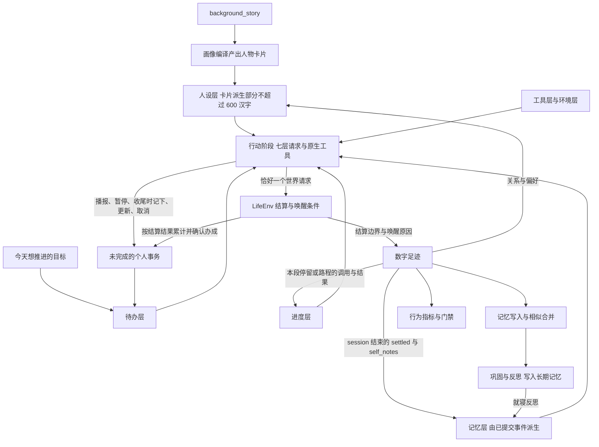
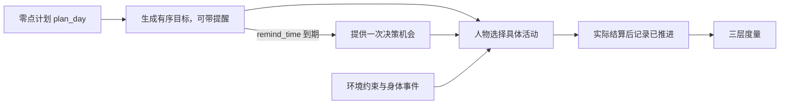

<a name="spec-life-realism-特性规格人物决策与画像"></a>
# 特性规格：人物决策与画像

> 按[动作与内容简化规格](SPEC-action-and-content-simplification.md#spec-acs-动作与内容简化开发规格)修订「固定规则、目录格式与加载边界、收货结算」（阶段 1、2）。

> 2026-10-07 按用户确认的[数据加工归属](../ARCHITECTURE.md#architecture-数据加工归属)修订：WorldMock 负责模拟、记录、完整认证足迹导出与真实性评估；LabelKit 加工、模型任务、训练装载与规则测试归 LabelKit-DataSet；环境素材归 WorldMock-Dataset。历史验收数字只证明原源码基线，不代表本次消费链已验收。

> 2026-10-07：按[资源与规则引擎简化规格](SPEC-resource-and-rule-simplification.md#spec-rrs-资源与规则引擎简化开发规格)同步阶段 7 的记录、导出、交付与评估合同。

> 2026-10-07：按资源与规则引擎简化规格同步剩余系统规则、最终提示身份与查看器（阶段 6）。

> 2026-10-07：按[资源与规则引擎简化规格](SPEC-resource-and-rule-simplification.md#spec-rrs-资源与规则引擎简化开发规格)同步阶段 5 的人物可见的工作主题与累计。

> 按[资源与规则引擎简化规格](SPEC-resource-and-rule-simplification.md#spec-rrs-资源与规则引擎简化开发规格)修订「世界素材品类要求、`location_kinds` 的运行期强制语义」（阶段 1）；「画像编译、地图、门店供给与活动环境、商务与进食、动机层、候选确定性、呈现上限与下推游标、呈现轮转、素材淘汰与检索机制的禁止项、验收矩阵、工具层的紧凑编码与即时查询、单一行动阶段、工作安排声明」（阶段 3）；「app 内容边界、工具层、进度层、动机层与素材可达性」（阶段 4）。

> 状态：FROZEN——条款已裁决。既有测试证据保留原源码身份；正式地点活动环境、供给候选与交易由地图特性完整实现并重新验收，不能沿用历史数字宣称完成。正式十二周、隔离盲评与 LabelKit 完整自然日交付仍待真实运行。
> 部分条款按[人物 Prompt 规格](SPEC-life-realism.md#persona-prompt-七层请求)修订，修订部分已实现并通过离线验收（证据见[人物 Prompt 验收记录](../archive/persona-prompt/persona-prompt-verification.md)）；修订记录见「版本表」。
> 「候选与呈现」「画像编译」「地图、门店供给与活动环境」「呈现与导出」「默认裁决与备选」与验收矩阵中的相应条款按[一日运行保真规格](../VERIFICATION.md#verification-incremental-evidence)修订
> （一日运行保真 RL1–RL4）；修订部分已实现并通过离线验收，验收矩阵中改动的三行已改记 `代码层已验证`。
> 「产品行为」补个人事务；「单一行动阶段」补控制请求的 `errands` 与 `query_world` 六键；「记忆合同」写明事务变更不是记忆写入点、就寝反思经严格工具提交；
> 「当日目标」补与个人事务、工作安排的边界；「画像编译」增下班与到家锚点、场景作息覆盖七字段并区分作息与工作安排；
> 「呈现与导出」补交付窗口投影不带 `errands`；修订部分已实现并通过离线验收（证据见[个人事务与工作安排验收记录](../archive/errands-workday/errands-workday-verification.md)）。
> 按[让「等待」成为例外规格](SPEC-idle-fillers.md#spec-idle-fillers-让等待成为例外开发规格)修订「效力：呈现事实，不新增拒绝」（阶段 1）、「系统层：照作息过日子，较强一档才改」（阶段 2）与「零点计划只写今天与平常不同的事」（阶段 3）。
> 按[同时做两件事规格](SPEC-parallel-activities.md#spec-parallel-activities-同时做两件事开发规格)修订「待办层」（阶段 1）。
> 日期：2026-10-07
> 依据：《人物真实性根因分析》（`docs/dev/research/realism-root-cause-2026-09-17.md`）的裁决结果。四个假设不是并列的，而是一条因果链——人物与环境之间的交换规则是主因也是放大器，给模型看的呈现是最便宜的杠杆，数据缺的是品类而不是条数，人物卡片文本本身有效而编译层是死通道
> 补充依据：《对象模型重分析》的「可达性：池变大后靠什么被看到」「被裁掉的对象怎么办」「曝光轮转」「地点语义粒度该取什么值」四节，见 `.work/object-model-reanalysis/REPORT.md` 与同目录 `LOCATION-GRANULARITY.md`
> 范围：人物的记忆写入与巩固、动机层的内部仪表与呈现、当日目标、世界素材品类准入、素材可达性与呈现轮转、画像编译、商品数量合同、运行呈现与导出投影

当前环境归属按[环境数据归属规格](SPEC-environment-data-ownership.md)执行：具体 `corpora/`、`catalog/`、`scenarios/`
及制作工具由 WorldMock-Dataset 维护，正式环境为 `environment/zhangjiang-baseline/`；通用活动、动机与人物映射
由 WorldMock 包资源提供，环境冻结副本须逐字节一致。当前场景结构为 `6`，单人物文件为 `single-person.json`。
本文中的新环境放行须另核对本次收据，历史验收数字不证明当前组合已经通过。

<a name="spec-life-realism-共享规则与可重建环境修订"></a>
## 共享规则与可重建环境修订

按[共享规则与可重建环境规格](SPEC-shared-rules-and-rebuildable-env.md)修订；验收结果独立记录。

记忆合同的空数组、阈值巩固、人物卡片与相似同类合并由 WorldMock 人物扩展负责；存储与恢复继续复用 AS2 框架。候选种类、活动家族、中文名称与主观快照只读取各自唯一规则实现；记忆类型、来源、阈值与事实主观分区不变。

<a name="spec-life-realism-产品行为"></a>
## 产品行为

对象的品类归属、共享属性、交换规则及来源审核统一由[品类契约规格](../archive/category-contract/SPEC-category-contract.md#spec-category-contract-品类契约与交换规则开发规格)定义。
本规格中的世界素材品类覆盖仍以可供性与内容要求检验；它不替代有向交换配对的场景准入检查。

人物自己决定怎么过日子。本规格规定其中两件事：每次决策给模型看什么，以及模型说了什么要留下什么。

环境每提供一次决策机会，人物模型只有一个行动阶段：走现有 ReAct 循环，读取七层请求与原生工具，可以先查询自己的记忆，
再恰好提交一个世界请求，登记即结束；决策就是所选的世界请求。回复正文可有可无，写了就作为该调用的 `self_note`
保留到本段停留或路程结束，不进入记忆。每次请求都留完整证据。当日目标由场景本地零点的后台任务 `plan_day` 生成，可带提醒，人物清醒时可修订；
目标是人物意图，环境只根据实际活动证据标记推进，并以环境事件提供决策机会。
人物在播报、暂停或收尾活动时还可以登记个人事务（要取得或吃掉的一件具体商品）：事务存在人物状态里、跨日保留并显示在待办层，
办没办成只由环境按结算结果确认，人物只能更新它，或取消并写原因；当日目标的生成、修订与过期都不波及它
（[个人事务与工作安排规格](SPEC-as2-integration.md#errands-workday-运行修复入库)第二章，阶段 2 落地）。人物在结束活动时写主观记忆，可以为空；
写入前按相似度合并，累计到阈值、待巩固条数达到十条或入睡后的第一个边界时归纳主观内容，
并在就寝后做一次反思。长期记忆的完成事实只由已提交环境事件确定性投影。

人物卡片由背景故事编译而来，结构化字段以人设层 JSON 进入提示（卡片派生部分不超过 600 汉字，当下处境不进提示）；
大五分数、九参数与权重都不进提示，只驱动世界层动力学。动机评分器计算并落库，候选、名次与概率不进入提示，
也不再合成一句话进入提示：体感分级、工作合同与待办分别只在环境层、工具层任务目标与待办层出现。
世界数据按可供性品类而不是条目数量验收，准入检查不满足即拒绝启动。

本规格改变提示词、工具 Schema 与世界状态结构，`prompt_sha256`、`tool_schema_sha256`、`code_sha256` 随之改变；
世界状态新增结构版本，旧状态没有该字段，加载即拒绝。此前运行的模型请求记录与新运行跨版本不可比，
这是有意为之：不为旧记录保留兼容读取路径，也不维护旧观察格式的别名。



<a name="spec-life-realism-与相邻规格的边界"></a>
## 与相邻规格的边界

本规格只定义人物决策与画像。以下内容已由其他文档定义，本规格引用而不重写。

| 内容 | 归属 |
| --- | --- |
| 社交行为规则：在场可见、消息、交谈、通话、联系人及其回复策略 | `docs/dev/SPEC-life-runtime.md#spec-life-runtime-特性规格lifeenv-运行时行为与结算规则`「社交最小可行版」 |
| 七层请求：各层字段与唯一出现、系统层、同秒续接、提示预算 | [人物 Prompt 规格](SPEC-life-realism.md#persona-prompt-七层请求) |
| 观察投影与提示合同：禁止进入提示的字段、app 目标、app 内容结果与 `app_push` 进度记录 | `docs/dev/SPEC-life-runtime.md#spec-life-runtime-特性规格lifeenv-运行时行为与结算规则`「观察投影与提示合同」 |
| 身体语义：两过程睡眠、睡眠不足账、体感分级、社交需要与情绪的数值和滞回 | `docs/dev/SPEC-life-runtime.md#spec-life-runtime-特性规格lifeenv-运行时行为与结算规则`「身体语义：两过程睡眠、睡眠不足账、体感分级」 |
| 决策节律：结算边界不等于决策机会、唤醒条件清单、静默边界 | `docs/dev/SPEC-life-runtime.md#spec-life-runtime-特性规格lifeenv-运行时行为与结算规则`「决策节律：结算边界与唤醒条件分离」 |
| 类型、签名、字段、枚举、上限常量与提示模板 | `docs/CONTRACTS.md#contracts-worldmock-接口合同` |
| 活动受理门、被挡项的原因码与观察可见性、投影通道预算 | `docs/dev/SPEC-life-runtime.md#spec-life-runtime-特性规格lifeenv-运行时行为与结算规则`「活动组合政策」「观察投影与提示合同」 |
| 地点类与人物显式交互菜单、对象动作准入 | `docs/dev/SPEC-interaction-menu.md#spec-interaction-menu-特性规格交互菜单` |
| 行为指标与门禁的汇总口径、report-only 边界与交付顺序 | `docs/VERIFICATION.md#verification-worldmock-验收标准` |
| 个人事务的登记、完成依据、提醒与待办层呈现；下班与到家作息、场景工作安排与环境层 `duty`；`query_world` 的筛选与返回；就寝反思的提交通道与校验 | [个人事务与工作安排规格](SPEC-as2-integration.md#errands-workday-运行修复入库) |

<a name="spec-life-realism-设计裁决"></a>
## 设计裁决

本规格的每一条款都有已核实的症状支撑，条款按上述因果链排定，不做并列假设。全部数值参数属于
`experiment_assumption`，除明确引用文献的常数外不宣称已测量的人类参数。

下表一行一个症状：直接机制列与对应条款列都用 ①②③ 编号，同号即同一条因果链，机制与修复它的条款一一对应。

| 已核实症状 | 直接机制 | 对应条款 |
| --- | --- | --- |
| 53.9% 的决策是 `continue_activity`，吃掉 53–62% 的 token | 900 秒结算边界每次都唤醒模型 | `docs/dev/SPEC-life-runtime.md#spec-life-runtime-特性规格lifeenv-运行时行为与结算规则`「决策节律：结算边界与唤醒条件分离」 |
| 记忆一半是边界簿记 | 结算边界强制写记忆 | 本规格「记忆合同」 |
| 就寝 19:53 / 21:44、计划睡 11 小时，李凡三次运行均早于人物卡片声明的凌晨一点 | `sleep_debt_hours` 等于醒着小时数，无饱和无昼夜门控，原值直接进提示 | `docs/dev/SPEC-life-runtime.md#spec-life-runtime-特性规格lifeenv-运行时行为与结算规则`「身体语义：两过程睡眠、睡眠不足账、体感分级」 |
| 07:00 开车去 08:00 才开门的公司并空等近两小时，21 个代码版本未改善 | ① 家中没有早晨可供性，任务 09:00 才可见<br/>② 模型按动机权重推翻直觉<br/>③ 缺少当日目标，每次决策只对当前状态作贪心反应 | ① 本规格「世界素材品类要求」<br/>② 本规格「动机层」<br/>③ 本规格「当日目标」 |
| 三次同一碗面 | ① 正餐只有 7 碗方便面<br/>② 首次购买被写成偏好记忆后回灌为稳定偏好 | ① 本规格「世界素材品类要求」<br/>② 本规格「记忆合同」；验收覆盖反例：购买本身不写偏好，首次购买后人物只写「明天还想吃」这类非偏好记忆时，人设层 `preferences` 为空（验收矩阵「记忆写入」） |
| 冰红茶三次放弃 | ① 活动进行中隐藏购买与进食工具<br/>② 一次响应只接受一个生活动作<br/>③ 最廉进食候选恒为西柚汁 | ① `docs/dev/SPEC-life-runtime.md#spec-life-runtime-特性规格lifeenv-运行时行为与结算规则`「观察投影与提示合同」<br/>② 本规格「商务与进食」<br/>③ 本规格「动机层」 |
| 两人同办公室清醒共处 10.86 小时互不可见，Relationships 恒空 | ① 观察没有在场人物字段，也没有通讯工具<br/>② 人物卡片没有关系字段 | ① `docs/dev/SPEC-life-runtime.md#spec-life-runtime-特性规格lifeenv-运行时行为与结算规则`「社交最小可行版」<br/>② 本规格「画像编译」 |
| 21 项生活活动 40 个运行零命中 | ① 生活活动 relief 为空、成本随时长线性，在评分器里是纯成本，且候选采样自全库而非人物启用集<br/>② 工具描述未列出生活活动 | ① 本规格「动机层」<br/>② `docs/dev/SPEC-life-runtime.md#spec-life-runtime-特性规格lifeenv-运行时行为与结算规则`「观察投影与提示合同」 |
| 每次请求 4.5 万 token，观察被序列化两遍、商品全表常驻 | vendor 观察记录双写，商品无遗忘 | `docs/dev/SPEC-life-runtime.md#spec-life-runtime-特性规格lifeenv-运行时行为与结算规则`「观察投影与提示合同」 |
| 人物卡片只占 0.25%，system prompt 86% 是协议 | ① 人物卡片 JSON 整体注入<br/>② 协议文本替换了身份前言 | ① 本规格「画像编译」<br/>② 本规格「单一行动阶段」；原「恢复身份前言」已被[人物 Prompt 规格](SPEC-life-realism.md#persona-prompt-七层请求)取代：身份前言删除，system 只放系统层交互规则，身份只在人设层 |
| 两条时间线分不出人格（同代码同人、异人的 JS 距离差 0.02；最近邻 59%，p=0.22） | ① 大五到九参数只作用于无人采纳的 hints，却以 JSON 进提示被当 reward<br/>② 222 个随机偏好浮点与文本反向 | ① 本规格「动机层」<br/>② 本规格「画像编译」 |
| 李凡的 MEMORY.md 第一条是 “Marketing analyst” | 巩固提示不传人物卡片且带示例身份 | 本规格「记忆合同」 |

<a name="spec-life-realism-单一行动阶段"></a>
## 单一行动阶段

每一次决策机会只有一个行动阶段：人物模型可以先查询记忆、回看任务或查询世界，也可能有协议纠错回合，然后恰好提交一个世界请求，
登记即结束；决策就是所选的世界请求，不另设决策自述阶段。没有只读查询与纠错时，一次决策恰好一次模型请求；
所有请求与响应都留完整证据。请求组成、同秒续接与只读问答以[人物 Prompt 规格](SPEC-life-realism.md#persona-prompt-七层请求)第一、二章为准；
动作登记、回执隔离与公开结果字段以 [决策上下文规格](SPEC-decision-context.md#spec-decision-context-特性规格决策上下文与工具结果) 为准。

| 阶段 | 请求 | 输出 |
| --- | --- | --- |
| 行动 | 原生 `tools`（整次运行不变，只剩最后一个回合时与输出截断后的那次重试时去掉全部只读查询工具）；system 为系统层 JSON；user 为工具层、人设层、记忆层、待办层、环境层、进度层六层 JSON；同一秒接着决策时追加上一决策的原生 assistant 与 tool 消息 | 可选的回复正文与恰好一个世界请求，登记即结束；同秒续接时此前各 assistant 回合原样回传 `reasoning_content` |

七层各自的字段与唯一出现原则见[人物 Prompt 规格](SPEC-life-realism.md#persona-prompt-七层请求)第一章，禁止进入提示的字段见
`docs/dev/SPEC-life-runtime.md#spec-life-runtime-特性规格lifeenv-运行时行为与结算规则`「观察投影与提示合同」；请求组成、生成参数、模型身份与工具面只在
`docs/CONTRACTS.md#contracts-worldmock-接口合同`「人物决策提示与生成参数」定义。

**行为规则**：

- 每次决策的全部模型请求与响应都留下完整证据；`decision_started` 在本次决策的首个行动请求时与该请求同批写入、排在请求之前，
  `data` 只有 `round_id`、`round_order`、`world_state_version`、`wake_reasons`
- 回复正文可有可无：提交世界请求那一次回复的非空正文写入 `action_requested.data.self_note`，在本段停留或路程的进度层中随该调用出现，
  不进入记忆；不要求、不重问、不代写
- 回复正文与思考都不是动作，不改变世界；思考只在同一秒的连续决策中原样回传，时间推进后丢弃，不进入七层中的任何一层
- 每次决策至多 16 个回合，全部归行动阶段：为世界请求保留 1 个回合，剩余不少于 2 个时才开放只读查询
  （`memory_recent`、`memory_search`、`memory_time_range`、`recall_task_summary`、`query_world`）；只读查询可同批，
  不结束决策、不计同刻轮数、不消耗模拟时间，含查询的模型回复仍计十六回合；非法响应反馈沿用现有条款；无 `finish`。
  世界查询返回 `{matches, total_count, next_offset}`，只保留模型与 tool 交换证据，不写进度层 `events` 或人物记忆。
  记忆随 `conclude_activity.items[].memories` 写入，允许空
- 行动阶段的 `start_activity` 动作取冻结观察中的有效交互菜单，列在工具层；动作不按人物状态隐藏，此刻不能做的标
人物只读取画像散文并自主决定，画像不生成候选权重或世界准入条件。
- `start_activity.items[]` 只提交一至两项 `{target, way, from, to}` 与请求级字段，删除旧平行数组和 `actions`；
  目标与方式唯一解析内部动作，本人进食或使用的 `consume` 两端均为 null，给予通过「给予」方式独立表达。
  取得给本人时 `to=null`；包含购买的请求 `prefer` 必须取「最快拿到」或「到手价最低」，其他请求必须为 null。
  `query_world(name, way, category, from, available_only, offset)` 只查询人物有权知道的世界事实；六个键全部必填：
  `name`、`way`、`category`、`from` 可空且至少一个非 null，`from` 写购买来源（地点显示名或渠道称呼，与购买项的 `from` 同名同义、同一解析函数），
  `available_only` 为布尔、true 只留已确认此刻可执行的条目，偏移量为非负整数，末页 `next_offset=null`；
  除两种查询参数错误（`from` 既不是地点显示名也不是渠道称呼；`from` 为 null、`name` 无任何匹配且其写法恰是一个渠道称呼）外，
  筛选无匹配时返回空页，不报错、不自动放宽；每项不再附 `candidates`（[个人事务与工作安排规格](SPEC-as2-integration.md#errands-workday-运行修复入库)第五章，阶段 4 落地）。
- `report_status`、`pause_activity`、`conclude_activity` 各带请求级必填字段 `errands`（与 `items` 平级，可为 `[]`），
  每条变更是八个键全部必填的封闭对象：`change`（新增、更新、取消，没有完成）、`name`、`outcome`、`item`、`quantity`、`memo`、
  `remind_time`、`reason`；同一请求内按取消、更新、新增的次序求值，同一条未完成事务在一次请求里至多被一条更新或取消点名，
  两条新增不得同名；它是这三个控制请求的请求内字段，不是第二个世界请求，也不新增工具；事务变更与同一请求的活动状态转换同批校验、
  同一事务提交，请求被拒时一并不生效，成功结果在 `details.errands` 给回执 `[{errand, change}]`（`errand` 为事务名称）。
  字段与交叉约束见 `docs/CONTRACTS.md#contracts-worldmock-接口合同`，行为见[个人事务与工作安排规格](SPEC-as2-integration.md#errands-workday-运行修复入库)第二章（阶段 2 落地）。
- 接口报错一律返回英文原因与逐项 `items[]`，每项带完整 `path`、`allowed_values` 和 `expected`，
  合法枚举按该参数位置给出；当天名称与参数拒绝由进度层 `rejected_today` 跨时刻呈现，不能用未经核验的偏好记忆替代。

依据：DeepSeek 思考模式文档规定请求带 `tools` 时此前每个 assistant 回合的 `reasoning_content` 都须原样回传，
不在消息中的回合不受此约束，这决定了同秒续接与时间推进后丢弃思考的切分；
Humanoid Agents 与 Sotopia 都把内部状态或私有目标作为显式输入。

<a name="spec-life-realism-记忆合同"></a>
## 记忆合同

记忆随 `conclude_activity.items[].memories` 写入，允许空数组：没有值得记录的新事件时不写记忆，AS2 运行时不以空列表为错误。
播报与暂停不带记忆。三个控制请求里的个人事务变更（`errands`）不是记忆写入点：不写入 AS2、不产生 `memory_updated`、
不计入待巩固条数与重要度累计；同一请求里的 `memories` 仍按既有规则由宿主在登记时写入，二者落地规则不同
（被业务拒绝的收尾：记忆已入库而事务未登记；个人事务与工作安排规格 2.2，阶段 2 落地）。条数上限与字段面见 `docs/CONTRACTS.md#contracts-worldmock-接口合同`「记忆字段」。

**写入规则**：

- 每条记忆的 `text` 使用人物语言，不得包含事件标识、请求哈希或任意十六进制身份；无 `refs`，来源由系统登记
- 人物只写感受、打算、偏好、关系等主观文字；`event`、`observation` 不再是 WorldMock 可写类型，闭集见 `docs/CONTRACTS.md#contracts-worldmock-接口合同`「记忆字段」；
  系统层第 6 条引导人物只记以后做决定用得上的新情况，人设层已有的作息与待办层已有的事务不再记；以后要买到、拿到或吃掉的具体东西记成个人事务，
  其他需要延续的打算写进 `pause_activity` 或 `conclude_activity` 的 summary（`report_status` 的 summary 不进记忆层，只留到本段停留或路程结束）。
  这是提示引导，宿主不做语义拒绝，七类类型闭集不变（[个人事务与工作安排规格](SPEC-as2-integration.md#errands-workday-运行修复入库) 3.1、3.4，阶段 2 落地）
- relationship、preference 两类记忆必须带 `subject`（写的是谁或什么），其他类型的 `subject` 为 `null`；relationship 的 `subject`
  须是已知人物（卡片关系名、联系人姓名或称谓、同世界人物名）。`subject` 只在 WorldMock 的请求与事件中，写入 AS2 前去掉
- 这两类记忆只在人设层出现：成功的 `conclude_activity` 中带 `subject` 的条目按对象取事件顺序最后一条，原地更新人设层关系的 `view`
  与 `preferences`，存储仍只追加；它们不进记忆层，也从进度层该调用的参数中略去。购买本身不写偏好
- 写入前按 bigram Jaccard ≥ 0.6 与最近 24 小时的同类型记忆合并；合并只增加计数与最近时刻，不重复追加文本

**主观巩固触发**为三选一：`importance` 自上次巩固起累计到 3.0；待巩固记忆满 10 条；人物入睡后的第一个边界。
单条 preference 类型记忆不触发主观归纳更新；每步事实视图刷新不重置这些计数。

**主观归纳**（阈值巩固）保留：传入 `persona_card` 和主观 episode，使用人物语言，不含示例身份或地点编号；
模型只更新单独持久的主观归纳，不能直接改写长期记忆文件的身份和已核验经历区段。
`MEMORY.md` 每步从冻结画像、当前观察事实窗口和主观归纳确定性装配；它与归纳摘要都不再进入人物决策提示。

**记忆层**取代提示中的主观归纳、最近条目窗口与已核验经历句子：构建提示时由环境从已提交事件与世界状态派生，
不新增持久状态，构建结果随观察事件保存。`earlier_today` 为今天已结束的每个 session 一条 `{recorded_at, settled, self_notes}`，
`earlier_days` 为起源于该日且此刻仍未了结的事项加上归属该日的就寝反思。`settled` 是系统写的确定性句子；
`self_notes` 取本 session 内成功的 `pause_activity`、`conclude_activity` 写下的 summary 与记忆原文，按活动名标注。
请求里的 `errands` 不进 `self_notes`；个人事务不进记忆层、不占 8000 字符窗口，记忆层不为它写 `settled` 句：
未完成事务的完整行只在待办层，提醒到点与环境确认办成各在当段进度层留一条只写事务名称的记录（`errand_reminder`、`errand_completed`），
取消的事务只从待办层消失（session 归属与浓缩见[个人事务与工作安排规格](SPEC-as2-integration.md#errands-workday-运行修复入库) 2.6，阶段 2 落地）。
记忆层 JSON 不超过 8000 字符。句式、零点分区、未了结的判定与窗口删减顺序见[人物 Prompt 规格](SPEC-life-realism.md#persona-prompt-七层请求)第三章；
完成事实的来源与恢复见[一日行为规格](SPEC-dayrun-behavior.md#spec-dayrun-behavior-已核验经历与人物自述)。

**反思**：就寝后的巩固同时执行一次反思，由三个问题引导；没有可反思的主观记忆时不调用模型。
模型必须恰好调用一次严格工具 `submit_reflection`（`tool_choice="required"`，思考关闭，请求不带 `purpose`）提交一至五条 `reflection` 主观洞见；
`message.content` 不读取，自由文本、其他工具与多次调用都不接受。每条为 `{insight, refs}`：`insight` 与收尾记忆同一文字校验
（至多一千字符、不含八位以上十六进制串），`refs` 引用支持它的记忆身份，非空、条内不重复且全部取自本次输入的记忆身份。
该引用是记忆运行时后台调用对 AS2 条目身份的内部引用
（`docs/dev/SPEC-life-runtime.md#time-and-energy-决策不耗时时间只在做事时流动`「发给模型的内容不含内部身份」所列例外），不进人物决策提示。
`submit_reflection` 不属于人物工具面，不进 `tool_schema_sha256`；反思文案由 WorldMock 自持并逐字登记在 `docs/CONTRACTS.md#contracts-worldmock-接口合同`「请求组成」，
与工具 Schema 一同由 `code_sha256` 绑定（严格工具通道见[个人事务与工作安排规格](SPEC-as2-integration.md#errands-workday-运行修复入库) 1.1，阶段 1 落地）。
反思仍只写 `reflection`，不产出关系与偏好；反思不登记、不办成、不取消个人事务，也不把没有结算结果的事写成已完成，
反思里想到的事由人物在其后的播报、暂停或收尾时登记（个人事务与工作安排规格 3.3，阶段 2 落地）；它归属「睡眠开始时刻前推 6 小时」的本地日期，进入记忆层 `earlier_days`。
输出不合合同是协议违约，不是业务拒绝：按与零点计划同形的有界校验重试处理，附回英文校验错误重新请求，首次之外至多三次
（连同首次至多四次模型调用，另设独立常量），与传输重试分开计数；每次尝试是 AS2 记忆调度下的一次独立模型调用，
请求与响应照常留证并各自计入模型用量，校验错误随下一次请求的附回消息留证，不覆写 AS2 的记忆调度；耗尽即运行故障，
最后一次错误写进故障原因，本轮中止，不写入任何洞见、不登记 `memory_updated`、不降级为空反思（个人事务与工作安排规格 1.1，阶段 1 落地）。
这是 Generative Agents 反思机制的直接借用。

**足迹的关系**：沿用 AS2 的主观记忆检索和归纳能力，每条记忆补充来源事件与形成时刻；每次决策实际检索的主观记忆都留存下来，
不只留最后一份长期记忆文件。记忆没有提到某次观看，不代表那次观看没有发生：原始数字足迹始终保留，
已核验经历仅从该事件库投影。系统登记的来源不证明人物自由文字属实。
`memory_updated` 只在实际主观条目写入或长期记忆视图变化后保存：操作类型、新建与合并的 episode
身份、同一批 `{id,type,text,epistemic_status=subjective}` 快照、当轮观察身份、事实来源身份、
写入前后视图摘要以及写入后条目和状态文件摘要必须一同留证。多件食品来自同一结算事件时，
事实仍逐件展示，但来源事件身份只保留首次出现的一次；记录校验拒绝重复身份和观察窗口之外的来源。
准确字段与质量重算见[记录引擎设计](../design/05-recording-engine.md#recording-engine-已核验经历与主观记忆)。

<a name="spec-life-realism-dreaming-边界"></a>
### dreaming 边界

人物运行中的记忆影响后续行为，LabelKit 离线生成的 dreaming 是后续训练材料，默认不自动写回仍在运行的人物。
dreaming 的任务取值、每份材料必须携带的字段与分支绑定见 `docs/CONTRACTS.md#contracts-worldmock-接口合同`「反事实与重演字段」。
推演改变行动或世界条件时建立新分支；仅由模型想象的结果标明假设，经过环境执行的结果标明重新仿真。

<a name="spec-life-realism-动机层"></a>
## 动机层

内部动机评分器已退役，不计算也不写 `motivation_internal`。人物选择只来自七层请求，体感以环境层分级呈现；环境动作和内容不提供数字权重。

<a name="spec-life-realism-当日目标"></a>
## 当日目标

当日目标表达人物今天想推进什么，由零点计划生成、人物可修订；环境掌握具体活动、时间约束和进展证据。
完整行为与验收统一见 [当日目标规格](SPEC-day-plan-goals.md#spec-day-plan-goals-当日目标特性开发规格)，字段见
[当日目标请求](../CONTRACTS.md#contracts-day-goal-request)。本节不再保留时段骨架的另一份规则。



目标不是全天轮廓；人物卡片的作息继续影响环境与身体，只经零点计划影响目标与可选提醒，不成为目标的绝对起止时刻；
提醒只给一次决策机会，不驱动活动。
场景声明的工作安排不是当日目标，也不是作息习惯：零点计划与 `revise_day_plan` 改不了它；零点计划输入带当天的上班安排
（与环境层 `duty` 同源，不含 `status`），目标不安排在上班时间离开上班地点，写明的休息时段和工作要求去别处的外出除外；
今日计划优先于作息只对习惯成立（[个人事务与工作安排规格](SPEC-as2-integration.md#errands-workday-运行修复入库) 4.6，阶段 3 落地）。
原段数、覆盖就寝、段起点唤醒与分钟偏离算法退役。目标推进率仅报告，外部约束受阻按质量门禁处理。
当日目标与个人事务分开保存：零点置空与修订整表替换都不波及个人事务，零点置空、`revise_day_plan` 与目标推进都不改动它；
零点计划输入以只读键「个人事务」带上还没办完的事务（不创建、不更改、不终结），现有键「待办任务」只指已分配且未完成的工作主题；
`progressed` 只表示获得过活动推进，不表示事务办成（个人事务与工作安排规格 2.8，阶段 2 落地）。

<a name="spec-life-realism-世界素材品类要求"></a>
## 世界素材品类要求

环境登记五类对象，内容与动作由数据仓维护。

| 对象 | 要求 |
| --- | --- |
| 地点 | 八个固定 LocationKind、已发布图与场景所选身份；活动环境由 PLACE_KIND_ENVIRONMENTS 派生 |
| 商品 | meal、snack、drink、leisure、daily 五个类别；食品每份热量 600/200/100 千卡，非食品固定收货效果 0.10/0.05；商品提供名称、价格与店铺绑定 |
| 内容 | 一个 action_id、标题、摘要与来源、至少 60 秒时长、符合动作绑定的 app 集合、可选 series；没有内容分类 |
| 工作 | 场景以 work_content_ids 分配 work_study 内容，工作安排及分配时长通过四个 WORK_* 加载检查 |
| 动作 | 名称、说明、五个固定类别之一、可选 app 与使用方式；不声明时长、效果、代谢当量、场所与时间窗 |
| 联系人 | 关系、渠道与回复策略仍由场景联系人合同声明 |

人物以 `work_content_ids` 分配 `work_study` 类别的目录内容，引用必须已登记且不得重复。
分配内容的动作不得是 `offline_assisted`；同一工作内容只能分配给一个人物。
有分配内容的人物必须声明 `work_schedule`（`WORK_SCHEDULE_REQUIRED`）；
声明排班的人物至少分配一条内容（`WORK_CONTENT_REQUIRED`）。
分配内容的 `duration_seconds` 之和不得少于运行起止区间内的排班秒数（`WORK_CONTENT_INSUFFICIENT`）；
引用不存在、不是工作与学习类别、重复分配或方式不合要求，以 `WORK_CONTENT_UNKNOWN` 拒绝。
工作地点取 `work_schedule.workplace_location_id`，分配的工作内容只能在该地点进行；从运行开始可做，班次不改变内容可见性。

<a name="spec-life-realism-location_kinds-的运行期强制语义"></a>
### `location_kinds` 的运行期强制语义

地点在 `locations.json` 只声明固定 `LocationKind`。`PLACE_KIND_ENVIRONMENTS` 将 home、office、park、fitness 与四类食品店铺分别派生为 home、office、outdoor、fitness、venue。
生活活动条目保留自己的 `location_kinds`，含 anywhere 表示任何地点；其余条目按派生环境与条目需求的交集判定资格。地点和条目不重复维护两张环境表；目录不维护内容检索分区或品类地点资格。

<a name="spec-life-realism-素材可达性"></a>
### 素材可达性

内容可达当且仅当绑定一个已登记动作，且动作有 app 时内容的 app 集合为该动作 app 集合的非空子集。无 app 动作的内容 app 集合为空；空集合不代表全部 app。登记反向索引一次冻结，可达性不依赖曝光统计或模型判断。

人物选择 app，环境才在这个 app 绑定的内容中按全局 `content_progress` 抽取；推送优先指向同一 session 的 pending 内容。
app 即使没有内容也始终列出，但打开动作不可用并返回 `APP_CONTENT_EMPTY`。这一行为把「能选哪个 app」与
「app 内实际接触哪条内容」分开，同时保证每次内容足迹能追溯到人物选择、app 绑定、推送状态和真实完成位置。

<a name="spec-life-realism-素材淘汰与检索机制的禁止项"></a>
### 素材淘汰与检索机制的禁止项

- **禁止按互动统计永久退役素材。** 不得以观看次数、选择次数或任何由互动累计出的估计量把对象移出目录或标记为
  不受欢迎；12 周内内容品类最大 90 条、平均每条约一到两次曝光，这个样本量支撑不起「谁更受欢迎」的排序，
  且永久移除意味着一次错判无法挽回。目录侧的 `Tombstone` 语义（保留可读、拒绝新场景引用）是退役的正确样板：
  退役不等于删除。
- **禁止向量检索与近似最近邻作为素材检索机制。** 近似最近邻的结果不确定、聚类初始化带随机性，
  与「冻结目录 + 同一世界状态逐字节可复现」直接冲突。允许的是可枚举、可 diff、可进 provenance 的稀疏词项检索，
  以及按标签的倒排与 facet 计数。
- **禁止把排除与不存在混为一谈。** 被排除的条目必须在观察侧可区分地带出原因码；
  「没显示」不能读成「不存在」。
- 素材的**曝光轮转不是淘汰**：轮转只改呈现顺序与换新名额的分配，见「呈现轮转」。取名上必须区分「永久退役」
  与「曝光轮转」，两者对复现性、可审计性与可逆性的要求完全不同。

依据：《对象模型重分析》「曝光轮转」的「不做：永久退役」一半，以及「被裁掉的对象怎么办」的三条约束。

本特性的原始分析观察到场景目录只用了 192 条内容中的 10 条、129 种食品中的 5 种；因此本规格不要求增加同类条目数量，
只要求补齐上表缺失的品类。语料获取、来源整理和制作在 Dataset 执行，来源、许可与哈希进入发布环境的 `corpora/manifest.json`。

本阶段商品、生活活动与任务保留确定性呈现管线，app 名称始终列出；食品不依赖库存、下架、报价或检索分区。娱乐管线的最后消费者在娱乐阶段删除。

<a name="spec-life-realism-候选与呈现"></a>
## 候选与呈现

本规格只定义候选与呈现的**行为要求**。字段、枚举、上限常量的具体名称与类型在 `docs/CONTRACTS.md#contracts-worldmock-接口合同` 定义；
投影与提示通道的预算规则见 `docs/dev/SPEC-life-runtime.md#spec-life-runtime-特性规格lifeenv-运行时行为与结算规则`「观察投影与提示合同」。

<a name="spec-life-realism-候选确定性"></a>
### 候选确定性

候选是派生量：商品、生活活动与任务从冻结目录、世界状态和选择器版本产生。同一场景、人物、状态与日期得到相同集合和顺序。
排序键为整数相关度与 `sha256(场景|人物|日期|对象)` 的稳定决胜键；不读画像口味权重、注意力先验、缓存时间或模型输出，不用内建 `hash()`。
世界事实排除只依据地点、在场、资源占用、时长与活动环境交集，能量不构成准入门槛。食品没有库存、下架、营业或报价状态。
实际事件引起的世界变化保留事件身份和证据；固定菜单、价格和 app 绑定不能在运行中悄悄改写。

<a name="spec-life-realism-呈现上限与下推游标"></a>
### 呈现上限与下推游标

- **单次呈现条数不超过场景常量。** 它限制本轮交互对象的展示数量，与整次模型请求的
  百分之八十五上下文容量检查分别负责不同约束，是 fail-closed 的：
  超过上限是运行故障，不是截断到上限；被截掉的部分不得静默丢弃
- **上限分两级，不合成一个数**：池规模上限（某人物在某地点理论可互动的对象总数）只用于计数与下推，
  不直接进提示；单次呈现上限才是「可交换 object」那一节。一个 `1k` 或更大的数不得直接充当呈现条数
- 单次呈现上限只约束目标条目：工具层的可调用索引 `callable_index` 只列名称、不是候选条目，不计入单次呈现上限，
  但计入整次请求的容量计数（[一日运行保真规格](SPEC-life-runtime.md#dayrun-fidelity-身体与需要) 5.2）
- **下推用游标，不用页码。** 游标由上一页最后一条的完整稳定排序键构成，且只由
  `(冻结目录, 世界状态版本, 排序键版本, 游标)` 决定；偏移量式分页在深分页时不稳定，且会随目录变动出重漏
- **全量遍历必须等于一次全量的有序子序列，无重无漏。** 逐页取尽后，得到的序列与一次性全量取出的有序序列逐项相同
- 单次返回体区分「本次返回条数」与「总数」，`count` 不再单独充当上限

依据：《对象模型重分析》「分层下推」的层数与游标两条、「prompt 里那一节『可交换 object』」的三级呈现与预算表。

上限与游标适用于商品、生活活动与任务的目标呈现；商品对象为 `<store_id>:<food_id>`，全部 app 名称始终列出。没有检索分区阈值，食品菜单完整性与单次提示容量分别检验。

<a name="spec-life-realism-呈现轮转"></a>
### 呈现轮转

轮转的判据是**上次呈现时刻**，不是任何偏好估计量——从上次呈现时刻可以导出未展示时长，它等于当前时刻减去上次呈现时刻，本规格的判据与断言都用「上次呈现时刻」这一个量表述。系统只需记住每个对象「上次被呈现是什么时候」——
这不需要统计推断，也不需要假设人物偏好稳定。「看了很多次只选某几种」只是触发轮转的信号，不是决定谁下架的依据。

**行为规则**：

- 每次呈现留若干换新名额给长期未呈现的对象，换新名额数与「长期」的阈值是场景参数，确定性且可断言
- 轮转必须**非破坏性**：只改呈现顺序与换新名额，不产生目录变更、不产生下架事件、不改任何对象状态
- 轮转只管实际展示，不改变目录菜单与 app 绑定；未呈现食品可按名购买。商品对象为 `<store_id>:<food_id>`，消费与多样性按食品身份，人物偏好散文不参与数值排序。

依据：《对象模型重分析》「曝光轮转」的三条合同要求与闭式表、`LOCATION-GRANULARITY.md`「轮转算术的口径」。

<a name="spec-life-realism-画像编译"></a>
## 画像编译

画像编译从 `background_story` 产出结构化人物卡片 `PersonaCard`（类型名；主观归纳请求里的字段名是 `persona_card`，
两者与中文正文所说的「人物卡片」是同一产物），抽取沿用三次一致性口径。新建运行时卡片的结构化字段另存进人物 `profile` 的
`persona_card_struct`，恢复时校验；宿主用它与人物姓名、场景联系人渲染人设层 JSON 进入提示。卡片编译、三次一致性与冻结恢复不变；
`render_card` 的输入先经场景作息覆盖（见下），下班、到家锚点各自非空时画像文本各追加一个分句并计入 600 汉字预算，二者都为 null 时输出与修订前逐字节相同；
人设层 `rhythm` 在 `lunch` 与 `dinner` 之间增 `leave_work`、`arrive_home` 两键（可为 null；个人事务与工作安排规格 4.1，阶段 3 落地）；600 汉字上限只约束卡片派生的字段；当下处境 `situation` 不进提示。卡片必须承载：身份（年龄、职业、居住方式）、关系（姓名或称谓、角色、
亲密度、渠道）、当下处境（本周在忙什么、在意什么）、时间锚点（起床、出门、午餐、晚餐、就寝窗口，另有可为空的下班、到家窗口）、
时型中点 `chronotype_midsleep`、睡眠需要 `sleep_need_hours`、习惯签名（触发—反应—时段三元组）、
口味（内容题材、饮食喜好、常用媒介）与压力时的应对方式。字段的名称、类型与取值范围只在
`docs/CONTRACTS.md#contracts-worldmock-接口合同`「人格与卡片字段」定义。
下班与到家只在故事写明固定时刻时才填，没有固定工作地点、时间不固定、落在次日或未提及为 null，不取映射表缺省（裁决 W2）；
二者由抽取载荷的独立顶层键 `work_anchors` 单独取共识，不连带改变其余五个锚点，不进入回绕归一与五锚点全序。
另设顺序约束：下班非空时出门起点 ≤ 下班起点，两者都非空时下班起点 ≤ 到家起点，下班为 null 而到家非空时出门起点 ≤ 到家起点，
任一非空时其起点 ≤ 归一后的就寝起点，与午餐、晚餐不设先后，首版不支持跨午夜的下班与到家。
新锚点不满足顺序约束时按固定顺序降级为 null（先核下班，再核到家），不让整张卡片编译失败：单次采样只为放行校验而降级，不写回载荷，
也不触发解析重试（格式错误仍走重试）；共识对原始的 `work_anchors` 取众数；降级说明只在共识后的最终卡片上生成，每个被置空的锚点一条。
降级说明作为画像编译警告经 `PERSONA_AGREEMENT_LOW` 进入运行输入警告（该码泛指画像编译留下的警告，警告码闭集为六个）。
编译产物的卡片结构版本为 3、抽取提示版本 `card-v3`，旧结构化卡片因缺这两个必填键被拒（[个人事务与工作安排规格](SPEC-as2-integration.md#errands-workday-运行修复入库) 4.1，阶段 3 落地）。

作息、消费与风险倾向记录在各自的 `background_story` 中，由卡片承载，场景显式声明的作息字段优先：场景人物显式声明的
`chronotype_midsleep`、`sleep_need_hours`、`lunch_window`、`leave_work_window`、`arrive_home_window`、`dinner_window`、`bedtime_window`
（下班与到家两者都声明时下班起点不晚于到家起点）覆盖卡片的抽取值（按卡片格点量化；覆盖后锚点乱序时
冲突的那一槽保留卡片值），未声明的字段仍取卡片值，每处覆盖与冲突各记一条输入警告；
覆盖与冲突规则不变并一体适用于下班、到家两个新槽：场景声明的窗口落下后违反顺序约束，或量化后写不成合法窗口时，
该槽保留卡片值（新槽的卡片值可以是 null）并记 `CARD_FIELD_CONFLICT`；卡片槽为 null 时同样可被场景声明覆盖并照常记警告，
警告码仍为 `CARD_FIELD_OVERRIDDEN`、`CARD_FIELD_CONFLICT`，只扩 `details.field` 的取值；`persona_card_struct` 保存覆盖后的值，身体结算、零点计划与每轮人设层
读同一组作息（[一日运行保真规格](SPEC-life-runtime.md#dayrun-fidelity-身体与需要) 2.1）。
零点计划的人物输入另增「下班时段」「到家时段」，只取场景声明、未声明省略；只来自卡片的下班与到家时刻同起床、出门一样不进零点计划的结构化输入（下班、到家两槽见个人事务与工作安排规格 4.2，阶段 3 落地）。
这些是 `experiment_assumption`，不宣称来自旧数据中未提供的个体特征，也不规定行动时刻、数量或必须完成的日程。
场景按人物另行声明的工作安排（`work_schedule`：工作地点、每周班次、日期例外与休息时段，可为 null）不属于这组作息字段：
它是场景声明、环境求值的事实，每轮在环境层 `duty` 呈现，今日计划与工作提交都改不了它；环境不因它新增任何拒绝，班内离岗照常受理，
只由行为评估度量（[个人事务与工作安排规格](SPEC-as2-integration.md#errands-workday-运行修复入库)第四章，阶段 3 落地）。零点计划生成的当日目标不是
日程脚本，不给固定的“先吃饭再工作”行为脚本。模型选择和提示使用 AS2 现有配置，正式运行固定端点、模型版本
与参数。

**大五只进入世界层动力学**：神经质决定情绪脉冲幅度与半衰期，外向性决定社交需要增长率与交谈缓解量，
开放性决定内部评分器的多样性权重，宜人性决定接受邀约与回复消息的倾向，尽责性决定内部评分器的现时偏好。
大五分数、九参数与权重不进提示。

**画像与行为**：`tastes` 保留卡片散文，人物结合此刻需要自主决定；不生成 `taste_weights`、注意力先验或食品排序参数。习惯签名与压力应对继续进入人设层，不把一段偏好描述当作世界准入条件。

覆盖率目标由登记目录确定：习惯反应对动作名与地点显示名按关键词匹配，饮食喜好对 meal、snack、drink 商品名匹配，媒体对全部动作名作双向子串匹配、对全部 app 名作精确匹配。内容没有分类标签。
不读取内容题材或手机配置，不把 app 名子串当作习惯反应命中；`missing[].kind` 仅 `habit_response`、`food_preference`、`media`。阈值 `0.8` 不变，报告缺项、可执行比例与实际目标集，运行低覆盖只警告。

运行输入警告闭集为 `CONTENT_EMPTY_WITH_MEDIA_TASTES`、`COVERAGE_BELOW_THRESHOLD`、`CARD_FIELD_OVERRIDDEN`、`CARD_FIELD_CONFLICT`、`PERSONA_AGREEMENT_LOW`、`LOCATION_NAME_SUSPICIOUS`。
无媒体内容警告指没有任何 app 绑定内容，`details={media, habits}`，没有 `card_content_genres`。作息覆盖、冲突与编译一致性仍报告实际原值；坐标状地点名字是质量警告，不改变登记准入。
没有口味权重、游戏权重或配送路线警告。警告冻结在 `input_warnings`，恢复继承不重算，运行只警告；`validate` 覆盖率低于 `0.8` 仍失败。

依据：Fleeson 2001 与 Mischel–Shoda CAPS 说明单日行为由情境与 if-then 签名决定，特质只解释小部分方差；
Roenneberg 的 MCTQ 以自由日睡眠中点度量时型。


人物有媒体口味但没有任何内容带非空 app_ids 时发出 `CONTENT_EMPTY_WITH_MEDIA_TASTES`。

<a name="spec-life-realism-地图门店供给与活动环境"></a>
## 地图、门店供给与活动环境

食品在 `foods.json` 定义 `food_id`、名称、`category`、固定 `price_fen` 与店铺绑定。类别只有 `snack`、`drink`、`meal`，同一食品全店同价，同类型食品店铺菜单完全相同。
`store_ids="all"` 只展开到食品店铺类型，住宅不出售食品；目录一次派生 `foods_by_store` 与店铺 app 索引。没有报价、价位、抖动、库存、营业或资格。

`from` 只接受 `null`、登记店铺显示名或 `apps.json` 的 app 名，来源与购买共用同一名称解析；`null` 不额外限制，食品完整标签仍约束标签店铺。
到店必须人在店内，`app_id=null`；app 配到店以 `SUPPLY_SOURCE_MISMATCH` 拒绝。远程下单要求店铺绑定 app；没有任何 app 是 `FULFILLMENT_NOT_SUPPORTED`，所点 app 未绑定该店是 `APP_NOT_BOUND`，app 的店不卖该食品是 `SUPPLY_NOT_AT_STORE`。
`from=null` 且店铺绑定多个 app 时取最小 `app_id`，写进 `details.notes`。app 来源从目录绑定派生，不读取手机配置。

商品、生活活动与任务保留生成、资格、排序、轮转管线；商品候选 `kind="product"` 的 `object_id="<store_id>:<food_id>"`，持有按食品身份。不同店铺条目不合并。
商品目标来自当前店铺菜单和可外卖食品；app 名称始终列出。世界事实判断地点、在场、资源占用和时长，没有库存、下架、口味、报价或营业筛选。
画像和 `tastes` 只以散文进入人设层，不生成权重，不改变候选数值排序；内容娱乐消费者的迁移由所属 app 阶段完成。

地图最短距离与预计取得时间是比较事实，不预设近店或低价店胜出。活动环境由地点八种 `kind` 的固定环境表派生，不从名字或品牌推断；生活活动以环境交集确定可行。人物自己选择，未呈现食品仍能按名购买。


店铺类型可供给商品类别由 `GOODS_CATEGORY_STORE_KINDS` 固定，不合供给表的类别不能绑定；同类型店铺同菜单。

<a name="spec-life-realism-商务与进食"></a>
## 购买与收货

购买先校验完整请求，任一商品不可购时整组拒绝且不自动删件。每单只付款一次；付款不产生商品效果。

订单 `DeliveryState` 保留订单身份、付款人 `agent_id`、店铺、购物 app、卖方账户、件数、单价、配送费、总价、收货地、履约方式、收货人、关联消息、创建与预计时刻、路径和配送行程；商品用 `goods_id` 与 `category`，另有可空 `payment_app_id`、可空 `received_at`。状态只有 `pending`、`delivered`；pending 的 received_at 为 null，到店收货时等于 created_at。订单数量恒为 1。没有食品持有或联系人持有。

连续身体变化由时钟推进先结算至收货秒；到店购买在当前同刻受理。到店受理与配送到期共用 `worldmock.life.receipt.settle_receipt`，该函数只施加本次瞬时商品效果并取走本次资源分录。函数同时将订单从 `pending` 改为 `delivered`、写 `received_at`、施加效果并取走本次资源分录。到店在付款的同一次提交内收货，配送在 `delivery_arrival` 当秒收货，不看收货人在哪里或是否睡着。
食品的 `provided` 为类别热量乘件数，`applied` 为按当秒睡眠不足利用率与能量上限得到的实际能量增加，超出上限的部分丢失。休闲用品每行降低娱乐需要 0.10（下限 0），日常用品每行施加情绪脉冲 0.05。没有持有、食用时长、份额、丢弃或装备能力。
本次食品 `food:intake` 分录与休闲用品 `goods:receipt` 分录在函数返回前立即取走，主体与时刻都是收货人和收货秒，缓冲为空；日常用品不写资源分录。状态变化与 `goods_received` 同一事务提交，事件的 `caused_by` 指向该提交中的真实购买结果或配送到期事件。
已交付订单再次到期不写状态、效果或事件；重复动作返回已存结果。联系人没有身体，收货只改变订单状态与 `received_at`，不写 `goods_received`。配送保留付款人的到期事件与唤醒，清醒模拟收货人得到同一个到期原因，睡着的不唤醒；到店不唤醒任何人。

<a name="spec-life-realism-呈现与导出"></a>
## 呈现与导出

- `scripts/inspect_run.py` 读取 `tool_name`
- `export` 增加确定性投影 `timeline/<agent>-<date>.md`，合并静默边界与同一活动、显示名称而非标识，
  由 `scripts/render_day.py` 生成；并行进度交错时仍按活动身份独立合并，重叠活动分别显示；时间线只出现中文名称：
  生活活动、app 使用、工作、通话与交谈都有标题，种类名取 `src/worldmock/life/readable.py` 的中文种类表（单一来源），
  不出现 `call`、`work` 等英文种类名与 `task-` 一类内部标识形态，质量报告另查时间线标签（[一日运行保真规格](SPEC-life-runtime.md#dayrun-fidelity-身体与需要) 7.4）
- `verified-experiences.jsonl` 从已提交事件的固定截止完整前缀导出，摘要绑定并由消费端重算；
  观察每轮只在私有证据中保存本人最近五条，不再写成句子发给模型。`played` 只记录 `use_app` 的真实
  `app_id`、`content_id` 与前后位置；目录展示、只打开 app 和模型文字不算内容消费
- `app-usage.jsonl` 以 `fact_kind` 分开记录 `app_use`、`content_consumed`、`push_delivered`、
  `push_opened`、`push_released`；手机行只从这些认证事实投影
- 工作时间线与评估读取 `topic_id`、真实累计工时、播报和 `work_topic_completed`，不构造任务截止、提交或评审事实
- `tools/run-viewer.html` 增加同一投影的“一天”视图
- 盲评记录为每条活动补上地点与同伴，同伴以匿名引用给出
- 动作与意图窗口仍以同人物、同决策、动作前最后一次实际行动请求为 prompt 权威，原样保留其中的 `reasoning_content`；
  `self_note` 随实际请求进入窗口，并进入 dreaming 输入；dreaming 读 `self_note` 与实际请求中的层 JSON，不再读决策自述与 `scene`；
  意图与 dreaming 窗口对控制请求的投影裁去 `errands`（与 `memories`、`views` 同等对待），动作窗口的目标保留完整请求，
  观察里的待办层原样进入窗口（个人事务与工作安排规格 2.9，阶段 2 落地）

本规格只约束人物请求与记忆来源。下游字段由 LabelKit-DataSet 的数据加工合同定义；训练目标是否改为叙事化 completion
不由本规格决定。

查看器使用食品、app、内容与工作主题的真实名称索引；app 活动标题取 app 名，工作活动标题取主题。
出行展示实际起点、终点与路径名称，冻结活动类型不含观看或游戏。


<a name="spec-life-realism-默认裁决与备选"></a>
## 默认裁决与备选

下表记录已裁决的默认值与备选值。备选只在形成新的规格版本时生效，不在运行时可切换。

| 条款 | 默认 | 备选（需新规格版本） |
| --- | --- | --- |
| 决策阶段 | 单一行动阶段：决策就是所选的世界请求，回复正文可有可无；原决策自述阶段被[人物 Prompt 规格](SPEC-life-realism.md#persona-prompt-七层请求)取代 | 无；原备选「只恢复身份前言，不加决策自述」同被取代，身份前言删除 |
| 重估间隔 | 5400 秒 | 3600 或 7200 秒 |
| 社交需要 | 作为第四项需要进入身体模型 | 不加资源，只靠人物卡片签名与消息驱动 |
| 联系人回复 | 老友与家人 `reply_policy=model`，同事映射到真实人物（现有两份一日场景把同事写成模型联系人，是否改正由数据集决定；模型联系人的回复只通过消息来往，不虚构到场，见[一日运行保真规格](SPEC-life-runtime.md#dayrun-fidelity-身体与需要) 7.3） | 全部 `template` |
| 动机评分器 | 保留为内部仪表并落库 | 整体删除 |
| 回复正文的信息范围 | `self_note` 随实际请求进入动作与意图窗口，并进入 dreaming 输入；原「决策自述仅 dreaming 可读」随决策自述删除 | 无 |
| 人物卡片覆盖率阈值 | 80%；低于阈值时 `validate` 失败，创建运行只发输入警告 `COVERAGE_BELOW_THRESHOLD`（一日运行保真规格裁决 D4） | 60%（放宽）或 100%（严格） |
| 提示容量 | 每次实际请求连同预留输出计入模型上下文窗口；达到百分之八十五时先提前结束本秒续接，再只压缩进度层派生投影 | 更换模型窗口须重新验证同一比例与结果保真 |

<a name="spec-life-realism-文件修改清单与实施顺序"></a>
## 文件修改清单与实施顺序

下表列出本规格条款要求的变化。完整的路径归属与交付顺序见 `docs/INDEX.md#index-worldmock-文档入口` 与 `docs/VERIFICATION.md#verification-worldmock-验收标准`。

| 模块与文件 | 必须完成的变化 |
| --- | --- |
| `custom/agents/life_agent.py` | 单一行动阶段（删除决策自述阶段与身份前言，system 为系统层）与同秒续接中 `reasoning_content` 原样回传；工具描述只写用途；商家或可配送时开放购买与进食；日程工具请求模型；记忆列表允许为空 |
| `custom/envs/life_env.py` | 注册日程与多件商务动作 |
| `src/worldmock/life/models.py`、`scenario.py` | 日程与人物卡片相关 Schema、多件购买与多件进食请求、品类与人物卡片覆盖率准入检查 |
| `src/worldmock/life/motivation.py`、`src/worldmock/data/motivation.toml`、`src/worldmock/data/affordances.toml` | 单位时间成本、价格单计、正餐门槛、家族上限、只从人物启用集采样、relief 通道、按感官特异性饱足降权、结果写入 `motivation_internal`（`drive_summary` 删除） |
| `src/worldmock/life/engine.py` | 目标实际推进与目标投影；`motivation_internal` 字段；多件商务结算 |
| `src/worldmock/life/commerce.py`、`activities.py` | 多件购买与整单拒绝、家中储备补货 |
| `src/worldmock/profile/extractor.py`、`mapper.py`、`textgen.py`、`models.py`、`taste.py`、`src/worldmock/data/persona-mapping.toml` | 卡片抽取、大五到世界层动力学映射、卡片渲染、覆盖率校验、`taste_weights` 降级为纯排序权重（零权重不出局） |
| `src/worldmock/footprints/models.py`、`quality.py`、`export.py` | `decision_started.data` 为闭集 `{round_id, round_order, world_state_version, wake_reasons}`，带 `decision_statement` 即拒绝；时间线投影、指标接入 |
| `src/worldmock/evaluation/review.py`、`public_evidence.py` | 盲评记录的地点与同伴列 |
| `scripts/inspect_run.py`、`scripts/render_day.py`、`tools/run-viewer.html` | `tool_name` 修正、时间线投影生成、“一天”视图 |
| Dataset `../WorldMock-Dataset/environment/zhangjiang-baseline/catalog/`、`../WorldMock-Dataset/environment/zhangjiang-baseline/corpora/` 及数据仓制作工具 | 正餐、地点、app 与内容、工作主题、生活活动 Schema 与联系人 |
| Dataset `../WorldMock-Dataset/environment/zhangjiang-baseline/scenarios/multi-person.json`、`single-person.json` | 按新 Schema 重新生成：人物卡片、联系人、地点、正餐、app 与内容、工作主题分配、工作安排、日历工资与房租日 |
| AS2 的必要生命周期补丁；`custom/agents/life_agent.py`、`life_memory.py`、`life_memory_store.py` | AS2 保留 `reasoning_content` 回传与严格存储；LifeAgent 维护观察单写，WorldMock 维护空记忆、巩固触发与提示、同类相似合并 |
| `src/worldmock/life/motivation.py`、`observe.py`、`activities.py`、`projection.py` | 娱乐与生活活动候选的入选条件去掉「偏好权重为正」；地点类交集门与稳定原因码；候选上限与下推游标；被挡项带原因码而非静默消失 |
| `src/worldmock/profile/taste.py` | 零权重语义改为「排最后」而非「不可选」 |
| `src/worldmock/catalog/admission.py`、`affordances.py` | 地点与内容品类的 `location_kinds` 声明完整性校验；分区键齐备与分区可达性校验（准入期阻断） |
| `src/worldmock/data/affordances.toml`、环境 `../WorldMock-Dataset/environment/zhangjiang-baseline/catalog/manifest.json`、`../WorldMock-Dataset/environment/zhangjiang-baseline/corpora/zhangjiang-map/locations.json`、`../WorldMock-Dataset/environment/zhangjiang-baseline/corpora/lifestyle/enrichment.json` | 地点补语义键；七个内容品类各补一行地点类；目录版本递增；`location_kinds` 词表三处逐值一致 |
| `src/worldmock/life/scenario.py`、Dataset `../WorldMock-Dataset/environment/zhangjiang-baseline/scenarios/*.json` | `LocationConfig` 增 `location_kinds` 并声明六值封闭集；三份生活场景（`single-person.json`、`multi-person.json`、`multi-person-half-day.json`）只引用具有明确活动环境的地图地点，`evaluation.json` 无 `locations` 键、不在其列；单次呈现上限与换新名额作为场景常量 |
| `docs/dev/implementation-status.md#implementation-status-worldmock-实现状态` | 记录本规格各项的实际门禁结果 |

**实施顺序**：


四个阶段的划分、内容与每阶段的通过条件见 `docs/VERIFICATION.md#verification-worldmock-验收标准`「实施顺序」。本规格只补一条约束：任何阶段结束时，本文件验收矩阵里标「代码层已验证」的观察都必须仍然成立，不得为了推进下一阶段而放宽它们。


<a name="persona-prompt-七层请求"></a>
## 七层请求

<a name="persona-prompt-七层请求-请求组成"></a>
### 请求组成

| 位置 | 内容 | 更新 |
| --- | --- | --- |
| `tools`（原生参数） | 七个世界请求工具、两个世界查询工具与三个记忆查询工具的定义。description 只写用途；参数不带逐轮名称枚举（〔#26〕），名称的合法性由宿主本地校验与环境受理判定。稳定的世界请求与查询工具始终都在，此刻不能用的由工具层 `available`、`reason` 说明，提交时业务拒绝 | 整次运行不变；例外是本次决策只剩最后一个回合时，以及输出截断后的那次重试（[一日运行保真规格](SPEC-life-runtime.md#dayrun-fidelity-身体与需要) 7.2），都去掉全部查询工具，只能给出世界请求（只读问答只剩 `finish`） |
| system | 系统层 JSON（紧凑序列化，键序固定）。生活决策与只读问答各一份固定文本 | 整次运行逐字节不变 |
| user | JSON 数组，依次为工具层、人设层、记忆层、待办层、环境层、进度层六个对象 | 每个时间点构造一次；续接链内逐字节不变 |
| 续接消息 | 同一秒后续决策追加的原生 assistant 与 tool 消息（第二章） | 时间推进后不再出现 |

发送前不做逐层 Schema 校验（已定 #2）；测试用 `src/worldmock/life/prompt_schemas.py` 校验各层构建器的输出。

<a name="persona-prompt-七层请求-唯一出现原则"></a>
### 唯一出现原则

每项信息在整个模型请求中只有一处完整内容，其他位置只用名称引用。原生 `tools` 也是请求的一部分。

| 信息 | 唯一位置 | 不再出现的位置 |
| --- | --- | --- |
| 世界交互规则；登记与结果的区别 | 系统层 `rules` | 工具 description、身份前言、「怎样过一天」 |
| 工具名称与参数定义 | 原生 `tools` | 工具层 JSON |
| 目标、动作、方式、条件、价格、耗时、数量；在场的人；持有物（含他处持有物） | 公开工具层的 `groups`；冻结观察保留 `targets` | 场景、事实清单、环境层 |
| 工作主题、目标、已做与还需工时 | 工具层 task 目标的四键 `contract` | 待办层、完成记录、活动的客观进度 |
| 进行中与刚结束活动的客观进度 | 工具层 activity 目标的 `state` | 进度层、环境层 |
| 暂停活动的地点、进度与可用的控制工具 | 待办层 | 工具层、进度层、记忆层 |
| 今日目标与提醒时刻 | 待办层 `day_plan` | 目标提醒事件只写目标名 |
| 人物记下的个人事务（名称、要办成什么、已办到哪、备注、提醒钟点、登记日期） | 待办层 `errands`（六层快照内事务的完整行只在这里） | 记忆层（不写 `settled` 句，不进 `self_notes`）、进度层 `tool_call.arguments`（三个控制工具的请求级 `errands` 略去）；别处只以名称引用：进度层 `errand_reminder`、`errand_completed` 记录与成功结果 `details.errands` 回执的 `errand` 键；系统不把事务抄进 `day_plan` 目标行。三处照原始证据回显所写内容的位置不在此列：同秒续接中上一决策原样带回的调用参数与 tool 消息的 `changes.errands`、当天操作备忘 `rejected_today` 的所写与受理写法、被拒结果明细里的所写内容（与 `views` 的现行处理相同） |
| 身份、作息、习惯、口味、关系与偏好的当前看法 | 人设层 | 系统层、记忆层、进度层中 `conclude_activity` 的参数 |
| 体感分级；所在地点或路程的静态信息 | 环境层 | 场景 |
| 今天的上班安排（是否当班、班次起止、工作地点名、休息时段与此刻状态） | 环境层 `duty` | 人设层、待办层、工具层、今日计划目标行；宿主不渲染人物档案里的工作安排 |
| 本 session 的调用与结果、世界事件；在途订单 | 进度层 JSON；链首之后同秒发生的在续接消息 | 记忆层（session 结束后才迁入） |
| 更早 session 与更早日期；跨日未了结的订单与消息 | 记忆层 | 进度层 |
| 人物写下的 summary | 本 session 内是进度层中该调用的参数；session 结束后是记忆层 `self_notes` | 待办层、目标行 |
| 回复正文 | 进度层中对应调用的 `self_note`，只到本 session 结束 | 记忆层 |
| 思考 | 本秒续接消息中 assistant 的 `reasoning_content` | 七层中的任何一层 |
| 邮件正文 | 阅读动作的结果 | 到达事件、工具层 |
| 记忆查询返回的条目 | 本秒续接消息中的 tool 消息 | 不登记进度层事件 |
| 回看的 summary | 仍在记忆层时不重复，结果只写「已在记忆层」与活动名；不在时写入回看结果 | — |

app 名称列在工具层，本 session 推送在进度层呈现；选择 app 后才取得内容。
工作主题的目标和已做工时只在工具层四键 `contract` 中完整呈现；播报是人物叙述，不能改变累计。


<a name="persona-prompt-七层请求-通用格式"></a>
### 通用格式

- 每层都有字符串字段 `layer`，取固定的中文层名。
- 数量、价格与时长写成人读短语（「约 12 分钟」「32 元」「0.25 份」），不给原始秒数或以分为单位的整数。
- 时刻字段（`*_at`、`date`、`deadline`）用带时区的 ISO 8601；短语里的时刻用场景本地 `HH:MM`，跨日时加「M月D日」；
  `remind_time`（当日目标与个人事务）保持 `HH:MM`，与 `revise_day_plan`、三个控制工具请求级 `errands` 的同名字段同形；
  个人事务的 `noted_on` 为场景本地日期，与 `preferences[].noted_on` 同形；环境层 `duty` 的 `hours`、`breaks` 写成「HH:MM–HH:MM」。
- 没有内容的列表写 `[]`，允许为空的写 `null`，不填编造的值。
- 名称沿用现行的唯一可读标签：交互对象标签须唯一（现行检查在 `src/worldmock/life/projection.py`，迁入工具层后照旧），活动名重名时追加「（第二次）」
  （`src/worldmock/life/activity_control.py`）；他处持有物的名称带地点，保证与手边同名持有物不重名。
- 人物写下的内容（`self_note`、`self_notes`、人设层的看法与偏好、待办层个人事务的名称与备注）是否经核验，由系统层规则统一说明，各字段不逐条标注。

<a name="persona-prompt-七层请求-系统层"></a>
### 系统层

提示与模板的唯一权威文本见 `docs/CONTRACTS.md#contracts-model-request`。

剩余系统规则已按冻结合同同步：推送时机、并行活动、名称、购买来源与工作主题。
这次改写只更新最终 `prompt_sha256` 与代码身份，`tool_schema_sha256` 沿用工作阶段已验收的工具面；
改写前后的运行不能恢复、重放或合并比较。运行中的系统层与工具定义始终保持各自冻结字节。


<a name="persona-prompt-七层请求-工具层"></a>
### 工具层

字段定义见 `prompt_schemas.py` 的工具层 Schema。冻结观察的本层 JSON 保留 `targets`；发给模型的本层 JSON 为 `{layer, groups, callable_index}`，其中只列名称的可调用索引 `callable_index`
（[一日运行保真规格](SPEC-life-runtime.md#dayrun-fidelity-身体与需要) 5.2）；工具定义只在原生 `tools` 中。

| 冻结观察与解组后的字段 | 含义 |
| --- | --- |
| `name`、`kind` | 可读名称；目标类别含地点、商品、人物、app、生活、任务、活动、消息、自己。`task` 表示尚未完成的已分配工作主题；旧内容、游戏、目录和工作合同目标都不存在 |
| `phase` | 只有活动目标有：「进行中」或「刚结束」；其他为 `null` |
| `state` | 此刻的可读状态：每份热量、在场的人在做什么、app 是否有可打开内容、邮件是否已读、活动的客观进度（刚结束时写终态原因）；没有时为 `null`。app 没有绑定内容时仍列出，打开动作 `available=false` 且原因对应 `APP_CONTENT_EMPTY`；工作活动另写主题累计状态与 `last_report` |
| `contract` | 只有任务目标有，恰好 `topic`、`target`、`done`、`remaining` 四键，分别是主题、目标工时、实际已做工时和剩余工时；没有开放、截止、地点、效率或评审字段 |
| `actions[]` | 冻结观察保存动作与方式；app 使用的动作是打开，提交 `use_app`，固定时长 `APP_USE_DEFAULT_SECONDS=1800`；其余动作继续使用现行方式。每项带 `available`、`reason`，可选价格、时长、数量与说明 |
| `tools[]` | 以本目标名称为参数的其他工具（`report_status`、`pause_activity`、`conclude_activity`、`send_message`），各带 `available`、`reason`；工作主题没有提交工具 |

- **可用性只有一个来源。** `available` 与 `reason` 由一个与环境受理同序的判定函数产生（菜单→同刻阶段→待收尾→名额与出发前→准入组→
  对象自身条件，`src/worldmock/life/engine.py`→`src/worldmock/life/session_actions.py`），`reason` 取拒绝时的原文。提示与拒绝一字不差。
- **列出即可提交。** 列出的动作都可以提交；不可用的由环境以同一原因业务拒绝。受限轮与待收尾期间，其余动作标 `available=false`，
  原因分别是同刻限制与 `Conclude the completed activity <活动> first.`。运行内可能满足的条件照常列出并标原因。
  尚未完成的已分配工作主题保留四键合同；已完成主题不列出。没有路线的地点不列入可达候选。
  这一条只约束进了窗口的目标的动作：地点类不符的生活活动在生成候选时就不进窗口（排除项记 `ELIGIBILITY_LOCATION_KIND_MISMATCH`），
  仍可按名调用（一日运行保真规格 5.1）。
- **活动也是目标。** 进行中与刚结束的活动是控制工具的对象；暂停的活动只在待办层。
- **他处持有物与送达的订单。** 他处持有物作为目标列出，名称带地点，食用与使用标不可用并写明只能在当地用；送达的订单成为持有物目标。
- **完成主题退出。** 主题累计达到目标工时后不再列在工具层；按名称尝试重新开始时，以 `ACTIVITY_DURATION_INVALID` 和不足一分钟的同一句原因拒绝。
- **展示不是资格上限。** `targets` 是本轮展示的目标；app 始终作为目标列出，不进入候选裁剪、轮转或可调用索引。商品继续按名查询。
- **可调用索引。** `callable_index` 恰含 `lifestyle`、`goods`、`query_categories` 三键；`lifestyle` 列此地此刻可做的生活活动，`goods` 提供商品品类计数与示例名；
  `query_categories[{category, count}]` 列 `query_world` 的 `category` 可写的公开类别标签与本轮查询权限内该类完整条目数
  （整数，不按呈现窗口截断，也不受查询筛选影响）；它不是目标，不带动作与条件，
  不计入单次呈现上限、计入整次请求的容量计数；索引里的名称按名调用，受理时照常做资格与准入判定。
- **`to` 的候选**是 `null`（本人）或本层的他人人物目标。

<a name="persona-prompt-七层请求-工具层的紧凑编码与即时查询"></a>
### 工具层的紧凑编码与即时查询

公开工具层恰为 `{layer, groups, callable_index}`；每组为 `{kind, action, way, shared, targets}`。
控制对象的 `action`、`way` 为 `null`，仍保留控制工具和状态；解组按名称合并并逐值恢复全部公开字段，
冲突元信息是渲染错误。只省略 `null` 和空集合，保留 `false`、零值与明确的未知原因。
工具层提示使用按对象类别与方式分组的紧凑 JSON：共同字段只写一次，名称、可用性及其差异留在组内，
空字段省略，共同不可用原因提至组级；续接 `changes` 使用同一确定性编码。
编码必须能无损还原目标、方式、可用性、原因、价格、时长、数量、任务合同和其他工具可用性；
冻结观察的工具层结构、私有绑定、可调用索引与世界权限不变。紧凑编码不是预算浓缩，不能减少对象或事实。

`recall_task_summary`、`query_world` 与 `memory_recent`、`memory_search`、`memory_time_range` 属于只读查询，
在生活决策中可同批调用；整批参数通过校验后按请求顺序返回。查询不登记世界请求、不结束决策、不推进模拟时间、
不增加同刻轮数，每次实际模型回复仍占用 `MAX_REACT_TURNS=16` 的回合预算。世界请求必须单独调用，
与查询混批或含多个世界请求时整批拒绝，所有调用均未执行。
`query_world(name, way, category, from, available_only, offset)` 六键均必填、无缺省，旧四键请求按缺字段拒绝；
`name`、`way`、`category`、`from` 为 `str|null`，非 null 不得为空白，四者至少一个非 null（全空时在四个位置各报一条，不落在空根位置），只写 `from` 合法；
`name` 只写对象名称，`from` 只写购买来源：登记店铺显示名或 app 名，与 `start_activity` 购买项的 `from` 同名同义、同一解析函数，
只匹配食品条目（门店名写在 `name` 里仍按地点目标匹配）；`available_only` 为严格布尔（拒绝字符串、数字与 null），

`offset` 为严格非负 JSON 整数（拒绝布尔值、数字字符串及浮点数），首批显式写 `0`，不能省略；`way` 取现有方式闭集，
写「购买」及其同义写法时等同于同时写「到店」与「远程下单」；`category` 匹配公开 `callable_index.query_categories` 的类别标签。
查询只读取本轮冻结观察、已有私有绑定与可调用索引权限内的完整匹配集合，
不读未揭示邮件正文或他人食品持有；食品查询只读固定菜单，不通过浏览揭示事实。

`query_world` 的固定返回为 `{matches, total_count, next_offset}`，不新增说明键；`matches` 每项是冻结目标的无损紧凑投影
（键取 `name, kind, phase, state, contract`（仅任务）`, actions, tools`，动作取 `action, way, available, reason, price, duration, quantity, note`），
只省略 `null` 与空集合，`false`、零价格、零剩余与明确的未知原因逐值保留，紧凑规则复用工具层分组已有的实现；
不再逐项附完整请求候选（候选只出现在错误合同里）；每批沿用现有 `candidate_presentation_limit=20`；
`total_count` 是全部筛选取交集后的完整匹配数，`offset` 的合法范围按它计算，`next_offset` 必填可空。
还有结果时返回下一批偏移，没有更多结果时为 `null`；同一冻结观察内重复传回偏移可遍历筛选后的全集。
各键取值合法、`offset` 在范围内时，除两种查询参数错误（`from` 既不是地点显示名也不是渠道称呼；`from` 为 `null`、`name` 按对象名称无任何匹配且其写法恰是一个渠道称呼）外，
任何筛选组合无匹配都返回 `matches=[]`、`total_count=0`、`next_offset=null`，不报错、不自动放宽、不换来源（`total_count` 为 0 时合法的 `offset` 只有 0，越界仍按既有错误处理）；
两种参数错误的顶层与明细码都是 `ARGUMENTS_INVALID`，候选是换了 `from`（或把该值移到 `from`、`name` 写 `null`）的完整 `query_world` 请求；不另设分页配置。
查询结果即时通过原生 tool 消息返回，留存于模型交互证据；外部只读问答仍只开放人物记忆查询与 `finish`。

`query_world(name, way, category, from, available_only, offset)` 六键必填，来源解析为目录店铺或 app，返回固定菜单的紧凑 `{matches, total_count, next_offset}`。
商品价格固定，类别标签来自食品类别；`available_only` 只按人在店内或店铺绑定 app 判断，不检查报价、营业、库存、配送区域或可见凭据。查询不揭示新世界事实、不推进时间、不占名额，只保存实际模型与 tool 交换证据。
查询与世界请求不得混批，先整批校验，再按原执行位置返回；有效交互菜单、同秒预算、名称纠错与只读权限保持原合同。

<a name="persona-prompt-七层请求-人设层"></a>
### 人设层

| 字段 | 含义 |
| --- | --- |
| `identity` | `name`、`age`、`occupation`、`living_arrangement` |
| `rhythm` | 键序 `wake, leave_home, lunch, leave_work, arrive_home, dinner, bedtime, sleep_midpoint, sleep_need`：起床、出门、午餐、下班、到家、晚餐、就寝窗口与睡眠中点、睡眠需要，均为可读短语；`leave_work`、`arrive_home` 没有固定时刻或故事未提及时为 `null`，不取缺省（刻钟也要写对，现行 `_hour_text` 只识别半点，`src/worldmock/profile/textgen.py::_hour_text`） |
| `habits` | 至多五条 `{trigger, response, time_window}` |
| `tastes`、`coping` | 卡片原有的偏好散文与压力时的应对方式 |
| `relationships[]` | `person`、`role`、`closeness`、`channels`、`view`（人物对此人的最新看法；提案中的同名字段 `self_note` 改名为 `view`，以免与进度层的 `self_note` 混淆） |
| `preferences[]` | 人物写下的偏好 `{subject, preference, noted_on}`，`noted_on` 为写下的本地日期 |

- **来源。** 新建运行时，卡片的结构化字段另存进人物 `profile` 的 `persona_card_struct`（现行 `profile` 只存渲染文本，`src/worldmock/runtime.py::_validate_agent_workspace.profile`），
  恢复时校验。宿主用它与人物姓名、场景联系人渲染人设层；环境只下发由事件派生的看法与偏好。卡片结构版本升为 3（抽取提示 `card-v3`，
  时间锚点增必填可空、不取缺省的 `leave_work`、`arrive_home`，抽取时单独取共识；新锚点乱序时按固定顺序降级为 `null`：单次采样只为放行校验而降级，
  不写回载荷、不触发解析重试，降级说明只在共识后的最终卡片上生成，不让卡片编译失败；降级说明经 `PERSONA_AGREEMENT_LOW`（改为泛指画像编译留下的警告）
  进运行输入警告），三次一致性与冻结恢复的机制不变，缺这两个必填键的旧结构化卡片在恢复校验时被拒；
  `render_card` 在两个新锚点各自非空时各追加一个分句（下班、到家；都为 `null` 时输出逐字节不变，追加分句计入 600 汉字预算），
  输入的卡片先经场景作息覆盖：场景显式声明的七个作息字段（`chronotype_midsleep`、`sleep_need_hours`、`lunch_window`、`dinner_window`、
  `bedtime_window`、`leave_work_window`、`arrive_home_window`）覆盖卡片抽取值，卡片槽为 `null` 时同样可覆盖；覆盖与冲突规则不变并一体适用于两个新槽：
  场景声明的窗口落下后违反顺序约束，或量化后写不成合法窗口时，该槽保留卡片值（新槽的卡片值可以是 `null`）并记 `CARD_FIELD_CONFLICT`；
  `persona_card_struct` 保存覆盖后的值，所以 `rhythm` 与身体结算、零点计划读同一组作息（一日运行保真规格 2.1）；
  600 汉字上限只约束卡片派生的字段。没有结构化卡片的人物（`src/worldmock/agents/life_context.py`）只填姓名，其余为 `null` 或 `[]`。
- **合并。** 卡片关系与场景联系人按名称精确合并（卡片 `name_or_appellation` 等于联系人姓名或称谓）；对不上的各占一项。只来自场景联系人的项，
  `closeness` 为 `null`、`channels` 为 `[]`：场景联系人的亲密度与渠道仍不进提示（所属现行合同不变，〔#35〕）。
- **原地更新。** `view` 与 `preferences` 只来自成功的 `conclude_activity` 中 `type` 为 relationship、preference 的看法与偏好（〔#33〕）：
  请求里写在各项的 `views`（`about` 写对象），宿主转为存储的 `subject`，存储形状不变（一日运行保真规格第六章；原为带 `subject` 的 `memories` 条目）；
  同一对象按事件顺序取最后一条，存储仍只追加。relationship 的 `about`（存储为 `subject`）须是已知人物（卡片关系名、联系人姓名或称谓、同世界人物名）。
  这两类条目只在人设层出现，不进记忆层，也从进度层该调用的参数中略去。
- **反例。** 购买本身不写偏好。首次购买后人物只写了「明天还想吃」这类非偏好记忆时，`preferences` 为空；巩固摘要不进提示（〔#36〕）。

`tastes` 是卡片里的散文，只帮助人物理解偏好；不参与内容抽取、食品热量、工作工时或准入计算。


<a name="persona-prompt-七层请求-记忆层"></a>
### 记忆层

| 字段 | 含义 |
| --- | --- |
| `earlier_days[]` | `{date, settled, self_notes}`：起源于该日且此刻仍未了结的事实，加上归属该日的就寝反思 |
| `earlier_today[]` | `{recorded_at, settled, self_notes}`：今天已结束的每个 session 一条，`recorded_at` 为 session 结束时刻；没有可保留的内容就不出现 |
| `settled` | 系统写的确定性句子，规则见第三章 |
| `self_notes` | `[{activity, text}]`：pause、conclude 写下的 summary 与记忆原文，按活动名标注 |

记忆层在构建提示时由环境从已提交事件与世界状态派生（〔#32〕），不新增持久状态；构建结果随观察事件保存，导出的就是模型所见。
窗口、零点与不写入的内容见第三章。

<a name="persona-prompt-七层请求-待办层"></a>
### 待办层

| 字段 | 含义 |
| --- | --- |
| `paused_activities[]` | 按暂停时刻从老到新，同刻按事件顺序：`name`、`paused_at`、`place`（只能回这里恢复）、`progress`（客观进度短句；进食写「已吃 0.2 份，剩 0.8 份」）、`tools[]`（`report_status` 表示恢复，`conclude_activity` 表示结束，各带 `available`、`reason`；恢复按受理的次序判定：人在别处时标不可用，原因点名地点，名额被进行中与待收尾的活动占满时标不可用，原因与 `SESSION_LIMIT_EXCEEDED` 同文，点名占名额的活动；暂停的活动不占名额） |
| `day_plan` | 零点计划生成前或当日结束后为 `null`；之后为 `{date, goals}`，至多八条，保持计划顺序 |
| `day_plan.goals[]` | `intent_kind`（十一种意图）、`goal`、`progressed`、`remind_time`、`around_time`（两种时刻均只显示 `HH:MM` 或 `null`） |
| `errands[]` | 必填，没有时为 `[]`，层键序为 `layer, paused_activities, errands, day_plan`；未完成的个人事务，按登记时刻、同刻按身份排序，至多 8 条：`name`（人物起的名称）、`done_when`（可读短语，如「取得素炒什锦食材包 2 份」）、`progress`（可读短语，如「已取得 1 份」）、`memo`（人物写的备注，可为 `null`）、`remind_time`（尚未提醒的钟点 `HH:MM`；没有或已提醒为 `null`）、`noted_on`（登记的本地日期）；行内不含内部身份、状态枚举与可用性 |

`paused_at` 是活动状态的新字段（随世界结构版本 8），暂停时写入、恢复时清空；排序不再用开始时刻。
`progressed` 为真只表示目标得到推进，不等于完成。目标行不显示人物自述：`PlanGoal.progress_note` 照存，不进提示。

个人事务不放进 `day_plan`：零点置空、零点计划与 `revise_day_plan` 整表替换都不增删它，跨午夜保留；办成（环境按结算确认）或取消后从本层消失；
本层不浓缩，也不重算可用性。新增、更新、取消只经 `report_status`、`pause_activity`、`conclude_activity` 的请求级 `errands`，
完成依据、提醒与上限见[个人事务与工作安排规格](SPEC-as2-integration.md#errands-workday-运行修复入库)第二章。

<a name="persona-prompt-七层请求-环境层"></a>
### 环境层

| 字段 | 含义 |
| --- | --- |
| `observed_at` | 当前观察时刻 |
| `body` | 五项体感分级 `appetite`、`sleepiness`、`entertainment`、`social`、`mood`，取值就是现有分级文字（`src/worldmock/life/felt.py`）；数值不进提示 |
| `location` | `session_kind`（`stay` 或 `transit`）、`name`（停留时为地点名，路程中为路段标签，现行路程中误写出发地）、`place_type`（停留时为场所类型的中文标签，路程中为出行方式）、`fixed_rules`（场所的固定规则，取菜单排除的动作的可读说法；现有场景菜单全开时为 `[]`） |
| `duty` | 必填可空，排在 `location` 之后，由环境按场景 `work_schedule` 与世界时钟求值：人物没有工作安排为 `null`；当日不当班为 `{"day": "休息日", "hours": null, "place": null, "breaks": [], "status": null}`；当日当班为 `{"day": "工作日", "hours": "09:00–18:00", "place": "<工作地点名>", "breaks": ["12:00–13:30"], "status": "<状态>"}`，`status` 取「未到上班时间」「当班中」「休息时段」「已下班」，只由时钟与班次决定，不含人物在不在场；键与值不含内部身份。它是呈现的事实：今日计划、`revise_day_plan` 与工作提交都不改变它，环境不因它新增任何拒绝 |

<a name="persona-prompt-七层请求-进度层"></a>
### 进度层

`session_started_at` 为当前 session 的开始时刻；`events` 是本 session 的有序记录：按 `occurred_at` 排列，同一时刻按事件序号。
JSON 部分写到构造本请求快照的那一刻：续接链的快照在链首决策时构造，此后同秒发生的事只经续接消息出现；不续接的请求写到此刻。

| `type` | 内容字段 | 含义 |
| --- | --- | --- |
| `tool_call` | `tool`、`arguments`、`result`，可选 `self_note` | 一次世界请求连同公开结果。全部即时查询保存在模型交互证据，不登记 `action_requested` 或进度层事件；`conclude_activity` 参数略去 relationship、preference 记忆（改形后即各项的 `views`）；`report_status`、`pause_activity`、`conclude_activity` 的参数略去请求级 `errands`（先例：`views`），本 session 内由结果的回执可见 |
| `message_arrival` | `sender`、`kind`（`direct`、`chat_invite`、`mail`），`text` 或 `subject` | 直接消息与交谈邀请带全文；邮件只有主题，正文在阅读结果中；邮件的 `sender` 可为 `null`（场景没有发件人字段） |
| `delivery` | `order`、`status`、`message` | 订单的可读名称与送达进展；`status` 取 `ready`、`delivered`、`cancelled` |
| `app_push` | `app`、`title`、`kind`、`summary` | 当前 session 内人物可见的 app 推送；推送记录不是内容消费，打开或释放后仍按 session 状态留证 |
| `work_completed` | `topic` | 工作主题真实累计首次达到目标；只写可读主题名称 |
| `plan_reminder` | `goal` | 当日目标的提醒到时；提醒时刻本身只在待办层 |
| `errand_reminder` | `errand` | 个人事务的提醒到点，只写事务名；提醒钟点本身只在待办层；同一边界到期的多条事务各一条 |
| `errand_completed` | `errand` | 环境按结算证据确认事务办成，只写事务名；该事务随后从待办层消失（取消的事务不产生记录） |
| `condensed` | `until_at`、`lines` | 预算浓缩产生的折叠记录，`lines` 为 settled 写法的句子（第四章）；`errand_completed` 折成一句只含时刻与事务名的句子（只用于折叠，记忆层不为它写 `settled` 句），`errand_reminder` 与 `plan_reminder` 一样折叠后不留句 |

- **`result`** 含 `occurred_at`、`status`（取现行动作状态闭集）、`error_code`、`message` 与 `details`，不含 `work_review`。成功打开 app 时，`details.app_content` 恰为 `{app, title, kind, summary, pushed}`；内容类型与环境事件的 `data.kind=app_push` 分开。工作播报结果可带 `details.work[{name,done,remaining}]`。
  `details` 只放本次新产生的可读事实（商品、份数、付款、送达地点与时刻、计划时长、进食的实际份量、工作主题累计、终局 `outcome`、近似候选 `candidates`、个人事务变更的回执 `errands`（`[{errand, change}]`，`errand` 为事务名称；只在成功结果里，被拒结果没有该键）），不复述参数（个人事务变更的回执是声明的例外），不含内部身份与资源账户。调用与结果合为一条记录，不给模型任何调用编号。
  按一日运行保真规格第四章，宿主纠错与环境拒绝共用一个错误结构（`error_code`、`reason`、`fix`、`items`、`unmet`）：公开的 `details` 另增
  `fix`（一句可照做的改法）、逐项明细 `items[]`（`path`、`written`、`error_code`、`allowed_values`、`expected`、英文 `why` 与至多 3 个可照填的 `candidates`）、
  受理时的归一结果 `resolved` 与说明 `notes`；`message` 直接取 `reason`，不再拼成英文前缀。
- **业务拒绝**照常记录，带 `error_code` 与 `details` 中的原因和下一步；协议纠错不伪造世界事件，结构化纠错保存于 `model_response.data.protocol_feedback` 并派生当天操作备忘。
- **session 下界。** 运行开始为 0；到达（发生在时钟推进中）取该 session 的开始时刻；由决策引起的切换（出发、途中结束出行）取引起切换的
  那条结果的事件序号，为此 `SessionState` 增 `opened_by_action_id`（随版本 8）。结果游标及其文本嗅探删除。
- **完成与提醒**：`work_completed` 由人物可见的 `work_topic_completed` 事件派生；当日目标提醒由提醒状态推导。
  个人事务的两种记录由人物可见的 `environment_event`（`kind` 为 `errand_reminded`、`errand_completed`，`visibility=agent`）派生，不由状态推导（办成的事务已移出状态）。
  工作完成与个人事务来源事件都计入 `progress_event_ids`，事件类型闭集不变。

进度层另有 `rejected_today` 当天操作备忘：从本人当天已持久化的 `model_response.data.protocol_feedback`
与非重放 `action_rejected` 确定性推导，跨时刻和地点会话保留，跨场景本地日期清空。
每条恰含 `written`、英文 `why`、`times`、`last` 与可空的 `accepted_as`；按原始证据中的相同工具、参数位置和原文合并，
最近使用的至多八条，每条英文 `why` 至多六十字符。它说明系统曾怎样拒绝，不重放整段调用或模型思考，
不新增检查点字段、不写入或迁入人物记忆；会话事件 `events` 的范围仍只限当前会话。
同秒续接对备忘的更新随 `changes.rejected_today` 整体替换，链首快照保持逐字节不变。

所有接口错误均使用英文 `reason`、`fix`、`message`、`why` 与错误日志，中文对象名保留原样。
错误顶层沿用 `{error_code, reason, fix, items, unmet}`；`items` 必须定位实际错误，
每项为 `{path, written, error_code, allowed_values, expected, why, candidates}`，不保留旧 `index`、`field` 定位字段。
`path` 是从工具调用根开始的完整位置数组，如
`["tool_calls", 0, "function", "arguments", "items", 0, "views", 1, "type"]`。
有限枚举在 `allowed_values` 完整列出；无枚举时为 `[]`，`expected` 写明类型、范围、格式、字段关系或世界条件。
未知工具定位 `function.name` 并列出本次实际提供的合法工具；组合错误定位 `tool_calls` 并说明合法调用组合。
不完整 JSON 定位该调用的 `function.arguments`，`expected` 含解析器的行列与该工具参数所需的闭集，
不推测尚未成功解析的参数字段。所有可独立确定的参数与名称错误一并报告，不能用一个粗略顶层字段掩盖嵌套位置。
候选统一为 `{tool, arguments, note}`，`note` 为英文说明或 `null`；`arguments` 是该工具完整合法的新请求，候选可原样提交。
`prefer` 的错误枚举按已合法的方式判定：含购买项返回 `["最快拿到", "到手价最低"]`，
没有购买项返回 `[null]`；尚不能判明方式时列声明的三值并说明跨字段约束，不猜购买类型。
名称字段不是封闭枚举，不把全量商品名塞进 `allowed_values`。
个人事务的名称与商品名称错误不带 `candidates`（与控制工具活动名错误的现行做法一致：完整请求候选要回显人物刚写的 summary 与记忆文字）。
更新、取消的 `errands[j].name` 找不到或不唯一时报 `NAME_NOT_FOUND`、`NAME_AMBIGUOUS`，`allowed_values` 列本人全部未完成事务名（至多 8 个，是此刻的有限集合），不替换；
新增的 `errands[j].item` 解析不到唯一商品时同码，最接近的至多三个商品名写在 `why`，仍不把全量商品名放进 `allowed_values`；
结构、交叉约束、重名与上限错误为 `ARGUMENTS_INVALID`，`path` 完整到 `errands[j].<键>`，`expected` 给类型与格式，上限随校验原因写在 `why`。
业务前置条件中所有可独立确定的问题按既定准入顺序列出，
定位有关请求参数并给合法方式或下一步；需要合法对象才能判定的条件不凭空推断。

<a name="persona-prompt-决策回复正文与思考"></a>
## 决策、回复正文与思考

<a name="persona-prompt-决策回复正文与思考-单一行动阶段"></a>
### 单一行动阶段

- **删除决策自述阶段。** 删除 LifeAgent 对自述钩子的覆写后，AS2 基类钩子返回 `None`
  （`vendor/agentsociety2/packages/agentsociety2/agentsociety2/agent/base/agent_runtime.py::AgentRuntimeMixin.prelude_decision_statement_request`、`vendor/agentsociety2/packages/agentsociety2/agentsociety2/agent/base/agent_runtime.py::AgentRuntimeMixin._run_prelude_decision_statement`），锁定的 AS2 不改。
  一次决策只有一个行动阶段，可以先做只读查询，也可能有协议纠错回合；世界请求登记即结束本次决策。
- **生成参数**沿用接口合同生成参数表的行动行（thinking 开启、`tool_choice=auto`、`max_tokens=8000`）。输出在思考阶段用尽而截断
  （`finish_reason=length` 且正文为空）时，丢弃截断的回合，改发错误码 `OUTPUT_TRUNCATED` 的结构化纠错（相同纠错替换、不叠加），
  并以关闭思考、`tool_choice=required`、`max_tokens` 不变的请求重试一次；只有这一次重试这样发送，`reasoning_effort` 仍不发送；
  上限保持 8000（一日运行保真规格 7.2，裁决 D10）。
- **回合预算**：每次决策至多 16 个回合（`MAX_REACT_TURNS`），全部归行动阶段；为世界请求保留 1 个回合，剩余不少于 2 个时才开放全部只读查询。
  预算 JSON 与低预算提示不再追加到 system（`custom/agents/life_agent.py::LifeAgent._model_request`、
  `custom/agents/life_agent.py::LifeAgent._prepare_life_action_state`）；耗尽时的处理不变。
- **`decision_started`** 在本次决策的首个行动请求（`phase=request`、带生活工具、thinking 开启、无 `purpose`）与该请求同批提交，排在请求之前；
  `data` 为闭集 `{round_id, round_order, world_state_version, wake_reasons}`。引擎直驱路径的兜底写入保留。
- **登记后不追加任何 tool 消息**；`ActionReceipt` 仍在宿主侧完整保存，用于审计与幂等。记忆查询的结果只序列化一次
  （现行在 observation 与 data 两处重复，`custom/agents/life_agent.py`）。

<a name="persona-prompt-决策回复正文与思考-回复正文"></a>
### 回复正文

- 提交世界请求那一次回复的非空正文，写入 `action_requested.data.self_note`；只做只读查询的回复，其正文随续接消息保留，折叠后不再出现。
- 不要求、不重问、不代写；进度层中对应调用带 `self_note`，只到本 session 结束，不进入记忆。
- 交付时，`self_note` 作为实际请求的一部分进入动作与意图窗口，并进入 dreaming 输入（第七章）。

<a name="persona-prompt-决策回复正文与思考-同秒续接"></a>
### 同秒续接

**成链条件**：同一人物在同一模拟秒内的相邻两次决策，同一 session；两者之间没有反事实干预；此前各 assistant 回合都带非空
`reasoning_content`；上一决策以恰好一个世界请求结束。条件不满足即断链，下一次请求从新快照构造，进度层写到此刻，此前的思考不再出现。

**缓冲来源**（〔#28〕）：环境从模型证据重建上一决策的末次请求与响应，在观察事件提交后挂到观察返回体的私有键上交给宿主；
不另存、不导出，并加入禁止渲染的键表。普通恢复同样可以续接；反事实分支一律断链（〔#29〕）。

**消息布局**：决策 k+1 的消息 = 决策 k 末次请求的全部消息（system、链首快照 user、此前各原生回合，含全部只读查询与纠错回合）
＋ 决策 k 的最终 assistant 消息（`reasoning_content`、`content`、`tool_calls`）＋ 一条对应其世界请求 `tool_call_id` 的 tool 消息。
续接本身不改变原生 `tools`。

**tool 消息**（〔#27〕）是一个 JSON 对象，空键省略：

| 键 | 内容 |
| --- | --- |
| `result` | 该世界请求的公开结果，与进度层 `tool_call.result` 同一投影 |
| `changes` | 相对于模型当前所见（链首快照依次叠加此前各 `changes`）的改动：`targets` 的 `updated`（完整目标对象）与 `removed`（名称）；`paused_activities` 的 `added` 与 `removed`；`errands` 的 `added`（新增或内容有变的完整行）与 `removed`（名称）；`day_plan` 整体替换；`body` 整体替换；`relationships`、`preferences` 的更新项。以最新为准 |
| `events` | 链首快照之后同秒发生、且不是本结果的进度层事件，例如他人同秒发来的消息（带全文）；个人事务的 `errand_reminder`、`errand_completed` 有来源事件，同秒发生时在这里出现，每条只出现一次（办成的事务另在 `changes.errands.removed` 列名称） |

记忆层、`location` 与环境层 `duty` 在链内不会改变：它们只随时间推进或 session 切换而变，而这两者都会断链。

**折叠**：不需要单独的转换步骤。时间推进后，进度层从事件重建：调用来自 `action_requested`，结果来自 `action_result`，
`self_note` 来自 `action_requested.data.self_note`；思考从不读取，纠错回合丢弃。

**上界**：链长不超过同刻上限加受限轮（交谈对方结束另加的轮次照旧计入），每次决策另受 16 个回合约束。名称类拒绝不计同刻轮数
（每人每秒至多 2 次不计，一日运行保真规格 3.4），链长上界相应至多另加这 2 次。

**协议自检**：发送前检查续接链中每个 assistant 都带 `reasoning_content`；缺失就断链。本次决策内缺失时以明确的英文错误失败。

**开关**（〔#31〕）：运行参数 `same_second_continuation`（缺省开），冻结进清单 `stages.action` 与人物配置，恢复与重放继承父清单的值，
不能覆盖。关闭时每次决策都从新快照构造请求，只用于对比运行。

<a name="persona-prompt-决策回复正文与思考-只读问答"></a>
### 只读问答

system 为只读系统层；user 为人设层与记忆层两个对象组成的 JSON 数组，外部问题作为其后一条 user 消息原样给出。
两层取自最近一次生活决策保存在人物工作区的快照（〔#38〕），运行开始后尚无决策时记忆层的两个列表都为空。工具只有 `memory_recent`、
`memory_search`、`memory_time_range` 与只读 `finish`；不写世界与记忆，不产生决策事件。

<a name="persona-prompt-决策回复正文与思考-删除与去重"></a>
### 删除与去重

| 旧内容 | 处理 |
| --- | --- |
| 身份前言与「怎样过一天」 | 删除；世界规则只在系统层写一次，身份只在人设层 |
| 工具 description 中的协议与阶段规则、`_ACTION_PROTOCOL` | 移入系统层；description 只写用途；数值上限由 Schema 与本地校验报错 |
| 场景与事实清单（可达地点、路线、商品、库存、在场的人、交互对象、工作主题、联系人、收件箱） | 按唯一出现原则分入各层 |
| `just_now`、`inbox_head`、`inbox_has_older_unread`、`todos_summary`、`local_food_summary`、`precondition_hints`、`same_moment_note`、`drive_summary`、`experiences`、`progress.sessions`、`current_epoch` | 删除 |
| 人物卡片里的当下处境 `situation` | 不进提示；卡片编译照旧 |
| 主观归纳、最近条目窗口、已核验经历句子 | 删除提示块；私有 `verified_experiences` 证据保留（记忆写入证据依赖它） |
| 决策自述阶段与「你刚才心里想的是」 | 删除 |
| 登记确认 | 删除（从未发给模型） |
| 预算附录、低预算提示 | 不再追加到 system |
| `memory_step_range`、`memory_tick_range` | 生活决策不再开放（〔#37〕）：提示中没有步号与秒数坐标 |
| 任务的 `new_material_chars`、`required_skill`、`minimum_skill` | 删除这些内部参数；技能不足的已知任务保留合同和准确不可用原因 |

<a name="persona-prompt-进度与记忆的更新"></a>
## 进度与记忆的更新

<a name="persona-prompt-进度与记忆的更新-session-与记忆条目"></a>
### session 与记忆条目

- **边界。** session 由出发、到达、到达被拒、途中结束出行、实验截止切换（`src/worldmock/life/session_actions.py`、`src/worldmock/life/engine.py`、
  `src/worldmock/life/session_actions.py`、`src/worldmock/life/engine.py`）。会话切换仍不写事件；记忆条目按边界所在的提交识别。
- **归属。** 一个 session 的记录区间是「前一边界提交的末事件序号，到本边界提交的末事件序号」，同一提交按 `state_version_after` 聚合：
  出发请求整体归旧 session；到达那一秒的收尾调用归新 session；路程中收到的消息、送达与发出的消息归路程 session。
- **不新增工具或模型总结请求，不为 session 建档。** 条目是派生视图；会话本身仍不写总结。

<a name="persona-prompt-进度与记忆的更新-settled-的写法"></a>
### `settled` 的写法

只收人物可见、状态为 `completed` 或 `in_progress`、且不是重放的结果与世界事件。句式由共享模块生成（同时替换 `src/worldmock/life/day_plan_inputs.py::_conclusion_records.completed`
与 `src/worldmock/life/projection.py` 的旧句式），金额按元，份数至多两位小数，时长用人读短语，跨日加「M月D日」。

| 来源 | 句式 |
| --- | --- |
| 瞬时世界请求（购买、发消息） | 购买句为「HH:MM 购买<商品> 1 份，付 N 元」；线上在购买前加「经<购物 app>」，并附「，预计 HH:MM 送到<地点>」，有支付 app 时在金额后加「（<支付 app>）」。关联回应消息与收货人的括注不变。发消息仍写全文 |
| 在本 session 结束的活动 | 每项一句：起止（含暂停区间）、终局（按计划、提前结束、到达、对方结束、失败）、app 内容接触或工作主题的实际秒数；工作句不写效率、提交或评审 |
| 世界事件 | 收到直接消息（全文）、邮件（主题）、送达与工作主题首次完成，各一句 |

不写：失败的请求、记忆查询、回看、`report_status`、暂停与恢复（仍暂停的在待办层）、`revise_day_plan`、提醒与身体结算，
个人事务的新增、更新、取消、进展、完成与提醒（`errand_completed`、`errand_reminded` 虽是人物可见的事件，也不写句；未完成的在待办层，办成所依据的订单与收货照常各写各的句子）、
其他层的当前状态（未读、待收货）。购买句只由订单生成；app 使用只按真实内容接触写句。

没有「吃了…」「丢弃…」「把…给了…」三种句子；收货事实只来自 goods_received。

<a name="persona-prompt-进度与记忆的更新-self_notes"></a>
### `self_notes`

取本 session 区间内成功的 `pause_activity`、`conclude_activity` 请求中各项的 `summary` 与 `memories[].text`，按该项的 `activity_name` 标注
（请求只接受带 `items[]` 与请求级 `errands` 的当前形状，缺 `errands` 键的旧控制请求是完整性故障，旧平行数组不再读取）；
条目内不重名时去掉开始时刻后缀。看法与偏好（`views`，存储为带 `subject` 的 relationship、preference 记忆），请求级 `errands` 的文字（名称、备注与取消原因），`report_status` 的 summary，回复正文与被拒请求的内容都不进入。
被拒的 `conclude_activity` 写下的记忆照旧存入主观记忆（所属现行合同的存储规则不变），只是不呈现。
个人事务变更不是记忆写入点，不写入主观记忆，也不产生 `memory_updated`；同一请求里的 `memories` 仍按既有规则由宿主写入。

<a name="persona-prompt-进度与记忆的更新-零点反思与未了结"></a>
### 零点、反思与未了结

- **零点不切断 session**，也不需要钩子：按当前时刻的本地日期分区。`earlier_today` 取结束时刻落在今天的已结束 session。
- **`earlier_days[d]`** = 起源于 d 且此刻仍未了结的事项 ＋ 归属 d 的就寝反思；空日期不出现。未了结按此刻判断：
  订单为本人状态 `pending` 或 `ready`；直接消息为收到之后没有成功 `send_message` 回复发件人（通话不算回复）。已了结的旧事项自动消失。
- **反思归属**（〔#34〕）：由含 `wake_from_sleep` 的那一轮找到刚结束的睡眠，归属日期取「睡眠开始时刻前推 6 小时」的本地日期。
  宿主覆写 AS2 的记忆快照记录，为反思条目加来源，引擎据此识别。

<a name="persona-prompt-进度与记忆的更新-窗口"></a>
### 窗口

- 记忆层 JSON 不超过 8000 字符（新常量）。超出时依次删去最旧日期的反思、再把最旧的今日条目缩成只剩未了结的 settled 句；
  未了结事项与最近一个 session 的条目永不删去。仍超出时写英文日志，交给整次请求的 85% 阈值处理。
- 记录不删除。更早的 summary 可按活动名用 `recall_task_summary` 回看；结束活动写下的记忆与反思可用记忆查询取得。
- 阈值巩固保留（〔#36〕），它的摘要不再进提示。

<a name="persona-prompt-预算"></a>
## 预算

发送每一次实际模型请求前，仍按所用模型的上下文窗口计算整次请求的 token 占用：原生 `tools`、系统层、六层 JSON、续接消息
（含回传的 `reasoning_content`）与预留输出。达到 85% 阈值时依次：

0. **提前结束本秒续接**（〔#30〕）：本次请求改为从新快照构造，思考不再出现；
1. 从旧到新去掉未受保护记录的 `self_note`；
2. 把最旧一段未受保护、已有结果的记录折成一条 `condensed` 记录；

每步之后重新计数。仍达阈值或超出输入额度时，按容量故障停止，并按系统层、工具定义、各 user 层、续接消息、预留输出分层记录 token 用量与英文错误日志。

始终完整保留（受保护）：工具层的进行中与刚结束活动、待办层的暂停活动、未了结订单相关的记录、上次请求之后的新记录。
工具层、人设层、待办层与环境层不浓缩；记忆层只受自身 8000 字符窗口约束。不静默删减。

<a name="dayrun-fidelity-人设与系统层"></a>
## 人设与系统层

<a name="dayrun-fidelity-人设与系统层-场景作息覆盖卡片抽取值"></a>
### 场景作息覆盖卡片抽取值

**规则**（裁决 D16：场景优先）。结构化字段优先：场景显式声明的作息字段覆盖 LLM 从背景故事抽取的卡片值；未声明的字段仍取卡片值。
同一次运行只有一套作息：身体结算、零点计划与每轮人设层读同一组值。（下班、到家两项身体结算不读；零点计划只在场景声明时带「下班时段」「到家时段」，
只来自卡片的与起床、出门一样不进零点计划的结构化输入；个人事务与工作安排规格 4.2，阶段 3 落地。）

**验收。** 场景只声明睡眠中点时，人设层显示场景中点、其余字段仍为卡片值；覆盖后锚点乱序时保留卡片值并记冲突警告；
身体结算、零点计划输入与人设层三处读到同一组值；`validate` 与运行路径结果一致。

<a name="dayrun-fidelity-人设与系统层-系统层照作息过日子较强一档才改"></a>
### 系统层：照作息过日子，较强一档才改

系统层共十八条；完整请求文案的唯一权威是 `docs/CONTRACTS.md#contracts-model-request`。
本规格规定作息、计划、身体需要、上班安排与决策机会的行为关系，不保存另一份提示全文。

- 作息和习惯是默认安排；今日计划写明今天与平常不同的具体安排时优先于习惯。身体只在更强档位才改变该默认。
  作息里的钟点与当日目标文字里的钟点、大致时刻都只是大概：目标文字与大致时刻不产生边界，作息本身只有午餐、晚餐时段的起止是结算边界，且只在饥饿体感跨档时提供决策机会，其余钟点不产生事件
  （场景声明的工作安排不是作息，其班次与休息时段的起止见[生活运行时规格](SPEC-life-runtime.md#spec-life-runtime-决策节律结算边界与唤醒条件分离)的触发表）。
  系统层写明临近即可去做、略早略晚仍算照常，与人约好的事宁早勿晚，必须准点的事由当日目标的提醒时刻承担。
- 环境层上班安排是场景事实：今日计划或已经交工都不改变当班状态；场景声明的休息时段和工作要求外出照常呈现。
- 只是“有点想吃”时正餐留到平常饭点前后，不要求等到饭点；饥饿到“饿”时允许在平常饭点前一小时准备或下单，更早可垫食；到“很饿”或更强档位立即寻找食物。每个饭点的正餐只计一次，订单实际送到后才可食用。
- 困意达到“很困”或更强档位时可以提前睡；较轻档位不因困意提前上床：就寝时间之前照常度过晚上，到了就寝时间随时可以入睡，不要求撑到某个钟点，作息一条的略早略晚对就寝同样适用。起床使用当日目标提醒，事务提醒不叫醒。
- 饥饿仲裁阈值为食欲 0.6，提前一小时是实验假设，敏感区间与身体分级由 `docs/EXPERIMENT.md#experiment-worldmock-实验设置` 和体感定义承载。
- 饥饿跨档提供决策机会，能量不足不阻断、不停止任何活动。人物正文、总结、记忆与看法没有额外的语言要求。
- 系统层第 7 条向人物说明的决策机会以[生活运行时规格](SPEC-life-runtime.md#spec-life-runtime-决策节律结算边界与唤醒条件分离)「决策节律」的触发表为准：活动在这些机会上照常进行，人物可在任一次机会结束它；
  例外是游戏只在自己的交互边界暂停或结束，人物之间的消息在收件人已达同刻上限时顺延到下一边界。
  系统层告诉人物空档里照自己的习惯做别的事，等待只用于几分钟内就有决策机会的情形；这是平常人的过法，不是规则：环境不设等待上限、不替人物选择内容，等待照常列出、照常受理
  （[让「等待」成为例外规格](SPEC-idle-fillers.md#spec-idle-fillers-让等待成为例外开发规格)）。

验收从真实模型请求核对系统层与合同唯一文本、规则条数、体感档名与指纹变化，并验证零点计划、工作安排与事务提醒的实际行为；不解析本规格的提示副本。
阶段 5 只对系统层第 2 条与六个世界请求的工具面进行对照；第 7、8、12、13、17 条的最终文本、工作主题决策机会与最终提示指纹收据仍归阶段 6。

<a name="dayrun-fidelity-人设与系统层-零点计划只写今天与平常不同的事"></a>
### 零点计划只写今天与平常不同的事

零点计划只写今天与平常不同的安排、需要办理的事项和需要提醒的事；日常作息与每天的消遣由人设层承载，不照抄成目标
（模板第三、五、六条按[让「等待」成为例外规格](SPEC-idle-fillers.md#spec-idle-fillers-让等待成为例外开发规格)改写）。
模板完整文本唯一登记在 `docs/CONTRACTS.md#contracts-model-request`，真实后台请求与合同比较。

- 人物档案与背景里天天如此的事（睡觉、起床、上下班、吃饭、休息、每天的消遣）不写成目标；今天不同的安排需说明差异，另写要办的事和需要提醒的事，清单可以很短，零条仍然合法。
  每条目标必填可空的大致时刻，只表示大概在那前后，不是开始的钟点，也不提醒。目标文字只给和人约好的事写钟点，其余写上午、午饭后这样的时段或先后；
  今天改了钟点的安排由大致时刻与「推迟」「提早」一类文字表达，环境不校验目标文字。目标文字不直接驱动活动。
- 取得或吃掉商品的跨日未完成事项由个人事务保存；计划输入只读取它，可以为今天打算办理的事务写目标，但不创建、更改或终结事务。
- 上班安排由场景声明，计划不改变它；计划避开非休息、非任务外出的班内离开工作地点安排。
- 例行意图为睡眠、晨间例程、通勤、用餐（`src/worldmock/life/schedule.py::ROUTINE_INTENT_KINDS`），它们照常受理、推进与记录，提醒为空的例行意图目标同样照常受理；推进比例只计非例行意图。
  每天的休息与消遣不是例行意图，写成目标的照常计入推进比例。实际作息遵守程度由行为指标直接度量。
- 就寝不使用目标提醒：播报和活动结束提供决策机会。要按时起床的写起床时刻的提醒，出门去上班、上课、接人、赴约这类要按时到的事写该出门时刻的提醒，一条目标含多件时取最早的；
  只打算在某个时段做的事不写提醒。这些时刻同样受模板「记录里没有的事不要编造」约束：取自背景原文或收尾记录，出门时刻也可按输入「上班安排」的钟点估计（环境不校验），都没有时不填。
  在家进行的约定（例如约好的通话）模板不单列，由零点计划按第三条「到点提醒他」的含义自行判断，环境不校验。事务提醒不唤醒睡眠，只在醒来的边界交付且仅一次。

验收检查真实计划输入、模板、目标时刻、空计划、提醒为空的例行意图目标照常受理、非例行推进比例及两个提醒渠道。模板由代码身份绑定，不读取本规格的提示副本。

<a name="dayrun-fidelity-人设与系统层-语言不作要求"></a>
### 语言不作要求

人物写的正文、summary、记忆与人设层看法用中文还是英文不作要求（裁决 D18，用户裁定）。本次运行里 WC 记为 `self_note` 的 10 条中 5 条、BIZ 18 条中 2 条是英文，
全部进入了 LabelKit 输入；是否需要统一语言由数据集在交付侧决定，系统不加系统层语言句、不在质量报告计数。其他调用点已有的中文要求（联系人回复 `src/worldmock/runtime.py`、
零点计划 `src/worldmock/life/day_planning.py`、记忆归纳 `src/worldmock/agents/life_memory.py`、画像抽取 `src/worldmock/profile/extractor.py`）不变；思考只保留在私有证据里。

<a name="tool-interaction-操作备忘与紧凑提示"></a>
## 操作备忘与紧凑提示

<a name="tool-interaction-操作备忘与紧凑提示-当日操作备忘"></a>
### 当日操作备忘

进度层增加 rejected_today，从持久化 model_response 的 protocol_feedback 与 action_rejected 证据派生。
字段为 written、why、times、last、accepted_as；按同一参数位置及写法汇总，后续受理记录更新 accepted_as。
至多八条，最近使用优先，why 使用英文、每条至多六十字符；完整原文仍留审计证据，不能删原始证据来缩短提示。
跨模拟时刻与会话保留，下一本地日清空呈现窗口；不写人物记忆、不新增检查点状态。
备忘只记录实际拒绝，不能把人物自述或查询空结果当失败。

<a name="tool-interaction-操作备忘与紧凑提示-无损分组"></a>
### 无损分组

完整冻结观察保留 targets、actions、tools、contract 和私有绑定；紧凑格式只发生在提示与公开 changes 的渲染。
公开工具层使用 groups 与 callable_index；每组为 kind、action、way、shared、targets。
按现有类别和相同动作方式分组，shared 只承载整组逐值相同的公开字段，targets 保存名称和各自不同的字段。
没有 start_activity 动作的控制对象使用 action=null、way=null，仍保留 tools 和状态。
解组按名称合并动作及一致元信息，冲突元信息视为渲染错误，不从另一组随意选值。
只省略 null 和空集合；false、零价格、零剩余、明确的未知原因不能因为真假值检查而丢失。
共同不可用原因及 changes 中相同原因的出现、解除可以合并，但每个受影响对象必须仍可恢复。
名称、可用性、原因、价格、份量、时长、任务合同、资格和控制工具信息逐值守恒。
同秒续接链首前缀仍逐字节稳定；工具层计入总提示容量，不通过裁掉名称绕过容量门禁。

<a name="errands-workday-提示信息分工"></a>
## 提示信息分工

<a name="errands-workday-提示信息分工-系统层第-146-条"></a>
### 系统层第 1、4、6 条

系统层保持十八条；完整文本唯一登记在 `docs/CONTRACTS.md#contracts-model-request`，实际请求与该合同逐字校验，提示指纹按请求模板计算。

- 待办层包含未完成个人事务，环境层包含当天上班安排。
- 事务文字是人物自己的记录，完成必须由实际结算确认；消息只证明对方说过，不能证明到场或工作已经完成。
- 可以由结算确认的跨日取得、吃掉商品打算由事务承载；其它延续打算由暂停与收尾总结承载。播报总结只存在于本段停留或路程。
- 当日目标提醒可以唤醒睡眠，事务提醒不唤醒，二者不抵触。不新增行动次序的模型指令。

验收走真实请求与持久事件：事务入口和规则共同存在，事务变更不旁路写主观记忆，不产生记忆更新，完整事务行只出现在待办层。

<a name="errands-workday-提示信息分工-工具用途句与字段说明"></a>
### 工具用途句与字段说明

工具用途和字段说明完整文本唯一登记在 `docs/CONTRACTS.md#contracts-person-tools`。
用途只表达行为目的，不加入规则说法与英文机制词；实际 Schema 与合同逐字校验，并通过已有说明扫描。
控制请求字段、封闭对象、必填与可空条件由接口合同及个人事务行为章节定义，工具指纹绑定这些实际 Schema。

<a name="errands-workday-提示信息分工-就寝反思文案补句"></a>
### 就寝反思文案补句

阶段 2 在 1.1 的反思文案末尾追加两句并同步登记块（反思输入只有人物自己的主观记忆，补句不借用「已结算」的说法）：

提示的唯一权威文本见 `docs/CONTRACTS.md#contracts-model-request`。

<a name="errands-workday-提示信息分工-可判定口径"></a>
### 可判定口径

“想记住的事只记新情况”不产生新的宿主语义拒绝，七类记忆闭集保持。

| 判定主题 | 真实验证 |
| --- | --- |
| 唯一提示与工具说明 | 实际请求、模块常量与 CONTRACTS 相同；十八条系统规则与用途说明扫描正确，不读取非权威副本 |
| 事务和记忆分离 | 经真实请求、引擎与 SQLite，事务变更不写主观记忆、不产生记忆更新、不进入 self_notes 或进度层工具调用参数；完整事务只出现于待办层 |
| 收尾记忆统计 | 统计自述文字，不能把文字当作发生事实；只报告，既有记忆重复比例门禁口径与阈值不变 |

<a name="errands-workday-作息补全与工作安排"></a>
## 作息补全与工作安排

<a name="errands-workday-作息补全与工作安排-下班与到家锚点"></a>
### 下班与到家锚点

- `TimeAnchors` 增 `leave_work`、`arrive_home`，类型为可空窗口、必填无缺省；null 统一表示「没有固定时刻或故事未提及」。
- 两者不进入回绕归一的名字元组，也不进入五锚点的全序校验（否则 null 会让归一整体放弃）。另设顺序约束：`leave_work` 非空时出门起点 ≤ 下班起点；两者都非空时下班起点 ≤ 到家起点；`leave_work` 为 null 而 `arrive_home` 非空时出门起点 ≤ 到家起点；任一非空时其起点 ≤ 归一后的就寝起点；与午餐、晚餐不设先后。首版不支持跨午夜的下班与到家。
- **抽取。** 抽取载荷新增独立顶层键 `work_anchors: {leave_work, arrive_home}`，单独取共识，下班锚点的摇摆不连带改变其余五个锚点。提示补一句：故事写明固定的下班或到家时刻才填；没有固定工作地点、时间不固定、落在次日或未提及写 null，不要推测。
- **不设缺省。** 两键为 null 时保持 null，不读映射表缺省（裁决 W2）；`src/worldmock/data/persona-mapping.toml` 不改，目录身份不变。
- **降级而不失败。** 新锚点不满足顺序约束时按固定顺序降级为 null：先核 `leave_work`（对出门与就寝），再核 `arrive_home`（对仍有效的下班或出门，以及就寝）。单次采样只为放行校验而降级，不写回载荷，也不触发解析重试（格式错误仍走重试）；共识对原始的 `work_anchors` 取众数；降级说明只在共识后的最终卡片上生成，每个被置空的锚点一条。不得因此让整张卡片编译失败。
- **降级说明的出口。** 抽取结果增一个承载说明的只读字段，编译警告把它接在一致性警告之后。画像编译警告进运行输入警告的唯一通道是 `PERSONA_AGREEMENT_LOW`：该码改为泛指「画像编译留下的警告」，消息不再预设原因是一致性偏低，`details.compiler_warning` 带原文；警告码闭集仍为 10。
- 编译产物的卡片结构版本为 3，抽取提示版本 `card-v3`；旧结构化卡片因缺这两个必填键被拒。
- 人设层 `rhythm` 键序为 `wake, leave_home, lunch, leave_work, arrive_home, dinner, bedtime, sleep_midpoint, sleep_need`，两个新键可为 null。画像文本对 `leave_work`、`arrive_home` 各自非空时各追加一个分句，都为 null 时输出与现在逐字节相同；追加分句计入六百汉字预算（裁决 W5）。

<a name="errands-workday-作息补全与工作安排-场景作息覆盖"></a>
### 场景作息覆盖

人物配置增可选的 `leave_work_window`、`arrive_home_window`（与午餐、晚餐窗口同单位同校验；两者都声明时下班起点不晚于到家起点）。
场景作息覆盖的字段由五项扩为七项，窗口槽由三个扩为五个；沿用 `CARD_FIELD_OVERRIDDEN`、`CARD_FIELD_CONFLICT`，只扩 `details.field` 的取值，警告码闭集仍为 10。
覆盖与冲突规则不变并一体适用于新槽：场景声明的窗口落下后违反顺序约束，或量化后写不成合法窗口时，该槽保留卡片值（新槽的卡片值可以是 null）并记 `CARD_FIELD_CONFLICT`。卡片槽为 null 时覆盖与告警都要能处理，覆盖结果仍是不动点。
零点计划的人物输入增「下班时段」「到家时段」，取场景字段、未声明省略。只来自卡片的下班与到家时刻同起床、出门一样，不进入零点计划的结构化输入；要让零点计划拿到它，由数据集在场景里声明。

<a name="errands-workday-作息补全与工作安排-工作安排声明"></a>
### 工作安排声明

人物配置增必填可空字段 `work_schedule`（裁决 W3）；null 表示这个人物没有任何在岗语义。该工作安排特性当时将场景结构升为 5；当前结构为 7，旧场景按版本拒绝。数据仓三份场景同批显式写出该字段，它们的 `scenario_sha256` 随之改变。

```json
{
  "workplace_location_id": "office",
  "weekly": {
    "0": {"starts": 540, "ends": 1080, "breaks": [[720, 810]]},
    "1": {"starts": 540, "ends": 1080, "breaks": [[720, 810]]},
    "2": {"starts": 540, "ends": 1080, "breaks": [[720, 810]]},
    "3": {"starts": 540, "ends": 1080, "breaks": [[720, 810]]},
    "4": {"starts": 540, "ends": 1080, "breaks": [[720, 810]]},
    "5": null,
    "6": null
  },
  "exceptions": {"2026-02-14": {"starts": 540, "ends": 1080, "breaks": []}, "2026-02-17": null}
}
```

示例只示意形状；完整声明须按下面的规则覆盖场景日历里落在时间窗内的全部特殊日。

- 工作安排独立使用如下单位：`weekly` 七天全写（周一为 `"0"`），`exceptions` 按 ISO 日期覆盖，时刻为自当地零点起的分钟；null 表示当日不当班。班次同日、`starts < ends`；休息时段落在班次内、升序、互不重叠；区间一律半开。
- 不从星期推断，不从任务分布推断，不带时区字段（复用场景唯一的 `timezone`）。
- **校验的落点。** 班次形状错误留在场景模型的校验器。跨引用放在加载检查（失败为顶层英文明细，写明人物、日期与字段）：工作地点是所选地点；与场景日历交叉核对——补班日必须有班次，春节、病假、事假日必须不当班，加班机会日不要求班次。
  交叉核对只对落在场景时间窗内的日历日期执行；时间窗外的例外日期不拒绝。场景日历是场景级的，病假、事假日对所有声明了班次的人物同时生效。
- 当时三份正式场景的全部人物首版写 null，只做结构升级；是否给正式十二周场景声明班次是实验条件，另行裁决并登记实验假设（裁决 W4）。班次行为的验收一律用 `engine_factory` 加 `mutate` 构造。

食品店铺固定全天服务，不声明营业日历或营业例外；工作安排仍按本节每周班次、日期例外与休息时段表达，不将营业概念引入工作语义。

<a name="errands-workday-作息补全与工作安排-环境层-duty"></a>
### 环境层 `duty`

环境层在 `location` 之后增必填可空键 `duty`，由环境按场景与世界时钟求值；人设层、待办层、工具层与零点计划目标都不重述，宿主不渲染人物档案里的工作安排。

| 情形 | 取值 |
| --- | --- |
| 人物没有工作安排 | `null` |
| 当日不当班 | `{"day": "休息日", "hours": null, "place": null, "breaks": [], "status": null}` |
| 当日当班 | `{"day": "工作日", "hours": "09:00–18:00", "place": "<工作地点名>", "breaks": ["12:00–13:30"], "status": "<状态>"}` |

`status` 闭集：「未到上班时间」「当班中」「休息时段」「已下班」，只由时钟与班次决定，不含人物在不在场。键与值不含内部身份。
同秒续接内时钟不动，`duty` 与所在地点一样在链内不变，不进 `changes`；时钟推进后的请求从新快照整体给出它。

<a name="errands-workday-作息补全与工作安排-效力呈现事实不新增拒绝"></a>

### 效力：呈现事实，不新增拒绝

工作安排是场景声明、环境求值的事实，不是人物的习惯：

- 零点计划、`revise_day_plan` 与工作主题完成都不改变它；主题做满时，`duty` 仍可为「当班中」。
- 环境不因班次新增一般动作拒绝：出行照常列出、照常受理。班内离岗由工作负荷与作息偏离指标从事件和场景重算，不另写事件。
- 声明的休息时段只影响指标口径。当日不当班不产生班次；模型写的理由不构成指标例外。
- 工作主题的地点是工作安排的工作地点；这一地点要求只约束开始和恢复工作，不把班次变成其他活动的硬约束。
- 班次与休息时段的起止以 `shift_start`、`shift_end`、`break_start`、`break_end`
  给清醒人物一次决策机会；活动照常继续，不新增拒绝或事件。睡眠中的人物不被叫醒，睡过的边界不补。

<a name="errands-workday-作息补全与工作安排-系统层第-114-条与零点计划模板"></a>
### 系统层第 1、14 条与零点计划模板

提示与模板的唯一权威文本见 `docs/CONTRACTS.md#contracts-model-request`。

<a name="errands-workday-作息补全与工作安排-与工作任务合同的边界"></a>

### 与工作主题的边界

工作安排提供 `duty`、班次与工作地点；有分配主题的人物必须声明工作安排，主题的要求地点就是
`work_schedule.workplace_location_id`。班次本身不增加一般动作拒绝，也不生成主题开放时刻。

工作主题从运行开始可见。开始与恢复仍按地点、主题剩余上限、名额与占用判定；班前已经在工作地点可以开始，
班后仍可继续未完成主题。未完成只表示真实累计工作秒数尚未达到目标工时，没有提交、截止、材料或评审状态。

<a name="spec-life-realism-验收矩阵"></a>
## 验收矩阵

工具交互修订已实现；`items[]`请求、只读查询、任务通知与类别供给的历史证据不能充当新行为验收。
本特性按错误接口、任务、供给价格、料理、查询、操作备忘与紧凑呈现完成可独立复验的端到端阶段，
具体门禁见[工具交互特性门禁](../VERIFICATION.md#verification-工具交互特性门禁)；每阶段只发布自身实际改变的身份，不保留双格式。
本次必须按[工具交互规格](SPEC-life-runtime.md#tool-interaction-工具请求)分别完成生产入口行为测试与独立变异测试，
验证八点通知后的普通工作到公司即能开工、预约例外有真实依据、逐店声明的对象完整可获得且价格在冻结范围内。

下表给出每条条款的观察、证据位置与状态；实际门禁结果与收据见 `docs/dev/implementation-status.md#implementation-status-worldmock-实现状态`。
确定性测试与门禁已通过的记 `代码层已验证`；必须等正式模型运行或真实盲评才能判定的记
`待真实运行`；已有合同尚未贯通正式输入的记 `既有实现缺口`；按人物 Prompt 规格修订、尚未重新验收的记 `离线验收待执行`（这些行已在最终代码上重新验收，改记 `代码层已验证`）。
按一日运行保真规格修订的三行在重新验收之前同样另记待验收一档，已在 `34a41ee` 的代码与测试上重新验收，改记 `代码层已验证`。
按个人事务与工作安排规格修订的行在对应阶段实现之前另记未实现一档；阶段 1–4 已实现，在最终代码与测试提交 `a7e2fdc` 上通过离线验收，「记忆巩固」「画像编译」两行改回 `代码层已验证`，新增的「个人事务、工作安排与查询筛选」行记「本特性确定性验收通过」。

| 要求 | 必须通过的观察 | 证据位置 | 状态 |
| --- | --- | --- | --- |
| 单一行动阶段 | 没有只读查询或纠错的决策恰好一次模型请求，不产生自述请求；`decision_started` 与首个行动请求同批且在前，`data` 为闭集；回复正文有则写入 `action_requested.data.self_note` 并在本 session 的进度层出现，没有时不重问、不代写 | `tests/integration/test_seven_layer_request.py`、`tests/integration/test_life_agent_protocol.py`；[人物 Prompt 规格](SPEC-life-realism.md#persona-prompt-七层请求)验收台账「单一行动阶段」「回复正文」 | 代码层已验证；工具交互修订的查询扩展见[工具交互验收记录](../archive/tool-interaction/tool-interaction-verification.md) |
| 记忆写入 | `conclude_activity.items[].memories` 空数组合法；自由文字和检索结果固定为主观；WorldMock 输入删除 `event`、`observation`；相似合并只增加计数与最近时刻；relationship、preference 带 `subject`，同一对象后写的看法替换先写的，事件中两条都保留；反例：首次购买后只写「明天还想吃」时人设层 `preferences` 为空 | `tests/as2/test_worldmock_life_hooks.py`（WorldMock 记忆存储与运行时）、`tests/life/test_revision_contract.py`、`tests/integration/test_conclude_memories.py`、`tests/life/test_persona_layer.py`（看法替换与「明天还想吃」反例）、一日行为端到端验收 | 代码层已验证 |
| 记忆巩固 | 三种主观触发条件各自生效，事实视图刷新不重置计数；待巩固条数与重要度累计只计 `conclude_activity` 写入的条目，就寝反思不计；模型只归纳主观内容；就寝反思保留身份且不进入完成事实章节；就寝反思恰好一次 `submit_reflection`、一至五条，引用非空、条内不重复且全部取自输入，正文超长或含身份串、自由文本、其他工具、多次调用与未知引用都不被接受；校验重试耗尽即运行故障，本轮中止、无 `memory_updated`；巩固摘要不进入人物决策提示；反思按睡眠开始时刻前推 6 小时的本地日期归属（23:00、01:00 入睡与 14:00 小睡） | `tests/as2/test_worldmock_life_hooks.py`（直接测试 WorldMock 记忆运行时的巩固触发与归纳）、`tests/integration/test_conclude_memories.py` 的 `test_threshold_consolidation_counts_conclusion_entries_but_not_bedtime_reflection`、`tests/life/test_memory_layer.py`（反思归属日期）、`tests/life/test_persona_layer.py`（巩固摘要不进提示）、一日行为端到端验收；就寝反思的提交、校验与重试走 WorldMock 记忆运行时覆写的 `_run_reflection`，由 `tests/integration/test_strict_reflection.py` 的 `test_runtime_submits_reflection_through_the_only_strict_tool`、`test_runtime_feeds_each_contract_violation_back_and_stores_only_the_corrected_reflection`、`test_runtime_stops_with_a_run_fault_after_three_validation_retries_and_stores_no_reflection`、`test_exhausted_reflection_leaves_evidence_but_no_memory_update_in_the_run_database` 与 `tests/integration/test_verified_memory.py::test_sleep_reflection_is_subjective_and_its_id_is_reported` 守卫；见[个人事务与工作安排规格](SPEC-as2-integration.md#errands-workday-运行修复入库)验收台账「严格反思」 | 代码层已验证 |
| 记忆质量门禁 | 记忆重复率与示例身份残留两项，判定对象与阈值按 `docs/VERIFICATION.md`「协议门禁」执行；长期记忆文件里不出现示例身份与示例编号 | `tests/evaluation/test_behavior_metrics.py` | 代码层已验证 |
| 动机层不外泄 | 观察中没有 motivation_internal，选择只来自七层请求 | `tests/life/test_grounded_observation.py` | 证据以本次回执判定 |
| 当日目标 | 清单、生命周期、修订、证据推进、威胁唤醒与三层度量按专属规格逐项验证 | [当日目标规格](SPEC-day-plan-goals.md#spec-day-plan-goals-当日目标特性开发规格)验收台账 | 本特性确定性验收通过 |
| 个人事务、工作安排与查询筛选 | 事务变更与原子受理、完成依据、提醒、待办层与进度层呈现、控制请求记录；上班安排呈现与计划的关系；六键查询、来源与可执行筛选按专属规格逐项验证 | [个人事务与工作安排规格](../VERIFICATION.md#verification-incremental-evidence)验收台账阶段 2–4 各行，登记表 `tests/errands_workday_acceptance.py`；逐行证据见[个人事务与工作安排验收记录](../archive/errands-workday/errands-workday-verification.md) | 本特性确定性验收通过（配对全天复跑未执行，只报告、不作门禁） |
| 世界素材品类 | 地点、家的可供性、办公室可供性、正餐、内容、工作、生活活动与联系人逐条满足；不满足即拒绝启动 | `tests/catalog/`、`tests/corpora/`；正式地点能力由地图准入与实际活动测试验证 | 独立地图分支及[当前主线组合](research/map-and-storefront-main-verification.md)均已通过 |
| 画像编译 | 卡片字段完整；结构化字段存入 `persona_card_struct` 并渲染为人设层 JSON，不含 `situation`，卡片关系与场景联系人按名称合并，刻钟时刻写对；大五分数与权重不进提示；四个模板字段与随机浮点已删除；场景只声明部分作息字段时只覆盖这些字段，覆盖后锚点乱序时保留卡片值并记警告，身体结算、零点计划输入与人设层三处同值，`validate` 与运行路径结果一致；故事写明时产出下班、到家窗口，未提及为 null 且不取缺省；下班摇摆不改变其余五个锚点；乱序时降级为 null、不失败，三次采样各自乱序但共识合法时不降级，降级说明经画像编译警告透传；场景作息覆盖为七字段，下班、到家两槽沿用现行冲突规则（冲突时该槽保留卡片值并记 `CARD_FIELD_CONFLICT`），卡片槽为 null 时覆盖与告警照常；缺下班、到家两键的旧结构化卡片被拒，卡片结构 3 | `tests/profile/`、`tests/integration/test_persona_profile.py`、`tests/life/test_persona_upgrade.py`、`tests/life/test_persona_layer.py`；场景作息见 `tests/profile/test_injection.py` 的 `test_only_explicitly_declared_fields_are_overridden`、`test_out_of_order_window_keeps_the_card_value_and_records_a_conflict` 与 `tests/integration/test_input_warnings.py` 的 `test_a_scenario_declaring_only_the_midpoint_changes_only_the_midpoint_in_the_request`、`test_body_settlement_day_plan_inputs_and_the_persona_layer_read_the_same_rhythm`、`test_restore_verifies_the_frozen_card_rhythm_against_the_scenario`；见[一日运行保真规格](../VERIFICATION.md#verification-incremental-evidence)验收台账「场景作息」；下班与到家锚点见 `tests/profile/test_extractor.py` 的 `test_stated_work_anchors_are_extracted_into_the_card`、`test_unmentioned_work_anchors_stay_null_without_toml_defaults`、`test_wavering_leave_work_does_not_change_the_five_anchors`、`test_out_of_order_consensus_demotes_leave_work_then_arrive_home_and_still_compiles`、`test_samples_out_of_order_on_their_own_but_legal_in_consensus_are_not_demoted`，`tests/profile/test_compile.py::test_demotion_notes_follow_the_agreement_warning_and_stand_alone_without_it` 与 `tests/integration/test_input_warnings.py` 的 `test_a_demotion_note_is_frozen_as_a_compiler_warning_that_does_not_blame_agreement`、`test_extracted_work_anchors_reach_the_real_request_persona_layer`；七字段覆盖见 `tests/profile/test_injection.py` 的 `test_a_null_card_slot_takes_the_scenario_work_window_and_is_reported_as_overridden`、`test_a_scenario_window_violating_the_work_anchor_order_keeps_the_card_value_as_a_conflict` 与 `tests/integration/test_input_warnings.py` 的 `test_scenario_declared_work_windows_reach_the_card_the_persona_layer_and_the_plan_input`、`test_a_conflicting_scenario_work_window_keeps_the_null_card_slot_and_is_frozen_as_a_conflict`；旧结构化卡片被拒见 `tests/life/test_persona_layer.py::test_structured_card_without_work_anchor_keys_is_rejected_on_restore`；见[个人事务与工作安排规格](../VERIFICATION.md#verification-incremental-evidence)验收台账「作息锚点」 | 代码层已验证 |
| 人物卡片覆盖率 | 习惯关键词、食品类别商品名、登记动作名与全部 app 名称形成实际目标集；低于 0.8 的 validate 失败，运行只警告；六警告闭集 |
| 购买与收货 | 每单一次付款；到店和配送共用收货函数，效果与证据归收货人；异地、睡眠、联系人和重复到期均按唯一规则结算 | tests/life/test_receipt.py | 按本次实际回执判定 |
| 素材可达性 | 每条内容至少绑定一个已登记 app；无绑定或引用未知 app 在启动前拒绝；内容不再建立检索分区、facet 或静态可达性脚本 | `tests/catalog/test_admission.py::test_registration_rejects_minimal_object_counterexample`、`tests/catalog/test_loader.py::test_catalog_registers_artificial_objects_and_indexes` | 阶段 4 纯目录节点已登记；完整引擎组合待阶段 5 |
| 候选与呈现 | 候选种类恰为 `product`、`lifestyle`、`task`；世界事实排除带原因码，相关度只改变顺序而不改变成员；同一输入与游标身份确定；轮转不改目录或对象状态 | `tests/life/test_candidates.py::test_candidates_have_only_product_lifestyle_and_task_kinds`、`tests/life/test_candidates.py::test_actual_world_constraints_are_reported`、`tests/life/test_candidates.py::test_relevance_changes_order_without_changing_membership`、`tests/life/test_candidates.py::test_candidates_and_cursor_are_deterministic`、`tests/life/test_rotation.py` | 阶段 4 纯候选节点已登记；完整引擎组合待阶段 5 |
| 呈现与导出 | 时间线投影与 `render_day.py` 输出一致且合并静默边界与同一活动；盲评记录含地点与同伴列；时间线只出现中文名称：没有 `call`、`work` 等英文种类名，没有 `task-` 形态的标识，质量报告的时间线标签检查为零 | `tests/footprints/test_export.py`；`tests/life/test_timeline_labels.py::test_exported_timeline_names_chats_calls_and_work_in_chinese`、`tests/footprints/test_render_day.py`（工作、通话与交谈的行写任务、联系人与人物名，无法解析的目标只写中文种类名）、`tests/footprints/test_quality.py::test_timeline_labels_count_english_kind_names_and_internal_ids_in_the_rendered_timeline`；见[一日运行保真规格](../VERIFICATION.md#verification-incremental-evidence)验收台账「时间线」 | 代码层已验证（`tools/run-viewer.html` 的“一天”视图按手工核对验收） |
| 人物卡片落地效果 | 两次同代码运行的作息落在场景作息覆盖后的就寝窗口内；进食多样性与人格可区分性按报告口径结算；下班、到家相对参照窗口的偏离与工作负荷按行为评估 `routine_deviation`、`workload` 只报告 | `docs/dev/implementation-status.md#implementation-status-worldmock-实现状态` 的正式运行记录；见[一日运行保真规格](../VERIFICATION.md#verification-incremental-evidence)验收台账「复跑指标（只报告）」；见[个人事务与工作安排规格](../VERIFICATION.md#verification-incremental-evidence)验收台账「复跑指标（只报告）」 | 待真实运行 |

当前 app 内容绑定、候选闭集与呈现确定性的证据如下，完整工程通过结论取本次全量回执。
原复判过程、数量和当时的缺陷见 [改造前固定提交原文](https://github.com/HoldThatThgt/WorldMock/blob/2cf230115f4084aef2376e9d77bc976efbed43ea/docs/dev/SPEC-life-realism.md)，该链接只定位原文，不证明本次执行。

| 当前判据 | 实际测试定义 |
| --- | --- |
| 同一候选输入两次逐字节一致，状态版本进入游标身份，哈希决胜不读取 Python 内建哈希或墙钟 | `tests/life/test_candidates.py::test_candidates_and_cursor_are_deterministic` |
| 相关度只排序、不改变成员；被排除项使用闭集原因码 | `tests/life/test_candidates.py::test_relevance_changes_order_without_changing_membership`、`tests/life/test_candidates.py::test_actual_world_constraints_are_reported` |
| 单次呈现受冻结场景上限约束；公开对象与私有绑定逐项对应 | `tests/life/test_candidate_contract_boundaries.py::test_presentation_windows_obey_frozen_limit`、`tests/life/test_candidate_contract_boundaries.py::test_public_window_has_only_currently_bound_objects` |
| 查询全集分页无损、false 与零保留；不改变世界、时钟、持久存储或呈现凭据 | `tests/life/test_world_query.py::test_world_query_paginates_complete_frozen_set_and_preserves_false_and_zero`、`tests/life/test_world_query.py::test_environment_read_query_keeps_world_clock_round_and_store_unchanged` |
| 轮转不改目录或对象状态、不下架；未展示间隔遵循精确上界 | `tests/life/test_rotation.py::test_rotation_is_non_destructive_and_defers_without_delisting`、`tests/life/test_rotation.py::test_worst_case_unpresented_interval_is_bounded_by_exact_form`、`tests/life/test_rotation.py::test_exact_bound_is_not_the_continuous_relaxation` |
| 内容不再进入检索分区；每条内容通过至少一个 app 绑定可达，绑定缺失或未知在目录登记时拒绝 | `tests/catalog/test_admission.py::test_registration_rejects_minimal_object_counterexample`、`tests/catalog/test_loader.py::test_catalog_registers_artificial_objects_and_indexes` |
| 曝光凭据由提交写入本秒暂存，推进时钟后写入正式轮转状态，恢复保留 | `tests/life/test_candidate_wiring.py::test_observation_commits_presented_object_stamps`、`tests/life/test_same_moment_decisions.py::test_presentation_staging_survives_reopen` |

<a name="spec-life-realism-版本表"></a>
## 版本表

以下仅为历史修订记录；旧时段合同已由当日目标规格替代，不构成现行接口。

| 版本 | 日期 | 修订内容 |
| --- | --- | --- |
| `2026-10-01-tool-interaction` | 2026-10-01 | 工具交互修订冻结并已实现：只读回看与世界查询、`items[]`请求、严格偏好枚举及本人消费空来源去向、英文错误与操作备忘；工作通知完整关联并普通工作收件即开放，预约必须有现实依据；地点按类别提供匹配对象并在构建时冻结范围报价；删除人物面旧购买与消费参数表述，新行为须通过行为与变异测试 |
| 1 | 2026-09-18 | 人物决策与画像条款从主设计单体拆分并冻结为本规格 |
| 2 | 2026-09-18 | 接口定义改引 `docs/CONTRACTS.md#contracts-worldmock-接口合同` 对应章节，本规格只留行为规则与算法理由；日程骨架验收观察按源码补「首次提交」限定；设计裁决表改为一行一个症状并统一条款引用体例；中文正文统一称「人物卡片」 |
| 3 | 2026-09-18 | 「两阶段决策」的决策自述信息范围改为引用 `docs/CONTRACTS.md#contracts-worldmock-接口合同`「决策自述证据」，本规格不再复述决策自述的可读任务与可见输入 |
| 4 | 2026-09-18 | 「两阶段决策」的决策自述写入条款改为引用 `docs/CONTRACTS.md#contracts-worldmock-接口合同`「决策自述证据」，写入字段、事件载体与信息范围收敛为同一处引用并保留完整证据义务；巩固触发、巩固章节清单、记忆检索留存、引用错误、dreaming 材料字段、动机层 `drive_summary`、画像编译卡片字段与 `taste_weights`、呈现导出可见面中与接口合同逐字重合的陈述改为本规格措辞或章节引用 |
| 5 | 2026-09-18 | 清掉与其他文档逐字重合的复述：四个交付阶段与每阶段通过条件改为按章引用 `docs/VERIFICATION.md#verification-worldmock-验收标准`「实施顺序」，本规格只补一条阶段间不得放宽已验证观察的约束；记忆质量门禁的判定对象与阈值改为按章引用 `docs/VERIFICATION.md#verification-worldmock-验收标准`「协议门禁」，只留长期记忆身份残留的观察；设计裁决表的日程症状、世界素材品类的联系人行、动机层文件清单、呈现与导出的盲评记录、验收矩阵引言等本职陈述保留原意并改写措辞 |
| 6 | 2026-09-18 | 「日程骨架」示意图的计划改写节点改为行为措辞并在邻近行为规则引用 `docs/CONTRACTS.md#contracts-worldmock-接口合同`「日程骨架请求」，示意图的醒来节点措辞与相邻文档去重；与 `docs/dev/SPEC-life-runtime.md#spec-life-runtime-特性规格lifeenv-运行时行为与结算规则` 的章节引用改用完整标题名「身体语义：两过程睡眠、睡眠不足账、体感分级」与「决策节律：结算边界与唤醒条件分离」 |
| 7 | 2026-09-19 | 「画像编译」新增口味权重定位条款，取代 `motivation.py` 的 `attention_prior × preference > 0` 入选条件，零权重改为「排最后」而非「不可选」；「世界素材品类要求」的内容行补可检索条目属性、地点行补 `location_kinds` 声明；新增「`location_kinds` 的运行期强制语义」「素材可达性」「素材淘汰与检索机制的禁止项」「候选与呈现」（含候选确定性、呈现上限与下推游标、呈现轮转）四节；覆盖率校验补与可达性的区分；验收矩阵与外溢清单按新条款补齐。依据为 `.work/object-model-reanalysis/REPORT.md` 的「可达性：池变大后靠什么被看到」「被裁掉的对象怎么办」「曝光轮转」与 `LOCATION-GRANULARITY.md` |
| 8 | 2026-09-19 | 头部状态声明与验收矩阵对齐：点名三行未落地条款，并说明「口味权重是排序信号」一行的入选条件已落地、留在矩阵的原因是零权重排序位次待补断言，删去已过时的「现行实现失败」描述；术语统一为「换新名额」与「上次呈现时刻」，并在判据首次出现处说明未展示时长的导出关系；文件修改清单的场景文件数由「四份」改准为三份并点名 `evaluation.json` 不在其列 |
| 9 | 2026-09-19 | 三行复判刷新：**口味权重是排序信号**改记「代码层已验证」（两处观察均有断言，零权重条目仍在候选内且排在非零权重之后，复跑 `tests/life/test_motivation.py` 两测 `2 passed, 76 deselected`）；**素材可达性**改记「代码层已验证」（证据改为准入函数的直接测试 `tests/catalog/test_reachability_admission.py`，原写的入口 `worldmock validate` 因 `PERSONA_COVERAGE_FAILED` 提前终止而不再构成可复现入口）；**候选与呈现**改记「代码层已验证」（证据改为 `tests/life/test_candidate_wiring.py` 等可复现测试路径与 `scripts/coverage_gate.py`）；新增表下复判说明，逐行给出判据与测试的对应关系；同时如实记录一项未解决的独立缺陷：`scripts/check_reachability.py --scenario` 退出码 1、86 条场景内容条目落不进分区；头部状态同步改写 |
| `2026-09-20-decision-context` | 2026-09-20 | 对齐决策上下文特性规格：统一决策自述命名，明确登记与结算结果的通道、场景信息和预算边界 |
| `2026-09-20-interaction-menu` | 2026-09-20 | 对齐人物显式交互菜单与行动工具收窄边界；如实标明正式地点 `location_kinds` 仍未贯通，且与 `locations[].kind` 不同 |
| `2026-09-21-day-plan-goals` | 2026-09-21 | 补记 `2d97d3d` 的就地改动（当时未入表）：「日程骨架」节改为「当日目标」，完整行为与验收改引当日目标规格；范围、产品行为、总流程图、设计裁决表、文件修改清单、实施顺序与验收矩阵中的日程骨架随之改为当日目标；版本表前加历史记录说明 |
| `2026-09-21-day-plan-goals-verified` | 2026-09-21 | 补记 `4ae28c7` 的就地改动（当时未入表）：验收矩阵「当日目标」行状态改为「本特性确定性验收通过」 |
| `2026-09-21-dayrun-resilience` | 2026-09-21 | 补记 `fa150fb` 的就地改动（当时未入表）：「商务与进食」补普通进食与单件使用的九位小数份额口径及 `1e-9` 份不足容差 |
| `2026-09-21-dayrun-behavior` | 2026-09-21 | 补记 `d998a31` 的就地改动（当时未入表）：「产品行为」「记忆合同」改为人物只写主观记忆，`event`、`observation` 不再可写，巩固只归纳主观内容，完成事实只由已提交环境事件确定性投影，补 `memory_updated` 留证；「呈现与导出」补并行进度的时间线合并与 `verified-experiences.jsonl` 导出；验收矩阵记忆写入与巩固两行随之改写 |
| `2026-09-21-dayrun-acceptance` | 2026-09-21 | 补记 `8df4045` 的就地改动（当时未入表）：验收矩阵记忆写入与巩固两行状态改为已通过一日行为离线验收，并链接其实施台账 |
| `2026-09-24-activity-contracts` | 2026-09-24 | 补记 `2913546` 的就地改动（当时未入表）：边界表交互菜单行改为「对象动作准入」；行动阶段按菜单收窄的对象改为 `start_activity` 动作；单次呈现上限与百分之八十五上下文容量检查分别负责；默认裁决表「提示字符预算」行改为「提示容量」 |
| `2026-09-24-time-and-energy` | 2026-09-24 | 按[时间与能量规格](SPEC-life-runtime.md#time-and-energy-决策不耗时时间只在做事时流动)「冻结条款修订」第 16 行修订：一轮决策为自述与动作两次请求，恰好一个世界请求，登记即结束，无 `finish`；system 含「怎样过一天」；动作不按人物状态隐藏，删日首计划；记忆随 `conclude_activity.memories` 写入，允许空，无 `refs`，来源由系统登记，播报与暂停不带记忆；就寝反思的条目身份引用注明为内部例外；待巩固计数只计结束活动写入的条目；当日目标由零点计划 `plan_day` 生成，可带提醒；地点不可行与资源冲突仍是两个原因码（裁决 #23 按推荐，「`location_kinds` 的运行期强制语义」不改）；验收矩阵记忆写入与巩固两行改待重验 |
| `2026-09-26-time-and-energy-stage-7` | 2026-09-26 | 时间与能量规格阶段 7 文档一致性核对（RL1–RL3、RL5–RL8 已落地）：「当日目标」首句改为目标由零点计划生成、人物可修订；「画像编译」的「人物自己生成的当日计划」改为「零点计划生成的当日目标」；「候选确定性」的排除条件删「身体条件不允许」，补「能量不构成排除」（代码已删 `ELIGIBILITY_ENERGY_INSUFFICIENT`，见时间与能量规格第三章） |
| `2026-09-26-time-and-energy-stage-9` | 2026-09-26 | 时间与能量规格实现后（阶段 9）：验收矩阵中由 RL7 记「待重验」的记忆写入与记忆巩固两行在最终源码 `ef13dc5` 通过门禁后改记 `代码层已验证`，证据补 `tests/integration/test_conclude_memories.py`（收尾记忆由系统登记来源；阈值巩固只计收尾写入的条目，就寝反思不计）；逐条证据见时间与能量验收记录 |
| `2026-09-27-persona-prompt` | 2026-09-27 | 按[人物 Prompt 规格](SPEC-life-realism.md#persona-prompt-七层请求)「冻结条款修订」第 3、11、14、15、23–25 行修订（人物 Prompt 台账 RL1–RL3、RL5、RL6），修订部分待实现：删决策自述阶段，「两阶段决策」改为「单一行动阶段」：决策就是所选的世界请求，回复正文可有可无、有则作为该调用的 `self_note`，`decision_started` 在首个行动请求时写入且不带自述，16 个回合全部归行动阶段，删对接口合同「决策自述证据」的引用；范围删「两阶段决策调用」；人物卡片以人设层 JSON 进入提示，`situation` 不进提示，600 汉字上限只约束卡片派生字段；删 `drive_summary`；轮转与可见期只管展示与比较，`obtain` 可以指名购买；进食按开吃份量，暂停保留、结束丢弃、不补算摄入，不足一份也可以吃；已核验经历不再写成句子发给模型；dreaming 读 `self_note` 与实际请求中的层 JSON；设计裁决表「三次同一碗面」的验收覆盖「购买本身不写偏好」的反例，「恢复身份前言」注明被取代；默认裁决表两行、文件修改清单与验收矩阵相应改写，改写的验收行记「离线验收待执行」；文件头注明修订待实现 |
| `2026-09-27-persona-prompt-stage-3` | 2026-09-27 | 按[人物 Prompt 规格](SPEC-life-realism.md#persona-prompt-七层请求)「冻结条款修订」第 12 行修订（人物 Prompt 台账 RL4，随阶段 3 代码），修订部分待实现：「记忆合同」中 relationship、preference 记忆带 `subject`，只在人设层按对象原地更新，不进记忆层；记忆层取代提示中的主观归纳、最近条目窗口与已核验经历句子，8000 字符窗口；阈值巩固保留，摘要与 `MEMORY.md` 不进人物决策提示；就寝反思仍只写 `reflection`，归属睡眠开始时刻前推 6 小时的本地日期；验收矩阵记忆写入与记忆巩固两行相应改写 |
| `2026-09-28-persona-prompt-implemented` | 2026-09-28 | 人物 Prompt 七层规格实现后文档（人物 Prompt 台账阶段 8，按最终代码 `f798ea7` 核对）：状态头改为修订部分已实现并通过离线验收；验收矩阵中记离线验收待执行的七行改为代码层已验证，「单一行动阶段」「记忆写入」「记忆巩固」「画像编译」「商务与进食」五行补实际守卫的测试文件；原生工具注明最后一个回合去掉记忆查询工具；「提示容量」写明先提前结束本秒续接 |
| `2026-09-29-dayrun-fidelity` | 2026-09-29 | 按[一日运行保真规格](../VERIFICATION.md#verification-incremental-evidence)「冻结条款修订」第 2、4、6、10、11、15、16、21 行修订（一日运行保真 RL1–RL4，随该规格冻结）：「候选确定性」决胜键改为 `sha256(场景\|人物\|日期\|对象)`、排序键含相关度；「呈现上限与下推游标」补可调用索引不计入单次呈现上限；「呈现轮转」的指名购买改为全部目录类按名调用、分段匹配与按 `prefer` 选定，轮转按每个对象的上次呈现时刻、不用共享偏移量；「画像编译」写明场景显式声明的作息字段优先、`render_card` 的输入先经场景作息覆盖，`taste_weights` 另调实际缓解幅度（有效偏好），覆盖率匹配不按 App 名子串、创建运行只警告；「地图、门店供给与活动环境」补可把挑店交给系统（`prefer`）；「呈现与导出」补时间线只出现中文名称；「默认裁决与备选」联系人回复行注明同事映射由数据集决定、覆盖率行注明运行只警告；验收矩阵画像编译、人物卡片覆盖率、呈现与导出三行改写，标注尚待本规格实现后重新验收，人物卡片落地效果改为覆盖后的就寝窗口；文件头补修订说明，日期改写 |
| `2026-09-29-dayrun-fidelity-implemented` | 2026-09-29 | 一日运行保真规格实现后（按 `34a41ee` 的代码与测试核对，`e377669` 复核）：验收矩阵画像编译、人物卡片覆盖率、呈现与导出三行改记 `代码层已验证`，证据位置补场景作息、输入警告与时间线标签的测试，矩阵前的状态说明随之改写；「单一行动阶段」行动行的原生 `tools` 补输出截断后的那次重试同样去掉记忆查询工具（该规格 7.2，冻结时漏改）；文件头改为修订部分已实现并通过离线验收 |
| `2026-10-02-errands-workday` | 2026-10-02 | 按[个人事务与工作安排规格](../VERIFICATION.md#verification-incremental-evidence)「冻结条款修订」修订（[实施计划](../archive/errands-workday/errands-workday-implementation-plan.md)文档同步作业 LR2–LR25，随该规格冻结），修订部分在冻结时未随文实现（阶段 1–4 实现后的核对见 `2026-10-04-errands-workday-implemented` 行）：「产品行为」补个人事务与总流程图节点；「与相邻规格的边界」增归属行；「单一行动阶段」补控制请求的 `errands`（备注键 `memo`，同一请求按取消、更新、新增求值），`query_world` 改为六键并写明两种参数错误之外无匹配为空页；「记忆合同」写明事务变更不是记忆写入点、可写内容的提示引导（其他延续打算写进暂停与收尾的 summary）与 `self_notes` 不含事务，就寝反思改经严格工具 `submit_reflection` 提交一至五条并采用与零点计划同形的有界校验重试，补反思不代替登记；「当日目标」补与个人事务、工作安排的边界；「画像编译」时间锚点增可空的下班与到家（乱序只降级不失败，降级说明只在共识后的卡片上生成并经画像编译警告透传），画像文本与人设层 `rhythm` 随之增项，场景作息覆盖扩为七项且新槽沿用现行冲突规则（冲突时该槽保留卡片值并记 `CARD_FIELD_CONFLICT`），区分作息与工作安排；「呈现与导出」补交付窗口裁去 `errands`；验收矩阵记忆巩固、画像编译两行改写，人物卡片落地效果补只报告项，新增一行指向该规格验收台账，「单一行动阶段」行的过时状态顺带更正；文件头补修订说明，日期改写 |
| `2026-10-04-errands-workday-implemented` | 2026-10-04 | 个人事务与工作安排规格实现后文档（[实施计划](../archive/errands-workday/errands-workday-implementation-plan.md)文档同步作业 LR26，按 `d8a41d3` 的代码与测试核对）：文件头改为修订部分已实现并通过离线验收，链接[个人事务与工作安排验收记录](../archive/errands-workday/errands-workday-verification.md)；验收矩阵「记忆巩固」「画像编译」两行改回 `代码层已验证`，「个人事务、工作安排与查询筛选」行改记「本特性确定性验收通过」；「记忆巩固」行的就寝反思证据由 AS2 分支记忆测试改指守卫 WorldMock 覆写路径的 `tests/integration/test_strict_reflection.py`、`tests/integration/test_verified_memory.py` 中登记到验收台账的节点，「画像编译」行补下班与到家锚点、七字段覆盖与旧卡片被拒的测试节点；矩阵前的状态说明随之改写，`2026-10-02-errands-workday` 行里的冻结期状态注记改为指向本行；条款正文不变。证据为离线测试；配对全天复跑（该规格阶段 6）未执行，「人物卡片落地效果」行仍为 `待真实运行` |
| `2026-10-05-layering-and-test-tiers` | 2026-10-05 | 五项已验收增量行为并回所属正文；提示唯一文本、机器验收登记与稳定引用同步，历史过程归档 |
| 共享规则与可重建环境 | 2026-10-05 | 同步唯一规则归宿、固定源码补丁和平台验收合同 |
| `2026-10-05-idle-fillers-c` | 2026-10-05 | 按[让「等待」成为例外规格](SPEC-idle-fillers.md#spec-idle-fillers-让等待成为例外开发规格)阶段 1 修订「作息补全与工作安排」的「效力：呈现事实，不新增拒绝」末条：班次与休息时段的起止各是一个唤醒原因（`shift_start`、`shift_end`、`break_start`、`break_end`），清醒的人物精确在该时刻获得一次决策机会，活动照常继续，环境不结束、暂停或开始任何活动，不新增拒绝、不另写事件；睡眠中的人物不计入候选、不形成静默边界、不被叫醒，睡过的起止不补；指标对「边界时刻人物在睡」单独标注；文件头补修订说明；版本表并回表外的末两行 |
| `2026-10-05-idle-fillers-a` | 2026-10-05 | 按[让「等待」成为例外规格](SPEC-idle-fillers.md#spec-idle-fillers-让等待成为例外开发规格)阶段 2 修订「人设与系统层」的「系统层：照作息过日子，较强一档才改」：范围补决策机会；作息一条补：作息与当日目标文字里的钟点、大致时刻都只是大概，目标文字与大致时刻不产生边界，作息本身只有午餐、晚餐时段的起止是结算边界且只在饥饿体感跨档时提供决策机会，其余钟点不产生事件（场景声明的工作安排不是作息，起止见生活运行时规格的触发表），系统层写明临近即可去做、略早略晚仍算照常、与人约好的事宁早勿晚、必须准点的事由当日目标的提醒时刻承担；饥饿一条句首补“有点想吃”时正餐留到平常饭点前后、不要求等到饭点；困意一条写明较轻档位不因困意提前上床，就寝时间之前照常度过晚上，到了就寝时间随时可以入睡、不要求撑到某个钟点，作息一条的略早略晚对就寝同样适用；新增一条：系统层第 7 条所说的决策机会以生活运行时规格「决策节律」的触发表为准，活动在这些机会上照常进行、人物可在任一次机会结束它（游戏只在自己的交互边界暂停或结束，人物之间的消息在收件人已达同刻上限时顺延到下一边界），系统层告诉人物空档里照自己的习惯做别的事、等待只用于几分钟内就有决策机会的情形，环境不设等待上限、不替人物选择内容；验收句补第 7 条所述决策机会（配送、任务开放、班次与休息时段起止）的实际行为；文件头修订说明补本阶段 |
| `2026-10-05-idle-fillers-b` | 2026-10-05 | 按[让「等待」成为例外规格](SPEC-idle-fillers.md#spec-idle-fillers-让等待成为例外开发规格)阶段 3 修订「人设与系统层」的「零点计划只写今天与平常不同的事」：人物档案与背景里天天如此的事（睡觉、起床、上下班、吃饭、休息、每天的消遣）不写成目标，今天不同的安排说明差异，另写要办的事和需要提醒的事，清单可以很短、零条仍然合法；每条目标的大致时刻只表示大概在那前后、不是开始的钟点，目标文字只给和人约好的事写钟点，今天改了钟点的安排由大致时刻与「推迟」「提早」一类文字表达，环境不校验目标文字；就寝不使用目标提醒，要按时起床的写起床时刻的提醒，出门去上班、上课、接人、赴约这类要按时到的事写该出门时刻的提醒（一条目标含多件时取最早的），只打算在某个时段做的事不写提醒，时刻取自背景原文或收尾记录、出门时刻也可按输入的上班安排估计，都没有时不填；在家进行的约定由零点计划按模板第三条自行判断、环境不校验；例行意图一条注明 `ROUTINE_INTENT_KINDS`，提醒为空的例行意图目标照常受理，每天的休息与消遣不是例行意图、写成目标的照常计入推进比例；验收句补提醒为空的例行意图目标照常受理；文件头修订说明补本阶段 |
| `2026-10-06-parallel-activities-slots` | 2026-10-06 | 按[同时做两件事规格](SPEC-parallel-activities.md#spec-parallel-activities-同时做两件事开发规格)阶段 1（暂停的活动不占名额）修订「七层请求」的「待办层」：`paused_activities[].tools` 中恢复的可用性按受理的次序判定，人在别处时原因点名地点，名额被进行中与待收尾的活动占满时标不可用、原因与 `SESSION_LIMIT_EXCEEDED` 同文；暂停的活动不占名额；文件头补修订说明、日期改为 2026-10-06 |
| `2026-10-06-rrs-rules` | 2026-10-07 | 阶段 1：固定规则与 RULES_VERSION、七份环境目录、真实环境命令和五字段运行身份；旧品类合同归档，后续消费者按阶段闭合 |
| `2026-10-06-rrs-store` | 2026-10-07 | 食品、店铺 app 来源、固定价格与单订单结算；类别消费、六个输入警告和目录覆盖率，删除本阶段退役正文 |
| `2026-10-06-rrs-app` | 2026-10-07 | 阶段 4：娱乐目标统一为 app；内容以五类、摘要、时长和 app 绑定准入；工具层、进度层与素材可达性改为 app 内容和 app 推送协议 |
| `2026-10-06-rrs-work` | 2026-10-07 | 同步工作主题、目标工时与人物可见累计 |
| `2026-10-06-rrs-prompt` | 2026-10-07 | 剩余系统规则与提示身份、当前 app 和工作主题查看器；工具身份保持已验收形状 |
| `2026-10-06-rrs-record` | 2026-10-07 | 阶段 7：时间线、app 内容状态与工作主题累计的导出事实 |
| `2026-10-07-acs-rules` | 2026-10-07 | 固定规则版本 2；目录格式 2、场景结构 8、世界结构 11、运行清单 4；环境仅发布目录与场景，规则只从包读取。 |
| `2026-10-07-acs-receipt` | 2026-10-07 | 付款与收货分别留证，收货由唯一函数恰好结算一次，效果与证据归收货人；个人事务七键，用餐目标按本人 meal 收货推进。 |
