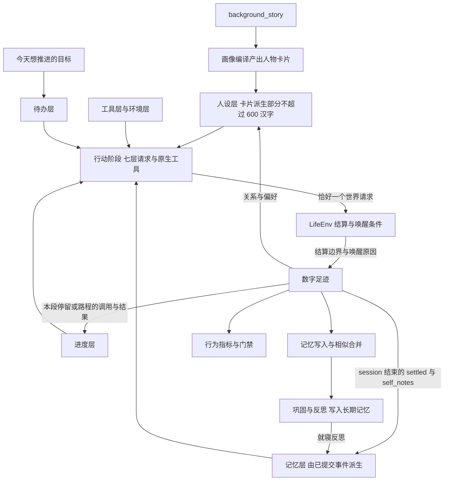
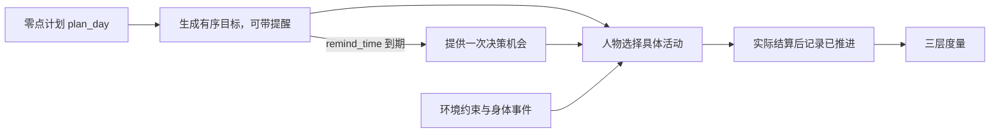

# 特性规格：人物决策与画像

> 状态：FROZEN——条款已裁决。既有测试证据保留原源码身份；正式地点活动环境、供给候选与交易由地图特性完整实现并重新验收，不能沿用历史数字宣称完成。正式十二周、隔离盲评与 LabelKit 完整自然日交付仍待真实运行。
> 部分条款按[人物 Prompt 规格](SPEC-persona-prompt.md)修订，修订部分已实现并通过离线验收（证据见[人物 Prompt 验收记录](persona-prompt-verification.md)）；修订记录见「版本表」。
> 「候选与呈现」「画像编译」「地图、门店供给与活动环境」「呈现与导出」「默认裁决与备选」与验收矩阵中的相应条款按[一日运行保真规格](SPEC-dayrun-fidelity.md#冻结条款修订)修订
> （一日运行保真 RL1–RL4）；定稿不等于已实现，验收矩阵中改动的行记 `离线验收待执行`。
> 日期：2026-09-29
> 依据：《人物真实性根因分析》（`docs/dev/research/realism-root-cause-2026-09-17.md`）的裁决结果。四个假设不是并列的，而是一条因果链——人物与环境之间的交换规则是主因也是放大器，给模型看的呈现是最便宜的杠杆，数据缺的是品类而不是条数，人物卡片文本本身有效而编译层是死通道
> 补充依据：《对象模型重分析》的「可达性：池变大后靠什么被看到」「被裁掉的对象怎么办」「曝光轮转」「地点语义粒度该取什么值」四节，见 `.work/object-model-reanalysis/REPORT.md` 与同目录 `LOCATION-GRANULARITY.md`
> 范围：人物的记忆写入与巩固、动机层的内部仪表与呈现、当日目标、世界素材品类准入、素材可达性与呈现轮转、画像编译、商品数量合同、运行呈现与导出投影

## 产品行为

对象的品类归属、共享属性、交换规则及来源审核统一由[品类契约规格](SPEC-category-contract.md)定义。
本规格中的世界素材品类覆盖仍以可供性与内容要求检验；它不替代有向交换配对的场景准入检查。

人物自己决定怎么过日子。本规格规定其中两件事：每次决策给模型看什么，以及模型说了什么要留下什么。

环境每提供一次决策机会，人物模型只有一个行动阶段：走现有 ReAct 循环，读取七层请求与原生工具，可以先查询自己的记忆，
再恰好提交一个世界请求，登记即结束；决策就是所选的世界请求。回复正文可有可无，写了就作为该调用的 `self_note`
保留到本段停留或路程结束，不进入记忆。每次请求都留完整证据。当日目标由场景本地零点的后台任务 `plan_day` 生成，可带提醒，人物清醒时可修订；
目标是人物意图，环境只根据实际活动证据标记推进，并以环境事件提供决策机会。人物在结束活动时写主观记忆，可以为空；
写入前按相似度合并，累计到阈值、待巩固条数达到十条或入睡后的第一个边界时归纳主观内容，
并在就寝后做一次反思。长期记忆的完成事实只由已提交环境事件确定性投影。

人物卡片由背景故事编译而来，结构化字段以人设层 JSON 进入提示（卡片派生部分不超过 600 汉字，当下处境不进提示）；
大五分数、九参数与权重都不进提示，只驱动世界层动力学。动机评分器计算并落库，候选、名次与概率不进入提示，
也不再合成一句话进入提示：体感分级、工作合同与待办分别只在环境层、工具层任务目标与待办层出现。
世界数据按可供性品类而不是条目数量验收，准入检查不满足即拒绝启动。

本规格改变提示词、工具 Schema 与世界状态结构，`prompt_sha256`、`tool_schema_sha256`、`code_sha256` 随之改变；
世界状态新增结构版本，旧状态没有该字段，加载即拒绝。此前运行的模型请求记录与新运行跨版本不可比，
这是有意为之：不为旧记录保留兼容读取路径，也不维护旧观察格式的别名。

## 与相邻规格的边界

本规格只定义人物决策与画像。以下内容已由其他文档定义，本规格引用而不重写。

| 内容 | 归属 |
| --- | --- |
| 社交行为规则：在场可见、消息、交谈、通话、联系人及其回复策略 | `docs/dev/SPEC-life-runtime.md`「社交最小可行版」 |
| 七层请求：各层字段与唯一出现、系统层、同秒续接、提示预算 | [人物 Prompt 规格](SPEC-persona-prompt.md) |
| 观察投影与提示合同：禁止进入提示的字段、商品可见期、材料与字幕增量 | `docs/dev/SPEC-life-runtime.md`「观察投影与提示合同」 |
| 身体语义：两过程睡眠、睡眠不足账、体感分级、社交需要与情绪的数值和滞回 | `docs/dev/SPEC-life-runtime.md`「身体语义：两过程睡眠、睡眠不足账、体感分级」 |
| 决策节律：结算边界不等于决策机会、唤醒条件清单、静默边界 | `docs/dev/SPEC-life-runtime.md`「决策节律：结算边界与唤醒条件分离」 |
| 类型、签名、字段、枚举、上限常量与提示模板 | `docs/CONTRACTS.md` |
| 活动受理门、被挡项的原因码与观察可见性、投影通道预算 | `docs/dev/SPEC-life-runtime.md`「活动组合政策」「观察投影与提示合同」 |
| 地点类与人物显式交互菜单、对象动作准入 | `docs/dev/SPEC-interaction-menu.md` |
| 行为指标与门禁的汇总口径、report-only 边界与交付顺序 | `docs/VERIFICATION.md` |

## 设计裁决

本规格的每一条款都有已核实的症状支撑，条款按上述因果链排定，不做并列假设。全部数值参数属于
`experiment_assumption`，除明确引用文献的常数外不宣称已测量的人类参数。

下表一行一个症状：直接机制列与对应条款列都用 ①②③ 编号，同号即同一条因果链，机制与修复它的条款一一对应。

| 已核实症状 | 直接机制 | 对应条款 |
| --- | --- | --- |
| 53.9% 的决策是 `continue_activity`，吃掉 53–62% 的 token | 900 秒结算边界每次都唤醒模型 | `docs/dev/SPEC-life-runtime.md`「决策节律：结算边界与唤醒条件分离」 |
| 记忆一半是边界簿记 | 结算边界强制写记忆 | 本规格「记忆合同」 |
| 就寝 19:53 / 21:44、计划睡 11 小时，李凡三次运行均早于人物卡片声明的凌晨一点 | `sleep_debt_hours` 等于醒着小时数，无饱和无昼夜门控，原值直接进提示 | `docs/dev/SPEC-life-runtime.md`「身体语义：两过程睡眠、睡眠不足账、体感分级」 |
| 07:00 开车去 08:00 才开门的公司并空等近两小时，21 个代码版本未改善 | ① 家中没有早晨可供性，任务 09:00 才可见 ② 模型按动机权重推翻直觉 ③ 缺少当日目标，每次决策只对当前状态作贪心反应 | ① 本规格「世界素材品类要求」 ② 本规格「动机层」 ③ 本规格「当日目标」 |
| 三次同一碗面 | ① 正餐只有 7 碗方便面 ② 首次购买被写成偏好记忆后回灌为稳定偏好 | ① 本规格「世界素材品类要求」 ② 本规格「记忆合同」；验收覆盖反例：购买本身不写偏好，首次购买后人物只写「明天还想吃」这类非偏好记忆时，人设层 `preferences` 为空（验收矩阵「记忆写入」） |
| 冰红茶三次放弃 | ① 活动进行中隐藏购买与进食工具 ② 一次响应只接受一个生活动作 ③ 最廉进食候选恒为西柚汁 | ① `docs/dev/SPEC-life-runtime.md`「观察投影与提示合同」 ② 本规格「商务与进食」 ③ 本规格「动机层」 |
| 两人同办公室清醒共处 10.86 小时互不可见，Relationships 恒空 | ① 观察没有在场人物字段，也没有通讯工具 ② 人物卡片没有关系字段 | ① `docs/dev/SPEC-life-runtime.md`「社交最小可行版」 ② 本规格「画像编译」 |
| 21 项生活活动 40 个运行零命中 | ① 生活活动 relief 为空、成本随时长线性，在评分器里是纯成本，且候选采样自全库而非人物启用集 ② 工具描述未列出生活活动 | ① 本规格「动机层」 ② `docs/dev/SPEC-life-runtime.md`「观察投影与提示合同」 |
| 每次请求 4.5 万 token，观察被序列化两遍、商品全表常驻 | vendor 观察记录双写，商品无遗忘 | `docs/dev/SPEC-life-runtime.md`「观察投影与提示合同」 |
| 人物卡片只占 0.25%，system prompt 86% 是协议 | ① 人物卡片 JSON 整体注入 ② 协议文本替换了身份前言 | ① 本规格「画像编译」 ② 本规格「单一行动阶段」；原「恢复身份前言」已被[人物 Prompt 规格](SPEC-persona-prompt.md)取代：身份前言删除，system 只放系统层交互规则，身份只在人设层 |
| 两条时间线分不出人格（同代码同人、异人的 JS 距离差 0.02；最近邻 59%，p=0.22） | ① 大五到九参数只作用于无人采纳的 hints，却以 JSON 进提示被当 reward ② 222 个随机偏好浮点与文本反向 | ① 本规格「动机层」 ② 本规格「画像编译」 |
| 李凡的 MEMORY.md 第一条是 “Marketing analyst” | 巩固提示不传人物卡片且带示例身份 | 本规格「记忆合同」 |

## 单一行动阶段

每一次决策机会只有一个行动阶段：人物模型可以先查询自己的记忆，也可能有协议纠错回合，然后恰好提交一个世界请求，
登记即结束；决策就是所选的世界请求，不另设决策自述阶段。没有记忆查询与纠错时，一次决策恰好一次模型请求；
所有请求与响应都留完整证据。请求组成、同秒续接与只读问答以[人物 Prompt 规格](SPEC-persona-prompt.md)第一、二章为准；
动作登记、回执隔离与公开结果字段以 [决策上下文规格](SPEC-decision-context.md) 为准。

| 阶段 | 请求 | 输出 |
| --- | --- | --- |
| 行动 | 原生 `tools`（整次运行不变，只剩最后一个回合时去掉记忆查询工具）；system 为系统层 JSON；user 为工具层、人设层、记忆层、待办层、环境层、进度层六层 JSON；同一秒接着决策时追加上一决策的原生 assistant 与 tool 消息 | 可选的回复正文与恰好一个世界请求，登记即结束；同秒续接时此前各 assistant 回合原样回传 `reasoning_content` |

七层各自的字段与唯一出现原则见[人物 Prompt 规格](SPEC-persona-prompt.md)第一章，禁止进入提示的字段见
`docs/dev/SPEC-life-runtime.md`「观察投影与提示合同」；请求组成、生成参数、模型身份与工具面只在
`docs/CONTRACTS.md`「人物决策提示与生成参数」定义。

**行为规则**：

- 每次决策的全部模型请求与响应都留下完整证据；`decision_started` 在本次决策的首个行动请求时与该请求同批写入、排在请求之前，
  `data` 只有 `round_id`、`round_order`、`world_state_version`、`wake_reasons`
- 回复正文可有可无：提交世界请求那一次回复的非空正文写入 `action_requested.data.self_note`，在本段停留或路程的进度层中随该调用出现，
  不进入记忆；不要求、不重问、不代写
- 回复正文与思考都不是动作，不改变世界；思考只在同一秒的连续决策中原样回传，时间推进后丢弃，不进入七层中的任何一层
- 每次决策至多 16 个回合，全部归行动阶段：为世界请求保留 1 个回合，剩余不少于 2 个时才开放记忆查询
  （`memory_recent`、`memory_search`、`memory_time_range`）；非法响应反馈沿用现有条款；无 `finish`，
  记忆随 `conclude_activity.memories` 写入，允许空
- 行动阶段的 `start_activity` 动作取冻结观察中的有效交互菜单，列在工具层；动作不按人物状态隐藏，此刻不能做的标
  `available=false` 并写明 `reason`；人物的 `interaction_menu` 是显式场景准入声明，不由人格特征、口味权重或动机评分推导

依据：DeepSeek 思考模式文档规定请求带 `tools` 时此前每个 assistant 回合的 `reasoning_content` 都须原样回传，
不在消息中的回合不受此约束，这决定了同秒续接与时间推进后丢弃思考的切分；
Humanoid Agents 与 Sotopia 都把内部状态或私有目标作为显式输入。

## 记忆合同

记忆随 `conclude_activity.memories` 写入，允许空数组：没有值得记录的新事件时不写记忆，AS2 运行时不以空列表为错误。
播报与暂停不带记忆。条数上限与字段面见 `docs/CONTRACTS.md`「记忆字段」。

**写入规则**：

- 每条记忆的 `text` 使用人物语言，不得包含事件标识、请求哈希或任意十六进制身份；无 `refs`，来源由系统登记
- 人物只写感受、打算、偏好、关系等主观文字；`event`、`observation` 不再是 WorldMock 可写类型，闭集见 `docs/CONTRACTS.md`「记忆字段」
- relationship、preference 两类记忆必须带 `subject`（写的是谁或什么），其他类型的 `subject` 为 `null`；relationship 的 `subject`
  须是已知人物（卡片关系名、联系人姓名或称谓、同世界人物名）。`subject` 只在 WorldMock 的请求与事件中，写入 AS2 前去掉
- 这两类记忆只在人设层出现：成功的 `conclude_activity` 中带 `subject` 的条目按对象取事件顺序最后一条，原地更新人设层关系的 `view`
  与 `preferences`，存储仍只追加；它们不进记忆层，也从进度层该调用的参数中略去。购买本身不写偏好
- 写入前按 bigram Jaccard ≥ 0.6 与最近 24 小时的同类型记忆合并；合并只增加计数与最近时刻，不重复追加文本

**主观巩固触发**为三选一：`importance` 自上次巩固起累计到 3.0；待巩固记忆满 10 条；人物入睡后的第一个边界。
单条 preference 类型记忆不触发主观归纳更新；每步事实视图刷新不重置这些计数。

**主观归纳**（阈值巩固）保留：传入 `persona_card` 和主观 episode，使用人物语言，不含示例身份或地点编号；
模型只更新单独持久的主观归纳，不能直接改写长期记忆文件的身份和已核验经历区段。
`MEMORY.md` 每步从冻结画像、当前观察事实窗口和主观归纳确定性装配；它与归纳摘要都不再进入人物决策提示。

**记忆层**取代提示中的主观归纳、最近条目窗口与已核验经历句子：构建提示时由环境从已提交事件与世界状态派生，
不新增持久状态，构建结果随观察事件保存。`earlier_today` 为今天已结束的每个 session 一条 `{recorded_at, settled, self_notes}`，
`earlier_days` 为起源于该日且此刻仍未了结的事项加上归属该日的就寝反思。`settled` 是系统写的确定性句子；
`self_notes` 取本 session 内成功的 `pause_activity`、`conclude_activity` 写下的 summary 与记忆原文，按活动名标注。
记忆层 JSON 不超过 8000 字符。句式、零点分区、未了结的判定与窗口删减顺序见[人物 Prompt 规格](SPEC-persona-prompt.md)第三章；
完成事实的来源与恢复见[一日行为规格](SPEC-dayrun-behavior.md#已核验经历与人物自述)。

**反思**：就寝后的巩固同时执行一次反思，由三个问题引导生成不超过五条 `reflection` 主观洞见，
每条引用支持它的记忆身份。该引用是记忆运行时后台调用对 AS2 条目身份的内部引用
（`docs/dev/SPEC-time-and-energy.md`「发给模型的内容不含内部身份」所列例外），不进人物决策提示。
反思仍只写 `reflection`，不产出关系与偏好；它归属「睡眠开始时刻前推 6 小时」的本地日期，进入记忆层 `earlier_days`。
这是 Generative Agents 反思机制的直接借用。

**足迹的关系**：沿用 AS2 的主观记忆检索和归纳能力，每条记忆补充来源事件与形成时刻；每次决策实际检索的主观记忆都留存下来，
不只留最后一份长期记忆文件。记忆没有提到某次观看，不代表那次观看没有发生：原始数字足迹始终保留，
已核验经历仅从该事件库投影。系统登记的来源不证明人物自由文字属实。
`memory_updated` 只在实际主观条目写入或长期记忆视图变化后保存：操作类型、新建与合并的 episode
身份、同一批 `{id,type,text,epistemic_status=subjective}` 快照、当轮观察身份、事实来源身份、
写入前后视图摘要以及写入后条目和状态文件摘要必须一同留证。多件食品来自同一结算事件时，
事实仍逐件展示，但来源事件身份只保留首次出现的一次；记录校验拒绝重复身份和观察窗口之外的来源。
准确字段与质量重算见[记录引擎设计](../design/05-recording-engine.md#已核验经历与主观记忆)。

### dreaming 边界

人物运行中的记忆影响后续行为，LabelKit 离线生成的 dreaming 是后续训练材料，默认不自动写回仍在运行的人物。
dreaming 的任务取值、每份材料必须携带的字段与分支绑定见 `docs/CONTRACTS.md`「反事实与重演字段」。
推演改变行动或世界条件时建立新分支；仅由模型想象的结果标明假设，经过环境执行的结果标明重新仿真。

## 动机层

动机评分器计算并写入 `observation.data.motivation_internal`，供评估与研究使用；候选、名次与概率不进入提示。
原先合成的一句话 `drive_summary` 删除：体感只以环境层的五项分级呈现，工作的截止与剩余要求在工具层任务目标的 `contract`，
待办在待办层，都不含数字权重（[人物 Prompt 规格](SPEC-persona-prompt.md)第一章）；字段面见 `docs/CONTRACTS.md`「体感与动机证据」。

**评分器修正**：

- 成本按候选时长归一为单位小时效用，价格只在成本项计一次
- 进食候选只接受热量不低于 300 kcal 或最接近缺口的正餐类食品，并返回前三名
- 同一娱乐家族至多两条候选；娱乐需要低于 0.3 时不生成娱乐候选
- 生活活动只从人物启用集采样，并具备 relief 通道
- 近 24 小时内已食用的商品在进食候选中按 `1 / (1 + 次数)` 降权，这是 Rolls 1981 的感官特异性饱足

Dill 的双效用（先按类别排序再在类内加权随机）是评分器修正的结构依据。本规格只修正内部仪表，
不据此替人物选择：内部仪表落库，人物看到的只有环境层的体感分级。

## 当日目标

当日目标表达人物今天想推进什么，由零点计划生成、人物可修订；环境掌握具体活动、时间约束和进展证据。
完整行为与验收统一见 [当日目标规格](SPEC-day-plan-goals.md)，字段见
[当日目标请求](../CONTRACTS.md#当日目标请求)。本节不再保留时段骨架的另一份规则。

目标不是全天轮廓；人物卡片的作息继续影响环境与身体，只经零点计划影响目标与可选提醒，不成为目标的绝对起止时刻；
提醒只给一次决策机会，不驱动活动。
原段数、覆盖就寝、段起点唤醒与分钟偏离算法退役。目标推进率仅报告，外部约束受阻按质量门禁处理。

## 世界素材品类要求

数据扩容按可供性品类而不是按条目数量验收；准入检查对下列要求逐条执行，不满足即拒绝启动。

| 品类 | 要求 |
| --- | --- |
| 地点 | 至少覆盖家、办公室、食堂或餐馆（≥2）、便利店、超市或菜场、公园或健身场所；从已取得的张江 OSM 探针选真实兴趣点，路线由 OSRM 冻结；每个地点必须声明 `location_kinds`，取值来自 `{home, office, outdoor, fitness, venue}`，非空且为该闭集的子集；`anywhere` 仅用于活动侧声明无地点限制 |
| 内容的地点类 | 每个内容品类必须声明 `location_kinds`（该品类需要哪些地点类），缺一即准入拒绝；条目所在地点类与地点声明的地点类取交集，非空即可行，声明含 `anywhere` 表示恒可行；白领场景的内容品类只取 `home`、`office`、`anywhere` 三个值 |
| 家的可供性 | 晨间例程（洗漱 15 分钟）与家中储备食品：场景初始储备 7 份早餐类食品，进食扣减，选择支持配送的门店供给补充至家中；储备为场景假设并留痕 |
| 办公室的可供性 | 茶水间饮水（免费、5 分钟、微量娱乐缓解）、会议室（会议任务）、同事在场 |
| 正餐 | 至少 30 个正餐类商品（热食、餐馆菜、外卖套餐），热量来源为中国食物成分表或 USDA FNDDS 并标注来源，门店供给报价 15–45 元为场景假设，用餐时长 20–40 分钟，可堂食或配送 |
| 内容 | 每个观看条目必须有 `title`、`genre[]`、`language`、`age_rating`；白领场景拒绝 `age_rating ≥ 18` 的条目；现有 `drama` 语料（英文视觉小说脚本）整体替换；此外每个条目必须携带可作检索分区键的条目属性——题材（`genre[]`）、语言（`language`）、时长段（由 `duration_seconds` 落格）三项不得缺省，检索分区即由这三项的组合构成 |
| 工作 | 84 天至少 20 份互不相同、与人物职业匹配的中文输入材料；`tasks[].assignee_agent_id` 必填，合同按人分配 |
| 生活活动 | 条目 Schema 增加 `location_kinds`、`time_window`、`needs_partner`、`effects`（娱乐、社交、健康）；启用集由画像编译产生 |
| 联系人 | 每个人物都要配到至少两名联系人：同事与其他人物对应，老友或家人由场景联系人担任；联系人与回复策略的行为规则见 `docs/dev/SPEC-life-runtime.md`「社交最小可行版」 |

### `location_kinds` 的运行期强制语义

`location_kinds` 必须来自地图地点目录的显式非空声明，场景只选择地点，运行时组装后由候选、活动启动和恢复共同读取。
审查基线缺失字段时放行的问题属于地图特性的完整开发范围；禁止保留缺失转 `anywhere` 的路径。
交互菜单读取解析后的 `kind`，既不生成活动环境，也不能替代其验收。

**行为规则**：

- 地点声明「我满足哪些地点类」，条目声明「我需要哪些地点类」，两侧同名同义，只用一个概念词 `location_kinds`，
  不新增第五套词表
- 交集为空即不可行，动作被拒绝并携带稳定原因码；地点不可行与资源冲突必须是两个可区分的原因码，
  不能都归为 `RESOURCE_CONFLICT`
- 被地点门挡下的条目在观察里带原因码出现，不得从列表里静默消失；模型看到的应是「这些东西你现在拿不到」，
  而不是「世界就是这样」
- 声明含 `anywhere` 的条目在任意地点恒可行
- 词表取值与 `corpora/lifestyle/enrichment.json` 的 `location_kind_closed_set` 逐值一致，目录、语料与准入三处不得漂移

**取舍记录**：地点这一类字段只当可行性门用，不当检索分区键。一个人十二周生活里的地点类别是十的量级，
地点最多贡献六到十倍收窄，而语料规模可以无限增长，两者不同步；把地点调细到足以当分区键必然细到与现实不符
（场景十一个地点里没有影院，把影片标成可在 `venue` 观看是空承诺），所以分区责任交给内容条目的题材、语言与时长段，
轮转单位也是检索分区。地点类取值取生活活动那一套六值而不是新造一套，理由有二：它是已冻结的封闭集并带双端防漂移断言；
它顺手消灭场景地点标签与生活活动地点类之间的零映射。审查基线的 `venue` 未被正式地点声明承载，现行地图必须显式核验每个活动环境；
保留在封闭集里不删除——未来影院落地时它是正确取值，而删除封闭集取值会改动词表身份。

依据：《对象模型重分析》「可达性：池变大后靠什么被看到」与 `LOCATION-GRANULARITY.md`「推荐」「明确做不到什么」。

### 素材可达性

**准入校验每个条目至少属于一个可检索分区，且该分区可达。** 条目不可达的定义是：不存在任何一条路径让该条目进入
某次决策的候选集。这是对全局可达性的要求，**不是覆盖率要求**：本规格不要求每个条目都被呈现过，
也不承诺它在任何有限运行窗口内被呈现；它只保证「从未可达」这个状态本身可被判假，
且判定方式不依赖任何运行期互动统计量。

校验在准入期执行，逐条目给出结论与证据，规则如下：

- 条目的检索分区键（内容为题材、语言、时长段）必须齐备；任一键缺省的条目落不进任何分区，判定为不可达
- 每个分区必须存在非空的地点可行组合：分区内至少有一条条目的 `location_kinds` 与场景至少一个地点的
  `location_kinds` 交集非空，否则该分区在场景里恒不可行，判定为不可达
- 声明的可达路径必须在有限次检索组合内可达；不得使用近似最近邻、向量检索或以模型输出为准的检索机制，
  《对象模型重分析》已判定这类机制的结果不确定且与「同输入逐字节相同输出」冲突
- 不可达条目在分区报告里逐条列出并阻断启动；报告不因条目数量少而放行

语料里已有 86 条内容在内容语料中查不到对应条目（含 80 条 `game_session`），其中 5 条落在 `attention_required`
品类却因权重恒零被排除在娱乐候选之外——那是「画像偏好被当成排除条件」的实例，见「画像编译」；
本节的不可达是分区缺失导致的，两者是独立缺陷，修好其中一个另一个仍然存在。

依据：《对象模型重分析》「被裁掉的对象怎么办」中影子集穷尽的算术——影子集的作用是反塌缩而非覆盖，
对应的门禁是静态可达性检查，而覆盖率不可断言。

### 素材淘汰与检索机制的禁止项

- **禁止按互动统计永久退役素材。** 不得以观看次数、选择次数或任何由互动累计出的估计量把对象移出目录或标记为
  不受欢迎；12 周内内容品类最大 90 条、平均每条约一到两次曝光，这个样本量支撑不起「谁更受欢迎」的排序，
  且永久移除意味着一次错判无法挽回。目录侧的 `Tombstone` 语义（保留可读、拒绝新场景引用）是退役的正确样板：
  退役不等于删除。
- **禁止向量检索与近似最近邻作为素材检索机制。** 近似最近邻的结果不确定、聚类初始化带随机性，
  与「冻结目录 + 同一世界状态逐字节可复现」直接冲突。允许的是可枚举、可 diff、可进 provenance 的稀疏词项检索，
  以及按标签的倒排与 facet 计数。
- **禁止把排除与不存在混为一谈。** 被排除的条目必须在观察侧可区分地带出原因码；
  「没显示」不能读成「不存在」。
- 素材的**曝光轮转不是淘汰**：轮转只改呈现顺序与换新名额的分配，见「呈现轮转」。取名上必须区分「永久退役」
  与「曝光轮转」，两者对复现性、可审计性与可逆性的要求完全不同。

依据：《对象模型重分析》「曝光轮转」的「不做：永久退役」一半，以及「被裁掉的对象怎么办」的三条约束。

当前场景目录只用了 192 条内容中的 10 条、129 种食品中的 5 种；因此本规格不要求增加同类条目数量，
只要求补齐上表缺失的品类。语料获取仍走 `prepare-corpora`，来源、许可与哈希进入 `corpora/manifest.json`。

## 候选与呈现

本规格只定义候选与呈现的**行为要求**。字段、枚举、上限常量的具体名称与类型在 `docs/CONTRACTS.md` 定义；
投影与提示通道的预算规则见 `docs/dev/SPEC-life-runtime.md`「观察投影与提示合同」。

### 候选确定性

候选集是**派生量，不是状态**：候选集 = `f(冻结目录, 画像摘要, 世界状态版本, 选择器版本)`。
时间戳、缓存内容、模型输出都不得进入这个函数。同一（世界状态、人物、场景）必得同一候选集与同一顺序。

**行为规则**：

- 排序键是整数或有限格点，沿用 `compute_taste_weights` 的四位小数取整口径，另含相关度一项；同分时以
  `sha256(场景|人物|日期|对象)` 决胜（[一日运行保真规格](SPEC-dayrun-fidelity.md) 5.1：以对象标识决胜会使零口味时的顺序退化为字母序），
  不以对象标识、字典序、插入序或内存地址决胜
- 分桶与游标派生使用 `hashlib`，不得使用内建 `hash()`——后者受进程哈希种子影响，跨进程不稳定
- 可见性的变更必须是事件。若某对象的可见性依赖「世界发生过什么」，那个「什么」必须是调度器里的一条已排定事件，
  有事件序号与变更前后的证据
- 只允许世界事实排除候选：不在场、供给库存为零、营业关闭或未知、资格不足、无有效报价、地点类交集为空；能量不构成排除。
  每一条排除都带稳定原因码，原因码取闭集，不自由拼字符串

依据：《对象模型重分析》「分层下推」的确定性四条与「被裁掉的对象怎么办」的裁剪三分表。

### 呈现上限与下推游标

- **单次呈现条数不超过场景常量。** 它限制本轮交互对象的展示数量，与整次模型请求的
  百分之八十五上下文容量检查分别负责不同约束，是 fail-closed 的：
  超过上限是运行故障，不是截断到上限；被截掉的部分不得静默丢弃
- **上限分两级，不合成一个数**：池规模上限（某人物在某地点理论可互动的对象总数）只用于计数与下推，
  不直接进提示；单次呈现上限才是「可交换 object」那一节。一个 `1k` 或更大的数不得直接充当呈现条数
- 单次呈现上限只约束目标条目：工具层的可调用索引 `callable_index` 只列名称、不是候选条目，不计入单次呈现上限，
  但计入整次请求的容量计数（[一日运行保真规格](SPEC-dayrun-fidelity.md) 5.2）
- **下推用游标，不用页码。** 游标由上一页最后一条的完整稳定排序键构成，且只由
  `(冻结目录, 世界状态版本, 排序键版本, 游标)` 决定；偏移量式分页在深分页时不稳定，且会随目录变动出重漏
- **全量遍历必须等于一次全量的有序子序列，无重无漏。** 逐页取尽后，得到的序列与一次性全量取出的有序序列逐项相同
- 单次返回体区分「本次返回条数」与「总数」，`count` 不再单独充当上限

依据：《对象模型重分析》「分层下推」的层数与游标两条、「prompt 里那一节『可交换 object』」的三级呈现与预算表。

### 呈现轮转

轮转的判据是**上次呈现时刻**，不是任何偏好估计量——从上次呈现时刻可以导出未展示时长，它等于当前时刻减去上次呈现时刻，本规格的判据与断言都用「上次呈现时刻」这一个量表述。系统只需记住每个对象「上次被呈现是什么时候」——
这不需要统计推断，也不需要假设人物偏好稳定。「看了很多次只选某几种」只是触发轮转的信号，不是决定谁下架的依据。

**行为规则**：

- 每次呈现留若干换新名额给长期未呈现的对象，换新名额数与「长期」的阈值是场景参数，确定性且可断言
- 轮转必须**非破坏性**：只改呈现顺序与换新名额，不产生目录变更、不产生下架事件、不改任何对象状态
- 轮转与可见期只管展示与比较，不限制按名调用：所有目录类对象都可以直接写名称，无损归一后唯一即受理，
  否则给至多 3 个可照填、此刻可行的候选，不自动替换（[一日运行保真规格](SPEC-dayrun-fidelity.md) 3.1）。`obtain` 按场景供给解析、按当前报价结算：
  `from` 是可选约束，分段匹配依次以 `SUPPLY_NOT_FOUND`、`SUPPLY_NOT_AT_STORE`、`FULFILLMENT_NOT_SUPPORTED`、`ACTIVITY_PRECONDITION_UNMET` 拒绝，
  多于一个可服务的匹配时按请求级 `prefer` 选定一家，不再以 `SUPPLY_NAME_AMBIGUOUS` 拒绝；不自动换成别的商品
  （[人物 Prompt 规格](SPEC-persona-prompt.md)第五章「指名购买」，按一日运行保真规格 3.2、3.3、3.5 修订）
- **最大未呈现间隔必须有界。** 给定池规模 `N` 与每次换新名额 `k`，最坏等待间隔不超过闭式上界
  `⌈N ÷ k⌉ ÷ D`，其中 `D` 是每天决策点数。写测试断言时必须用这个精确形式，
  不使用它的连续松弛 `N ÷ (k × D)`
- 有效可达率必须计入：某池只在人物身处对应地点时可达，有效决策点是 `D × 可达率`，
  最坏等待按有效决策点计算，不按理论决策点计算
- 轮转的单位是**检索分区**（内容为题材、语言、时长段的组合），不是整个语料池，也不是地点分区。
  分区之后每个小池的规模才可控，最坏等待间隔才有界
- 轮转不改变候选集的内容，只改变它的顺序与换新名额的分配：轮转前后两次投影里，同一会话内对象的相对顺序可不同，
  但同一输入两次投影必须逐字节相同
- 禁止把互动次数当作「受欢迎程度」使用；轮转的输入只有上次呈现时刻这一个计数器，每个对象各记自己的上次呈现时刻，
  不用人物级的共享偏移量，也不设分区游标；换新名额留给该分区内最久未呈现的对象
- 若需要「按最优替换这一周该换谁」这类离线基准，它是只读诊断工具，放在 `scripts/` 下，
  不是轮转的必要条件

参数不由拍脑袋决定，由闭式反解：`换新名额 k = 池规模 N ÷ (每天决策点 D × 目标等待天数 W)`；
`单池上限 N = k × D × W`；`总容量 = 分区数 × 单池上限`。`D` 是实测量，不是估计值——
它可从既有足迹里数出来，取值区间随运行快慢拉开。定参数时取偏保守一侧，验收断言用闭式而不是硬编码的天数。

依据：《对象模型重分析》「曝光轮转」的三条合同要求与闭式表、`LOCATION-GRANULARITY.md`「轮转算术的口径」。

## 画像编译

画像编译从 `background_story` 产出结构化人物卡片 `PersonaCard`（类型名；主观归纳请求里的字段名是 `persona_card`，
两者与中文正文所说的「人物卡片」是同一产物），抽取沿用三次一致性口径。新建运行时卡片的结构化字段另存进人物 `profile` 的
`persona_card_struct`，恢复时校验；宿主用它与人物姓名、场景联系人渲染人设层 JSON 进入提示。卡片编译、三次一致性与冻结恢复不变，
`render_card` 不变、输入的卡片先经场景作息覆盖（见下）；600 汉字上限只约束卡片派生的字段；当下处境 `situation` 不进提示。卡片必须承载：身份（年龄、职业、居住方式）、关系（姓名或称谓、角色、
亲密度、渠道）、当下处境（本周在忙什么、在意什么）、时间锚点（起床、出门、午餐、晚餐、就寝窗口）、
时型中点 `chronotype_midsleep`、睡眠需要 `sleep_need_hours`、习惯签名（触发—反应—时段三元组）、
口味（内容题材、饮食喜好、常用媒介）与压力时的应对方式。字段的名称、类型与取值范围只在
`docs/CONTRACTS.md`「人格与卡片字段」定义。

作息、消费与风险倾向记录在各自的 `background_story` 中，由卡片承载，场景显式声明的作息字段优先：场景人物显式声明的
`chronotype_midsleep`、`sleep_need_hours`、`lunch_window`、`dinner_window`、`bedtime_window` 覆盖卡片的抽取值（按卡片格点量化；覆盖后锚点乱序时
冲突的那一槽保留卡片值），未声明的字段仍取卡片值，每处覆盖与冲突各记一条输入警告；`persona_card_struct` 保存覆盖后的值，身体结算、零点计划与每轮人设层
读同一组作息（[一日运行保真规格](SPEC-dayrun-fidelity.md) 2.1）。这些是 `experiment_assumption`，
不宣称来自旧数据中未提供的个体特征，也不规定行动时刻、数量或必须完成的日程。零点计划生成的当日目标不是
日程脚本，不给固定的“先吃饭再工作”行为脚本。模型选择和提示使用 AS2 现有配置，正式运行固定端点、模型版本
与参数。

**大五只进入世界层动力学**：神经质决定情绪脉冲幅度与半衰期，外向性决定社交需要增长率与交谈缓解量，
开放性决定内部评分器的多样性权重，宜人性决定接受邀约与回复消息的倾向，尽责性决定内部评分器的现时偏好。
大五分数、九参数与权重不进提示。

**删除与替换**：`entertainment_preferences` 随机浮点删除；内容偏好改由卡片口味与内容 `genre[]` 的匹配结果决定，该结果即
`taste_weights`：它是内部评分器与浏览排序的排序信号，另按有效偏好 `f + (1 − f)·w` 调实际缓解的幅度（下限偏好 `f` 在场景层，
[一日运行保真规格](SPEC-dayrun-fidelity.md) 1.2）；游戏条目同一算法。`occupation`、`routine_preference`、`consumption_preference`、
`risk_preference` 四个模板字段删除，其内容并入卡片。

**口味权重是排序信号，不是准入条件。** `taste_weights` 以及任何由画像派生的偏好量，只允许改变候选的先后次序，
不允许把候选从集合里去掉；偏好只调缓解的幅度，不决定有无，零权重的条目也有下限缓解。候选生成阶段出现任何以偏好权重为条件的剔除都是违规：

- `compute_taste_weights`（`src/worldmock/profile/taste.py`）的取值域必须包含零而语义不是「不可选」；
  卡片未声明某题材时该题材条目的权重为零，零权重必须排在非零权重之后，而不是在枚举时被丢弃
- 娱乐候选的入选条件不得包含「偏好权重为正」这一支。现行实现
  `attention_prior[kind] × preference > 0`（`src/worldmock/life/motivation.py`）使卡片未声明过的题材整体不生成候选，
  本版取代该条件：`attention_prior[kind] > 0` 决定品类是否进入枚举，`preference` 只参与排序
- 受此影响的既有条目可数：白领场景 192 条内容中有 5 条（`news-feed`、`jokes-feed`、`weibo-feed`、`zhihu-feed`、
  `movie-reviews-feed`）因语料查不到 `genre` 而权重恒为零，现行实现把它们整条挡在娱乐候选之外

画像口味是描述性的（从背景故事抽取的自述），把它当规定性条件使用，等于用一句自述否定人物此刻的冲动，
且事后无法解释某条目为何从未出现。可达性验证的条目正是这条要求的静态守卫，见「素材可达性」。

依据：《对象模型重分析》「被裁掉的对象怎么办」的裁剪三分表——只有世界事实可以排除，意图查询由人物主动收窄，
画像偏好只允许改序；以及「可达性：池变大后靠什么被看到」的确定性去偏置一节。

**覆盖率校验**：`validate` 输出 `persona_coverage.json`，逐条记录每条习惯签名的反应与每个口味条目是否映射到
世界中至少一个可执行目标或条目；可执行比例低于 80% 时校验失败，并列出缺失项。这一校验防止人物卡片写了播客
而世界里没有播客。匹配不允许用 App 名子串算命中（「B站视频」不因应用名「B站」算覆盖）；创建运行的路径不因覆盖率失败，只发输入警告
`COVERAGE_BELOW_THRESHOLD`，与口味对不上题材、权重全零等其余输入警告一起冻结进运行清单与质量报告（[一日运行保真规格](SPEC-dayrun-fidelity.md) 1.3）。

**覆盖率与可达性不是同一件事，两者不得互相替代**：覆盖率问的是「卡片声明的口味在世界里有没有对应条目」，
是画像侧的完备性，允许按阈值放宽；可达性问的是「世界里的条目有没有一条到达人物的路径」，
是素材侧的准入条件，不做比例判定、不设阈值放宽，任一条目不可达即拒绝启动。见「素材可达性」。

依据：Fleeson 2001 与 Mischel–Shoda CAPS 说明单日行为由情境与 if-then 签名决定，特质只解释小部分方差；
Roenneberg 的 MCTQ 以自由日睡眠中点度量时型。

## 地图、门店供给与活动环境

[地图与门店供给规格](SPEC-map-and-storefront.md) 将商品定义与购买候选分离。
同商品不同地点的供给分别呈现价差、道路路程、营业和库存；人物自己选择，不预设近店或低价店必胜。人物也可以只写商品、收货人与
请求级 `prefer`（最快或最便宜）把挑店交给系统，系统按该偏好选定并写明所选门店（[一日运行保真规格](SPEC-dayrun-fidelity.md) 3.5）。
候选仍使用原类型闭集，购买身份取供给，消费与商品多样性取商品；不能把两家门店计成两种商品。

活动环境来自唯一地图地点目录的显式非空声明，按场景选中地点装配；不再依靠缺失声明时的放行路径。
经营业态、可选品牌和交互菜单地点类不自动生成活动环境。发现动作进入正常单动作协议，
结果结算后进入下一次观察；浏览与呈现只管展示与比较，不是购买资格上限，未呈现的商品按指名购买解析。
现有地点活动环境缺口属于本次完整开发范围，待正式输入上的行为断言通过后再刷新状态。

## 商务与进食

`purchase.items` 为一至五个不同门店供给与数量，必须同地点、同卖方、同履约方式，一次付款、一次配送；
同账户跨地点也拒绝，重复供给明确拒绝；任一项不可购则整单无副作用，不自动删件。`consume.items` 为 1–3 件已持有的食品，同一地点一次进食，用餐时长取最长者，
热量与效果累加；非食品使用仍为单件。家中储备与超市补货按「世界素材品类要求」执行。请求与结果字段见
`docs/CONTRACTS.md`，动作结算规则见 `docs/dev/SPEC-life-runtime.md`「具体活动结算」。

进食按开吃份量结算：开始进食时，每件取 `min(1, 手边持有)` 从库存移入活动数据的 `opened`，摄入只按 `opened` 与实际进度计算，
进食期间不再扣库存。暂停保留 `opened` 的剩余，别处不能用，恢复时不再核库存；结束进行中或暂停的进食时丢弃 `opened`
减已吃的部分，写入活动与结果，不补算摄入，其他份数不动；自然吃完丢弃为 0，实验截止截断时不丢弃。
不足一份也可以吃：份量取实际持有，时长为 `max(60, round(整份时长 × 份量))` 秒，工具层的数量、时长与热量同一口径；
收尾结果的 `details.outcome` 逐项写终局与已吃、丢弃、剩余份量（[人物 Prompt 规格](SPEC-persona-prompt.md)第五章「进食」）。

普通进食与单件使用沿用库存的九位小数份额口径：累计目标、实际进度与累计消耗使用同一精度，
身体热量与效果只按实际吃掉或用掉的量结算。相同实际进度分成不同结算边界时，最终库存、累计消耗与热量一致；
保存和恢复不得因舍入误差失败。单件使用单次不足不超过 `1e-9` 份时只消耗实际持有量，
超过该容差仍拒绝且不产生状态变化。库存配方沿用品类契约的精确微量口径，不受本段量化规则影响。

## 呈现与导出

- `scripts/inspect_run.py` 读取 `tool_name`
- `export` 增加确定性投影 `timeline/<agent>-<date>.md`，合并静默边界与同一活动、显示名称而非标识，
  由 `scripts/render_day.py` 生成；并行进度交错时仍按活动身份独立合并，重叠活动分别显示；时间线只出现中文名称：
  生活活动、观看、游戏、工作、通话与交谈都有标题，种类名取 `src/worldmock/life/readable.py` 的中文种类表（单一来源），
  不出现 `call`、`work` 等英文种类名与 `task-` 一类内部标识形态，质量报告另查时间线标签（[一日运行保真规格](SPEC-dayrun-fidelity.md) 7.4）
- `verified-experiences.jsonl` 从已提交事件的固定截止完整前缀导出，摘要绑定并由消费端重算；
  观察每轮只在私有证据中保存本人最近五条，不再写成句子发给模型。等待、原因未知的等待、真实内容接触与人物经过时间并集分别报告
- `tools/run-viewer.html` 增加同一投影的“一天”视图
- 盲评记录为每条活动补上地点与同伴，同伴以匿名引用给出
- 动作与意图窗口仍以同人物、同决策、动作前最后一次实际行动请求为 prompt 权威，原样保留其中的 `reasoning_content`；
  `self_note` 随实际请求进入窗口，并进入 dreaming 输入；dreaming 读 `self_note` 与实际请求中的层 JSON，不再读决策自述与 `scene`

本规格不改变 `docs/CONTRACTS.md` 中 LabelKit 最终数据合同的字段；训练目标是否改为叙事化 completion
不由本规格决定。

## 默认裁决与备选

下表记录已裁决的默认值与备选值。备选只在形成新的规格版本时生效，不在运行时可切换。

| 条款 | 默认 | 备选（需新规格版本） |
| --- | --- | --- |
| 决策阶段 | 单一行动阶段：决策就是所选的世界请求，回复正文可有可无；原决策自述阶段被[人物 Prompt 规格](SPEC-persona-prompt.md)取代 | 无；原备选「只恢复身份前言，不加决策自述」同被取代，身份前言删除 |
| 重估间隔 | 5400 秒 | 3600 或 7200 秒 |
| 社交需要 | 作为第四项需要进入身体模型 | 不加资源，只靠人物卡片签名与消息驱动 |
| 联系人回复 | 老友与家人 `reply_policy=model`，同事映射到真实人物（现有两份一日场景把同事写成模型联系人，是否改正由数据集决定；模型联系人的回复只通过消息来往，不虚构到场，见[一日运行保真规格](SPEC-dayrun-fidelity.md) 7.3） | 全部 `template` |
| 动机评分器 | 保留为内部仪表并落库 | 整体删除 |
| 回复正文的信息范围 | `self_note` 随实际请求进入动作与意图窗口，并进入 dreaming 输入；原「决策自述仅 dreaming 可读」随决策自述删除 | 无 |
| 人物卡片覆盖率阈值 | 80%；低于阈值时 `validate` 失败，创建运行只发输入警告 `COVERAGE_BELOW_THRESHOLD`（一日运行保真规格裁决 D4） | 60%（放宽）或 100%（严格） |
| 提示容量 | 每次实际请求连同预留输出计入模型上下文窗口；达到百分之八十五时先提前结束本秒续接，再只压缩进度层派生投影 | 更换模型窗口须重新验证同一比例与结果保真 |

## 文件修改清单与实施顺序

下表列出本规格条款要求的变化。完整的路径归属与交付顺序见 `docs/INDEX.md` 与 `docs/VERIFICATION.md`。

| 模块与文件 | 必须完成的变化 |
| --- | --- |
| `custom/agents/life_agent.py` | 单一行动阶段（删除决策自述阶段与身份前言，system 为系统层）与同秒续接中 `reasoning_content` 原样回传；工具描述只写用途；商家或可配送时开放购买与进食；日程工具请求模型；记忆列表允许为空 |
| `custom/envs/life_env.py` | 注册日程与多件商务动作 |
| `src/worldmock/life/models.py`、`scenario.py` | 日程与人物卡片相关 Schema、多件购买与多件进食请求、品类与人物卡片覆盖率准入检查 |
| `src/worldmock/life/motivation.py`、`catalog/rules/motivation.toml`、`catalog/affordances.toml` | 单位时间成本、价格单计、正餐门槛、家族上限、只从人物启用集采样、relief 通道、按感官特异性饱足降权、结果写入 `motivation_internal`（`drive_summary` 删除） |
| `src/worldmock/life/engine.py` | 目标实际推进与目标投影；`motivation_internal` 字段；多件商务结算 |
| `src/worldmock/life/commerce.py`、`activities.py` | 多件购买与整单拒绝、家中储备补货 |
| `src/worldmock/profile/extractor.py`、`mapper.py`、`textgen.py`、`models.py`、`taste.py`、`catalog/rules/persona-mapping.toml` | 卡片抽取、大五到世界层动力学映射、卡片渲染、覆盖率校验、`taste_weights` 降级为纯排序权重（零权重不出局） |
| `src/worldmock/footprints/models.py`、`quality.py`、`export.py` | `decision_started.data` 为闭集 `{round_id, round_order, world_state_version, wake_reasons}`，带 `decision_statement` 即拒绝；时间线投影、指标接入 |
| `src/worldmock/delivery/windows.py` | dreaming 窗口读 `self_note` 与实际请求中的层 JSON，不再重新渲染 `scene` |
| `src/worldmock/evaluation/review.py`、`public_evidence.py` | 盲评记录的地点与同伴列 |
| `scripts/inspect_run.py`、`scripts/render_day.py`、`tools/run-viewer.html` | `tool_name` 修正、时间线投影生成、“一天”视图 |
| `catalog/resources.jsonl`、`objects.jsonl`、`manifest.json`、`scripts/build_catalog.py`、`scripts/build_lifestyle_corpus.py`、`src/worldmock/corpora/fetch.py`、`corpora/` | 正餐、地点、内容元数据、生活活动 Schema、联系人、工作材料；替换 `drama` 语料 |
| `scenarios/multi-person.json`、`white-collar-12-weeks.json` | 按新 Schema 重新生成：人物卡片、联系人、地点、正餐、内容元数据、合同分配、日历补发薪与房租日 |
| AS2 分支 `agent/person.py`、`agent_runtime.py`、`base/agent.py`、`memory_runtime.py`、`memory.py` | `reasoning_content` 回传；空记忆、巩固触发、巩固提示、相似合并（LifeAgent 删除对决策自述钩子的覆写，锁定的 AS2 不改） |
| `src/worldmock/life/motivation.py`、`observe.py`、`activities.py`、`projection.py` | 娱乐与生活活动候选的入选条件去掉「偏好权重为正」；地点类交集门与稳定原因码；候选上限与下推游标；被挡项带原因码而非静默消失 |
| `src/worldmock/profile/taste.py` | 零权重语义改为「排最后」而非「不可选」 |
| `src/worldmock/catalog/admission.py`、`affordances.py` | 地点与内容品类的 `location_kinds` 声明完整性校验；分区键齐备与分区可达性校验（准入期阻断） |
| `catalog/affordances.toml`、`catalog/manifest.json`、`corpora/zhangjiang-map/locations.json`、`corpora/lifestyle/enrichment.json` | 地点补语义键；七个内容品类各补一行地点类；目录版本递增；`location_kinds` 词表三处逐值一致 |
| `src/worldmock/life/scenario.py`、`scenarios/*.json` | `LocationConfig` 增 `location_kinds` 并声明六值封闭集；三份生活场景（`white-collar-12-weeks.json`、`multi-person.json`、`multi-person-half-day.json`）只引用具有明确活动环境的地图地点，`evaluation.json` 无 `locations` 键、不在其列；单次呈现上限与换新名额作为场景常量 |
| `docs/dev/implementation-status.md` | 记录本规格各项的实际门禁结果 |

**实施顺序**：

四个阶段的划分、内容与每阶段的通过条件见 `docs/VERIFICATION.md`「实施顺序」。本规格只补一条约束：任何阶段结束时，本文件验收矩阵里标「代码层已验证」的观察都必须仍然成立，不得为了推进下一阶段而放宽它们。

## 验收矩阵

下表给出每条条款的观察、证据位置与状态；实际门禁结果与收据见 `docs/dev/implementation-status.md`。
确定性测试与门禁已通过的记 `代码层已验证`；必须等正式模型运行或真实盲评才能判定的记
`待真实运行`；已有合同尚未贯通正式输入的记 `既有实现缺口`；按人物 Prompt 规格修订、尚未重新验收的记 `离线验收待执行`（这些行已在最终代码上重新验收，改记 `代码层已验证`）；按一日运行保真规格修订的行同样记 `离线验收待执行`，重新验收后改记。

| 要求 | 必须通过的观察 | 证据位置 | 状态 |
| --- | --- | --- | --- |
| 单一行动阶段 | 没有记忆查询的决策恰好一次模型请求，不产生自述请求；`decision_started` 与首个行动请求同批且在前，`data` 为闭集；回复正文有则写入 `action_requested.data.self_note` 并在本 session 的进度层出现，没有时不重问、不代写 | `tests/integration/test_seven_layer_request.py`、`tests/integration/test_life_agent_protocol.py`；[人物 Prompt 规格](SPEC-persona-prompt.md)验收台账「单一行动阶段」「回复正文」 | 代码层已验证 |
| 回复正文与交付窗口 | `self_note` 随实际请求进入动作与意图窗口并进入 dreaming 输入；实际请求中的 `reasoning_content` 原样保留；交付不重新渲染 `scene` | `tests/delivery/test_windows.py` | 代码层已验证 |
| 记忆写入 | `conclude_activity.memories` 空数组合法；自由文字和检索结果固定为主观；WorldMock 输入删除 `event`、`observation`；相似合并只增加计数与最近时刻；relationship、preference 带 `subject`，同一对象后写的看法替换先写的，事件中两条都保留；反例：首次购买后只写「明天还想吃」时人设层 `preferences` 为空 | AS2 分支记忆测试、`tests/life/test_revision_contract.py`、`tests/integration/test_conclude_memories.py`、`tests/life/test_persona_layer.py`（看法替换与「明天还想吃」反例）、一日行为端到端验收 | 代码层已验证 |
| 记忆巩固 | 三种主观触发条件各自生效，事实视图刷新不重置计数；待巩固条数与重要度累计只计 `conclude_activity` 写入的条目，就寝反思不计；模型只归纳主观内容；就寝反思保留身份且不进入完成事实章节；巩固摘要不进入人物决策提示；反思按睡眠开始时刻前推 6 小时的本地日期归属（23:00、01:00 入睡与 14:00 小睡） | AS2 分支记忆测试、`tests/integration/test_conclude_memories.py` 的 `test_threshold_consolidation_counts_conclusion_entries_but_not_bedtime_reflection`、`tests/life/test_memory_layer.py`（反思归属日期）、`tests/life/test_persona_layer.py`（巩固摘要不进提示）、一日行为端到端验收 | 代码层已验证 |
| 记忆质量门禁 | 记忆重复率与示例身份残留两项，判定对象与阈值按 `docs/VERIFICATION.md`「协议门禁」执行；长期记忆文件里不出现示例身份与示例编号 | `tests/evaluation/test_behavior_metrics.py` | 代码层已验证 |
| 动机层不外泄 | 提示中不出现候选、名次、概率与数字权重，也没有 `drive_summary`；体感只以环境层五项分级出现；内部评分保留在 `motivation_internal` | `tests/life/test_motivation.py`、`tests/life/test_grounded_observation.py` | 代码层已验证 |
| 当日目标 | 清单、生命周期、修订、证据推进、威胁唤醒与三层度量按专属规格逐项验证 | [当日目标规格](SPEC-day-plan-goals.md)验收台账 | 本特性确定性验收通过 |
| 世界素材品类 | 地点、家的可供性、办公室可供性、正餐、内容、工作、生活活动与联系人逐条满足；不满足即拒绝启动 | `tests/catalog/`、`tests/corpora/`；正式地点能力由地图准入与实际活动测试验证 | 独立地图分支及[当前主线组合](research/map-and-storefront-main-verification.md)均已通过 |
| 画像编译 | 卡片字段完整；结构化字段存入 `persona_card_struct` 并渲染为人设层 JSON，不含 `situation`，卡片关系与场景联系人按名称合并，刻钟时刻写对；大五分数与权重不进提示；四个模板字段与随机浮点已删除；场景只声明部分作息字段时只覆盖这些字段，覆盖后锚点乱序时保留卡片值并记警告，身体结算、零点计划输入与人设层三处同值，`validate` 与运行路径结果一致 | `tests/profile/`、`tests/integration/test_persona_profile.py`、`tests/life/test_persona_upgrade.py`、`tests/life/test_persona_layer.py`；见[一日运行保真规格](SPEC-dayrun-fidelity.md#验收台账)验收台账「场景作息」 | 离线验收待执行 |
| 人物卡片覆盖率 | 可执行比例低于 80% 时校验失败并列出缺失项；App 名子串不算覆盖命中；创建运行时只发输入警告 `COVERAGE_BELOW_THRESHOLD`、不失败，警告冻结进清单并计入质量报告 | `validate` 输出的 `persona_coverage.json`；见[一日运行保真规格](SPEC-dayrun-fidelity.md#验收台账)验收台账「输入警告」 | 离线验收待执行 |
| 商务与进食 | 多件购买任一件不可购时整单拒绝且不自动删件；多件进食用餐时长取最长者、热量与效果累加；4 份里拿 1 份，吃到 300/1500 秒时结束：摄入 0.2、丢弃 0.8、库存 3；暂停保留剩余并可恢复；持有 0.25 份时受理、时长 375 秒、热量按 0.25 份；收尾结果写终局与份量 | `tests/life/test_commerce.py`、`tests/life/test_meal_outcome.py` | 代码层已验证 |
| 口味权重是排序信号 | 卡片未声明题材的条目仍在候选集里，只是排在非零权重之后；娱乐候选的入选条件不含偏好权重为正这一支 | `tests/life/test_motivation.py`（`TestScorerContract::test_zero_taste_weights_keep_entertainment_ranked_last`、`test_unstated_genre_items_stay_in_candidate_pool`）、`tests/life/test_candidates.py`（`TestSoftPreferenceOnlyReorders`）、`tests/profile/` | 代码层已验证 |
| 素材可达性 | 每个条目至少属于一个可检索分区且分区可达；分区键缺省或分区在场景里恒不可行的条目被逐条列出并阻断启动 | `tests/catalog/test_reachability_admission.py`（准入侧两个错误码 `CATEGORY_PARTITION_KEY_MISSING`、`CATEGORY_PARTITION_LOCATION_INFEASIBLE` 与阻断启动）、`tests/life/test_retrieval.py`（`reachability_report`）、`scripts/check_reachability.py`（静态守卫） | 历史证据保留；[当前组合守卫](research/map-and-storefront-main-verification.md)确认 7384 条素材、142 个分区全部可达 |
| 候选与呈现 | 同一（世界状态、人物、场景）两次投影逐字节相同；软偏好不出局；被排除项带原因码；单次呈现不超上限；全量遍历等于一次全量的有序子序列；轮转不改目录、不改对象状态、不产生下架事件；最坏未展示间隔不超过 `⌈N ÷ k⌉ ÷ D` | `tests/life/test_candidate_wiring.py`、`tests/life/test_candidates.py`、`tests/life/test_rotation.py`；门禁 `scripts/coverage_gate.py` | 代码层已验证 |
| 呈现与导出 | 时间线投影与 `render_day.py` 输出一致且合并静默边界与同一活动；盲评记录含地点与同伴列；时间线只出现中文名称：没有 `call`、`work` 等英文种类名，没有 `task-` 形态的标识，质量报告的时间线标签检查为零 | `tests/footprints/test_export.py`；见[一日运行保真规格](SPEC-dayrun-fidelity.md#验收台账)验收台账「时间线」 | 离线验收待执行（`tools/run-viewer.html` 的“一天”视图按手工核对验收） |
| 人物卡片落地效果 | 两次同代码运行的作息落在场景作息覆盖后的就寝窗口内；进食多样性与人格可区分性按报告口径结算 | `docs/dev/implementation-status.md` 的正式运行记录；见[一日运行保真规格](SPEC-dayrun-fidelity.md#验收台账)验收台账「复跑指标（只报告）」 | 待真实运行 |

三行的复判说明（逐行核对，含未达成的分句）：

**口味权重是排序信号**——两处观察都已补齐断言，改记「代码层已验证」。
入选条件一侧：娱乐候选的品类是否进入枚举由 `attention_prior[kind] > 0` 判定，`preference` 只进排序键
（实现 `src/worldmock/life/motivation.py`）；零权重条目不因权重为零而出局，且排在非零权重之后，
由 `tests/life/test_motivation.py::TestScorerContract::test_zero_taste_weights_keep_entertainment_ranked_last`
断言（两条 `feature_film` 条目中权重为零的那条仍在候选内且位次在后）与
`test_unstated_genre_items_stay_in_candidate_pool` 断言（卡片未声明题材时条目仍在候选池内）。
复判实跑：`uv run pytest -q tests/life/test_motivation.py -k "zero_taste_weights_keep_entertainment_ranked_last or unstated_genre_items_stay_in_candidate_pool"`
→ **2 passed, 76 deselected**。纯函数层同口径的四测在
`tests/life/test_candidates.py::TestSoftPreferenceOnlyReorders`。

**素材可达性**——准入门一侧已落地，改记「代码层已验证」。
两个错误码在 `src/worldmock/catalog/admission.py` 实施：`_check_partition_keys`（分区键缺省）与
`_check_partition_feasibility`（分区在场景里恒不可行），经 `src/worldmock/validation.py::_require_world_categories`
在启动前 fail-closed 阻断；证据是 `tests/catalog/test_reachability_admission.py` 九测，
覆盖条目缺分区键、缺时长段、阅读类语料回退 `estimated_read_seconds`、分区恒不可行、地点覆盖分区即可行、
`anywhere` 分区恒可行。静态可达性守卫是 `scripts/check_reachability.py`
（不带 `--scenario` 时实测 `all 7106 entries reachable across 101 partition(s)`、退出码 0），
纯函数层报告在 `tests/life/test_retrieval.py`。
**但同章另有一项独立缺陷未解决，不随本行状态变化而消失**：`scripts/check_reachability.py --scenario`
对正式场景实测**退出码 1**，报 `86 unreachable object(s)`，全部来自 `scenario:contents`，
`missing=['genre','language']`，其中 80 条为 `game_session` 品类（`game-0001`…`game-0080`），
另 6 条为 `jokes-feed`、`movie-reviews-feed`、`news-feed`、`sintel-en-subtitles`、`weibo-feed`、`zhihu-feed`。
即场景 `contents[]` 有 86 条条目自身缺题材与语言声明，落不进任何检索分区。
另注：本行原写的验证入口是「`worldmock validate` 输出的分区报告」，但 `worldmock validate` 在本复判时刻
**无法运行到分区校验之后**——它在分区准入之后被 `PERSONA_COVERAGE_FAILED` 提前终止
（`executable_ratio=0.1538 below 0.8`），因此该命令今天不构成可复现的验证入口；本行改以准入函数的直接测试为据。

**候选与呈现**——七项判据逐条落地，改记「代码层已验证」。
判据与证据的对应：两次投影逐字节相同 → `tests/life/test_candidates.py::TestDeterminism`
（含墙钟与 `PYTHONHASHSEED` 两项不进入结果的断言）；软偏好不出局 → `TestSoftPreferenceOnlyReorders`；
被排除项带原因码 → `TestExclusionDiscipline`；单次呈现不超上限 → `tests/life/test_rotation.py::test_presentation_count_never_exceeds_scenario_limit`
与 `tests/life/test_candidate_wiring.py::test_browse_result_matches_down_push_contract`；
全量遍历等于一次全量的有序子序列 → `tests/life/test_candidate_wiring.py::test_cursor_down_push_is_lossless_and_repeatable`
（空游标起反复下推所得标识集合恰等于该分区全量、无重复，跨页零交集）；轮转不改目录、不改对象状态、
不产生下架事件 → `tests/life/test_rotation.py::test_rotation_is_non_destructive_and_defers_without_delisting`
与 `test_candidate_wiring.py::test_observe_uses_candidate_contract_and_records_presentation`
（历史基线断言采用当时商品库存；现行购买供给必须改验 `WorldState.supply_stock`，通过状态按新规格重验）；最坏未展示间隔上界 `⌈N ÷ k⌉ ÷ D` →
`tests/life/test_rotation.py::test_worst_case_unpresented_interval_is_bounded_by_exact_form`
与 `test_exact_bound_is_not_the_continuous_relaxation`（断言用精确形式而非连续松弛）。
原写的验证入口「`docs/VERIFICATION.md`『工程门禁』的候选与呈现一致性」是门禁判据的承载处，
其可执行判定即上述测试与 `scripts/coverage_gate.py`；本行改以可复现的测试路径与门禁命令为据。

## 版本表

以下仅为历史修订记录；旧时段合同已由当日目标规格替代，不构成现行接口。

| 版本 | 日期 | 修订内容 |
| --- | --- | --- |
| 1 | 2026-09-18 | 人物决策与画像条款从主设计单体拆分并冻结为本规格 |
| 2 | 2026-09-18 | 接口定义改引 `docs/CONTRACTS.md` 对应章节，本规格只留行为规则与算法理由；日程骨架验收观察按源码补「首次提交」限定；设计裁决表改为一行一个症状并统一条款引用体例；中文正文统一称「人物卡片」 |
| 3 | 2026-09-18 | 「两阶段决策」的决策自述信息范围改为引用 `docs/CONTRACTS.md`「决策自述证据」，本规格不再复述决策自述的可读任务与可见输入 |
| 4 | 2026-09-18 | 「两阶段决策」的决策自述写入条款改为引用 `docs/CONTRACTS.md`「决策自述证据」，写入字段、事件载体与信息范围收敛为同一处引用并保留完整证据义务；巩固触发、巩固章节清单、记忆检索留存、引用错误、dreaming 材料字段、动机层 `drive_summary`、画像编译卡片字段与 `taste_weights`、呈现导出可见面中与接口合同逐字重合的陈述改为本规格措辞或章节引用 |
| 5 | 2026-09-18 | 清掉与其他文档逐字重合的复述：四个交付阶段与每阶段通过条件改为按章引用 `docs/VERIFICATION.md`「实施顺序」，本规格只补一条阶段间不得放宽已验证观察的约束；记忆质量门禁的判定对象与阈值改为按章引用 `docs/VERIFICATION.md`「协议门禁」，只留长期记忆身份残留的观察；设计裁决表的日程症状、世界素材品类的联系人行、动机层文件清单、呈现与导出的盲评记录、验收矩阵引言等本职陈述保留原意并改写措辞 |
| 6 | 2026-09-18 | 「日程骨架」示意图的计划改写节点改为行为措辞并在邻近行为规则引用 `docs/CONTRACTS.md`「日程骨架请求」，示意图的醒来节点措辞与相邻文档去重；与 `docs/dev/SPEC-life-runtime.md` 的章节引用改用完整标题名「身体语义：两过程睡眠、睡眠不足账、体感分级」与「决策节律：结算边界与唤醒条件分离」 |
| 7 | 2026-09-19 | 「画像编译」新增口味权重定位条款，取代 `motivation.py` 的 `attention_prior × preference > 0` 入选条件，零权重改为「排最后」而非「不可选」；「世界素材品类要求」的内容行补可检索条目属性、地点行补 `location_kinds` 声明；新增「`location_kinds` 的运行期强制语义」「素材可达性」「素材淘汰与检索机制的禁止项」「候选与呈现」（含候选确定性、呈现上限与下推游标、呈现轮转）四节；覆盖率校验补与可达性的区分；验收矩阵与外溢清单按新条款补齐。依据为 `.work/object-model-reanalysis/REPORT.md` 的「可达性：池变大后靠什么被看到」「被裁掉的对象怎么办」「曝光轮转」与 `LOCATION-GRANULARITY.md` |
| 8 | 2026-09-19 | 头部状态声明与验收矩阵对齐：点名三行未落地条款，并说明「口味权重是排序信号」一行的入选条件已落地、留在矩阵的原因是零权重排序位次待补断言，删去已过时的「现行实现失败」描述；术语统一为「换新名额」与「上次呈现时刻」，并在判据首次出现处说明未展示时长的导出关系；文件修改清单的场景文件数由「四份」改准为三份并点名 `evaluation.json` 不在其列 |
| 9 | 2026-09-19 | 三行复判刷新：**口味权重是排序信号**改记「代码层已验证」（两处观察均有断言，零权重条目仍在候选内且排在非零权重之后，复跑 `tests/life/test_motivation.py` 两测 `2 passed, 76 deselected`）；**素材可达性**改记「代码层已验证」（证据改为准入函数的直接测试 `tests/catalog/test_reachability_admission.py`，原写的入口 `worldmock validate` 因 `PERSONA_COVERAGE_FAILED` 提前终止而不再构成可复现入口）；**候选与呈现**改记「代码层已验证」（证据改为 `tests/life/test_candidate_wiring.py` 等可复现测试路径与 `scripts/coverage_gate.py`）；新增表下复判说明，逐行给出判据与测试的对应关系；同时如实记录一项未解决的独立缺陷：`scripts/check_reachability.py --scenario` 退出码 1、86 条场景内容条目落不进分区；头部状态同步改写 |
| `2026-09-20-decision-context` | 2026-09-20 | 对齐决策上下文特性规格：统一决策自述命名，明确登记与结算结果的通道、场景信息和预算边界 |
| `2026-09-20-interaction-menu` | 2026-09-20 | 对齐人物显式交互菜单与行动工具收窄边界；如实标明正式地点 `location_kinds` 仍未贯通，且与 `locations[].kind` 不同 |
| `2026-09-21-day-plan-goals` | 2026-09-21 | 补记 `2d97d3d` 的就地改动（当时未入表）：「日程骨架」节改为「当日目标」，完整行为与验收改引当日目标规格；范围、产品行为、总流程图、设计裁决表、文件修改清单、实施顺序与验收矩阵中的日程骨架随之改为当日目标；版本表前加历史记录说明 |
| `2026-09-21-day-plan-goals-verified` | 2026-09-21 | 补记 `4ae28c7` 的就地改动（当时未入表）：验收矩阵「当日目标」行状态改为「本特性确定性验收通过」 |
| `2026-09-21-dayrun-resilience` | 2026-09-21 | 补记 `fa150fb` 的就地改动（当时未入表）：「商务与进食」补普通进食与单件使用的九位小数份额口径及 `1e-9` 份不足容差 |
| `2026-09-21-dayrun-behavior` | 2026-09-21 | 补记 `d998a31` 的就地改动（当时未入表）：「产品行为」「记忆合同」改为人物只写主观记忆，`event`、`observation` 不再可写，巩固只归纳主观内容，完成事实只由已提交环境事件确定性投影，补 `memory_updated` 留证；「呈现与导出」补并行进度的时间线合并与 `verified-experiences.jsonl` 导出；验收矩阵记忆写入与巩固两行随之改写 |
| `2026-09-21-dayrun-acceptance` | 2026-09-21 | 补记 `8df4045` 的就地改动（当时未入表）：验收矩阵记忆写入与巩固两行状态改为已通过一日行为离线验收，并链接其实施台账 |
| `2026-09-24-activity-contracts` | 2026-09-24 | 补记 `2913546` 的就地改动（当时未入表）：边界表交互菜单行改为「对象动作准入」；行动阶段按菜单收窄的对象改为 `start_activity` 动作；单次呈现上限与百分之八十五上下文容量检查分别负责；默认裁决表「提示字符预算」行改为「提示容量」 |
| `2026-09-24-time-and-energy` | 2026-09-24 | 按[时间与能量规格](SPEC-time-and-energy.md)「冻结条款修订」第 16 行修订：一轮决策为自述与动作两次请求，恰好一个世界请求，登记即结束，无 `finish`；system 含「怎样过一天」；动作不按人物状态隐藏，删日首计划；记忆随 `conclude_activity.memories` 写入，允许空，无 `refs`，来源由系统登记，播报与暂停不带记忆；就寝反思的条目身份引用注明为内部例外；待巩固计数只计结束活动写入的条目；当日目标由零点计划 `plan_day` 生成，可带提醒；地点不可行与资源冲突仍是两个原因码（裁决 #23 按推荐，「`location_kinds` 的运行期强制语义」不改）；验收矩阵记忆写入与巩固两行改待重验 |
| `2026-09-26-time-and-energy-stage-7` | 2026-09-26 | 时间与能量规格阶段 7 文档一致性核对（RL1–RL3、RL5–RL8 已落地）：「当日目标」首句改为目标由零点计划生成、人物可修订；「画像编译」的「人物自己生成的当日计划」改为「零点计划生成的当日目标」；「候选确定性」的排除条件删「身体条件不允许」，补「能量不构成排除」（代码已删 `ELIGIBILITY_ENERGY_INSUFFICIENT`，见时间与能量规格第三章） |
| `2026-09-26-time-and-energy-stage-9` | 2026-09-26 | 时间与能量规格实现后（阶段 9）：验收矩阵中由 RL7 记「待重验」的记忆写入与记忆巩固两行在最终源码 `ef13dc5` 通过门禁后改记 `代码层已验证`，证据补 `tests/integration/test_conclude_memories.py`（收尾记忆由系统登记来源；阈值巩固只计收尾写入的条目，就寝反思不计）；逐条证据见时间与能量验收记录 |
| `2026-09-27-persona-prompt` | 2026-09-27 | 按[人物 Prompt 规格](SPEC-persona-prompt.md)「冻结条款修订」第 3、11、14、15、23–25 行修订（人物 Prompt 台账 RL1–RL3、RL5、RL6），修订部分待实现：删决策自述阶段，「两阶段决策」改为「单一行动阶段」：决策就是所选的世界请求，回复正文可有可无、有则作为该调用的 `self_note`，`decision_started` 在首个行动请求时写入且不带自述，16 个回合全部归行动阶段，删对接口合同「决策自述证据」的引用；范围删「两阶段决策调用」；人物卡片以人设层 JSON 进入提示，`situation` 不进提示，600 汉字上限只约束卡片派生字段；删 `drive_summary`；轮转与可见期只管展示与比较，`obtain` 可以指名购买；进食按开吃份量，暂停保留、结束丢弃、不补算摄入，不足一份也可以吃；已核验经历不再写成句子发给模型；dreaming 读 `self_note` 与实际请求中的层 JSON；设计裁决表「三次同一碗面」的验收覆盖「购买本身不写偏好」的反例，「恢复身份前言」注明被取代；默认裁决表两行、文件修改清单与验收矩阵相应改写，改写的验收行记「离线验收待执行」；文件头注明修订待实现 |
| `2026-09-27-persona-prompt-stage-3` | 2026-09-27 | 按[人物 Prompt 规格](SPEC-persona-prompt.md)「冻结条款修订」第 12 行修订（人物 Prompt 台账 RL4，随阶段 3 代码），修订部分待实现：「记忆合同」中 relationship、preference 记忆带 `subject`，只在人设层按对象原地更新，不进记忆层；记忆层取代提示中的主观归纳、最近条目窗口与已核验经历句子，8000 字符窗口；阈值巩固保留，摘要与 `MEMORY.md` 不进人物决策提示；就寝反思仍只写 `reflection`，归属睡眠开始时刻前推 6 小时的本地日期；验收矩阵记忆写入与记忆巩固两行相应改写 |
| `2026-09-28-persona-prompt-implemented` | 2026-09-28 | 人物 Prompt 七层规格实现后文档（人物 Prompt 台账阶段 8，按最终代码 `f798ea7` 核对）：状态头改为修订部分已实现并通过离线验收；验收矩阵中记离线验收待执行的七行改为代码层已验证，「单一行动阶段」「记忆写入」「记忆巩固」「画像编译」「商务与进食」五行补实际守卫的测试文件；原生工具注明最后一个回合去掉记忆查询工具；「提示容量」写明先提前结束本秒续接 |
| `2026-09-29-dayrun-fidelity` | 2026-09-29 | 按[一日运行保真规格](SPEC-dayrun-fidelity.md#冻结条款修订)「冻结条款修订」第 2、4、6、10、11、15、16、21 行修订（一日运行保真 RL1–RL4，随该规格冻结）：「候选确定性」决胜键改为 `sha256(场景\|人物\|日期\|对象)`、排序键含相关度；「呈现上限与下推游标」补可调用索引不计入单次呈现上限；「呈现轮转」的指名购买改为全部目录类按名调用、分段匹配与按 `prefer` 选定，轮转按每个对象的上次呈现时刻、不用共享偏移量；「画像编译」写明场景显式声明的作息字段优先、`render_card` 的输入先经场景作息覆盖，`taste_weights` 另调实际缓解幅度（有效偏好），覆盖率匹配不按 App 名子串、创建运行只警告；「地图、门店供给与活动环境」补可把挑店交给系统（`prefer`）；「呈现与导出」补时间线只出现中文名称；「默认裁决与备选」联系人回复行注明同事映射由数据集决定、覆盖率行注明运行只警告；验收矩阵画像编译、人物卡片覆盖率、呈现与导出三行改写并记「离线验收待执行」，人物卡片落地效果改为覆盖后的就寝窗口；文件头补修订说明，日期改写 |
