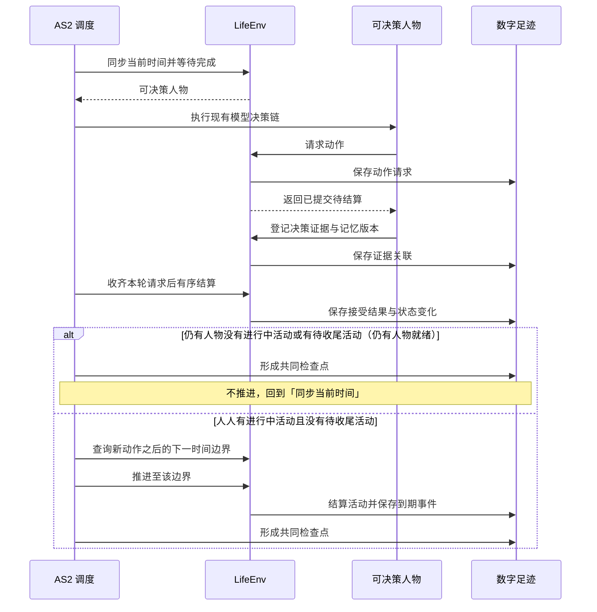
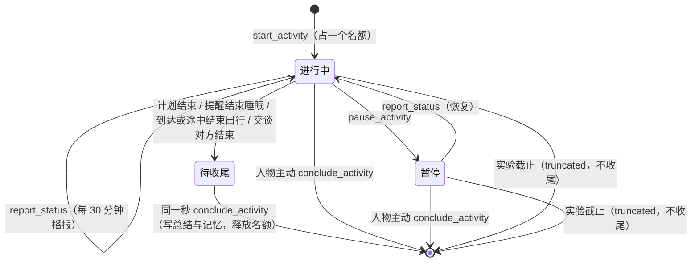
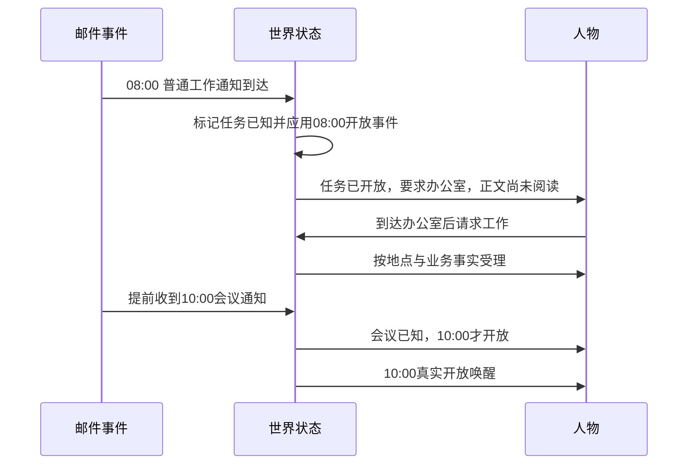
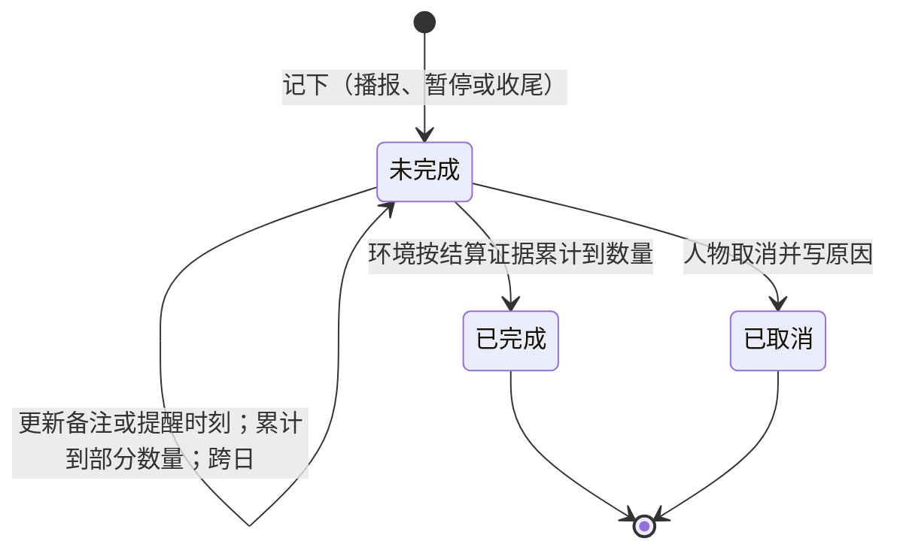

<a name="spec-life-runtime-特性规格lifeenv-运行时行为与结算规则"></a>
# 特性规格：LifeEnv 运行时行为与结算规则

> 状态：FROZEN——条款已裁决并冻结；按[时间与能量规格](../VERIFICATION.md#verification-incremental-evidence)修订 2–11 与修订 30 改写，
> 受影响条款已在最终源码 `ef13dc5` 上重新验收（证据见[时间与能量验收记录](../archive/time-and-energy/time-and-energy-verification.md)）。「候选契约与呈现规则」章九行中八行已有代码层证据，
> 审查基线的地点侧 `location_kinds` 输入缺口由地图特性完整处理，最终通过状态以新规格的生产入口证据为准。
> 其余既有条款的历史代码层证据保留原身份。真实 DeepSeek 完整实验仍待正式运行。
> 观察投影改为七层请求，系统层取代身份前言与「怎样过一天」，上下文容量按其第四章，指名购买、给予、进食开吃份量与联系人收货和往来随之改写；
> 按人物 Prompt 规格修订，修订部分已实现并通过离线验收（证据见[人物 Prompt 验收记录](../archive/persona-prompt/persona-prompt-verification.md)），验收矩阵中改动的行已改记「代码层已验证」。
> 不适脉冲门槛只判一次、有效偏好与有缓解不累积、名称类拒绝不施加脉冲、摘录按字数核对、全部目录类按名调用与指名购买口径、生活活动的地点类资格、
> 相关度与哈希决胜、按对象轮转、可调用索引不计上限、渠道只是门店集合的称呼；修订部分已实现并通过离线验收，验收矩阵中改动的十一行已改记「代码层已验证」。
> 状态归属增个人事务与工作安排；唤醒闭集追加 `errand_reminder_due`，下一边界与下一次决策机会增个人事务提醒，在手承诺不含个人事务；控制请求携带 `errands`；
> 个人事务、上班安排在七层中的位置，两种进度层记录及其浓缩口径；只读查询的执行位置，`query_world` 六键、筛选与返回；
> 顺带更正 `report_status` 的 summary 去向、来源写法与可调用索引括注三处既有漂移；修订部分已实现并通过离线验收（证据见[个人事务与工作安排验收记录](../archive/errands-workday/errands-workday-verification.md)）。
> 日期：2026-10-05
> 实施基线：`9b7fbc8`
> 范围：LifeEnv 的状态归属与生命周期、共享时钟与并发活动、消费生产与需求模型、语料准入与内容提供、场景与身体规则、观察投影与提示合同、候选契约与呈现规则、社交最小可行版

本文定义 LifeEnv 的状态归属、生命周期、工具和动作结果行为规则；资源、需求、活动结算、共享时钟、并发和加速算法；语料进入环境、内容目录、工作反馈、导航和配送的准入和结算行为；场景与身体规则、内容提供与消费生产之间的绑定算法。

类型、签名、枚举和结果字段见 `docs/CONTRACTS.md#contracts-worldmock-接口合同`。人物决策与画像条款见 `docs/dev/SPEC-life-realism.md#spec-life-realism-特性规格人物决策与画像`。
品类继承、有向三态配对、闭集金额计算、使用完成时的库存转换与运行内容身份由
[品类契约规格](SPEC-category-contract.md#spec-category-contract-品类契约与交换规则开发规格)统一定义；这些规则接入本规格已有的动作、活动与提交路径。

当前环境归属按[环境数据归属规格](SPEC-environment-data-ownership.md)执行：具体 `corpora/`、`catalog/`、`scenarios/`
及制作工具由 WorldMock-Dataset 维护，正式环境为 `environment/zhangjiang-baseline/`；通用活动、动机与人物映射
由 WorldMock 包资源提供，环境冻结副本须逐字节一致。当前场景结构为 `6`，单人物文件为 `single-person.json`。
本文中的新环境放行须另核对本次收据，历史验收数字不证明当前组合已经通过。

<a name="spec-life-runtime-共享规则与可重建环境修订"></a>
## 共享规则与可重建环境修订

按[共享规则与可重建环境规格](SPEC-shared-rules-and-rebuildable-env.md)修订；验收结果独立记录。

资源效率曲线由目录和生活模型共同读取有限非负约束；缓解预估与实际结算读取同一速率。工具清单和受理使用相同活动时长推导，邮件头与社交资源分录共用实现；身体睡眠判定不启用 sleep_channel。

内容标题直接投影场景 `contents[].title`，不再读取来源专属标题目录。生活活动从实际 `corpus_root`
读取必填不可变 `effects`，键恰为 `entertainment`、`social`、`health`，值为有限数值 0–1。候选预演使用条目效果，
启动复制到 `ActivityState.data["effects"]`；推进与恢复只读冻结值，缺失记录错误并拒绝，不回查全局文件。

<a name="spec-life-runtime-状态归属与生命周期"></a>
## 状态归属与生命周期

<a name="spec-life-runtime-状态归属规则"></a>
### 状态归属规则

| 状态类别 | 包含内容 | 谁可以改变 |
| --- | --- | --- |
| 世界 | 模拟时钟、地点、天气、内容目录版本、营业与工作日历、场景按人物声明的工作安排（`work_schedule`）、待发生事件 | 环境规则；管理员只能在运行前配置或开启新实验分支；工作安排只在运行前由场景声明，零点计划、`revise_day_plan` 与工作提交都不改变它 |
| 人物身体 | 身体状态与需求状态、最近活动及必要生理模型状态 | 推进时间，并结算进食、睡眠与实际活动 |
| 人物资产 | 账户余额、持有商品、消耗品数量、已取得的使用权 | 交易与交付结算（送达只入收货人持有）、物品使用、给予（同处，只转移持有）与合同履约 |
| 人物活动 | 活动类型、开始时间、进度、下一次决策机会、占用资源与名额、暂停与结束原因 | 人物提交动作申请，环境负责验证与执行 |
| 地点会话 | 一段地点停留或两地之间的一段路，及其所含活动 | 环境随出发与到达开始和结束 |
| 当日计划与提醒 | 当日有序目标及其提醒时刻 | 零点计划生成，人物清醒时修订 |
| 个人事务 | 人物记下的未完成事务：名称、完成依据（结果种类、商品、数量）、已累计量、备注与提醒时刻；办成或取消的事务移出状态，终态、原因与证据只留在事件 | 人物经 `report_status`、`pause_activity`、`conclude_activity` 的 `errands` 登记、更新与取消；累计与办成只由环境按结算证据写入；零点处理、`revise_day_plan` 与目标推进不读写它，零点计划只读 |
| 工作 | 任务、输入材料、截止时间、交付物、验收、合同及付款状态 | 任务来源、交付动作与独立验收环节 |
| 内容接触 | 可见目录、已读邮件、已播放片段、游戏状态及素材区间 | 实际接触动作与内容投递环节 |
| 记忆 | AS2 的人物记忆条目、记忆版本、来源事件与检索结果 | 人物记忆流程；环境不代写“人物应当喜欢什么” |

状态类别的字段面见 `docs/CONTRACTS.md#contracts-worldmock-接口合同`「LifeEnv 状态字段」章的「状态归属」节；本表只判定各类状态由谁改变。

**核心原则**：
- 身体状态与账户余额的准确数值只属于世界事实
- 人物实际收到的，是确定性规则换算出的体感分级，以及七层请求中的可读事实（见「观察投影与提示合同」）
- 准确数值只进入数字足迹与评估；训练数据导出的信息范围裁剪见 `docs/design/05-recording-engine.md#recording-engine-worldmock-产品设计说明书-记录引擎`「来源与可见性」

<a name="spec-life-runtime-生命周期行为"></a>
### 生命周期行为

引用 `docs/CONTRACTS.md#contracts-worldmock-接口合同`「LifeEnv 状态字段」章的「生命周期」节。

本规格在此只判定一条行为：`step` 在区间内处理连续变化与到期事件，并按「时间约定」核验本次推进的时间对账。

<a name="spec-life-runtime-时间推进与并发活动"></a>
## 时间推进与并发活动

<a name="spec-life-runtime-共享时钟"></a>
### 共享时钟



同一秒可有多轮决策，每轮各形成检查点。

**时间推进规则**：
1. 先处理当前时刻已到期的通知或活动，再选出需要决策的人物
2. 人物完成本轮选择后，环境先结算本轮请求
3. 无人就绪时（每个人物都有进行中活动且都没有待收尾活动，等待与睡眠都算），调度器再计算下一边界：活动完成、内容反馈、通知到达、工作截止、需要重新评估的身体变化、人物选择的等待结束、场景本地零点、当日目标提醒、个人事务提醒（只对清醒的人物，睡眠中的人物不计）或实验结束
4. 每次推进严格大于零；即时事件在当前边界按稳定序号处理；同一秒的再决策不推进时钟，轮数受同刻上限约束
5. 同刻再决策：人物没有进行中活动或有待收尾活动时，在同一模拟秒再获得决策机会，直到有一项进行中活动且没有待收尾活动；适用于运行开始、活动结束、瞬时动作之后与业务拒绝之后。决策本身不消耗模拟时间
6. 同一人物同一模拟秒的决策轮数以场景参数 `max_same_moment_decisions` 封顶，时钟推进即归零（取值见 `docs/EXPERIMENT.md#experiment-worldmock-实验设置`「场景参数」章的「活动节奏与同刻决策上限」节）；达到上限仍不满足第 5 条的结束条件时进入受限轮：每轮只开放一类动作，收尾、结束与等待不会被业务拒绝，阶梯见 `docs/dev/SPEC-life-runtime.md#time-and-energy-决策不耗时时间只在做事时流动`「一、决策不耗时：时间只在做事时流动」规则 3
7. 有进行中活动且没有待收尾活动时，瞬时动作成功后不在同一秒再给机会，下一次按决策节律；业务拒绝后在同一秒再给一次机会，受同一上限约束，达到上限后按决策节律。拒绝保留在动作结果，不替人物选择动作，也不把业务拒绝写成运行失败

**时间约定**：
- 人物决策收到当前时刻
- 环境 `step(tick, t)` 收到本次结束时刻
- 时间对账：本次推进秒数必须恰好补齐上一确认时刻到本次结束时刻的间隔；接口表述见 `docs/CONTRACTS.md#contracts-worldmock-接口合同`「LifeEnv 状态字段」章的「生命周期」节
- 事件精度为秒；素材本身可保留更细的媒体时间，量化方式固定并记录
- 数据库的模拟时间采用 UTC epoch 秒，交付文件按合同编码为带时区的 ISO 8601；转换不改变时刻或排序

<a name="spec-life-runtime-决策节律结算边界与唤醒条件分离"></a>
### 决策节律：结算边界与唤醒条件分离

**核心原则**：结算边界与决策机会分离。

`activity_feedback_seconds=900` 作为身体、进度与内容的结算粒度；每个结算边界产生 `activity_progress` 事件并结算资源。

**是否提供决策机会，只由唤醒条件决定**。

唤醒条件和原因闭集由模拟引擎维护。唤醒原因是冻结词表，成员不可改名、不可删除，新增走版本表：

```python
WakeReason = Literal[
    "planned_end", "felt_band_change", "message_arrival", "delivery_arrival",
    "task_available", "task_due_soon", "work_review_result", "commitment_threatened",
    "reconsideration_interval", "location_hours_change", "person_arrived", "person_left",
    "activity_infeasible", "rejection_feedback", "discovery_result", "wake_from_sleep", "run_start",
    "progress_report_due", "no_active_activity", "plan_reminder_due",
    "errand_reminder_due",
]
```

睡眠期间仍可提供决策的只有 `planned_end`、`wake_from_sleep`、`run_start` 与 `plan_reminder_due`；`errand_reminder_due` 不进入睡眠允许集合。存储层登记同源的 `WAKE_REASON_NAMES` 词表，与 `life.schedule.WakeReason` 由测试互锁防漂移。

记录引擎原样保存本次判定，增量字段见[共同身体结算与决策证据](../design/05-recording-engine.md#recording-engine-共同身体结算与决策证据)；
缺字段时的判定口径见 `docs/VERIFICATION.md#verification-worldmock-验收标准`「协议门禁」。下表把闭集成员对应到触发条件：

| 唤醒原因 | 触发条件 |
| --- | --- |
| `planned_end` | 活动由世界结束：到达引擎派生的计划时长、被提醒结束睡眠，或交谈对方结束（`partner_ended`）；交谈对方结束而本人仍有其他进行中活动时，同刻轮也记此原因 |
| `felt_band_change` | 任一体感分级与上一次实际提供决策时的分级不同 |
| `message_arrival`、`delivery_arrival` | 新消息或配送到达本人 |
| `task_available`、`task_due_soon`、`work_review_result` | 已知任务真正开放、任务截止前 30 分钟、工作验收结果返回；提前收到预约通知不构成 `task_available` |
| `commitment_threatened` | 已有承诺进入任务截止或闭店预警；同时保留具体原因，边界按当日目标规格 |
| `reconsideration_interval` | 距上次实际决策达到当前在手承诺对应的常规或空闲间隔 |
| `location_hours_change` | 有在手承诺时当前地点即将闭店（提前 15 分钟），或地点已开门；承诺口径见当日目标规格 |
| `person_arrived`、`person_left` | 同一地点的在场人物集合变化 |
| `activity_infeasible` | 保留名称，当前无触发来源 |
| `discovery_result` | 保留名称，当前无触发来源；浏览是活动，结果随浏览结束或下一次观察回灌 |
| `rejection_feedback` | 同一秒业务拒绝后的再决策轮，只由同刻规则写入；边界判定不产生它 |
| `wake_from_sleep`、`run_start` | 沿用现有语义 |
| `progress_report_due` | 本人某项进行中活动距其播报锚点已满播报间隔（`progress_report_interval_seconds`）；只计进行中活动，暂停、待收尾与已收尾的活动不播报；锚点为活动的 `report_anchor_at`，在开始、恢复以及对该活动播报时写入当前时刻 |
| `no_active_activity` | 边界结算后没有进行中活动的人物必获决策，同刻再决策轮也记它，不进睡眠允许集合 |
| `plan_reminder_due` | 当日目标的 `remind_time` 到点：同时到期的合并，只计一次，每条提醒只触发一次；非睡眠活动继续进行。睡眠中到点即结束睡眠（`boundary_type` 与 `interruption_reason` 记 `plan_reminder`，按实际时长结算，睡眠成为待收尾），该边界的唤醒原因为 `planned_end`、`wake_from_sleep`、`plan_reminder_due`，睡眠结束后没有其他进行中活动时另含 `no_active_activity`（不按睡眠允许集合过滤）；睡眠的计划结束与提醒同秒时记 `boundary_type=planned_end`，提醒记为已触发 |
| `errand_reminder_due` | 个人事务的提醒时刻到点：清醒的人物精确在该时刻获得一次决策机会；同一边界到期的多条事务合并为一次机会、本原因只计一次，每条事务各写一条 `environment_event`（`data.kind="errand_reminded"`，人物可见，决策与动作身份为空），与 `plan_reminder_due` 同刻到期时按枚举顺序并列；只提供决策机会，不改变事务状态，进行中的活动继续。不进睡眠允许集合：睡眠中的人物不计入候选、不形成静默边界、不交付也不消耗、不结束睡眠，睡眠期间错过的提醒在人物醒来的那个边界交付、不另起边界；事务办成或取消后不再提醒，更新时写新的提醒时刻重新计一次；只在实际交付决策机会时记账并写事件 |

**唤醒条件是判定规则，唤醒原因是本次命中的成员**：上表列出全部唤醒条件；某次结算边界实际命中的成员构成该次边界的唤醒原因。只有命中的边界才提供决策机会并记录这些原因。

**静默边界**：没有任何唤醒条件的边界
- 环境按人物已开始的活动续行
- 不调用人物决策模型
- 不产生 `decision_started`、`observation`、`model_request`、`memory_updated` 事件；带 `data.purpose="plan_day"` 的 `model_request` 例外
- 本区间共同身体结算（`environment_event.data.kind=body_settlement`）写入上述增量字段：本次边界未提供决策，唤醒原因为空
- 续行不是环境替人物选择：人物的选择是它开始的活动，静默边界只是不打断这一选择

**零点计划**：场景本地零点与启动路径由运行时后台任务 `plan_day` 为人物生成当日计划（同联系人回复），不调用人物，
不提供决策，不写 `decision_started`，不计同刻轮数；其模型请求与响应带 `data.purpose="plan_day"`，计划写
`environment_event`（`data.kind="day_plan_generated"`），按记录引擎设计留证。

**提供决策的边界**：
- 同一组增量字段记为提供决策，并记录实际命中的全部唤醒原因

**下一次决策机会**：没有进行中活动或有待收尾活动的人物取当前时刻；其余人物取下列各项的最小值，以本次决策时刻作为上次决策时刻计算
- 计划结束
- 体感分级预计跨越时刻：困意与饥饿都从当前状态扫描预测，步长不超过 900 秒、最多 24 小时，取首个分级变化的步点后二分到整秒；
  饥饿含昼夜项与餐时项及 800、400、100 kcal 三个能量阈值，交谈、通话期间同样预测
- 午餐、晚餐窗口的起止时刻
- 已排定的通知与配送
- 当日目标提醒（睡眠中也计入）
- 个人事务提醒时刻（睡眠中不计入）
- 进行中活动的播报到期
- 任务截止与闭店的精确预警边界
- 当前在手承诺对应的重估间隔到期
- 地点营业变化

常规间隔 `reconsideration_interval_seconds` 默认 5400 秒；空闲间隔
`idle_reconsideration_interval_seconds` 默认 10800 秒，不能短于常规间隔。进行中的等待不算在手承诺；人物只在等待、
且没有未推进目标、可见未完成的工作任务、暂停活动或其他进行中活动时用空闲间隔。
未完成的个人事务不计入在手承诺，不改变常规与空闲间隔及闭店预警（[个人事务与工作安排规格](SPEC-as2-integration.md#errands-workday-运行修复入库) 2.5）。
两者沿用场景配置；在手承诺闭集、切换和精确威胁候选见
[当日目标的决策节律](SPEC-day-plan-goals.md#spec-day-plan-goals-事件驱动的决策节律)。睡眠继续仅接受睡眠允许的原因。

**验证**：游戏保持逐回合反馈；睡眠期只在计划结束或有唤醒事件到达时提供决策机会（见 `tests/life/test_wake_reasons.py` 的 `test_sleep_accepts_only_existing_sleep_reasons` 与 `tests/life/test_revision_contract.py` 的 `test_sleep_is_not_interrupted_by_reconsideration`）；
同刻决策与计划提醒另以新增的 `tests/life/test_same_moment_decisions.py`、`tests/life/test_day_planning.py` 验收。

**依据**：Humanoid Agents 每十五分钟只在情绪非中性或某项需要偏低时才提示模型；Generative Agents 按计划执行，只在感知到需要反应的事件时重新规划；目标导向行动规划只在计划失效或更相关目标出现时重规划。重估间隔的取值依据人类注意的基本休息—活动周期约 90 分钟（Kleitman 的休息—活动周期）。

<a name="spec-life-runtime-决策机会规则"></a>
### 决策机会规则

观看、工作和睡眠由长期活动表示，不需要每秒运行模型。

**唤醒条件与重估间隔是模拟粒度**，应作为参数记录，不能声称未观察的间隔里发生了逐秒选择。

睡眠不会为每次时间推进自动写一条模型记忆；只有实际形成的观察和记忆进入人物流程。

**人物决策约束**：
- 一轮只提交一个世界请求，`start_activity` 至多同时开始两项
- 一单购买可含多件商品、一餐可含多件持有食品，它们仍分别是一个购买或一个进食行动
- 记忆检索不改变世界
- 同一轮内不能在已登记请求之外再免费浏览、工作或进食；下一轮何时提供按时间推进规则
- 业务拒绝后的下一次决策机会按时间推进规则第 5–7 条；重复拒绝不会被记为人物决策失败

<a name="spec-life-runtime-并发与占用"></a>
### 并发与占用

**占用**由注册表显式声明，占用名与声明表见「活动组合政策」；准入另按目标在场、实际地点、出行方式与物品状态判定。

**规则示例**：
- 驾车只容播客与免提通话
- 工作可与食用、观看、播客并行；身体只结算一次，各活动分别累计，不默认折半
- 不同人物可以并行活动，某人睡眠八小时不会让其他人物的八小时行动被跳过

**同轮竞争处理**：
1. 模型调用可并发
2. 共享物品、任务与余额的修改由环境 actor 串行提交
3. 同一模拟时刻出现竞争时，宿主在决策前为就绪人物生成并记录顺序，固定随机种子
4. 同轮观察以共同的世界版本为准
5. 人物提交的动作先进入待结算队列，全部决策正常结束后再按该顺序应用
6. 环境 actor 不等待尚未到达的早序请求而阻塞后续接收，因此保持现有单写入 actor
7. 该顺序只决定冲突处理，不选择人物动作
8. 任务提交与其他不可逆结算使用稳定动作标识防止重试重复记账
9. 任何必要人物决策异常时不结算该轮尚未执行的提案，原请求和失败证据保留，运行终止；宿主在上抛前写一条带完整异常链的英文 error 日志，异常对象与类型不变；工具分发失败同样先写日志，再按失败阶段码 `TOOL_SERVICE_FAILED` 抛出。日志不是持久证据，不新增事件、不改变失败分类；四个失败阶段码（模型服务、证据写入、记忆查询、工具服务）随个人事务与工作安排规格阶段 1 补登进 `docs/CONTRACTS.md#contracts-worldmock-接口合同` 的宿主错误码表，只标出失败阶段与调用位置，不是对请求参数的协议纠错

**验证**：颠倒到达顺序不改变结算（见 `tests/life/test_engine_round.py` 的 `test_multi_person_arrival_order_does_not_change_settlement_order`）；种子变化改变竞争顺序且检查点可恢复（见 `tests/life/test_engine_feedback.py` 的 `test_seed_changes_competition_order_and_checkpoint_restores_it`）。

<a name="spec-life-runtime-加速"></a>
### 加速

**程序执行加速只减少现实等待**。

模拟中看二十分钟节目仍消耗二十分钟，其他人的邮件和送达事件照常发生。

**人物选的媒体倍速与程序加速分开记录**；跳过的内容不会进入其观察或记忆。

整体速度受模型调用、内容处理与写盘影响，必须通过实测给出加速比，不能预先保证。

<a name="spec-life-runtime-运行观测"></a>
### 运行观测

**只读状态视图**显示模拟时间、现实耗时、运行状态，以及每个人物当前活动、进度、最近动作结果和下一次决策机会。正常等待、模型调用中、正在写盘和故障停止分别显示，避免把「人物正在睡眠」与「框架没有响应」混为一谈。查看状态使用已确认事件与状态，不唤醒人物、不调用模型、不改变决策。

**质量报告**从同一份数字足迹统计完成、中断、拒绝、重复观看、内容接触时长、转换效率、记忆写入与来源登记问题、个人事务的登记、办成、取消、跨夜与提醒、收尾记忆的构成与模型成本（个人事务与收尾记忆两组只报告，见个人事务与工作安排规格 6.1）。这些统计用于运行后评估；正式实验期间不根据报告暗中修改提示或替人物选择行动。

**验证**：见 `tests/footprints/test_status.py` 的 `test_status_reads_confirmed_state_without_modifying_any_run_file`。

<a name="spec-life-runtime-身体语义两过程睡眠睡眠不足账体感分级"></a>
## 身体语义：两过程睡眠、睡眠不足账、体感分级

引用 `docs/CONTRACTS.md#contracts-worldmock-接口合同`「LifeEnv 状态字段」章的「资源与需求字段」节。

<a name="spec-life-runtime-两过程睡眠模型"></a>
### 两过程睡眠模型

**状态字段**：`sleep_pressure`（睡眠压力）、`sleep_deficit_hours`（睡眠不足账）

**算法**（Daan、Beersma 与 Borbély 1984；参数取 npj Biological Timing and Sleep 2025 综述标准值）：

```
清醒：S(t+dt) = 1 − (1 − S(t)) · exp(−dt / 18.2h)
睡眠：S(t+dt) = S(t) · exp(−dt / 4.2h)

入睡阈值 H(t) = 0.67 − 0.12 · cos(2π (t − t_min) / 24h)
醒来阈值 L(t) = 0.17 − 0.12 · cos(2π (t − t_min) / 24h)

困意 = (S − L(t)) / (H(t) − L(t))，截断到 [0, 1.2]
```

**参数**：
- `t_min` 为两条阈值的最低点时刻，取人物卡片的 `chronotype_midsleep`（自由日睡眠中点），默认 04:00
- 晚型人物中点每晚一小时，阈值曲线整体后移一小时
- 初始 `sleep_pressure` 假定人物自起点之前最近一次惯常起床时刻（`chronotype_midsleep + sleep_need_hours/2`，按 24 小时取模）
  起一直清醒反推：起床时取睡满后的压力，再按清醒过程推进到起点；不预置活动

**困意分级**（档界按 KSS 等价刻度 `K = 7 + 7.6 · (困意 − 1)` 在 K = 5.5、6.5、7.5、8.4 处切分，属实验假设，登记在 `docs/EXPERIMENT.md#experiment-worldmock-实验设置`「实验假设声明」；档的名称与个数不变）：
- `< 0.80` 清醒
- `0.80–0.93` 有点乏
- `0.93–1.07` 困
- `1.07–1.18` 很困
- `≥ 1.18` 撑不住（留 0.02 余量，不与截断上界 1.2 重合）

**预期行为示例**：
假设按默认参数（睡眠中点 04:00），人物 07:00 起床、起床时压力等于当时的醒来阈值 L(07:00)，此后一直清醒，按上面的公式计算：
约 21:30 起为“有点乏”、22:40 起为“困”、00:05 起为“很困”、01:25 起为“撑不住”；睡眠中点 05:00、08:00 起床的晚型人物整体后移一小时。

场景起点为 00:00 时，按默认参数反推的惯常起床时刻为 07:45，人物在起点已清醒 16.25 小时，困意约 1.04，为“困”；
睡眠中点 05:00 的晚型人物困意约 0.94，同为“困”。去不去睡由人物决定。

<a name="spec-life-runtime-睡眠不足账与效率曲线"></a>
### 睡眠不足账与效率曲线

**累积算法**：
```
清醒每小时累积：sleep_need_hours / (24 − sleep_need_hours)
睡眠每小时恢复：1 小时
下限：0
上限：24
```

**默认参数**：`sleep_need_hours=7.5`（来自人物卡片，允许 7–9 小时），清醒每小时累积约 0.45 小时睡眠不足。

**效率曲线**（输入为 `sleep_deficit_hours`）：

工作效率节点：`(0, 1.0)、(8, 1.0)、(16, 0.85)、(24, 0.65)`
食品利用效率节点：`(0, 0.90)、(8, 0.90)、(16, 0.85)、(24, 0.80)`

节点之间线性插值，两端取边界值。

**分工明确**：
- `sleep_pressure` 决定人物此刻困不困
- `sleep_deficit_hours` 决定连续缺觉对效率的累积影响

<a name="spec-life-runtime-其他体感分级"></a>
### 其他体感分级

**饥饿体感**：
```
appetite = clamp((appetite_anchor_kcal − energy_kcal) / (appetite_anchor_kcal − 400), 0, 1) 
          · (1 + 0.17 · cos(2π (t − 20h) / 24h)) + 餐时项
```

- `appetite_anchor_kcal` 默认 1200
- 由此 800 kcal 对应“饿”；能量低于身体配置的紧急阈值（`emergency_threshold_kcal`，400 kcal）时无条件至少“饿得难受”，不受昼夜项与餐时项影响
- 昼夜项依据 Scheer、Morris 与 Shea 2013 的内源饥饿节律（08:00 低谷、20:00 峰值、峰谷差 17%）
- 餐时项在午餐、晚餐窗口内加 0.15，窗口外为零

**分级**：
- `< 0.15` 不饿
- `0.15–0.35` 有点想吃
- `0.35–0.6` 饿
- `0.6–0.85` 很饿
- `≥ 0.85` 饿得难受
- 能量低于 100 kcal 为第六档“饿得发慌”，只由能量决定；100 kcal 登记在 `docs/EXPERIMENT.md#experiment-worldmock-实验设置`「场景参数」章的「需求状态」节

**娱乐需要分级**：
- `< 0.3` 不闷
- `0.3–0.6` 有点想放松
- `≥ 0.6` 很想放松

**社交需要**（`social_need`，取零到一）：
- 清醒每小时增长 0.04；是否清醒按本区间共同身体结算（`body_settlement.activity_ids`）所用的活动集合判定，不在推进后重新推断，
  所以在边界结束的睡眠整段按睡眠计；没有该结算草稿时（直接调用）按「ACTIVE，或 COMPLETED 且 `ended_at` 等于此刻」判定
- 与在场人物交谈每小时减少 0.5
- 与联系人通话每小时减少 0.4
- 收到并阅读一条来自人物或联系人的消息减少 0.05；睡眠中不读消息，睡眠中送达的消息在醒来后的第一个边界才阅读并计效果
- 共同用餐每小时减少 0.3
- 交谈、通话的覆盖与共同用餐都按上述同一活动集合判定（在边界吃完的一餐仍算共同用餐）

**分级**：
- `< 0.3` 不想找人
- `0.3–0.6` 想和人说说话
- `≥ 0.6` 有点孤单

**情绪**（`mood_valence`，取 −1 到 1）：

按事件加脉冲并以半衰期衰减。

脉冲表：
- 工作验收通过 +0.3
- 被退回 −0.3
- 任务到期未交 −0.4
- 收到人物或联系人的消息 +0.1（睡眠中送达的，醒来后的第一个边界阅读时才计）
- 连续两小时以上饿（饥饿分级“饿”及以上，含“饿得发慌”）或困 −0.1/小时；两小时门槛只判一次：连续不适时长减去两小时为可计费小时，
  每个边界按新增的可计费小时施加，未施加时不消耗计费小时
- 当日目标首次由实际活动推进 +0.05；每条目标只发一次，按当日目标规格核验活动证据
- 业务拒绝 −0.05，同一人物同一模拟秒至多一次；名称类拒绝（码的闭集见[一日运行保真规格](SPEC-life-runtime.md#dayrun-fidelity-身体与需要) 3.4）不施加，每人每秒至多 2 次，第 3 次起照常施加

半衰期：45 分钟 × `(1 + 0.3 · N_norm)`
脉冲幅度：× `(1 + 0.5 · N_norm)`
`N_norm` 为神经质归一到 [−1, 1] 的值

**分级**：
- `< −0.4` 很烦
- `−0.4 – −0.15` 有点烦
- `−0.15 – 0.15` 平静
- `0.15 – 0.4` 挺好
- `≥ 0.4` 很开心

**情绪只影响体感呈现与记忆重要度加权，不直接改变任何动作可行性。**

<a name="spec-life-runtime-滞回规则"></a>
### 滞回规则

分级在每个结算边界重算，但只有与“上一次实际提供决策时的分级”不同才构成唤醒条件。

这以决策而非结算为参照，天然抑制在分级边界附近的抖动，不另设阈值参数。

<a name="spec-life-runtime-数值与分级的分离"></a>
### 数值与分级的分离

所有数值继续写入 `activity_progress` 与 `observation` 事件的 `body` 字段供评估与导出；**给模型的提示只含分级文本**。
商品每份热量与路线费力是商品和路线的事实，可进工具层的目标与动作，不算身体数值。

身体状态与账户余额的准确数值只属于世界事实，但人物拿到的是体感分级，不是精确数值。

**验证**：见 `tests/life/test_sleep_two_process.py`、`test_felt_states.py`、`test_body.py`。

<a name="spec-life-runtime-消费生产与需求模型"></a>
## 消费、生产与需求模型

<a name="spec-life-runtime-资源表达"></a>
### 资源表达

引用 `docs/CONTRACTS.md#contracts-worldmock-接口合同`「LifeEnv 状态字段」章的「资源与需求字段」节。

**表达原则**：
- 时间：UTC 整数秒及场景时区；同秒事件另有严格序号
- 金钱：币种与最小货币单位整数（避免浮点累计误差）
- 可用能量：kcal（实验中的可用能量状态，不等于人体全部储存热量）
- 睡眠不足：小时（与食品能量独立，进食不会直接消除）
- 娱乐需要：归一化状态与明确变化规则；随生活积累，实际娱乐可改变，需要考虑喜好、重复与时长
- 工作需要：截止时间、合同、任务与经济目标；从工作义务与人物经济处境产生，不设置固定「每小时必须工作」脚本

所有数值变化由明确规则计算。人物提示描述其处境与选项，允许拖延、过度娱乐、拒绝购买或再次观看。

**规则只限制物理、经济和任务可行性，不替人物优化人生。**

<a name="spec-life-runtime-转换效率算法"></a>
### 转换效率算法

建议采用简单可校准的函数与参数，避免通用规则语言或额外规则解释器。参数值属于实验假设，正式运行前冻结并通过场景校验。

**能量变化**：
```
能量变化 = 实际进食热量 × 食品利用效率(sleep_deficit_hours)
          − 基础消耗率 × 经过时间 − 活动额外消耗
结算后能量 = max(0, 结算前能量 + 能量变化)
```

**睡眠不足变化**：
```
睡眠不足变化 = 清醒期间累积 − 有效睡眠期间恢复
```

**娱乐需要变化**：
```
有效偏好 = f + (1 − f) · w          0 < f < 1，对 w 严格单调，w = 1 时不变
娱乐需要变化 = 内容自身每小时效果 × 有效偏好 ÷ 当前接触次数
```
`w` 是卡片口味与条目题材精确匹配得到的口味权重（`compute_taste_weights`）；候选与浏览排序只用原始权重 `w`，零权重照旧排在最后，
实际缓解与评分器的缓解预演用有效偏好。偏好只调幅度，不决定有无：下限偏好 `f` 取场景层身体实例字段
`entertainment_relief_preference_floor`（缺省 0.5，取值 (0, 1)，实验假设），喜欢的内容仍比不喜欢的缓解快；不用 `max(w, f)`。
游戏与内容同一算法：游戏条目也按题材计算口味权重，没有题材声明的权重为零、走下限。
有缓解的活动进行时不再累积娱乐需要；共同区间结算与单活动结算用同一口径，对同一内容给出相同净效果。
首次与重复接触采用相同公式；接触次数只在首次与从头重看时加一，接着看不加。

**有效工作量**：
```
有效工作量 = 技能对应的工作速率 × 工作效率(sleep_deficit_hours)
            × 能量效率(energy_kcal) × 已生效工具效果 × 实际投入时间
```
工作速率直接取任务所需技能对应的场景等级（冻结参数，取值只在 `docs/EXPERIMENT.md#experiment-worldmock-实验设置`「场景参数」章的「工作参数」节定义）；已实际使用 `work_notes` 后的产出倍率为 `body.work_notes_multiplier=1.10`。

**计件收入**：
```
计件收入 = 合同约定报酬，在交付验收和付款条件满足后结算
```

**计时收入**：
```
计时收入 = 合同费率 × 符合合同条件的实际工作时间
```

**效率曲线原则**：
- 基础模型可以用分段线性曲线描述效率
- 不能同时降低计时工资和工作效率来重复惩罚睡眠，除非合同明确这样约定
- 高收入通过职业、技能、机会与合同表现；不从人物初始财富反推能力
- 睡眠期间仍有基础能量消耗；饥饿和睡眠不足不能互相替代
- 低能量的代价是饥饿上升与工作变慢，不拒绝、不停止活动
- 睡眠与食品利用效率之间的关系是用户提出的仿真假设，必须单独配置、校准并在报告中标注，不宣称它已被生理学验证

**参数管理**：
- 规则参数集中在场景定义的身体与活动部分，包括基础能量消耗、活动额外消耗、清醒累积和睡眠恢复速度、效率曲线节点、工作速率、娱乐需要变化及阅读和游戏动作的时间映射
- 参数必须有单位、来源类型和有效范围
- 效率曲线的节点有序，结果有明确上下界
- 每次资源结算记录实际参数与持续时间
- 饥饿等衍生需求从当前资源及必要历史计算，不允许额外自由写入一份会与资源状态矛盾的数值

<a name="spec-life-runtime-具体活动结算"></a>
### 具体活动结算

| 活动 | 执行与结算 |
| --- | --- |
| 进食 | 必须已取得食品；开始时每件取 min(1, 手边持有) 从库存移入活动数据的 `opened`，摄入只按 `opened` 与实际进度计算；暂停保留 `opened` 的剩余，别处不能用，恢复时不再核库存；结束（进行中或暂停的进食）丢弃未吃的部分，不补算摄入，其他份数不动，自然吃完丢弃为 0，实验截止截断时不丢弃；不足一份也可以吃，时长为 max(60, round(整份时长 × 份量)) 秒；收尾结果逐项写终局与已吃、丢弃、剩余份量；支付、取得食品和进食分别记录 |
| 工作 | 输入材料、投入时间、产出物和验收可追溯；失败、延期和返工保留 |
| 睡眠 | 持续恢复睡眠状态；按实际睡眠部分结算，中断后不直接恢复到满值 |
| 看节目 | 按实际播放区间提供内容；暂停不继续推进媒体；倍速改变媒体进度与注意力规则；接着看从上次位置继续；看完只能从头再看 |
| 游戏 | 游戏引擎执行动作；成功、失败和进度来自实际局面，不能由简介推断 |
| 购物 | 商品先落到收货人的库存，或进入配送队列等待送达收货人；一单只有一个收货人（自己、同世界人物或场景联系人），付款人仍是执行人物；耐用品分账持有与使用，消耗品在使用后扣减，食品在开吃时移出库存（见「进食」） |
| 给予 | 瞬时，不占名额：从本人手边移出每件 min(1, 持有)，记入对方持有（场景联系人记入 `WorldState.contact_holdings`），任何人都不增加摄入；要求同处（同世界人物在同一地点，联系人则本人位于其收货地点）；内部标准动作仍记为 `consume` |
| 出行 | 按实际道路和方式计算时间、费用与消耗；改变当前位置及可访问内容 |
| 等待 | 可以由人物选择；世界其他事件照常发生，身体状态继续变化 |

**资金记录**：
- 工资与消费记录付款方和收款方
- 雇主、商家与人物账户之间的金额对应
- 实验初始资金和外部注入明确留痕
- 任务报酬受合同与雇主资源约束，不能通过重复提交同一交付物无限取得工资

**工作质量**：
- 由实际交付物评估
- 模型调用耗时不等于人物工作耗时
- 有效工作量控制任务进度，模型产出的文本还必须通过内容验收，不能用累计时间替代真实生产结果

**验证**：见 `tests/life/test_body.py`、`test_commerce.py`、`test_work_review.py`、`test_activities.py`。

<a name="spec-life-runtime-语料进入环境与内容提供"></a>
## 语料进入环境与内容提供

<a name="spec-life-runtime-数据进入环境的过程"></a>
### 数据进入环境的过程

语料从选定来源进入环境的数据流，以及离线整理这一选择本身的理由，见 `docs/ARCHITECTURE.md#architecture-worldmock-架构设计`「离线语料如何进入环境」。本节只保留本规格另定的准入规则：

- 素材不要求全部托管在 Hugging Face；地图与游戏引擎使用其成熟来源，统一来源关联即可
- 初版优先文本内容，记录为字幕、文本会议或文字游戏经历；实际没有输入画面时不标记为完整视觉观看

<a name="spec-life-runtime-来源与准入"></a>
### 来源与准入

| 内容 | 首选来源 | 进入环境的方式 | 缺口与限制 |
| --- | --- | --- | --- |
| 食品 | Open Food Facts 产品库 | 食品目录、营养、份量与可消耗商品 | 份量和每百克标注需统一；缺字段不能随意补成事实 |
| 食价 | Open Prices | 带地点、日期、币种和单位的价格依据 | 不能直接当作当前中国外卖报价 |
| 电视节目 | LongTVQA+、TVQA | 节目目录、剧情片段、字幕与可用媒体 | LongTVQA+ 的字幕片段标记不是逐句时间轴；需核对原字幕或媒体时长 |
| 游戏目录 | Steam Games Dataset | 简介、类型、历史价格、选择依据 | 聚合游玩统计不能直接当作单次活动时长 |
| 游戏反馈 | Microsoft TextWorld | 游戏实例、玩家动作、局面、进度和输赢 | 初版代表文字游戏；游戏回合到生活时间的映射需明确 |
| 工作记录 | AMIsum、AMI-ME | 会议、议题、发言时间；整理纪要、提取待办等任务 | 需补充合同、截止时间和独立验收；不能代表全部职业 |
| 邮件 | Enron 邮件集 | 收件箱、线程、日程与工作请求 | 人物和时间需一致改写；部分原始版本不含附件 |
| 购物 | Amazon Reviews 2023 | 商品描述、属性、评论、历史价格与选择 | 库存、使用效果、配送和耐用性需场景规则；评论不是人物已发生的体验 |
| 导航 | OpenStreetMap 与 OSRM；高德路径规划为备选来源 | 道路路径、距离、方式和预计耗时 | 静态速度不等于实时拥堵；道路不可达必须如实返回 |
| 出行与生活校验 | GeoLife、ATUS | 出行形态和时间使用的外部参照 | 样本人群、地区和年代有限，不能直接推断目标人口行为 |

内容取得不足、格式错误或哈希错误必须明确失败，不能更换来源、放宽必需字段或用模型补成来源事实。冻结清单的构成与运行前的核验门槛见 `docs/EXPERIMENT.md#experiment-worldmock-实验设置`「内容与语料绑定」；清单未通过全量核验时拒绝启动。

<a name="spec-life-runtime-内容目录契约"></a>
### 内容目录契约

引用 `docs/CONTRACTS.md#contracts-worldmock-接口合同`「语料内容目录字段」章。

**各类别有独立属性 Schema，公共字段含义保持一致**，不做任意万能字段映射平台。

**来源标记原则**：
- 模型生成的补充属性标记为合成
- 没有证据的价格、营养、路况与时长不能无标记混入来源字段
- 原始素材文件按哈希复用；多个访问事件各有自己的标识和接触区间

<a name="spec-life-runtime-内容提供行为"></a>
### 内容提供行为

**工作材料与邮件反馈**：
- 人物收到的任务具备输入材料、交付要求、可用工具、截止时间、合同及验收条件
- 实际输出纪要、回复或其他成果存成素材，验收结果单独记录
- 来源数据的参考摘要用于检查，不提前提供；人物完成与否由交付和验收判定
- 工作说明与交付格式先可见，正文随实际工作进度揭示
- 观察不能免费取得未接触的完整转写
- 纪要包含摘要、决定与行动项
- 来源文件的原始会议标识仍保留为语料元数据

**任务通知与可用性**：
- 每封非空 `related_task_id` 邮件必须引用存在的任务，收件人与该任务的 `assignee_agent_id` 一致；每项工作另须至少一封关联通知，缺失或逐封错配时拒绝加载。
- 每项任务的输入只声明必填 `appointment`：普通工作为 null，真实预约为 `{starts_at, reason}`，两个预约键必填，
  `starts_at` 带时区，`reason` 非空。删除输入 `available_at`、`availability_kind`、`appointment_reason`，不接受旧形状。
- 普通工作由场景编译生成 `RuntimeWorkTask.available_at`，等于最早发给受派人且关联本任务的邮件 `sent_at`。
  邮件到达的同一事件批次写入 `visible_task_ids`，人物到达要求地点即可开工，不另等办公室上班钟点或读完邮件。
- 非空 `appointment` 只用于现实中必须提前约定的活动；内部 `available_at` 取 `appointment.starts_at`，最早关联通知不得晚于该时刻。
  后续关联提醒可以在开始之后送达，不改变已派生的开放时刻。
  提前收到通知时任务可知、开工不可用，英文原因返回约定依据与开放时刻。
- `visible_task_ids` 表示人物已知任务；通知只公开合同元信息，邮件正文仍须阅读。任务目标的
  `contract{opens, place, deadline, remaining, outlook}` 写真实开放、公开地点名、截止及进度，不含内部身份。
  五项合同事实只在任务目标出现；邮件到达与阅读结果中的任务引用只用关联任务完整名称，不再复制合同元信息。
  到达结果不公开正文，阅读结果保留实际正文，不公开验收答案。
- `WORK_AVAILABLE` 只在真实开放时触发 `task_available`，不再揭示未知任务。通知与开放同秒时先处理整批事件，再观察与唤醒一次。
  预约收件只以 `message_arrival` 提供机会，不能把新可见误当已经开放；睡眠过滤照常。
- `available_at` 可以早于运行起点；`due_at` 必须晚于运行起点与开放时刻。运行起点已送达的通知与已开放事实
  在首次观察前原子初始化；未送达的通知不能因 `available_at` 提前泄露。恢复不重复告知或重复开放唤醒。
- 地点、技能、余额与截止照常限制受理。正式任务的输入材料必须在通知前已有效，缺失材料在加载时拒绝；
  当前合同没有任务依赖模型，不得假称存在依赖完成判定。现成会议材料的分析与纪要整理属于普通工作，
  标题含会议不构成预约依据；本特性不新增任务依赖接口，也不保留无通知时按开放时刻揭示任务的路径。
- 输入 `WorkTaskConfig` 与编译后的 `RuntimeWorkTask` 分开；运行期受理、调度和合同呈现共用内部派生 `available_at`，
  不让每个消费者重新扫描邮箱，也不把派生字段写回场景或增加检查点字段。

**工作提交**：
- 场景必须为工作合同声明唯一可读的 `WorkTaskConfig.title`；人物只用该标题提交，
  引擎从冻结观察私下绑定 `task_id`、来源材料和验收，不以内部编号作为展示名
- 不要求人物再次填写来源内部的 `meeting_id`
- 不要求人物生成另一个全局唯一的 `submission_id`
- 宿主动作身份记录每次提交，已付款任务集合防止重复付款

**工作验收**：
使用独立 DeepSeek 调用，结合完整来源、隐藏参考与实际交付判断事实支持、必需内容覆盖和矛盾，接受同义改写。字符相等、词面相似度或工作时间均不能单独代替语义验收。

**验收协议**：
- 请求、原始响应、用量、模型身份和校验结果保存为证据
- 模型返回逐项判断，代码决定最终接受与付款
- 验收模型的传输或结构错误终止运行，内容不合格作为可返工的业务结果
- 没有自动重试或替代验收
- 逐字摘录须经本地来源核对才被接受，按字数计：先做 NFKC 与大小写归一，把非词字符换成空格，再删除与汉字、假名相邻的空格；
  有效长度 = 字母数字串个数 + 汉字与假名字数 ÷ 2，至少为 3（纯英文时仍按「至少 3 个词」，与原口径逐位相同）；核对不通过仍拒绝

**反馈内容**：
- 接受与拒绝均向人物返回已留证评审的公开反馈
- 必需事实的覆盖统计，以及缺失内容和交付字段的具体改进依据
- 事后反馈可包含已接触来源的摘录与评审理由，区分覆盖不足、不受来源支持和矛盾
- 不直接返回隐藏参考答案对象、内部参考身份、私有路径和哈希

**历史邮件处理**：
若人物改变历史邮件的情节，不能继续把历史后续回复当作对新邮件的真实反应。新的同事反馈来自其他模拟人物或明确环境规则，保留其生成来源。

**验证**：见 `tests/life/test_work_review.py`、`test_work_review_protocol.py`、`test_work_contracts.py`。

<a name="spec-life-runtime-导航与配送"></a>
### 导航与配送

**路线计算**：
- 经纬度只能直接给出球面距离
- 驾驶耗时使用道路路由与对应速度信息
- 可沿实际路线和模拟时间生成定位轨迹，同时保存路线与采样规则
- 定位采样不是人物的一次决策

**路线成本**：
- 路线总耗时应包含路由引擎计算的转弯等成本
- 不只累加可能缺少这些成本的片段字段

**配送时间**：
- 预计配送时间由商家准备、排队、道路运输和交付过程组成
- 预计到达时间与实际到达事件分开保存
- 不能为所有订单使用同一个固定时长
- 没有准备时间数据时采用明确标记的场景参数或分布，并记录随机抽样
- 人物只看到当时的报价或预计时间，不提前看到隐藏的实际到达安排

**交通数据**：
- 必须对应模拟日期和时段
- 当前路况不能冒充任意模拟日期的路况
- 初次穿刺可明确限定为静态交通场景

**验证**：见 `tests/life/test_travel_time.py`、`test_travel_cost.py`、`test_travel_trajectory.py`、`test_commerce.py`。

<a name="spec-life-runtime-场景与身体规则"></a>
## 场景与身体规则

<a name="spec-life-runtime-身体参数与单位"></a>
### 身体参数与单位

场景校验强制每项身体与活动参数带单位、来源类型与取值区间；初始取值按实验假设处理，此后只随时间与动作规则变化。不能把「为了更像人」的运行后指标反馈成秘密行动脚本。

**正式身体参数**：
- 体重 65 kg
- 初始能量 1600 kcal、上限 2400 kcal
- 初始睡眠不足零小时
- 基础消耗每小时 65 kcal
- 额外活动消耗按已声明的代谢当量扣除基础部分后计算

**能量精度**：
- 结算与预测共用完整能量成本函数
- 分段结算使用浮点数
- 所有活动集合的能量都以 0 截断，不报错
- 能量不参与受理、路线与恢复

**效率曲线**：
- 工作效率曲线节点为 `(0, 1.0)、(8, 1.0)、(16, 0.85)、(24, 0.65)`
- 食品利用效率节点为 `(0, 0.90)、(8, 0.90)、(16, 0.85)、(24, 0.80)`
- 以上两条输入均为 `sleep_deficit_hours`
- 能量效率节点为 `(0, 0.5)、(399.9, 0.5)、(400, 0.8)、(800, 1.0)`，输入为 `energy_kcal`，与工作效率相乘
- 节点之间线性插值，两端取边界值

**睡眠参数**：
- 两过程模型按前述算法
- `sleep_need_hours` 默认 7.5，允许 7–9 小时
- 睡眠不足账清醒每小时累积约 0.45、睡眠每小时恢复 1

**娱乐与社交**：
- 娱乐需要取零到一，清醒每小时增长 0.08，有缓解的活动进行时不再增长；实际娱乐时按内容自身每小时效果、有效偏好
  `f + (1 − f)·w` 与当前接触次数减少（见「转换效率算法」）；接触次数只在首次与从头重看时加一，接着看不加
- 社交需要取零到一，清醒每小时增长 0.04（清醒按本区间共同身体结算所用的活动集合判定），交谈、通话、收到并阅读消息与共同用餐按前述规则减少；
  睡眠中不读消息
- 重复接触的次数与效果都落在数字足迹里

**所有系数作为实验假设记录；真实人类生理有效性不是既得结论。**

<a name="spec-life-runtime-活动组合政策"></a>
### 活动组合政策

**正式场景活动组合**：
- 同一人物的活动集合由 `WorldState.activities` 唯一保存；占用槽位为 `idle`、`travel`、`eyes`、`ears`、`hands`、
  `voice` 与 `work`，均须由注册表显式声明。准入仍按占用交集判定，互斥不另设按动作名的规则；另按目标在场、
  实际地点、出行方式与物品状态判定；能量不参与；整组原子受理。
- 各活动的占用：

  | 活动 | 占用 |
  | --- | --- |
  | 等待 | `idle` |
  | 睡眠 | `idle`、`travel`、`eyes`、`ears`、`hands`、`voice`、`work`（全部） |
  | 步行 | `travel`、`idle` |
  | 驾车 | `travel`、`idle`、`eyes`、`hands` |
  | 工作 | `work`、`idle` |
  | 视频、剧集、网文、段子等观看 | `eyes`、`ears` |
  | 播客（`podcast_episode`） | `ears` |
  | 游戏、读信、浏览 | `eyes`、`hands` |
  | 食用或使用、生活活动 | `hands` |
  | 交谈、通话 | `voice`、`ears` |

- 每人两个活动名额，进行中、暂停与待收尾的活动各占一个。
- 暂停及终态释放占用，名额在 `conclude_activity` 后释放；配送和消息仍是独立后台过程。完整声明和边界以
  [一日行为可信性规格](SPEC-dayrun-behavior.md#spec-dayrun-behavior-同一人物的活动集合)为准。

**活动控制**：
- 人物观察提供全部进行中、暂停与待收尾活动，每项独立控制
- 待收尾活动（状态为 `completed`、`failed` 或 `cancelled` 且 `concluded_at` 为空的活动；`truncated` 不收尾）只接受
  `conclude_activity`；有待收尾活动时做别的，以 `ACTIVITY_CONCLUSION_REQUIRED` 拒绝；已收尾与截断的活动不进入可控制集合
- `report_status`、`pause_activity`、`conclude_activity` 各带请求级 `errands`（可为空数组），用于登记、更新、取消个人事务；
  事务变更与同一请求的活动状态转换同批校验、同一事务提交，请求被业务拒绝或任一条变更不合法时整请求不生效、世界不变；
  事务不是活动、不占名额，本次决策点不出一项进行中、暂停或待收尾的活动时没有变更入口；携带事务不改变三个请求既有的控制效果
  （[个人事务与工作安排规格](SPEC-as2-integration.md#errands-workday-运行修复入库) 2.2、2.3）
- 活动使用注册表声明的 `idle`、`travel`、`eyes`、`ears`、`hands`、`voice`、`work` 占用
- 场景中声明地点和资格要求，组合由显式占用声明与准入事实决定
- 不允许的组合整组拒绝，不能自动退出旧活动或自动挑选替代行动

<a name="spec-life-runtime-结算间隔与续行"></a>
### 结算间隔与续行

**普通清醒活动的结算间隔**：场景 `activity_feedback_seconds=900` 秒冻结

到达结算边界时活动仍连续存在。

**是否提供决策机会**：由唤醒条件决定
- 无唤醒条件时环境按人物已开始的活动续行并留痕
- 有唤醒条件时人物根据实际进度选择继续、暂停或结束
- 继续请求不能造成零时间循环或把同一区间重复计入产出
- 活动因计划结束、提醒结束睡眠、到达、途中结束出行或交谈对方结束而结束时，人物在同一秒收尾

生活活动的目录声明 `feedback_boundary=true`，沿用同一反馈、暂停、继续与恢复路径。
暂停后可以选择真实出行；暂停的活动只在开始地点恢复，恢复前重新验证原活动的环境要求，失败保留暂停进度；
在别处恢复以 `ACTIVITY_PRECONDITION_UNMET` 拒绝并点名开始地点，在别处可以直接结束。
地点恢复门必须由真实生产入口测试证明：“启动—暂停—离开—恢复”被拒，“返回后恢复”受理；不能只调用辅助校验函数。

**游戏与睡眠**：
- 游戏沿用明确的回合反馈边界
- 睡眠期只在计划结束、当日目标提醒或有唤醒事件到达时提供决策机会

**活动进度的结算口径**：
- 身体与活动进度按实际推进区间结算；每项活动的投入秒数与有效秒数随每次结算累加
- 暂停不计算活动产出
- 提前结束保留已完成部分
- 实验结束保留截断标识；每项被截断的活动（进行中或暂停）写一条 `environment_event`（`data.kind` 取 `activity_truncated`，带截断后的活动快照），导出据此与最终检查点逐项一致
- 主动结束、暂停与恢复逐活动各写一条 `environment_event`（`data.kind` 取 `activity_concluded`、`activity_paused`、`activity_resumed`）

<a name="spec-life-runtime-资金与合同"></a>
### 资金与合同

币种、账户初始余额、合同实例金额与工作机会时长、交通服务账户和路线实例由 `docs/EXPERIMENT.md#experiment-worldmock-实验设置`「场景参数」章说明。
品类费率、计酬槽位与算法统一由 环境 `../WorldMock-Dataset/environment/zhangjiang-baseline/catalog/exchange-rules.json` 的闭集规则定义，行为归[品类契约规格](SPEC-category-contract.md#spec-category-contract-品类契约与交换规则开发规格)。
本节判定资金结算行为：

- 计时与计件两类合同都按实际合格产出结算，交付通过验收是付款条件
- 重复任务付款由稳定任务标识防止，已付款任务的集合不得重复放款
- 资金注入及所有双方转账必须可对账：每一笔金额变化都能追到付款方与收款方
- 交通服务的启程请求按当时可见报价一次预付，取消不退
- 余额不足时拒绝整个启程请求，不部分受理
- 同一动作幂等重放不得重复扣款

**验证**：见 `tests/footprints/test_ledger.py`、`tests/life/test_work_contracts.py`。

<a name="spec-life-runtime-观察投影与提示合同"></a>
## 观察投影与提示合同

<a name="spec-life-runtime-七层请求"></a>
### 七层请求

生活决策的每次模型请求由原生 `tools`、system 与 user 组成，同一秒的后续决策另加续接消息；各层全部由确定性代码渲染，
不调用模型。组成与更新以[人物 Prompt 规格](SPEC-life-realism.md#persona-prompt-七层请求)第一章「请求组成」为准：

| 位置 | 内容 | 更新 |
| --- | --- | --- |
| `tools`（原生参数） | 世界请求工具与只读查询工具的固定定义；description 只写用途，参数不带逐轮名称枚举 | 整次运行不变；只有本次决策剩最后一个回合时，以及输出截断后的那次重试，去掉全部只读查询工具 |
| system | 系统层 JSON（见「系统层」） | 整次运行逐字节不变 |
| user | JSON 数组，依次为工具层、人设层、记忆层、待办层、环境层、进度层六个对象 | 每个时间点构造一次；同一秒的续接链内逐字节不变 |
| 续接消息 | 同一秒后续决策追加的原生 assistant 与 tool 消息 | 时间推进后不再出现 |

七层的字段清单与上限只在 `docs/CONTRACTS.md#contracts-worldmock-接口合同`「观察投影字段」定义：字段面见「七层字段」，容量与窗口见「可见期与提示预算」；
机器可读形式为 `src/worldmock/life/prompt_schemas.py`。人设层由人物卡片的结构化字段、人物姓名与场景联系人渲染，
卡片的字段与编译规则见 `docs/dev/SPEC-life-realism.md#spec-life-realism-特性规格人物决策与画像`「画像编译」。

进度层只含当前地点会话（一段停留或一段路）的有序记录，不按会话分组列出历史会话；更早的会话由记忆层呈现。
结算结果归进度层，内部身份、报价版本和状态维护不暴露给模型；层内字段以 `docs/CONTRACTS.md#contracts-worldmock-接口合同`「观察投影字段」为准。

<a name="spec-life-runtime-不进入提示的字段"></a>
### 不进入提示的字段

不得进入提示的字面键清单见 `docs/CONTRACTS.md#contracts-worldmock-接口合同`「禁止进入提示的字段」；宿主渲染七层 JSON 与续接 tool 消息时逐键校验，原生 `tools` 是整次运行不变的常量，由测试校验。

两条由本规格判定的行为边界：`game_catalog` 只在人物在家且询问娱乐时以名称列表出现，不整表下发；能量数值与能量可行性不约束工具 Schema。

<a name="spec-life-runtime-观察投影行为规则"></a>
### 观察投影行为规则

**唯一出现**：每项信息在整个模型请求（含原生 `tools`）中只有一处完整内容，其他位置只用名称引用；各项信息的唯一位置见
人物 Prompt 规格第一章「唯一出现原则」。一次决策的输入里，同一条观察也不得被序列化两遍。观察记录的写入形态以 `docs/design/05-recording-engine.md#recording-engine-worldmock-产品设计说明书-记录引擎`「数字足迹事件结构」章的「事件字段」节为准，LifeAgent 把该形态落到代码的改动见 `docs/dev/SPEC-as2-integration.md#spec-as2-integration-特性规格agentsociety-2-集成与改动`「观察记录单写」。

**门店供给可见期**：可见期与可见凭据只管展示与比较。实际呈现的购买候选按 `supply_id` 分别记录可见身份、浏览时刻与浏览地点；
距该供给实际呈现超过 1800 秒或离开呈现地点后失效。不得把全商品目录设为可见，也不能让同商品另一门店继承凭据。
已持有商品的使用可见性仍按当前地点库存。可见期与可见凭据不放宽；离开呈现地点后，人物凭进度层、记忆层中带店名的浏览结果（完整标签）按名下单。
展示不是资格的上限：所有目录类对象（商品与供给、生活活动、内容、游戏、地点、联系人与人物、任务、活动）都可以直接写名称，
无损归一后唯一即受理，归一结果写进 `details.resolved`；相似度只用来给候选、永不自动替换，候选按此刻可行过滤，至多 3 个，
写成可照填的完整请求 `{tool, arguments, note}`；宿主与环境共用同一名称解析，宿主逐项收集全部名称类失败项，环境逐项解析后合并成一次拒绝
（[一日运行保真规格](SPEC-life-runtime.md#dayrun-fidelity-身体与需要) 3.1、第四章）。按名写的对象照常经菜单、资格与准入判定。
`obtain` 的商品目标按指名购买解析：`from` 是可选约束（`null`、地点显示名（含「家」「住处」）或渠道称呼）；分段匹配依次以 `SUPPLY_NOT_FOUND`（没有这件商品）、
`SUPPLY_NOT_AT_STORE`（这家店不卖）、`FULFILLMENT_NOT_SUPPORTED`（不支持这种方式）与 `ACTIVITY_PRECONDITION_UNMET`（要去哪里或送不到）拒绝；
方式可写「购买」，由系统定到店或远程下单；多于一个可服务的匹配时按请求级 `prefer` 选定一家并写进 `details.notes`；
受理后按当前报价在同一秒批量结算，价格、余额、营业与库存照常检查；不自动换成别的商品（该规格 3.2、3.3、3.5）。
字段合同见 [地图与门店供给合同](../CONTRACTS.md#contracts-地图与门店供给合同)。

**工作材料增量**：现行提示从不含材料正文，只给新揭示材料的字数，与接口合同的「揭示」不符；七层删去该字数字段，
材料正文进入哪一层另立规格（人物 Prompt 规格「范围外登记」）。完整材料进度仍由结算记录。

**字幕与内容片段**：结算只揭示本次新跨过的区间，横跨边界的同一条字幕不重复揭示；字幕正文不进入七层，工具层内容目标的 `state` 只写没看过、看过一部分或看完了。

**动作结果回灌**：本会话内的世界请求连同公开结果是进度层的 `tool_call` 记录，在整个会话内保留；同一秒续接时，
上一决策的结果随 tool 消息返回；会话结束后由系统派生为记忆层的 `settled` 句子。活动的客观进度在工具层活动目标的 `state`，
暂停的活动在待办层。人物写下的 summary 在本会话内是进度层中该调用的参数；会话结束后，成功的 `pause_activity`、`conclude_activity`
写下的 summary 是记忆层的 `self_notes`，`report_status` 的 summary 不进入记忆层；
回复正文是该调用的 `self_note`，只保留到本会话结束。这些内容未经核验，由系统层规则统一说明，各字段不逐条标注。
控制请求里的 `errands` 从进度层该调用的参数中略去（先例：`views`），也不进 `self_notes`，本会话内由结果的 `details.errands` 回执
`[{errand, change}]` 可见（`errand` 为事务名称）。在每次请求的六层快照内，事务的完整行只在待办层，别处只以名称引用；
待办层事务行的名称与备注是人物自己记下的，未经核验，由系统层规则统一说明。进度层另有两种只写事务名称的记录：
`errand_reminder{errand}`（提醒到点）与 `errand_completed{errand}`（环境确认办成），都由人物可见的事件派生，来源事件计入观察的进度来源；
办成的事务由此对人物可见，取消的事务只从待办层消失。同秒续接中上一决策原样带回的调用参数与 tool 消息的 `changes.errands`
（`added` 为新增或内容有变的完整行，`removed` 为名称）属于续接消息，不在六层快照的唯一出现口径之内；
两种新记录有来源事件，随 tool 消息的 `events` 各出现一次。
目标行不显示人物自述（`progress_note` 照存，不进提示）；同一段 summary 只在进度层或记忆层之一出现。
工作验收使用已有公开反馈，不含完整活动快照和内部参考；权威事件保持完整，
容量浓缩只处理发送给模型的进度层 JSON。具体边界见
[决策上下文规格](SPEC-decision-context.md#spec-decision-context-登记确认与结算结果)，字段见接口合同。

直接消息与交谈邀请以全文进入进度层的 `message_arrival`，邮件只写主题，正文在阅读结果中；「已读」指全文已呈现。
可达地点的营业状态、路线的分钟数与费力、商品的价格与每份热量都在工具层的目标与动作中；吃饭途径由工具层目标与系统层规则表达，
不再有吃饭途径句。暂停活动与今日计划只在待办层，未完成个人事务的完整行也只在待办层（进度层两种记录与结果回执只写事务名称），
工作合同只在工具层 task 目标的 `contract`；在途订单与未回复消息的位置不变，待办层不复述它们。
今天的上班安排只在环境层的 `duty`（由环境按场景 `work_schedule` 与世界时钟求值，人物没有工作安排时为 null），
人设层、待办层、工具层与当日目标都不重述，宿主不渲染人物档案里的工作安排；同秒续接内时钟不动，`duty` 与所在地点一样在链内不变、
不进 `changes`，时钟推进后的请求从新快照整体给出；它是呈现的事实，环境不因它新增任何拒绝，出行照常列出、照常受理，
班内离岗不另写事件，只由行为评估从事件与场景重算（[个人事务与工作安排规格](SPEC-as2-integration.md#errands-workday-运行修复入库) 4.4、4.5）。各项信息的归属见
[七层归属](SPEC-decision-context.md#spec-decision-context-七层归属)。

**请求、查询与错误**：`start_activity.items[]` 包含一至两项 `{target, way, from, to}`，连同请求级 `answering`、`prefer`
整组原子受理；删除旧平行数组与 `actions`。目标与方式唯一决定内部动作；本人进食或使用两端必须为 null，
取得给本人时 `to=null`，给予通过「给予」方式和已知收件人名称独立表达。
包含购买的请求 `prefer` 必须取「最快拿到」或「到手价最低」，其他请求必须为 null，不接受旧英文枚举。
`recall_task_summary` 与 `query_world(name, way, category, from, available_only, offset)` 归入只读查询，可与记忆查询同批；
查询六个键全部必填、无缺省：`name`、`way`、`category`、`from` 可为 null 且至少一个非 null（全空时在四个位置各报一条），
`available_only` 是布尔，`offset` 是非负整数，旧四键请求按缺字段拒绝；`from` 写购买来源，与 `start_activity` 购买项的 `from`
同名同义并共用同一来源解析函数，只匹配供给条目；`available_only=true` 只留本轮冻结观察里已确认此刻可执行的条目；
筛选在排序与切页之前施加，类别复用现有品类名称，分页顺序由本轮冻结观察确定。
不结束决策、不改变世界、不计同刻轮数；含查询的模型回复本身仍计入十六回合预算。世界查询只能返回人物有权知道的对象。
执行位置：`recall_task_summary` 经环境代理送到环境 actor 并等待真实结果；`query_world` 由宿主在本次冻结观察上本地求值，
`LifeEnv.read_query` 的同名分支是同一组纯函数的第二入口，两入口对同一观察、同一请求逐值相等。`read_query` 按决策身份取本决策
唯一一条已提交观察，工具与请求类型不符或找不到唯一观察是协议违约，回看的业务拒绝以错误结构作为返回值；
查询不进入待结算队列、不写事件、不改世界版本与时钟。
`query_world` 返回 `{matches, total_count, next_offset}`，逐页读取无重无漏，末页 `next_offset=null`；`total_count` 是全部筛选交集后的完整匹配数；
除两种查询参数错误（`from` 既不是地点显示名也不是渠道称呼；`from` 为 null、`name` 按对象名称无任何匹配且其写法恰是一个渠道称呼，
此时候选给一条把该值移到 `from` 的完整请求，不自动改写）外，任何筛选组合无匹配时返回 `matches=[]`、`total_count=0`、`next_offset=null`，
不报错、不自动放宽、不换来源；每项是冻结目标的无损紧凑投影，只省略 null 与空集合（与紧凑工具层的分组呈现同一实现），
不再逐项附 `candidates`，候选只出现在错误合同里；查询结果只进入原生模型与 tool 交换证据，
不写进度层 `events`、世界动作或人物记忆；最终回合与截断重试不开放任何只读查询。
每次接口错误都返回英文原因与 `items[]`，每项含精确 `path`、合法 `allowed_values` 与 `expected`；
`path` 是从模型工具调用根开始的完整位置数组，取代旧 `index`、`field`，例如
`["tool_calls", 0, "function", "arguments", "items", 0, "way"]`；不存在有限闭集时 `allowed_values=[]`，
`expected` 写合法类型或业务条件。候选只含 `{tool, arguments, note}`，其中 `arguments` 是完整合法新请求。
该规则覆盖请求级字段、数组项、嵌套字段及业务条件错误，不直接转储校验库错误。

**跨时刻操作备忘**：进度层 `rejected_today` 由当天已提交的名称类、参数类拒绝证据派生，
跨模拟时刻与地点会话保留，次日本地日清空；至多八条，英文 `why` 至多六十字符，字段为
`written`、`why`、`times`、`last`、`accepted_as`，包含次数、最后时刻及后来受理的写法。
成功归一不登记；备忘是环境确认的操作经过，不是人物自述或活动完成事实，不新增持久世界状态。

**紧凑工具层**：只压缩发送给模型的呈现，公开为 `groups` 与 `callable_index`；每组含
`kind`、`action`、`way`、`shared`、`targets`，按同类别、同动作、同方式分组。
`shared` 只承载整组逐值相同的字段，`targets` 保留目标名称及不同字段；控制对象的 `action`、`way` 为 null，
工具和状态仍保留。只省略 null 或空集合，不丢失 false、零值或明确的未知原因。
展开结果与完整冻结观察逐项等价，同秒 `changes` 用相同表达；冲突字段视为渲染错误。
预算计实际发送内容；名称解析、菜单、地点资格、呈现上限及可调用索引的范围不变。

工具交互按错误接口、任务、供给价格、料理、查询、操作备忘与紧凑呈现依次完成独立端到端阶段，
各阶段的生产入口行为与独立变异门禁见[工具交互特性门禁](../VERIFICATION.md#verification-工具交互特性门禁)。
任务阶段只发布新场景输入，其他数据身份在对应阶段实际受影响时发布；不保持双格式，也不拆掉可运行主链等待最终组合。

<a name="spec-life-runtime-交互菜单的运行边界"></a>
### 交互菜单的运行边界

每次生活观察的事件级工具支持数据包含按人物权威位置计算的有效交互菜单。该菜单随观察冻结，本身不进入人物 user 消息：
工具层只列菜单允许的动作，环境层的 `fixed_rules` 写菜单排除的动作的可读说法；工具层的目标与动作、本地决策校验和宿主派发
共用这份冻结值。原生工具整次运行不变，不按菜单逐轮收窄参数。
地点变化不改写本轮观察，只在下一次观察重新计算。声明形状、交集与保护项见
[交互菜单规格](SPEC-interaction-menu.md#spec-interaction-menu-特性规格交互菜单)。

环境受理时按权威场景、人物位置和当前状态重验菜单。禁止的标准动作在
领域副作用前以 `INTERACTION_MENU_DENIED` 拒绝，并沿用业务拒绝节律、结果回灌
和幂等规则。工作提交若不满足领域资格，不得进入独立评审。进行中与暂停活动的播报、暂停和结束保留
独立控制规则；恢复须回到开始地点，重验注册表占用、地点、归属与身份，能量不参与。

菜单只控制入口和启动资格，不改变 `affordance_contract`、候选生成、世界事实排除、排除原因计数、
呈现上限、游标或轮转。候选与呈现仍完整执行本规格的统一合同；菜单不为关闭的入口伪造候选排除原因。

<a name="spec-life-runtime-系统层"></a>
### 系统层

**系统层正式、简洁**：生活决策的 system 是系统层 JSON（字段 `layer`、`role`、`rules`，紧凑序列化、键序固定），
整次运行逐字节不变；只读问答另有一份只读系统层。`rules` 每条只写一次世界交互机制，不要求人物每次写正文；定稿全文唯一登记在
`docs/CONTRACTS.md#contracts-model-request`，由提示指纹绑定。
身份前言与「怎样过一天」删除：身份只在人设层，世界规则只在系统层；人物与情境内容不少于 50% 的比例及其测试
（`tests/integration/test_life_agent_protocol.py` 的 `test_system_prompt_is_identity_first_with_word_share`）废止。
工具的 `description` 只写用途，协议与阶段规则只在系统层；预算 JSON 与低预算提示不再追加到 system。

提示中不得出现「评审」「评分」「引擎期望」等把人物置于被评价位置的措辞。地点处境由环境层
表达；地点允许的行动由显式交互菜单控制，工具描述不得固定写入办公室娱乐偏好或其他人物策略。

<a name="spec-life-runtime-上下文容量"></a>
### 上下文容量

发送每一次实际模型请求前，按所用模型的上下文窗口计算整次请求的 token 占用：原生 `tools`、系统层、六层 JSON、
续接消息（含回传的 `reasoning_content`）与预留输出。达到百分之八十五时依次处理，每步之后重新计数：

0. 提前结束本秒续接：本次请求改为从新快照构造，此前的思考不再出现；
1. 从旧到新去掉未受保护记录的 `self_note`；
2. 把最旧一段未受保护、已有结果的记录折成一条 `condensed` 记录。

仍达阈值或超出输入额度时，按容量故障停止，并按系统层、工具定义、各 user 层、续接消息、预留输出分层记录 token 用量与英文错误日志。
始终完整保留（受保护）：工具层的进行中与刚结束活动、待办层的暂停活动、未了结订单相关的记录、上次请求之后的新记录。
工具层、人设层、待办层与环境层不浓缩；记忆层只受自身 8000 字符窗口约束。
进度层的 `errand_completed` 记录折叠时留一句只含时刻与事务名的句子，`errand_reminder` 与当日目标提醒同等对待、折叠后不留句；
待办层不浓缩，未完成的个人事务不受容量处理影响，其条数由每人至多 8 条的上限约束
（[个人事务与工作安排规格](SPEC-as2-integration.md#errands-workday-运行修复入库) 2.1、2.6）。不静默删减，
不修改权威活动与会话状态或原始结算事件。行为以人物 Prompt 规格第四章为准。

**正式运行目标**：
- `quality.json` 报告每次决策的提示词 token 分布
- 中位数目标为不超过 15000 token
- 该目标只报告不放行

**语言**：提示文本使用场景 `language=zh-CN`

**验证**：见 `tests/life/test_narration.py`、`tests/life/test_revision_contract.py`、
`tests/integration/test_life_agent_protocol.py`；另以阈值时先断链、再依次去 `self_note` 与折叠为 `condensed`、
受保护项完整保留、仍超限时容量故障并分层记日志的测试验收。

<a name="spec-life-runtime-候选契约与呈现规则"></a>
## 候选契约与呈现规则

本节判定「人物此刻能碰到哪些对象、按什么顺序碰到、一次能看到多少条」。对象层（冻结目录与场景声明的对象）本身在本节之外；字段名、枚举值、返回体结构与场景常量名只在 `docs/CONTRACTS.md#contracts-worldmock-接口合同`「候选与呈现合同」定义，本节只写行为规则。

**依据**：`.work/object-model-reanalysis/REPORT.md` 第二章「主干：从『三条链路』改成『一个生成器 + 一个资格级联 + 一个排序器』」「三个获取来源 → 保留三分，但统一到一个生成器」「prompt 里那一节『可交换 object』 → 保留，但分三级、且不放 scene」「画像 preference list，≤1k → 降级为两级上限」「分层下推 → 保留，但层数是『约束传播的层』，不是 UI 分页」；地点部分依据同目录 `LOCATION-GRANULARITY.md` 的「一句话结论」与「推荐」。

<a name="spec-life-runtime-统一候选契约生成资格排序三段"></a>
### 统一候选契约：生成、资格、排序三段

**判定规则**：购买供给与持有商品、生活活动、内容、游戏和任务都走同一套三段式，任何一类不得另起一条独立链路。

| 段 | 输入 | 输出 |
| --- | --- | --- |
| 生成 | 在场对象 ∪ 浏览时效内的对象 ∪ 随身持有对象 ∪ 画像激活集对象 | 未收窄的候选全集，附带每个来源的命中计数 |
| 资格 | 营业时段、库存、地点要求、资源占用、启用集 | 保留项 + 被排除项及其稳定原因码 |
| 排序 | 画像口味 × 注意力先验，另加相关度 | 有序候选，每项带完整稳定排序键 |

**资格与排序的现行口径**（[一日运行保真规格](SPEC-life-runtime.md#dayrun-fidelity-身体与需要) 5.1）：生活活动窗口按当前地点与时刻取候选，地点类不符的条目不进窗口，
排除项记 `ELIGIBILITY_LOCATION_KIND_MISMATCH`，被排除的条目仍可按名调用。排序键为（非零口味，−口味×注意力，−相关度，哈希）：
相关度只取人物自己的事实与目录事实——目录 `time_window` 覆盖此刻 +2、属于当日未推进目标的活动家族 +2、人设层习惯签名的反应文本命中条目名或品类 +1；
决胜键为 `sha256(场景|人物|日期|对象)`，不再用对象标识，零口味时顺序不退化为字母序；排序键版本 `ORDER_KEY_VERSION` 为 2，只参与游标身份。

**读到什么算通过**：同一个人物、同一世界状态版本、同一场景，两次取候选得到逐字节相同的序列，且五个品类的返回体形状一致（同一组顶层键）。

**读到什么算失败**：某一品类缺少资格段的排除计数，或某一品类走了不经过生成段的枚举路径（例如直接从全表扫描出发再按条件筛）。

**候选是派生量，不是状态**：候选集的身份只由（冻结目录摘要、画像摘要、世界状态版本、选择器版本）四项决定。时间戳、缓存内容、模型输出都不得进入这个函数。分桶与游标的哈希一律用 `hashlib`，不得用内建 `hash()`。

**读到什么算通过**：同一 `(冻结目录, 画像, 世界状态版本, 选择器版本)` 在父运行与从该状态分支出的运行里得到同一候选集。

**读到什么算失败**：候选顺序或成员在两次同输入调用间变化；候选依赖运行墙钟时间或上一次模型输出。

<a name="spec-life-runtime-两条排除纪律"></a>
### 两条排除纪律

**只有世界事实可以排除。** 可排除的是地点或访问不可用（人不在、营业关闭或未知、地点类交集为空、资格不足）、供给无有效报价、库存为零或已下架，以及身体与资源条件不允许（资源占用冲突、时长越界；占用按「活动组合政策」判定）。每一类排除携带一个稳定原因码，原因码的闭集只在 `docs/CONTRACTS.md#contracts-worldmock-接口合同`「候选与呈现合同」定义。
地点类资格在生成候选时就对生活活动窗口施加：地点类交集为空的条目不进窗口，而不是进了窗口再标不可用。

**软偏好只允许改序，不允许出局。** 画像口味、注意力先验、画像激活集只参与排序键，不得作为候选的入选条件。**修订既有实现**：`compute_taste_weights` 给出权重零的条目必须仍然进入候选并按最低档排序，`motivation` 里以 `attention_prior × preference > 0` 作为入场条件的写法作废（依据：`REPORT.md`「被裁掉的对象怎么办：裁剪不可保证，但必须可审计、可区分、可逆」的「当前实现已经踩了第三类」与 `REPORT.md`「现状与 elevate 后模型的 gap」的「画像偏好被当成排除条件（软偏好硬用）」）。

**「没显示」与「不存在」必须可区分**：被排除的对象以「带原因码的排除项」出现在观察与事件证据里，不能从返回体里静默消失。人物看到的是人读说明，例如「这里有三十样东西你现在拿不到，要到店里才能买」，不是「世界就是这样」；原因码（如 `ELIGIBILITY_LOCATION_ABSENT`）只进证据。

**`ROTATION_DEFERRED` 也是排除项**：该原因码是闭集成员，带它的对象计入排除项计数，与其余排除项同样满足「排除项计数加保留项计数等于候选全集规模」。它与其余排除项的差别只在生效范围——**只影响本次呈现**，不改变对象状态、不写目录、不产生下架事件，因此不得把它当作保留项或不计入排除计数。

**读到什么算通过**：画像未声明过的题材，其条目仍出现在候选集里且排序低于已声明题材的条目；每个被排除项（含带 `ROTATION_DEFERRED` 的项）都能取到一个闭集内的原因码；排除项的计数加保留项的计数等于候选全集的规模。

**读到什么算失败**：任何一条不出现在候选里的条目既没有原因码、也不在任何排除计数里；口味权重为零的条目在候选枚举阶段就不生成。

<a name="spec-life-runtime-两级上限"></a>
### 两级上限

**池上限与单次呈现上限分开，二者不得合并成一个数。**

- **检索分区池上限**：人物在某分区内「理论可互动」的对象总数上限，只用于计数与下推，不直接进提示。
- **单次呈现上限**：一次决策放进提示的条数上限，是场景层常量，默认 20 条。上限只约束目标条目：工具层的可调用索引
  `callable_index`（`lifestyle` 列此地此刻可做的生活活动名称，`contents`、`goods` 给品类计数与每类至多 3 个示例名，`query_categories` 列世界查询可用的品类及其在查询权限内的完整条目数）不是候选条目，不计入单次呈现上限，
  但计入整次请求的容量计数；索引里的名称按名调用，受理时照常做资格与准入判定（[一日运行保真规格](SPEC-life-runtime.md#dayrun-fidelity-身体与需要) 5.2）。

**读到什么算通过**：观察投影的条数不超过场景声明的单次呈现上限；池上限的取值同时出现在
由 `start_activity` 发起的下推结果 `total` 里，而不是被当成呈现上限把返回体裁短。

**读到什么算失败**：提示里出现的候选条数超过单次呈现上限；或把池上限当成提示条数上限，导致某一次呈现直接塞进池上限条。

**修订既有实现**：动机层内部的候选截断（`MAX_CANDIDATES`，26）不作用于呈现，不得把它的取值当作单次呈现上限；两者是不同的量，前者只是内部仪表。

<a name="spec-life-runtime-下推两层游标返回体"></a>
### 下推：两层、游标、返回体

**层数限两层**，即品类 → 条目。层的语义是约束传播（上一层选定的品类收窄下一层的可行集合），不是界面分页。

**分页用游标，不用页码**。游标是上一页最后一条的完整稳定排序键；页码与偏移不稳定，目录变动时会重漏。

**返回体必须含三件事**：本次返回条数、总数、下一页游标；最后一页的游标为空。返回体的字段名与结构见 `docs/CONTRACTS.md#contracts-worldmock-接口合同`「候选与呈现合同」。

**游标只能由（冻结目录、世界状态版本、排序键版本、游标）决定**，不得包含模型输出、会话状态或墙钟时间。

**读到什么算通过**：以空游标起、反复带上一页游标下推，得到的序列是一次全量有序候选的无重、无漏子序列；同一游标在同一世界状态版本下重复请求返回同一段。

**读到什么算失败**：下推出现第三层；返回体缺少总数或下一页游标；两次下推之间目录未变而结果出现重复或遗漏。

<a name="spec-life-runtime-曝光轮转"></a>
### 曝光轮转

**轮转的判据是「上次呈现时刻」**（字段名 `last_presented_at`），不是互动次数，也不是任何偏好估计量。合同禁止把互动次数当作「受欢迎程度」使用。

**轮转非破坏性**：只改呈现顺序与换新名额，不改目录、不改对象状态、不产生下架事件。每次呈现按场景声明的换新比例留出固定换新名额给「长期未呈现」的对象，其余条数按排序键给出。
每个对象各记自己的 `last_presented_at`，换新名额留给该分区内最久未呈现的对象；不用人物级的共享偏移量，也不设分区游标。

**最大未呈现间隔必须有界**：给定分区池规模 `N` 与每次呈现的换新名额 `k`，单对象最坏等待间隔的闭式上界为 `⌈N ÷ k⌉ ÷ D`，其中 `D` 为该分区的每天决策点数。验收断言必须用这个精确形式，不得用它的连续松弛 `N ÷ (k × D)`。`N` 与 `k` 的取值来源见 `docs/CONTRACTS.md#contracts-worldmock-接口合同`「候选与呈现合同」；`D` 的取值按章引用 `docs/EXPERIMENT.md#experiment-worldmock-实验设置`「场景参数」章的「决策点节奏」节，取该节记录的实测区间而非单一估计值，本规格不复述数值。

**轮转的单位是检索分区，不是整个语料池**：分区越细，单池越小（等待变短），但每个分区的可达率也越低（等待变长），两者互相抵消，因此分区不能无限细。
`⌈N ÷ k⌉` 的上界按分区成立，`N` 与 `k` 取该分区自己的池规模与换新名额。

**读到什么算通过**：连续 `⌈N ÷ k⌉` 次呈现之后，分区内每个对象至少被呈现一次；轮转前后目录条目数、对象状态与事件序列中不出现任何下架事件。

**读到什么算失败**：轮转改变了目录或对象状态；换新名额被排序键挤占而长期未呈现的对象永远不出现；用互动次数（`exposure_count` 一类计数）作为轮转判据；把带 `ROTATION_DEFERRED` 的对象当作保留项而不计入排除项计数；用人物级共享偏移量代替逐对象的上次呈现时刻。

**轮转状态**：判据所需的上次呈现时刻是派生量，写入方式与字段面见 `docs/CONTRACTS.md#contracts-worldmock-接口合同`「候选与呈现合同」；它是纯时刻或计数，不含任何偏好推断。

<a name="spec-life-runtime-禁止永久退役"></a>
### 禁止永久退役

**禁止按互动统计永久移除对象。** 任何以互动次数、被选择次数或「受欢迎程度」为判据把对象移出对象层的机制都不得实现，因为十二周窗口内的样本量（内容品类最大约 90 条、平均每条约一至两次曝光）支撑不了「谁更受欢迎」的判断，且永久移除意味着一次错判无法挽回（依据：`REPORT.md`「按互动统计淘汰尾部 x% → 拆成『永久退役』与『曝光轮转』，只有前者该被否」）。

**目录条目的退役只允许走墓碑语义**：保留可读、拒绝新场景引用。退役不删除条目，也不改变既有足迹的解释。

**读到什么算通过**：轮转、候选裁剪与淘汰统计都不改动对象层的条目数量；对象层条目数的变化只由目录版本变更产生。

**读到什么算失败**：任何运行期通路按互动统计把条目从对象层移出；「没被选中」被写成「下架」事件。

<a name="spec-life-runtime-地点语义与检索分区"></a>
### 地点语义与检索分区

**地点是可行性门，条目属性是检索分区键，两件事必须分开。**

- **可行性门**回答「此刻此地能不能做」：地点声明「我满足哪些地点类」，条目声明「我需要哪些地点类」，交集非空即可行；只有活动侧 `anywhere` 表示无地点限制，地点必须声明实际环境，不能含 `anywhere`。地点词表取生活活动地点类的单一封闭集，各处对齐后运行期强制（现行词表的对齐要求与语境见 `LOCATION-GRANULARITY.md`「核实现状」与 `docs/dev/SPEC-life-realism.md#spec-life-realism-特性规格人物决策与画像`「世界素材品类要求」；字段与闭集见 `docs/CONTRACTS.md#contracts-worldmock-接口合同`「候选与呈现合同」）。
- **检索分区键**回答「从哪个池里选」，取条目属性（题材、语言、时长段），不取地点。地点粒度不足以当分区键：一个人的生活里场所类别是十的量级，纯地点方案的分区数上限约 24 个，与十万级池所需的千级分区差两个数量级。

`required_location_id` 与地点类判定并列：前者指定具体地点实例，后者指定地点类别，取交集即可行。

**读到什么算通过**：在办公室启动影片观看被拒且原因码为地点不可行（不是资源冲突）；在声明可行性的地点启动同一条目被受理；声明 `anywhere` 的条目在全部地点均可受理；地点类词表在各处逐值一致。

**读到什么算失败**：地点只作展示而不参与可行性判定；或把地点当作检索分区键，使分区数被地点取值数封顶。

<a name="spec-life-runtime-检索确定性索引与-facet"></a>
### 检索：确定性索引与 facet

**索引必须确定性**：倒排索引（标签 → 对象标识）与 facet 计数都是纯文本、可 diff、可进溯源的结构。

**禁止向量检索与近似最近邻**。内容检索不得依赖随机初始化或不稳定距离比较；稀疏词项检索可枚举、可审查。地点发现使用冻结道路结果与稳定身份排序；空间粗筛不能代替道路可达性，不能把直线距离写作道路分钟。

**反塌缩保证**：任一对象必须在有限次查询组合下存在至少一条到达路径。这是静态可检查的性质，**不是覆盖率承诺**——不得把它读成「每个对象都会被曝光」。

**触发条件**：单一品类池规模超过场景声明的阈值时才建立倒排与 facet；未超过时按品类下推，但查询入口与分区键现在就固定，避免池变大时推倒重来。

**读到什么算通过**：同一查询在同一（冻结目录、世界状态版本）下返回同一有序结果；静态可达性检查对任意对象都给出至少一条路径。

**读到什么算失败**：内容索引依赖浮点距离或随机初始化；查询结果依赖进程内缓存或哈希种子；地点发现用直线距离替代道路可达时间。

<a name="spec-life-runtime-随身持有与远程订购"></a>
### 随身持有与远程订购

**随身持有的语义是「在当前位置的手边」**，按地点嵌套：人物知道他处持有物及其所在地点，只能在当地使用，出门后不在手边。不引入随身背包，也不新增「带出门」动作。结算仍按当前位置的持有数量判定。

**读到什么算通过**：在家取得的面包，人物到达办公室后在工具层作为名称带所在地点（家）的持有物目标列出，食用与使用标不可用并写明只能在当地用。

**读到什么算失败**：把他处持有物呈现为手边可用；或新增一件表示随身背包的世界状态。

**远程订购复用既有交付语义**；渠道只是门店集合的称呼，不带交付语义：`from` 写 App 称呼时解析为该渠道成员门店的供给，
渠道由场景钉定的手机配置派生（卖家账户→App、App→称呼），送达仍由供给的备货时长与冻结路线决定，订单载荷与 `purchases.jsonl` 记 `channel_id`，
`channel_id` 不进世界状态（[一日运行保真规格](SPEC-life-runtime.md#dayrun-fidelity-身体与需要) 3.3）。远程提交的履约方式不受在场约束：取货必须在商家地点，配送不校验在场；这一点由系统层规则或对应动作的 `note` 说明，不写进工具的 `description`（依据：`REPORT.md`「三个获取来源 → 保留三分，但统一到一个生成器」的手机远程行为一条）。
收货人由 `obtain` 的 `to` 指定，收货地点不作参数：自己的收货地是当前地点，同世界人物是其所在地点，场景联系人取 `Contact.receive_location_id`（可空，为空时不能收实物）；送达只入收货人的持有。

**读到什么算通过**：以配送方式提交的购买请求在人物不在商家地点时被受理；以取货方式提交的同一请求在人物不在商家地点时被拒，且原因码为地点不可行。

<a name="spec-life-runtime-地图与门店供给行为"></a>
## 地图与门店供给行为

本次要求按 [地图与门店供给开发规格](SPEC-map-and-storefront.md#spec-map-and-storefront-地图数据集合与门店供给开发规格) 完整实现并验收地图、地点发现与交易；下文是行为合同，不是通过记录。
场景选择固定地图中的地点；活动环境必填且非空，候选、启动和恢复使用同一显式声明，缺失不得放行。
活动侧 `anywhere` 表示无地点限制，地点侧不能声明 `anywhere`。生活活动使用目录已启用的反馈边界，
暂停后只在开始地点恢复并重验环境；不能保留永远无法进入的恢复分支。
交互菜单继续使用解析地点的 `kind`，与经营业态和活动环境分别判断。


营业支持分段、跨午夜和日期例外，全部读取方共享 `open/closed/unknown` 解释；边界按事件推进。
供给报价和库存是持久化世界事实，调价与补货不能修改商品定义，恢复不能回到初始价。
购买继续验证品类配对，当前供给报价与数量经统一 `purchase_amount` 求得实际付款；
一份的比较金额、余额判断和动机价格排序共用该入口，多份订单按整行乘积取整而非乘已取整单价。
订单一至五个不同供给，必须同地点同卖方；先完整校验再一次结算。到店自提和配送分开验证，
同单配送等待最迟备货时刻，交付前不增加人物库存，重复交付不重复增加。
实际返回的供给才产生可见凭据，凭据只管展示与比较；`obtain` 可按名称指名本轮未展示的供给（见「观察投影行为规则」）。
购买候选保留商品类型，但身份、轮转、游标和排除统计按供给区分。
本特性的逐条证据须在最终验收后登记，不沿用历史商品库存测试数字宣称通过。

<a name="spec-life-runtime-社交最小可行版"></a>
## 社交最小可行版

社交落在 `LifeEnv` 内部：直接复用既有的消息通道与事件类型；不装配 AS2 的 `SimpleSocialSpace`。

社交的接口面只在 `docs/CONTRACTS.md#contracts-worldmock-接口合同` 定义：工具签名见「人物工具与管理接口」，联系人投影字段见「七层字段」，亲密度与渠道刻度见「人格与卡片字段」；回复策略闭集、消息与回复的汉字上限、交谈与通话的结算费率同属接口面，只在 `docs/CONTRACTS.md#contracts-worldmock-接口合同`「社交接口」章定义，落点在该章的「场景联系人」「消息与收件箱」「交谈与通话」「联系人回复」与「社交拒绝错误码」各节。本节只写行为规则。

| 能力 | 行为规则 |
| --- | --- |
| 在场可见 | 观察列出同一地点的其他人物及其当前活动家族与可交谈状态，途中人物不算在场；可交谈判定为对方清醒且不在主动游戏；在场人物集合变化构成唤醒条件 |
| 消息 | 发送是瞬时动作，只在决策阶段登记；收件方在进度层的 `message_arrival` 中看到全文（链首快照之后同秒到达的随续接 tool 消息的 `events` 返回），送达另记为一条环境事件（`message_arrival`）；发给场景联系人的消息记入发送人的 `AgentState.outbox`；清醒的收件人在同一秒获得决策机会，计入其同刻轮数；睡眠中不唤醒；收件人必须是同世界人物或场景联系人，否则整个请求被拒绝 |
| 交谈 | 必须双方同处一地且对方处于可交谈状态，否则拒绝；发起方把它作为前台活动结算，对方收到一条 `chat_invite` 消息（进度层 `message_arrival`，`kind=chat_invite`）；对方对发起人选择交谈即接受，不再发邀请，对方交谈的计划结束时刻对齐发起方；接受时双方按同一速率缓解社交需要，被拒绝时只有发起方按较低速率缓解、对方为零；一方结束时对方同秒结束 |
| 通话 | 面向场景联系人；时长由场景 `activity_feedback_seconds` 派生后截到 600–3600 秒，受理结果写明计划时长，不因派生值拒绝；可与驾车并行，占用 `voice`、`ears`；按结算费率缓解社交需要 |
| 联系人 | 按人物在场景里声明，亲密度沿用画像关系的整数刻度，渠道限定可达的联系方式，回复策略取闭集；可声明收货地点 `receive_location_id`（可空，为空时不能收实物），收到的物品记入 `WorldState.contact_holdings`；在人设层的 `relationships` 中出现，只来自场景联系人的项不带亲密度与渠道 |
| 联系人回复 | 策略开启的联系人对每条收到的消息至多回复一次：模型回复由独立 DeepSeek 调用生成并保存完整请求响应；回复策略行为、幂等键、请求字段、落库标记与回复影响见 `docs/CONTRACTS.md#contracts-worldmock-接口合同`「社交接口」章的「联系人回复」节；回复请求带双方往来 `history`（双方消息按时间排序，至多 20 条）与对方实际收到的物品 `received`；回复只落到收件方的收件箱，不改动资源与任务状态；联系人回复为预排送达，送达时以 `message_arrival` 唤醒，睡眠中过滤 |

**隐私原则**：
- 其他人物在观察中只暴露姓名、活动家族与可交谈状态
- 不暴露其身体数值、余额、任务或记忆

**验证**：见 `tests/life/test_social.py`。


<a name="time-and-energy-决策不耗时时间只在做事时流动"></a>
## 决策不耗时：时间只在做事时流动

<a name="time-and-energy-决策不耗时时间只在做事时流动-规则"></a>
### 规则

1. **时钟只在人人有事时推进。** 世界推进到下一边界的前提是：每个人物都有进行中活动，且都没有待收尾活动（第七章）。
   等待与睡眠都是活动。决策本身不消耗模拟时间。唯一的例外是规则 3 末尾的技术停顿：受限轮用完仍没有进行中活动或仍有待收尾活动时，
   时钟可以推进。
2. **没有进行中活动或有待收尾活动，就同刻再决策。** 人物没有 `ACTIVE` 活动，或有待收尾活动时，在同一模拟秒立即再获得
   决策机会，直到有一项进行中活动（开始新活动或恢复暂停的活动）且没有待收尾活动。适用情形：运行开始；活动结束
   （计划结束、提醒结束睡眠、到达、交谈对方结束，先按第七章收尾）；瞬时动作之后（发消息、购买或下单、给予、提交成果、
   回看、暂停、结束活动、修订计划）；业务拒绝之后。
3. **同刻上限。** 同一人物在同一模拟秒内的决策轮数由场景参数 `max_same_moment_decisions` 封顶（缺省 3，正整数），
   时钟推进即归零；轮数照旧计入成功、拒绝与重放，它不是连续失败次数；名称类拒绝不计（每人每秒至多 2 次不计，第 3 次起照常计，
   名称类拒绝码的闭集见[一日运行保真规格](SPEC-life-runtime.md#dayrun-fidelity-身体与需要) 3.4）。达到上限后，若仍不满足规则 2 的结束条件，
   就进入受限轮，至多三轮。每个受限轮只开放一类动作：
   - 有待收尾活动：只开放 `conclude_activity`，每项待收尾活动都可以收尾，一次收尾其中几项也受理，这一阶段持续到没有待收尾活动；
   - 否则有空名额：开始或恢复一项持续活动（等待始终可选）；瞬时的 `obtain`（到店、远程下单与由系统定方式的「购买」）与其他瞬时的生活动作
     不在受限轮开放；
   - 否则（两个名额都被暂停的活动占着）：恢复或结束其中一项。

   开始或恢复被拒后留在原阶段，被拒的选项在工具层标原因。受限轮不开放的动作照常列在工具层，标 `available=false`，
   `reason` 为同刻限制的拒绝原文（受限轮的判定先于待收尾；未到上限而有待收尾活动时，其余动作的 `reason` 为英文 `Conclude the completed activity <活动> first.`）；原生工具与名称参数不按阶段收窄
   （人物 Prompt 规格裁决 #26）。形状错误按协议错误在本轮重试，不计轮数。等待只在有空名额时开放，时长取场景
   `activity_feedback_seconds`（下限 60 秒）；标为可用的收尾、结束与等待都会被受理。交谈对方在同一秒结束交谈造成的
   新待收尾（第五章「交谈」），按本条阶梯从收尾一支重新开始，每次至多另加三轮；除此之外，同一秒内的轮数不超过上限加三。
   受限轮用完仍没有进行中活动，或仍有待收尾活动（待收尾活动旁另有进行中活动时同样要在同一秒收尾，不写该事件这一秒便没有上界）时
   （人物 Prompt 规格裁决 #25），环境不替人物造活动：写一条 `environment_event`
   （`data.kind=decision_budget_exhausted`，`visibility=system`，带最近的拒绝码），设
   `next_decision_at = now + activity_feedback_seconds`，时钟可以推进（技术停顿，身体按静息结算）；质量报告计数，
   不记成人物主动等待。单次决策的回合预算与这一跨决策预算分开计。
   这一收窄只是防止同一秒无限循环的保险，常规路径靠系统层规则与工具层说明。人物始终自己选，系统不替人物选择活动。
4. **有进行中活动时。** 没有待收尾活动时：瞬时动作成功后不在同一秒再给机会，下一次按决策节律；业务拒绝后在同一秒
   再给一次机会，受同一上限约束，达到上限后按决策节律。有待收尾活动时，按规则 2、3 处理，收尾前时钟不推进。
5. **边界兜底。** 任一边界结算后没有进行中活动的人物，必定在该边界获得决策，唤醒原因含 `no_active_activity`。
6. **唤醒原因记录。** 同刻再决策的轮次，`pending_wake_reasons` 替换为本轮原因：没有进行中活动记 `no_active_activity`，
   业务拒绝之后记 `rejection_feedback`；交谈对方在同一秒结束交谈、本人仍有其他进行中活动时记 `planned_end`；人物消息或
   交谈邀请送达而获得同刻机会时（本章「人物之间的消息」）记 `message_arrival`。
   `no_active_activity` 与 `rejection_feedback` 同时成立时按枚举顺序记两项。上一轮的原因（含 `wake_from_sleep`、
   `plan_reminder_due`）不带入，所以每次醒来只做一次就寝后反思。本轮原因由该轮 `decision_started` 与观察记录
   （`src/worldmock/life/decision_start.py`、`src/worldmock/life/observe.py`）。同刻轮次没有结算区间，不写 `body_settlement`。
   - `no_active_activity` 不进入睡眠允许集合，不改变其他唤醒条件；规则 5 的边界兜底靠它提供决策。
   - 新成员依次追加在 `progress_report_due` 之后：`no_active_activity`、`plan_reminder_due`。个人事务与工作安排规格 2.5 在
     `plan_reminder_due` 之后再追加 `errand_reminder_due`（事务提醒到点），它不进入睡眠允许集合。新增成员照数字人交互规格
     「冻结条款修订」第 1 行规定的程序办：同步调度枚举、足迹侧的唤醒原因词表与写入期校验、质量报告的分桶与两处互锁测试，
     并登记接口合同枚举表、life-runtime 规格的冻结词表与触发表、记录引擎设计；漏登词表会让带新原因的事件落不了库。
   - `rejection_feedback` 只由本条写入，边界判定不再产生它。
   - `discovery_result` 保留在闭集中，当前没有触发来源：浏览已经是活动，结果随浏览结束或在下一次观察时回灌。
7. **候选时刻修正。** 有进行中活动的人物，下一决策候选以本次决策时刻作为上次决策时刻计算（`last_decision_time` 取
   当前时刻），首次决策即含重估项。`next_decision_time` 仍只取严格晚于当前时刻的候选（`src/worldmock/life/schedule.py::next_decision_time`）。
8. **单一来源。** 同刻机会只由 `next_decision_at = 当前时刻` 表达，`_ready` 与 `_require_boundary_action` 无需旁路。
9. **重放。** 幂等重放不重做领域动作；下一次机会按存档结果与当前状态走同一套规则：无进行中活动或有待收尾时同一秒
   再决策，否则按决策节律。重放轮计入同刻轮数，唤醒原因按规则 6 写入。相应的代码改动：
   - `_reused_result` 中无条件加一秒的写法删除；
   - `_after_unknown` 没有调用方，删除；
   - `_put_agent_and_defer_feedback` 只保留游戏回合顺延（把 `next_interaction_at` 等于当前时刻的游戏活动推后一秒，
     防止达上限后在同一秒再就绪），随之改名并改文档串。

AS2 调度已支持同刻多轮：`society.step` 在有人就绪时执行决策轮，只有无人就绪才推进时钟
（按 SERIES 重建的 AS2，`vendor/agentsociety2/packages/agentsociety2/agentsociety2/society/society.py::AgentSociety.step`）；每轮照常形成共同检查点。

<a name="time-and-energy-决策不耗时时间只在做事时流动-实现约定"></a>
### 实现约定

- 人物新增字段 `same_moment_rounds: int`（本秒已进行的决策轮数）与 `same_moment_stage`（受限轮阶段，取值 `open`、
  `conclude_pending`、`start_or_resume`、`resume_or_conclude`、`conclude_only`）。受理、业务拒绝、重放各使轮数加一；
  时钟推进时两者归零；随世界结构版本 7 保存，阶段闭集删去 `wait_only` 随版本 8。阶段依赖上一受限轮的结果，所以单独保存。
  `start_or_resume` 只接受会产生进行中活动的开始或恢复，工具层把到店购买与远程下单标为不可用。
- 观察私有证据携带 `same_moment_stage`。工具层据此把受限轮不开放的动作标 `available=false`，`reason` 取与环境受理
  同一判定的拒绝原文（人物 Prompt 规格第一章「工具层」）；LifeAgent 不按阶段收窄原生工具与名称参数，全部只读查询照常开放。
  请求中没有受限轮的说明句，不写次数。
- 引擎在 `_require_boundary_action` 中用同一判定复核。越界请求（即工具层标为不可用的动作）以业务拒绝
  `SAME_MOMENT_ACTION_RESTRICTED` 返回并计入轮数，拒绝原因与工具层的 `reason` 一字不差。该码登记到接口合同。
- 连续拒绝计数：`AgentState.consecutive_rejections` 保留，只作动机层挫败感的输入。挫败感分母改为
  `max_same_moment_decisions`，结果截到 1（`src/worldmock/life/motivation.py::MotivationContext.max_same_moment_decisions`、`src/worldmock/life/observe.py`）。它不再参与唤醒与冷却：
  删除 `WakeSnapshot.consecutive_rejections` 及其派生（`src/worldmock/life/rhythm.py`）。拒绝结果 `data` 用 `same_moment_round`、
  `max_same_moment_decisions`、`next_decision_at` 取代 `consecutive_rejections`、`maximum_rejections`
  （`src/worldmock/life/engine.py`）。
- `decision_started` 与 `body_settlement` 的写入路径接入 `validate_decision_rhythm`（现在没有生产调用方），让闭集在
  写入时就被校验。

<a name="time-and-energy-决策不耗时时间只在做事时流动-人物之间的消息"></a>
### 人物之间的消息

人物消息与交谈邀请送达时，清醒的收件人按 life-runtime 既有的 `message_arrival`（「新消息到达本人」）获得机会：
`next_decision_at` 取当前时刻，在同一秒决策，计入其同刻轮数；达到上限后改在下一边界提供；睡眠中不唤醒，醒后在观察中
看到消息。这个唤醒在本轮全部动作结算后合并，不会被收件人本轮的 `_after_success` 覆盖。睡眠中也不读消息：睡眠中送达的消息
不记为已读，不计社交缓解与消息情绪脉冲，醒来后的第一个边界再读（[一日运行保真规格](SPEC-life-runtime.md#dayrun-fidelity-身体与需要) 1.5，裁决 D15）。

改造前有两处要改：收件箱在建快照之前就被记为已读，`message_arrival` 只能由预排事件成立。
当前读取在唤醒判定之后，由 `src/worldmock/life/rhythm.py::read_new_messages` 完成；
`src/worldmock/life/session_actions.py::ActionHandlers._deliver_social_message`、
`src/worldmock/life/session_actions.py::ActionHandlers._register_delivered_message` 负责登记收件人就绪。

**联系人回复**（裁决 #21）：联系人的回复登记为预排送达事件，延迟为实验常量
`CONTACT_REPLY_DELAY_SECONDS`（缺省 300 秒）；送达时收件人以 `message_arrival` 获得机会，睡眠中过滤。现状是回复在发送
的同一秒送达，无事可做的人能与联系人在零模拟时间内来回多轮。

<a name="time-and-energy-决策不耗时时间只在做事时流动-同一秒内的呈现与刚才"></a>
### 同一秒内的呈现与「刚才」

- 同一人物同一模拟秒内的各轮，沿用该秒首轮的呈现窗口。本秒的呈现留痕先暂存在世界状态里，时钟推进时才并入
  `presentation_state`；轮转游标与上次呈现时刻取该秒开始时的值。本秒首轮回灌的浏览结果，在后续轮次中继续置顶。
  对象只因世界事实（库存、营业、地点、在场）变化而离开窗口。
- 修一个既有缺陷：引擎只暂存一份呈现留痕，多人同轮时后观察者会覆盖前者（`src/worldmock/life/observe.py`）。改为按人物暂存，由
  `flush_presentation`（`src/worldmock/life/state_commit.py::flush_presentation`）逐人合并。
- 同刻再决策的轮次，上一轮本人世界请求的公开结果（受理，或拒绝的原因与下一步）不再写成 `scene.just_now`：同一秒续接时
  它随上一决策世界请求对应的 tool 消息的 `result` 返回；断链时它在进度层该调用的 `result` 中（人物 Prompt 规格第二章
  「同秒续接」）。两处都不含内部身份，也不含登记确认。

<a name="time-and-energy-决策不耗时时间只在做事时流动-拒绝的情绪代价与重估间隔"></a>
### 拒绝的情绪代价与重估间隔

- 业务拒绝的 `service_refused` 情绪脉冲（`src/worldmock/life/engine.py`）对同一人物、同一模拟秒至多施加一次，避免引导性拒绝在
  同一秒叠成「很烦」。名称类拒绝不施加该脉冲，每人每秒至多 2 次，第 3 次起照常施加（[一日运行保真规格](SPEC-life-runtime.md#dayrun-fidelity-身体与需要) 3.4）。
- 时钟推进时人人都有进行中活动。按现行口径（`src/worldmock/life/rhythm.py`，任何进行中或暂停的活动都算在手承诺），空闲间隔永远
  用不上。改为：进行中的等待不算在手承诺。人物只在等待、且没有未推进目标、可见未完成任务、暂停活动或其他进行中活动时，
  才用 `idle_reconsideration_interval_seconds`。句中「可见未完成任务」指工作任务；未完成的个人事务不计入在手承诺，
  不改变常规与空闲重估间隔及闭店预警（个人事务与工作安排规格 2.5，其裁决 E6）。睡眠照常不受重估间隔影响。

<a name="time-and-energy-决策不耗时时间只在做事时流动-场景参数"></a>
### 场景参数

| 参数 | 缺省 | 约束 |
| --- | --- | --- |
| `max_same_moment_decisions` | 3 | 正整数；取代 `max_consecutive_rejections`，后者从场景 Schema与场景文件删除；接口合同本无此键，冻结规格与实验参数中的出处见「冻结条款修订」 |
| `activity_feedback_seconds` | 场景现值 | 下限由 1 改为 60（等待时长取它，必须能受理） |

当前结构身份、版本拒绝与字段定义以 `docs/CONTRACTS.md#contracts-worldmock-接口合同` 和 `docs/design/09-io-formats.md#io-formats-worldmock-产品设计说明书-输入输出格式` 为准；历史首次发布版本只保留在归档证据。

<a name="time-and-energy-决策不耗时时间只在做事时流动-不变项"></a>
### 不变项

- 睡眠中只接受睡眠允许的唤醒原因；`no_active_activity` 与 `errand_reminder_due` 都不进入 `SLEEP_ALLOWED_REASONS`。
- 静默边界不调用人物决策模型；场景本地零点的 `plan_day` 是运行时后台任务，不经人物，按第四章留证；有进行中活动的人物仍按计划结束、30 分钟播报、
  体感、事件、提醒与重估间隔获得机会。
- 一轮决策一个世界请求（第七章）。

<a name="time-and-energy-能量感知"></a>
## 能量感知

身体数值、阈值与能量预算不进提示。人物通过饥饿分级、商品标签和路线标签感知能量。

<a name="time-and-energy-能量感知-饥饿在低能量时不失灵"></a>
### 饥饿在低能量时不失灵

食欲公式与原五档阈值不变；新增第六档「饿得发慌」，只由能量决定。两条低能量规则：

| 条件 | 显示 |
| --- | --- |
| `energy_kcal` < 400（身体配置 `emergency_threshold_kcal`） | 至少「饿得难受」，不受昼夜项与餐时项影响 |
| `energy_kcal` < 100（新常量 `APPETITE_STARVING_KCAL`，约 1.5 小时基础消耗） | 新档「饿得发慌」 |

- 400 取身体配置的 `emergency_threshold_kcal`（目录 `alert_rules` 中的 `EMERGENCY_ENERGY`），不复用 `felt.py` 的公式
  下限 `APPETITE_KCAL_FLOOR`（`src/worldmock/life/felt.py::APPETITE_KCAL_FLOOR`）。100 是 `felt.py` 的新常量 `APPETITE_STARVING_KCAL`，不进目录，所以目录与
  数据集副本都不变。`BodyConfig.validate_body`改为校验
  `APPETITE_STARVING_KCAL < emergency_threshold_kcal < hunger_threshold_kcal <= maximum_energy_kcal`。
- 分级函数改为 `felt.appetite_level(appetite, energy_kcal, emergency_kcal)`；`summarize_felt_levels` 相应增加这两个参数，
  三处调用都要传入：`projection.body_projection`（`src/worldmock/life/projection.py`）与 `src/worldmock/life/rhythm.py`；`projection.felt_values`
  仍只返回五个数值，`body.values` 的字段不变。`body.values.appetite` 的数值仍按原公式计算。
  「饿得发慌」不进 `APPETITE_BANDS`。
- 「饿得发慌」加入分级序表与饥饿不适档（`rhythm.py` 的 `_BAND_ORDER`、`HUNGRY_BANDS`）。
- 边界预测的能量阈值为 800、400、100（800、400 取身体配置，100 取 `APPETITE_STARVING_KCAL`；`src/worldmock/life/body.py` 现只有
  前两个），跨档照常以 `felt_band_change` 唤醒，睡眠中过滤。
- 能量同时压低工作效率；这一事实只写进系统层规则（人物 Prompt 规格第一章「系统层」），不给数值。
- `body_observation`（`src/worldmock/life/body.py`）与只为它存在的 `body.felt_levels`、`body.felt_values`都没有生产调用方，一并删除；同时删除 `ScenarioSemantics.alert_codes`。目录 `alert_rules`
  仍是 800、400 的来源。`scripts/inspect_run.py` 改读 `body.values` 与 `body.levels`。

<a name="time-and-energy-能量感知-商品热量与路线费力"></a>
### 商品热量与路线费力

- 工具层商品目标与持有物目标中的食品（`use_modes` 含 `eat`）在 `state` 写每份热量，例如「每份约 250 千卡」：取
  `energy_kcal_per_unit`，按 5 进位取整到 10 千卡；不足 5 千卡写「几乎不含热量」；非食品不写热量。数值来自目录的
  份量声明，与价格同类；合成条目的份量是场景假设（第八章「数据集侧」）。
- 路线的费力随工具层地点目标的出行动作给出：MET < 2 为「轻松」，2 ≤ MET < 3 为「一般」，≥ 3 为「费力」。
  现有方式中，驾车（MET 1.5，约 97.5 kcal/h）为轻松，步行（MET 3.5，约 227.5 kcal/h）为费力。费力按出行方式给出，
  未核实的路线也给。
- 路线的 `feasible` 取 `status == "reachable"`（`observe.py` 的 `_route_rows`），不再按能量计算（第三章）。事件级路线
  目录删除 `minimum_energy_cost_kcal`、`energy_feasible`，保留 `duration_seconds`、`travel_time_factor`。
- 分界与常量（100 千卡、MET 分界、热量按 5 进位取整到 10 千卡）与第三章的能量效率
  节点是实验假设，登记在 `docs/EXPERIMENT.md#experiment-worldmock-实验设置`；MET 分界是 `projection.py` 常量。

<a name="time-and-energy-能量不拦人"></a>
## 能量不拦人

<a name="time-and-energy-能量不拦人-原则"></a>
### 原则

能量不拒绝、不停止任何活动。人物再饿也能走路、工作、去买吃的；低能量的代价是难受和做事变慢，而不是被卡住。
阻断不会让人去吃，只会让人更快陷入困境：r14 陈曦归零后 69 次决策全部被拒，却没有一次因此吃上饭（issue 实测）。
这也与人的实际情况一致：一项汇总 71 项研究、3484 名受试者的荟萃分析发现，短时空腹（中位 12 小时）
不降低认知表现（[APA 报道](https://www.apa.org/news/press/releases/2025/11/short-fasts-do-not-impair-thinking)）。

<a name="time-and-energy-能量不拦人-删除的机制"></a>
### 删除的机制

- 受理闸门 `_require_energy_plan`（`src/worldmock/life/engine.py`）及其四处调用。
- 结算透支报错（`src/worldmock/life/body.py`）：能量对所有活动集合都以 0 为下限截断，与现行空闲和恢复活动相同。
- 恢复校验中的能量检查（`src/worldmock/life/activity_validation.py`）与 `_activity_infeasible_signatures` 的能量判据
  （`src/worldmock/life/rhythm.py`）。
- 路线 `feasible` 中的能量成分（`src/worldmock/life/observe.py`）、观察事件中的 `energy_feasibility`（`src/worldmock/life/observe.py`）。
- 错误码 `INSUFFICIENT_ENERGY`（只在 `_require_energy_plan` 与数字人交互规格「前置条件前置与前往提醒」出现，接口合同
  本无此码）。
- `activity_infeasible` 失去了唯一来源（`src/worldmock/life/rhythm.py` 只有能量判据）。按唤醒闭集规则保留该成员，当前不产生。
  同时删除：`_activity_infeasible_signatures`；`_warning_signatures` 的 `infeasible` 分支；`WakeSnapshot.activity_infeasible`；
  `commitment_threatened` 中「当前活动不可行」的分支（`src/worldmock/life/schedule.py`）与 `activity_infeasible` 的判定分支
  （`src/worldmock/life/schedule.py`）。此后 `commitment_threatened` 只来自
  临近截止与临近闭店。随之无用的 `RhythmInputs.recovery_kinds` 与 `engine.recovery_kinds`（`src/worldmock/life/engine.py`）一并删除。
- 删除可供性字段 `energy_projection`、派生出的 `energy_limit_kinds`，以及观察合同键 `energy_projection`（`src/worldmock/life/engine.py`，
  合同键由六个改为五个）。注册表用同一个键闭集校验场景目录副本；当前唯一来源为
  `src/worldmock/data/affordances.toml`，Dataset 构建器据此生成冻结副本并刷新目录清单，
  按实际内容发布环境版本，场景钉定其真实身份（原裁决 #25 的行为要求保留，归属按环境数据规格更新）。
- 删除暂停控制行的 `minimum_energy_cost_kcal`、`resume_energy_feasible`（`src/worldmock/life/observe.py`）；删除候选排除理由
  `ELIGIBILITY_ENERGY_INSUFFICIENT`（`candidates.py` 的 `_energy_reason`，生产路径不会触发）；删除无调用方的
  `_remaining_activity_energy`（`src/worldmock/life/engine.py`）；删除闸门移除后无人调用的共同能量预测：`activities` 的
  `active_energy_entries`、`combined_energy_cost`、`maximum_combined_duration`，`body` 的 `shared_energy_cost`、
  `maximum_shared_energy_duration`。
- 保留：内部动机评分（`motivation_internal`，只供评估，不进提示）继续按能量取舍。`energy_floor_exempt`、
  `ENERGY_RECOVERY_ACTIVITY_KINDS`、`maximum_energy_duration_seconds` 只为它保留，不代表世界规则。

<a name="time-and-energy-能量不拦人-低能量的代价保留不新增惩罚"></a>
### 低能量的代价（保留，不新增惩罚）

- 饥饿分级逐档上升（第二章），持续饥饿产生既有的不适情绪脉冲。
- 工作效率随能量下降（既有效率因子：800 kcal 以上为 1.0，400 kcal 时 0.8，更低为 0.5）。

<a name="time-and-energy-能量不拦人-让人物趁早吃"></a>
### 让人物趁早吃

1. **饥饿每跨一档都给决策机会**，包括正在工作或观看时（`felt_band_change`；睡眠中照常过滤）。跨档时刻由饥饿跨档扫描
   给出，算法与第八章「节律」的困意扫描相同：按当前共同净消耗推进能量，逐步计算含昼夜项与餐时项的食欲，取首个分级变化
   的整秒，其中含 400、100 千卡两个保底档。交谈、通话期间同样预测，代谢当量取 `CHAT_MET`、`CALL_MET`；游戏按回合、
   睡眠按睡眠允许原因处理，不另做预测（改 `src/worldmock/life/rhythm.py` 与 `body.py` 的 `next_shared_body_boundary_seconds`）。
2. **吃饭途径由工具层目标与系统层规则表达**（人物 Prompt 规格第一章）。不再生成吃饭途径句，`scene.local_food_summary`
   与当地餐食句一并删除。手边能吃的是工具层现场持有物目标的食用动作；在路上的订单在进度层的调用结果与 `delivery` 记录中，
   跨日未了结的在记忆层；这里能买的与能送到这里的是工具层商品目标的到店与远程下单动作，预计送达写在该动作中；
   附近能买的地点及其路线是工具层的地点目标。当前地点有供给但本轮没有呈现时，人物仍可按名称指名购买（第五章「请求形状与菜单」）。
3. **饮食行为。** 按体感档位和平常饭点安排饮食，每个饭点的正餐只吃一次；下单后送到手才能吃。提示的唯一权威文本见 `docs/CONTRACTS.md#contracts-model-request`。
4. **工作中也能吃、能下单**（第五章），配送时刻写成人读的形式（第八章）。

<a name="time-and-energy-五类生活动作与并行准入"></a>
## 五类生活动作与并行准入

<a name="time-and-energy-五类生活动作与并行准入-人物选择什么"></a>
### 人物选择什么

人物生活动作的每一项由方式唯一推导五类内部动词；一个 `start_activity` 请求（一至两项）整组算一个生活动作。活动的播报、暂停、结束与目标修订是控制；任务回看、世界查询与记忆查询是观察，不登记世界请求；它们都不算生活动作。一轮决策只提交一个世界请求（第七章）；`start_activity` 请求至多包含
两项同时开始的持续活动。瞬时动作指不产生持续活动的世界请求：发消息、提交成果、到店购买、远程下单、给予这五种瞬时的
生活动作，以及暂停、结束活动、修订计划等控制。

| 动词 | 对象与方式 | 覆盖的能力 |
| --- | --- | --- |
| `travel` | 目的地；步行或驾车 | 前往地点 |
| `interact` | 人、内容、工作任务、游戏、目录、生活活动或自己；对象给出可用方式 | 工作、观看、游玩、交谈、通话、阅读、浏览、生活活动、等待 |
| `obtain` | 商品与取得方式；到店、远程下单、购买（由系统定到店或远程下单）或制作；`from` 可写地点显示名（含「家」「住处」）或渠道称呼（可选约束），`to=null` 表示本人，他人写真实人物名称；购买的 `prefer` 写「最快拿到」或「到手价最低」 | 购买与订单；制作须对象、材料与产物规则齐备才开放 |
| `consume` | 已取得的物品及其使用方式；`from=null`，食用与使用的 `to=null`，给予的 `to` 写人物 | 食用、使用由环境确定本人；给予只转移持有 |
| `sleep` | 自己 | 入睡；时长由身体睡眠需要派生，只有计划结束、醒来与计划提醒能结束它 |

发消息与提交成果仍是独立工具 `send_message`、`submit_work`（正文与成果由人物撰写），分类上属于 `interact`，但不经
`start_activity`；它们是瞬时动作，不占名额。世界请求工具为 `start_activity`、`submit_work`、`send_message`、`report_status`、`pause_activity`、`conclude_activity`、`revise_day_plan`；
任务回看 `recall_task_summary`、世界查询 `query_world` 与记忆工具属于只读查询；
`plan_day`、`finish` 删除。

- `sleep` 单列，因为它改变唤醒规则（睡眠中只接受睡眠允许原因），需要清醒的活动都不能与它并行。
  等待仍属 `interact` 的「自己」对象，短而可随时结束。
- 旧的细分动作名不再是人物词表，不留兼容入口；领域执行仍按对象的真实能力处理路线、媒体、社交、工作、交易与身体效果。
- 浏览只取得信息，不产生订单或持有物；下单、购买与制作属于 `obtain`。浏览占用活动名额；到店购买与远程下单都是瞬时的，
  不占名额。
- 远程下单只产生订单，送达收货人或到店取得后物品才可使用。订单只有一个收货人，送达只入收货人的持有：同世界人物入其库存，
  场景联系人入 `WorldState.contact_holdings`；付款人仍是执行人物。
- 给予是瞬时的，不占名额，任何人都不增加摄入：从本人手边移出每件 min(1, 持有)，记入对方持有；要求同处（同世界人物在同一
  地点，联系人则本人位于其收货地点）。内部标准动作仍记为 `consume`（收件人不是自己），菜单、可供性目录与品类配对不变。
  手边没有以 `PRODUCT_NOT_HELD` 拒绝；不同处以 `ACTIVITY_PRECONDITION_UNMET`（`unmet=recipient_present`）拒绝；
  收件人不存在以 `RECIPIENT_NOT_FOUND` 拒绝。直接送给他人与自己收货后再给予不会重复转移。

<a name="time-and-energy-五类生活动作与并行准入-请求形状与菜单"></a>
### 请求形状与菜单

现行请求由方式推导动词；来源、去向、购买偏好与名称解析遵循以下规则。

- `start_activity(items, answering, prefer)`：`items[{target, way, from, to}]` 一至两项、每项四键必填，另有必填可空的 `answering` 与
  `prefer`；`items[i].from`、`items[i].to`、`answering` 都是 `str|null`；含购买项时 `prefer` 必须写「最快拿到」或「到手价最低」，无购买项时必须 `null`，不设默认最快。不接受 `actions`；`items[i].way` 唯一推导内部动词，并取
  `items[i].target` 本轮列出的可读方式短语（步行、驾车；工作、观看、游玩、交谈、通话、阅读、浏览、进行、等待；到店、
  远程下单、制作；食用、使用、给予；接着看、从头再看、接着听、从头再听；睡觉），或 `obtain` 的「购买」：它属于 `obtain`，
  对任何商品目标都受理，由系统在来源范围内定方式，不定交不到收货人手上的方式——人在出售该商品的门店里、东西在那里交得到收货人手上
  （收货人是自己，或此刻也在那家店里）就到店，否则能送到收货地就远程下单；两者都不行以 `ACTIVITY_PRECONDITION_UNMET` 拒绝，送给自己时
  `next_step` 写路线最短的能到店买的出售门店（出售门店都只能远程下单时与远程下单的拒绝同一说法），送给别人时写先送到自己这里再当面给；
  工具层的动作不列「购买」。只有一种方式的对象也要照填。
- 来源与去向（人物 Prompt 规格第五章「来源与去向」）：

  | 动词 | `items[i].from` | `items[i].to` | 方式 |
  | --- | --- | --- | --- |
  | `obtain` | 可选约束：`null`、地点显示名（含「家」「住处」，指本人住处）或渠道称呼（其他写法报 `SOURCE_NOT_FOUND`）；目标是完整标签「<门店>出售的<商品>」时为 `null`、该门店或包含该门店的渠道；方式为制作时为 `null` | 购买为 `null`（本人）或他人人物名；制作为 `null` | 购买、到店、远程下单；制作由引擎推导本人去向 |
  | `consume` | `null`，引擎推导本人来源 | 食用与使用为 `null`；给予为人物名 | 食用与使用由引擎推导本人去向；给予只配人物 |
  | 其他动词 | `null` | `null` | 不变 |

`from=null` 在购买时表示不额外限定卖方或渠道，完整商品标签仍限定标签门店；其他方式的来源由引擎推导，只允许 `null`。
`to=null` 始终表示本人，购买收货地沿用当前地点规则，不等于本人住处；只有购买或给予给他人时写真实人物名称。
食用、使用、制作及其他方式的 `to` 只允许 `null`；给予必须写他人，不能给予本人。
不接受在 `to` 填「自己」或本人姓名的旧写法；出行目的地由 `target` 与方式确定，`from/to` 不承载路线起止地点。

  收货地点不作参数：自己的收货地是当前地点，同世界人物是其所在地点，场景联系人取 `Contact.receive_location_id`
  （可空，为空时不能收实物）。`answering` 填一条可见的直接消息的规范名称「<发件人> HH:MM 的消息」，只关联 `to` 等于该消息
  发件人的那几项；已有同一（消息，收货人，商品）的未取消关联订单时再提交，以 `REQUEST_ALREADY_HANDLED` 拒绝
  （人物 Prompt 规格第五章「代点请求与订单关联」）。
- 私有绑定把（对象，动词，方式）映射到内部标准动作、出行方式、履约方式与 `use_mode`。映射不唯一、或不在本轮闭集中时，
  报 `ACTION_REQUEST_INVALID`；名称与方式写得不准时按一日运行保真规格 3.1 报名称类错误（`NAME_NOT_FOUND`、`NAME_AMBIGUOUS`、
  `WAY_NOT_OFFERED` 等）并给可照填的候选。所有目录类对象都可以直接写名称：宿主与环境共用同一名称解析，无损归一后唯一即受理，
  否则给候选，不替人物改；`obtain` 的商品目标按指名购买解析（人物 Prompt 规格第五章「指名购买」，按一日运行保真规格 3.2、3.3、3.5
  改为分段匹配与按 `prefer` 选定）。同一请求中只有 `to` 不同时才允许重复目标；两个对象同为 `obtain` 时按（方式，收货地）
  拆单，去重键为（供给，收货人）；同为 `consume` 且方式相同、食用的各项 `to` 都是 `null` 时合成一餐。
  `obtain` 的方式「制作」映射到品类契约既有的库存转换配方（内部动作 `consume`，`use_mode` 为 `use`，配对键
  `consume:use`）：对象的 `consume:use` 规则是库存转换配方时列「制作」，否则列 `consume` 的「使用」（现由 `engine.py` 的
  `_consume` 经 `prepare_inventory_recipe` 区分）；不新增内部动作，品类契约不改。
- 内部标准动作不变：`START_ACTIVITY_ACTIONS`、注册表的 `kinds.*.action` 与 `habit_members`、场景交互菜单的
  `allowed_actions` 及保护项 `wait`、`sleep` 都沿用内部名，场景文件不改。菜单按映射后的内部动作判定
  （`interaction_menu.py` 的 `menu_allows_action`）：菜单外的能力不列出；菜单内但条件不满足的，照常列出并标
  `available=false`、写明 `reason`。
- 出行途中 `agent.location_id` 仍是出发地，菜单按出发地的地点类解析，再由出行方式的准入规则收窄。

`recall_task_summary`、`query_world` 与 `memory_recent`、`memory_search`、`memory_time_range` 属于只读查询，
在生活决策中可同批调用；整批参数通过校验后按请求顺序返回。查询不登记世界请求、不结束决策、不推进模拟时间、
不增加同刻轮数，每次实际模型回复仍占用 `MAX_REACT_TURNS=16` 的回合预算。世界请求必须单独调用，
与查询混批或含多个世界请求时整批拒绝，所有调用均未执行。
`query_world(name, way, category, from, available_only, offset)` 六键均必填、无缺省，旧四键请求按缺字段拒绝；
`name`、`way`、`category`、`from` 为 `str|null`，至少一个非 null、非 null 不得为空白，四者全空时在四个位置各报一条；
`from` 写购买来源（地点显示名，含「家」「住处」，或渠道称呼），与 `start_activity` 购买项的 `from` 同名同义、共用同一解析函数，只匹配供给条目；
`available_only` 为严格布尔，true 只留已确认此刻可执行的条目（取冻结观察里动作的 `available`），不单独构成查询条件；
`offset` 为严格非负 JSON 整数（拒绝布尔值、数字字符串及浮点数），首批显式写 `0`，不能省略；`way` 取现有方式闭集，写「购买」时等同同时写「到店」与「远程下单」，`category` 匹配公开 `callable_index` 的类别标签（个人事务与工作安排规格 5.1–5.3）。
查询只读取本轮冻结观察、已有私有绑定与可调用索引权限内的完整匹配集合，
不读未揭示邮件正文、不公开超权限报价或世界库存，不替代耗时浏览的揭示行为。
`query_world` 的固定返回为 `{matches, total_count, next_offset}`；`matches` 每项是冻结目标的无损紧凑投影
（键取 `name, kind, phase, state, contract`（仅任务）`, actions, tools`，动作取 `action, way, available, reason, price, duration, quantity, note`；
只省略 null 与空集合，false、零价格、零剩余与明确的未知原因逐值保留，紧凑规则复用工具层分组已有的实现），不再逐项附请求候选，候选只出现在错误合同里；
每批沿用现有 `candidate_presentation_limit=20`；筛选在排序与切页之前施加，`total_count` 是全部筛选交集后的完整权限内匹配数，`next_offset` 必填可空。
还有结果时返回下一批偏移，没有更多结果时为 `null`；同一冻结观察内重复传回偏移可遍历权限内全集。
各键取值合法、`offset` 在范围内时，除两种参数错误外（`from` 既不是地点显示名也不是渠道称呼；`from` 为 null、`name` 按对象名称无任何匹配
且其写法恰是一个渠道称呼，后者给一条把该值移到 `from`、`name` 写 null 的完整请求候选，不自动改写），任何筛选组合无匹配时返回 `matches=[]`、
`total_count=0`、`next_offset=null`，不报错、不自动放宽、不换来源；`total_count` 为 0 时合法的 `offset` 只有 0，越界仍按既有错误处理；
来源解析成功但没有权限内供给、完整标签与另一家店的 `from` 不相交，都是合法空页；
顶层恒为三键、不新增说明键；不另设分页配置（个人事务与工作安排规格 5.3–5.5）。
查询结果即时通过原生 tool 消息返回，留存于模型交互证据；外部只读问答仍只开放人物记忆查询与 `finish`。

所有接口错误均使用英文 `reason`、`fix`、`message`、`why` 与错误日志，中文对象名保留原样。
错误顶层沿用 `{error_code, reason, fix, items, unmet}`；`items` 必须定位实际错误，
每项为 `{path, written, error_code, allowed_values, expected, why, candidates}`，不保留旧 `index`、`field` 定位字段。
`path` 是从工具调用根开始的完整位置数组，如
`["tool_calls", 0, "function", "arguments", "items", 0, "views", 1, "type"]`。
有限枚举在 `allowed_values` 完整列出；无枚举时为 `[]`，`expected` 写明类型、范围、格式、字段关系或世界条件。
未知工具定位 `function.name` 并列出本次实际提供的合法工具；组合错误定位 `tool_calls` 并说明合法调用组合。
不完整 JSON 定位该调用的 `function.arguments`，`expected` 含解析器的行列与该工具参数所需的闭集，
不推测尚未成功解析的参数字段。所有可独立确定的参数与名称错误一并报告，不能用一个粗略顶层字段掩盖嵌套位置。
候选统一为 `{tool, arguments, note}`，`note` 为英文说明或 `null`；`arguments` 是该工具完整合法的新请求，候选可原样提交。
`prefer` 的错误枚举按已合法的方式判定：含购买项返回 `["最快拿到", "到手价最低"]`，
没有购买项返回 `[null]`；尚不能判明方式时列声明的三值并说明跨字段约束，不猜购买类型。
名称字段不是封闭枚举，不把全量商品名塞进 `allowed_values`。个人事务的名称类错误照此办，并有一处明示例外：更新或取消的 `name`
找不到或多于一个时，`allowed_values` 列本人全部未完成事务名（此刻至多 8 个的有限集合，是对「名称字段不列全量」的明示例外，先例是动态品类标签），
不替换；新增的 `item` 解析不到唯一商品时，最接近的至多三个商品名写在 `why`，不把全量商品名放进 `allowed_values`；上限写在 `why`，
`expected` 给类型与格式；这些错误都不带 `candidates`，与控制工具活动名错误的现行做法一致（个人事务与工作安排规格 2.3）。
业务前置条件中所有可独立确定的问题按既定准入顺序列出，
定位有关请求参数并给合法方式或下一步；需要合法对象才能判定的条件不凭空推断。

<a name="time-and-energy-五类生活动作与并行准入-并行准入"></a>
### 并行准入

**名额。** 活动名额见第七章：每人两个；进行中、暂停中与待收尾的活动都占名额，`conclude_activity` 之后释放；出行也占
名额。瞬时的生活动作（发消息、提交成果、到店购买、远程下单、给予）不占名额。开始后所占名额会超过两个时，以
`SESSION_LIMIT_EXCEEDED` 整组拒绝；只剩一个名额却请求开始两项，同样拒绝。该码此前只用于请求数组不合法（`src/worldmock/life/session_actions.py`）；数组
items 不合法、项数越界或目标重复（`to` 也相同），改报 `ACTION_REQUEST_INVALID`。名额是常量 2；数字人交互规格修订 #2 的场景参数
`max_concurrent_sessions` 从未实现，删除。两个名额都被暂停活动占满时，出行以 `SESSION_LIMIT_EXCEEDED` 拒绝，并提示先
结束一项。

**占用**（裁决 #23）。准入保留注册表显式声明的占用交集判定（life-runtime「活动组合政策」的机制
不变），只重列占用。占用名是内部声明：槽位闭集为 `src/worldmock/catalog/affordances.py` 的 `RESOURCE_CLAIM_SLOTS`
，各活动的占用写在
`src/worldmock/data/affordances.toml` 的 `resource_claims` 与 `src/worldmock/life/social.py::SOCIAL_RESOURCE_CLAIMS` 中。播客与其他观看同属
`watch`，改造前条件占用只接受 `mode:` 条件；当前由 `src/worldmock/catalog/affordances.py::_parse_resource_claims` 增加按内容类型的
条件，`affordances.resource_claims` 与 `_expected_activity_claims`同步。暂停与终态释放占用，名额
另计。表中未列的组合按此表判定。

| 活动 | 占用 |
| --- | --- |
| 等待 | `idle` |
| 睡眠 | `idle`、`travel`、`eyes`、`ears`、`hands`、`voice`、`work`（全部） |
| 步行 | `travel`、`idle` |
| 驾车 | `travel`、`idle`、`eyes`、`hands` |
| 工作 | `work`、`idle` |
| 视频、剧集、网文、段子等观看 | `eyes`、`ears` |
| 播客（`podcast_episode`） | `ears` |
| 游戏、读信、浏览 | `eyes`、`hands` |
| 食用或使用、生活活动 | `hands` |
| 交谈、通话 | `voice`、`ears` |

| 准入事实 | 规则 |
| --- | --- |
| 实际地点 | 出行中，人物的在场资格是「途中」；`agent.location_id` 保留出发地，作路线身份与菜单解析用；判定现场资格时同时检查进行中的出行 |
| 目标在场 | 办公室工作、当面交谈、现场制作与到店取得，都要求人在目标地点。出发前须先结束或暂停所有进行中的活动（第七章），否则以 `ACTIVITY_PRECONDITION_UNMET` 拒绝，并点名这些活动 |
| 出行方式 | 驾车途中，需要手动操作的瞬时动作（发消息、远程下单、提交成果）以 `ACTIVITY_PRECONDITION_UNMET` 拒绝；步行途中受理，其中远程下单的送达地取 `agent.location_id`（出发地），配送资格按同一地点判定 |
| 物品状态 | `consume`（食用、使用与给予）只接受此刻所在地点的已取得物品；途中没有可用的持有物；未交付的订单不可用；给予另要求与收件人同处 |

两项活动共享的真实时间里，身体只结算一次，各活动分别累计自己的进度并留证。工作可与进食、观看同时进行，不默认折半。

| 同时发生 | 结果 |
| --- | --- |
| 驾车与播客、通话 | 受理：与出行在同一请求中开始，或在途中的决策机会开始；归入路上会话，到达时一并结束 |
| 驾车与视频、游戏、浏览、食用、睡眠 | 拒绝（`RESOURCE_CONFLICT`） |
| 驾车与办公室工作、当面交谈、到店取得 | 拒绝（目标在场） |
| 工作与食用、观看、播客 | 受理 |
| 两段观看、观看与游戏、交谈与通话、两条出行 | 拒绝（`RESOURCE_CONFLICT`） |
| 驾车时发消息、远程下单、提交成果 | 拒绝（`ACTIVITY_PRECONDITION_UNMET`） |

整组提交中任一项不成立，就整组拒绝。有待收尾活动时，开始请求的顶层码为 `ACTIVITY_CONCLUSION_REQUIRED`（第七章「活动一结束
就要结束它」）。其余准入按名额、目标在场与实际地点、出行方式、占用、物品状态的顺序报告所有可独立确定的问题，
不能因一个业务问题隐藏已经能够确定的其他问题；依赖合法对象或方式的后续判定不凭空推断。顶层码取排序后的首项，
各问题在 `items` 中带完整参数路径。例如驾车途中开始办公室工作先列 `ACTIVITY_PRECONDITION_UNMET`，还能够确定的占用问题一并列出；
驾车途中开始食用先列 `RESOURCE_CONFLICT`，可独立确定的持有物问题也一并列出。能量不参与准入（第三章）。

<a name="time-and-energy-五类生活动作与并行准入-动作照常列出做错了再说明"></a>
### 动作照常列出，做错了再说明

- 冻结观察的工具层 `targets` 列出人物此刻可见的全部对象与动作；公开提示由 `groups` 无损组织这些事实，不按人物的当前状态剪掉。每个动作为
  `{action, way, available, reason, price, duration, quantity, note}`：`action` 取五个动词，`way` 取方式；`available` 为假时
  `reason` 是未满足条件的一句说明，取环境拒绝时的原文，可用时为 null；它取代 `preconditions_met`（`src/worldmock/life/projection.py`）。
  可用性只有一个来源，与环境受理同序判定（人物 Prompt 规格第一章「工具层」），`reason` 同源使用英文。例如
  `Conclude or pause your active activities first.`、`You must be at 张江办公室.`、`Conclude an activity before starting another one.`。`start_activity` 的工具描述只写用途，不写条件。
- 撤回 `2913546` 至 `778beca` 间先后加入的按人物状态的剪裁：资源与前置条件（`src/worldmock/life/projection.py`，`778beca`、
  `eee89fc`）；整行丢弃动作为空的对象；任务剩余不足 60 秒（`_task_object_rows`）；内容剩余不足 60 秒
  （`_content_object_rows`，改为「从头再看」，见第八章），后三项出自 `2913546`。按世界事实做的过滤保留：菜单外的能力、
  不可达或未核实的路线、不出售的供给，都不列出。那次改动要解决的逐秒重试，现在由第一章的同刻上限兜住。
  一日运行保真规格维持不可达路线不列（裁决 S9），去不了的地点由被拒时的 `reason`、`next_step` 与只指向可达地点的下一步提示说明；
  地点类不符的生活活动同样按世界事实不进窗口，仍可按名调用（该规格 5.1，裁决 S8）。
- 没有任何可见对象时列表为空，这是合法状态；`start_activity` 照常可见，`custom/agents/life_agent.py` 不再把空
  列表当作致命错误（第九章）。撤回剪裁后，「自己」对象（等待、睡觉）恒在列表中，所以正常运行不会出现空层。
- 列出的每个动作都必须有可满足的条件：
  - 同场人物只列交谈；通话只对通讯录联系人开放。
  - 交谈邀请、人物消息与联系人回复以全文在进度层的 `message_arrival` 中呈现（会话结束后由记忆层的 `settled` 呈现），
    不作为阅读对象。
  - 给 `none` 策略联系人发的消息照常送达，只是不回复；`template` 策略落一条占位回复（接口合同「联系人回复」），不再以
    `CONTACT_REPLY_NOT_MODEL` 拒绝。
- 人物选了不满足条件的动作时，以业务拒绝返回原因与下一步，点名要先处理的活动或要去的地点。改造前 `unmet`、`suggested` 仅
  写进私有 `ActionResult.data`（`src/worldmock/life/decision_coordinator.py::DecisionCoordinator._after_rejection`），公开结果（`result_projection.py` 的 `public_action_result`）和
  进度层（`projection.py` 的 `_progress_result`）都不含，模型只能看到「Action rejected: <CODE>」。本规格补上：
  进度层 `tool_call.result.details` 增加 `reason`（一句英文原因）与 `next_step`（可读的活动名或地点名，不含身份），由
  确定性代码从拒绝结果生成；`suggested` 里的内部地点身份在投影时换成地点名。引导性拒绝码：
  - 需要在某地（含在别处恢复暂停的活动）、出发前需要先结束或暂停手上的事、驾车时需要手动操作的瞬时动作：
    `ACTIVITY_PRECONDITION_UNMET`（附 `unmet`、`suggested`，登记接口合同）；
  - 有待收尾时做别的：`ACTIVITY_CONCLUSION_REQUIRED`（第七章）；
  - 名额已满：`SESSION_LIMIT_EXCEEDED`。

  占用冲突不属于上述三类，仍报 `RESOURCE_CONFLICT`，同样在 `details` 中带 `reason` 与 `next_step`。
- 上述拒绝都是人物选了带说明的动作，归入当日目标度量的 `other_rejections`，不计为外部约束。外部约束闭集删去
  `PICKUP_LOCATION_REQUIRED`，以及工作地点、技能不符（代码中是 `ACTIVITY_PRECONDITION_UNMET`，冻结文本中是
  `WORK_LOCATION_REQUIRED`）；只保留营业、到达准入、路线与工作可用性（`src/worldmock/evaluation/goal_metrics.py` 同步）。

<a name="time-and-energy-五类生活动作与并行准入-交谈"></a>
### 交谈

- 对方对发起人选择交谈，而发起人正有以对方为伙伴的进行中交谈，这就是接受：不再发邀请，对方交谈的计划结束时刻对齐
  发起方。同一对人物只能有一项进行中交谈，重复发起以业务拒绝 `CHAT_ALREADY_ACTIVE` 返回（登记接口合同「社交拒绝错误码」）。
  发起方的交谈结束后邀请失效，此后对其发起交谈算新邀请。邀请在进度层的 `message_arrival`（`kind=chat_invite`）中写明
  回应方式：「对某某选择交谈即接受」。
- 一方结束交谈（包括出发前、入睡前结束）时，对方以其为伙伴的进行中交谈在同一秒结束：`status=completed`，
  `boundary_type` 与 `interruption_reason` 都记 `partner_ended`。对方随即在同一秒收尾（第七章），计入同刻轮数；
  由此超出同刻上限时按第一章规则 3 另计。
- 接受带来的缓解，按区间内双方交谈同时进行的秒数结算，以推进前的状态判定，不受人物推进顺序影响；推进由
  `src/worldmock/life/time_advance.py::TimeAdvanceCoordinator._advance_activities` 协调。一日运行保真规格 1.1 以本条为依据：社交账的清醒、交谈与通话的覆盖
  和共同用餐同样按本区间共同身体结算所用的活动集合判定。没有生产调用方的 `social.chat_settlement` 删除。
- 交谈、通话不可分段，时长由场景 `activity_feedback_seconds` 派生后截取：通话 600–3600 秒，交谈 60–7200 秒，受理结果中
  写明计划时长。派生值不再触发 `CALL_DURATION_OUT_OF_RANGE`，也不再触发请求模型的校验异常（`src/worldmock/life/session_actions.py`；
  `StartSocialActivityRequest.duration_minutes` 的 `le=120` 在构造时会越界）。

<a name="time-and-energy-五类生活动作与并行准入-派生时长上限"></a>
### 派生时长上限

活动时长由 `life.durations` 统一推导，上限声明归 `life.models`；工具展示、按名清单和受理同源，受理仍逐项重验。
游戏轨迹内容按 WATCH 内容规则并受一般 86400 秒上限约束，TextWorld 游戏按场景反馈间隔，不受理 PLAY_GAME 游戏轨迹内容。

本节按裁决 #19 写。

观看、游戏内容与生活活动的派生时长超过 86400 秒时，按 86400 秒受理。工作已经取上限（`src/worldmock/life/session_actions.py`）；
进食时长仍按 60–14400 秒校验，越界以 `ACTIVITY_DURATION_INVALID` 拒绝（`src/worldmock/life/session_actions.py`），不取上限；
不足一份也可以吃：份量取实际持有，时长为 max(60, round(整份时长 × 份量)) 秒，进食时长的校验按份量折算，工具层的数量、
时长与热量同一口径（人物 Prompt 规格第五章「进食」）。按反馈间隔派生的活动（等待）不变。计划时长以人读形式写进工具层动作的
`duration` 与受理结果的 `details.planned`。
Dataset 发布环境 `../WorldMock-Dataset/environment/zhangjiang-baseline/scenarios/` 的 `single-person.json`、`multi-person.json`
（`multi-person-half-day.json` 含其中两条）的原始超长内容案例中
段子流（138264 秒）、微博流（96759 秒）与 `novel-0003`（88324 秒）从头开始永远报 `ACTIVITY_DURATION_INVALID`，由此修复；
练秋湖数据集场景没有超长内容。出行超过上限仍以 `ROUTE_DURATION_INVALID` 拒绝；非出行活动最短 60 秒；地点、截止时间仍须
校验。`ACTIVITY_DURATION_INVALID` 与 `ROUTE_DURATION_INVALID` 一起写入接口合同「请求字段与结算检查」下新设的「活动受理
拒绝码」表。模型不填时长；进行中活动有 30 分钟播报，可随时结束。

验收：真实引擎与人物观察覆盖上表各组合、途中的地点投影与菜单、订单与取得的先后、共同身体只结算一次、各活动分别留证。
非法组合整组拒绝后，余额、库存、位置和已有活动都不变。互斥只由注册表声明的占用判定，不另设按动作名的规则。交谈被接受
时不再发邀请，一方结束时对方同秒结束；同一对人物重复发起交谈以 `CHAT_ALREADY_ACTIVE` 拒绝。反馈间隔为 60、7200、86400 秒的场景中，交谈、通话、等待都不产生 `run_failed`。
列出的每个动作都存在能满足其条件的状态。

<a name="time-and-energy-会话活动与记忆提示中不出现内部身份"></a>
## 会话、活动与记忆；提示中不出现内部身份

<a name="time-and-energy-会话活动与记忆提示中不出现内部身份-三层结构"></a>
### 三层结构

| 层 | 是什么 | 谁开始、谁结束 |
| --- | --- | --- |
| 当日目标 | 当天想推进的事（第四章） | 零点计划（`plan_day`）生成，人物可修订，次日零点失效 |
| 会话 | 在一个地点的一段连续停留，或两地之间的一段路。例如「在家（1月5日 00:00 起）」「去张江办公室的路上（1月5日 14:17 起）」「张江办公室（1月5日 14:34 起）」 | 系统：出发时结束当前地点的会话、开始路上的会话；到达时结束路上的会话、开始新地点的会话。人物不手动开始或结束会话 |
| 活动 | 占一个名额的具体事情：工作、观看、吃饭、出行、睡觉、等待… | 人物开始并结束（`conclude_activity`）；计划结束、提醒结束睡眠、到达或交谈对方结束使活动结束时，世界要求人物当即收尾 |

- 会话是组织单位，不是生命周期：它不播报、不暂停，人物不为它写总结。会话结束时，系统从已提交事件派生一条记忆
  （`settled` 与 `self_notes`），由记忆层呈现，不新增持久状态（人物 Prompt 规格第三章，其裁决 #32）。进度层只含当前会话的
  有序记录，不按会话分组。
- **会话结束前，人物要处理完其中仍在进行的活动。** 进行中的活动不跨越出行：出发前要结束或暂停；路上开始的活动在到达或
  途中结束出行时结束；暂停的活动随地点保留，回到该地点时归入新会话。
  - 出发：出行动作照常列出，未满足时带英文说明 `Conclude or pause your active activities first.`。人物仍有进行中活动时选择出行，
    以业务拒绝返回，点名要先处理的活动；人物结束或暂停它们（瞬时，同一秒）后再出发。系统层规则写明这条规矩。
  - 到达：出行结束与路上会话结束在同一秒发生，世界在这一秒请人物给出行和路上开始的其他活动收尾（见下「活动一结束就要
    结束它」）。路上的活动不能暂停，因为回不到那段路。
  - 想在路上接着听同一个播客，就在出发前结束它，出发时与出行一起重新开始（同一请求的两项）；到了再结束，进门后还可以
    接着听。内容从上次的位置接着放，「接着听」不算新的一次接触：`exposure_count` 只在第一次和从头重看时增加
    （`src/worldmock/life/rules.py::LifeRuleEngine._validate_watch`），否则每重开一次，娱乐缓解都会按接触次数被摊薄（`src/worldmock/life/activities.py`）。
- 暂停的活动属于它的地点，占着名额；回到该地点时归入那里的新会话并可恢复，活动记录它先后所属的会话（`session_ids`）。
  在别处恢复以 `ACTIVITY_PRECONDITION_UNMET` 拒绝并点名该地点；人在别处可以直接结束它。
- `recall_task_summary` 可按任务名、当日目标名或活动名回看，名称只取七层中出现的名称（会话名不在七层中出现，不可回看；待办层的个人事务名也不进回看名称，其状态已全量在待办层，见个人事务与工作安排规格 2.3）。
  结果直接在本次 tool 消息返回（首键 `kind` 为 task、goal 或 activity，逐键形状见接口合同「七层字段」），不登记世界请求或进度层事件：任务给 {名称, 截止, 最近自述}；目标给 {目标, 意图, 是否已推进}；活动给 {名称, 地点, 阶段, 客观进度（已做与有效时长）, 自述}；
  都不带身份。回看的 summary 仍在记忆层时不重复正文，结果只写「已在记忆层」与活动名。人物写下的内容是否经核验由系统层规则
  统一说明，各字段不逐条标注。回看的调用与结果由实际模型交互证据留存，不推进模拟时间。

<a name="time-and-energy-会话活动与记忆提示中不出现内部身份-会话与活动的字段"></a>
### 会话与活动的字段

| 模型 | 字段 |
| --- | --- |
| 会话 `SessionState` | `session_id`、`agent_id`、`kind`（`stay` 停留 / `transit` 路上）、`location_id`（停留时）或 `origin_id`、`destination_id`（路上时）、`status`（`active`、`ended`）、`started_at`、`ended_at`、`activity_ids`、`name` |
| 活动 `ActivityState` 新增 | `concluded_at`、`report_anchor_at`（第八章）、`session_ids`、`name`；从原会话移来的 `task_kind`、`task_ref`、`plan_goal_intent_kind`、`progress_note`、`note_updated_at`、`note_history`（`report_status`、`pause_activity`、`conclude_activity` 的 `summary` 照旧写入 `progress_note`，并把前一条推入 `note_history`） |
| 删除 | 会话的 `task_name`、`session_name`（由 `name` 取代，名称格式见下）、`task_kind`、`task_ref`、`plan_goal_intent_kind`、`targets`、`segments`、`invested_seconds`、`effective_seconds`、`remaining_contract_seconds`、`preconditions_unmet`、`progress_note`、`note_updated_at`、`note_history`；会话状态 `paused`、`concluded`、`aborted` |

- 以上字段随世界结构版本 7 生效（第九章）。逐字段登记在输入输出格式设计
  「3.1 WorldState（世界状态）」「3.4 ActivityState（活动状态）」（E9-2、E9-4）；接口合同「状态归属」（C1）与记录引擎设计
  「地图与供给的恢复身份」（E5-13）补地点会话与名额。
- 名称格式：停留会话「<地点>（<M月D日> HH:MM 起）」；路上会话「去<目的地>的路上（<M月D日> HH:MM 起）」；活动
  「<做什么><对象>（<M月D日> HH:MM 起）」。日期用绝对日期，结束后不改名。同一轮可见的名称重复时，追加「（第二次）」这类
  序号，不抛错（改 `src/worldmock/life/observe.py` 的 `ValueError`）。
- 进度层的 `events` 只含当前会话：`session_started_at` 与按时刻排序的调用结果、消息、送达、截止、提醒（含事务提醒 `errand_reminder{errand}` 与办成记录 `errand_completed{errand}`，都由人物可见的事件派生、只写事务名，来源事件计入观察的进度来源）；`rejected_today` 保留当天跨会话的拒绝备忘，由持久证据派生。活动的客观进度
  在工具层活动目标的 `state`，暂停活动与未完成的个人事务在待办层（`errands` 不浓缩、不占记忆层字符窗口，容量由事务条数与字段长度上限保证）；
  控制请求的 `errands` 从进度层该调用的参数中略去，回执在结果的 `details.errands`（`[{errand, change}]`，`errand` 为事务名称）
  （个人事务与工作安排规格 2.1、2.2、2.6）。85% 阈值的处理按人物 Prompt 规格第四章：先提前结束本秒续接，再去掉
  未受保护记录的 `self_note`、把最旧一段折成 `condensed`；进行中与刚结束的活动、暂停活动与未了结订单相关的记录受保护。
  折叠时 `errand_completed` 折成一句只含时刻与事务名的句子，`errand_reminder` 与当日目标提醒同等对待、折叠后不留句
  （个人事务与工作安排规格 2.6）。
- 工作回看、目标自述与播报锚点都改读活动字段（`src/worldmock/life/session_actions.py::ActionHandlers.read_task_summary`、
  `src/worldmock/life/session_actions.py::ActionHandlers._with_goal_summaries`，
  `src/worldmock/life/rhythm.py`）。
- 会话切换的边界情形：
  - 运行开始时，按初始地点开始首个停留会话。
  - 途中结束出行：路上会话结束；路上开始的其他活动仍在进行的，与到达时一样由世界结束（`status=cancelled`，
    `boundary_type` 与 `interruption_reason` 都记 `route_ended`，媒体位置保留），成为待收尾；人仍在出发地（未到达时不改
    地点，见 `travel.py` 的 `update_travel`），开始该地的新停留会话。
  - 到达被拒：出行记为 `failed`；人已在目的地，开始目的地的停留会话。
  - 到达时，路上开始的其他活动由世界结束：`status=cancelled`，`boundary_type` 与 `interruption_reason` 都记 `route_ended`，
    媒体位置保留，这些活动成为待收尾。
  - 路上活动的 `pause_activity` 以业务拒绝 `ACTIVITY_PAUSE_UNAVAILABLE` 返回；交谈、通话沿用 `SOCIAL_ACTIVITY_CANNOT_PAUSE`。
  - 实验截止时，所有会话结束；活动按既有的 `truncated` 处理，不要求收尾。
  - 会话的开始与结束只写入世界状态（`WorldState.sessions`，随共同检查点保存），不写事件，也不新增事件类型；活动所属的
    会话由活动快照的 `session_ids` 记录。

<a name="time-and-energy-会话活动与记忆提示中不出现内部身份-活动的生命周期"></a>
### 活动的生命周期



- **两个名额。** 进行中、暂停中与待收尾的活动各占一个名额；只有 `conclude_activity` 之后名额才释放。
- **待收尾的表示。** `ActivityState` 增加 `concluded_at: int | None`。由世界结束的活动（`completed`、`failed`，以及因
  到达或途中结束出行而记为 `cancelled` 的路上活动；交谈对方结束的交谈记为 `completed`，见第五章「交谈」），在 `concluded_at` 为空时
  就是待收尾（即「刚结束」）；`ActivityStatus` 闭集不变。人物主动结束的活动，在结束时即写 `concluded_at`。`truncated` 的活动不需要收尾。
- **活动一结束就要结束它。** 活动因计划结束、提醒结束睡眠、到达（出行本身与路上开始的活动）、途中结束出行（路上开始的
  活动）或交谈对方结束而结束时，成为待收尾。世界在同一秒请人物决策：工具层以 `phase=刚结束` 的活动目标列出它们
  （`state` 写终态原因），其余动作标不可用，原因为英文 `Conclude the completed activity <活动> first.`；私有绑定含待收尾项。
  人物用 `conclude_activity` 点名它们，同时结束的两项可以一次结束，也可以逐项结束；达到同刻上限后的受限轮中同样逐项或一次收尾，工具层每项待收尾活动的 `conclude_activity` 都标可用。
  这时做别的事，以业务拒绝 `ACTIVITY_CONCLUSION_REQUIRED` 返回「先给刚结束的某事收尾」。总结与记忆在这一轮写下，名额随即释放。「刚结束」只存在于这一秒之内，不跨时间：第一章
  规则 1、3 保证待收尾时时钟不推进，达到上限后只开放收尾。另一项仍在进行的活动不受影响：边走边听播客时，播客先放完，
  人物在那一秒结束播客，步行继续，到达时再结束步行。这一轮计入同刻轮数。
- **`conclude_activity` 的效果。** 对待收尾活动：不改终态，只写总结与记忆，并置 `concluded_at`。对进行中或暂停的活动：
  先转为 `cancelled`（`interruption_reason=agent_cancelled`），再置 `concluded_at`。
- **进食的暂停与结束**（人物 Prompt 规格第五章「进食」）。开始进食时每件取 min(1, 手边持有) 从库存移入活动数据的
  `opened`，摄入只按 `opened` 与实际进度计算。暂停保留 `opened` 的剩余，别处不能用，恢复时不再核库存。结束进行中或暂停的
  进食时丢弃 `opened` 中未吃的部分，写入活动与结果，不补算摄入，其他份数不动；自然吃完丢弃为 0；实验截止截断时不丢弃。
  收尾结果的 `details.outcome` 逐项写终局（完成、提前结束、失败）与已吃、丢弃、剩余份量，人物写「吃完了」不能覆盖结算结果。
- **人物也可以主动结束**进行中或暂停的活动，效果同上。
- **两项都暂停时**，人物没有进行中活动，世界在同一秒请人物决策（第一章）。恢复其中一项即重新有事可做；结束其中一项只
  释放名额，人物仍在同一秒继续决策，直到有进行中活动。不另设限制。
- **播报与控制都作用于活动。** `report_status`、`pause_activity`、`conclude_activity` 的 `items[].activity_name` 逐项点名活动（一日运行保真规格第六章，原为 `task[]`），
  名称是「做什么＋对象＋开始时刻」的可读短语。播报唤醒（`progress_report_due`）只针对进行中的活动；`report_status` 点名
  暂停的活动即恢复它；工具层 `phase=进行中` 的活动目标只列进行中的活动，暂停的活动只在待办层。三个请求另带请求级必填的 `errands`
  （与 `items` 平级，可为 `[]`），用来新增、更新或取消个人事务，不点名活动；所以只有本次决策能点名一项活动时才能变更事务：
  进行中的可播报、暂停或结束；暂停的在其开始地点可用 `report_status`（会恢复它），在任何地点都可用 `conclude_activity`（会结束它）；
  待收尾的用 `conclude_activity`。空闲、只做瞬时动作（购买、给予、发消息、交工、修订计划）期间没有入口；点名活动的既有效果不因携带事务而改变
  （个人事务与工作安排规格 2.2）。

<a name="time-and-energy-会话活动与记忆提示中不出现内部身份-finish-并入-conclude_activity"></a>
### `finish` 并入 `conclude_activity`

- **一轮决策 = 恰好一个世界请求。** 决策就是所选的世界请求（第五章所列世界请求工具之一），不再有决策自述阶段；回复正文
  可有可无，有就作为该调用的 `self_note` 保留到本会话结束，不进入记忆（人物 Prompt 规格第二章）。请求登记后本轮即结束，
  不向模型发送登记确认。记忆查询是观察，可以在请求之前多次使用，不结束本轮。取消 `finish` 工具：LifeAgent 覆写 AS2 的
  `_run_react_turn`，在世界请求登记后结束本轮，AS2 锁定版本不改；每次决策至多 16 个回合，全部归行动阶段，为世界请求保留
  1 个，剩余不少于 2 个时才开放记忆查询，写入接口合同。人物的只读问答保留 AS2 的 `finish`，不在本规格范围。
- **同秒续接**（人物 Prompt 规格第二章「同秒续接」，其裁决 #27、#28）。同一人物在同一模拟秒、同一会话内的相邻两次决策，
  两者之间没有反事实干预、此前各 assistant 回合都带非空 `reasoning_content`、上一决策以恰好一个世界请求结束时成链：
  后一决策的消息等于上一决策末次请求的全部消息（链首快照 user 逐字节不变）加上一决策的最终 assistant 消息与一条对应其世界
  请求的 tool 消息 `{result, changes, events}`。续接所需的消息由环境从模型证据重建，经观察返回体的私有键交给宿主，
  不另存、不导出。条件不满足即断链，此外开关 `same_second_continuation` 关闭、模型证据缺失或上一世界请求的结果记录缺失时也断链；
  时间推进后，受理或业务拒绝的结果连同 `self_note` 从事件重建进进度层，思考不再出现。
- **人物在决策中只在结束活动时写记忆**（此外只有既有的就寝反思与阈值巩固，二者保留，巩固计数口径见下，巩固摘要不进提示
  （人物 Prompt 规格裁决 #36）；`plan_day` 不写记忆，见第四章）。
  - 签名（按[一日运行保真规格](SPEC-life-runtime.md#dayrun-fidelity-身体与需要)第六章，裁决 D9，一项活动一个对象）：
    `conclude_activity(items: list[{activity_name, summary, memories, views}], errands: list[{change, name, outcome, item, quantity, memo, remind_time, reason}])`，
    `items` 一至两项；`errands` 必填、可为 `[]`、一次至多 4 条，每条八个键全部必填；同一请求内按取消、更新、新增的次序求值，
    同一条未完成事务在一次请求里至多被一条更新或取消点名，两条新增不得同名（个人事务与工作安排规格 2.2）；`activity_name` 取活动名（取代 `task`），
    `summary` 为该活动的总结，`memories`、`views` 都是必填字段、允许空列表，两者合计不超过八条。旧 `task[]`、`summary[]`、`memories[][]` 直接拒绝，`control_items` 只读取当前 `items` 形状。缺 `errands` 键的控制请求（含事件与导出里的旧记录）同样直接拒绝，不留读取分支。
  - `memories[]` 的条目为 `{type, text, importance, keywords}`：`type` 取 commitment、goal、conflict、resolution、identity、routine、
    reflection 七类，没有 `subject` 字段；`views[]` 的条目为 `{type, about, text, importance, keywords}`：`type` 取 relationship、
    preference，`about` 写这条看法或偏好关于的对象，relationship 的 `about` 须是已知人物（卡片关系名、联系人姓名或称谓、
    同世界人物名）（人物 Prompt 规格裁决 #33）。`text` 非空、不超过 1000 字符，不含八位以上十六进制身份（与接口合同「记忆字段」一致）；
    `keywords` 不超过 12 个；`epistemic_status` 由系统固定为 `subjective`。
  - 宿主把 `views` 转回现行带 `subject` 的记忆条目（请求里叫 `about`，存储里叫 `subject`，指同一件事），存储形状不变。
    relationship、preference 记忆只在人设层按 `subject` 原地替换（同一对象按事件顺序取最后一条，存储仍只追加），不进记忆层，
    也从进度层该调用的参数中略去。`subject` 写入 AS2 记忆前去掉。
  - 写入时机：`conclude_activity` 登记时，宿主把各项的 `memories` 与转换后的 `views` 按 `activity_name` 展平，交给本轮的 `after_step`
    写入人物记忆，与原来 `finish.memories` 走同一路径。环境只校验形状，并随 `action_requested` 留证，不写记忆。登记后结算被拒的
    `conclude_activity`，其记忆仍作为人物自述保留，来源标为该动作，只是不呈现。同一请求的 `errands` 与活动状态转换同批校验、
    同一事务提交：请求被业务拒绝时事务变更一并不生效，任何一条事务变更不合法则整请求被拒、世界不变；宿主不旁路写入事务，
    事务变更不是记忆写入点、不产生 `memory_updated`，所以被拒的收尾其记忆保留而事务未登记（个人事务与工作安排规格 2.2）。
  - 超限处理：`memories` 与 `views` 合计超过八条、项数不在一至二、`text` 超长或含十六进制身份、`keywords` 超过 12 个时，由 LifeAgent 的本地请求模型
    校验拒绝（与现在 `FinishRequest`、`LifeMemoryEpisode` 的校验相同），按协议错误在本轮重试，不计同刻轮数。
- **`report_status`、`pause_activity` 不带记忆。** 参数为 `{items: [{activity_name, summary}], errands: [...]}`（`items` 按一日运行保真规格第六章，`errands` 与 `conclude_activity` 同形）。播报每 30 分钟一次，
  会产生大量重复记忆并过早触发巩固；暂停不是结束，`summary` 已记下停在哪里。事务按名称新增、更新或取消，已有同名或同（结果种类，商品）的
  未完成事务时再次新增由校验拒绝，播报不会重复登记。
- **来源由系统记录。** 记忆不再有 `refs`。`conclude_activity` 的 `action_result.data` 增加私有字段
  `memory_sources: [{task, activity_id, session_id, verified_event_ids}]`。`memory_updated.data` 增加写入点列表 `trigger`
  （按 `activity_conclusion`、`reflection` 的顺序列出本步实际发生的写入点；醒来那一轮的收尾记忆与就寝反思
  可同在一步，见 `custom/agents/life_memory.py` 的 `after_step`），并以 `decision_id` 关联。条目的 `source` 由系统固定为同一组
  取值，取代「`finish` 固定为 `decision_observation`」。模型不填、不选任何身份。字段定稿在记录引擎设计「已核验经历与主观
  记忆」中。
- **瞬时的生活动作**（发消息、下单、提交成果）不是活动，不另写记忆；就寝反思保留。
- **巩固。** 结束活动写入的条目，计入待巩固条数与重要度累计；就寝反思的条目不计。
  `custom/agents/life_memory.py::WorldMockMemoryRuntime` 负责业务触发：只按 `unconsolidated()` 中
  `source` 不为 `reflection` 的条目计条数与重要度，固定阈值为十条或重要度累计 3.0；就寝边界触发不变。
  阈值与同类记忆合并由 WorldMock 维护，AS2 的通用配置不承载生活业务规则。
  当前源码来源、唯一摘要及测试归属按[共享规则与可重建环境规格](SPEC-shared-rules-and-rebuildable-env.md#shared-rules-源码与换行身份)。

<a name="time-and-energy-会话活动与记忆提示中不出现内部身份-发给模型的内容不含内部身份"></a>
### 发给模型的内容不含内部身份

- 适用范围：人物模型的全部请求（生活决策与只读问答）与零点计划 `plan_day` 的请求，覆盖系统层、user 各层、原生工具 Schema、
  续接消息与工具返回。以下不在此限：
  - 交付给 LabelKit 的窗口按 `event_id` 引证（交付设计「6.4 语义校验规则」）；
  - 就寝反思是记忆运行时的后台调用，沿用 AS2 的条目身份作为内部 `refs`（AS2 `_reflection_messages` 传入条目 `id`；
    输出不再经 AS2 `_parse_reflection`，由 WorldMock 记忆运行时覆写的 `_run_reflection` 以唯一严格工具 `submit_reflection`
    （`tool_choice=required`；不属于人物工具面；请求不带 `purpose`，思考由 AS2 记忆调度关闭）接收并在本地校验：恰一次调用、
    一至五条洞见、每条 `refs` 非空且条内不重复并全部取自本次输入；洞见正文与收尾记忆同一校验，不含八位以上十六进制串，
    条目身份只留在 `refs`、不随正文进入记忆层；输出不合合同是协议违约，取与零点计划同形的有界校验重试：附回英文校验错误重新请求，
    首次之外至多三次（独立常量，与零点计划的次数同值，与传输重试分开计数），耗尽为运行故障，不写洞见、不登记 `memory_updated`、
    不降级为空反思；每次尝试是 AS2 记忆调度下的一次独立模型调用，请求与响应照常留证，校验错误随下一次请求的附回消息留证；
    AS2 必需调度补丁保留、其记忆调度不覆写，见个人事务与工作安排规格 1.1）；阈值巩固（`custom/agents/life_memory.py` 的 `_consolidate_subjective`）
    只传 {type, text, time}，不传完整内部记录；
  - `tool_call_id` 是协议句柄，不属于内部身份。
- 发给模型的名称都是人能读懂的短语，内部身份只存在于私有绑定中。
- 已核验经历不再作为独立的提示块发给人物模型：生活决策中的结算事实由记忆层的 `settled` 句子呈现，零点计划输入的经历句与
  `settled` 由同一模块生成（`src/worldmock/life/settled_text.py`，人物 Prompt 规格第三章「`settled` 的写法」）：零点计划输入的经历句
  例如「14:17 开车到了张江办公室」，记忆层 `settled` 的活动句写作「<活动名>：HH:MM–HH:MM，<终局>…」；都不带
  `source_event_id`、`activity_id`、`event_seq`、`product_id`、`agent_id`。已核验经历的结构行（`footprints/experiences.py`
  与观察的 `data.verified_experiences`）不变，仍是私有证据，记忆写入证据依赖它。
- 记忆查询只返回 {type, text, time, epistemic_status}，由 LifeAgent 的 `_dispatch_strict_memory` 投影，不改 AS2。删除按
  条目身份读取的 `memory_read`（`custom/agents/life_agent.py`）。
- 生活工具 Schema 不包含来源身份枚举。

<a name="persona-prompt-交互语义"></a>
## 交互语义

<a name="persona-prompt-交互语义-来源与去向"></a>
### 来源与去向

工作场景输入只保留显式必填的 `appointment`：普通工作写 `null`，真实预约写 `{starts_at, reason}`；
删除输入 `available_at`、`availability_kind`、`appointment_reason`。内部 `RuntimeWorkTask.available_at`
由最早发给本人且关联该任务的邮件 `sent_at` 或预约 `starts_at` 派生，不写回输入、不增加检查点字段。
普通工作收到通知后，在地点及既有截止、技能、素材条件满足时即可开始；任务的 `contract.opens` 使用同一派生时刻。
每封 `related_task_id` 非空的邮件都必须关联已存在的任务，且收件人必须是该任务受派人；另外，每个任务都至少有一封本人关联邮件。
预约只要求最早本人关联通知的 `sent_at <= appointment.starts_at`，后续合法提醒可晚于预约开始，不改变内部 `available_at`。
邮件到达不公开正文；阅读结果保留实际所读正文，仅不重复任务合同时间、地点或验收答案。


`start_activity` 参数为必填 `items[{target, way, from, to}]` 一至两项，四键显式必填；
请求级 `answering` 必填可空，`from`、`to` 为 `str|null`。`prefer` 显式必填可空：只要含「购买」「到店」或「远程下单」项，就必须写「最快拿到」或「到手价最低」；没有购买项时必须为 `null`。`null` 不再默认最快，不接受旧英文或短名。
旧平行数组、`actions` 和旧英文偏好直接拒绝。

| 动词 | `items[i].from` | `items[i].to` | 方式 |
| --- | --- | --- | --- |
| `obtain` | 可选约束：`null`、地点显示名（含「家」「住处」）或渠道称呼（App 名，按场景钉定的手机配置解析为成员门店），其他写法报 `SOURCE_NOT_FOUND`；目标是完整标签「<门店>出售的<商品>」时为 `null`、该门店或包含该门店的渠道；方式为制作时为 `null` | 购买为 `null`（本人）或他人人物名；制作为 `null` | 购买（由系统定到店或远程下单）、到店、远程下单；制作由引擎确定本人去向 |
| `consume` | `null`，本人手边来源由引擎推导 | 食用、使用为 `null`；给予为人物名 | 食用、使用只表示本人消费；给予只配人物 |
| 其他动词 | `null` | `null` | 不变 |

`from=null` 在购买时表示不额外限定卖方或渠道，完整商品标签仍限定标签门店；其他方式的来源由引擎推导，只允许 `null`。
`to=null` 始终表示本人，购买收货地沿用当前地点规则，不等于本人住处；只有购买或给予给他人时写真实人物名称。
食用、使用、制作及其他方式的 `to` 只允许 `null`；给予必须写他人，不能给予本人。
不接受在 `to` 填「自己」或本人姓名的旧写法；出行目的地由 `target` 与方式确定，`from/to` 不承载路线起止地点。

- **收货地点不作参数。** 自己的收货地是当前地点；同世界人物是其所在地点；场景联系人取新增的 `Contact.receive_location_id`（可空，
  为空时不能收实物）。
- **订单只有一个收货人。** `DeliveryState` 增 `recipient_id` 与 `request_message_id`；送达只入收货人的持有：同世界人物入其库存，
  联系人入新增的 `WorldState.contact_holdings`。付款人仍是执行人物。同一请求中只有 `to` 不同时才允许重复目标；订单按（方式，收货地）拆分，
  去重键为（供给，收货人）。
- **给予**是瞬时动作，不占名额，任何人都不增加摄入：从本人手边移出每件 `min(1, 持有)`，记入对方持有；要求同处（同世界人物在同一地点；
  联系人则本人位于其收货地点）。内部标准动作仍记为 `consume`（「收件人不是自己」分支），菜单、可供性目录与品类配对不变。
  拒绝码：手边没有用 `PRODUCT_NOT_HELD`；不同处用 `ACTIVITY_PRECONDITION_UNMET`（`unmet=recipient_present`，英文原因如 `You must be at the same location as 王磊 to give this item.`）；
  收件人不存在用 `RECIPIENT_NOT_FOUND`；直接配送到联系人却送不到用 `ACTIVITY_PRECONDITION_UNMET`（英文原因如 `Delivery to 王磊 is currently unavailable.`）。
- **合成一餐**只在各项方式都是食用、`to` 都是 `null` 时发生。
- **直接送给他人与自己收货后再给予不会重复转移**：订单只入一个收货人，给予只能转出真实持有的量。

<a name="persona-prompt-交互语义-进食"></a>
### 进食

- **开吃份量。** 开始进食时，每件取 `min(1, 手边持有)` 从库存移入活动数据的 `opened`；摄入只按 `opened` 与实际进度计算，不再扣库存。
- **暂停**保留 `opened` 的剩余，别处不能用；恢复时不再核库存。
- **结束**（进行中或暂停的进食）丢弃 `opened` 减已吃的部分，写入活动与结果，不补算摄入，其他份数不动；自然吃完丢弃为 0；
  实验截止截断时不丢弃。
- **不足一份**也可以吃：份量取实际持有，时长为 `max(60, round(整份时长 × 份量))` 秒，进食时长的校验按份量折算；工具层的数量、时长与热量同一口径。
- **收尾结果**的 `details.outcome` 逐项写终局（完成、提前结束、失败）与已吃、丢弃、剩余份量。人物写「吃完了」不能覆盖结算结果。

<a name="persona-prompt-交互语义-指名购买"></a>
### 指名购买

- `obtain` 的商品目标不论是否本轮列出，都可以按名称解析：先精确匹配标签「<门店>出售的<商品>」，再经无损归一匹配商品名。
  `from` 是可选约束：`null` 为全部门店，地点显示名（含「家」「住处」）为该地点，渠道称呼为该渠道的成员门店，其他写法报 `SOURCE_NOT_FOUND`；
  完整标签配一致的 `from` 照常受理，配另一家已知门店报 `SUPPLY_SOURCE_MISMATCH`。
- 分段匹配依次报：M0 没有这件商品 `SUPPLY_NOT_FOUND`；M1 `from` 限定的门店不卖 `SUPPLY_NOT_AT_STORE`（`from` 为 `null` 时跳过）；
  M2 不支持所选方式 `FULFILLMENT_NOT_SUPPORTED`（方式为「购买」时跳过）；M3 此刻不能服务（到店要人在店里，远程下单要能送到收货地）
  以 `ACTIVITY_PRECONDITION_UNMET` 说明要去哪里或送不到哪里。方式「购买」由系统在来源范围内定，不定交不到收货人手上的方式：人在出售门店里、
  东西在那里交得到收货人手上（收货人是自己，或此刻也在那家店里）就到店，否则能送到就远程下单；都不行时送给自己的 `next_step` 写路线最短的
  能到店买的出售门店（出售门店都只能远程下单时与远程下单的拒绝同一说法），送给别人时写先送到自己这里再当面给。候选至多 3 个，按此刻可行过滤，
  写成可照填的请求（词项相似度，不用向量检索与近似最近邻）。
- 多于一个可服务的匹配时按请求级 `prefer` 选定一家：`最快拿到` 取远程下单预计送达最早或到店路线最短者，`到手价最低` 取到手价最低者，
  并列时先比到手价、再比门店标识，所选门店写进 `details.notes`；商品购买不再以 `SUPPLY_NAME_AMBIGUOUS` 拒绝。恰好确定一家时按当前报价
  在同一秒批量结算，价格、余额、营业与库存照常检查。不自动换成别的商品。
- 指名路径取消可见凭据门（`src/worldmock/life/storefront_runtime.py`）；浏览与轮转本身不变，可见期只管展示与比较。其余动词的目标也可以直接写名称：
  宿主与环境共用同一名称解析，无损归一后唯一即受理，否则以名称类错误给可照填的候选（宿主的在本轮按协议纠错重试）。

<a name="persona-prompt-交互语义-代点请求与订单关联"></a>
### 代点请求与订单关联

- `answering` 填一条可见的直接消息的规范名称「<发件人> HH:MM 的消息」（不是今天的加「M月D日」），由私有绑定映射到消息；可见指出现在进度层
  `message_arrival` 或记忆层的未回复消息。它只关联 `to` 等于该消息发件人的那几项，写入 `request_message_id`。
- 已有同一（消息，收货人，商品）的未取消关联订单时再提交，以 `REQUEST_ALREADY_HANDLED` 业务拒绝，并列出已关联订单与预计送达时刻。
  换了商品、回应新消息或不关联时照常购买，不全局禁止复购。
- 关联在进度层的参数与结果中可见，session 结束后写进 settled 句。

<a name="persona-prompt-交互语义-联系人往来"></a>
### 联系人往来

- 发给场景联系人的消息记入新增的 `AgentState.outbox`。
- 联系人回复请求增加 `history[{speaker, time, text}]`（双方消息按时间排序，至多 20 条）与 `received[{item, quantity, time}]`（对方实际收到的物品）。
- 回复仍按联系人回复策略与延迟送达（时间与能量规格裁决 #21）。
- 按一日运行保真规格 7.3（裁决 D11）：回复请求另带 `sender_name`、`now`（场景本地时刻）、`presence: "remote"` 与 `receive_location`（收货地名，可空）；
  提示写明联系人只通过消息来往，不说自己在赶来或已到场、不约当面、不说已替对方做完什么或揽下对方的活，打算只写成打算；
  后验守卫按闭集正则（到达或在路上、已完成或带来、揽活、保证结果）检查，命中就在同一结算内重试一次，仍命中则用固定兜底句；
  每条来信仍只写一条回复事件，事件 `data` 增 `attempts[]` 与 `guard_applied`。

<a name="persona-prompt-交互语义-失败后强制等待与跨决策预算"></a>
### 失败后强制等待与跨决策预算

- 删除受限轮阶梯中的 `wait_only` 阶段及其两条升级（`src/worldmock/life/same_moment.py`、:53、:58-71）；开始或恢复被拒后留在原阶段，被拒的选项在工具层标原因。
- 同刻轮数照旧计入成功、拒绝与重放（`src/worldmock/life/decision_coordinator.py::DecisionCoordinator._after_success`、
  `src/worldmock/life/decision_coordinator.py::DecisionCoordinator._after_rejection`、
  `src/worldmock/life/decision_coordinator.py::DecisionCoordinator._reused_result`），它不是连续失败次数；名称类拒绝不计，也不施加 `service_refused` 脉冲，
  每人每秒至多 2 次，第 3 次起照常（一日运行保真规格 3.4，裁决 D7）。达到上限后仍给至多三轮受限轮。
- 受限轮用完仍没有进行中活动时（〔#25〕），环境不替人物造活动：写一条 `environment_event`（`data.kind=decision_budget_exhausted`，`visibility=system`，
  带最近的拒绝码），设 `next_decision_at = now + activity_feedback_seconds`，时钟可以推进（技术停顿，身体按静息结算）；质量报告计数；
  不记成人物主动等待。
- 单次决策的回合预算（16）与跨决策预算分开计；前者耗尽时的处理不变。

<a name="dayrun-fidelity-身体与需要"></a>
## 身体与需要

<a name="dayrun-fidelity-身体与需要-区间事实只有一个来源社交账与共同用餐"></a>
### 区间事实只有一个来源：社交账与共同用餐

**规则。** 一段结算区间里有哪些活动，以该区间共同身体结算（`body_settlement.activity_ids`）所用的活动集合为准；
社交账的「是否在睡」、交谈与通话的覆盖判断、共同用餐判定都改用这个集合，不在推进后重新推断。社交账的计费小时取本边界的区间
（`inputs.interval_seconds`，与现行相同），活动集合取该区间的共同身体结算草稿。代谢账不变：基础代谢与
额外代谢不分清醒睡眠照常扣除，饥饿在睡眠中照常上升；娱乐需要在睡眠中不增长。


**验收。** 睡眠在边界完成：社交不变，能量按基础代谢乘小时数下降，睡眠压力下降；睡眠被提醒提前结束：同上；醒后第一段清醒区间：
社交增加 0.04 × 0.25；性质测试：社交账的清醒分类与共同身体结算所用集合一致；在边界吃完的一餐仍算共同用餐；没有草稿时走 `ended_at == now` 兜底。

<a name="dayrun-fidelity-身体与需要-下限缓解与累积口径"></a>
### 下限缓解与累积口径

**规则。** 偏好只调幅度，不决定有无。实际缓解使用有效偏好

```
relief_preference(w, f) = f + (1 − f) · w        0 < f < 1，对 w 严格单调，w = 1 时不变
```

- `w` 是现行口味权重（`compute_taste_weights`，`src/worldmock/profile/taste.py::compute_taste_weights`，精确交集）；`f` 是下限偏好，缺省 **0.5**（实验假设，敏感区间 0.3–0.7；
  文献只能确定 0 < f < 1）。取 0.5 时喜欢的内容仍比不喜欢的快一倍，口味差异保留。
- 只作用于实际缓解（`src/worldmock/life/activities.py::entertainment_relief_rate`：内容按速率 × 偏好 ÷ 接触次数，游戏按偏好 × 基础速率）
  和评分器里口径相同的缓解预演（`src/worldmock/life/activities.py::content_entertainment_relief_rate`、
  `src/worldmock/life/motivation.py::_watch_candidate`）。所有排序仍用原始权重 `w`，零权重照旧排在最后（`src/worldmock/life/candidates.py`）。
  不用 `max(w, f)`：低于 `f` 的权重会被拉成并列。
- 游戏与内容同一算法（裁决 S1）：`src/worldmock/run_setup.py::_card_taste_weights` 也为游戏条目计算口味权重；
  没有题材声明的条目权重为零，走下限。
- **累积口径统一为「有缓解的活动进行时不再累积娱乐需要」**。生产路径只有共同区间一条：
  `src/worldmock/life/body.py::settle_shared_body` 与 `src/worldmock/life/activities.py::advance_activity_shared`
  经 `body._shared_entries`（`src/worldmock/life/body.py`）按「累积减缓解」结算；单活动路径 `body._entertainment_entries`
  只经 `activities.advance_activity` 与 `social_actions.advance_social` 到达，源码里没有生产调用方，只有测试在用。统一口径改在 `_shared_entries` 一处，
  单活动路径随之对齐。统一后从 1.0 降到「有点想放松」以下所需的观看时间（缓解速率 0.30/小时，清醒累积 0.08/小时）：
  `f=0.5` 时不喜欢的内容 2.7 小时、喜欢的 1.3 小时；不统一口径时 0.5 在现行引擎下要看 5.7 小时，一整晚仍会连看。
- **存放位置**（裁决 D3）：场景层身体实例配置 `src/worldmock/life/scenario.py::BodyInstanceConfig` 位于
  `src/worldmock/life/scenario.py::LifeScenario` 的 `body`，字段 `entertainment_relief_preference_floor`，
  缺省 0.5、取值 (0, 1)，经 `semantics._assemble_body`并入 `BodyConfig`；带缺省值，现有场景文件不必改，目录与数据集副本都不变。
  这沿用接口合同「场景常量」把常量放场景层以避免触发目录版本变更、以及时间与能量规格把 `APPETITE_STARVING_KCAL` 放代码常量「不进目录」的先例。
  提案推荐的目录方案（`catalog/resources.jsonl` 的 `entertainment_need` 消耗规则新增该键，同改 `src/worldmock/catalog/models.py::DrainRules`、目录小版本升级、场景重钉、数据集重冻结）列为另一选项。
  两种放法都在 `docs/EXPERIMENT.md#experiment-worldmock-实验设置`「实验假设声明」登记假设与敏感区间。

**验收。** 不喜欢的内容按下限缓解；缓解随口味权重单调；游戏走下限；评分器预演与引擎一致；零权重仍排在最后；
两条结算路径对同一内容给出相同净效果；`f` 的取值与来源在场景层字段说明与 `docs/EXPERIMENT.md#experiment-worldmock-实验设置` 各登记一次。

**冻结条款。** 现行文档两边说法不一致：人物规格「画像编译」（:383-384）与接口合同 :891、:1429 写 `taste_weights`「只供内部评分器与浏览排序使用」；
life-runtime 规格「转换效率算法」（:410-414，娱乐需要变化 = 内容效果 × 人物偏好 ÷ 接触次数）、「验收矩阵」:608 与 `docs/EXPERIMENT.md#experiment-worldmock-实验设置`「需求状态」（:187，按偏好减少）写实际缓解乘以偏好，
代码按后者实现。统一为：排序用原始权重，实际缓解用有效偏好；两边都改写。

<a name="dayrun-fidelity-身体与需要-运行输入警告"></a>
### 运行输入警告

**规则。** 注入即核对。人物口味与内容题材对不上、权重全为 0、没有内容却有观看习惯、场景作息与卡片抽取不一致时，
创建运行时逐条发出警告；警告冻结进运行清单、写进质量报告、逐条写一条 ops 警告，`validate` 同时打印。**运行路径永不因警告失败。**

- 新建纯函数模块 `src/worldmock/profile/injection.py`，在创建运行时计算（`src/worldmock/runtime.py`）；运行清单（`src/worldmock/life/engine.py`）
  增加 `input_warnings` 键；`quality.json` 增加 `input_warnings` 一节（第九章）。
- 警告正文同时列出卡片的 `content_genres` 与 `media`，以及语料中最常见的几个题材，由数据集决定改卡片还是补题材标签
  （题材词表归数据集，系统只做精确匹配：裁决 D1，用户已定）。`src/worldmock/run_setup.py::_card_taste_weights` 只用 `content_genres` 参与匹配，
  「B站视频」这类平台词无论写在哪个字段都对不上题材。
- 警告码闭集（登记进接口合同「人物卡片覆盖率产出」旁的新小节「运行输入警告」）：

  | 码 | 条件 |
  | --- | --- |
  | `TASTE_GENRES_UNMATCHED` | 人物口味与场景内容题材没有交集 |
  | `CONTENT_WEIGHTS_ALL_ZERO` | 有内容，但权重全为 0 |
  | `CONTENT_EMPTY_WITH_MEDIA_TASTES` | 没有内容，但卡片或习惯里有看、刷、听 |
  | `GAMES_WITHOUT_TASTE_WEIGHTS` | 有游戏，但没有算口味权重 |
  | `COVERAGE_BELOW_THRESHOLD` | `src/worldmock/profile/coverage.py::validate_coverage` 的覆盖率低于 80%；校验命令经 `src/worldmock/validation.py::validate_persona_coverage` 调用，创建运行经 `src/worldmock/run_setup.py::creation_inputs` 计算相同警告；不允许用 App 名子串算命中。改造前双向子串匹配把「B站视频」按应用名「B站」判为覆盖，WC 算出 0.92 而权重全零；接口合同「人物卡片覆盖率产出」的匹配口径已收紧为不含 App 名 |
  | `CARD_FIELD_OVERRIDDEN` / `CARD_FIELD_CONFLICT` | 场景作息覆盖了卡片值 / 覆盖后锚点冲突（第二章 2.1） |
  | `PERSONA_AGREEMENT_LOW` | 透传 `src/worldmock/run_setup.py::_compile_persona` 返回的画像编译警告；该码泛指画像编译留下的警告（三次一致性偏低的字段、下班与到家锚点的降级说明等），消息不预设原因是一致性偏低，`details.compiler_warning` 带原文；警告码闭集仍为十个（个人事务与工作安排规格 4.1） |

- `validate` 在覆盖率低于 80% 时继续失败（沿用现行合同，裁决 D4）；运行路径只警告。

**验收。** 每个警告码各一例；警告冻结进清单并计入质量报告；警告不会让创建失败；App 名子串不再算覆盖命中。

<a name="dayrun-fidelity-身体与需要-困意档界"></a>
### 困意档界

**规则。** 困意 `f = (S − L(t)) / (H(t) − L(t))`（`src/worldmock/life/sleep.py`）不变，只改档界；档的名称与个数不变（人物 Prompt 规格裁决 #10）。
按 KSS 等价刻度 `K = 7 + 7.6 · (f − 1)`（斜率由 Shochat 等 2021 的两个锚点对三个人物的工作日稳态拟合，得 7.47–7.81，取 7.6；
就寝前 4 小时 KSS 约 4，入睡时约 7），在 K = 5.5、6.5、7.5、8.4 切档：

| 档 | 现行下界 | 新下界 |
| --- | --- | --- |
| 有点乏 | 0.5 | **0.80** |
| 困 | 0.75 | **0.93** |
| 很困 | 0.9 | **1.07** |
| 撑不住 | 1.0 | **1.18**（留 0.02 余量，不与截断上界 1.2 重合） |

- 现行「有点乏」一档 0.25 宽（「困」0.15、「很困」0.10），晚上 `f` 每小时约升 0.10，「困」出现在模型自身入睡点之前约 2.4 小时（WC 21:45、BIZ 20:56），
  「撑不住」恰落在惯常就寝时刻；两份运行的人物都在「困」时上床。
- 不采用清醒维持区抑制项：文献显示这段时间主观困意并不下降，而且单加它修不好（裁决 D5）。
- 已知局限：两过程常数的周期解本身约睡 7.9 小时，需要量越短、模型入睡点越早，BIZ（7 小时）的「困」在新档界下仍比就寝早 1:20；改 S/C 标定不在本次范围，由第二章的系统层规则兜底。
- 早晨不受影响：醒来只由「睡够」（睡眠活动的计划时长 `sleep_need_hours × 3600`，`src/worldmock/life/session_actions.py`）或提醒触发，不由压力触发；所有正常早晨 `f < 0.4`，两套映射都是「清醒」。
- 困意的不适档 `SLEEPY_BANDS` 从「困」起算（`rhythm.py`），「困」后移到 0.93 也就推迟了困意不适脉冲的起点；这是有意的。
- 档界标定是实验假设（KSS 等价刻度与斜率 7.6），登记进 `docs/EXPERIMENT.md#experiment-worldmock-实验设置`「实验假设声明」。
- 档界有两份常数（`src/worldmock/life/felt.py`，与只有测试在用的 `src/worldmock/life/sleep.py`），同步修改并加一条两者一致的测试；`src/worldmock/life/felt.py` 的注释随之改写
  （:57 写「输入为 sleep.py 演化的原始压力值」，实际输入是 `sleep.sleepiness` 归一后的 `f`，`src/worldmock/life/body.py`；:58 写「修订合同冻结阈值，无文献出处」）。
- life-runtime 规格「两过程睡眠模型」的困意分级（:261-266）与预期行为示例（:268-272）重算。按模型自身公式（默认中点 04:00，07:00 起床且起床时压力等于当时的醒来阈值），
  新档界下约 21:30 起「有点乏」、22:40 起「困」、00:05 起「很困」、01:25 起「撑不住」；现行示例所写的 20:00/21:00/22:00/22:45 与同一假设下的
  18:33/21:00/22:24/23:23 不符（`tests/life/test_sleep_two_process.py` 的注释已指出 22:00 是「困」不是「很困」），本次一并以计算值改写并写明假设。
  该测试的锚点轨迹（20:00 f=0.644、21:00 0.750、22:00 0.857、22:45 0.937）在新档界下为清醒、清醒、有点乏、困，`tests/life/test_sleep_two_process.py` 的对应断言要改写而不只是换阈值。

**验收。** 五档名称不变；两份常数一致；WC/BIZ 工作日稳态的各档起点与提案表一致（WC 22:13/23:26/00:51/02:09，BIZ 21:25/22:40/00:04/01:18）；
`tests/life/test_felt_states.py`、`tests/life/test_sleep_two_process.py` 按新档界改写。

<a name="dayrun-fidelity-身体与需要-不适脉冲与睡眠中的消息"></a>
### 不适脉冲与睡眠中的消息

- **改造前不适脉冲的门槛被算了两次。** `src/worldmock/life/rhythm.py::_settle_discomfort` 按连续不适时长减去 2 小时触发门槛（`felt.MOOD_DISCOMFORT_TRIGGER_HOURS`）得到可计费小时，取新增部分
  （通常 0.25 小时）传给 `apply_discomfort_pulse`；`felt.discomfort_pulse`（`src/worldmock/life/felt.py`）却对传入的小时数再施加一次 2 小时门槛（已复核：0.25 小时→0，1.99→0，2.0→−0.2），
  而且当时在脉冲为 0 时照样把这些小时记为已计费。只有单个边界的新增计费小时不少于 2 小时时才会触发，边界间隔不超过 2 小时的运行里从未生效。
  改为：`discomfort_pulse` 直接返回 `MOOD_PULSES["discomfort_hourly"] × hours`，2 小时门槛只在 `src/worldmock/life/rhythm.py` 判定一次；不适档不变
  （饥饿 `HUNGRY_BANDS`：饿、很饿、饿得难受、饿得发慌；困意 `SLEEPY_BANDS`：困、很困、撑不住）；life-runtime 规格「其他体感分级」脉冲表
  （:344，连续两小时以上，−0.1/小时）不变，本项是恢复对它的符合。
- **睡眠中不读消息。** 改造前判定段对每个边界无条件调用 `read_new_messages`（当前职责见 `src/worldmock/life/rhythm.py::read_new_messages`），睡眠中送达的消息被标为已读、
  社交需要 −0.05（`felt.SOCIAL_NEED_MESSAGE_RELIEF`）、情绪 +0.1（`MOOD_PULSES["message_received"]`），与 life-runtime「阅读」的语义（:327）、
  接口合同「已读指全文已呈现」（:749，人物 Prompt 规格第六章）和时间与能量规格「睡眠中不唤醒，醒后在观察中看到消息」（:182-184）不符。
  改为睡眠中不读，醒来后的第一个边界再读（裁决 D15）。

**验收。** 连续饿 2.25 小时、边界间隔 0.25 小时时施加 −0.025 的脉冲，1.75 小时不施加，且未施加时不消耗计费小时；睡眠中送达的消息在醒来后的第一个边界才计阅读效果。

<a name="dayrun-fidelity-结束播报暂停改为一项一个对象"></a>
## 结束、播报、暂停改为一项一个对象

**当前形状**（一至两项活动，记忆合计不超过八条，关系与偏好必须写对象）：

```json
{"items": [{"activity_name": "食用牛肉炒面（9月28日 10:20 起）",
            "summary": "10:20–10:45 在工位把一份牛肉炒面吃完…",
            "memories": [{"type": "routine", "text": "…", "importance": 0.4, "keywords": ["午饭"]}],
            "views": [{"type": "relationship", "about": "王磊", "text": "…", "importance": 0.6, "keywords": ["同事"]}]}],
 "errands": []}
```

- 一项活动一个对象，不再靠下标对齐三组数组。
- 看法与偏好单独放进 `views`，用 `about` 写对象；`memories[].type` 只取另外 7 类（commitment、goal、conflict、resolution、identity、routine、reflection），没有 `subject` 字段。
  「一维与二维混淆」和「`subject` 误填」在结构上无法写出。宿主把 `views` 转回现行的 `subject` 再写入记忆，存储形状与接口合同「记忆字段」（:1466-1476）不变：
  请求里叫 `about`、存储里叫 `subject`，两个名字指同一件事，接口合同注明对应关系。
- 字段名 `activity_name` 取代 `task`，避免与工作任务混淆。
- 每个字段写一句「格式与来源」说明（如「照待办层或进度层原样抄写，包括『（9月28日 12:05 起）』这样的开始时刻」）；现行请求模型的多数字段没有 `description`
  （`src/worldmock/life/models.py::purpose_only_schema` 只替换对象级说明，字段级说明保留）。工具 description 仍只写用途（所属现行合同、:1098）；
  字段说明是参数 Schema 的一部分，不是 description，两处各补一句区分。
- `report_status`、`pause_activity` 改为 `{"items": [{"activity_name", "summary"}], "errands": [...]}`。
- 三个控制工具各带请求级必填字段 `errands`（与 `items` 平级，可为 `[]`）：个人事务的新增、更新、取消，一条一个封闭对象，`change`、`name`、`outcome`、`item`、`quantity`、`memo`、`remind_time`、`reason`
  八个键全部必填（备注键叫 `memo`，不与拒绝结果里环境给出的 `next_step` 同名）；不放进 `items[]`（事务不属于某项活动）；一次请求至多 4 条变更，同一条未完成事务至多被一条更新或取消点名，
  两条新增不得同名，同一请求内按取消、更新、新增的次序求值；条数与长度上限在本地校验（个人事务与工作安排规格 2.2、2.3，阶段 2 落地）。
- 外层键用 `items`，不用 `activities`（后者在提示字段黑名单里，`src/worldmock/life/narration.py`）；嵌套对象以 `WithJsonSchema` 内联
  （`src/worldmock/life/models.py::ActivityConclusionItem` 与 `src/worldmock/life/models.py::ConcludeActivityRequest`），
  `views[]` 同样内联：`tests/integration/test_activity_schema.py` 禁止 `$ref` 与 `$defs`。
- 数量与长度上限继续在本地校验（`custom/agents/life_agent.py`）：仓库的严格 Schema 禁止 `oneOf`、`minLength`、`maxLength`、`minItems`、`maxItems`、`default`，
  受约束解码也可能欠约束，本地校验是最终权威；因此 `views`、`memories` 与 `errands` 都是必填字段，允许空列表。
- `start_activity` 直接使用 `items[{target, way, from, to}]` 一至两项，删除旧平行数组和 `actions`；方式唯一推导内部动词。

**当前读取。** `control_items(tool, request)` 只读取当前形状（`items` 加请求级 `errands`），
`task[]`、`summary[]`、`memories[][]` 与旧 `subject` 请求字段直接拒绝。缺 `errands` 键的控制请求同样按完整性故障直接拒绝。
进度层、记忆层、交付窗口、质量报告、零点计划输入、宿主与环境控制，以及运行查看器统一改用当前形状，都要求请求带 `errands` 键（个人事务与工作安排规格 2.3、2.9，阶段 2 落地）；
不保留旧形状读取、迁移或回退。`views.about` 转成存储记忆的 `subject`，属于当前接口的字段映射。

**验收。** 新形状经本地校验的上限（1–2 项、≤ 8 条记忆、文本长度）；`views` 写入后的持久记忆带 `subject`；`control_items` 对旧形状直接报错；
查看器、交付窗口、质量报告、进度层、零点计划输入与记忆层都不再直接读 `task`/`memories`。

<a name="tool-interaction-工具请求"></a>
## 工具请求

<a name="tool-interaction-工具请求-开始活动"></a>
### 开始活动

`start_activity` 只有必填的 `items`、`answering`、`prefer`。
items 包含一至两项，每项恰为 `{target, way, from, to}`，四个键都必填。
一项对象表达一次活动，整组原子受理；不截取多余项，不再存在平行数组等长与下标对齐约束。
删除模型参数 actions 和旧 targets/ways/from/to 数组，收到旧字段按多余参数拒绝。
方式经现有闭集解析后唯一确定内部的 travel、interact、obtain、consume、sleep。
地点菜单仍按内部标准动作判准入；工具层 `actions[]` 仍是系统提供的能力事实，不是模型输入。

| 方式 | 每项 from | 每项 to |
| --- | --- | --- |
| 步行、驾车及非转移的交互、睡觉 | null | null；行为作用于本人 |
| 食用、使用 | null；本人来源由引擎推导 | null；作用于本人 |
| 给予 | null；本人来源由引擎推导 | 已知其他人物名称；继续要求同处 |
| 制作 | null | null；输出归本人在当前地点的库存 |
| 到店、远程下单、购买 | null 表示不约束来源，或地点显示名（含「家」「住处」）、渠道称呼 | null 表示本人，或真实其他收货人名称 |

`to=null` 对全部方式统一表示本人，不表示家或默认送回住处；本人的收货地仍是当前地点。
人物名只用于他人；旧的“自己”收件人字符串直接拒绝。非转移动作不接受他人，给予不接受 null。
`from=null` 对购买表示不约束来源，对其他方式由引擎按实际本人位置和库存解释。

`prefer` 必填可空：含到店、远程下单或购买项时只能是“最快拿到”或“到手价最低”；
不含购买项时必须为 null。null 不再默认最快，旧英文值、简称、空串及字符串“null”均拒绝。
字段说明、Schema 枚举和错误合法值使用同一中文精确短语；现有预计送达、到手价和决胜顺序保持。
`answering` 必填可空，关联已知未回复消息。模型不得提交内部身份、价格、时长、数量或报价版本。

```json
{
  "items": [{
    "target": "工作：会议分析与工作总结",
    "way": "工作",
    "from": null,
    "to": null
  }],
  "answering": null,
  "prefer": null
}
```

现有控制工具已使用嵌套闭合 items 对象，现有 strict Schema 能表达这一结构，无需新增提供商能力。
一至两项在本地校验，全部字段必填且 additionalProperties=false。提供商 strict 不代替 Pydantic 本地严格类型校验；
各请求模型拒绝数值字符串、布尔冒充整数等类型转换，不改变无关输入模型的类型策略。`conclude_activity` 的 views、memories 仍必填可写 []。
`report_status`、`pause_activity`、`conclude_activity` 各另有请求级必填字段 `errands`（与 `items` 平级，没有变更写 `[]`，一次至多四条）；
每条是闭合对象，`change`、`name`、`outcome`、`item`、`quantity`、`memo`、`remind_time`、`reason` 八个键全部必填，
`change` 只取「新增」「更新」「取消」，请求里没有「完成」；同一条未完成事务在一次请求里至多被一条更新或取消点名，两条新增不得同名，
同一请求内按取消、更新、新增的次序求值。`start_activity`、`revise_day_plan` 不带该字段，不新增工具；各键类型与交叉约束只在接口合同定义。
`revise_day_plan` 的 around_time、remind_time 均显示并接收本地 HH:MM 或 null；“约”仅用于说明。
旧请求、旧候选、旧控制记录读取分支及不再使用的商品重名拒绝码直接删除，不增加兼容和迁移。
缺 `errands` 键的控制请求按缺字段拒绝，事件与导出里的这类记录是完整性故障，同样不留读取分支。

<a name="tool-interaction-工具请求-只读查询"></a>
### 只读查询

固定 `query_world(name, way, category, from, available_only, offset)`，六个键都必填、无缺省；旧四键请求按缺字段拒绝，不留读取分支。
name、way、category、from 为可空字符串，四者至少一个非 null，非 null 值不得为空白；四者全空时在四个位置各报一条，不落在空根位置，只写 from 合法。
available_only 为严格 JSON 布尔，拒绝字符串、数字与 null，不单独构成查询条件。offset 为非负 JSON 整数，拒绝布尔、字符串和非整数，首次写 0。
多条件按交集匹配；way 按现有方式闭集，category 只取本轮 callable_index 已展示的公开品类标签。
way 写「购买」及其同义写法时等同于同时写「到店」与「远程下单」。
from 是购买来源，写地点显示名（含「家」「住处」）或渠道称呼，与 `start_activity` 购买项的 from 同名同义，
并与购买共用同一个来源解析纯函数，同一写法得到的门店集合逐一相等；from 只匹配供给条目，非供给条目一律排除；
name 只写对象名称，门店名写在 name 里仍按地点目标匹配。
available_only 为 true 时只留本轮冻结观察里已确认此刻可执行的条目：取该条目动作的 available
（写了 way 只看方式命中的动作，way 为 null 时看全部动作以及以该目标为参数的工具，「购买」取两种取得动作任一可用），
与工具层和环境受理同源；false 不筛选。保留的条目照常返回全部动作与工具，不可用的仍带原因。
category 不是对象名称，不允许把“食品”当实际商品；标签由现有品类树和内容类别生成，不新增另一套分类词表。
名称只使用已有确定性名称解析，不增加语义检索、向量库、模型裁决或商品需求推断；
from 不按需求反查门店、不计算路线、不按距离或价格排序，两个新字段不引入否定、或、范围与表达式。

返回 `{matches, total_count, next_offset}`，三个键都必填；next_offset 为整数或 null。
matches 每项是冻结目标的无损紧凑投影：键取 name、kind、phase、state、contract（仅任务）、actions、tools，
动作取 action、way、available、reason、price、duration、quantity、note；只省略 null 与空集合，
false、零价格、零剩余与明确的未知原因逐值保留（与「无损分组」同一规则）。
不再逐项附完整请求候选：照抄 name 与所选动作的 way 即可提交，候选只出现在错误合同里；门店商品的来源标记 note 保留。
同一冻结观察与筛选条件下按公开完整名称及内部稳定身份排序，内部身份不返回模型。
沿用 candidate_presentation_limit 作为每页大小，不增加页长参数或配置；
筛选在排序与切页之前施加，total_count 为全部筛选交集后的权限内完整匹配数，offset 的合法范围按它计算；排序键与每页大小不变。
后续原样保持筛选条件并提交 next_offset；最后一页 next_offset=null，offset=total_count 返回空末页，
offset>total_count 按参数错误返回合法范围。超过呈现窗口的商品必须能完整翻页，不能永久只看前二十项。
offset 在范围内时，除错误入口表所列的两种查询参数错误（from 既不是地点显示名也不是渠道称呼；
from 为 null、name 按对象名称解析无任何匹配且其写法恰是一个渠道称呼）外，
任何筛选组合无匹配时返回 matches=[]、total_count=0、next_offset=null，不报错、不自动放宽、不换来源；
from 解析成功但该来源没有权限内供给、或 name 的完整标签与 from 指向不同门店，都是合法空页。
available_only=true 的空页只表示没有已确认此刻可执行的条目
（报价未知、营业未知的条目也被滤掉；因人物级前置条件使全部动作不可用时同样是合法空页），不等于都不能做；
工具层索引显示可查询标签和完整数量，动态标签错误返回全部合法标签。
筛选不改变索引里各品类的计数口径，它仍是查询权限内的完整条目数。

查询不能读取未读正文、验收答案、未揭示内容、他人私有库存或未知报价。
指名购买本已允许的商品可查同等公开事实；读取已经冻结公开的供给不额外要求 browse 菜单，
只有真实耗时浏览需相应准入。查询不扩大购买或正文权限，也不加入新供给、目标或呈现凭据。
它查询已经知道的能力，不是 product_id/business_kind/travel_mode/max_travel_seconds 的地点发现接口；
删除旧 discover_places 请求正文，已有公开地点路线事实仍可按地点名称和方式查询。

query_world、recall_task_summary 和记忆查询可同批；先校验整批，任一无效则整批不执行，报告全部可独立确定错误。
世界请求与任何查询混批、多个世界请求仍整批拒绝。结果直接作为 tool 消息返回，只保存模型工具交换证据，
不登记世界动作、进度 events 或人物记忆，不推进模拟时间、不增加同刻决策轮数。
执行位置：`query_world` 由宿主在本次冻结观察上本地求值；`recall_task_summary` 经环境代理的 `read_query` 送到唯一的环境 actor
并等待真实结果对象，回看的业务拒绝以错误结构作为返回值。
环境侧 `read_query` 的 `query_world` 分支是同一组纯函数的第二入口，两入口对同一观察、同一请求的结果逐值相等。
每个含查询的模型回复仍消耗一次 MAX_REACT_TURNS；保留十六回合和最终世界请求保留回合。
最终回合与截断重试不开放查询，只读问答沿用 finish，生活决策不增加 finish。
原有“浏览”仍耗时并揭示新内容和供给。前两次名称类拒绝也不计同刻轮数，但仍计模型回合；
查询的独立价值是按品类发现和完整遍历，不声称查询凭预算规则就必然节省回合，按固定身份对照实测。

<a name="tool-interaction-每次错误都要足够具体"></a>
## 每次错误都要足够具体

<a name="tool-interaction-每次错误都要足够具体-唯一错误结构"></a>
### 唯一错误结构

宿主解析、请求模型、名称解析、环境业务拒绝和查询错误共用 `error_code`、`reason`、`fix`、`items`、`unmet`。
所有错误输出和日志使用英文；中文对象名称作为原始名称保留。reason、fix 不含校验器转储、内部身份或验收答案。
异常分支写英文错误日志，结构化证据另外持久化，不从日志文本反解析参数位置。

| items 字段 | 合同 |
| --- | --- |
| path | 从本次模型工具调用根开始的完整位置数组，保留所有数组下标；替代 index 和 field |
| written | 该位置所写的 JSON 值；缺失时为 null，并在 expected 明确 required |
| error_code | 该位置的具体错误码；顶层码表达整批结果 |
| allowed_values | 有限闭集的全部 JSON 合法选项，保留 null 的真实类型；不存在闭集时为 [] |
| expected | 英文说明类型、格式、范围、所需条件；不能用空枚举假装没有限制 |
| why | 参数、名称或世界前置条件的英文说明；不把原因另做一套枚举体系 |
| candidates | 至多三个 {tool, arguments, note}；note 必填可空、非空时为英文，arguments 是可直接提交的完整新请求 |

allowed_values 从该位置的 Pydantic Enum、Literal、JSON Schema 或冻结对象的有限方式选项直接生成。
本轮冻结观察里的有限集合同样完整返回：查询的公开品类标签，以及更新、取消个人事务时本人全部未完成事务名（至多八个）。
已确定包含购买时 prefer 的合法值只有两条中文选项，无购买时只有 [null]；方式本身未合法时只给通用三值类型闭集，
不猜依赖方式才能确定的后续条件。
活动项数、分页范围、价格范围、格式、自由文本、对象名称不冒充静态枚举；分别在 expected 给约束，在 candidates 给可执行选项。
个人事务名是本人此刻的有限集合，不属此列；商品名仍不进 allowed_values，新增个人事务时最接近的至多三个商品名写在 why。
个人事务的名称类错误不带 candidates（完整请求候选要回显人物刚写的 summary 与记忆文字），与控制工具活动名错误不带候选的现行做法一致。
未知方式返回方式闭集，存在对象但方式不支持时返回该对象可写方式；世界暂时不可用仍说明时间、地点、库存等真实条件。
枚举为 null-only 时必须返回 [null]，不返回字符串“null”。合法枚举不能因为超过三条候选上限而截断。

```json
{
  "error_code": "ARGUMENTS_INVALID",
  "reason": "Invalid value at tool_calls[0].function.arguments.prefer.",
  "fix": "For purchases, set prefer to 最快拿到 or 到手价最低.",
  "items": [{
    "path": ["tool_calls", 0, "function", "arguments", "prefer"],
    "written": "最快",
    "error_code": "ARGUMENTS_INVALID",
    "allowed_values": ["最快拿到", "到手价最低"],
    "expected": "A purchase requires one of the two declared preferences; non-purchases require null.",
    "why": "The value is outside the declared enum.",
    "candidates": []
  }],
  "unmet": []
}
```

<a name="tool-interaction-每次错误都要足够具体-所有入口必须覆盖"></a>
### 所有入口必须覆盖

| 错误入口 | 定位和合法选项 |
| --- | --- |
| 参数 JSON 损坏或被截断 | 定位到 function.arguments，expected 含解析行列及完整对象要求；不猜未完成的字段 |
| 缺字段、类型、界限、额外字段 | 保留完整 Pydantic loc；根级跨字段验证也必须明确受影响字段，不能只返回空根位置 |
| 未知或本轮未提供的工具 | 定位到 function.name，allowed_values 是本轮全部可用工具名称 |
| 没有调用、多个世界请求、混批 | 定位到 tool_calls，expected 给合法组合；allowed_values 列本轮可用工具 |
| 活动项超限、项内字段或重复对象 | 定位 items 或 items 中具体字段；expected 给一至两项、重复规则及原子受理要求 |
| 控制请求及记忆种类 | 定位到 items 中具体元素和字段；记忆 type 返回实际合法种类闭集 |
| 个人事务变更 | 定位到 `errands[j].<键>`；`change`、`outcome` 返回全部合法值，`expected` 给类型与格式，长度、单次条数与未完成条数上限随校验原因写在 `why`；缺键、类型、枚举、交叉约束、长度、单次条数、两条新增同名或同一事务被两条更新或取消点名，以及新增的名称与已有未完成事务归一后相同、结果种类与商品都与已有或同请求另一条新增相同、新增后未完成数超过八条，都是 `ARGUMENTS_INVALID`，`why` 写明冲突的事务名或上限；更新、取消的 `name` 找不到或不唯一为 `NAME_NOT_FOUND`、`NAME_AMBIGUOUS`，`allowed_values` 列本人全部未完成事务名（至多八个），不替换；新增的 `item` 解析不到唯一商品同为这两码，最接近的至多三个商品名写在 `why`，不把全量商品名放进 `allowed_values`；这些错误都不带 `candidates`；环境用同一函数复核，失败合并为一次 `ACTION_REQUEST_INVALID` |
| 计划意图重复、时刻格式错误 | 零点计划与 `revise_day_plan` 共用同一校验函数；每个重复的意图同时定位首次出现与其后每次出现的 `goals[i].intent_kind`，条数超过八条与重复意图在同一次校验里一并报告、定位在 `goals`，不因超限提前返回。修订入口照错误合同给完整 path、written（该意图字符串；超限时为提交的 `goals`）与 allowed_values（全部意图）；零点计划入口不经这一错误结构，附回文本逐条列位置与原因。时刻错误指出 HH:MM 范围 |
| 查询请求、名称、方式或来源错误 | 同一结构，顶层与明细码都是 `ARGUMENTS_INVALID`，不把环境名称类码带进宿主协议反馈；from 既不是地点显示名也不是渠道称呼时定位 from，allowed_values 为 []，expected 写 `null, a known place name, or a known channel name is required.`，why 与购买侧同句，candidates 给至多三条换了 from 的完整 `query_world` 请求（来源只取权限内有供给条目的门店与渠道）；from 为 null、name 按对象名称解析无任何匹配且其写法恰是一个渠道称呼时（与其余筛选是否为空无关）定位 name，expected 写 `A channel name belongs in from; name takes an object name.`，candidates 给一条把该值移到 from、name 写 null 的完整请求，不自动改写；available_only 非布尔按类型错误定位；来源、方式、品类错误一次全报，offset 范围只在全部筛选合法后计算；查询失败不登记世界，不以 NO_DATA 代替原因 |
| 开工、购买、食用等业务失败 | 定位回原模型参数；expected 写明确的真实条件，unmet 保留既有领域约束 |
| 输出截断、服务或证据失败 | 定位到 tool_calls 或该调用根；无参数枚举时 []，说明失败阶段，不伪造已执行结果；服务与证据失败的阶段码为 `MODEL_SERVICE_FAILED`、`EVIDENCE_WRITE_FAILED`、`MEMORY_QUERY_FAILED`、`TOOL_SERVICE_FAILED`，只标出失败阶段与调用位置，不是对请求参数的协议纠错；四码随个人事务与工作安排规格阶段 1 补登进接口合同的宿主错误码表 |

可独立判定的错误一次全报；必须先有合法对象才能判断的后续业务条件不凭空推断。
整组接受或拒绝，禁止部分执行后才发现另一项参数不合法。宿主与环境共用纯校验、方式映射和错误构造，
在同一冻结观察中对名称和方式的判定一致。

<a name="tool-interaction-每次错误都要足够具体-世界事实与候选"></a>
### 世界事实与候选

找不到名称时只在所选方式对应的对象类别中比较；除单字名称外，至少共有一个连续二字词才给近名候选。
相似度永不自动替换。真实但不可用的对象返回自己的原因；世界中没有对应对象时明确说明换名字无法得到它。
食用候选只给持有物；需要先取得食物时，下一步候选改为完整购买或制作请求，标明工具和方式。
名称不存在、当前库存不足、地点不对和任务未开放不得混报为同一种“没有数据”。

候选只能来自同一冻结观察的准入判定。可执行候选可原样提交；因真实前置条件不可用的候选明确标原因，
不能宣称立即执行成功。同一次请求重复出现的错误合并到操作备忘，不增加重复次数触发的特殊放宽规则。

<a name="tool-interaction-普通工作与预约活动"></a>
## 普通工作与预约活动

输入 WorkTaskConfig 只增加必填 appointment：null 表示普通工作，或 `{starts_at, reason}` 表示预约。
预约两个键都必填，starts_at 带时区，reason 非空并说明现实预约依据；不依据任务标题推断类型。
删除输入 available_at、availability_kind、appointment_reason，不保留重复通知时间及旧字段。
“会议分析与工作总结”是独立办公，不因标题含“会议”而成为预约。
不新增前序任务依赖配置；工作素材在通知前有效，首次世界保存和观察之前复用既有加载器核验，缺素材拒绝正式构建。

每封非空 related_task_id 通知都须引用存在任务，收件人为该任务受派人物，逐封校验；
每任务另须至少一封覆盖通知，名称指同一完整标题；缺通知或错配拒绝构建。
装配时生成 RuntimeWorkTask：内部 available_at 对普通工作取最早本人关联邮件 sent_at，对预约取 starts_at。
这是运行时事实，供调度与工作判断使用，不要求作者重复填写，不写回输入或新增检查点字段。
预约最早通知不晚于 starts_at，后续合法提醒可晚于开始但不改变开放时间；due_at 晚于内部 available_at 和运行起点，不晚于运行结束；开放可早于运行起点。
启动先应用已送达通知和已开放任务，再生成首次观察。素材、技能、工资、地点、工时和真实截止保持原合同。

同一模拟秒先应用邮件到达及相关任务开放事实，再构建人物观察；两者没有可供模型决策的中间状态。
邮件到达把关联任务写入 visible_task_ids，它只表示本人已知任务，不能用该集合新增来替代真正开放事件。
普通任务此时已开放；预约任务已知但动作 available=false，reason 写准确的约定时刻。
提前收到预约邮件只产生邮件通知，不产生 task_available；WORK_AVAILABLE 仍在实际内部 available_at 唤醒。
睡眠中不唤醒规则保留，人物醒来时看到已到达的通知和已开放的工作。

任务 contract 为 `{opens, deadline, place, remaining, outlook}`：opens/deadline 是带时区的可读绝对时间，
place 是要求地点的公开名称。合同五键只在任务目标出现；邮件到达不公开正文，阅读结果保留实际所读正文；两种结果只引用关联任务完整名称，
不重复任务合同的时刻、地点或验收答案。
提交、回看和工具层名称都从同一任务合同与已知集合生成。
在错误地点尝试开放工作返回地点条件，不返回“尚未开放”；预约未到点返回开放时刻，不返回 NAME_NOT_FOUND。
到截止同秒的提交仍按原合同允许；超过截止拒绝，逾期展示保留到当地日结束。



<a name="tool-interaction-料理与习惯"></a>
## 料理与习惯

制作沿用 inventory_recipe 的单输入对象到单输出对象转换。发布可制作的一份食材包、库存转换规则、
输出品类和 recipe_output_bindings；输入和输出 inventory_unit 均为 item，库存资源仍为 inventory/item，并符合唯一输出绑定。
若多个菜品共用输出品类会产生歧义，发布明确的输出子品类，不从人物叙述猜一道菜。
不开发多材料自动配方；人物已有菜谱之外的世界事实不能由模型写“出锅了”创建。
食材实际消耗、菜品实际入库、地点和份量由引擎结算，再允许食用。
具有真实产出含义的做饭对象直接使用制作路径，删除无产出的重复生活活动绑定。
活动结束结果总是写物品变化；没有变化时明确返回英文“没有物品变化”的语义。

运行输入 COVERAGE_BELOW_THRESHOLD 继续只警告，validate 的既有覆盖率要求保持；
正式数据集另用显式原生动作夹具验证每条声明的习惯与前后依赖链。
夹具写明对象、方式、地点、通知和库存前置事实，由同一引擎回放。
不能把关键词命中率当行为完成率，也不能声称可自动理解和回放任意散文日程。

<a name="errands-workday-个人事务"></a>
## 个人事务

<a name="errands-workday-个人事务-范围与状态"></a>
### 范围与状态

- 个人事务只表达**能由世界结算确认的事**：取得或吃掉一件具体商品。不能绑定具体商品的打算（「买点菜」「早点睡」「回个电话」）不记成事务，仍写当日目标、summary 或记忆（裁决 E2）。
- 状态闭集三值：未完成、已完成、已取消。没有截止与过期；运行结束时仍未完成的照实留在最终状态。
- 「已完成」只由确定性环境代码按结算证据写入；请求里没有「标记完成」。「已取消」由人物请求触发并必须写原因。
- 事务是人物记下的打算，与当日目标文字、活动自述同类：它随人物状态保存，但不是世界事实，不改变余额、库存、身体、订单与验收。文字字段只用于呈现，不参与结算与完成判定。
  一日行为规格与接口合同「记忆字段」里「自由主观文字永远不能进入世界状态」一句据此改写为「不能成为完成事实、结构化经历或客观指标的依据，也不能改变任何世界事实」：目标文字与活动自述早已随人物状态保存，原句本就不精确。
- 工作任务、订单、未回复消息的呈现位置与完成事实不变，待办层不复述它们（裁决 E1）。



**存放。** `AgentState.errands: dict[str, ErrandState]`（键为事务身份），只保存未完成事务；完成或取消时从字典移出，终态、原因与证据只写进同一提交的事件。
这样状态有硬上界，恢复后「不重复完成」由「事务已不在未完成集合」保证。事务不放进 `DayPlan`：零点置空与修订整表替换都不得波及它。

| `ErrandState` 字段 | 类型 | 含义 |
| --- | --- | --- |
| `errand_id` | 字符串 | 由来源动作身份与序号确定性生成，只存状态与事件 |
| `name` | 字符串 | 人物起的名称 |
| `outcome` | `obtain`、`eat` | 结果种类 |
| `product_id` | 字符串 | 记下时由商品名解析 |
| `quantity` | 整数 | 要办成的份数 |
| `progress` | 九位小数 | 已累计量，恒小于数量 |
| `memo` | 字符串或 null | 人物写的备注 |
| `registered_at` | 时刻 | 记下的时刻 |
| `remind_at`、`reminded_at` | 时刻或 null | 提醒时刻与已提醒时刻 |
| `origin_action_id`、`origin_event_id` | 字符串 | 来源动作与请求事件 |

**上限（实验假设，登记进 `docs/EXPERIMENT.md#experiment-worldmock-实验设置`）。** 每人未完成事务至多 8 条；一次请求至多 4 条变更；名称至多 30 字符；备注与取消原因各至多 120 字符；数量 1 至 9。
待办层不浓缩，没有上限就只能以容量故障收场；上限由校验执行，不静默截取、不自动合并。

<a name="errands-workday-个人事务-记下更新取消"></a>
### 记下、更新、取消

**入口。** `report_status`、`pause_activity`、`conclude_activity` 各增一个请求级必填字段 `errands`（与 `items` 平级，可为 `[]`）（裁决 E3）。
不放进 `items[]`：事务不属于某项活动。不扩到 `start_activity`、`revise_day_plan`，也不新增工具。

入口的边界照实写明：只有本次决策能点名一项活动时才能变更事务——进行中的可播报、暂停或结束；暂停的在其开始地点可用 `report_status`（会恢复它），在任何地点都可用 `conclude_activity`（会结束它）；待收尾的用 `conclude_activity`。
空闲、只做瞬时动作（购买、给予、发消息、交工、修订计划）期间没有入口；这些既有效果不因携带事务而改变。
就寝反思里想到的事，由人物在其后下一次播报、暂停或收尾时记下；反思文字次日起才进入记忆层。

**每条变更。** 封闭对象，八个键全部必填：

| 键 | 类型 | 说明 |
| --- | --- | --- |
| `change` | 「新增」「更新」「取消」 | 没有「完成」 |
| `name` | 非空白字符串 | 新增时由人物写，兼作描述；更新与取消照待办层写法 |
| `outcome` | 「取得」「吃掉」或 null | 完成依据的结果种类 |
| `item` | 字符串或 null | 商品名称，按名称解析到唯一商品 |
| `quantity` | 整数或 null | 份数 |
| `memo` | 字符串或 null | 人物写的备注：打算怎么办、去哪办 |
| `remind_time` | `HH:MM` 或 null | 想被提醒的钟点，与当日目标的 `remind_time` 同名同形 |
| `reason` | 字符串或 null | 取消原因 |

备注不叫 `next_step`：那是拒绝结果里环境给出的下一步指引，同名会混淆环境核验的内容与人物自述。枚举值不用「登记」：工具说明的扫描把它判为协议说法，说明与枚举用同一个词。

| 变更 | 必须非空 | 必须为 null | 其余 |
| --- | --- | --- | --- |
| 新增 | `outcome`、`item`、`quantity` | `reason` | `memo`、`remind_time` 可空 |
| 更新 | — | `outcome`、`item`、`quantity`、`reason` | `memo`、`remind_time` 为替换语义，null 即清空 |
| 取消 | `reason` | `outcome`、`item`、`quantity`、`memo`、`remind_time` | — |

- 完成依据记下后不可改；要改就取消后重新新增，二者可以在同一请求里完成，并可沿用原名。
- 同一请求内按「取消、更新、新增」的次序求值：重名、同结果同商品与上限都按扣除本请求取消之后的未完成集合判定。同一条未完成事务在一次请求里至多被一条更新或取消点名；两条新增不得同名。
- 事务记下后不可改名，终结后名称可以再用。

```json
{
  "items": [{"activity_name": "睡觉", "summary": "睡醒了，冰箱里的食材包昨晚吃掉了。"}],
  "errands": [{
    "change": "新增",
    "name": "补一份素炒什锦食材包",
    "outcome": "取得",
    "item": "素炒什锦食材包",
    "quantity": 1,
    "memo": "下班前下单送到家",
    "remind_time": "17:00",
    "reason": null
  }]
}
```

**原子性。** 事务变更与同一请求的活动状态转换同批校验、同一事务提交。请求因任何原因被业务拒绝时事务变更一并不生效；任何一条事务变更不合法则整请求被拒、世界不变。
每条被受理的变更恰好写一条事务事件（内容没有变化的更新也写），只在成功分支生成，不经拒绝分支也会提交的暂存通道。
宿主不得旁路写入事务；事务变更不是记忆写入点，不产生 `memory_updated`。同一请求里的 `memories` 仍按既有规则在登记时由宿主写入，二者落地规则不同，验收各守一条。
成功结果恒带回执 `details.errands`：`[{errand, change}]`（`errand` 为名称），顺序同请求里的顺序，没有变更时为 `[]`；被拒结果没有该键。回执是「结果不复述参数」的声明例外：进度层的调用参数略去了 `errands`，回执是事务变更在进度层的唯一呈现。

<a name="errands-workday-个人事务-校验与错误"></a>
### 校验与错误

宿主与环境对同一冻结观察调用同一纯函数，判定一致；不新增任何业务拒绝码。

| 情形 | 宿主纠错 | 说明 |
| --- | --- | --- |
| 缺键、类型、枚举、交叉约束、长度、单次条数、两条新增同名、同一事务被两条更新或取消点名 | `ARGUMENTS_INVALID` | `path` 完整到 `errands[j].<键>`，枚举给全部合法值；`expected` 给类型与格式，上限随校验原因写在 `why` |
| 更新或取消的 `name` 找不到、多于一个 | `NAME_NOT_FOUND`、`NAME_AMBIGUOUS` | `allowed_values` 列本人全部未完成事务名；不替换 |
| 新增的 `item` 解析不到唯一商品 | `NAME_NOT_FOUND`、`NAME_AMBIGUOUS` | 最接近的至多三个商品名写在 `why`；不把全量商品名放进 `allowed_values` |
| 新增的名称与已有未完成事务归一后相同；结果种类与商品都与已有或同请求另一条新增相同；新增后未完成数超过 8 | `ARGUMENTS_INVALID` | 状态相关，但只读冻结观察的私有绑定即可判定；`why` 写明冲突的事务名或上限 |

- 这些错误都不带 `candidates`，与控制工具活动名错误的现行实现一致：完整请求候选要回显人物刚写的 summary 与记忆文字，不值得。数字人交互规格写控制工具的名称错误「给可照填的候选」与实现不符，一并更正。
- 事务名是此刻至多 8 个的有限集合，列进 `allowed_values` 是对「名称字段不列全量」的明示例外（先例：动态品类标签）；商品名仍不列全量。
- 上限写在 `why`、`expected` 只给类型与格式是现行实现的做法；工具交互规格把范围与项数写在 `expected` 的表述属既有漂移，一并更正。
- 同一人物同时至多一条相同（结果种类，商品）的未完成事务。这从源头消除「一条证据完成多条事务」的歧义。
- 环境在三个处理器里用同一函数复核，失败合并为一次 `ACTION_REQUEST_INVALID`（业务拒绝，照常计同刻轮数）。绑定指向的事务不在本人未完成集合（观察与世界对不上）按既有做法处理。
- 事件或导出里的控制请求缺 `errands` 键是完整性故障：旧形状记录直接拒绝，不留读取分支。
- 观察新增两类私有绑定并列入提示禁键：`errand_bindings`（名称、事务身份、结果种类、商品身份）与 `errand_item_bindings`（全部商品名到商品身份）；`errand_id` 同列禁键。商品名本就可按名调用，不扩大权限。事务名不进回看名称。

<a name="errands-workday-个人事务-完成依据与结算"></a>
### 完成依据与结算

**依据。** 结果种类 × 商品 × 数量。

| 结果种类 | 算数的结算证据（都必须在记下之后） |
| --- | --- |
| 取得 | 本人作为收货人的订单变为已送达：动作结果顶层 `orders` 里状态为已送达的订单（到店成交与当场送达的远程订单），以及配送送达事件里本次新送达的入库行（经订单身份取收货人）；制作产出入库（活动进度的库存转换输出）；本人收到的当面给予（动作结果顶层 `given`） |
| 吃掉 | 本人进食活动的进度结算中该商品的本区间食用量 |

- **不算**：下单受理、未送达订单、活动开始、制作未完成、目标 `progressed`、任何自述；记下前已持有的不算；本人买给别人、送达别人手上的不算本人取得。归属看收货人，不看事件的人物字段。
- **不含地点条件**：到店成交的物品留在门店，事务照样办成；要在家里用的东西应远程下单送到家，人物可以把这层意思写在备注里。给事务加「在某处取得」登记在范围外。
- **先后按事件顺序，不按时刻**：以往提交记下、到本次提交的动作全部结算后仍未完成的事务，对本次提交的全部证据有效；本次提交里新增的事务只认排在其新增事件之后的证据；本次提交里被取消的事务不再接受该提交的证据。决策不耗模拟时间，「同一秒先收尾记下、再到店买下」必须能完成。活动进度类证据另要求其结算区间的起点不早于记下的时刻。
- **只读一处**：动作结果只读顶层的 `orders` 与 `given`，不读并行开始时逐项结果里的同一订单；重放的动作结果不算；只读结果事件，不读受理事件；配送事件只读本次新送达的入库行，重复到期的订单不再产生入库行。
- **累计与容差**：累计量达到数量减 1e-9 即完成；不足时保持未完成并记录已累计量，此后吃掉或给出不回退。每次购买每件商品一份，数量大于一靠多次结算累计。
- 缺货、闭店、买不起时事务保持未完成并继续在待办层；原因只出现在它本来的位置（该次购买的拒绝结果、当日操作备忘与工具层商品目标的原因），待办层不重算可用性。

**结算函数。** 纯函数 `settle(状态, 本次提交的事件草稿)`，每次提交恰好调用一次：决策轮提交在全部动作结算之后；时钟推进在后台事件并入之后、构造节律边界之前。
按草稿先后扫描，命中即累加，达标则把事务移出未完成集合并写完成事件。每条证据至多命中一条事务，证据行只在订单由未送达变为已送达的那一次出现，所以状态里不需要「已消费证据」集合。
逻辑放新模块，引擎只留这两处接线（`engine.py` 已近文件行数上限）。状态模型与逻辑分两个模块，避免与 `models.py` 循环导入。

<a name="errands-workday-个人事务-提醒时刻"></a>
### 提醒时刻

- 只支持时刻，不支持条件。`remind_time` 换算为绝对时刻：该钟点的今日时刻严格晚于受理时刻取今天，否则取下一本地日（按本地日历换算），所以它总在二十四小时之内。
- 到点只提供一次决策机会并记一次，不改变事务状态；更新时写新的 `remind_time` 重新计一次；事务完成或取消后不再提醒。没有提醒时刻的事务不另外提供决策机会，只在平常的决策机会里可见。
- 唤醒原因新增成员 `errand_reminder_due`，追加在 `plan_reminder_due` 之后，**不进入睡眠允许集合**（裁决 E5）。想在某个时刻起床仍只用当日目标的提醒。
  新增成员按数字人交互规格规定的程序办：同步调度枚举、足迹侧的唤醒原因词表与写入期校验、质量报告的分桶与两处互锁测试，并在生活运行时规格的冻结词表与触发表、记录引擎设计登记；漏登词表会让带新原因的事件落不了库。
- **调度口径。** 清醒人物的未提醒时刻进入下一边界与下一次决策机会的候选，精确在该时刻到点，预测与唤醒共用同一事实生成器；候选只取严格晚于此刻的时刻。睡眠中的人物不计入候选、不形成静默边界、不交付也不消耗。
  每个为清醒人物提供决策机会的边界（含人物刚醒来的那个边界），都把该人物全部已到点未提醒的事务一并交付：`errand_reminder_due` 与该边界的其他原因按枚举顺序并列、只计一次，每条事务各写一条提醒事件。睡眠期间错过的提醒因此在醒来的边界交付，不另起边界；这期间人物没有观察，待办层显示的钟点不会被读错。
- 事务提醒的候选在下一边界与下一次决策机会两处各自并入、各自按是否在睡过滤；当日目标提醒的候选与到期判定（它会结束睡眠）保持只管当日目标。提醒草稿追加到边界的事件草稿（平常边界与零点边界同理），引擎不为此新增接线。
- 未完成事务不计入在手承诺，不改变常规与空闲重估间隔及闭店预警（裁决 E6）。

<a name="errands-workday-个人事务-待办层与进度层呈现"></a>
### 待办层与进度层呈现

待办层增一个必填键 `errands`（没有时为 `[]`），键序为 `layer, paused_activities, errands, day_plan`；行按记下的时刻与身份排序，每行：

| 键 | 内容 |
| --- | --- |
| `name` | 人物起的名称 |
| `done_when` | 「取得<商品名> N 份」或「吃掉<商品名> N 份」 |
| `progress` | 「已取得 N 份」或「已吃掉 N 份」，尚无进展写 0 份；数量写法复用既有的份量短语 |
| `memo` | 人物写的备注，可为 null |
| `remind_time` | 尚未提醒的钟点 `HH:MM`；没有或已提醒为 null |
| `noted_on` | 记下的本地日期 |

- 行内不含内部身份、状态枚举与可用性；个人事务不进记忆层，不占记忆层的字符窗口，记忆层不为它写 `settled` 句。
- 进度层新增两种只写名称的记录：`errand_reminder{errand}`（提醒到点）与 `errand_completed{errand}`（环境确认办成），都由事件派生、来源事件计入观察的进度来源。办成的事务由此对人物可见，随后从待办层消失；取消的事务只从待办层消失。
- 记录按所在提交归属 session：落在开启新 session 的那次提交里的办成或提醒（例如一次请求里到店买下并出发、到达那一秒配送送达）归旧 session，不出现在新 session 的进度层；这时办成由事务从待办层消失与同一提交的购买、送达句体现。
- 上下文容量浓缩时，`errand_completed` 折成一句「HH:MM 办成「<事务名>」」（跨日加日期），只用于进度层折叠，记忆层与零点计划输入不写；`errand_reminder` 与当日目标提醒同等对待，折叠后不留句。
- 进度层的工具调用参数略去 `errands`（先例：`views`），本 session 内由结果的 `details.errands` 回执可见。
- **唯一出现的口径。** 在每次请求的六层快照内，事务的完整行只在待办层；别处只以名称引用（进度层两种记录与回执的 `errand` 键）。三处照原始证据回显所写内容的位置不在此列：同秒续接中上一决策原样带回的调用参数与 tool 消息里的改动、当日操作备忘的所写与受理写法、被拒结果明细里的所写内容（与 `views` 的现行处理相同）。
- **同秒续接。** `changes` 增 `errands` 的 `added`（新增或内容有变的完整行）与 `removed`（名称）；两种新记录有来源事件，属于 tool 消息的 `events`，每条只出现一次。

<a name="errands-workday-个人事务-事件检查点与恢复"></a>
### 事件、检查点与恢复

事件类型闭集不变，在 `environment_event` 下登记六个 `kind`（登记落点为记录引擎设计）：

| `kind` | 何时写 | `caused_by` | 可见性 |
| --- | --- | --- | --- |
| `errand_registered`、`errand_updated`、`errand_cancelled` | 控制请求受理时，每条变更一条；取消带 `reason` | 请求事件 | `system` |
| `errand_progressed` | 结算证据命中但未达数量 | 证据事件 | `system` |
| `errand_completed` | 结算证据命中并达到数量 | 证据事件 | `agent` |
| `errand_reminded` | 提醒实际交付时 | — | `agent` |

- 六种事件的决策身份与动作身份都为空，只经 `caused_by` 关联：它们不进入任何动作窗口的结果，也不落进别人那次决策的分组（证据可以是别人的动作，例如他人买给本人）。
- 两种被进度层消费的事件必须是人物可见的：交付窗口要求每个进度来源都是本人可见的结果或事件，否则是完整性故障。它们在窗口里作为事件出现时公开投影仍为空对象。其余四种只供审计与指标。
- 一条事件只对应一条事务，人物字段为事务所有人，来源为环境；载荷为 `{kind, errand}`（`errand` 为事务快照），结算两种另带 `quantity_added`，取消另带 `reason`；不得含 `activity` 与 `resource_changes` 键。
- 事务变化与触发它的事件、世界状态在同一 SQLite 事务提交。世界结构版本升为 9（只升一次）：版本 8 的检查点与导出按版本拒绝，不迁移（裁决 E7）。代码注释记载的「其后新增字段都并入 8」随之改写。
- 共同检查点保存未完成事务；恢复后待办层逐字节相同，不重复登记、不重复完成、不重复提醒。

<a name="errands-workday-个人事务-零点计划修订与只读问答"></a>
### 零点计划、修订与只读问答

- 零点置空当日计划、修订计划与推进目标都不改变事务；零点计划只读取事务，不能创建、更改或终结事务。
- 零点计划输入包含只读“个人事务”：名称、完成条件、已推进数量、备注与提醒时刻；“待办任务”仍指工作任务。
- 零点计划不照抄日常作息和事务，只描述今天不同的安排；可以为打算执行的事务写一条今天的目标。
- 模板完整文本唯一登记在 `docs/CONTRACTS.md#contracts-model-request`，从真实请求与合同比较；模板不进提示指纹，由代码身份绑定。
- 只读问答只带人设层、记忆层与外部问题，不含待办层，因此外部问答不直接读取未完成事务。

<a name="errands-workday-个人事务-交付边界"></a>
### 交付边界

- `control_items` 是控制请求的唯一读取入口，缺 `errands` 键即完整性故障；经它读取的环境处理器、同刻请求分类、宿主校验、进度层、记忆层、记忆证据、零点计划输入、质量报告与交付窗口都随之严格。查看器是独立的镜像实现，同步为缺键报错。
- 意图与 dreaming 窗口对控制请求的投影恒不带 `errands`（与 `memories`、`views` 同等对待，投影函数签名不变，由用例守住而不是靠白名单遗漏）；动作窗口的目标保留完整请求；观察里的待办层原样进入窗口。
- 事务事件不带动作身份，不进入任何窗口的目标。含事务提醒与办成记录的导出必须能构造动作、意图与 dreaming 三类窗口。
- 配对复跑的基线臂产出的是世界结构 8 的运行，用基线提交的查看器查看。


<a name="spec-life-runtime-验收矩阵"></a>
## 验收矩阵

工具交互修订已实现，真实生产入口的行为测试与独立源码变异结果见[验收记录](../archive/tool-interaction/tool-interaction-verification.md)。
历史「代码层已验证」只覆盖各行原行为。

| 本次修订 | 必须通过的观察 | 证据位置 | 状态 |
| --- | --- | --- | --- |
| 请求与错误 | `items[]`请求唯一解析，旧 `actions` 被拒；本人消费两端非空、`prefer` 越界、嵌套参数错误都返回英文 `path`、`allowed_values` 与 `expected` | [工具交互验收记录](../archive/tool-interaction/tool-interaction-verification.md) | 已实现，实际结果另记 |
| 只读查询 | 任务回看、世界查询与记忆查询可同批，不改变世界、不计同刻轮数；含查询的回复仍计十六回合预算，最后回合与截断重试无只读工具 | 同上 | 已实现，实际结果另记 |
| 任务通知 | 普通工作八点收件后在公司即可开工，预约任务提前可知但到约定时刻才开放；无通知、错配受理人或缺失素材被拒绝 | 同上 | 已实现，实际结果另记 |
| 操作备忘与紧凑呈现 | 拒绝跨时刻与会话可见、次日本地日清空；紧凑呈现与完整观察展开等价，同秒 `changes` 使用同一表达 | 同上 | 已实现，实际结果另记 |

下表给出本规格每条要求的观察、证据位置与状态。确定性测试已通过的记「代码层已验证」，依赖正式
模型运行或真实盲评的记「待真实运行」；已有合同尚未贯通正式输入的记「既有实现缺口」；本次新增行为
在最终源码身份尚未完成门禁时记「本次离线验收待执行」，不能提前写成通过。
按个人事务与工作安排规格修订的行在对应阶段实现之前另记未实现一档；阶段 1–4 已实现，在最终代码与测试提交 `a7e2fdc` 上通过离线验收，「决策节律」行与该规格新增的四行改记「代码层已验证」。

| 要求 | 必须通过的观察 | 证据位置 | 状态 |
| --- | --- | --- | --- |
| 状态归属与生命周期 | 状态类别与修改权限符合 `docs/CONTRACTS.md#contracts-worldmock-接口合同`「LifeEnv 状态字段」章的「状态归属」节；生命周期各接口的签名与行为符合该章的「生命周期」节；已有运行可恢复；未初始化或缺少场景时接口失败关闭 | `tests/integration/test_env_lifecycle_coverage.py` | 代码层已验证 |
| 共享时钟 | 模型上下文时间与结算时间一致；错误时刻的上下文被拒绝；反馈边界严格向前且不释放占用 | `tests/life/test_engine_feedback.py`、`tests/life/test_engine_round.py` | 代码层已验证 |
| 决策节律 | 静默边界不产生决策事件；提供决策的边界记录全部实际唤醒原因；睡眠不被重估间隔打断；体感滞回以上一次实际决策为参照；唤醒闭集依次含 `progress_report_due`、`no_active_activity`、`plan_reminder_due`，睡眠允许集合含 `plan_reminder_due`、不含 `no_active_activity`；唤醒闭集在 `plan_reminder_due` 之后含 `errand_reminder_due`，睡眠允许集合不含它，睡眠中到点的个人事务提醒不交付不消耗、在人物醒来的那个边界交付 | `tests/life/test_revision_contract.py`、`tests/life/test_wake_reasons.py`；个人事务提醒见 `tests/life/test_wake_reasons.py::test_frozen_wake_and_intent_names`（闭集与顺序）、`tests/footprints/test_event_fields.py::test_new_wake_reasons_are_accepted_by_validation`（存储词表）与 `tests/life/test_errand_reminder.py` 的 `test_an_awake_person_is_reminded_once_exactly_on_time_and_the_errand_is_unchanged`、`test_a_sleeper_gets_no_boundary_no_delivery_and_no_consumption_and_is_reminded_at_the_wake_boundary`、`test_errand_and_goal_reminders_due_together_are_listed_in_enum_order`；见[个人事务与工作安排规格](../VERIFICATION.md#verification-incremental-evidence)验收台账「事务提醒」 | 代码层已验证 |
| 同刻决策 | 没有进行中活动或有待收尾活动时在同一秒再决策，时钟不推进；同一人物同一秒的轮数受 `max_same_moment_decisions` 约束，达到上限后进入受限轮，收尾、结束与等待不被业务拒绝；有进行中活动时，瞬时动作成功后按决策节律，业务拒绝后同一秒再给一次机会；业务拒绝不产生运行失败；名称类拒绝不计同刻轮数、不施加情绪脉冲，每人每秒至多 2 次，第 3 次起照常计轮 | `tests/life/test_same_moment_decisions.py`；名称类拒绝见 `tests/life/test_name_resolution.py` 的 `test_two_name_rejections_in_one_second_are_free_and_the_third_counts`、`test_a_name_rejection_beside_other_rejections_follows_the_same_count`、`test_host_and_environment_share_one_name_class_closed_set`；见[一日运行保真规格](../VERIFICATION.md#verification-incremental-evidence)验收台账「名称类预算」 | 代码层已验证 |
| 并发与占用 | 颠倒到达顺序不改变结算顺序；种子变化改变竞争顺序且检查点可恢复；异常时不结算该轮未执行的提案 | `tests/life/test_engine_round.py`、`tests/life/test_engine_feedback.py` | 代码层已验证 |
| 运行观测 | 只读查询使用已确认状态且不修改任何运行文件 | `tests/footprints/test_status.py` | 代码层已验证 |
| 身体语义 | 两过程睡眠阈值与演化逐点符合公式；睡眠不足账与效率曲线的钳制与插值；饥饿、娱乐、社交需要的分级阈值；能量低于 400 kcal 时至少“饿得难受”，低于 100 kcal 为“饿得发慌”；初始睡眠压力按惯常起床时刻反推；困意档界为 0.80、0.93、1.07、1.18 且两份常数一致，档的名称与个数不变；社交账的清醒按本区间共同身体结算的活动集合判定，在边界结束的睡眠不计清醒；睡眠中送达的消息醒来后的第一个边界才计阅读效果；不适脉冲的两小时门槛只判一次 | `tests/life/test_sleep_two_process.py`（`TestSleepinessGradeBands`、`TestWeekdaySteadyStateOnsets`、`TestAnchorTrajectory`）、`tests/life/test_felt_states.py`、`tests/life/test_body.py`；社交账的清醒口径见 `tests/life/test_sleep_billing.py`，脉冲与睡眠中的消息见 `tests/life/test_discomfort_and_sleep_messages.py`；见[一日运行保真规格](../VERIFICATION.md#verification-incremental-evidence)验收台账「睡眠计费」「困意档界」「不适脉冲与消息」 | 代码层已验证 |
| 资源结算 | 能量与娱乐分录分开结算；能量对所有活动集合以 0 截断、不报错；精确总成本经多次反馈结算不变；娱乐按有效偏好 `f + (1 − f)·w` 缓解，不喜欢的内容也有下限缓解、游戏走下限，有缓解时不累积娱乐需要，两条结算路径对同一内容净效果相同 | `tests/life/test_body.py`；下限缓解、单调性、游戏权重与两条路径一致见 `tests/life/test_relief_floor.py`，评分器预演与引擎一致见 `tests/life/test_motivation.py` 的 `TestReliefFloorPreview`；见[一日运行保真规格](../VERIFICATION.md#verification-incremental-evidence)验收台账「下限缓解」 | 代码层已验证 |
| 具体活动结算 | 暂停、恢复与取消保留实际进度；完成与实验截断设置结束时刻；字幕只揭示实际播放区间；主动结束、暂停与恢复逐活动各写一条 `environment_event`；投入与有效秒数随结算累加；进食按开吃份量结算：4 份里拿 1 份、吃到 300/1500 秒时结束，摄入 0.2、丢弃 0.8、库存 3，暂停保留剩余并可恢复，持有 0.25 份时受理且时长 375 秒，收尾结果写终局与份量；给予只转移持有、要求同处，任何人的摄入都不变 | `tests/life/test_activities.py`、`tests/life/test_content_game.py`；新增 `tests/life/test_meal_outcome.py`、`tests/life/test_giving.py` | 代码层已验证 |
| 工作与验收 | 计时与计件合同按实际合格工时与冻结件数结算；过期、重复与无资金在语义付款前停止；评审协议纠正、耗尽与零重试；逐字摘录按字数核对：五个汉字拒、六个通过、改一字不匹配，纯英文逐位不变 | `tests/life/test_work_contracts.py`、`tests/life/test_work_review.py`、`tests/life/test_work_review_protocol.py`；摘录按字数核对见 `tests/life/test_work_review_excerpts.py`（含商务运行六次评审记录重算与英文评审逐位不变）；见[一日运行保真规格](../VERIFICATION.md#verification-incremental-evidence)验收台账「中文摘录」 | 代码层已验证 |
| 语料准入 | 场景目录逐条通过引用完整性、单位与守恒检查；正式清单逐文件校验与选定条数；AMI 输入与隐藏参考分离；TextWorld 使用真实重置与步进 | `tests/catalog/test_admission.py`、`tests/corpora/test_corpora.py` | 代码层已验证 |
| 导航与配送 | 路线报价一次预付且不可负担时不改动任何账户；walking 记录零车费不虚构付款；定位轨迹确定且不构成人物决策；交通时间因子随日期时段变化 | `tests/life/test_travel_cost.py`、`tests/life/test_travel_trajectory.py`、`tests/life/test_travel_time.py` | 代码层已验证 |
| 场景与身体规则 | 正式与多人场景校验通过；身体实例与拒绝范围强制；账户身份唯一，经营角色允许多个卖方账户；出行报价符合目录闭集规则；日历、账单与工资按规则结算 | `tests/life/test_scenario.py`、`tests/life/test_scheduling.py` | 代码层已验证 |
| 观察投影 | 生活决策请求只有原生 `tools`、系统层 system 与六层 user（续接时另加原生消息），各层通过 `src/worldmock/life/prompt_schemas.py` 校验，user 数组层序固定；禁止键不进入七层、原生 `tools` 与续接消息；发给人物模型的内容无内部身份；每项信息在请求中只出现一次；门店供给可见期按实际呈现身份和地点判断，超过 1800 秒失效；所有目录类对象按名称可调用：无损归一后唯一即受理，否则给至多 3 个可照填的可行候选且不替换；七层不含新揭示材料的字数；跨边界字幕不重复；不输出数字权重；浏览结果列完整标签；指名购买按分段匹配报码，多于一个可服务的匹配按 `prefer` 选定并写进 `details.notes` | `tests/life/test_revision_contract.py`、`tests/life/test_narration.py`、`tests/life/test_storefront_discovery.py`；新增 `tests/life/test_prompt_layers.py`、`tests/life/test_tool_layer.py`、`tests/life/test_named_purchase.py`；按名调用与候选见 `tests/life/test_name_resolution.py`，浏览结果完整标签与可达提示见 `tests/life/test_browse_and_hints.py`、`tests/life/test_wayfinding.py`，指名购买的分段匹配见 `tests/life/test_purchase_stages.py`、`tests/life/test_wc_named_purchase_replay.py`，按 `prefer` 选定见 `tests/life/test_named_purchase.py::test_several_servable_matches_follow_prefer_and_never_report_ambiguity`；见[一日运行保真规格](../VERIFICATION.md#verification-incremental-evidence)验收台账「名称解析」「指名购买」「浏览与提示」 | 代码层已验证 |
| 交互菜单 | 有效菜单随观察冻结；模型、本地与宿主使用同一资格；环境重验不可绕过；拒绝无领域副作用；候选、事实与排除统计不变 | [交互菜单验收记录](research/interaction-menu-verification.md)所列对应测试 | 独立特性及[当前主线组合](research/map-and-storefront-main-verification.md)均已通过 |
| 统一候选契约 | 五类对象的候选区分生成、资格与排序三段且返回体形状一致；同输入两次取候选逐字节相同；候选不依赖时间戳、缓存或模型输出；生活活动窗口按当前地点施加地点类资格，地点类不符的条目不进窗口 | `tests/life/test_candidates.py`、`tests/life/test_candidate_wiring.py`；地点类资格与相关度见 `tests/life/test_presentation_fidelity.py` 的 `test_lifestyle_window_excludes_location_kind_mismatches_with_the_reason_code`、`test_relevance_puts_time_window_goal_family_and_habit_hits_ahead` 与 `tests/integration/test_presentation_habits.py`；见[一日运行保真规格](../VERIFICATION.md#verification-incremental-evidence)验收台账「呈现」 | 代码层已验证 |
| 两条排除纪律 | 画像未声明的题材其条目仍在候选内且排序靠后；每个被排除项带闭集内的原因码；保留项计数与排除项计数之和等于候选全集规模；地点类不符的生活活动以 `ELIGIBILITY_LOCATION_KIND_MISMATCH` 记为排除项，仍可按名调用 | `tests/life/test_candidates.py`、`tests/life/test_candidate_wiring.py`；`tests/life/test_presentation_fidelity.py::test_lifestyle_window_excludes_location_kind_mismatches_with_the_reason_code`，按名调用见 `tests/life/test_name_resolution.py::test_unlisted_catalog_objects_are_callable_by_name_with_the_usual_checks`；见[一日运行保真规格](../VERIFICATION.md#verification-incremental-evidence)验收台账「呈现」 | 代码层已验证 |
| 两级上限 | 单次呈现条数不超过场景声明的呈现上限；池上限只进 `total` 计数，不当作呈现上限截短返回体；可调用索引 `callable_index` 不计入单次呈现上限、计入整次请求的容量计数，索引里的名称都能按名调用 | `tests/life/test_rotation.py`、`tests/life/test_candidate_wiring.py`、`tests/life/test_candidate_constants.py`；可调用索引见 `tests/life/test_callable_index.py`（`test_the_index_is_not_a_target_and_the_presentation_cap_ignores_it`、`test_every_name_in_the_index_is_callable_by_name_and_accepted`）与 `tests/integration/test_seven_layer_request.py::test_callable_index_rides_in_the_tool_layer_and_counts_toward_capacity`；见[一日运行保真规格](../VERIFICATION.md#verification-incremental-evidence)验收台账「呈现」 | 代码层已验证 |
| 下推 | 层数不超过两层；以游标下推得到全量有序候选的无重无漏子序列；返回体含本次条数、总数与下一页游标 | `tests/life/test_candidate_wiring.py`、`tests/life/test_candidates.py` | 代码层已验证 |
| 曝光轮转 | 连续 `⌈N ÷ k⌉` 次呈现后分区内每个对象至少出现一次；轮转不改目录、不改对象状态、不产生下架事件；轮转判据是上次呈现时刻（`last_presented_at`）而非互动次数；每个对象各记 `last_presented_at`，换新名额留给该分区内最久未呈现的对象，`⌈N ÷ k⌉` 按分区成立；决胜键为 `sha256` 哈希，零口味时顺序不是字母序且随日期变化；`ORDER_KEY_VERSION` 为 2 | `tests/life/test_rotation.py`（`test_rotation_criterion_is_last_presented_at_not_exposure_count`）、`tests/life/test_candidate_wiring.py`；`tests/life/test_presentation_fidelity.py` 的 `test_refresh_quota_goes_to_the_longest_unpresented_lifestyle_entries`、`test_the_ceiling_n_over_k_bound_holds_per_partition`、`test_zero_taste_order_is_not_alphabetical_and_changes_with_the_date`、`test_order_key_version_is_two`；见[一日运行保真规格](../VERIFICATION.md#verification-incremental-evidence)验收台账「呈现」 | 代码层已验证 |
| 禁止永久退役 | 轮转、裁剪与淘汰统计都不改变对象层条目数；无运行期通路按互动统计移出条目 | `tests/life/test_rotation.py`、`tests/life/test_candidate_wiring.py` | 代码层已验证 |
| 地点语义与检索分区 | 地点类交集决定可行性且原因码可区分；`anywhere` 恒可行；地点类词表逐值一致；分区键取条目属性而非地点 | 显式地点集合的单元证据见 `tests/life/test_candidates.py`、`tests/life/test_activity_location_kinds.py`、`tests/life/test_retrieval.py`、`tests/catalog/test_reachability_admission.py`；正式地图声明与场景引用由地图特性重新验收 | 独立特性及[当前主线组合](research/map-and-storefront-main-verification.md)均已通过 |
| 检索与反塌缩 | 同一查询在同一（冻结目录、世界状态版本）下返回同一有序结果；静态可达性检查对任意对象给出至少一条到达路径；索引不含浮点距离或随机初始化 | `tests/life/test_retrieval.py`、`tests/catalog/test_reachability_admission.py` | 代码层已验证 |
| 随身持有与远程订购 | 他处持有物在工具层作为名称带所在地点的目标列出，食用与使用标不可用并写明只能在当地用，不呈现为手边可用；配送不受在场约束而取货受在场约束，两者的拒绝原因码可区分；订单只入收货人（`to`）的持有，直接配送给场景联系人时送到其 `receive_location_id`，自己收货后再给予只转移一次；`from` 写渠道称呼时解析为成员门店的供给，订单载荷与 `purchases.jsonl` 带 `channel_id` | `tests/life/test_storefront_commerce.py` 的 `test_pickup_is_instant_and_never_needs_delivery_route` 与 `test_fulfillment_rejections_are_atomic`；`tests/life/test_commerce.py::test_remote_inventory_is_not_a_current_interactive_object`；`tests/life/test_public_observation_contract.py::test_products_and_inventory_show_food_energy_and_elsewhere_holdings`；新增 `tests/life/test_giving.py`、`tests/integration/test_minimum_complete_path.py`；渠道解析、准入与订单的 `channel_id` 见 `tests/life/test_purchase_channels.py`、`tests/profile/test_coverage_apps.py` 与 `tests/footprints/test_purchases.py::test_purchase_rows_carry_the_order_channel_or_no_channel`；见[一日运行保真规格](../VERIFICATION.md#verification-incremental-evidence)验收台账「购买渠道」 | 代码层已验证 |
| 完整请求容量 | 实际请求连同预留输出达到窗口 85% 时先提前结束本秒续接，再依次去掉未受保护记录的 `self_note`、把最旧一段已有结果的记录折成 `condensed`；工具层的进行中与刚结束活动、待办层的暂停活动、未了结订单相关的记录与上次请求之后的新记录完整保留；仍达阈值或超过输入额度则报容量故障，并留分层 token 用量；记忆层按自身 8000 字符窗口截取 | `tests/life/test_decision_context_projection.py`（阈值、去 `self_note`、折叠与容量故障）；新增 `tests/integration/test_same_second_continuation.py`（预算第 0 步）、`tests/life/test_memory_layer.py`（记忆层窗口） | 代码层已验证 |
| 社交 | 在场可见字段闭合，途中人物不算在场；交谈要求双方同处一地且对方清醒、不在主动游戏，对方对发起人选择交谈即接受、不再发邀请，一方结束时对方同秒结束，同一对人物重复发起以 `CHAT_ALREADY_ACTIVE` 拒绝；清醒的收件人在同一秒获得决策机会，睡眠中不唤醒；消息汉字上限边界；交谈与通话的费率与派生时长边界，不因派生值拒绝；联系人策略为闭集且回复至多一次，给 `none` 策略联系人的消息照常送达、不回复，`template` 策略落一条占位回复，联系人回复预排送达、睡眠中过滤；直接消息以全文进入收件人的进度层；发给场景联系人的消息记入发送人的 `outbox`，联系人回复请求带双方往来（至多 20 条）与对方实际收到的物品；`receive_location_id` 为空的联系人不能收实物，给予联系人要求本人位于其收货地点；睡眠中送达的消息在醒来后的第一个边界才读 | `tests/life/test_social.py`、`tests/life/test_social_rounds.py`、`tests/life/test_same_moment_decisions.py`；新增 `tests/life/test_giving.py`、`tests/integration/test_minimum_complete_path.py`；睡眠中不读消息见 `tests/life/test_discomfort_and_sleep_messages.py` 的 `test_messages_delivered_during_sleep_are_read_at_the_first_boundary_after_waking`、`test_the_boundary_decision_segment_reads_no_message_while_asleep`、`test_a_round_observed_while_asleep_marks_no_message_read`；见[一日运行保真规格](../VERIFICATION.md#verification-incremental-evidence)验收台账「不适脉冲与消息」 | 代码层已验证 |
| 只读查询转发与故障传播 | 真实 Ray 下回看任务返回结果字典而非远端引用，世界状态与事件序号不变；`query_world` 两入口逐值相等；环境 actor 并发度为 1；决策失败与工具分发失败各有英文日志，异常对象、类型与失败阶段码不变 | [个人事务与工作安排规格](../VERIFICATION.md#verification-incremental-evidence)验收台账「只读查询转发」「故障传播」；只读查询转发见 `tests/integration/test_read_query_runtime.py` 的 `test_runtime_assembly_builds_life_actor_and_a_proxy_with_read_query`、`test_task_recall_crosses_real_ray_without_world_mutation`、`test_unwrapped_actor_read_query_equals_direct_environment_call`、`test_life_env_actor_class_fixes_single_concurrency_without_parameters` 与 `tests/life/test_world_query.py::test_environment_read_query_keeps_world_clock_round_and_store_unchanged`（两入口逐值相等）；故障传播见 `tests/integration/test_host_failure_stages.py` 的 `test_tool_service_failure_on_the_real_engine_is_logged_and_raised_with_its_stage`、`test_model_service_failure_on_the_real_engine_is_logged_once_and_reraised_unchanged` 与 `tests/integration/test_life_agent_protocol.py::test_decision_failure_is_logged_once_and_reraised_unchanged` | 代码层已验证 |
| 个人事务 | 登记与原子受理、名称与错误、跨夜可见、完成依据、结算幂等、提醒、检查点恢复与唯一出现按专属规格逐项验证 | [个人事务与工作安排规格](../VERIFICATION.md#verification-incremental-evidence)验收台账阶段 2 各行；`tests/life/test_errand_requests.py`（变更与原子受理）、`tests/life/test_errand_names.py`（名称与错误）、`tests/life/test_errand_overnight.py`（跨夜可见）、`tests/life/test_errand_completion.py`（完成依据）、`tests/life/test_errand_settlement_idempotence.py`（结算幂等）、`tests/life/test_errand_reminder.py`（提醒）、`tests/integration/test_errand_checkpoint.py::test_a_restored_branch_shows_the_same_todo_layer_and_repeats_nothing`（检查点恢复）、`tests/integration/test_unique_presence_run.py::test_an_errand_full_row_appears_only_in_the_todo_layer`（唯一出现） | 代码层已验证 |
| 工作安排与上班安排呈现 | 工作安排加载校验；环境层 `duty` 在班前、当班中、休息时段、班后、休息日与无工作安排各状态；修订计划与提交工作后不变；班内离岗照常受理；班次不改变任务开放与截止 | [个人事务与工作安排规格](../VERIFICATION.md#verification-incremental-evidence)验收台账阶段 3 各行；加载校验见 `tests/life/test_load_checks.py` 的 `test_work_schedule_workplace_must_be_a_selected_location`、`test_a_malformed_shift_or_break_is_rejected_by_the_real_loader`、`test_work_schedule_must_agree_with_the_calendar_inside_the_window`；`duty` 各状态与不变性见 `tests/life/test_work_schedule.py` 的 `test_duty_follows_the_clock_through_a_working_day`、`test_rest_days_come_from_weekly_null_and_exception_null_and_an_exception_shift_overrides_weekly`、`test_people_without_a_schedule_have_no_duty_while_others_keep_theirs`、`test_revising_the_day_plan_does_not_change_duty`、`test_duty_stays_on_duty_after_the_work_is_submitted`、`test_leaving_the_workplace_on_duty_is_listed_and_accepted_without_new_event_kinds`、`test_shifts_do_not_change_task_opening_or_deadline` | 代码层已验证 |
| 世界查询筛选与返回 | 六键必填、四键旧请求被拒；来源与购买解析得到的门店集合逐一相等；可执行筛选在切页之前施加；任意筛选组合沿 `next_offset` 遍历等于完整匹配集，false 与零值保留、无逐项候选；查询只读 | [个人事务与工作安排规格](../VERIFICATION.md#verification-incremental-evidence)验收台账阶段 4 各行；`tests/life/test_world_query.py` 的 `test_world_query_requires_every_declared_field`、`test_world_query_rejects_the_retired_four_key_request`、`test_world_query_matches_are_compact_targets_without_candidates`，`tests/life/test_purchase_channels.py::test_query_and_purchase_resolve_each_from_form_to_the_same_stores`，`tests/life/test_world_query_filters.py` 的 `test_available_only_judges_only_the_actions_of_the_written_way`、`test_filtered_traversal_equals_the_complete_match_set_and_counts_after_filtering`、`test_filtered_queries_leave_world_clock_events_credentials_and_presentation_unchanged` | 代码层已验证 |
| 真实端点集成 | 真实 DeepSeek 端点与完整活动结算的集成测试通过 | 正式运行记录见 `docs/dev/implementation-status.md#implementation-status-worldmock-实现状态` | 待真实运行 |

候选与呈现的历史复判过程见 [改造前固定提交原文](https://github.com/HoldThatThgt/WorldMock/blob/2cf230115f4084aef2376e9d77bc976efbed43ea/docs/dev/SPEC-life-runtime.md)，该链接只定位原文，不构成本次执行证明。当前有效行为测试按上表与机器验收登记核对。

所有改动必须通过真实 DeepSeek 端点与完整活动结算的集成测试。

<a name="spec-life-runtime-版本表"></a>
## 版本表

| 版本 | 日期 | 修订内容 |
| --- | --- | --- |
| `2026-10-01-tool-interaction` | 2026-10-01 | 工具交互修订冻结并已实现：任务通知与真实开放分离、普通工作收件即开放、预约依据与加载校验；请求删除 actions、消费两端严格为空、prefer 严格闭集；回看与世界查询归只读；英文逐位置错误、跨时刻操作备忘和紧凑呈现；新验收实际结果单独记录，历史证据仅保留原行为 |
| 1 | 2026-09-18 | LifeEnv 运行时行为与结算规则从主设计单体拆分并冻结为本规格 |
| 2 | 2026-09-18 | 接口事实改为引用：社交字段与闭集、结算费率与工具签名归 `docs/CONTRACTS.md#contracts-worldmock-接口合同`，观察投影字段清单与汉字上限归 `docs/CONTRACTS.md#contracts-worldmock-接口合同`，语料数据流与离线整理理由归 `docs/ARCHITECTURE.md#architecture-worldmock-架构设计`；删除带占位符的伪代码块与重复数据流图；术语统一为「决策机会」，并写明唤醒条件与唤醒原因的区分 |
| 3 | 2026-09-18 | 决策节律增量字段改为引用：唤醒原因的字段名、冻结闭集与缺省语义归 `docs/design/05-recording-engine.md#recording-engine-worldmock-产品设计说明书-记录引擎`「决策节律增量字段」节，状态类别的字段面归「状态归属」节，社交回复的请求字段与落库标记归「联系人回复」节；写入时机、静默边界留痕与睡眠期判定等行为规则仍在本规格 |
| 4 | 2026-09-18 | 生命周期行为节改为引用：接口签名、逐接口行为与验证口径归 `docs/CONTRACTS.md#contracts-worldmock-接口合同`「LifeEnv 状态字段」章的「生命周期」节，删除该表的整段复述，只留本规格判定的 `step` 区间处理行为 |
| 5 | 2026-09-18 | 清掉与 `docs/CONTRACTS.md#contracts-worldmock-接口合同` 逐字重合的残留复述：状态归属表的「谁可以改变」列、核心原则里数值与分级的表述、数值与分级分离节的口径、社交章的三条行为句，全部改写成本规格自己的措辞；验收矩阵的状态归属与生命周期观察项改为按章引用 `docs/CONTRACTS.md#contracts-worldmock-接口合同`「LifeEnv 状态字段」章的「状态归属」与「生命周期」两节；`step` 的时间对账恒等式表述保持不变 |
| 6 | 2026-09-18 | 清掉与其他文档逐字重合的复述，只留本规格判定的行为与算法：训练数据导出裁剪按章引用 `docs/design/05-recording-engine.md#recording-engine-worldmock-产品设计说明书-记录引擎`「来源与可见性」；具体产品白名单、地点坐标与素材哈希的冻结及其运行前核验按章引用 `docs/EXPERIMENT.md#experiment-worldmock-实验设置`「内容与语料绑定」；币种、账户初始余额、合同金额与工作机会时长、交通服务账户与报价公式等冻结参数按章引用 `docs/EXPERIMENT.md#experiment-worldmock-实验设置`「场景参数」，本规格只保留资金结算行为；观察记录的单写形态改为引用 `docs/design/05-recording-engine.md#recording-engine-worldmock-产品设计说明书-记录引擎`「数字足迹事件结构」章的「事件字段」节与 `docs/dev/SPEC-as2-integration.md#spec-as2-integration-特性规格agentsociety-2-集成与改动`「观察记录单写」，并去掉变更叙述；睡眠期决策机会、购物结算、离线整理理由、身体参数校验、重复接触留痕、睡眠与食品利用效率的假设标注、验收矩阵引言、商品可见期观察项等本职条款保留原意并改写措辞 |
| 7 | 2026-09-18 | 时间对账不再复述接口原文：生命周期行为与「时间约定」两条改按本规格措辞描述同一条对账义务，接口表述按章引用 `docs/CONTRACTS.md#contracts-worldmock-接口合同`「LifeEnv 状态字段」章的「生命周期」节；连续业务拒绝上限与工作速率的取值按章引用 `docs/EXPERIMENT.md#experiment-worldmock-实验设置`「场景参数」章的「活动节奏与拒绝边界」与「工作参数」两节，两处行为措辞改写为不再与实验文档逐字重合 |
| 8 | 2026-09-19 | 新增「候选契约与呈现规则」章：统一候选契约三段式与派生量身份、两条排除纪律（只有世界事实可排除、软偏好只改序、被排除项带原因码）、两级上限（分区池上限与单次呈现上限分离，呈现上限默认 20）、两层下推与游标返回体、曝光轮转（判据为上次呈现时刻、非破坏性、最大未呈现间隔闭式上界 `⌈N ÷ k⌉ ÷ D`）、禁止永久退役与墓碑语义、地点语义与检索分区分离、确定性索引与 facet 并禁止向量检索与近似最近邻、随身持有的手边语义与远程订购复用交付语义；商品可见期条款就地修订为离开商家地点与 1800 秒两条并列，取代只按时间判定的旧口径；验收矩阵补入该章各项观察项 |
| 8（复判刷新） | 2026-09-19 | 该章落地后逐行复判验收矩阵：九行中八行由「待实现」改记「代码层已验证」并填入证据位置（`tests/life/test_candidates.py`、`test_rotation.py`、`test_candidate_constants.py`、`test_candidate_wiring.py`、`test_retrieval.py`、`tests/catalog/test_reachability_admission.py`、`test_activity_location_kinds.py`），「随身持有与远程订购」一行保留「待实现」（持有面 `AgentState.inventory` 缺地点嵌套、两个原因码未分野）；新增表下复判说明，记录分句级的未达成项与该章一项独立缺陷（`scripts/check_reachability.py --scenario` 退出码 1，86 条场景内容条目落不进分区）；头部状态同步改写 |
| `2026-09-20-decision-context` | 2026-09-20 | 对齐决策上下文特性规格：统一决策自述命名，明确登记与结算结果的通道、场景信息和预算边界 |
| `2026-09-20-interaction-menu` | 2026-09-20 | 对齐有效菜单的观察冻结、模型与宿主共用、环境重验、拒绝副作用和候选不变边界；删除固定地点偏好表述；如实标明正式地点 `location_kinds` 仍未贯通且与菜单地点类不同 |
| `2026-09-21-daily-goals` | 2026-09-21 | 补记 `2d97d3d` 的就地改动：唤醒闭集以 `commitment_threatened` 取代 `plan_block_boundary`；下一次决策机会删计划段起点，加任务截止与闭店的精确预警边界；重估间隔按在手承诺取常规或空闲间隔；情绪脉冲「完成计划段」改为当日目标首次由实际活动推进 |
| `2026-09-21-concurrent-activities` | 2026-09-21 | 补记 `d998a31` 的就地改动：活动组合政策改为活动集合由 `WorldState.activities` 唯一保存、按显式占用交集准入，播放可与步行、等待、进食并行；活动控制逐项独立，不允许的组合整组拒绝 |
| `2026-09-24-activity-execution` | 2026-09-24 | 补记 `2913546` 的就地改动：业务拒绝达到连续阈值后推迟到活动反馈间隔、不记运行失败，取代原失败终止；「字符预算」改为「上下文容量」（整次请求 token 计数与 85% 进度浓缩）；工作提交按可读标题私下绑定任务；动作结果回灌归进度层；交互菜单的运行边界与两级上限的下推判据按新工具面改写；验收矩阵同步 |
| `2026-09-24-time-and-energy` | 2026-09-24 | 按[时间与能量规格](../VERIFICATION.md#verification-incremental-evidence)修订 2–11 与修订 30（裁决 #22 采纳）改写：决策不消耗时间，没有进行中活动或有待收尾活动时同一秒再决策，同刻上限与受限轮取代一秒反应边界与连续拒绝冷却；静默边界与零点计划 `plan_day` 的留证；下一次决策机会的候选与空闲间隔口径；初始睡眠压力按惯常起床时刻反推；低能量两档饥饿显示；能量以 0 截断，不参与受理、路线与恢复，工作效率乘能量效率；接触次数只在首次与从头重看时加一；占用按注册表重列，另按准入事实判定，每人两个活动名额，控制集合含待收尾活动；活动结束同一秒收尾，暂停的活动只在开始地点恢复；进度层按会话分组，系统提示含「怎样过一天」；社交按同秒消息机会、交谈接受与结束、通话派生时长与预排的联系人回复改写；他处持有物可知、只能在当地使用；验收矩阵改动行记「本次离线验收待执行」。唤醒闭集新成员与触发表的改动随对应代码落地 |
| `2026-09-25-time-and-energy-stage-1` | 2026-09-25 | 时间与能量规格阶段 1（LR5、LR7）：唤醒原因闭集改为不可改名、不可删除，新增走版本表；词表依次写全 `progress_report_due` 并追加 `no_active_activity`、`plan_reminder_due`；睡眠期间仍可提供决策的原因加 `plan_reminder_due`，不加 `no_active_activity`；触发表的 `planned_end` 改为活动由世界结束（含交谈对方结束），`discovery_result` 删「下一秒」、当前无触发来源，`rejection_feedback` 单列为同一秒业务拒绝后的再决策轮、只由同刻规则写入，增 `no_active_activity` 行（边界兜底与同刻再决策轮） |
| `2026-09-25-time-and-energy-stage-2` | 2026-09-25 | 时间与能量规格阶段 2（身体与能量）随代码落地触发表的改动：`commitment_threatened` 只来自任务截止与闭店预警，删「或当前活动不可行」；`activity_infeasible` 保留名称，当前无触发来源 |
| `2026-09-25-time-and-energy-stage-3` | 2026-09-25 | 时间与能量规格阶段 3（LR7）：触发表增 `progress_report_due` 行：只计本人进行中活动，锚点为活动的 `report_anchor_at`（开始、恢复以及对该活动播报时写入）；「活动进度的结算口径」写明实验结束时每项被截断的活动（进行中或暂停）写一条 `activity_truncated`（带截断后的活动快照），导出据此与最终检查点逐项一致 |
| `2026-09-25-time-and-energy-stage-5` | 2026-09-25 | 时间与能量规格阶段 5（LR7）：触发表增 `plan_reminder_due` 行：当日目标提醒到点，同时到期的合并、只计一次，每条提醒只触发一次，非睡眠活动继续；睡眠中到点即结束睡眠（`boundary_type` 与 `interruption_reason` 记 `plan_reminder`，按实际时长结算，成为待收尾），该边界的唤醒原因为 `planned_end`、`wake_from_sleep`、`plan_reminder_due`，没有其他进行中活动时另含 `no_active_activity`；计划结束与提醒同秒时记 `planned_end`，提醒记为已触发。`planned_end` 行「被提醒结束睡眠」的措辞阶段 1 已写入，不改 |
| `2026-09-26-time-and-energy-stage-7` | 2026-09-26 | 时间与能量规格阶段 7 文档一致性核对（LR1–LR32 对照最终代码）：「决策节律：结算边界与唤醒条件分离」的静默边界与「结算间隔与续行」改为按人物已开始的活动续行（时长由引擎派生，人物不提交计划时长），该节结算口径的「退出」改「提前结束」；「验收矩阵」「随身持有与远程订购」行改引现有测试 `test_remote_inventory_is_not_a_current_interactive_object` 与 `test_products_and_inventory_show_food_energy_and_elsewhere_holdings`，删去已不存在的 `test_consume_rejects_inventory_held_at_another_location` |
| `2026-09-26-time-and-energy-stage-9` | 2026-09-26 | 时间与能量规格实现后（阶段 9）：最终源码 `ef13dc5` 通过全量、覆盖率、风格与文档门禁，验收矩阵中按 LR31 记「本次离线验收待执行」的八行（决策节律、同刻决策、身体语义、资源结算、具体活动结算、观察投影、随身持有与远程订购、完整请求容量）改记「代码层已验证」；「社交」行按 LR30 改写后的社交行为补观察（途中人物不算在场、对发起人选择交谈即接受、一方结束时对方同秒结束、重复发起被拒、清醒收件人同秒获得机会、派生时长不因派生值拒绝、`none` 与 `template` 策略、联系人回复预排送达）与证据 `tests/life/test_social_rounds.py`、`tests/life/test_same_moment_decisions.py`；状态头改为受影响条款已重新验收，链接时间与能量验收记录 |
| `2026-09-27-persona-prompt` | 2026-09-27 | 按[人物 Prompt 规格](../VERIFICATION.md#verification-incremental-evidence)修订 7–9、14–16、22、24、28 改写（人物 Prompt 台账 LR1–LR6），修订部分待实现：状态归属的人物资产加送达只入收货人与给予；核心原则与「数值与分级的分离」的场景段落、事实清单改为七层；「具体活动结算」的进食改为开吃份量（暂停保留、结束丢弃、不补算摄入、不足一份按份量折算时长），购物写明一单一个收货人，新增给予行；「观察投影三部分」改为「七层请求」，禁止键清单覆盖七层、原生 `tools` 与续接消息；「观察投影行为规则」的不重复序列化并入唯一出现，可见期只管展示与比较并加指名购买，工作材料按人物 Prompt 规格「范围外登记」删去字数字段，字幕落在内容目标 `state`，结果回灌改为进度层 `tool_call` 与会话结束后的记忆层，目标行不显示自述，收件头、吃饭途径句与场景句删除，链接改指决策上下文规格「七层归属」；交互菜单只经工具层与环境层 `fixed_rules` 呈现，原生工具不按菜单收窄；「系统提示与身份前言」改为「系统层」，身份前言、「怎样过一天」与 50% 比例废止；「上下文容量」按人物 Prompt 规格第四章（先提前结束续接，再去 `self_note`、折叠为 `condensed`）；随身持有的通过判据改为工具层目标，配送不校验在场改由系统层规则或动作 `note` 说明，远程订购写明收货人与联系人收货地点；社交写明消息全文进入进度层、联系人 `outbox`、收货地点与联系人持有、回复请求的双方往来与对方收到的物品；验收矩阵具体活动结算、观察投影、随身持有与远程订购、完整请求容量、社交五行改写并记「本次离线验收待执行」 |
| `2026-09-28-persona-prompt-implemented` | 2026-09-28 | 人物 Prompt 七层规格实现后文档（人物 Prompt 台账阶段 8，按最终代码 `f798ea7` 核对）：状态头改为修订部分已实现并通过离线验收；验收矩阵中记「本次离线验收待执行」的五行改为「代码层已验证」，「完整请求容量」的证据改指实际守卫的测试（原引的跨轮容量场景不存在）；禁止键校验的覆盖范围按代码写明；「字幕与内容片段」改为字幕正文不进入七层，内容目标的 `state` 只写观看进度 |
| `2026-09-29-dayrun-fidelity` | 2026-09-29 | 按[一日运行保真规格](../VERIFICATION.md#verification-incremental-evidence)修订 1–3、10–12、15、16 改写（一日运行保真 LR1–LR8，随该规格冻结）：「两过程睡眠模型」困意档界改为 0.80、0.93、1.07、1.18（KSS 等价刻度标定，实验假设），预期行为示例按公式重算并写明假设（07:00 起床、起床时压力等于醒来阈值：约 21:30 有点乏、22:40 困、00:05 很困、01:25 撑不住；旧示例 20:00/21:00/22:00/22:45 与同一假设下按旧档界算得的 18:33/21:00/22:24/23:23 不符），起点 00:00 的例子改为困意约 1.04 为「困」、晚型人物约 0.94 同为「困」；「其他体感分级」社交需要的清醒按本区间共同身体结算的活动集合判定，交谈、通话覆盖与共同用餐同一口径，睡眠中不读消息，脉冲表注明两小时门槛只判一次、未施加时不消耗计费小时，业务拒绝脉冲补名称类拒绝不施加；「转换效率算法」改为有效偏好 `f + (1 − f)·w`（排序仍用原始权重，游戏同一算法，有缓解时不累积，下限偏好为场景层字段），「身体参数与单位」的娱乐与社交两条随之改写；「内容提供行为」补摘录按字数核对（其余不变）；「观察投影行为规则」可见期不放宽、离开后凭完整标签按名下单，全部目录类可按名调用、归一唯一即受理、候选可照填且不替换，指名购买改为 `from` 可选约束、分段匹配、方式「购买」与按 `prefer` 选定；「统一候选契约」加相关度并补资格与排序的现行口径（地点类资格、哈希决胜、`ORDER_KEY_VERSION` 2）；「两条排除纪律」补地点类资格在生成时施加；「两级上限」补可调用索引不计上限；「曝光轮转」补逐对象 `last_presented_at`、上界按分区、失败判据加共享偏移量；「随身持有与远程订购」改为渠道只是门店集合的称呼；验收矩阵同刻决策、身体语义、资源结算、工作与验收、观察投影、统一候选契约、两条排除纪律、两级上限、曝光轮转、随身持有与远程订购、社交十一行改写，标注尚待本规格实现后重新验收；文件头补修订说明，日期改写 |
| `2026-09-29-dayrun-fidelity-implemented` | 2026-09-29 | 一日运行保真规格实现后（按 `e377669` 的代码与测试核对）：验收矩阵中由 LR8 改写的同刻决策、身体语义、资源结算、工作与验收、观察投影、统一候选契约、两条排除纪律、两级上限、曝光轮转、随身持有与远程订购、社交十一行重新验收，改记「代码层已验证」，证据位置补实际守卫的测试（名称类预算、睡眠计费、困意档界、不适脉冲与睡眠中的消息、下限缓解与评分器预演、中文摘录、按名调用、浏览结果与可达提示、指名购买的分段匹配与按 `prefer` 选定、地点类资格与相关度、可调用索引、按对象轮转与哈希决胜、购买渠道与订单的 `channel_id`）；「七层请求」原生 `tools` 的例外补输出截断后的那次重试同样去掉记忆查询工具（该规格 7.2，冻结时漏改）；文件头「定稿不等于已实现」改为修订部分已实现并通过离线验收 |
| `2026-10-02-errands-workday` | 2026-10-02 | 按[个人事务与工作安排规格](../VERIFICATION.md#verification-incremental-evidence)「冻结条款修订」修订（[实施计划](../archive/errands-workday/errands-workday-implementation-plan.md)文档同步作业 RT2–RT24、RT27–RT29，随该规格冻结），修订部分在冻结时未随文实现（阶段 1–4 实现后的核对见 `2026-10-04-errands-workday-implemented` 行）：状态归属增「个人事务」行，「世界」行补场景声明的工作安排；唤醒原因闭集在 `plan_reminder_due` 之后追加 `errand_reminder_due`（不进睡眠允许集合），触发表增一行（清醒时精确到点，同一边界多条合并为一次机会、每条事务各写一条提醒事件，睡眠中不形成边界、错过的提醒在醒来的那个边界交付），下一边界与下一次决策机会增个人事务提醒，在手承诺写明不含个人事务、「可见未完成任务」改写为工作任务；同轮竞争处理第 9 条补异常日志与失败阶段码的登记位置；质量报告统计项增个人事务与收尾记忆；活动控制补三个控制请求的 `errands` 与原子受理；「观察投影行为规则」写明事务变更不进进度层参数与 `self_notes`、新增两种进度层记录、事务完整行只在待办层、上班安排只在环境层 `duty`（同秒续接链内不变）且不新增拒绝，`query_world` 改为六键并写明筛选、两种参数错误之外的空页与不再逐项附候选，补只读查询的执行位置；「上下文容量」补两种进度层记录的浓缩口径；顺带更正三处既有漂移：`report_status` 的 summary 不进记忆层，`from` 的写法由「门店名」改为地点显示名（含住处）或渠道称呼，可调用索引括注补第四键 `query_categories`；验收矩阵决策节律行改写，新增只读查询转发与故障传播、个人事务、工作安排与上班安排呈现、世界查询筛选与返回四行，冻结时各记未实现一档并指向该规格的对应阶段；文件头补修订说明，日期改写 |
| `2026-10-04-errands-workday-implemented` | 2026-10-04 | 个人事务与工作安排规格实现后文档（[实施计划](../archive/errands-workday/errands-workday-implementation-plan.md)文档同步作业 RT25，按 `d8a41d3` 的代码与测试核对）：文件头改为修订部分已实现并通过离线验收，链接[个人事务与工作安排验收记录](../archive/errands-workday/errands-workday-verification.md)；「决策节律：结算边界与唤醒条件分离」删去 `errand_reminder_due` 进入两处代码词表之前的过渡说明（调度枚举 `life.schedule.WakeReason` 与存储层 `WAKE_REASON_NAMES` 现都含它，枚举里排在 `plan_reminder_due` 之后，睡眠允许集合不含它）；验收矩阵「决策节律」行与「只读查询转发与故障传播」「个人事务」「工作安排与上班安排呈现」「世界查询筛选与返回」四行改记「代码层已验证」，证据列补登记到该规格验收台账的测试节点（只读查询转发为 `tests/integration/test_read_query_runtime.py` 中已登记的四个节点）；矩阵前的状态说明随之改写，`2026-10-02-errands-workday` 行里的冻结期状态注记改为指向本行；条款正文不变。证据为离线测试；配对全天复跑（该规格阶段 6）未执行，「真实端点集成」行仍为「待真实运行」 |

| `2026-10-05-layering-and-test-tiers` | 2026-10-05 | 五项已验收增量行为并回所属正文；提示唯一文本、机器验收登记与稳定引用同步，历史过程归档 |
| 共享规则与可重建环境 | 2026-10-05 | 同步唯一规则归宿、固定源码补丁和平台验收合同 |
