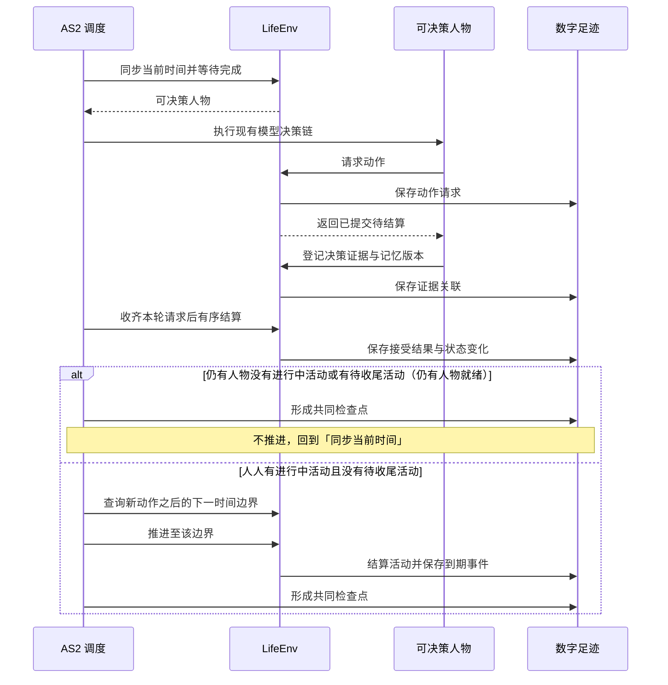

# 特性规格：LifeEnv 运行时行为与结算规则

> 状态：FROZEN——条款已裁决并冻结；按[时间与能量规格](SPEC-time-and-energy.md#冻结条款修订)修订 2–11 与修订 30 改写，
> 受影响条款已在最终源码 `ef13dc5` 上重新验收（证据见[时间与能量验收记录](research/time-and-energy-verification.md)）。「候选契约与呈现规则」章九行中八行已有代码层证据，
> 审查基线的地点侧 `location_kinds` 输入缺口由地图特性完整处理，最终通过状态以新规格的生产入口证据为准。
> 其余既有条款的历史代码层证据保留原身份。真实 DeepSeek 完整实验仍待正式运行。
> 按[人物 Prompt 规格](SPEC-persona-prompt.md#冻结条款修订)修订 7–9、14–16、22、24、28 改写（人物 Prompt 台账 LR1–LR6）：
> 观察投影改为七层请求，系统层取代身份前言与「怎样过一天」，上下文容量按其第四章，指名购买、给予、进食开吃份量与联系人收货和往来随之改写；
> 按人物 Prompt 规格修订，修订部分已实现并通过离线验收（证据见[人物 Prompt 验收记录](persona-prompt-verification.md)），验收矩阵中改动的行已改记「代码层已验证」。
> 按[一日运行保真规格](SPEC-dayrun-fidelity.md#冻结条款修订)修订 1–3、10–12、15、16 改写（一日运行保真 LR1–LR8）：困意档界与示例、社交账的清醒口径与睡眠中不读消息、
> 不适脉冲门槛只判一次、有效偏好与有缓解不累积、名称类拒绝不施加脉冲、摘录按字数核对、全部目录类按名调用与指名购买口径、生活活动的地点类资格、
> 相关度与哈希决胜、按对象轮转、可调用索引不计上限、渠道只是门店集合的称呼；修订部分已实现并通过离线验收，验收矩阵中改动的十一行已改记「代码层已验证」。
> 工具交互修订：按[工具交互规格](SPEC-tool-interaction.md)冻结目标行为；本次修订已实现，实际验收结果单独记录，历史证据只证明原行为。
> 按[个人事务与工作安排规格](SPEC-errands-workday.md#冻结条款修订)修订改写（作业编号见[实施计划](research/errands-workday-implementation-plan.md)的文档同步作业 RT2–RT24、RT27–RT29）：
> 状态归属增个人事务与工作安排；唤醒闭集追加 `errand_reminder_due`，下一边界与下一次决策机会增个人事务提醒，在手承诺不含个人事务；控制请求携带 `errands`；
> 个人事务、上班安排在七层中的位置，两种进度层记录及其浓缩口径；只读查询的执行位置，`query_world` 六键、筛选与返回；
> 顺带更正 `report_status` 的 summary 去向、来源写法与可调用索引括注三处既有漂移；修订部分已实现并通过离线验收（证据见[个人事务与工作安排验收记录](errands-workday-verification.md)）。
> 日期：2026-10-04
> 实施基线：`9b7fbc8`
> 范围：LifeEnv 的状态归属与生命周期、共享时钟与并发活动、消费生产与需求模型、语料准入与内容提供、场景与身体规则、观察投影与提示合同、候选契约与呈现规则、社交最小可行版

本文定义 LifeEnv 的状态归属、生命周期、工具和动作结果行为规则；资源、需求、活动结算、共享时钟、并发和加速算法；语料进入环境、内容目录、工作反馈、导航和配送的准入和结算行为；场景与身体规则、内容提供与消费生产之间的绑定算法。

类型、签名、枚举和结果字段见 `docs/CONTRACTS.md`。人物决策与画像条款见 `docs/dev/SPEC-life-realism.md`。
品类继承、有向三态配对、闭集金额计算、使用完成时的库存转换与运行内容身份由
[品类契约规格](SPEC-category-contract.md)统一定义；这些规则接入本规格已有的动作、活动与提交路径。

## 状态归属与生命周期

### 状态归属规则

| 状态类别 | 包含内容 | 谁可以改变 |
| --- | --- | --- |
| 世界 | 模拟时钟、地点、天气、内容目录版本、营业与工作日历、场景按人物声明的工作安排（`work_schedule`）、待发生事件 | 环境规则；管理员只能在运行前配置或开启新实验分支；工作安排只在运行前由场景声明，零点计划、`revise_day_plan` 与工作提交都不改变它 |
| 人物身体 | 身体状态与需求状态、最近活动及必要生理模型状态 | 推进时间，并结算进食、睡眠与实际活动 |
| 人物资产 | 账户余额、持有商品、消耗品数量、已取得的使用权 | 交易与交付结算（送达只入收货人持有）、物品使用、给予（同处，只转移持有）与合同履约 |
| 人物活动 | 活动类型、开始时间、进度、下一次决策机会、占用资源与名额、暂停与结束原因 | 人物提交动作申请，环境负责验证与执行 |
| 地点会话 | 一段地点停留或两地之间的一段路，及其所含活动 | 环境随出发与到达开始和结束 |
| 当日计划与提醒 | 当日有序目标及其提醒时刻 | 零点计划生成，人物清醒时修订 |
| 个人事务 | 人物记下的未完成事务：名称、完成依据（结果种类、商品、数量）、已累计量、备注与提醒时刻；办成或取消的事务移出状态，终态、原因与证据只留在事件 | 人物经 `report_status`、`pause_activity`、`conclude_activity` 的 `errands` 登记、更新与取消；累计与办成只由环境按结算证据写入；零点处理、`revise_day_plan` 与目标推进不读写它，零点计划只读 |
| 工作 | 任务、输入材料、截止时间、交付物、验收、合同及付款状态 | 任务来源、交付动作与独立验收环节 |
| 内容接触 | 可见目录、已读邮件、已播放片段、游戏状态及素材区间 | 实际接触动作与内容投递环节 |
| 记忆 | AS2 的人物记忆条目、记忆版本、来源事件与检索结果 | 人物记忆流程；环境不代写“人物应当喜欢什么” |

状态类别的字段面见 `docs/CONTRACTS.md`「LifeEnv 状态字段」章的「状态归属」节；本表只判定各类状态由谁改变。

**核心原则**：
- 身体状态与账户余额的准确数值只属于世界事实
- 人物实际收到的，是确定性规则换算出的体感分级，以及七层请求中的可读事实（见「观察投影与提示合同」）
- 准确数值只进入数字足迹与评估；训练数据导出的信息范围裁剪见 `docs/design/05-recording-engine.md`「来源与可见性」

### 生命周期行为

引用 `docs/CONTRACTS.md`「LifeEnv 状态字段」章的「生命周期」节。

本规格在此只判定一条行为：`step` 在区间内处理连续变化与到期事件，并按「时间约定」核验本次推进的时间对账。

## 时间推进与并发活动

### 共享时钟



同一秒可有多轮决策，每轮各形成检查点。

**时间推进规则**：
1. 先处理当前时刻已到期的通知或活动，再选出需要决策的人物
2. 人物完成本轮选择后，环境先结算本轮请求
3. 无人就绪时（每个人物都有进行中活动且都没有待收尾活动，等待与睡眠都算），调度器再计算下一边界：活动完成、内容反馈、通知到达、工作截止、需要重新评估的身体变化、人物选择的等待结束、场景本地零点、当日目标提醒、个人事务提醒（只对清醒的人物，睡眠中的人物不计）或实验结束
4. 每次推进严格大于零；即时事件在当前边界按稳定序号处理；同一秒的再决策不推进时钟，轮数受同刻上限约束
5. 同刻再决策：人物没有进行中活动或有待收尾活动时，在同一模拟秒再获得决策机会，直到有一项进行中活动且没有待收尾活动；适用于运行开始、活动结束、瞬时动作之后与业务拒绝之后。决策本身不消耗模拟时间
6. 同一人物同一模拟秒的决策轮数以场景参数 `max_same_moment_decisions` 封顶，时钟推进即归零（取值见 `docs/EXPERIMENT.md`「场景参数」章的「活动节奏与同刻决策上限」节）；达到上限仍不满足第 5 条的结束条件时进入受限轮：每轮只开放一类动作，收尾、结束与等待不会被业务拒绝，阶梯见 `docs/dev/SPEC-time-and-energy.md`「一、决策不耗时：时间只在做事时流动」规则 3
7. 有进行中活动且没有待收尾活动时，瞬时动作成功后不在同一秒再给机会，下一次按决策节律；业务拒绝后在同一秒再给一次机会，受同一上限约束，达到上限后按决策节律。拒绝保留在动作结果，不替人物选择动作，也不把业务拒绝写成运行失败

**时间约定**：
- 人物决策收到当前时刻
- 环境 `step(tick, t)` 收到本次结束时刻
- 时间对账：本次推进秒数必须恰好补齐上一确认时刻到本次结束时刻的间隔；接口表述见 `docs/CONTRACTS.md`「LifeEnv 状态字段」章的「生命周期」节
- 事件精度为秒；素材本身可保留更细的媒体时间，量化方式固定并记录
- 数据库的模拟时间采用 UTC epoch 秒，交付文件按合同编码为带时区的 ISO 8601；转换不改变时刻或排序

### 决策节律：结算边界与唤醒条件分离

**核心原则**：结算边界与决策机会分离。

`activity_feedback_seconds=900` 作为身体、进度与内容的结算粒度；每个结算边界产生 `activity_progress` 事件并结算资源。

**是否提供决策机会，只由唤醒条件决定**。

唤醒条件和原因闭集由模拟引擎维护。唤醒原因是冻结词表，成员不可改名、不可删除，新增走版本表：

```python
WakeReason = Literal[
    "planned_end", "felt_band_change", "message_arrival", "delivery_arrival",
    "task_available", "task_due_soon", "work_review_result", "commitment_threatened",
    "reconsideration_interval", "location_hours_change", "person_arrived", "person_left",
    "activity_infeasible", "rejection_feedback", "discovery_result", "wake_from_sleep", "run_start",
    "progress_report_due", "no_active_activity", "plan_reminder_due",
    "errand_reminder_due",
]
```

睡眠期间仍可提供决策的只有 `planned_end`、`wake_from_sleep`、`run_start` 与 `plan_reminder_due`；`errand_reminder_due` 不进入睡眠允许集合。存储层登记同源的 `WAKE_REASON_NAMES` 词表，与 `life.schedule.WakeReason` 由测试互锁防漂移。

记录引擎原样保存本次判定，增量字段见[共同身体结算与决策证据](../design/05-recording-engine.md#共同身体结算与决策证据)；
缺字段时的判定口径见 `docs/VERIFICATION.md`「协议门禁」。下表把闭集成员对应到触发条件：

| 唤醒原因 | 触发条件 |
| --- | --- |
| `planned_end` | 活动由世界结束：到达引擎派生的计划时长、被提醒结束睡眠，或交谈对方结束（`partner_ended`）；交谈对方结束而本人仍有其他进行中活动时，同刻轮也记此原因 |
| `felt_band_change` | 任一体感分级与上一次实际提供决策时的分级不同 |
| `message_arrival`、`delivery_arrival` | 新消息或配送到达本人 |
| `task_available`、`task_due_soon`、`work_review_result` | 已知任务真正开放、任务截止前 30 分钟、工作验收结果返回；提前收到预约通知不构成 `task_available` |
| `commitment_threatened` | 已有承诺进入任务截止或闭店预警；同时保留具体原因，边界按当日目标规格 |
| `reconsideration_interval` | 距上次实际决策达到当前在手承诺对应的常规或空闲间隔 |
| `location_hours_change` | 有在手承诺时当前地点即将闭店（提前 15 分钟），或地点已开门；承诺口径见当日目标规格 |
| `person_arrived`、`person_left` | 同一地点的在场人物集合变化 |
| `activity_infeasible` | 保留名称，当前无触发来源 |
| `discovery_result` | 保留名称，当前无触发来源；浏览是活动，结果随浏览结束或下一次观察回灌 |
| `rejection_feedback` | 同一秒业务拒绝后的再决策轮，只由同刻规则写入；边界判定不产生它 |
| `wake_from_sleep`、`run_start` | 沿用现有语义 |
| `progress_report_due` | 本人某项进行中活动距其播报锚点已满播报间隔（`progress_report_interval_seconds`）；只计进行中活动，暂停、待收尾与已收尾的活动不播报；锚点为活动的 `report_anchor_at`，在开始、恢复以及对该活动播报时写入当前时刻 |
| `no_active_activity` | 边界结算后没有进行中活动的人物必获决策，同刻再决策轮也记它，不进睡眠允许集合 |
| `plan_reminder_due` | 当日目标的 `remind_time` 到点：同时到期的合并，只计一次，每条提醒只触发一次；非睡眠活动继续进行。睡眠中到点即结束睡眠（`boundary_type` 与 `interruption_reason` 记 `plan_reminder`，按实际时长结算，睡眠成为待收尾），该边界的唤醒原因为 `planned_end`、`wake_from_sleep`、`plan_reminder_due`，睡眠结束后没有其他进行中活动时另含 `no_active_activity`（不按睡眠允许集合过滤）；睡眠的计划结束与提醒同秒时记 `boundary_type=planned_end`，提醒记为已触发 |
| `errand_reminder_due` | 个人事务的提醒时刻到点：清醒的人物精确在该时刻获得一次决策机会；同一边界到期的多条事务合并为一次机会、本原因只计一次，每条事务各写一条 `environment_event`（`data.kind="errand_reminded"`，人物可见，决策与动作身份为空），与 `plan_reminder_due` 同刻到期时按枚举顺序并列；只提供决策机会，不改变事务状态，进行中的活动继续。不进睡眠允许集合：睡眠中的人物不计入候选、不形成静默边界、不交付也不消耗、不结束睡眠，睡眠期间错过的提醒在人物醒来的那个边界交付、不另起边界；事务办成或取消后不再提醒，更新时写新的提醒时刻重新计一次；只在实际交付决策机会时记账并写事件 |

**唤醒条件是判定规则，唤醒原因是本次命中的成员**：上表列出全部唤醒条件；某次结算边界实际命中的成员构成该次边界的唤醒原因。只有命中的边界才提供决策机会并记录这些原因。

**静默边界**：没有任何唤醒条件的边界
- 环境按人物已开始的活动续行
- 不调用人物决策模型
- 不产生 `decision_started`、`observation`、`model_request`、`memory_updated` 事件；带 `data.purpose="plan_day"` 的 `model_request` 例外
- 本区间共同身体结算（`environment_event.data.kind=body_settlement`）写入上述增量字段：本次边界未提供决策，唤醒原因为空
- 续行不是环境替人物选择：人物的选择是它开始的活动，静默边界只是不打断这一选择

**零点计划**：场景本地零点与启动路径由运行时后台任务 `plan_day` 为人物生成当日计划（同联系人回复），不调用人物，
不提供决策，不写 `decision_started`，不计同刻轮数；其模型请求与响应带 `data.purpose="plan_day"`，计划写
`environment_event`（`data.kind="day_plan_generated"`），按记录引擎设计留证。

**提供决策的边界**：
- 同一组增量字段记为提供决策，并记录实际命中的全部唤醒原因

**下一次决策机会**：没有进行中活动或有待收尾活动的人物取当前时刻；其余人物取下列各项的最小值，以本次决策时刻作为上次决策时刻计算
- 计划结束
- 体感分级预计跨越时刻：困意与饥饿都从当前状态扫描预测，步长不超过 900 秒、最多 24 小时，取首个分级变化的步点后二分到整秒；
  饥饿含昼夜项与餐时项及 800、400、100 kcal 三个能量阈值，交谈、通话期间同样预测
- 午餐、晚餐窗口的起止时刻
- 已排定的通知与配送
- 当日目标提醒（睡眠中也计入）
- 个人事务提醒时刻（睡眠中不计入）
- 进行中活动的播报到期
- 任务截止与闭店的精确预警边界
- 当前在手承诺对应的重估间隔到期
- 地点营业变化

常规间隔 `reconsideration_interval_seconds` 默认 5400 秒；空闲间隔
`idle_reconsideration_interval_seconds` 默认 10800 秒，不能短于常规间隔。进行中的等待不算在手承诺；人物只在等待、
且没有未推进目标、可见未完成的工作任务、暂停活动或其他进行中活动时用空闲间隔。
未完成的个人事务不计入在手承诺，不改变常规与空闲间隔及闭店预警（[个人事务与工作安排规格](SPEC-errands-workday.md) 2.5）。
两者沿用场景配置；在手承诺闭集、切换和精确威胁候选见
[当日目标的决策节律](SPEC-day-plan-goals.md#事件驱动的决策节律)。睡眠继续仅接受睡眠允许的原因。

**验证**：游戏保持逐回合反馈；睡眠期只在计划结束或有唤醒事件到达时提供决策机会（见 `tests/life/test_wake_reasons.py` 的 `test_sleep_accepts_only_existing_sleep_reasons` 与 `tests/life/test_revision_contract.py` 的 `test_sleep_is_not_interrupted_by_reconsideration`）；
同刻决策与计划提醒另以新增的 `tests/life/test_same_moment_decisions.py`、`tests/life/test_day_planning.py` 验收。

**依据**：Humanoid Agents 每十五分钟只在情绪非中性或某项需要偏低时才提示模型；Generative Agents 按计划执行，只在感知到需要反应的事件时重新规划；目标导向行动规划只在计划失效或更相关目标出现时重规划。重估间隔的取值依据人类注意的基本休息—活动周期约 90 分钟（Kleitman 的休息—活动周期）。

### 决策机会规则

观看、工作和睡眠由长期活动表示，不需要每秒运行模型。

**唤醒条件与重估间隔是模拟粒度**，应作为参数记录，不能声称未观察的间隔里发生了逐秒选择。

睡眠不会为每次时间推进自动写一条模型记忆；只有实际形成的观察和记忆进入人物流程。

**人物决策约束**：
- 一轮只提交一个世界请求，`start_activity` 至多同时开始两项
- 一单购买可含多件商品、一餐可含多件持有食品，它们仍分别是一个购买或一个进食行动
- 记忆检索不改变世界
- 同一轮内不能在已登记请求之外再免费浏览、工作或进食；下一轮何时提供按时间推进规则
- 业务拒绝后的下一次决策机会按时间推进规则第 5–7 条；重复拒绝不会被记为人物决策失败

### 并发与占用

**占用**由注册表显式声明，占用名与声明表见「活动组合政策」；准入另按目标在场、实际地点、出行方式与物品状态判定。

**规则示例**：
- 驾车只容播客与免提通话
- 工作可与食用、观看、播客并行；身体只结算一次，各活动分别累计，不默认折半
- 不同人物可以并行活动，某人睡眠八小时不会让其他人物的八小时行动被跳过

**同轮竞争处理**：
1. 模型调用可并发
2. 共享物品、任务与余额的修改由环境 actor 串行提交
3. 同一模拟时刻出现竞争时，宿主在决策前为就绪人物生成并记录顺序，固定随机种子
4. 同轮观察以共同的世界版本为准
5. 人物提交的动作先进入待结算队列，全部决策正常结束后再按该顺序应用
6. 环境 actor 不等待尚未到达的早序请求而阻塞后续接收，因此保持现有单写入 actor
7. 该顺序只决定冲突处理，不选择人物动作
8. 任务提交与其他不可逆结算使用稳定动作标识防止重试重复记账
9. 任何必要人物决策异常时不结算该轮尚未执行的提案，原请求和失败证据保留，运行终止；宿主在上抛前写一条带完整异常链的英文 error 日志，异常对象与类型不变；工具分发失败同样先写日志，再按失败阶段码 `TOOL_SERVICE_FAILED` 抛出。日志不是持久证据，不新增事件、不改变失败分类；四个失败阶段码（模型服务、证据写入、记忆查询、工具服务）随个人事务与工作安排规格阶段 1 补登进 `docs/CONTRACTS.md` 的宿主错误码表，只标出失败阶段与调用位置，不是对请求参数的协议纠错

**验证**：颠倒到达顺序不改变结算（见 `tests/life/test_engine_round.py` 的 `test_multi_person_arrival_order_does_not_change_settlement_order`）；种子变化改变竞争顺序且检查点可恢复（见 `tests/life/test_engine_feedback.py` 的 `test_seed_changes_competition_order_and_checkpoint_restores_it`）。

### 加速

**程序执行加速只减少现实等待**。

模拟中看二十分钟节目仍消耗二十分钟，其他人的邮件和送达事件照常发生。

**人物选的媒体倍速与程序加速分开记录**；跳过的内容不会进入其观察或记忆。

整体速度受模型调用、内容处理与写盘影响，必须通过实测给出加速比，不能预先保证。

### 运行观测

**只读状态视图**显示模拟时间、现实耗时、运行状态，以及每个人物当前活动、进度、最近动作结果和下一次决策机会。正常等待、模型调用中、正在写盘和故障停止分别显示，避免把「人物正在睡眠」与「框架没有响应」混为一谈。查看状态使用已确认事件与状态，不唤醒人物、不调用模型、不改变决策。

**质量报告**从同一份数字足迹统计完成、中断、拒绝、重复观看、内容接触时长、转换效率、记忆写入与来源登记问题、个人事务的登记、办成、取消、跨夜与提醒、收尾记忆的构成与模型成本（个人事务与收尾记忆两组只报告，见个人事务与工作安排规格 6.1）。这些统计用于运行后评估；正式实验期间不根据报告暗中修改提示或替人物选择行动。

**验证**：见 `tests/footprints/test_status.py` 的 `test_status_reads_confirmed_state_without_modifying_any_run_file`。

## 身体语义：两过程睡眠、睡眠不足账、体感分级

引用 `docs/CONTRACTS.md`「LifeEnv 状态字段」章的「资源与需求字段」节。

### 两过程睡眠模型

**状态字段**：`sleep_pressure`（睡眠压力）、`sleep_deficit_hours`（睡眠不足账）

**算法**（Daan、Beersma 与 Borbély 1984；参数取 npj Biological Timing and Sleep 2025 综述标准值）：

```
清醒：S(t+dt) = 1 − (1 − S(t)) · exp(−dt / 18.2h)
睡眠：S(t+dt) = S(t) · exp(−dt / 4.2h)

入睡阈值 H(t) = 0.67 − 0.12 · cos(2π (t − t_min) / 24h)
醒来阈值 L(t) = 0.17 − 0.12 · cos(2π (t − t_min) / 24h)

困意 = (S − L(t)) / (H(t) − L(t))，截断到 [0, 1.2]
```

**参数**：
- `t_min` 为两条阈值的最低点时刻，取人物卡片的 `chronotype_midsleep`（自由日睡眠中点），默认 04:00
- 晚型人物中点每晚一小时，阈值曲线整体后移一小时
- 初始 `sleep_pressure` 假定人物自起点之前最近一次惯常起床时刻（`chronotype_midsleep + sleep_need_hours/2`，按 24 小时取模）
  起一直清醒反推：起床时取睡满后的压力，再按清醒过程推进到起点；不预置活动

**困意分级**（档界按 KSS 等价刻度 `K = 7 + 7.6 · (困意 − 1)` 在 K = 5.5、6.5、7.5、8.4 处切分，属实验假设，登记在 `docs/EXPERIMENT.md`「实验假设声明」；档的名称与个数不变）：
- `< 0.80` 清醒
- `0.80–0.93` 有点乏
- `0.93–1.07` 困
- `1.07–1.18` 很困
- `≥ 1.18` 撑不住（留 0.02 余量，不与截断上界 1.2 重合）

**预期行为示例**：
假设按默认参数（睡眠中点 04:00），人物 07:00 起床、起床时压力等于当时的醒来阈值 L(07:00)，此后一直清醒，按上面的公式计算：
约 21:30 起为“有点乏”、22:40 起为“困”、00:05 起为“很困”、01:25 起为“撑不住”；睡眠中点 05:00、08:00 起床的晚型人物整体后移一小时。

场景起点为 00:00 时，按默认参数反推的惯常起床时刻为 07:45，人物在起点已清醒 16.25 小时，困意约 1.04，为“困”；
睡眠中点 05:00 的晚型人物困意约 0.94，同为“困”。去不去睡由人物决定。

### 睡眠不足账与效率曲线

**累积算法**：
```
清醒每小时累积：sleep_need_hours / (24 − sleep_need_hours)
睡眠每小时恢复：1 小时
下限：0
上限：24
```

**默认参数**：`sleep_need_hours=7.5`（来自人物卡片，允许 7–9 小时），清醒每小时累积约 0.45 小时睡眠不足。

**效率曲线**（输入为 `sleep_deficit_hours`）：

工作效率节点：`(0, 1.0)、(8, 1.0)、(16, 0.85)、(24, 0.65)`
食品利用效率节点：`(0, 0.90)、(8, 0.90)、(16, 0.85)、(24, 0.80)`

节点之间线性插值，两端取边界值。

**分工明确**：
- `sleep_pressure` 决定人物此刻困不困
- `sleep_deficit_hours` 决定连续缺觉对效率的累积影响

### 其他体感分级

**饥饿体感**：
```
appetite = clamp((appetite_anchor_kcal − energy_kcal) / (appetite_anchor_kcal − 400), 0, 1) 
          · (1 + 0.17 · cos(2π (t − 20h) / 24h)) + 餐时项
```

- `appetite_anchor_kcal` 默认 1200
- 由此 800 kcal 对应“饿”；能量低于身体配置的紧急阈值（`emergency_threshold_kcal`，400 kcal）时无条件至少“饿得难受”，不受昼夜项与餐时项影响
- 昼夜项依据 Scheer、Morris 与 Shea 2013 的内源饥饿节律（08:00 低谷、20:00 峰值、峰谷差 17%）
- 餐时项在午餐、晚餐窗口内加 0.15，窗口外为零

**分级**：
- `< 0.15` 不饿
- `0.15–0.35` 有点想吃
- `0.35–0.6` 饿
- `0.6–0.85` 很饿
- `≥ 0.85` 饿得难受
- 能量低于 100 kcal 为第六档“饿得发慌”，只由能量决定；100 kcal 登记在 `docs/EXPERIMENT.md`「场景参数」章的「需求状态」节

**娱乐需要分级**：
- `< 0.3` 不闷
- `0.3–0.6` 有点想放松
- `≥ 0.6` 很想放松

**社交需要**（`social_need`，取零到一）：
- 清醒每小时增长 0.04；是否清醒按本区间共同身体结算（`body_settlement.activity_ids`）所用的活动集合判定，不在推进后重新推断，
  所以在边界结束的睡眠整段按睡眠计；没有该结算草稿时（直接调用）按「ACTIVE，或 COMPLETED 且 `ended_at` 等于此刻」判定
- 与在场人物交谈每小时减少 0.5
- 与联系人通话每小时减少 0.4
- 收到并阅读一条来自人物或联系人的消息减少 0.05；睡眠中不读消息，睡眠中送达的消息在醒来后的第一个边界才阅读并计效果
- 共同用餐每小时减少 0.3
- 交谈、通话的覆盖与共同用餐都按上述同一活动集合判定（在边界吃完的一餐仍算共同用餐）

**分级**：
- `< 0.3` 不想找人
- `0.3–0.6` 想和人说说话
- `≥ 0.6` 有点孤单

**情绪**（`mood_valence`，取 −1 到 1）：

按事件加脉冲并以半衰期衰减。

脉冲表：
- 工作验收通过 +0.3
- 被退回 −0.3
- 任务到期未交 −0.4
- 收到人物或联系人的消息 +0.1（睡眠中送达的，醒来后的第一个边界阅读时才计）
- 连续两小时以上饿（饥饿分级“饿”及以上，含“饿得发慌”）或困 −0.1/小时；两小时门槛只判一次：连续不适时长减去两小时为可计费小时，
  每个边界按新增的可计费小时施加，未施加时不消耗计费小时
- 当日目标首次由实际活动推进 +0.05；每条目标只发一次，按当日目标规格核验活动证据
- 业务拒绝 −0.05，同一人物同一模拟秒至多一次；名称类拒绝（码的闭集见[一日运行保真规格](SPEC-dayrun-fidelity.md) 3.4）不施加，每人每秒至多 2 次，第 3 次起照常施加

半衰期：45 分钟 × `(1 + 0.3 · N_norm)`
脉冲幅度：× `(1 + 0.5 · N_norm)`
`N_norm` 为神经质归一到 [−1, 1] 的值

**分级**：
- `< −0.4` 很烦
- `−0.4 – −0.15` 有点烦
- `−0.15 – 0.15` 平静
- `0.15 – 0.4` 挺好
- `≥ 0.4` 很开心

**情绪只影响体感呈现与记忆重要度加权，不直接改变任何动作可行性。**

### 滞回规则

分级在每个结算边界重算，但只有与“上一次实际提供决策时的分级”不同才构成唤醒条件。

这以决策而非结算为参照，天然抑制在分级边界附近的抖动，不另设阈值参数。

### 数值与分级的分离

所有数值继续写入 `activity_progress` 与 `observation` 事件的 `body` 字段供评估与导出；**给模型的提示只含分级文本**。
商品每份热量与路线费力是商品和路线的事实，可进工具层的目标与动作，不算身体数值。

身体状态与账户余额的准确数值只属于世界事实，但人物拿到的是体感分级，不是精确数值。

**验证**：见 `tests/life/test_sleep_two_process.py`、`test_felt_states.py`、`test_body.py`。

## 消费、生产与需求模型

### 资源表达

引用 `docs/CONTRACTS.md`「LifeEnv 状态字段」章的「资源与需求字段」节。

**表达原则**：
- 时间：UTC 整数秒及场景时区；同秒事件另有严格序号
- 金钱：币种与最小货币单位整数（避免浮点累计误差）
- 可用能量：kcal（实验中的可用能量状态，不等于人体全部储存热量）
- 睡眠不足：小时（与食品能量独立，进食不会直接消除）
- 娱乐需要：归一化状态与明确变化规则；随生活积累，实际娱乐可改变，需要考虑喜好、重复与时长
- 工作需要：截止时间、合同、任务与经济目标；从工作义务与人物经济处境产生，不设置固定「每小时必须工作」脚本

所有数值变化由明确规则计算。人物提示描述其处境与选项，允许拖延、过度娱乐、拒绝购买或再次观看。

**规则只限制物理、经济和任务可行性，不替人物优化人生。**

### 转换效率算法

建议采用简单可校准的函数与参数，避免通用规则语言或额外规则解释器。参数值属于实验假设，正式运行前冻结并通过场景校验。

**能量变化**：
```
能量变化 = 实际进食热量 × 食品利用效率(sleep_deficit_hours)
          − 基础消耗率 × 经过时间 − 活动额外消耗
结算后能量 = max(0, 结算前能量 + 能量变化)
```

**睡眠不足变化**：
```
睡眠不足变化 = 清醒期间累积 − 有效睡眠期间恢复
```

**娱乐需要变化**：
```
有效偏好 = f + (1 − f) · w          0 < f < 1，对 w 严格单调，w = 1 时不变
娱乐需要变化 = 内容自身每小时效果 × 有效偏好 ÷ 当前接触次数
```
`w` 是卡片口味与条目题材精确匹配得到的口味权重（`compute_taste_weights`）；候选与浏览排序只用原始权重 `w`，零权重照旧排在最后，
实际缓解与评分器的缓解预演用有效偏好。偏好只调幅度，不决定有无：下限偏好 `f` 取场景层身体实例字段
`entertainment_relief_preference_floor`（缺省 0.5，取值 (0, 1)，实验假设），喜欢的内容仍比不喜欢的缓解快；不用 `max(w, f)`。
游戏与内容同一算法：游戏条目也按题材计算口味权重，没有题材声明的权重为零、走下限。
有缓解的活动进行时不再累积娱乐需要；共同区间结算与单活动结算用同一口径，对同一内容给出相同净效果。
首次与重复接触采用相同公式；接触次数只在首次与从头重看时加一，接着看不加。

**有效工作量**：
```
有效工作量 = 技能对应的工作速率 × 工作效率(sleep_deficit_hours)
            × 能量效率(energy_kcal) × 已生效工具效果 × 实际投入时间
```
工作速率直接取任务所需技能对应的场景等级（冻结参数，取值只在 `docs/EXPERIMENT.md`「场景参数」章的「工作参数」节定义）；已实际使用 `work_notes` 后的产出倍率为 `body.work_notes_multiplier=1.10`。

**计件收入**：
```
计件收入 = 合同约定报酬，在交付验收和付款条件满足后结算
```

**计时收入**：
```
计时收入 = 合同费率 × 符合合同条件的实际工作时间
```

**效率曲线原则**：
- 基础模型可以用分段线性曲线描述效率
- 不能同时降低计时工资和工作效率来重复惩罚睡眠，除非合同明确这样约定
- 高收入通过职业、技能、机会与合同表现；不从人物初始财富反推能力
- 睡眠期间仍有基础能量消耗；饥饿和睡眠不足不能互相替代
- 低能量的代价是饥饿上升与工作变慢，不拒绝、不停止活动
- 睡眠与食品利用效率之间的关系是用户提出的仿真假设，必须单独配置、校准并在报告中标注，不宣称它已被生理学验证

**参数管理**：
- 规则参数集中在场景定义的身体与活动部分，包括基础能量消耗、活动额外消耗、清醒累积和睡眠恢复速度、效率曲线节点、工作速率、娱乐需要变化及阅读和游戏动作的时间映射
- 参数必须有单位、来源类型和有效范围
- 效率曲线的节点有序，结果有明确上下界
- 每次资源结算记录实际参数与持续时间
- 饥饿等衍生需求从当前资源及必要历史计算，不允许额外自由写入一份会与资源状态矛盾的数值

### 具体活动结算

| 活动 | 执行与结算 |
| --- | --- |
| 进食 | 必须已取得食品；开始时每件取 min(1, 手边持有) 从库存移入活动数据的 `opened`，摄入只按 `opened` 与实际进度计算；暂停保留 `opened` 的剩余，别处不能用，恢复时不再核库存；结束（进行中或暂停的进食）丢弃未吃的部分，不补算摄入，其他份数不动，自然吃完丢弃为 0，实验截止截断时不丢弃；不足一份也可以吃，时长为 max(60, round(整份时长 × 份量)) 秒；收尾结果逐项写终局与已吃、丢弃、剩余份量；支付、取得食品和进食分别记录 |
| 工作 | 输入材料、投入时间、产出物和验收可追溯；失败、延期和返工保留 |
| 睡眠 | 持续恢复睡眠状态；按实际睡眠部分结算，中断后不直接恢复到满值 |
| 看节目 | 按实际播放区间提供内容；暂停不继续推进媒体；倍速改变媒体进度与注意力规则；接着看从上次位置继续；看完只能从头再看 |
| 游戏 | 游戏引擎执行动作；成功、失败和进度来自实际局面，不能由简介推断 |
| 购物 | 商品先落到收货人的库存，或进入配送队列等待送达收货人；一单只有一个收货人（自己、同世界人物或场景联系人），付款人仍是执行人物；耐用品分账持有与使用，消耗品在使用后扣减，食品在开吃时移出库存（见「进食」） |
| 给予 | 瞬时，不占名额：从本人手边移出每件 min(1, 持有)，记入对方持有（场景联系人记入 `WorldState.contact_holdings`），任何人都不增加摄入；要求同处（同世界人物在同一地点，联系人则本人位于其收货地点）；内部标准动作仍记为 `consume` |
| 出行 | 按实际道路和方式计算时间、费用与消耗；改变当前位置及可访问内容 |
| 等待 | 可以由人物选择；世界其他事件照常发生，身体状态继续变化 |

**资金记录**：
- 工资与消费记录付款方和收款方
- 雇主、商家与人物账户之间的金额对应
- 实验初始资金和外部注入明确留痕
- 任务报酬受合同与雇主资源约束，不能通过重复提交同一交付物无限取得工资

**工作质量**：
- 由实际交付物评估
- 模型调用耗时不等于人物工作耗时
- 有效工作量控制任务进度，模型产出的文本还必须通过内容验收，不能用累计时间替代真实生产结果

**验证**：见 `tests/life/test_body.py`、`test_commerce.py`、`test_work_review.py`、`test_activities.py`。

## 语料进入环境与内容提供

### 数据进入环境的过程

语料从选定来源进入环境的数据流，以及离线整理这一选择本身的理由，见 `docs/ARCHITECTURE.md`「离线语料如何进入环境」。本节只保留本规格另定的准入规则：

- 素材不要求全部托管在 Hugging Face；地图与游戏引擎使用其成熟来源，统一来源关联即可
- 初版优先文本内容，记录为字幕、文本会议或文字游戏经历；实际没有输入画面时不标记为完整视觉观看

### 来源与准入

| 内容 | 首选来源 | 进入环境的方式 | 缺口与限制 |
| --- | --- | --- | --- |
| 食品 | Open Food Facts 产品库 | 食品目录、营养、份量与可消耗商品 | 份量和每百克标注需统一；缺字段不能随意补成事实 |
| 食价 | Open Prices | 带地点、日期、币种和单位的价格依据 | 不能直接当作当前中国外卖报价 |
| 电视节目 | LongTVQA+、TVQA | 节目目录、剧情片段、字幕与可用媒体 | LongTVQA+ 的字幕片段标记不是逐句时间轴；需核对原字幕或媒体时长 |
| 游戏目录 | Steam Games Dataset | 简介、类型、历史价格、选择依据 | 聚合游玩统计不能直接当作单次活动时长 |
| 游戏反馈 | Microsoft TextWorld | 游戏实例、玩家动作、局面、进度和输赢 | 初版代表文字游戏；游戏回合到生活时间的映射需明确 |
| 工作记录 | AMIsum、AMI-ME | 会议、议题、发言时间；整理纪要、提取待办等任务 | 需补充合同、截止时间和独立验收；不能代表全部职业 |
| 邮件 | Enron 邮件集 | 收件箱、线程、日程与工作请求 | 人物和时间需一致改写；部分原始版本不含附件 |
| 购物 | Amazon Reviews 2023 | 商品描述、属性、评论、历史价格与选择 | 库存、使用效果、配送和耐用性需场景规则；评论不是人物已发生的体验 |
| 导航 | OpenStreetMap 与 OSRM；高德路径规划为备选来源 | 道路路径、距离、方式和预计耗时 | 静态速度不等于实时拥堵；道路不可达必须如实返回 |
| 出行与生活校验 | GeoLife、ATUS | 出行形态和时间使用的外部参照 | 样本人群、地区和年代有限，不能直接推断目标人口行为 |

内容取得不足、格式错误或哈希错误必须明确失败，不能更换来源、放宽必需字段或用模型补成来源事实。冻结清单的构成与运行前的核验门槛见 `docs/EXPERIMENT.md`「内容与语料绑定」；清单未通过全量核验时拒绝启动。

### 内容目录契约

引用 `docs/CONTRACTS.md`「语料内容目录字段」章。

**各类别有独立属性 Schema，公共字段含义保持一致**，不做任意万能字段映射平台。

**来源标记原则**：
- 模型生成的补充属性标记为合成
- 没有证据的价格、营养、路况与时长不能无标记混入来源字段
- 原始素材文件按哈希复用；多个访问事件各有自己的标识和接触区间

### 内容提供行为

**工作材料与邮件反馈**：
- 人物收到的任务具备输入材料、交付要求、可用工具、截止时间、合同及验收条件
- 实际输出纪要、回复或其他成果存成素材，验收结果单独记录
- 来源数据的参考摘要用于检查，不提前提供；人物完成与否由交付和验收判定
- 工作说明与交付格式先可见，正文随实际工作进度揭示
- 观察不能免费取得未接触的完整转写
- 纪要包含摘要、决定与行动项
- 来源文件的原始会议标识仍保留为语料元数据

**任务通知与可用性**：
- 每封非空 `related_task_id` 邮件必须引用存在的任务，收件人与该任务的 `assignee_agent_id` 一致；每项工作另须至少一封关联通知，缺失或逐封错配时拒绝加载。
- 每项任务的输入只声明必填 `appointment`：普通工作为 null，真实预约为 `{starts_at, reason}`，两个预约键必填，
  `starts_at` 带时区，`reason` 非空。删除输入 `available_at`、`availability_kind`、`appointment_reason`，不接受旧形状。
- 普通工作由场景编译生成 `RuntimeWorkTask.available_at`，等于最早发给受派人且关联本任务的邮件 `sent_at`。
  邮件到达的同一事件批次写入 `visible_task_ids`，人物到达要求地点即可开工，不另等办公室上班钟点或读完邮件。
- 非空 `appointment` 只用于现实中必须提前约定的活动；内部 `available_at` 取 `appointment.starts_at`，最早关联通知不得晚于该时刻。
  后续关联提醒可以在开始之后送达，不改变已派生的开放时刻。
  提前收到通知时任务可知、开工不可用，英文原因返回约定依据与开放时刻。
- `visible_task_ids` 表示人物已知任务；通知只公开合同元信息，邮件正文仍须阅读。任务目标的
  `contract{opens, place, deadline, remaining, outlook}` 写真实开放、公开地点名、截止及进度，不含内部身份。
  五项合同事实只在任务目标出现；邮件到达与阅读结果中的任务引用只用关联任务完整名称，不再复制合同元信息。
  到达结果不公开正文，阅读结果保留实际正文，不公开验收答案。
- `WORK_AVAILABLE` 只在真实开放时触发 `task_available`，不再揭示未知任务。通知与开放同秒时先处理整批事件，再观察与唤醒一次。
  预约收件只以 `message_arrival` 提供机会，不能把新可见误当已经开放；睡眠过滤照常。
- `available_at` 可以早于运行起点；`due_at` 必须晚于运行起点与开放时刻。运行起点已送达的通知与已开放事实
  在首次观察前原子初始化；未送达的通知不能因 `available_at` 提前泄露。恢复不重复告知或重复开放唤醒。
- 地点、技能、余额与截止照常限制受理。正式任务的输入材料必须在通知前已有效，缺失材料在加载时拒绝；
  当前合同没有任务依赖模型，不得假称存在依赖完成判定。现成会议材料的分析与纪要整理属于普通工作，
  标题含会议不构成预约依据；本特性不新增任务依赖接口，也不保留无通知时按开放时刻揭示任务的路径。
- 输入 `WorkTaskConfig` 与编译后的 `RuntimeWorkTask` 分开；运行期受理、调度和合同呈现共用内部派生 `available_at`，
  不让每个消费者重新扫描邮箱，也不把派生字段写回场景或增加检查点字段。

**工作提交**：
- 场景必须为工作合同声明唯一可读的 `WorkTaskConfig.title`；人物只用该标题提交，
  引擎从冻结观察私下绑定 `task_id`、来源材料和验收，不以内部编号作为展示名
- 不要求人物再次填写来源内部的 `meeting_id`
- 不要求人物生成另一个全局唯一的 `submission_id`
- 宿主动作身份记录每次提交，已付款任务集合防止重复付款

**工作验收**：
使用独立 DeepSeek 调用，结合完整来源、隐藏参考与实际交付判断事实支持、必需内容覆盖和矛盾，接受同义改写。字符相等、词面相似度或工作时间均不能单独代替语义验收。

**验收协议**：
- 请求、原始响应、用量、模型身份和校验结果保存为证据
- 模型返回逐项判断，代码决定最终接受与付款
- 验收模型的传输或结构错误终止运行，内容不合格作为可返工的业务结果
- 没有自动重试或替代验收
- 逐字摘录须经本地来源核对才被接受，按字数计：先做 NFKC 与大小写归一，把非词字符换成空格，再删除与汉字、假名相邻的空格；
  有效长度 = 字母数字串个数 + 汉字与假名字数 ÷ 2，至少为 3（纯英文时仍按「至少 3 个词」，与原口径逐位相同）；核对不通过仍拒绝

**反馈内容**：
- 接受与拒绝均向人物返回已留证评审的公开反馈
- 必需事实的覆盖统计，以及缺失内容和交付字段的具体改进依据
- 事后反馈可包含已接触来源的摘录与评审理由，区分覆盖不足、不受来源支持和矛盾
- 不直接返回隐藏参考答案对象、内部参考身份、私有路径和哈希

**历史邮件处理**：
若人物改变历史邮件的情节，不能继续把历史后续回复当作对新邮件的真实反应。新的同事反馈来自其他模拟人物或明确环境规则，保留其生成来源。

**验证**：见 `tests/life/test_work_review.py`、`test_work_review_protocol.py`、`test_work_contracts.py`。

### 导航与配送

**路线计算**：
- 经纬度只能直接给出球面距离
- 驾驶耗时使用道路路由与对应速度信息
- 可沿实际路线和模拟时间生成定位轨迹，同时保存路线与采样规则
- 定位采样不是人物的一次决策

**路线成本**：
- 路线总耗时应包含路由引擎计算的转弯等成本
- 不只累加可能缺少这些成本的片段字段

**配送时间**：
- 预计配送时间由商家准备、排队、道路运输和交付过程组成
- 预计到达时间与实际到达事件分开保存
- 不能为所有订单使用同一个固定时长
- 没有准备时间数据时采用明确标记的场景参数或分布，并记录随机抽样
- 人物只看到当时的报价或预计时间，不提前看到隐藏的实际到达安排

**交通数据**：
- 必须对应模拟日期和时段
- 当前路况不能冒充任意模拟日期的路况
- 初次穿刺可明确限定为静态交通场景

**验证**：见 `tests/life/test_travel_time.py`、`test_travel_cost.py`、`test_travel_trajectory.py`、`test_commerce.py`。

## 场景与身体规则

### 身体参数与单位

场景校验强制每项身体与活动参数带单位、来源类型与取值区间；初始取值按实验假设处理，此后只随时间与动作规则变化。不能把「为了更像人」的运行后指标反馈成秘密行动脚本。

**正式身体参数**：
- 体重 65 kg
- 初始能量 1600 kcal、上限 2400 kcal
- 初始睡眠不足零小时
- 基础消耗每小时 65 kcal
- 额外活动消耗按已声明的代谢当量扣除基础部分后计算

**能量精度**：
- 结算与预测共用完整能量成本函数
- 分段结算使用浮点数
- 所有活动集合的能量都以 0 截断，不报错
- 能量不参与受理、路线与恢复

**效率曲线**：
- 工作效率曲线节点为 `(0, 1.0)、(8, 1.0)、(16, 0.85)、(24, 0.65)`
- 食品利用效率节点为 `(0, 0.90)、(8, 0.90)、(16, 0.85)、(24, 0.80)`
- 以上两条输入均为 `sleep_deficit_hours`
- 能量效率节点为 `(0, 0.5)、(399.9, 0.5)、(400, 0.8)、(800, 1.0)`，输入为 `energy_kcal`，与工作效率相乘
- 节点之间线性插值，两端取边界值

**睡眠参数**：
- 两过程模型按前述算法
- `sleep_need_hours` 默认 7.5，允许 7–9 小时
- 睡眠不足账清醒每小时累积约 0.45、睡眠每小时恢复 1

**娱乐与社交**：
- 娱乐需要取零到一，清醒每小时增长 0.08，有缓解的活动进行时不再增长；实际娱乐时按内容自身每小时效果、有效偏好
  `f + (1 − f)·w` 与当前接触次数减少（见「转换效率算法」）；接触次数只在首次与从头重看时加一，接着看不加
- 社交需要取零到一，清醒每小时增长 0.04（清醒按本区间共同身体结算所用的活动集合判定），交谈、通话、收到并阅读消息与共同用餐按前述规则减少；
  睡眠中不读消息
- 重复接触的次数与效果都落在数字足迹里

**所有系数作为实验假设记录；真实人类生理有效性不是既得结论。**

### 活动组合政策

**正式场景活动组合**：
- 同一人物的活动集合由 `WorldState.activities` 唯一保存；占用槽位为 `idle`、`travel`、`eyes`、`ears`、`hands`、
  `voice` 与 `work`，均须由注册表显式声明。准入仍按占用交集判定，互斥不另设按动作名的规则；另按目标在场、
  实际地点、出行方式与物品状态判定；能量不参与；整组原子受理。
- 各活动的占用：

  | 活动 | 占用 |
  | --- | --- |
  | 等待 | `idle` |
  | 睡眠 | `idle`、`travel`、`eyes`、`ears`、`hands`、`voice`、`work`（全部） |
  | 步行 | `travel`、`idle` |
  | 驾车 | `travel`、`idle`、`eyes`、`hands` |
  | 工作 | `work`、`idle` |
  | 视频、剧集、网文、段子等观看 | `eyes`、`ears` |
  | 播客（`podcast_episode`） | `ears` |
  | 游戏、读信、浏览 | `eyes`、`hands` |
  | 食用或使用、生活活动 | `hands` |
  | 交谈、通话 | `voice`、`ears` |

- 每人两个活动名额，进行中、暂停与待收尾的活动各占一个。
- 暂停及终态释放占用，名额在 `conclude_activity` 后释放；配送和消息仍是独立后台过程。完整声明和边界以
  [一日行为可信性规格](SPEC-dayrun-behavior.md#同一人物的活动集合)为准。

**活动控制**：
- 人物观察提供全部进行中、暂停与待收尾活动，每项独立控制
- 待收尾活动（状态为 `completed`、`failed` 或 `cancelled` 且 `concluded_at` 为空的活动；`truncated` 不收尾）只接受
  `conclude_activity`；有待收尾活动时做别的，以 `ACTIVITY_CONCLUSION_REQUIRED` 拒绝；已收尾与截断的活动不进入可控制集合
- `report_status`、`pause_activity`、`conclude_activity` 各带请求级 `errands`（可为空数组），用于登记、更新、取消个人事务；
  事务变更与同一请求的活动状态转换同批校验、同一事务提交，请求被业务拒绝或任一条变更不合法时整请求不生效、世界不变；
  事务不是活动、不占名额，本次决策点不出一项进行中、暂停或待收尾的活动时没有变更入口；携带事务不改变三个请求既有的控制效果
  （[个人事务与工作安排规格](SPEC-errands-workday.md) 2.2、2.3）
- 活动使用注册表声明的 `idle`、`travel`、`eyes`、`ears`、`hands`、`voice`、`work` 占用
- 场景中声明地点和资格要求，组合由显式占用声明与准入事实决定
- 不允许的组合整组拒绝，不能自动退出旧活动或自动挑选替代行动

### 结算间隔与续行

**普通清醒活动的结算间隔**：场景 `activity_feedback_seconds=900` 秒冻结

到达结算边界时活动仍连续存在。

**是否提供决策机会**：由唤醒条件决定
- 无唤醒条件时环境按人物已开始的活动续行并留痕
- 有唤醒条件时人物根据实际进度选择继续、暂停或结束
- 继续请求不能造成零时间循环或把同一区间重复计入产出
- 活动因计划结束、提醒结束睡眠、到达、途中结束出行或交谈对方结束而结束时，人物在同一秒收尾

生活活动的目录声明 `feedback_boundary=true`，沿用同一反馈、暂停、继续与恢复路径。
暂停后可以选择真实出行；暂停的活动只在开始地点恢复，恢复前重新验证原活动的环境要求，失败保留暂停进度；
在别处恢复以 `ACTIVITY_PRECONDITION_UNMET` 拒绝并点名开始地点，在别处可以直接结束。
地点恢复门必须由真实生产入口测试证明：“启动—暂停—离开—恢复”被拒，“返回后恢复”受理；不能只调用辅助校验函数。

**游戏与睡眠**：
- 游戏沿用明确的回合反馈边界
- 睡眠期只在计划结束、当日目标提醒或有唤醒事件到达时提供决策机会

**活动进度的结算口径**：
- 身体与活动进度按实际推进区间结算；每项活动的投入秒数与有效秒数随每次结算累加
- 暂停不计算活动产出
- 提前结束保留已完成部分
- 实验结束保留截断标识；每项被截断的活动（进行中或暂停）写一条 `environment_event`（`data.kind` 取 `activity_truncated`，带截断后的活动快照），导出据此与最终检查点逐项一致
- 主动结束、暂停与恢复逐活动各写一条 `environment_event`（`data.kind` 取 `activity_concluded`、`activity_paused`、`activity_resumed`）

### 资金与合同

币种、账户初始余额、合同实例金额与工作机会时长、交通服务账户和路线实例由 `docs/EXPERIMENT.md`「场景参数」章说明。
品类费率、计酬槽位与算法统一由 `catalog/exchange-rules.json` 的闭集规则定义，行为归[品类契约规格](SPEC-category-contract.md)。
本节判定资金结算行为：

- 计时与计件两类合同都按实际合格产出结算，交付通过验收是付款条件
- 重复任务付款由稳定任务标识防止，已付款任务的集合不得重复放款
- 资金注入及所有双方转账必须可对账：每一笔金额变化都能追到付款方与收款方
- 交通服务的启程请求按当时可见报价一次预付，取消不退
- 余额不足时拒绝整个启程请求，不部分受理
- 同一动作幂等重放不得重复扣款

**验证**：见 `tests/footprints/test_ledger.py`、`tests/life/test_work_contracts.py`。

## 观察投影与提示合同

### 七层请求

生活决策的每次模型请求由原生 `tools`、system 与 user 组成，同一秒的后续决策另加续接消息；各层全部由确定性代码渲染，
不调用模型。组成与更新以[人物 Prompt 规格](SPEC-persona-prompt.md)第一章「请求组成」为准：

| 位置 | 内容 | 更新 |
| --- | --- | --- |
| `tools`（原生参数） | 世界请求工具与只读查询工具的固定定义；description 只写用途，参数不带逐轮名称枚举 | 整次运行不变；只有本次决策剩最后一个回合时，以及输出截断后的那次重试，去掉全部只读查询工具 |
| system | 系统层 JSON（见「系统层」） | 整次运行逐字节不变 |
| user | JSON 数组，依次为工具层、人设层、记忆层、待办层、环境层、进度层六个对象 | 每个时间点构造一次；同一秒的续接链内逐字节不变 |
| 续接消息 | 同一秒后续决策追加的原生 assistant 与 tool 消息 | 时间推进后不再出现 |

七层的字段清单与上限只在 `docs/CONTRACTS.md`「观察投影字段」定义：字段面见「七层字段」，容量与窗口见「可见期与提示预算」；
机器可读形式为 `src/worldmock/life/prompt_schemas.py`。人设层由人物卡片的结构化字段、人物姓名与场景联系人渲染，
卡片的字段与编译规则见 `docs/dev/SPEC-life-realism.md`「画像编译」。

进度层只含当前地点会话（一段停留或一段路）的有序记录，不按会话分组列出历史会话；更早的会话由记忆层呈现。
结算结果归进度层，内部身份、报价版本和状态维护不暴露给模型；层内字段以 `docs/CONTRACTS.md`「观察投影字段」为准。

### 不进入提示的字段

不得进入提示的字面键清单见 `docs/CONTRACTS.md`「禁止进入提示的字段」；宿主渲染七层 JSON 与续接 tool 消息时逐键校验，原生 `tools` 是整次运行不变的常量，由测试校验。

两条由本规格判定的行为边界：`game_catalog` 只在人物在家且询问娱乐时以名称列表出现，不整表下发；能量数值与能量可行性不约束工具 Schema。

### 观察投影行为规则

**唯一出现**：每项信息在整个模型请求（含原生 `tools`）中只有一处完整内容，其他位置只用名称引用；各项信息的唯一位置见
人物 Prompt 规格第一章「唯一出现原则」。一次决策的输入里，同一条观察也不得被序列化两遍。观察记录的写入形态以 `docs/design/05-recording-engine.md`「数字足迹事件结构」章的「事件字段」节为准，AS2 侧把该形态落到代码的改动见 `docs/dev/SPEC-as2-integration.md`「观察记录单写」。

**门店供给可见期**：可见期与可见凭据只管展示与比较。实际呈现的购买候选按 `supply_id` 分别记录可见身份、浏览时刻与浏览地点；
距该供给实际呈现超过 1800 秒或离开呈现地点后失效。不得把全商品目录设为可见，也不能让同商品另一门店继承凭据。
已持有商品的使用可见性仍按当前地点库存。可见期与可见凭据不放宽；离开呈现地点后，人物凭进度层、记忆层中带店名的浏览结果（完整标签）按名下单。
展示不是资格的上限：所有目录类对象（商品与供给、生活活动、内容、游戏、地点、联系人与人物、任务、活动）都可以直接写名称，
无损归一后唯一即受理，归一结果写进 `details.resolved`；相似度只用来给候选、永不自动替换，候选按此刻可行过滤，至多 3 个，
写成可照填的完整请求 `{tool, arguments, note}`；宿主与环境共用同一名称解析，宿主逐项收集全部名称类失败项，环境逐项解析后合并成一次拒绝
（[一日运行保真规格](SPEC-dayrun-fidelity.md) 3.1、第四章）。按名写的对象照常经菜单、资格与准入判定。
`obtain` 的商品目标按指名购买解析：`from` 是可选约束（`null`、地点显示名（含「家」「住处」）或渠道称呼）；分段匹配依次以 `SUPPLY_NOT_FOUND`（没有这件商品）、
`SUPPLY_NOT_AT_STORE`（这家店不卖）、`FULFILLMENT_NOT_SUPPORTED`（不支持这种方式）与 `ACTIVITY_PRECONDITION_UNMET`（要去哪里或送不到）拒绝；
方式可写「购买」，由系统定到店或远程下单；多于一个可服务的匹配时按请求级 `prefer` 选定一家并写进 `details.notes`；
受理后按当前报价在同一秒批量结算，价格、余额、营业与库存照常检查；不自动换成别的商品（该规格 3.2、3.3、3.5）。
字段合同见 [地图与门店供给合同](../CONTRACTS.md#地图与门店供给合同)。

**工作材料增量**：现行提示从不含材料正文，只给新揭示材料的字数，与接口合同的「揭示」不符；七层删去该字数字段，
材料正文进入哪一层另立规格（人物 Prompt 规格「范围外登记」）。完整材料进度仍由结算记录。

**字幕与内容片段**：结算只揭示本次新跨过的区间，横跨边界的同一条字幕不重复揭示；字幕正文不进入七层，工具层内容目标的 `state` 只写没看过、看过一部分或看完了。

**动作结果回灌**：本会话内的世界请求连同公开结果是进度层的 `tool_call` 记录，在整个会话内保留；同一秒续接时，
上一决策的结果随 tool 消息返回；会话结束后由系统派生为记忆层的 `settled` 句子。活动的客观进度在工具层活动目标的 `state`，
暂停的活动在待办层。人物写下的 summary 在本会话内是进度层中该调用的参数；会话结束后，成功的 `pause_activity`、`conclude_activity`
写下的 summary 是记忆层的 `self_notes`，`report_status` 的 summary 不进入记忆层；
回复正文是该调用的 `self_note`，只保留到本会话结束。这些内容未经核验，由系统层规则统一说明，各字段不逐条标注。
控制请求里的 `errands` 从进度层该调用的参数中略去（先例：`views`），也不进 `self_notes`，本会话内由结果的 `details.errands` 回执
`[{errand, change}]` 可见（`errand` 为事务名称）。在每次请求的六层快照内，事务的完整行只在待办层，别处只以名称引用；
待办层事务行的名称与备注是人物自己记下的，未经核验，由系统层规则统一说明。进度层另有两种只写事务名称的记录：
`errand_reminder{errand}`（提醒到点）与 `errand_completed{errand}`（环境确认办成），都由人物可见的事件派生，来源事件计入观察的进度来源；
办成的事务由此对人物可见，取消的事务只从待办层消失。同秒续接中上一决策原样带回的调用参数与 tool 消息的 `changes.errands`
（`added` 为新增或内容有变的完整行，`removed` 为名称）属于续接消息，不在六层快照的唯一出现口径之内；
两种新记录有来源事件，随 tool 消息的 `events` 各出现一次。
目标行不显示人物自述（`progress_note` 照存，不进提示）；同一段 summary 只在进度层或记忆层之一出现。
工作验收使用已有公开反馈，不含完整活动快照和内部参考；权威事件保持完整，
容量浓缩只处理发送给模型的进度层 JSON。具体边界见
[决策上下文规格](SPEC-decision-context.md#登记确认与结算结果)，字段见接口合同。

直接消息与交谈邀请以全文进入进度层的 `message_arrival`，邮件只写主题，正文在阅读结果中；「已读」指全文已呈现。
可达地点的营业状态、路线的分钟数与费力、商品的价格与每份热量都在工具层的目标与动作中；吃饭途径由工具层目标与系统层规则表达，
不再有吃饭途径句。暂停活动与今日计划只在待办层，未完成个人事务的完整行也只在待办层（进度层两种记录与结果回执只写事务名称），
工作合同只在工具层 task 目标的 `contract`；在途订单与未回复消息的位置不变，待办层不复述它们。
今天的上班安排只在环境层的 `duty`（由环境按场景 `work_schedule` 与世界时钟求值，人物没有工作安排时为 null），
人设层、待办层、工具层与当日目标都不重述，宿主不渲染人物档案里的工作安排；同秒续接内时钟不动，`duty` 与所在地点一样在链内不变、
不进 `changes`，时钟推进后的请求从新快照整体给出；它是呈现的事实，环境不因它新增任何拒绝，出行照常列出、照常受理，
班内离岗不另写事件，只由行为评估从事件与场景重算（[个人事务与工作安排规格](SPEC-errands-workday.md) 4.4、4.5）。各项信息的归属见
[七层归属](SPEC-decision-context.md#七层归属)。

**请求、查询与错误**：`start_activity.items[]` 包含一至两项 `{target, way, from, to}`，连同请求级 `answering`、`prefer`
整组原子受理；删除旧平行数组与 `actions`。目标与方式唯一决定内部动作；本人进食或使用两端必须为 null，
取得给本人时 `to=null`，给予通过「给予」方式和已知收件人名称独立表达。
包含购买的请求 `prefer` 必须取「最快拿到」或「到手价最低」，其他请求必须为 null，不接受旧英文枚举。
`recall_task_summary` 与 `query_world(name, way, category, from, available_only, offset)` 归入只读查询，可与记忆查询同批；
查询六个键全部必填、无缺省：`name`、`way`、`category`、`from` 可为 null 且至少一个非 null（全空时在四个位置各报一条），
`available_only` 是布尔，`offset` 是非负整数，旧四键请求按缺字段拒绝；`from` 写购买来源，与 `start_activity` 购买项的 `from`
同名同义并共用同一来源解析函数，只匹配供给条目；`available_only=true` 只留本轮冻结观察里已确认此刻可执行的条目；
筛选在排序与切页之前施加，类别复用现有品类名称，分页顺序由本轮冻结观察确定。
不结束决策、不改变世界、不计同刻轮数；含查询的模型回复本身仍计入十六回合预算。世界查询只能返回人物有权知道的对象。
执行位置：`recall_task_summary` 经环境代理送到环境 actor 并等待真实结果；`query_world` 由宿主在本次冻结观察上本地求值，
`LifeEnv.read_query` 的同名分支是同一组纯函数的第二入口，两入口对同一观察、同一请求逐值相等。`read_query` 按决策身份取本决策
唯一一条已提交观察，工具与请求类型不符或找不到唯一观察是协议违约，回看的业务拒绝以错误结构作为返回值；
查询不进入待结算队列、不写事件、不改世界版本与时钟。
`query_world` 返回 `{matches, total_count, next_offset}`，逐页读取无重无漏，末页 `next_offset=null`；`total_count` 是全部筛选交集后的完整匹配数；
除两种查询参数错误（`from` 既不是地点显示名也不是渠道称呼；`from` 为 null、`name` 按对象名称无任何匹配且其写法恰是一个渠道称呼，
此时候选给一条把该值移到 `from` 的完整请求，不自动改写）外，任何筛选组合无匹配时返回 `matches=[]`、`total_count=0`、`next_offset=null`，
不报错、不自动放宽、不换来源；每项是冻结目标的无损紧凑投影，只省略 null 与空集合（与紧凑工具层的分组呈现同一实现），
不再逐项附 `candidates`，候选只出现在错误合同里；查询结果只进入原生模型与 tool 交换证据，
不写进度层 `events`、世界动作或人物记忆；最终回合与截断重试不开放任何只读查询。
每次接口错误都返回英文原因与 `items[]`，每项含精确 `path`、合法 `allowed_values` 与 `expected`；
`path` 是从模型工具调用根开始的完整位置数组，取代旧 `index`、`field`，例如
`["tool_calls", 0, "function", "arguments", "items", 0, "way"]`；不存在有限闭集时 `allowed_values=[]`，
`expected` 写合法类型或业务条件。候选只含 `{tool, arguments, note}`，其中 `arguments` 是完整合法新请求。
该规则覆盖请求级字段、数组项、嵌套字段及业务条件错误，不直接转储校验库错误。

**跨时刻操作备忘**：进度层 `rejected_today` 由当天已提交的名称类、参数类拒绝证据派生，
跨模拟时刻与地点会话保留，次日本地日清空；至多八条，英文 `why` 至多六十字符，字段为
`written`、`why`、`times`、`last`、`accepted_as`，包含次数、最后时刻及后来受理的写法。
成功归一不登记；备忘是环境确认的操作经过，不是人物自述或活动完成事实，不新增持久世界状态。

**紧凑工具层**：只压缩发送给模型的呈现，公开为 `groups` 与 `callable_index`；每组含
`kind`、`action`、`way`、`shared`、`targets`，按同类别、同动作、同方式分组。
`shared` 只承载整组逐值相同的字段，`targets` 保留目标名称及不同字段；控制对象的 `action`、`way` 为 null，
工具和状态仍保留。只省略 null 或空集合，不丢失 false、零值或明确的未知原因。
展开结果与完整冻结观察逐项等价，同秒 `changes` 用相同表达；冲突字段视为渲染错误。
预算计实际发送内容；名称解析、菜单、地点资格、呈现上限及可调用索引的范围不变。

工具交互按错误接口、任务、供给价格、料理、查询、操作备忘与紧凑呈现依次完成独立端到端阶段，
各阶段的生产入口行为与独立变异门禁见[工具交互特性门禁](../VERIFICATION.md#工具交互特性门禁)。
任务阶段只发布新场景输入，其他数据身份在对应阶段实际受影响时发布；不保持双格式，也不拆掉可运行主链等待最终组合。

### 交互菜单的运行边界

每次生活观察的事件级工具支持数据包含按人物权威位置计算的有效交互菜单。该菜单随观察冻结，本身不进入人物 user 消息：
工具层只列菜单允许的动作，环境层的 `fixed_rules` 写菜单排除的动作的可读说法；工具层的目标与动作、本地决策校验和宿主派发
共用这份冻结值。原生工具整次运行不变，不按菜单逐轮收窄参数。
地点变化不改写本轮观察，只在下一次观察重新计算。声明形状、交集与保护项见
[交互菜单规格](SPEC-interaction-menu.md)。

环境受理时按权威场景、人物位置和当前状态重验菜单。禁止的标准动作在
领域副作用前以 `INTERACTION_MENU_DENIED` 拒绝，并沿用业务拒绝节律、结果回灌
和幂等规则。工作提交若不满足领域资格，不得进入独立评审。进行中与暂停活动的播报、暂停和结束保留
独立控制规则；恢复须回到开始地点，重验注册表占用、地点、归属与身份，能量不参与。

菜单只控制入口和启动资格，不改变 `affordance_contract`、候选生成、世界事实排除、排除原因计数、
呈现上限、游标或轮转。候选与呈现仍完整执行本规格的统一合同；菜单不为关闭的入口伪造候选排除原因。

### 系统层

**系统层正式、简洁**：生活决策的 system 是系统层 JSON（字段 `layer`、`role`、`rules`，紧凑序列化、键序固定），
整次运行逐字节不变；只读问答另有一份只读系统层。`rules` 每条只写一次世界交互机制，不要求人物每次写正文；定稿全文见
人物 Prompt 规格第一章「系统层」，逐字登记在 `docs/CONTRACTS.md`「请求组成」，由提示指纹绑定。
身份前言与「怎样过一天」删除：身份只在人设层，世界规则只在系统层；人物与情境内容不少于 50% 的比例及其测试
（`tests/integration/test_life_agent_protocol.py` 的 `test_system_prompt_is_identity_first_with_word_share`）废止。
工具的 `description` 只写用途，协议与阶段规则只在系统层；预算 JSON 与低预算提示不再追加到 system。

提示中不得出现「评审」「评分」「引擎期望」等把人物置于被评价位置的措辞。地点处境由环境层
表达；地点允许的行动由显式交互菜单控制，工具描述不得固定写入办公室娱乐偏好或其他人物策略。

### 上下文容量

发送每一次实际模型请求前，按所用模型的上下文窗口计算整次请求的 token 占用：原生 `tools`、系统层、六层 JSON、
续接消息（含回传的 `reasoning_content`）与预留输出。达到百分之八十五时依次处理，每步之后重新计数：

0. 提前结束本秒续接：本次请求改为从新快照构造，此前的思考不再出现；
1. 从旧到新去掉未受保护记录的 `self_note`；
2. 把最旧一段未受保护、已有结果的记录折成一条 `condensed` 记录。

仍达阈值或超出输入额度时，按容量故障停止，并按系统层、工具定义、各 user 层、续接消息、预留输出分层记录 token 用量与英文错误日志。
始终完整保留（受保护）：工具层的进行中与刚结束活动、待办层的暂停活动、未了结订单相关的记录、上次请求之后的新记录。
工具层、人设层、待办层与环境层不浓缩；记忆层只受自身 8000 字符窗口约束。
进度层的 `errand_completed` 记录折叠时留一句只含时刻与事务名的句子，`errand_reminder` 与当日目标提醒同等对待、折叠后不留句；
待办层不浓缩，未完成的个人事务不受容量处理影响，其条数由每人至多 8 条的上限约束
（[个人事务与工作安排规格](SPEC-errands-workday.md) 2.1、2.6）。不静默删减，
不修改权威活动与会话状态或原始结算事件。行为以人物 Prompt 规格第四章为准。

**正式运行目标**：
- `quality.json` 报告每次决策的提示词 token 分布
- 中位数目标为不超过 15000 token
- 该目标只报告不放行

**语言**：提示文本使用场景 `language=zh-CN`

**验证**：见 `tests/life/test_narration.py`、`tests/life/test_revision_contract.py`、
`tests/integration/test_life_agent_protocol.py`；另以阈值时先断链、再依次去 `self_note` 与折叠为 `condensed`、
受保护项完整保留、仍超限时容量故障并分层记日志的测试验收。

## 候选契约与呈现规则

本节判定「人物此刻能碰到哪些对象、按什么顺序碰到、一次能看到多少条」。对象层（冻结目录与场景声明的对象）本身在本节之外；字段名、枚举值、返回体结构与场景常量名只在 `docs/CONTRACTS.md`「候选与呈现合同」定义，本节只写行为规则。

**依据**：`.work/object-model-reanalysis/REPORT.md` 第二章「主干：从『三条链路』改成『一个生成器 + 一个资格级联 + 一个排序器』」「三个获取来源 → 保留三分，但统一到一个生成器」「prompt 里那一节『可交换 object』 → 保留，但分三级、且不放 scene」「画像 preference list，≤1k → 降级为两级上限」「分层下推 → 保留，但层数是『约束传播的层』，不是 UI 分页」；地点部分依据同目录 `LOCATION-GRANULARITY.md` 的「一句话结论」与「推荐」。

### 统一候选契约：生成、资格、排序三段

**判定规则**：购买供给与持有商品、生活活动、内容、游戏和任务都走同一套三段式，任何一类不得另起一条独立链路。

| 段 | 输入 | 输出 |
| --- | --- | --- |
| 生成 | 在场对象 ∪ 浏览时效内的对象 ∪ 随身持有对象 ∪ 画像激活集对象 | 未收窄的候选全集，附带每个来源的命中计数 |
| 资格 | 营业时段、库存、地点要求、资源占用、启用集 | 保留项 + 被排除项及其稳定原因码 |
| 排序 | 画像口味 × 注意力先验，另加相关度 | 有序候选，每项带完整稳定排序键 |

**资格与排序的现行口径**（[一日运行保真规格](SPEC-dayrun-fidelity.md) 5.1）：生活活动窗口按当前地点与时刻取候选，地点类不符的条目不进窗口，
排除项记 `ELIGIBILITY_LOCATION_KIND_MISMATCH`，被排除的条目仍可按名调用。排序键为（非零口味，−口味×注意力，−相关度，哈希）：
相关度只取人物自己的事实与目录事实——目录 `time_window` 覆盖此刻 +2、属于当日未推进目标的活动家族 +2、人设层习惯签名的反应文本命中条目名或品类 +1；
决胜键为 `sha256(场景|人物|日期|对象)`，不再用对象标识，零口味时顺序不退化为字母序；排序键版本 `ORDER_KEY_VERSION` 为 2，只参与游标身份。

**读到什么算通过**：同一个人物、同一世界状态版本、同一场景，两次取候选得到逐字节相同的序列，且五个品类的返回体形状一致（同一组顶层键）。

**读到什么算失败**：某一品类缺少资格段的排除计数，或某一品类走了不经过生成段的枚举路径（例如直接从全表扫描出发再按条件筛）。

**候选是派生量，不是状态**：候选集的身份只由（冻结目录摘要、画像摘要、世界状态版本、选择器版本）四项决定。时间戳、缓存内容、模型输出都不得进入这个函数。分桶与游标的哈希一律用 `hashlib`，不得用内建 `hash()`。

**读到什么算通过**：同一 `(冻结目录, 画像, 世界状态版本, 选择器版本)` 在父运行与从该状态分支出的运行里得到同一候选集。

**读到什么算失败**：候选顺序或成员在两次同输入调用间变化；候选依赖运行墙钟时间或上一次模型输出。

### 两条排除纪律

**只有世界事实可以排除。** 可排除的是地点或访问不可用（人不在、营业关闭或未知、地点类交集为空、资格不足）、供给无有效报价、库存为零或已下架，以及身体与资源条件不允许（资源占用冲突、时长越界；占用按「活动组合政策」判定）。每一类排除携带一个稳定原因码，原因码的闭集只在 `docs/CONTRACTS.md`「候选与呈现合同」定义。
地点类资格在生成候选时就对生活活动窗口施加：地点类交集为空的条目不进窗口，而不是进了窗口再标不可用。

**软偏好只允许改序，不允许出局。** 画像口味、注意力先验、画像激活集只参与排序键，不得作为候选的入选条件。**修订既有实现**：`compute_taste_weights` 给出权重零的条目必须仍然进入候选并按最低档排序，`motivation` 里以 `attention_prior × preference > 0` 作为入场条件的写法作废（依据：`REPORT.md`「被裁掉的对象怎么办：裁剪不可保证，但必须可审计、可区分、可逆」的「当前实现已经踩了第三类」与 `REPORT.md`「现状与 elevate 后模型的 gap」的「画像偏好被当成排除条件（软偏好硬用）」）。

**「没显示」与「不存在」必须可区分**：被排除的对象以「带原因码的排除项」出现在观察与事件证据里，不能从返回体里静默消失。人物看到的是人读说明，例如「这里有三十样东西你现在拿不到，要到店里才能买」，不是「世界就是这样」；原因码（如 `ELIGIBILITY_LOCATION_ABSENT`）只进证据。

**`ROTATION_DEFERRED` 也是排除项**：该原因码是闭集成员，带它的对象计入排除项计数，与其余排除项同样满足「排除项计数加保留项计数等于候选全集规模」。它与其余排除项的差别只在生效范围——**只影响本次呈现**，不改变对象状态、不写目录、不产生下架事件，因此不得把它当作保留项或不计入排除计数。

**读到什么算通过**：画像未声明过的题材，其条目仍出现在候选集里且排序低于已声明题材的条目；每个被排除项（含带 `ROTATION_DEFERRED` 的项）都能取到一个闭集内的原因码；排除项的计数加保留项的计数等于候选全集的规模。

**读到什么算失败**：任何一条不出现在候选里的条目既没有原因码、也不在任何排除计数里；口味权重为零的条目在候选枚举阶段就不生成。

### 两级上限

**池上限与单次呈现上限分开，二者不得合并成一个数。**

- **检索分区池上限**：人物在某分区内「理论可互动」的对象总数上限，只用于计数与下推，不直接进提示。
- **单次呈现上限**：一次决策放进提示的条数上限，是场景层常量，默认 20 条。上限只约束目标条目：工具层的可调用索引
  `callable_index`（`lifestyle` 列此地此刻可做的生活活动名称，`contents`、`goods` 给品类计数与每类至多 3 个示例名，`query_categories` 列世界查询可用的品类及其在查询权限内的完整条目数）不是候选条目，不计入单次呈现上限，
  但计入整次请求的容量计数；索引里的名称按名调用，受理时照常做资格与准入判定（[一日运行保真规格](SPEC-dayrun-fidelity.md) 5.2）。

**读到什么算通过**：观察投影的条数不超过场景声明的单次呈现上限；池上限的取值同时出现在
由 `start_activity` 发起的下推结果 `total` 里，而不是被当成呈现上限把返回体裁短。

**读到什么算失败**：提示里出现的候选条数超过单次呈现上限；或把池上限当成提示条数上限，导致某一次呈现直接塞进池上限条。

**修订既有实现**：动机层内部的候选截断（`MAX_CANDIDATES`，26）不作用于呈现，不得把它的取值当作单次呈现上限；两者是不同的量，前者只是内部仪表。

### 下推：两层、游标、返回体

**层数限两层**，即品类 → 条目。层的语义是约束传播（上一层选定的品类收窄下一层的可行集合），不是界面分页。

**分页用游标，不用页码**。游标是上一页最后一条的完整稳定排序键；页码与偏移不稳定，目录变动时会重漏。

**返回体必须含三件事**：本次返回条数、总数、下一页游标；最后一页的游标为空。返回体的字段名与结构见 `docs/CONTRACTS.md`「候选与呈现合同」。

**游标只能由（冻结目录、世界状态版本、排序键版本、游标）决定**，不得包含模型输出、会话状态或墙钟时间。

**读到什么算通过**：以空游标起、反复带上一页游标下推，得到的序列是一次全量有序候选的无重、无漏子序列；同一游标在同一世界状态版本下重复请求返回同一段。

**读到什么算失败**：下推出现第三层；返回体缺少总数或下一页游标；两次下推之间目录未变而结果出现重复或遗漏。

### 曝光轮转

**轮转的判据是「上次呈现时刻」**（字段名 `last_presented_at`），不是互动次数，也不是任何偏好估计量。合同禁止把互动次数当作「受欢迎程度」使用。

**轮转非破坏性**：只改呈现顺序与换新名额，不改目录、不改对象状态、不产生下架事件。每次呈现按场景声明的换新比例留出固定换新名额给「长期未呈现」的对象，其余条数按排序键给出。
每个对象各记自己的 `last_presented_at`，换新名额留给该分区内最久未呈现的对象；不用人物级的共享偏移量，也不设分区游标。

**最大未呈现间隔必须有界**：给定分区池规模 `N` 与每次呈现的换新名额 `k`，单对象最坏等待间隔的闭式上界为 `⌈N ÷ k⌉ ÷ D`，其中 `D` 为该分区的每天决策点数。验收断言必须用这个精确形式，不得用它的连续松弛 `N ÷ (k × D)`。`N` 与 `k` 的取值来源见 `docs/CONTRACTS.md`「候选与呈现合同」；`D` 的取值按章引用 `docs/EXPERIMENT.md`「场景参数」章的「决策点节奏」节，取该节记录的实测区间而非单一估计值，本规格不复述数值。

**轮转的单位是检索分区，不是整个语料池**：分区越细，单池越小（等待变短），但每个分区的可达率也越低（等待变长），两者互相抵消，因此分区不能无限细。
`⌈N ÷ k⌉` 的上界按分区成立，`N` 与 `k` 取该分区自己的池规模与换新名额。

**读到什么算通过**：连续 `⌈N ÷ k⌉` 次呈现之后，分区内每个对象至少被呈现一次；轮转前后目录条目数、对象状态与事件序列中不出现任何下架事件。

**读到什么算失败**：轮转改变了目录或对象状态；换新名额被排序键挤占而长期未呈现的对象永远不出现；用互动次数（`exposure_count` 一类计数）作为轮转判据；把带 `ROTATION_DEFERRED` 的对象当作保留项而不计入排除项计数；用人物级共享偏移量代替逐对象的上次呈现时刻。

**轮转状态**：判据所需的上次呈现时刻是派生量，写入方式与字段面见 `docs/CONTRACTS.md`「候选与呈现合同」；它是纯时刻或计数，不含任何偏好推断。

### 禁止永久退役

**禁止按互动统计永久移除对象。** 任何以互动次数、被选择次数或「受欢迎程度」为判据把对象移出对象层的机制都不得实现，因为十二周窗口内的样本量（内容品类最大约 90 条、平均每条约一至两次曝光）支撑不了「谁更受欢迎」的判断，且永久移除意味着一次错判无法挽回（依据：`REPORT.md`「按互动统计淘汰尾部 x% → 拆成『永久退役』与『曝光轮转』，只有前者该被否」）。

**目录条目的退役只允许走墓碑语义**：保留可读、拒绝新场景引用。退役不删除条目，也不改变既有足迹的解释。

**读到什么算通过**：轮转、候选裁剪与淘汰统计都不改动对象层的条目数量；对象层条目数的变化只由目录版本变更产生。

**读到什么算失败**：任何运行期通路按互动统计把条目从对象层移出；「没被选中」被写成「下架」事件。

### 地点语义与检索分区

**地点是可行性门，条目属性是检索分区键，两件事必须分开。**

- **可行性门**回答「此刻此地能不能做」：地点声明「我满足哪些地点类」，条目声明「我需要哪些地点类」，交集非空即可行；只有活动侧 `anywhere` 表示无地点限制，地点必须声明实际环境，不能含 `anywhere`。地点词表取生活活动地点类的单一封闭集，各处对齐后运行期强制（现行词表的对齐要求与语境见 `LOCATION-GRANULARITY.md`「核实现状」与 `docs/dev/SPEC-life-realism.md`「世界素材品类要求」；字段与闭集见 `docs/CONTRACTS.md`「候选与呈现合同」）。
- **检索分区键**回答「从哪个池里选」，取条目属性（题材、语言、时长段），不取地点。地点粒度不足以当分区键：一个人的生活里场所类别是十的量级，纯地点方案的分区数上限约 24 个，与十万级池所需的千级分区差两个数量级。

`required_location_id` 与地点类判定并列：前者指定具体地点实例，后者指定地点类别，取交集即可行。

**读到什么算通过**：在办公室启动影片观看被拒且原因码为地点不可行（不是资源冲突）；在声明可行性的地点启动同一条目被受理；声明 `anywhere` 的条目在全部地点均可受理；地点类词表在各处逐值一致。

**读到什么算失败**：地点只作展示而不参与可行性判定；或把地点当作检索分区键，使分区数被地点取值数封顶。

### 检索：确定性索引与 facet

**索引必须确定性**：倒排索引（标签 → 对象标识）与 facet 计数都是纯文本、可 diff、可进溯源的结构。

**禁止向量检索与近似最近邻**。内容检索不得依赖随机初始化或不稳定距离比较；稀疏词项检索可枚举、可审查。地点发现使用冻结道路结果与稳定身份排序；空间粗筛不能代替道路可达性，不能把直线距离写作道路分钟。

**反塌缩保证**：任一对象必须在有限次查询组合下存在至少一条到达路径。这是静态可检查的性质，**不是覆盖率承诺**——不得把它读成「每个对象都会被曝光」。

**触发条件**：单一品类池规模超过场景声明的阈值时才建立倒排与 facet；未超过时按品类下推，但查询入口与分区键现在就固定，避免池变大时推倒重来。

**读到什么算通过**：同一查询在同一（冻结目录、世界状态版本）下返回同一有序结果；静态可达性检查对任意对象都给出至少一条路径。

**读到什么算失败**：内容索引依赖浮点距离或随机初始化；查询结果依赖进程内缓存或哈希种子；地点发现用直线距离替代道路可达时间。

### 随身持有与远程订购

**随身持有的语义是「在当前位置的手边」**，按地点嵌套：人物知道他处持有物及其所在地点，只能在当地使用，出门后不在手边。不引入随身背包，也不新增「带出门」动作。结算仍按当前位置的持有数量判定。

**读到什么算通过**：在家取得的面包，人物到达办公室后在工具层作为名称带所在地点（家）的持有物目标列出，食用与使用标不可用并写明只能在当地用。

**读到什么算失败**：把他处持有物呈现为手边可用；或新增一件表示随身背包的世界状态。

**远程订购复用既有交付语义**；渠道只是门店集合的称呼，不带交付语义：`from` 写 App 称呼时解析为该渠道成员门店的供给，
渠道由场景钉定的手机配置派生（卖家账户→App、App→称呼），送达仍由供给的备货时长与冻结路线决定，订单载荷与 `purchases.jsonl` 记 `channel_id`，
`channel_id` 不进世界状态（[一日运行保真规格](SPEC-dayrun-fidelity.md) 3.3）。远程提交的履约方式不受在场约束：取货必须在商家地点，配送不校验在场；这一点由系统层规则或对应动作的 `note` 说明，不写进工具的 `description`（依据：`REPORT.md`「三个获取来源 → 保留三分，但统一到一个生成器」的手机远程行为一条）。
收货人由 `obtain` 的 `to` 指定，收货地点不作参数：自己的收货地是当前地点，同世界人物是其所在地点，场景联系人取 `Contact.receive_location_id`（可空，为空时不能收实物）；送达只入收货人的持有。

**读到什么算通过**：以配送方式提交的购买请求在人物不在商家地点时被受理；以取货方式提交的同一请求在人物不在商家地点时被拒，且原因码为地点不可行。

## 地图与门店供给行为

本次要求按 [地图与门店供给开发规格](SPEC-map-and-storefront.md) 完整实现并验收地图、地点发现与交易；下文是行为合同，不是通过记录。
场景选择固定地图中的地点；活动环境必填且非空，候选、启动和恢复使用同一显式声明，缺失不得放行。
活动侧 `anywhere` 表示无地点限制，地点侧不能声明 `anywhere`。生活活动使用目录已启用的反馈边界，
暂停后只在开始地点恢复并重验环境；不能保留永远无法进入的恢复分支。
交互菜单继续使用解析地点的 `kind`，与经营业态和活动环境分别判断。


营业支持分段、跨午夜和日期例外，全部读取方共享 `open/closed/unknown` 解释；边界按事件推进。
供给报价和库存是持久化世界事实，调价与补货不能修改商品定义，恢复不能回到初始价。
购买继续验证品类配对，当前供给报价与数量经统一 `purchase_amount` 求得实际付款；
一份的比较金额、余额判断和动机价格排序共用该入口，多份订单按整行乘积取整而非乘已取整单价。
订单一至五个不同供给，必须同地点同卖方；先完整校验再一次结算。到店自提和配送分开验证，
同单配送等待最迟备货时刻，交付前不增加人物库存，重复交付不重复增加。
实际返回的供给才产生可见凭据，凭据只管展示与比较；`obtain` 可按名称指名本轮未展示的供给（见「观察投影行为规则」）。
购买候选保留商品类型，但身份、轮转、游标和排除统计按供给区分。
本特性的逐条证据须在最终验收后登记，不沿用历史商品库存测试数字宣称通过。

## 社交最小可行版

社交落在 `LifeEnv` 内部：直接复用既有的消息通道与事件类型；不装配 AS2 的 `SimpleSocialSpace`。

社交的接口面只在 `docs/CONTRACTS.md` 定义：工具签名见「人物工具与管理接口」，联系人投影字段见「七层字段」，亲密度与渠道刻度见「人格与卡片字段」；回复策略闭集、消息与回复的汉字上限、交谈与通话的结算费率同属接口面，只在 `docs/CONTRACTS.md`「社交接口」章定义，落点在该章的「场景联系人」「消息与收件箱」「交谈与通话」「联系人回复」与「社交拒绝错误码」各节。本节只写行为规则。

| 能力 | 行为规则 |
| --- | --- |
| 在场可见 | 观察列出同一地点的其他人物及其当前活动家族与可交谈状态，途中人物不算在场；可交谈判定为对方清醒且不在主动游戏；在场人物集合变化构成唤醒条件 |
| 消息 | 发送是瞬时动作，只在决策阶段登记；收件方在进度层的 `message_arrival` 中看到全文（链首快照之后同秒到达的随续接 tool 消息的 `events` 返回），送达另记为一条环境事件（`message_arrival`）；发给场景联系人的消息记入发送人的 `AgentState.outbox`；清醒的收件人在同一秒获得决策机会，计入其同刻轮数；睡眠中不唤醒；收件人必须是同世界人物或场景联系人，否则整个请求被拒绝 |
| 交谈 | 必须双方同处一地且对方处于可交谈状态，否则拒绝；发起方把它作为前台活动结算，对方收到一条 `chat_invite` 消息（进度层 `message_arrival`，`kind=chat_invite`）；对方对发起人选择交谈即接受，不再发邀请，对方交谈的计划结束时刻对齐发起方；接受时双方按同一速率缓解社交需要，被拒绝时只有发起方按较低速率缓解、对方为零；一方结束时对方同秒结束 |
| 通话 | 面向场景联系人；时长由场景 `activity_feedback_seconds` 派生后截到 600–3600 秒，受理结果写明计划时长，不因派生值拒绝；可与驾车并行，占用 `voice`、`ears`；按结算费率缓解社交需要 |
| 联系人 | 按人物在场景里声明，亲密度沿用画像关系的整数刻度，渠道限定可达的联系方式，回复策略取闭集；可声明收货地点 `receive_location_id`（可空，为空时不能收实物），收到的物品记入 `WorldState.contact_holdings`；在人设层的 `relationships` 中出现，只来自场景联系人的项不带亲密度与渠道 |
| 联系人回复 | 策略开启的联系人对每条收到的消息至多回复一次：模型回复由独立 DeepSeek 调用生成并保存完整请求响应；回复策略行为、幂等键、请求字段、落库标记与回复影响见 `docs/CONTRACTS.md`「社交接口」章的「联系人回复」节；回复请求带双方往来 `history`（双方消息按时间排序，至多 20 条）与对方实际收到的物品 `received`；回复只落到收件方的收件箱，不改动资源与任务状态；联系人回复为预排送达，送达时以 `message_arrival` 唤醒，睡眠中过滤 |

**隐私原则**：
- 其他人物在观察中只暴露姓名、活动家族与可交谈状态
- 不暴露其身体数值、余额、任务或记忆

**验证**：见 `tests/life/test_social.py`。

## 验收矩阵

工具交互修订已实现，真实生产入口的行为测试与独立源码变异结果见[验收记录](tool-interaction-verification.md)。
历史「代码层已验证」只覆盖各行原行为。

| 本次修订 | 必须通过的观察 | 证据位置 | 状态 |
| --- | --- | --- | --- |
| 请求与错误 | `items[]`请求唯一解析，旧 `actions` 被拒；本人消费两端非空、`prefer` 越界、嵌套参数错误都返回英文 `path`、`allowed_values` 与 `expected` | [工具交互验收记录](tool-interaction-verification.md) | 已实现，实际结果另记 |
| 只读查询 | 任务回看、世界查询与记忆查询可同批，不改变世界、不计同刻轮数；含查询的回复仍计十六回合预算，最后回合与截断重试无只读工具 | 同上 | 已实现，实际结果另记 |
| 任务通知 | 普通工作八点收件后在公司即可开工，预约任务提前可知但到约定时刻才开放；无通知、错配受理人或缺失素材被拒绝 | 同上 | 已实现，实际结果另记 |
| 操作备忘与紧凑呈现 | 拒绝跨时刻与会话可见、次日本地日清空；紧凑呈现与完整观察展开等价，同秒 `changes` 使用同一表达 | 同上 | 已实现，实际结果另记 |

下表给出本规格每条要求的观察、证据位置与状态。确定性测试已通过的记「代码层已验证」，依赖正式
模型运行或真实盲评的记「待真实运行」；已有合同尚未贯通正式输入的记「既有实现缺口」；本次新增行为
在最终源码身份尚未完成门禁时记「本次离线验收待执行」，不能提前写成通过。
按个人事务与工作安排规格修订的行在对应阶段实现之前另记未实现一档；阶段 1–4 已实现，在最终代码与测试提交 `a7e2fdc` 上通过离线验收，「决策节律」行与该规格新增的四行改记「代码层已验证」。

| 要求 | 必须通过的观察 | 证据位置 | 状态 |
| --- | --- | --- | --- |
| 状态归属与生命周期 | 状态类别与修改权限符合 `docs/CONTRACTS.md`「LifeEnv 状态字段」章的「状态归属」节；生命周期各接口的签名与行为符合该章的「生命周期」节；已有运行可恢复；未初始化或缺少场景时接口失败关闭 | `tests/integration/test_env_lifecycle_coverage.py` | 代码层已验证 |
| 共享时钟 | 模型上下文时间与结算时间一致；错误时刻的上下文被拒绝；反馈边界严格向前且不释放占用 | `tests/life/test_engine_feedback.py`、`tests/life/test_engine_round.py` | 代码层已验证 |
| 决策节律 | 静默边界不产生决策事件；提供决策的边界记录全部实际唤醒原因；睡眠不被重估间隔打断；体感滞回以上一次实际决策为参照；唤醒闭集依次含 `progress_report_due`、`no_active_activity`、`plan_reminder_due`，睡眠允许集合含 `plan_reminder_due`、不含 `no_active_activity`；唤醒闭集在 `plan_reminder_due` 之后含 `errand_reminder_due`，睡眠允许集合不含它，睡眠中到点的个人事务提醒不交付不消耗、在人物醒来的那个边界交付 | `tests/life/test_revision_contract.py`、`tests/life/test_wake_reasons.py`；个人事务提醒见 `tests/life/test_wake_reasons.py::test_frozen_wake_and_intent_names`（闭集与顺序）、`tests/footprints/test_event_fields.py::test_new_wake_reasons_are_accepted_by_validation`（存储词表）与 `tests/life/test_errand_reminder.py` 的 `test_an_awake_person_is_reminded_once_exactly_on_time_and_the_errand_is_unchanged`、`test_a_sleeper_gets_no_boundary_no_delivery_and_no_consumption_and_is_reminded_at_the_wake_boundary`、`test_errand_and_goal_reminders_due_together_are_listed_in_enum_order`；见[个人事务与工作安排规格](SPEC-errands-workday.md#验收台账)验收台账「事务提醒」 | 代码层已验证 |
| 同刻决策 | 没有进行中活动或有待收尾活动时在同一秒再决策，时钟不推进；同一人物同一秒的轮数受 `max_same_moment_decisions` 约束，达到上限后进入受限轮，收尾、结束与等待不被业务拒绝；有进行中活动时，瞬时动作成功后按决策节律，业务拒绝后同一秒再给一次机会；业务拒绝不产生运行失败；名称类拒绝不计同刻轮数、不施加情绪脉冲，每人每秒至多 2 次，第 3 次起照常计轮 | `tests/life/test_same_moment_decisions.py`；名称类拒绝见 `tests/life/test_name_resolution.py` 的 `test_two_name_rejections_in_one_second_are_free_and_the_third_counts`、`test_a_name_rejection_beside_other_rejections_follows_the_same_count`、`test_host_and_environment_share_one_name_class_closed_set`；见[一日运行保真规格](SPEC-dayrun-fidelity.md#验收台账)验收台账「名称类预算」 | 代码层已验证 |
| 并发与占用 | 颠倒到达顺序不改变结算顺序；种子变化改变竞争顺序且检查点可恢复；异常时不结算该轮未执行的提案 | `tests/life/test_engine_round.py`、`tests/life/test_engine_feedback.py` | 代码层已验证 |
| 运行观测 | 只读查询使用已确认状态且不修改任何运行文件 | `tests/footprints/test_status.py` | 代码层已验证 |
| 身体语义 | 两过程睡眠阈值与演化逐点符合公式；睡眠不足账与效率曲线的钳制与插值；饥饿、娱乐、社交需要的分级阈值；能量低于 400 kcal 时至少“饿得难受”，低于 100 kcal 为“饿得发慌”；初始睡眠压力按惯常起床时刻反推；困意档界为 0.80、0.93、1.07、1.18 且两份常数一致，档的名称与个数不变；社交账的清醒按本区间共同身体结算的活动集合判定，在边界结束的睡眠不计清醒；睡眠中送达的消息醒来后的第一个边界才计阅读效果；不适脉冲的两小时门槛只判一次 | `tests/life/test_sleep_two_process.py`（`TestSleepinessGradeBands`、`TestWeekdaySteadyStateOnsets`、`TestAnchorTrajectory`）、`tests/life/test_felt_states.py`、`tests/life/test_body.py`；社交账的清醒口径见 `tests/life/test_sleep_billing.py`，脉冲与睡眠中的消息见 `tests/life/test_discomfort_and_sleep_messages.py`；见[一日运行保真规格](SPEC-dayrun-fidelity.md#验收台账)验收台账「睡眠计费」「困意档界」「不适脉冲与消息」 | 代码层已验证 |
| 资源结算 | 能量与娱乐分录分开结算；能量对所有活动集合以 0 截断、不报错；精确总成本经多次反馈结算不变；娱乐按有效偏好 `f + (1 − f)·w` 缓解，不喜欢的内容也有下限缓解、游戏走下限，有缓解时不累积娱乐需要，两条结算路径对同一内容净效果相同 | `tests/life/test_body.py`；下限缓解、单调性、游戏权重与两条路径一致见 `tests/life/test_relief_floor.py`，评分器预演与引擎一致见 `tests/life/test_motivation.py` 的 `TestReliefFloorPreview`；见[一日运行保真规格](SPEC-dayrun-fidelity.md#验收台账)验收台账「下限缓解」 | 代码层已验证 |
| 具体活动结算 | 暂停、恢复与取消保留实际进度；完成与实验截断设置结束时刻；字幕只揭示实际播放区间；主动结束、暂停与恢复逐活动各写一条 `environment_event`；投入与有效秒数随结算累加；进食按开吃份量结算：4 份里拿 1 份、吃到 300/1500 秒时结束，摄入 0.2、丢弃 0.8、库存 3，暂停保留剩余并可恢复，持有 0.25 份时受理且时长 375 秒，收尾结果写终局与份量；给予只转移持有、要求同处，任何人的摄入都不变 | `tests/life/test_activities.py`、`tests/life/test_content_game.py`；新增 `tests/life/test_meal_outcome.py`、`tests/life/test_giving.py` | 代码层已验证 |
| 工作与验收 | 计时与计件合同按实际合格工时与冻结件数结算；过期、重复与无资金在语义付款前停止；评审协议纠正、耗尽与零重试；逐字摘录按字数核对：五个汉字拒、六个通过、改一字不匹配，纯英文逐位不变 | `tests/life/test_work_contracts.py`、`tests/life/test_work_review.py`、`tests/life/test_work_review_protocol.py`；摘录按字数核对见 `tests/life/test_work_review_excerpts.py`（含商务运行六次评审记录重算与英文评审逐位不变）；见[一日运行保真规格](SPEC-dayrun-fidelity.md#验收台账)验收台账「中文摘录」 | 代码层已验证 |
| 语料准入 | 场景目录逐条通过引用完整性、单位与守恒检查；正式清单逐文件校验与选定条数；AMI 输入与隐藏参考分离；TextWorld 使用真实重置与步进 | `tests/catalog/test_admission.py`、`tests/corpora/test_corpora.py` | 代码层已验证 |
| 导航与配送 | 路线报价一次预付且不可负担时不改动任何账户；walking 记录零车费不虚构付款；定位轨迹确定且不构成人物决策；交通时间因子随日期时段变化 | `tests/life/test_travel_cost.py`、`tests/life/test_travel_trajectory.py`、`tests/life/test_travel_time.py` | 代码层已验证 |
| 场景与身体规则 | 正式与多人场景校验通过；身体实例与拒绝范围强制；账户身份唯一，经营角色允许多个卖方账户；出行报价符合目录闭集规则；日历、账单与工资按规则结算 | `tests/life/test_scenario.py`、`tests/life/test_scheduling.py` | 代码层已验证 |
| 观察投影 | 生活决策请求只有原生 `tools`、系统层 system 与六层 user（续接时另加原生消息），各层通过 `src/worldmock/life/prompt_schemas.py` 校验，user 数组层序固定；禁止键不进入七层、原生 `tools` 与续接消息；发给人物模型的内容无内部身份；每项信息在请求中只出现一次；门店供给可见期按实际呈现身份和地点判断，超过 1800 秒失效；所有目录类对象按名称可调用：无损归一后唯一即受理，否则给至多 3 个可照填的可行候选且不替换；七层不含新揭示材料的字数；跨边界字幕不重复；不输出数字权重；浏览结果列完整标签；指名购买按分段匹配报码，多于一个可服务的匹配按 `prefer` 选定并写进 `details.notes` | `tests/life/test_revision_contract.py`、`tests/life/test_narration.py`、`tests/life/test_storefront_discovery.py`；新增 `tests/life/test_prompt_layers.py`、`tests/life/test_tool_layer.py`、`tests/life/test_named_purchase.py`；按名调用与候选见 `tests/life/test_name_resolution.py`，浏览结果完整标签与可达提示见 `tests/life/test_browse_and_hints.py`、`tests/life/test_wayfinding.py`，指名购买的分段匹配见 `tests/life/test_purchase_stages.py`、`tests/life/test_wc_named_purchase_replay.py`，按 `prefer` 选定见 `tests/life/test_named_purchase.py::test_several_servable_matches_follow_prefer_and_never_report_ambiguity`；见[一日运行保真规格](SPEC-dayrun-fidelity.md#验收台账)验收台账「名称解析」「指名购买」「浏览与提示」 | 代码层已验证 |
| 交互菜单 | 有效菜单随观察冻结；模型、本地与宿主使用同一资格；环境重验不可绕过；拒绝无领域副作用；候选、事实与排除统计不变 | [交互菜单验收记录](research/interaction-menu-verification.md)所列对应测试 | 独立特性及[当前主线组合](research/map-and-storefront-main-verification.md)均已通过 |
| 统一候选契约 | 五类对象的候选区分生成、资格与排序三段且返回体形状一致；同输入两次取候选逐字节相同；候选不依赖时间戳、缓存或模型输出；生活活动窗口按当前地点施加地点类资格，地点类不符的条目不进窗口 | `tests/life/test_candidates.py`、`tests/life/test_candidate_wiring.py`；地点类资格与相关度见 `tests/life/test_presentation_fidelity.py` 的 `test_lifestyle_window_excludes_location_kind_mismatches_with_the_reason_code`、`test_relevance_puts_time_window_goal_family_and_habit_hits_ahead` 与 `tests/integration/test_presentation_habits.py`；见[一日运行保真规格](SPEC-dayrun-fidelity.md#验收台账)验收台账「呈现」 | 代码层已验证 |
| 两条排除纪律 | 画像未声明的题材其条目仍在候选内且排序靠后；每个被排除项带闭集内的原因码；保留项计数与排除项计数之和等于候选全集规模；地点类不符的生活活动以 `ELIGIBILITY_LOCATION_KIND_MISMATCH` 记为排除项，仍可按名调用 | `tests/life/test_candidates.py`、`tests/life/test_candidate_wiring.py`；`tests/life/test_presentation_fidelity.py::test_lifestyle_window_excludes_location_kind_mismatches_with_the_reason_code`，按名调用见 `tests/life/test_name_resolution.py::test_unlisted_catalog_objects_are_callable_by_name_with_the_usual_checks`；见[一日运行保真规格](SPEC-dayrun-fidelity.md#验收台账)验收台账「呈现」 | 代码层已验证 |
| 两级上限 | 单次呈现条数不超过场景声明的呈现上限；池上限只进 `total` 计数，不当作呈现上限截短返回体；可调用索引 `callable_index` 不计入单次呈现上限、计入整次请求的容量计数，索引里的名称都能按名调用 | `tests/life/test_rotation.py`、`tests/life/test_candidate_wiring.py`、`tests/life/test_candidate_constants.py`；可调用索引见 `tests/life/test_callable_index.py`（`test_the_index_is_not_a_target_and_the_presentation_cap_ignores_it`、`test_every_name_in_the_index_is_callable_by_name_and_accepted`）与 `tests/integration/test_seven_layer_request.py::test_callable_index_rides_in_the_tool_layer_and_counts_toward_capacity`；见[一日运行保真规格](SPEC-dayrun-fidelity.md#验收台账)验收台账「呈现」 | 代码层已验证 |
| 下推 | 层数不超过两层；以游标下推得到全量有序候选的无重无漏子序列；返回体含本次条数、总数与下一页游标 | `tests/life/test_candidate_wiring.py`、`tests/life/test_candidates.py` | 代码层已验证 |
| 曝光轮转 | 连续 `⌈N ÷ k⌉` 次呈现后分区内每个对象至少出现一次；轮转不改目录、不改对象状态、不产生下架事件；轮转判据是上次呈现时刻（`last_presented_at`）而非互动次数；每个对象各记 `last_presented_at`，换新名额留给该分区内最久未呈现的对象，`⌈N ÷ k⌉` 按分区成立；决胜键为 `sha256` 哈希，零口味时顺序不是字母序且随日期变化；`ORDER_KEY_VERSION` 为 2 | `tests/life/test_rotation.py`（`test_rotation_criterion_is_last_presented_at_not_exposure_count`）、`tests/life/test_candidate_wiring.py`；`tests/life/test_presentation_fidelity.py` 的 `test_refresh_quota_goes_to_the_longest_unpresented_lifestyle_entries`、`test_the_ceiling_n_over_k_bound_holds_per_partition`、`test_zero_taste_order_is_not_alphabetical_and_changes_with_the_date`、`test_order_key_version_is_two`；见[一日运行保真规格](SPEC-dayrun-fidelity.md#验收台账)验收台账「呈现」 | 代码层已验证 |
| 禁止永久退役 | 轮转、裁剪与淘汰统计都不改变对象层条目数；无运行期通路按互动统计移出条目 | `tests/life/test_rotation.py`、`tests/life/test_candidate_wiring.py` | 代码层已验证 |
| 地点语义与检索分区 | 地点类交集决定可行性且原因码可区分；`anywhere` 恒可行；地点类词表逐值一致；分区键取条目属性而非地点 | 显式地点集合的单元证据见 `tests/life/test_candidates.py`、`tests/life/test_activity_location_kinds.py`、`tests/life/test_retrieval.py`、`tests/catalog/test_reachability_admission.py`；正式地图声明与场景引用由地图特性重新验收 | 独立特性及[当前主线组合](research/map-and-storefront-main-verification.md)均已通过 |
| 检索与反塌缩 | 同一查询在同一（冻结目录、世界状态版本）下返回同一有序结果；静态可达性检查对任意对象给出至少一条到达路径；索引不含浮点距离或随机初始化 | `tests/life/test_retrieval.py`、`tests/catalog/test_reachability_admission.py` | 代码层已验证 |
| 随身持有与远程订购 | 他处持有物在工具层作为名称带所在地点的目标列出，食用与使用标不可用并写明只能在当地用，不呈现为手边可用；配送不受在场约束而取货受在场约束，两者的拒绝原因码可区分；订单只入收货人（`to`）的持有，直接配送给场景联系人时送到其 `receive_location_id`，自己收货后再给予只转移一次；`from` 写渠道称呼时解析为成员门店的供给，订单载荷与 `purchases.jsonl` 带 `channel_id` | `tests/life/test_storefront_commerce.py` 的 `test_pickup_is_instant_and_never_needs_delivery_route` 与 `test_fulfillment_rejections_are_atomic`；`tests/life/test_commerce.py::test_remote_inventory_is_not_a_current_interactive_object`；`tests/life/test_public_observation_contract.py::test_products_and_inventory_show_food_energy_and_elsewhere_holdings`；新增 `tests/life/test_giving.py`、`tests/integration/test_minimum_complete_path.py`；渠道解析、准入与订单的 `channel_id` 见 `tests/life/test_purchase_channels.py`、`tests/profile/test_coverage_apps.py` 与 `tests/footprints/test_purchases.py::test_purchase_rows_carry_the_order_channel_and_old_orders_read_as_null`；见[一日运行保真规格](SPEC-dayrun-fidelity.md#验收台账)验收台账「购买渠道」 | 代码层已验证 |
| 完整请求容量 | 实际请求连同预留输出达到窗口 85% 时先提前结束本秒续接，再依次去掉未受保护记录的 `self_note`、把最旧一段已有结果的记录折成 `condensed`；工具层的进行中与刚结束活动、待办层的暂停活动、未了结订单相关的记录与上次请求之后的新记录完整保留；仍达阈值或超过输入额度则报容量故障，并留分层 token 用量；记忆层按自身 8000 字符窗口截取 | `tests/life/test_decision_context_projection.py`（阈值、去 `self_note`、折叠与容量故障）；新增 `tests/integration/test_same_second_continuation.py`（预算第 0 步）、`tests/life/test_memory_layer.py`（记忆层窗口） | 代码层已验证 |
| 社交 | 在场可见字段闭合，途中人物不算在场；交谈要求双方同处一地且对方清醒、不在主动游戏，对方对发起人选择交谈即接受、不再发邀请，一方结束时对方同秒结束，同一对人物重复发起以 `CHAT_ALREADY_ACTIVE` 拒绝；清醒的收件人在同一秒获得决策机会，睡眠中不唤醒；消息汉字上限边界；交谈与通话的费率与派生时长边界，不因派生值拒绝；联系人策略为闭集且回复至多一次，给 `none` 策略联系人的消息照常送达、不回复，`template` 策略落一条占位回复，联系人回复预排送达、睡眠中过滤；直接消息以全文进入收件人的进度层；发给场景联系人的消息记入发送人的 `outbox`，联系人回复请求带双方往来（至多 20 条）与对方实际收到的物品；`receive_location_id` 为空的联系人不能收实物，给予联系人要求本人位于其收货地点；睡眠中送达的消息在醒来后的第一个边界才读 | `tests/life/test_social.py`、`tests/life/test_social_rounds.py`、`tests/life/test_same_moment_decisions.py`；新增 `tests/life/test_giving.py`、`tests/integration/test_minimum_complete_path.py`；睡眠中不读消息见 `tests/life/test_discomfort_and_sleep_messages.py` 的 `test_messages_delivered_during_sleep_are_read_at_the_first_boundary_after_waking`、`test_the_boundary_decision_segment_reads_no_message_while_asleep`、`test_a_round_observed_while_asleep_marks_no_message_read`；见[一日运行保真规格](SPEC-dayrun-fidelity.md#验收台账)验收台账「不适脉冲与消息」 | 代码层已验证 |
| 只读查询转发与故障传播 | 真实 Ray 下回看任务返回结果字典而非远端引用，世界状态与事件序号不变；`query_world` 两入口逐值相等；环境 actor 并发度为 1；决策失败与工具分发失败各有英文日志，异常对象、类型与失败阶段码不变 | [个人事务与工作安排规格](SPEC-errands-workday.md#验收台账)验收台账「只读查询转发」「故障传播」；只读查询转发见 `tests/integration/test_read_query_runtime.py` 的 `test_runtime_assembly_builds_life_actor_and_a_proxy_with_read_query`、`test_task_recall_crosses_real_ray_without_world_mutation`、`test_unwrapped_actor_read_query_equals_direct_environment_call`、`test_life_env_actor_class_fixes_single_concurrency_without_parameters` 与 `tests/life/test_world_query.py::test_environment_read_query_keeps_world_clock_round_and_store_unchanged`（两入口逐值相等）；故障传播见 `tests/integration/test_host_failure_stages.py` 的 `test_tool_service_failure_on_the_real_engine_is_logged_and_raised_with_its_stage`、`test_model_service_failure_on_the_real_engine_is_logged_once_and_reraised_unchanged` 与 `tests/integration/test_life_agent_protocol.py::test_decision_failure_is_logged_once_and_reraised_unchanged` | 代码层已验证 |
| 个人事务 | 登记与原子受理、名称与错误、跨夜可见、完成依据、结算幂等、提醒、检查点恢复与唯一出现按专属规格逐项验证 | [个人事务与工作安排规格](SPEC-errands-workday.md#验收台账)验收台账阶段 2 各行；`tests/life/test_errand_requests.py`（变更与原子受理）、`tests/life/test_errand_names.py`（名称与错误）、`tests/life/test_errand_overnight.py`（跨夜可见）、`tests/life/test_errand_completion.py`（完成依据）、`tests/life/test_errand_settlement_idempotence.py`（结算幂等）、`tests/life/test_errand_reminder.py`（提醒）、`tests/integration/test_errand_checkpoint.py::test_a_restored_branch_shows_the_same_todo_layer_and_repeats_nothing`（检查点恢复）、`tests/integration/test_unique_presence_run.py::test_an_errand_full_row_appears_only_in_the_todo_layer`（唯一出现） | 代码层已验证 |
| 工作安排与上班安排呈现 | 工作安排加载校验；环境层 `duty` 在班前、当班中、休息时段、班后、休息日与无工作安排各状态；修订计划与提交工作后不变；班内离岗照常受理；班次不改变任务开放与截止 | [个人事务与工作安排规格](SPEC-errands-workday.md#验收台账)验收台账阶段 3 各行；加载校验见 `tests/life/test_load_checks.py` 的 `test_work_schedule_workplace_must_be_a_selected_location`、`test_a_malformed_shift_or_break_is_rejected_by_the_real_loader`、`test_work_schedule_must_agree_with_the_calendar_inside_the_window`；`duty` 各状态与不变性见 `tests/life/test_work_schedule.py` 的 `test_duty_follows_the_clock_through_a_working_day`、`test_rest_days_come_from_weekly_null_and_exception_null_and_an_exception_shift_overrides_weekly`、`test_people_without_a_schedule_have_no_duty_while_others_keep_theirs`、`test_revising_the_day_plan_does_not_change_duty`、`test_duty_stays_on_duty_after_the_work_is_submitted`、`test_leaving_the_workplace_on_duty_is_listed_and_accepted_without_new_event_kinds`、`test_shifts_do_not_change_task_opening_or_deadline` | 代码层已验证 |
| 世界查询筛选与返回 | 六键必填、四键旧请求被拒；来源与购买解析得到的门店集合逐一相等；可执行筛选在切页之前施加；任意筛选组合沿 `next_offset` 遍历等于完整匹配集，false 与零值保留、无逐项候选；查询只读 | [个人事务与工作安排规格](SPEC-errands-workday.md#验收台账)验收台账阶段 4 各行；`tests/life/test_world_query.py` 的 `test_world_query_requires_every_declared_field`、`test_world_query_rejects_the_retired_four_key_request`、`test_world_query_matches_are_compact_targets_without_candidates`，`tests/life/test_purchase_channels.py::test_query_and_purchase_resolve_each_from_form_to_the_same_stores`，`tests/life/test_world_query_filters.py` 的 `test_available_only_judges_only_the_actions_of_the_written_way`、`test_filtered_traversal_equals_the_complete_match_set_and_counts_after_filtering`、`test_filtered_queries_leave_world_clock_events_credentials_and_presentation_unchanged` | 代码层已验证 |
| 真实端点集成 | 真实 DeepSeek 端点与完整活动结算的集成测试通过 | 正式运行记录见 `docs/dev/implementation-status.md` | 待真实运行 |

「候选契约与呈现规则」历史基线的复判说明（保留当时证据，不描述地图特性整合后状态）：

- 该章九行中有八行具备代码层证据，每一行的证据位置见上表；地点语义一行的算法分支虽有显式
  地点集合的单元测试，正式输入仍未提供地点侧 `location_kinds`，所以不以单元测试替代端到端落地。
  八个测试文件在复判时刻的实跑结果为
  `165 passed`：`tests/life/test_candidates.py` 49 测、`tests/life/test_rotation.py` 20 测、
  `tests/life/test_candidate_constants.py` 32 测、`tests/life/test_candidate_wiring.py` 9 测、
  `tests/life/test_retrieval.py` 31 测、`tests/catalog/test_reachability_admission.py` 9 测、
  `tests/life/test_activity_location_kinds.py` 9 测、`tests/test_documentation_gate.py` 6 测。
- **「随身持有与远程订购」一行已记「代码层已验证」**：两个分句的测试证据如下——
  持有面确实按地点嵌套（`AgentState.inventory` 是 `dict[str, dict[str, float]]`，
  外层键即地点标识；写入见 `src/worldmock/life/basket.py` 的 `_add_inventory`，
  读取见 `src/worldmock/life/commerce.py` 的 `held_quantity`，两者都以 `agent.location_id` 取用），
  故「出门后不在手边」可实现且已断言；配送与取货的分野也已断言，取货不在场给
  `PICKUP_LOCATION_REQUIRED`、配送在同样条件下正常受理。
  **未落地的是**：`custom/agents/life_agent.py` 的 `purchase` 工具 `description`
  已按规格要求补入该句（本轮同步重钉工具面指纹）。
- **三个分句虽有测试文件为凭但缺专测，如实记在证据位置上而不单列**：
  「下推」一行的「层数不超过两层」分句只有返回体形状断言，没有层数上限本身的断言；
  「地点语义与检索分区」一行的「`anywhere` 恒可行」分句在 `src/worldmock/life/retrieval.py`
  与 `src/worldmock/life/activities.py` 两侧有专测
  （`tests/life/test_retrieval.py::test_feasible_kinds_follows_anywhere_and_intersection`、
  `tests/life/test_activity_location_kinds.py::test_anywhere_declaration_is_always_feasible`），
  但 `src/worldmock/life/candidates.py` 侧的地点侧 `anywhere` 分支无测试触发；
  「地点类词表逐值一致」分句只断言模块闭集与语料声明一致，未覆盖
  `src/worldmock/catalog/admission.py:669` 的 `LIFESTYLE_LOCATION_KINDS` 这一路重复声明。
- **与本矩阵无关但同属该章的独立缺陷（如实记录，未解决）**：`scripts/check_reachability.py --scenario`
  对正式场景实测退出码 1，报 `86 unreachable object(s)`，全部来自 `scenario:contents`，
  `missing=['genre','language']`，其中 80 条为 `game_session` 品类、6 条为 feed 与字幕类。
  不带 `--scenario` 时退出码 0（`all 7106 entries reachable across 101 partition(s)`）。
  这是场景内容条目自身缺分区键，与本矩阵的条款映射判定相互独立。

所有改动必须通过真实 DeepSeek 端点与完整活动结算的集成测试。

## 版本表

| 版本 | 日期 | 修订内容 |
| --- | --- | --- |
| `2026-10-01-tool-interaction` | 2026-10-01 | 工具交互修订冻结并已实现：任务通知与真实开放分离、普通工作收件即开放、预约依据与加载校验；请求删除 actions、消费两端严格为空、prefer 严格闭集；回看与世界查询归只读；英文逐位置错误、跨时刻操作备忘和紧凑呈现；新验收实际结果单独记录，历史证据仅保留原行为 |
| 1 | 2026-09-18 | LifeEnv 运行时行为与结算规则从主设计单体拆分并冻结为本规格 |
| 2 | 2026-09-18 | 接口事实改为引用：社交字段与闭集、结算费率与工具签名归 `docs/CONTRACTS.md`，观察投影字段清单与汉字上限归 `docs/CONTRACTS.md`，语料数据流与离线整理理由归 `docs/ARCHITECTURE.md`；删除带占位符的伪代码块与重复数据流图；术语统一为「决策机会」，并写明唤醒条件与唤醒原因的区分 |
| 3 | 2026-09-18 | 决策节律增量字段改为引用：唤醒原因的字段名、冻结闭集与缺省语义归 `docs/design/05-recording-engine.md`「决策节律增量字段」节，状态类别的字段面归「状态归属」节，社交回复的请求字段与落库标记归「联系人回复」节；写入时机、静默边界留痕与睡眠期判定等行为规则仍在本规格 |
| 4 | 2026-09-18 | 生命周期行为节改为引用：接口签名、逐接口行为与验证口径归 `docs/CONTRACTS.md`「LifeEnv 状态字段」章的「生命周期」节，删除该表的整段复述，只留本规格判定的 `step` 区间处理行为 |
| 5 | 2026-09-18 | 清掉与 `docs/CONTRACTS.md` 逐字重合的残留复述：状态归属表的「谁可以改变」列、核心原则里数值与分级的表述、数值与分级分离节的口径、社交章的三条行为句，全部改写成本规格自己的措辞；验收矩阵的状态归属与生命周期观察项改为按章引用 `docs/CONTRACTS.md`「LifeEnv 状态字段」章的「状态归属」与「生命周期」两节；`step` 的时间对账恒等式表述保持不变 |
| 6 | 2026-09-18 | 清掉与其他文档逐字重合的复述，只留本规格判定的行为与算法：训练数据导出裁剪按章引用 `docs/design/05-recording-engine.md`「来源与可见性」；具体产品白名单、地点坐标与素材哈希的冻结及其运行前核验按章引用 `docs/EXPERIMENT.md`「内容与语料绑定」；币种、账户初始余额、合同金额与工作机会时长、交通服务账户与报价公式等冻结参数按章引用 `docs/EXPERIMENT.md`「场景参数」，本规格只保留资金结算行为；观察记录的单写形态改为引用 `docs/design/05-recording-engine.md`「数字足迹事件结构」章的「事件字段」节与 `docs/dev/SPEC-as2-integration.md`「观察记录单写」，并去掉变更叙述；睡眠期决策机会、购物结算、离线整理理由、身体参数校验、重复接触留痕、睡眠与食品利用效率的假设标注、验收矩阵引言、商品可见期观察项等本职条款保留原意并改写措辞 |
| 7 | 2026-09-18 | 时间对账不再复述接口原文：生命周期行为与「时间约定」两条改按本规格措辞描述同一条对账义务，接口表述按章引用 `docs/CONTRACTS.md`「LifeEnv 状态字段」章的「生命周期」节；连续业务拒绝上限与工作速率的取值按章引用 `docs/EXPERIMENT.md`「场景参数」章的「活动节奏与拒绝边界」与「工作参数」两节，两处行为措辞改写为不再与实验文档逐字重合 |
| 8 | 2026-09-19 | 新增「候选契约与呈现规则」章：统一候选契约三段式与派生量身份、两条排除纪律（只有世界事实可排除、软偏好只改序、被排除项带原因码）、两级上限（分区池上限与单次呈现上限分离，呈现上限默认 20）、两层下推与游标返回体、曝光轮转（判据为上次呈现时刻、非破坏性、最大未呈现间隔闭式上界 `⌈N ÷ k⌉ ÷ D`）、禁止永久退役与墓碑语义、地点语义与检索分区分离、确定性索引与 facet 并禁止向量检索与近似最近邻、随身持有的手边语义与远程订购复用交付语义；商品可见期条款就地修订为离开商家地点与 1800 秒两条并列，取代只按时间判定的旧口径；验收矩阵补入该章各项观察项 |
| 8（复判刷新） | 2026-09-19 | 该章落地后逐行复判验收矩阵：九行中八行由「待实现」改记「代码层已验证」并填入证据位置（`tests/life/test_candidates.py`、`test_rotation.py`、`test_candidate_constants.py`、`test_candidate_wiring.py`、`test_retrieval.py`、`tests/catalog/test_reachability_admission.py`、`test_activity_location_kinds.py`），「随身持有与远程订购」一行保留「待实现」（持有面 `AgentState.inventory` 缺地点嵌套、两个原因码未分野）；新增表下复判说明，记录分句级的未达成项与该章一项独立缺陷（`scripts/check_reachability.py --scenario` 退出码 1，86 条场景内容条目落不进分区）；头部状态同步改写 |
| `2026-09-20-decision-context` | 2026-09-20 | 对齐决策上下文特性规格：统一决策自述命名，明确登记与结算结果的通道、场景信息和预算边界 |
| `2026-09-20-interaction-menu` | 2026-09-20 | 对齐有效菜单的观察冻结、模型与宿主共用、环境重验、拒绝副作用和候选不变边界；删除固定地点偏好表述；如实标明正式地点 `location_kinds` 仍未贯通且与菜单地点类不同 |
| `2026-09-21-daily-goals` | 2026-09-21 | 补记 `2d97d3d` 的就地改动：唤醒闭集以 `commitment_threatened` 取代 `plan_block_boundary`；下一次决策机会删计划段起点，加任务截止与闭店的精确预警边界；重估间隔按在手承诺取常规或空闲间隔；情绪脉冲「完成计划段」改为当日目标首次由实际活动推进 |
| `2026-09-21-concurrent-activities` | 2026-09-21 | 补记 `d998a31` 的就地改动：活动组合政策改为活动集合由 `WorldState.activities` 唯一保存、按显式占用交集准入，播放可与步行、等待、进食并行；活动控制逐项独立，不允许的组合整组拒绝 |
| `2026-09-24-activity-execution` | 2026-09-24 | 补记 `2913546` 的就地改动：业务拒绝达到连续阈值后推迟到活动反馈间隔、不记运行失败，取代原失败终止；「字符预算」改为「上下文容量」（整次请求 token 计数与 85% 进度浓缩）；工作提交按可读标题私下绑定任务；动作结果回灌归进度层；交互菜单的运行边界与两级上限的下推判据按新工具面改写；验收矩阵同步 |
| `2026-09-24-time-and-energy` | 2026-09-24 | 按[时间与能量规格](SPEC-time-and-energy.md#冻结条款修订)修订 2–11 与修订 30（裁决 #22 采纳）改写：决策不消耗时间，没有进行中活动或有待收尾活动时同一秒再决策，同刻上限与受限轮取代一秒反应边界与连续拒绝冷却；静默边界与零点计划 `plan_day` 的留证；下一次决策机会的候选与空闲间隔口径；初始睡眠压力按惯常起床时刻反推；低能量两档饥饿显示；能量以 0 截断，不参与受理、路线与恢复，工作效率乘能量效率；接触次数只在首次与从头重看时加一；占用按注册表重列，另按准入事实判定，每人两个活动名额，控制集合含待收尾活动；活动结束同一秒收尾，暂停的活动只在开始地点恢复；进度层按会话分组，系统提示含「怎样过一天」；社交按同秒消息机会、交谈接受与结束、通话派生时长与预排的联系人回复改写；他处持有物可知、只能在当地使用；验收矩阵改动行记「本次离线验收待执行」。唤醒闭集新成员与触发表的改动随对应代码落地 |
| `2026-09-25-time-and-energy-stage-1` | 2026-09-25 | 时间与能量规格阶段 1（LR5、LR7）：唤醒原因闭集改为不可改名、不可删除，新增走版本表；词表依次写全 `progress_report_due` 并追加 `no_active_activity`、`plan_reminder_due`；睡眠期间仍可提供决策的原因加 `plan_reminder_due`，不加 `no_active_activity`；触发表的 `planned_end` 改为活动由世界结束（含交谈对方结束），`discovery_result` 删「下一秒」、当前无触发来源，`rejection_feedback` 单列为同一秒业务拒绝后的再决策轮、只由同刻规则写入，增 `no_active_activity` 行（边界兜底与同刻再决策轮） |
| `2026-09-25-time-and-energy-stage-2` | 2026-09-25 | 时间与能量规格阶段 2（身体与能量）随代码落地触发表的改动：`commitment_threatened` 只来自任务截止与闭店预警，删「或当前活动不可行」；`activity_infeasible` 保留名称，当前无触发来源 |
| `2026-09-25-time-and-energy-stage-3` | 2026-09-25 | 时间与能量规格阶段 3（LR7）：触发表增 `progress_report_due` 行：只计本人进行中活动，锚点为活动的 `report_anchor_at`（开始、恢复以及对该活动播报时写入）；「活动进度的结算口径」写明实验结束时每项被截断的活动（进行中或暂停）写一条 `activity_truncated`（带截断后的活动快照），导出据此与最终检查点逐项一致 |
| `2026-09-25-time-and-energy-stage-5` | 2026-09-25 | 时间与能量规格阶段 5（LR7）：触发表增 `plan_reminder_due` 行：当日目标提醒到点，同时到期的合并、只计一次，每条提醒只触发一次，非睡眠活动继续；睡眠中到点即结束睡眠（`boundary_type` 与 `interruption_reason` 记 `plan_reminder`，按实际时长结算，成为待收尾），该边界的唤醒原因为 `planned_end`、`wake_from_sleep`、`plan_reminder_due`，没有其他进行中活动时另含 `no_active_activity`；计划结束与提醒同秒时记 `planned_end`，提醒记为已触发。`planned_end` 行「被提醒结束睡眠」的措辞阶段 1 已写入，不改 |
| `2026-09-26-time-and-energy-stage-7` | 2026-09-26 | 时间与能量规格阶段 7 文档一致性核对（LR1–LR32 对照最终代码）：「决策节律：结算边界与唤醒条件分离」的静默边界与「结算间隔与续行」改为按人物已开始的活动续行（时长由引擎派生，人物不提交计划时长），该节结算口径的「退出」改「提前结束」；「验收矩阵」「随身持有与远程订购」行改引现有测试 `test_remote_inventory_is_not_a_current_interactive_object` 与 `test_products_and_inventory_show_food_energy_and_elsewhere_holdings`，删去已不存在的 `test_consume_rejects_inventory_held_at_another_location` |
| `2026-09-26-time-and-energy-stage-9` | 2026-09-26 | 时间与能量规格实现后（阶段 9）：最终源码 `ef13dc5` 通过全量、覆盖率、风格与文档门禁，验收矩阵中按 LR31 记「本次离线验收待执行」的八行（决策节律、同刻决策、身体语义、资源结算、具体活动结算、观察投影、随身持有与远程订购、完整请求容量）改记「代码层已验证」；「社交」行按 LR30 改写后的社交行为补观察（途中人物不算在场、对发起人选择交谈即接受、一方结束时对方同秒结束、重复发起被拒、清醒收件人同秒获得机会、派生时长不因派生值拒绝、`none` 与 `template` 策略、联系人回复预排送达）与证据 `tests/life/test_social_rounds.py`、`tests/life/test_same_moment_decisions.py`；状态头改为受影响条款已重新验收，链接时间与能量验收记录 |
| `2026-09-27-persona-prompt` | 2026-09-27 | 按[人物 Prompt 规格](SPEC-persona-prompt.md#冻结条款修订)修订 7–9、14–16、22、24、28 改写（人物 Prompt 台账 LR1–LR6），修订部分待实现：状态归属的人物资产加送达只入收货人与给予；核心原则与「数值与分级的分离」的场景段落、事实清单改为七层；「具体活动结算」的进食改为开吃份量（暂停保留、结束丢弃、不补算摄入、不足一份按份量折算时长），购物写明一单一个收货人，新增给予行；「观察投影三部分」改为「七层请求」，禁止键清单覆盖七层、原生 `tools` 与续接消息；「观察投影行为规则」的不重复序列化并入唯一出现，可见期只管展示与比较并加指名购买，工作材料按人物 Prompt 规格「范围外登记」删去字数字段，字幕落在内容目标 `state`，结果回灌改为进度层 `tool_call` 与会话结束后的记忆层，目标行不显示自述，收件头、吃饭途径句与场景句删除，链接改指决策上下文规格「七层归属」；交互菜单只经工具层与环境层 `fixed_rules` 呈现，原生工具不按菜单收窄；「系统提示与身份前言」改为「系统层」，身份前言、「怎样过一天」与 50% 比例废止；「上下文容量」按人物 Prompt 规格第四章（先提前结束续接，再去 `self_note`、折叠为 `condensed`）；随身持有的通过判据改为工具层目标，配送不校验在场改由系统层规则或动作 `note` 说明，远程订购写明收货人与联系人收货地点；社交写明消息全文进入进度层、联系人 `outbox`、收货地点与联系人持有、回复请求的双方往来与对方收到的物品；验收矩阵具体活动结算、观察投影、随身持有与远程订购、完整请求容量、社交五行改写并记「本次离线验收待执行」 |
| `2026-09-28-persona-prompt-implemented` | 2026-09-28 | 人物 Prompt 七层规格实现后文档（人物 Prompt 台账阶段 8，按最终代码 `f798ea7` 核对）：状态头改为修订部分已实现并通过离线验收；验收矩阵中记「本次离线验收待执行」的五行改为「代码层已验证」，「完整请求容量」的证据改指实际守卫的测试（原引的跨轮容量场景不存在）；禁止键校验的覆盖范围按代码写明；「字幕与内容片段」改为字幕正文不进入七层，内容目标的 `state` 只写观看进度 |
| `2026-09-29-dayrun-fidelity` | 2026-09-29 | 按[一日运行保真规格](SPEC-dayrun-fidelity.md#冻结条款修订)修订 1–3、10–12、15、16 改写（一日运行保真 LR1–LR8，随该规格冻结）：「两过程睡眠模型」困意档界改为 0.80、0.93、1.07、1.18（KSS 等价刻度标定，实验假设），预期行为示例按公式重算并写明假设（07:00 起床、起床时压力等于醒来阈值：约 21:30 有点乏、22:40 困、00:05 很困、01:25 撑不住；旧示例 20:00/21:00/22:00/22:45 与同一假设下按旧档界算得的 18:33/21:00/22:24/23:23 不符），起点 00:00 的例子改为困意约 1.04 为「困」、晚型人物约 0.94 同为「困」；「其他体感分级」社交需要的清醒按本区间共同身体结算的活动集合判定，交谈、通话覆盖与共同用餐同一口径，睡眠中不读消息，脉冲表注明两小时门槛只判一次、未施加时不消耗计费小时，业务拒绝脉冲补名称类拒绝不施加；「转换效率算法」改为有效偏好 `f + (1 − f)·w`（排序仍用原始权重，游戏同一算法，有缓解时不累积，下限偏好为场景层字段），「身体参数与单位」的娱乐与社交两条随之改写；「内容提供行为」补摘录按字数核对（其余不变）；「观察投影行为规则」可见期不放宽、离开后凭完整标签按名下单，全部目录类可按名调用、归一唯一即受理、候选可照填且不替换，指名购买改为 `from` 可选约束、分段匹配、方式「购买」与按 `prefer` 选定；「统一候选契约」加相关度并补资格与排序的现行口径（地点类资格、哈希决胜、`ORDER_KEY_VERSION` 2）；「两条排除纪律」补地点类资格在生成时施加；「两级上限」补可调用索引不计上限；「曝光轮转」补逐对象 `last_presented_at`、上界按分区、失败判据加共享偏移量；「随身持有与远程订购」改为渠道只是门店集合的称呼；验收矩阵同刻决策、身体语义、资源结算、工作与验收、观察投影、统一候选契约、两条排除纪律、两级上限、曝光轮转、随身持有与远程订购、社交十一行改写，标注尚待本规格实现后重新验收；文件头补修订说明，日期改写 |
| `2026-09-29-dayrun-fidelity-implemented` | 2026-09-29 | 一日运行保真规格实现后（按 `e377669` 的代码与测试核对）：验收矩阵中由 LR8 改写的同刻决策、身体语义、资源结算、工作与验收、观察投影、统一候选契约、两条排除纪律、两级上限、曝光轮转、随身持有与远程订购、社交十一行重新验收，改记「代码层已验证」，证据位置补实际守卫的测试（名称类预算、睡眠计费、困意档界、不适脉冲与睡眠中的消息、下限缓解与评分器预演、中文摘录、按名调用、浏览结果与可达提示、指名购买的分段匹配与按 `prefer` 选定、地点类资格与相关度、可调用索引、按对象轮转与哈希决胜、购买渠道与订单的 `channel_id`）；「七层请求」原生 `tools` 的例外补输出截断后的那次重试同样去掉记忆查询工具（该规格 7.2，冻结时漏改）；文件头「定稿不等于已实现」改为修订部分已实现并通过离线验收 |
| `2026-10-02-errands-workday` | 2026-10-02 | 按[个人事务与工作安排规格](SPEC-errands-workday.md#冻结条款修订)「冻结条款修订」修订（[实施计划](research/errands-workday-implementation-plan.md)文档同步作业 RT2–RT24、RT27–RT29，随该规格冻结），修订部分在冻结时未随文实现（阶段 1–4 实现后的核对见 `2026-10-04-errands-workday-implemented` 行）：状态归属增「个人事务」行，「世界」行补场景声明的工作安排；唤醒原因闭集在 `plan_reminder_due` 之后追加 `errand_reminder_due`（不进睡眠允许集合），触发表增一行（清醒时精确到点，同一边界多条合并为一次机会、每条事务各写一条提醒事件，睡眠中不形成边界、错过的提醒在醒来的那个边界交付），下一边界与下一次决策机会增个人事务提醒，在手承诺写明不含个人事务、「可见未完成任务」改写为工作任务；同轮竞争处理第 9 条补异常日志与失败阶段码的登记位置；质量报告统计项增个人事务与收尾记忆；活动控制补三个控制请求的 `errands` 与原子受理；「观察投影行为规则」写明事务变更不进进度层参数与 `self_notes`、新增两种进度层记录、事务完整行只在待办层、上班安排只在环境层 `duty`（同秒续接链内不变）且不新增拒绝，`query_world` 改为六键并写明筛选、两种参数错误之外的空页与不再逐项附候选，补只读查询的执行位置；「上下文容量」补两种进度层记录的浓缩口径；顺带更正三处既有漂移：`report_status` 的 summary 不进记忆层，`from` 的写法由「门店名」改为地点显示名（含住处）或渠道称呼，可调用索引括注补第四键 `query_categories`；验收矩阵决策节律行改写，新增只读查询转发与故障传播、个人事务、工作安排与上班安排呈现、世界查询筛选与返回四行，冻结时各记未实现一档并指向该规格的对应阶段；文件头补修订说明，日期改写 |
| `2026-10-04-errands-workday-implemented` | 2026-10-04 | 个人事务与工作安排规格实现后文档（[实施计划](research/errands-workday-implementation-plan.md)文档同步作业 RT25，按 `d8a41d3` 的代码与测试核对）：文件头改为修订部分已实现并通过离线验收，链接[个人事务与工作安排验收记录](errands-workday-verification.md)；「决策节律：结算边界与唤醒条件分离」删去 `errand_reminder_due` 进入两处代码词表之前的过渡说明（调度枚举 `life.schedule.WakeReason` 与存储层 `WAKE_REASON_NAMES` 现都含它，枚举里排在 `plan_reminder_due` 之后，睡眠允许集合不含它）；验收矩阵「决策节律」行与「只读查询转发与故障传播」「个人事务」「工作安排与上班安排呈现」「世界查询筛选与返回」四行改记「代码层已验证」，证据列补登记到该规格验收台账的测试节点（只读查询转发为 `tests/integration/test_read_query_runtime.py` 中已登记的四个节点）；矩阵前的状态说明随之改写，`2026-10-02-errands-workday` 行里的冻结期状态注记改为指向本行；条款正文不变。证据为离线测试；配对全天复跑（该规格阶段 6）未执行，「真实端点集成」行仍为「待真实运行」 |
