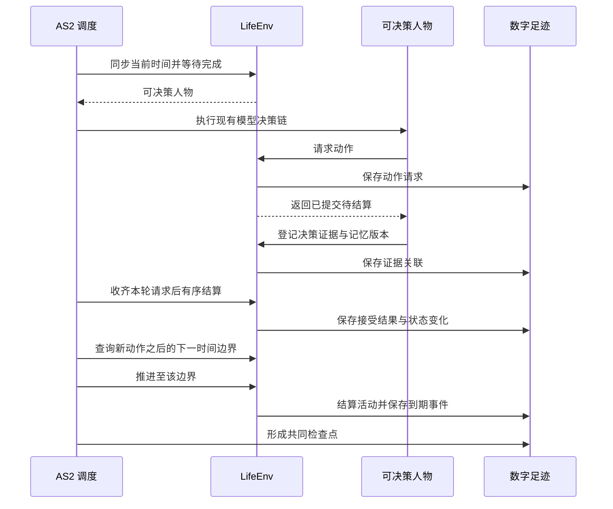

# 特性规格：LifeEnv 运行时行为与结算规则

> 状态：FROZEN——条款已裁决并冻结；「候选契约与呈现规则」章九行中八行已有代码层证据，
> 审查基线的地点侧 `location_kinds` 输入缺口由地图特性完整处理，最终通过状态以新规格的生产入口证据为准。
> 其余既有条款的历史代码层证据保留原身份；本次受影响行为须重新验收，不能沿用旧结论。真实 DeepSeek 完整实验仍待正式运行。
> 日期：2026-09-18
> 实施基线：`9b7fbc8`
> 范围：LifeEnv 的状态归属与生命周期、共享时钟与并发活动、消费生产与需求模型、语料准入与内容提供、场景与身体规则、观察投影与提示合同、候选契约与呈现规则、社交最小可行版

本文定义 LifeEnv 的状态归属、生命周期、工具和动作结果行为规则；资源、需求、活动结算、共享时钟、并发和加速算法；语料进入环境、内容目录、工作反馈、导航和配送的准入和结算行为；场景与身体规则、内容提供与消费生产之间的绑定算法。

类型、签名、枚举和结果字段见 `docs/CONTRACTS.md`。人物决策与画像条款见 `docs/dev/SPEC-life-realism.md`。
品类继承、有向三态配对、闭集金额计算、使用完成时的库存转换与运行内容身份由
[品类契约规格](SPEC-category-contract.md)统一定义；这些规则接入本规格已有的动作、活动与提交路径。

## 状态归属与生命周期

### 状态归属规则

| 状态类别 | 包含内容 | 谁可以改变 |
| --- | --- | --- |
| 世界 | 模拟时钟、地点、天气、内容目录版本、营业与工作日历、待发生事件 | 环境规则；管理员只能在运行前配置或开启新实验分支 |
| 人物身体 | 身体状态与需求状态、最近活动及必要生理模型状态 | 推进时间，并结算进食、睡眠与实际活动 |
| 人物资产 | 账户余额、持有商品、消耗品数量、已取得的使用权 | 交易与交付结算、物品使用与合同履约 |
| 人物活动 | 活动类型、开始时间、进度、下一次决策机会、占用资源、暂停与结束原因 | 人物提交动作申请，环境负责验证与执行 |
| 工作 | 任务、输入材料、截止时间、交付物、验收、合同及付款状态 | 任务来源、交付动作与独立验收环节 |
| 内容接触 | 可见目录、已读邮件、已播放片段、游戏状态及素材区间 | 实际接触动作与内容投递环节 |
| 记忆 | AS2 的人物记忆条目、记忆版本、来源事件与检索结果 | 人物记忆流程；环境不代写“人物应当喜欢什么” |

状态类别的字段面见 `docs/CONTRACTS.md`「LifeEnv 状态字段」章的「状态归属」节；本表只判定各类状态由谁改变。

**核心原则**：
- 身体状态与账户余额的准确数值只属于世界事实
- 人物实际收到的，是确定性规则换算出的体感分级，以及自然语言写成的场景段落
- 准确数值只进入数字足迹与评估；训练数据导出的信息范围裁剪见 `docs/design/05-recording-engine.md`「来源与可见性」

### 生命周期行为

引用 `docs/CONTRACTS.md`「LifeEnv 状态字段」章的「生命周期」节。

本规格在此只判定一条行为：`step` 在区间内处理连续变化与到期事件，并按「时间约定」核验本次推进的时间对账。

## 时间推进与并发活动

### 共享时钟



**时间推进规则**：
1. 先处理当前时刻已到期的通知或活动，再选出需要决策的人物
2. 人物完成本轮选择后，环境先结算本轮请求
3. 调度器再计算下一边界：活动完成、内容反馈、通知到达、工作截止、需要重新评估的身体变化、人物选择的等待结束或实验结束
4. 每次推进严格大于零；即时事件在当前边界按稳定序号处理，避免零时间循环
5. 本轮业务拒绝形成一秒反应边界：下一次决策机会在当前模拟时刻的下一秒提供，拒绝反馈只出现一次；不能无限占用同一时刻重新请求
6. 已接受瞬时动作同样安排下一秒反应边界
7. 场景明确 `max_consecutive_rejections=10`（取值见 `docs/EXPERIMENT.md`「场景参数」章的「活动节奏与拒绝边界」节）；达到连续业务拒绝上限时把该人物记为决策失败并终止运行，成功选择后计数重置，不自动替人物选择等待或其他动作

**时间约定**：
- 人物决策收到当前时刻
- 环境 `step(tick, t)` 收到本次结束时刻
- 时间对账：本次推进秒数必须恰好补齐上一确认时刻到本次结束时刻的间隔；接口表述见 `docs/CONTRACTS.md`「LifeEnv 状态字段」章的「生命周期」节
- 事件精度为秒；素材本身可保留更细的媒体时间，量化方式固定并记录
- 数据库的模拟时间采用 UTC epoch 秒，交付文件按合同编码为带时区的 ISO 8601；转换不改变时刻或排序

### 决策节律：结算边界与唤醒条件分离

**核心原则**：结算边界与决策机会分离。

`activity_feedback_seconds=900` 作为身体、进度与内容的结算粒度；每个结算边界产生 `activity_progress` 事件并结算资源。

**是否提供决策机会，只由唤醒条件决定**。

唤醒条件和原因闭集由模拟引擎维护。唤醒原因是冻结词表，成员不可增删：

```python
WakeReason = Literal[
    "planned_end", "felt_band_change", "message_arrival", "delivery_arrival",
    "task_available", "task_due_soon", "work_review_result", "commitment_threatened",
    "reconsideration_interval", "location_hours_change", "person_arrived", "person_left",
    "activity_infeasible", "rejection_feedback", "discovery_result", "wake_from_sleep", "run_start",
]
```

睡眠期间仍可提供决策的只有 `planned_end`、`wake_from_sleep` 与 `run_start`。存储层登记同源的 `WAKE_REASON_NAMES` 词表，与 `life.schedule.WakeReason` 由测试互锁防漂移。

记录引擎原样保存本次判定，字段与缺省语义见[决策节律增量字段](../design/05-recording-engine.md#决策节律增量字段)。下表把闭集成员对应到触发条件：

| 唤醒原因 | 触发条件 |
| --- | --- |
| `planned_end` | 当前活动到达人物提交的计划持续时间 |
| `felt_band_change` | 任一体感分级与上一次实际提供决策时的分级不同 |
| `message_arrival`、`delivery_arrival` | 新消息或配送到达本人 |
| `task_available`、`task_due_soon`、`work_review_result` | 新任务可见、任务截止前 30 分钟、工作验收结果返回 |
| `commitment_threatened` | 已有承诺进入任务截止或闭店预警，或当前活动不可行；同时保留具体原因，边界按当日目标规格 |
| `reconsideration_interval` | 距上次实际决策达到当前在手承诺对应的常规或空闲间隔 |
| `location_hours_change` | 有在手承诺时当前地点即将闭店（提前 15 分钟），或地点已开门；承诺口径见当日目标规格 |
| `person_arrived`、`person_left` | 同一地点的在场人物集合变化 |
| `activity_infeasible` | 能量或位置条件已不允许当前活动继续 |
| `discovery_result` | 发现门店结果已提交，下一秒进入合法决策轮并回灌比较事实 |
| `rejection_feedback`、`wake_from_sleep`、`run_start` | 沿用现有语义 |

**唤醒条件是判定规则，唤醒原因是本次命中的成员**：上表列出全部唤醒条件；某次结算边界实际命中的成员构成该次边界的唤醒原因。只有命中的边界才提供决策机会并记录这些原因。

**静默边界**：没有任何唤醒条件的边界
- 环境按人物已提交的计划续行
- 不调用模型
- 不产生 `decision_started`、`observation`、`model_request`、`memory_updated` 事件
- `activity_progress` 事件写入上述增量字段：本次边界未提供决策，唤醒原因为空
- 续行不是环境替人物选择：人物的选择是它提交的计划持续时间，静默边界只是不打断这一选择

**提供决策的边界**：
- 同一组增量字段记为提供决策，并记录实际命中的全部唤醒原因

**下一次决策机会**：下列各项的最小值
- 计划结束
- 体感分级预计跨越时刻（复用 `next_body_boundary_seconds` 预测）
- 已排定的通知与配送
- 任务截止与闭店的精确预警边界
- 当前在手承诺对应的重估间隔到期
- 地点营业变化

常规间隔 `reconsideration_interval_seconds` 默认 5400 秒；无在手承诺的空闲间隔
`idle_reconsideration_interval_seconds` 默认 10800 秒，不能短于常规间隔。
两者沿用场景配置；在手承诺闭集、切换和精确威胁候选见
[当日目标的决策节律](SPEC-day-plan-goals.md#事件驱动的决策节律)。睡眠继续仅接受睡眠允许的原因。

**验证**：游戏保持逐回合反馈；睡眠期只在计划结束或有唤醒事件到达时提供决策机会（见 `tests/life/test_wake_reasons.py` 的 `test_sleep_ignores_reconsideration_interval` 与 `tests/life/test_revision_contract.py` 的 `test_sleep_is_not_interrupted_by_reconsideration`）。

**依据**：Humanoid Agents 每十五分钟只在情绪非中性或某项需要偏低时才提示模型；Generative Agents 按计划执行，只在感知到需要反应的事件时重新规划；目标导向行动规划只在计划失效或更相关目标出现时重规划。重估间隔的取值依据人类注意的基本休息—活动周期约 90 分钟（Kleitman 的休息—活动周期）。

### 决策机会规则

观看、工作和睡眠由长期活动表示，不需要每秒运行模型。

**唤醒条件与重估间隔是模拟粒度**，应作为参数记录，不能声称未观察的间隔里发生了逐秒选择。

睡眠不会为每次时间推进自动写一条模型记忆；只有实际形成的观察和记忆进入人物流程。

**人物决策约束**：
- 同一人物的一次决策只提交一个需要生活时间的主要行动
- 一单购买可含多件商品、一餐可含多件持有食品，它们仍分别是一个购买或一个进食行动
- 记忆检索不改变世界
- 已接受后不能在同一时刻继续免费浏览、工作和进食
- 拒绝后的重新选择有有限决策预算，耗尽后记为人物决策失败

### 并发与占用

**注意力、身体位置和特定设备的占用**由活动规则明确表达。

**规则示例**：
- 驾驶与主动游戏不能同时占用全部注意力
- 是否允许吃饭时听节目需要在场景中明确，且满足时长与效果分配
- 不同人物可以并行活动，某人睡眠八小时不会让其他人物的八小时行动被跳过

**同轮竞争处理**：
1. 模型调用可并发
2. 共享物品、任务与余额的修改由环境 actor 串行提交
3. 同一模拟时刻出现竞争时，宿主在决策前为就绪人物生成并记录顺序，固定随机种子
4. 同轮观察以共同的世界版本为准
5. 人物提交的动作先进入待结算队列，全部决策正常结束后再按该顺序应用
6. 环境 actor 不等待尚未到达的早序请求而阻塞后续接收，因此保持现有单写入 actor
7. 该顺序只决定冲突处理，不选择人物动作
8. 任务提交与其他不可逆结算使用稳定动作标识防止重试重复记账
9. 任何必要人物决策异常时不结算该轮尚未执行的提案，原请求和失败证据保留，运行终止

**验证**：颠倒到达顺序不改变结算（见 `tests/life/test_engine_round.py` 的 `test_multi_person_arrival_order_does_not_change_settlement_order`）；种子变化改变竞争顺序且检查点可恢复（见 `tests/life/test_engine_feedback.py` 的 `test_seed_changes_competition_order_and_checkpoint_restores_it`）。

### 加速

**程序执行加速只减少现实等待**。

模拟中看二十分钟节目仍消耗二十分钟，其他人的邮件和送达事件照常发生。

**人物选的媒体倍速与程序加速分开记录**；跳过的内容不会进入其观察或记忆。

整体速度受模型调用、内容处理与写盘影响，必须通过实测给出加速比，不能预先保证。

### 运行观测

**只读状态视图**显示模拟时间、现实耗时、运行状态，以及每个人物当前活动、进度、最近动作结果和下一次决策机会。正常等待、模型调用中、正在写盘和故障停止分别显示，避免把「人物正在睡眠」与「框架没有响应」混为一谈。查看状态使用已确认事件与状态，不唤醒人物、不调用模型、不改变决策。

**质量报告**从同一份数字足迹统计完成、中断、拒绝、重复观看、内容接触时长、转换效率、记忆引用问题与模型成本。这些统计用于运行后评估；正式实验期间不根据报告暗中修改提示或替人物选择行动。

**验证**：见 `tests/footprints/test_status.py` 的 `test_status_reads_confirmed_state_without_modifying_any_run_file`。

## 身体语义：两过程睡眠、睡眠不足账、体感分级

引用 `docs/CONTRACTS.md`「LifeEnv 状态字段」章的「资源与需求字段」节。

### 两过程睡眠模型

**状态字段**：`sleep_pressure`（睡眠压力）、`sleep_deficit_hours`（睡眠不足账）

**算法**（Daan、Beersma 与 Borbély 1984；参数取 npj Biological Timing and Sleep 2025 综述标准值）：

```
清醒：S(t+dt) = 1 − (1 − S(t)) · exp(−dt / 18.2h)
睡眠：S(t+dt) = S(t) · exp(−dt / 4.2h)

入睡阈值 H(t) = 0.67 − 0.12 · cos(2π (t − t_min) / 24h)
醒来阈值 L(t) = 0.17 − 0.12 · cos(2π (t − t_min) / 24h)

困意 = (S − L(t)) / (H(t) − L(t))，截断到 [0, 1.2]
```

**参数**：
- `t_min` 为两条阈值的最低点时刻，取人物卡片的 `chronotype_midsleep`（自由日睡眠中点），默认 04:00
- 晚型人物中点每晚一小时，阈值曲线整体后移一小时
- 初始 `sleep_pressure` 由场景起点时刻按已睡时长反推，不假定零

**困意分级**：
- `< 0.5` 清醒
- `0.5–0.75` 有点乏
- `0.75–0.9` 困
- `0.9–1.0` 很困
- `≥ 1.0` 撑不住

**预期行为示例**：
按默认参数，07:00 起床的人物在 20:00 为“有点乏”、21:00 为“困”、22:00 为“很困”、约 22:45 起“撑不住”；睡眠中点 05:00 的晚型人物整体后移一小时。

### 睡眠不足账与效率曲线

**累积算法**：
```
清醒每小时累积：sleep_need_hours / (24 − sleep_need_hours)
睡眠每小时恢复：1 小时
下限：0
上限：24
```

**默认参数**：`sleep_need_hours=7.5`（来自人物卡片，允许 7–9 小时），清醒每小时累积约 0.45 小时睡眠不足。

**效率曲线**（输入为 `sleep_deficit_hours`）：

工作效率节点：`(0, 1.0)、(8, 1.0)、(16, 0.85)、(24, 0.65)`
食品利用效率节点：`(0, 0.90)、(8, 0.90)、(16, 0.85)、(24, 0.80)`

节点之间线性插值，两端取边界值。

**分工明确**：
- `sleep_pressure` 决定人物此刻困不困
- `sleep_deficit_hours` 决定连续缺觉对效率的累积影响

### 其他体感分级

**饥饿体感**：
```
appetite = clamp((appetite_anchor_kcal − energy_kcal) / (appetite_anchor_kcal − 400), 0, 1) 
          · (1 + 0.17 · cos(2π (t − 20h) / 24h)) + 餐时项
```

- `appetite_anchor_kcal` 默认 1200
- 由此 800 kcal 对应“饿”、400 kcal 对应“饿得难受”
- 昼夜项依据 Scheer、Morris 与 Shea 2013 的内源饥饿节律（08:00 低谷、20:00 峰值、峰谷差 17%）
- 餐时项在午餐、晚餐窗口内加 0.15，窗口外为零

**分级**：
- `< 0.15` 不饿
- `0.15–0.35` 有点想吃
- `0.35–0.6` 饿
- `0.6–0.85` 很饿
- `≥ 0.85` 饿得难受

**娱乐需要分级**：
- `< 0.3` 不闷
- `0.3–0.6` 有点想放松
- `≥ 0.6` 很想放松

**社交需要**（`social_need`，取零到一）：
- 清醒每小时增长 0.04
- 与在场人物交谈每小时减少 0.5
- 与联系人通话每小时减少 0.4
- 收到并阅读一条来自人物或联系人的消息减少 0.05
- 共同用餐每小时减少 0.3

**分级**：
- `< 0.3` 不想找人
- `0.3–0.6` 想和人说说话
- `≥ 0.6` 有点孤单

**情绪**（`mood_valence`，取 −1 到 1）：

按事件加脉冲并以半衰期衰减。

脉冲表：
- 工作验收通过 +0.3
- 被退回 −0.3
- 任务到期未交 −0.4
- 收到人物或联系人的消息 +0.1
- 连续两小时以上饿或困 −0.1/小时
- 当日目标首次由实际活动推进 +0.05；每条目标只发一次，按当日目标规格核验活动证据
- 业务拒绝 −0.05

半衰期：45 分钟 × `(1 + 0.3 · N_norm)`
脉冲幅度：× `(1 + 0.5 · N_norm)`
`N_norm` 为神经质归一到 [−1, 1] 的值

**分级**：
- `< −0.4` 很烦
- `−0.4 – −0.15` 有点烦
- `−0.15 – 0.15` 平静
- `0.15 – 0.4` 挺好
- `≥ 0.4` 很开心

**情绪只影响体感呈现与记忆重要度加权，不直接改变任何动作可行性。**

### 滞回规则

分级在每个结算边界重算，但只有与“上一次实际提供决策时的分级”不同才构成唤醒条件。

这以决策而非结算为参照，天然抑制在分级边界附近的抖动，不另设阈值参数。

### 数值与分级的分离

所有数值继续写入 `activity_progress` 与 `observation` 事件的 `body` 字段供评估与导出；**给模型的提示只含分级文本**。

身体状态与账户余额的准确数值只属于世界事实，但人物拿到的是体感分级，不是精确数值。

**验证**：见 `tests/life/test_sleep_two_process.py`、`test_felt_states.py`、`test_body.py`。

## 消费、生产与需求模型

### 资源表达

引用 `docs/CONTRACTS.md`「LifeEnv 状态字段」章的「资源与需求字段」节。

**表达原则**：
- 时间：UTC 整数秒及场景时区；同秒事件另有严格序号
- 金钱：币种与最小货币单位整数（避免浮点累计误差）
- 可用能量：kcal（实验中的可用能量状态，不等于人体全部储存热量）
- 睡眠不足：小时（与食品能量独立，进食不会直接消除）
- 娱乐需要：归一化状态与明确变化规则；随生活积累，实际娱乐可改变，需要考虑喜好、重复与时长
- 工作需要：截止时间、合同、任务与经济目标；从工作义务与人物经济处境产生，不设置固定「每小时必须工作」脚本

所有数值变化由明确规则计算。人物提示描述其处境与选项，允许拖延、过度娱乐、拒绝购买或再次观看。

**规则只限制物理、经济和任务可行性，不替人物优化人生。**

### 转换效率算法

建议采用简单可校准的函数与参数，避免通用规则语言或额外规则解释器。参数值属于实验假设，正式运行前冻结并通过场景校验。

**能量变化**：
```
能量变化 = 实际进食热量 × 食品利用效率(sleep_deficit_hours)
          − 基础消耗率 × 经过时间 − 活动额外消耗
```

**睡眠不足变化**：
```
睡眠不足变化 = 清醒期间累积 − 有效睡眠期间恢复
```

**娱乐需要变化**：
```
娱乐需要变化 = 内容自身每小时效果 × 人物偏好 ÷ 当前接触次数
```
首次与重复接触采用相同公式。

**有效工作量**：
```
有效工作量 = 技能对应的工作速率 × 工作效率(sleep_deficit_hours)
            × 已生效工具效果 × 实际投入时间
```
工作速率直接取任务所需技能对应的场景等级（冻结参数，取值只在 `docs/EXPERIMENT.md`「场景参数」章的「工作参数」节定义）；已实际使用 `work_notes` 后的产出倍率为 `body.work_notes_multiplier=1.10`。

**计件收入**：
```
计件收入 = 合同约定报酬，在交付验收和付款条件满足后结算
```

**计时收入**：
```
计时收入 = 合同费率 × 符合合同条件的实际工作时间
```

**效率曲线原则**：
- 基础模型可以用分段线性曲线描述效率
- 不能同时降低计时工资和工作效率来重复惩罚睡眠，除非合同明确这样约定
- 高收入通过职业、技能、机会与合同表现；不从人物初始财富反推能力
- 睡眠期间仍有基础能量消耗；饥饿和睡眠不足不能互相替代
- 睡眠与食品利用效率之间的关系是用户提出的仿真假设，必须单独配置、校准并在报告中标注，不宣称它已被生理学验证

**参数管理**：
- 规则参数集中在场景定义的身体与活动部分，包括基础能量消耗、活动额外消耗、清醒累积和睡眠恢复速度、效率曲线节点、工作速率、娱乐需要变化及阅读和游戏动作的时间映射
- 参数必须有单位、来源类型和有效范围
- 效率曲线的节点有序，结果有明确上下界
- 每次资源结算记录实际参数与持续时间
- 饥饿等衍生需求从当前资源及必要历史计算，不允许额外自由写入一份会与资源状态矛盾的数值

### 具体活动结算

| 活动 | 执行与结算 |
| --- | --- |
| 进食 | 必须已取得食品；实际消耗数量与进食进度相符；支付、取得食品和进食分别记录 |
| 工作 | 输入材料、投入时间、产出物和验收可追溯；失败、延期和返工保留 |
| 睡眠 | 持续恢复睡眠状态；按实际睡眠部分结算，中断后不直接恢复到满值 |
| 看节目 | 按实际播放区间提供内容；暂停不继续推进媒体；倍速改变媒体进度与注意力规则 |
| 游戏 | 游戏引擎执行动作；成功、失败和进度来自实际局面，不能由简介推断 |
| 购物 | 商品先落到库存，或进入配送队列等待送达；耐用品分账持有与使用，消耗品在使用后扣减 |
| 出行 | 按实际道路和方式计算时间、费用与消耗；改变当前位置及可访问内容 |
| 等待 | 可以由人物选择；世界其他事件照常发生，身体状态继续变化 |

**资金记录**：
- 工资与消费记录付款方和收款方
- 雇主、商家与人物账户之间的金额对应
- 实验初始资金和外部注入明确留痕
- 任务报酬受合同与雇主资源约束，不能通过重复提交同一交付物无限取得工资

**工作质量**：
- 由实际交付物评估
- 模型调用耗时不等于人物工作耗时
- 有效工作量控制任务进度，模型产出的文本还必须通过内容验收，不能用累计时间替代真实生产结果

**验证**：见 `tests/life/test_body.py`、`test_commerce.py`、`test_work_review.py`、`test_activities.py`。

## 语料进入环境与内容提供

### 数据进入环境的过程

语料从选定来源进入环境的数据流，以及离线整理这一选择本身的理由，见 `docs/ARCHITECTURE.md`「离线语料如何进入环境」。本节只保留本规格另定的准入规则：

- 素材不要求全部托管在 Hugging Face；地图与游戏引擎使用其成熟来源，统一来源关联即可
- 初版优先文本内容，记录为字幕、文本会议或文字游戏经历；实际没有输入画面时不标记为完整视觉观看

### 来源与准入

| 内容 | 首选来源 | 进入环境的方式 | 缺口与限制 |
| --- | --- | --- | --- |
| 食品 | Open Food Facts 产品库 | 食品目录、营养、份量与可消耗商品 | 份量和每百克标注需统一；缺字段不能随意补成事实 |
| 食价 | Open Prices | 带地点、日期、币种和单位的价格依据 | 不能直接当作当前中国外卖报价 |
| 电视节目 | LongTVQA+、TVQA | 节目目录、剧情片段、字幕与可用媒体 | LongTVQA+ 的字幕片段标记不是逐句时间轴；需核对原字幕或媒体时长 |
| 游戏目录 | Steam Games Dataset | 简介、类型、历史价格、选择依据 | 聚合游玩统计不能直接当作单次活动时长 |
| 游戏反馈 | Microsoft TextWorld | 游戏实例、玩家动作、局面、进度和输赢 | 初版代表文字游戏；游戏回合到生活时间的映射需明确 |
| 工作记录 | AMIsum、AMI-ME | 会议、议题、发言时间；整理纪要、提取待办等任务 | 需补充合同、截止时间和独立验收；不能代表全部职业 |
| 邮件 | Enron 邮件集 | 收件箱、线程、日程与工作请求 | 人物和时间需一致改写；部分原始版本不含附件 |
| 购物 | Amazon Reviews 2023 | 商品描述、属性、评论、历史价格与选择 | 库存、使用效果、配送和耐用性需场景规则；评论不是人物已发生的体验 |
| 导航 | OpenStreetMap 与 OSRM；高德路径规划为备选来源 | 道路路径、距离、方式和预计耗时 | 静态速度不等于实时拥堵；道路不可达必须如实返回 |
| 出行与生活校验 | GeoLife、ATUS | 出行形态和时间使用的外部参照 | 样本人群、地区和年代有限，不能直接推断目标人口行为 |

内容取得不足、格式错误或哈希错误必须明确失败，不能更换来源、放宽必需字段或用模型补成来源事实。冻结清单的构成与运行前的核验门槛见 `docs/EXPERIMENT.md`「内容与语料绑定」；清单未通过全量核验时拒绝启动。

### 内容目录契约

引用 `docs/CONTRACTS.md`「语料内容目录字段」章。

**各类别有独立属性 Schema，公共字段含义保持一致**，不做任意万能字段映射平台。

**来源标记原则**：
- 模型生成的补充属性标记为合成
- 没有证据的价格、营养、路况与时长不能无标记混入来源字段
- 原始素材文件按哈希复用；多个访问事件各有自己的标识和接触区间

### 内容提供行为

**工作材料与邮件反馈**：
- 人物收到的任务具备输入材料、交付要求、可用工具、截止时间、合同及验收条件
- 实际输出纪要、回复或其他成果存成素材，验收结果单独记录
- 来源数据的参考摘要用于检查，不提前提供；人物完成与否由交付和验收判定
- 工作说明与交付格式先可见，正文随实际工作进度揭示
- 观察不能免费取得未接触的完整转写
- 纪要包含摘要、决定与行动项
- 来源文件的原始会议标识仍保留为语料元数据

**工作提交**：
- 只用公开的 `task_id` 绑定合同、来源材料和验收
- 不要求人物再次填写来源内部的 `meeting_id`
- 不要求人物生成另一个全局唯一的 `submission_id`
- 宿主动作身份记录每次提交，已付款任务集合防止重复付款

**工作验收**：
使用独立 DeepSeek 调用，结合完整来源、隐藏参考与实际交付判断事实支持、必需内容覆盖和矛盾，接受同义改写。字符相等、词面相似度或工作时间均不能单独代替语义验收。

**验收协议**：
- 请求、原始响应、用量、模型身份和校验结果保存为证据
- 模型返回逐项判断，代码决定最终接受与付款
- 验收模型的传输或结构错误终止运行，内容不合格作为可返工的业务结果
- 没有自动重试或替代验收

**反馈内容**：
- 接受与拒绝均向人物返回已留证评审的公开反馈
- 必需事实的覆盖统计，以及缺失内容和交付字段的具体改进依据
- 事后反馈可包含已接触来源的摘录与评审理由，区分覆盖不足、不受来源支持和矛盾
- 不直接返回隐藏参考答案对象、内部参考身份、私有路径和哈希

**历史邮件处理**：
若人物改变历史邮件的情节，不能继续把历史后续回复当作对新邮件的真实反应。新的同事反馈来自其他模拟人物或明确环境规则，保留其生成来源。

**验证**：见 `tests/life/test_work_review.py`、`test_work_review_protocol.py`、`test_work_contracts.py`。

### 导航与配送

**路线计算**：
- 经纬度只能直接给出球面距离
- 驾驶耗时使用道路路由与对应速度信息
- 可沿实际路线和模拟时间生成定位轨迹，同时保存路线与采样规则
- 定位采样不是人物的一次决策

**路线成本**：
- 路线总耗时应包含路由引擎计算的转弯等成本
- 不只累加可能缺少这些成本的片段字段

**配送时间**：
- 预计配送时间由商家准备、排队、道路运输和交付过程组成
- 预计到达时间与实际到达事件分开保存
- 不能为所有订单使用同一个固定时长
- 没有准备时间数据时采用明确标记的场景参数或分布，并记录随机抽样
- 人物只看到当时的报价或预计时间，不提前看到隐藏的实际到达安排

**交通数据**：
- 必须对应模拟日期和时段
- 当前路况不能冒充任意模拟日期的路况
- 初次穿刺可明确限定为静态交通场景

**验证**：见 `tests/life/test_travel_time.py`、`test_travel_cost.py`、`test_travel_trajectory.py`、`test_commerce.py`。

## 场景与身体规则

### 身体参数与单位

场景校验强制每项身体与活动参数带单位、来源类型与取值区间；初始取值按实验假设处理，此后只随时间与动作规则变化。不能把「为了更像人」的运行后指标反馈成秘密行动脚本。

**正式身体参数**：
- 体重 65 kg
- 初始能量 1600 kcal、上限 2400 kcal
- 初始睡眠不足零小时
- 基础消耗每小时 65 kcal
- 额外活动消耗按已声明的代谢当量扣除基础部分后计算

**能量精度**：
- 受理与结算共用完整能量成本函数
- 分段结算使用浮点数
- 耗能后的负数仅在距零不超过 `1e-9 kcal` 这一固定数值精度内归零
- 更大的负值对非恢复活动仍报错
- 该精度只处理累计舍入，不放宽启动、路线或恢复的能量可行性比较

**效率曲线**：
- 工作效率曲线节点为 `(0, 1.0)、(8, 1.0)、(16, 0.85)、(24, 0.65)`
- 食品利用效率节点为 `(0, 0.90)、(8, 0.90)、(16, 0.85)、(24, 0.80)`
- 输入均为 `sleep_deficit_hours`
- 节点之间线性插值，两端取边界值

**睡眠参数**：
- 两过程模型按前述算法
- `sleep_need_hours` 默认 7.5，允许 7–9 小时
- 睡眠不足账清醒每小时累积约 0.45、睡眠每小时恢复 1

**娱乐与社交**：
- 娱乐需要取零到一，清醒每小时增长 0.08，实际娱乐时按内容自身每小时效果、人物偏好与当前接触次数减少
- 社交需要取零到一，清醒每小时增长 0.04，交谈、通话、收到并阅读消息与共同用餐按前述规则减少
- 重复接触的次数与效果都落在数字足迹里

**所有系数作为实验假设记录；真实人类生理有效性不是既得结论。**

### 活动组合政策

**正式场景活动组合**：
- 禁止驾驶与主动游戏并发
- 允许后台配送与消息继续推进
- 主活动同时占用的资源由明确集合判定
- 正式与多人验证场景均冻结为同一人物的前台主活动互斥
- 进食与观看也不同时执行
- 配送与消息属于独立后台过程

**活动控制**：
- 人物观察同时提供当前活动及本人暂停活动
- 已完成、取消、失败和截断活动不进入可控制集合
- 活动使用明确的注意力、位置、设备占用
- 场景中声明是否允许搭配
- 不允许的组合作为业务拒绝，不能自动退出旧活动或自动挑选替代行动

### 结算间隔与续行

**普通清醒活动的结算间隔**：场景 `activity_feedback_seconds=900` 秒冻结

到达结算边界时活动仍连续存在。

**是否提供决策机会**：由唤醒条件决定
- 无唤醒条件时环境按人物计划续行并留痕
- 有唤醒条件时人物根据实际进度选择继续、暂停或退出
- 继续请求不能造成零时间循环或把同一区间重复计入产出

生活活动的目录声明 `feedback_boundary=true`，沿用同一反馈、暂停、继续与恢复路径。
暂停后可以选择真实出行；恢复前必须按新位置重新验证原活动的环境要求，失败保留暂停进度。
地点恢复门必须由真实“启动—暂停—换地点—恢复”的生产入口测试证明，不能只调用辅助校验函数。

**游戏与睡眠**：
- 游戏沿用明确的回合反馈边界
- 睡眠期只在计划结束或有唤醒事件到达时提供决策机会

**活动进度的结算口径**：
- 身体与活动进度按实际推进区间结算
- 暂停不计算活动产出
- 退出保留已完成部分
- 实验结束保留截断标识

### 资金与合同

币种、账户初始余额、合同实例金额与工作机会时长、交通服务账户和路线实例由 `docs/EXPERIMENT.md`「场景参数」章说明。
品类费率、计酬槽位与算法统一由 `catalog/exchange-rules.json` 的闭集规则定义，行为归[品类契约规格](SPEC-category-contract.md)。
本节判定资金结算行为：

- 计时与计件两类合同都按实际合格产出结算，交付通过验收是付款条件
- 重复任务付款由稳定任务标识防止，已付款任务的集合不得重复放款
- 资金注入及所有双方转账必须可对账：每一笔金额变化都能追到付款方与收款方
- 交通服务的启程请求按当时可见报价一次预付，取消不退
- 余额不足时拒绝整个启程请求，不部分受理
- 同一动作幂等重放不得重复扣款

**验证**：见 `tests/footprints/test_ledger.py`、`tests/life/test_work_contracts.py`。

## 观察投影与提示合同

### 观察投影三部分

给模型的 user 消息由 `persona_card`、`scene`、`facts` 三部分组成，全部由确定性代码渲染，不调用模型。

三部分的字段清单与上限只在 `docs/CONTRACTS.md`「观察投影字段」定义：字段面见「场景段落与事实清单」，汉字与字符上限见「可见期与提示预算」。人物卡片的字段与编译规则见 `docs/dev/SPEC-life-realism.md`「画像编译」。

`scene` 是中文自然语言场景段落，`facts` 是工具需要的精简事实清单；本规格只判定投影的三段划分与不得进入提示的内容，段内字段的取值与上限以 `docs/CONTRACTS.md`「观察投影字段」为准。

### 不进入提示的字段

不得进入提示的字面键清单见 `docs/CONTRACTS.md`「禁止进入提示的字段」。

两条由本规格判定的行为边界：`game_catalog` 只在人物在家且询问娱乐时以名称列表出现，不整表下发；能量可行性上限继续约束工具 Schema，只出现在工具参数描述中。

### 观察投影行为规则

**观察不得重复序列化**：一次决策的输入里，同一条观察不得被序列化两遍。观察记录的写入形态以 `docs/design/05-recording-engine.md`「数字足迹事件结构」章的「事件字段」节为准，AS2 侧把该形态落到代码的改动见 `docs/dev/SPEC-as2-integration.md`「观察记录单写」。

**门店供给可见期**：实际呈现的购买候选按 `supply_id` 分别记录可见身份、浏览时刻与浏览地点；距该供给实际呈现超过 1800 秒或离开呈现地点后失效，配送发现仍按其可见凭据和履约条件判定。不得把全商品目录设为可见，也不能让同商品另一门店继承凭据。已持有商品的使用可见性仍按当前地点库存。字段合同见 [地图与门店供给合同](../CONTRACTS.md#地图与门店供给合同)。

**工作材料增量**：只揭示自上次决策以来新读到的区间，单次至多 2000 字符；完整材料进度仍由结算记录。

**字幕与内容片段**：只交付本次结算新跨过的区间；横跨边界的同一条字幕不重复交付。

**动作结果回灌**：`recent_action_results` 保留上次观察后全部公开结算结果、状态与错误原因，
工作验收使用已有公开反馈，不含完整活动快照和内部参考。具体边界见
[决策上下文规格](SPEC-decision-context.md#登记确认与结算结果)，字段见接口合同。

场景展示最近三条收件头并提示未展示的未读消息，事实清单保留完整可见收件箱。
可达地点在场景只保留名称与营业状态；路线分钟数保留在事实清单和工具支持行。
暂停活动以自然中文描述且与未完成工作合同分开。行为与验收见
[场景信息](SPEC-decision-context.md#场景信息)；不得为去重让自述阶段失去可理解的处境。

### 交互菜单的运行边界

每次生活观察的事件级工具支持数据包含按人物权威位置计算的有效交互菜单。该菜单随观察冻结，
不进入 `scene`、`facts` 或人物 user 消息；实际模型 Schema、本地决策校验和宿主派发共用这份冻结值。
地点变化不改写本轮观察，只在下一次观察重新计算。声明形状、交集、保护项和工具参数收窄规则见
[交互菜单规格](SPEC-interaction-menu.md)。

环境受理时按权威场景、人物位置和当前状态重验菜单。禁止的工具、活动类型、下钻品类或恢复请求在
领域副作用前以 `INTERACTION_MENU_DENIED` 拒绝，并沿用现有业务拒绝计数、一秒反馈边界、结果回灌
和幂等规则。工作工具被禁时不得进入独立评审。已开始活动的继续、暂停、取消、调速和游戏指令保留
原控制规则，恢复仍须满足当前菜单与既有能量、归属和身份检查。

菜单只控制入口和启动资格，不改变 `affordance_contract`、候选生成、世界事实排除、排除原因计数、
呈现上限、游标或轮转。候选与呈现仍完整执行本规格的统一合同；菜单不为关闭的入口伪造候选排除原因。

### 系统提示与身份前言

**系统提示以身份为主**：恢复 AS2 人物提示的身份前言语义（“你不是 AI 助手，你是一个有自己性格、需要与处境的人”），按词数计人物与情境部分不少于 50%；工具协议、引用规则与阶段规则移入各工具的 `description`；回合预算只在剩余回合不多于两个时以一句话出现。

提示中不得出现「评审」「评分」「引擎期望」等把人物置于被评价位置的措辞。地点处境可以由场景描述
表达；地点允许的行动由显式交互菜单控制，工具描述不得固定写入办公室娱乐偏好或其他人物策略。

### 字符预算

**单次决策限制**：
- user 消息不超过 40000 字符
- system 消息不超过 3000 字符
- 超限是运行故障，不截断、不删字段

**正式运行目标**：
- `quality.json` 报告每次决策的提示词 token 分布
- 中位数目标为不超过 15000 token
- 该目标只报告不放行

**语言**：提示与场景文本使用场景 `language=zh-CN`

**验证**：见 `tests/life/test_narration.py`、`tests/life/test_revision_contract.py`、`tests/integration/test_life_agent_protocol.py`。

## 候选契约与呈现规则

本节判定「人物此刻能碰到哪些对象、按什么顺序碰到、一次能看到多少条」。对象层（冻结目录与场景声明的对象）本身在本节之外；字段名、枚举值、返回体结构与场景常量名只在 `docs/CONTRACTS.md`「候选与呈现合同」定义，本节只写行为规则。

**依据**：`.work/object-model-reanalysis/REPORT.md` 第二章「主干：从『三条链路』改成『一个生成器 + 一个资格级联 + 一个排序器』」「三个获取来源 → 保留三分，但统一到一个生成器」「prompt 里那一节『可交换 object』 → 保留，但分三级、且不放 scene」「画像 preference list，≤1k → 降级为两级上限」「分层下推 → 保留，但层数是『约束传播的层』，不是 UI 分页」；地点部分依据同目录 `LOCATION-GRANULARITY.md` 的「一句话结论」与「推荐」。

### 统一候选契约：生成、资格、排序三段

**判定规则**：购买供给与持有商品、生活活动、内容、游戏和任务都走同一套三段式，任何一类不得另起一条独立链路。

| 段 | 输入 | 输出 |
| --- | --- | --- |
| 生成 | 在场对象 ∪ 浏览时效内的对象 ∪ 随身持有对象 ∪ 画像激活集对象 | 未收窄的候选全集，附带每个来源的命中计数 |
| 资格 | 营业时段、库存、地点要求、资源占用、启用集 | 保留项 + 被排除项及其稳定原因码 |
| 排序 | 画像口味 × 注意力先验 | 有序候选，每项带完整稳定排序键 |

**读到什么算通过**：同一个人物、同一世界状态版本、同一场景，两次取候选得到逐字节相同的序列，且五个品类的返回体形状一致（同一组顶层键）。

**读到什么算失败**：某一品类缺少资格段的排除计数，或某一品类走了不经过生成段的枚举路径（例如直接从全表扫描出发再按条件筛）。

**候选是派生量，不是状态**：候选集的身份只由（冻结目录摘要、画像摘要、世界状态版本、选择器版本）四项决定。时间戳、缓存内容、模型输出都不得进入这个函数。分桶与游标的哈希一律用 `hashlib`，不得用内建 `hash()`。

**读到什么算通过**：同一 `(冻结目录, 画像, 世界状态版本, 选择器版本)` 在父运行与从该状态分支出的运行里得到同一候选集。

**读到什么算失败**：候选顺序或成员在两次同输入调用间变化；候选依赖运行墙钟时间或上一次模型输出。

### 两条排除纪律

**只有世界事实可以排除。** 可排除的是地点或访问不可用（人不在、营业关闭或未知、地点类交集为空、资格不足）、供给无有效报价、库存为零或已下架，以及身体与资源条件不允许（能量不足、资源占用冲突、时长越界）。每一类排除携带一个稳定原因码，原因码的闭集只在 `docs/CONTRACTS.md`「候选与呈现合同」定义。

**软偏好只允许改序，不允许出局。** 画像口味、注意力先验、画像激活集只参与排序键，不得作为候选的入选条件。**修订既有实现**：`compute_taste_weights` 给出权重零的条目必须仍然进入候选并按最低档排序，`motivation` 里以 `attention_prior × preference > 0` 作为入场条件的写法作废（依据：`REPORT.md`「被裁掉的对象怎么办：裁剪不可保证，但必须可审计、可区分、可逆」的「当前实现已经踩了第三类」与 `REPORT.md`「现状与 elevate 后模型的 gap」的「画像偏好被当成排除条件（软偏好硬用）」）。

**「没显示」与「不存在」必须可区分**：被排除的对象以「带原因码的排除项」出现在观察与事件证据里，不能从返回体里静默消失。人物看到的表述是「这里有三十样东西你现在拿不到（原因：`ELIGIBILITY_LOCATION_ABSENT`）」，不是「世界就是这样」。

**`ROTATION_DEFERRED` 也是排除项**：该原因码是闭集成员，带它的对象计入排除项计数，与其余排除项同样满足「排除项计数加保留项计数等于候选全集规模」。它与其余排除项的差别只在生效范围——**只影响本次呈现**，不改变对象状态、不写目录、不产生下架事件，因此不得把它当作保留项或不计入排除计数。

**读到什么算通过**：画像未声明过的题材，其条目仍出现在候选集里且排序低于已声明题材的条目；每个被排除项（含带 `ROTATION_DEFERRED` 的项）都能取到一个闭集内的原因码；排除项的计数加保留项的计数等于候选全集的规模。

**读到什么算失败**：任何一条不出现在候选里的条目既没有原因码、也不在任何排除计数里；口味权重为零的条目在候选枚举阶段就不生成。

### 两级上限

**池上限与单次呈现上限分开，二者不得合并成一个数。**

- **检索分区池上限**：人物在某分区内「理论可互动」的对象总数上限，只用于计数与下推，不直接进提示。
- **单次呈现上限**：一次决策放进提示的条数上限，是场景层常量，默认 20 条。

**读到什么算通过**：观察投影的条数不超过场景声明的单次呈现上限；池上限的取值同时出现在 `browse_activities` 返回的 `total` 里，而不是被当成呈现上限把返回体裁短。

**读到什么算失败**：提示里出现的候选条数超过单次呈现上限；或把池上限当成提示条数上限，导致某一次呈现直接塞进池上限条。

**修订既有实现**：动机层内部的候选截断（`MAX_CANDIDATES`，26）不作用于呈现，不得把它的取值当作单次呈现上限；两者是不同的量，前者只是内部仪表。

### 下推：两层、游标、返回体

**层数限两层**，即品类 → 条目。层的语义是约束传播（上一层选定的品类收窄下一层的可行集合），不是界面分页。

**分页用游标，不用页码**。游标是上一页最后一条的完整稳定排序键；页码与偏移不稳定，目录变动时会重漏。

**返回体必须含三件事**：本次返回条数、总数、下一页游标；最后一页的游标为空。返回体的字段名与结构见 `docs/CONTRACTS.md`「候选与呈现合同」。

**游标只能由（冻结目录、世界状态版本、排序键版本、游标）决定**，不得包含模型输出、会话状态或墙钟时间。

**读到什么算通过**：以空游标起、反复带上一页游标下推，得到的序列是一次全量有序候选的无重、无漏子序列；同一游标在同一世界状态版本下重复请求返回同一段。

**读到什么算失败**：下推出现第三层；返回体缺少总数或下一页游标；两次下推之间目录未变而结果出现重复或遗漏。

### 曝光轮转

**轮转的判据是「上次呈现时刻」**（字段名 `last_presented_at`），不是互动次数，也不是任何偏好估计量。合同禁止把互动次数当作「受欢迎程度」使用。

**轮转非破坏性**：只改呈现顺序与换新名额，不改目录、不改对象状态、不产生下架事件。每次呈现按场景声明的换新比例留出固定换新名额给「长期未呈现」的对象，其余条数按排序键给出。

**最大未呈现间隔必须有界**：给定分区池规模 `N` 与每次呈现的换新名额 `k`，单对象最坏等待间隔的闭式上界为 `⌈N ÷ k⌉ ÷ D`，其中 `D` 为该分区的每天决策点数。验收断言必须用这个精确形式，不得用它的连续松弛 `N ÷ (k × D)`。`N` 与 `k` 的取值来源见 `docs/CONTRACTS.md`「候选与呈现合同」；`D` 的取值按章引用 `docs/EXPERIMENT.md`「场景参数」章的「决策点节奏」节，取该节记录的实测区间而非单一估计值，本规格不复述数值。

**轮转的单位是检索分区，不是整个语料池**：分区越细，单池越小（等待变短），但每个分区的可达率也越低（等待变长），两者互相抵消，因此分区不能无限细。

**读到什么算通过**：连续 `⌈N ÷ k⌉` 次呈现之后，分区内每个对象至少被呈现一次；轮转前后目录条目数、对象状态与事件序列中不出现任何下架事件。

**读到什么算失败**：轮转改变了目录或对象状态；换新名额被排序键挤占而长期未呈现的对象永远不出现；用互动次数（`exposure_count` 一类计数）作为轮转判据；把带 `ROTATION_DEFERRED` 的对象当作保留项而不计入排除项计数。

**轮转状态**：判据所需的上次呈现时刻是派生量，写入方式与字段面见 `docs/CONTRACTS.md`「候选与呈现合同」；它是纯时刻或计数，不含任何偏好推断。

### 禁止永久退役

**禁止按互动统计永久移除对象。** 任何以互动次数、被选择次数或「受欢迎程度」为判据把对象移出对象层的机制都不得实现，因为十二周窗口内的样本量（内容品类最大约 90 条、平均每条约一至两次曝光）支撑不了「谁更受欢迎」的判断，且永久移除意味着一次错判无法挽回（依据：`REPORT.md`「按互动统计淘汰尾部 x% → 拆成『永久退役』与『曝光轮转』，只有前者该被否」）。

**目录条目的退役只允许走墓碑语义**：保留可读、拒绝新场景引用。退役不删除条目，也不改变既有足迹的解释。

**读到什么算通过**：轮转、候选裁剪与淘汰统计都不改动对象层的条目数量；对象层条目数的变化只由目录版本变更产生。

**读到什么算失败**：任何运行期通路按互动统计把条目从对象层移出；「没被选中」被写成「下架」事件。

### 地点语义与检索分区

**地点是可行性门，条目属性是检索分区键，两件事必须分开。**

- **可行性门**回答「此刻此地能不能做」：地点声明「我满足哪些地点类」，条目声明「我需要哪些地点类」，交集非空即可行；只有活动侧 `anywhere` 表示无地点限制，地点必须声明实际环境，不能含 `anywhere`。地点词表取生活活动地点类的单一封闭集，各处对齐后运行期强制（现行词表的对齐要求与语境见 `LOCATION-GRANULARITY.md`「核实现状」与 `docs/dev/SPEC-life-realism.md`「世界素材品类要求」；字段与闭集见 `docs/CONTRACTS.md`「候选与呈现合同」）。
- **检索分区键**回答「从哪个池里选」，取条目属性（题材、语言、时长段），不取地点。地点粒度不足以当分区键：一个人的生活里场所类别是十的量级，纯地点方案的分区数上限约 24 个，与十万级池所需的千级分区差两个数量级。

`required_location_id` 与地点类判定并列：前者指定具体地点实例，后者指定地点类别，取交集即可行。

**读到什么算通过**：在办公室启动影片观看被拒且原因码为地点不可行（不是资源冲突）；在声明可行性的地点启动同一条目被受理；声明 `anywhere` 的条目在全部地点均可受理；地点类词表在各处逐值一致。

**读到什么算失败**：地点只作展示而不参与可行性判定；或把地点当作检索分区键，使分区数被地点取值数封顶。

### 检索：确定性索引与 facet

**索引必须确定性**：倒排索引（标签 → 对象标识）与 facet 计数都是纯文本、可 diff、可进溯源的结构。

**禁止向量检索与近似最近邻**。内容检索不得依赖随机初始化或不稳定距离比较；稀疏词项检索可枚举、可审查。地点发现使用冻结道路结果与稳定身份排序；空间粗筛不能代替道路可达性，不能把直线距离写作道路分钟。

**反塌缩保证**：任一对象必须在有限次查询组合下存在至少一条到达路径。这是静态可检查的性质，**不是覆盖率承诺**——不得把它读成「每个对象都会被曝光」。

**触发条件**：单一品类池规模超过场景声明的阈值时才建立倒排与 facet；未超过时按品类下推，但查询入口与分区键现在就固定，避免池变大时推倒重来。

**读到什么算通过**：同一查询在同一（冻结目录、世界状态版本）下返回同一有序结果；静态可达性检查对任意对象都给出至少一条路径。

**读到什么算失败**：内容索引依赖浮点距离或随机初始化；查询结果依赖进程内缓存或哈希种子；地点发现用直线距离替代道路可达时间。

### 随身持有与远程订购

**随身持有的语义是「在当前位置的手边」**，按地点嵌套：持有物只在其所在地点可见，出门后不在手边。不引入随身背包，也不新增「带出门」动作。结算仍按当前位置的持有数量判定。

**读到什么算通过**：在家取得的面包，人物到达办公室后不在其候选与持有物投影里。

**读到什么算失败**：出现跨地点可见的持有集合；或新增一件表示随身背包的世界状态。

**远程订购复用既有交付语义**，不新增渠道对象。远程提交的履约方式不受在场约束：取货必须在商家地点，配送不校验在场；这一点必须在对应工具的 `description` 里点明（依据：`REPORT.md`「三个获取来源 → 保留三分，但统一到一个生成器」的手机远程行为一条）。

**读到什么算通过**：以配送方式提交的购买请求在人物不在商家地点时被受理；以取货方式提交的同一请求在人物不在商家地点时被拒，且原因码为地点不可行。

## 地图与门店供给行为

本次要求按 [地图与门店供给开发规格](SPEC-map-and-storefront.md) 完整实现并验收地图、地点发现与交易；下文是行为合同，不是通过记录。
场景选择固定地图中的地点；活动环境必填且非空，候选、启动和恢复使用同一显式声明，缺失不得放行。
活动侧 `anywhere` 表示无地点限制，地点侧不能声明 `anywhere`。生活活动使用目录已启用的反馈边界，
实际暂停后跨地点恢复仍须重验环境；不能保留永远无法进入的恢复分支。
交互菜单继续使用解析地点的 `kind`，与经营业态和活动环境分别判断。


营业支持分段、跨午夜和日期例外，全部读取方共享 `open/closed/unknown` 解释；边界按事件推进。
供给报价和库存是持久化世界事实，调价与补货不能修改商品定义，恢复不能回到初始价。
购买继续验证品类配对，当前供给报价与数量经统一 `purchase_amount` 求得实际付款；
一份的比较金额、余额判断和动机价格排序共用该入口，多份订单按整行乘积取整而非乘已取整单价。
订单一至五个不同供给，必须同地点同卖方；先完整校验再一次结算。到店自提和配送分开验证，
同单配送等待最迟备货时刻，交付前不增加人物库存，重复交付不重复增加。
实际返回的供给才产生可见凭据；购买候选保留商品类型，但身份、轮转、游标和排除统计按供给区分。
本特性的逐条证据须在最终验收后登记，不沿用历史商品库存测试数字宣称通过。

## 社交最小可行版

社交落在 `LifeEnv` 内部：直接复用既有的消息通道与事件类型；不装配 AS2 的 `SimpleSocialSpace`。

社交的接口面只在 `docs/CONTRACTS.md` 定义：工具签名见「人物工具与管理接口」，联系人投影字段见「场景段落与事实清单」，亲密度与渠道刻度见「人格与卡片字段」；回复策略闭集、消息与回复的汉字上限、交谈与通话的结算费率同属接口面，只在 `docs/CONTRACTS.md`「社交接口」章定义，落点在该章的「场景联系人」「消息与收件箱」「交谈与通话」「联系人回复」与「社交拒绝错误码」各节。本节只写行为规则。

| 能力 | 行为规则 |
| --- | --- |
| 在场可见 | 观察列出同一地点的其他人物及其当前活动家族与可交谈状态；可交谈判定为对方清醒且不在主动游戏；在场人物集合变化构成唤醒条件 |
| 消息 | 发送是瞬时动作，只在决策阶段登记；收件方在下一次观察的收件箱里看到它，送达另记为一条环境事件（`message_arrival`）；收件人必须是同世界人物或场景联系人，否则整个请求被拒绝 |
| 交谈 | 必须双方同处一地且对方处于可交谈状态，否则拒绝；发起方把它作为前台活动结算，对方收到一条 `chat_invite` 消息；对方若在其下一次决策开始与发起方的交谈即为接受，接受时双方按同一速率缓解社交需要，被拒绝时只有发起方按较低速率缓解、对方为零 |
| 通话 | 面向场景联系人，占用注意力；时长取闭区间端点内的 10–60 分钟，超出区间即拒绝；按结算费率缓解社交需要 |
| 联系人 | 按人物在场景里声明，亲密度沿用画像关系的整数刻度，渠道限定可达的联系方式，回复策略取闭集 |
| 联系人回复 | 策略开启的联系人对每条收到的消息至多回复一次：模型回复由独立 DeepSeek 调用生成并保存完整请求响应；回复策略行为、幂等键、请求字段、落库标记与回复影响见 `docs/CONTRACTS.md`「社交接口」章的「联系人回复」节；回复只落到收件方的收件箱，不改动资源与任务状态 |

**隐私原则**：
- 其他人物在观察中只暴露姓名、活动家族与可交谈状态
- 不暴露其身体数值、余额、任务或记忆

**验证**：见 `tests/life/test_social.py`。

## 验收矩阵

下表给出本规格每条要求的观察、证据位置与状态。确定性测试已通过的记「代码层已验证」，依赖正式
模型运行或真实盲评的记「待真实运行」；已有合同尚未贯通正式输入的记「既有实现缺口」；本次新增行为
在最终源码身份尚未完成门禁时记「本次离线验收待执行」，不能提前写成通过。

| 要求 | 必须通过的观察 | 证据位置 | 状态 |
| --- | --- | --- | --- |
| 状态归属与生命周期 | 状态类别与修改权限符合 `docs/CONTRACTS.md`「LifeEnv 状态字段」章的「状态归属」节；生命周期各接口的签名与行为符合该章的「生命周期」节；已有运行可恢复；未初始化或缺少场景时接口失败关闭 | `tests/integration/test_env_lifecycle_coverage.py` | 代码层已验证 |
| 共享时钟 | 模型上下文时间与结算时间一致；错误时刻的上下文被拒绝；反馈边界严格向前且不释放占用 | `tests/life/test_engine_feedback.py`、`tests/life/test_engine_round.py` | 代码层已验证 |
| 决策节律 | 静默边界不产生决策事件；提供决策的边界记录全部实际唤醒原因；睡眠不被重估间隔打断；体感滞回以上一次实际决策为参照 | `tests/life/test_revision_contract.py`、`tests/life/test_wake_reasons.py` | 代码层已验证 |
| 业务拒绝节律 | 业务拒绝在下一秒提供一次反馈；第十次连续拒绝记为人物决策失败并停止运行 | `tests/life/test_engine_feedback.py` 的 `test_rejection_waits_one_second_and_next_observation_reports_once`、`test_tenth_consecutive_rejection_fails_agent_and_run` | 代码层已验证 |
| 并发与占用 | 颠倒到达顺序不改变结算顺序；种子变化改变竞争顺序且检查点可恢复；异常时不结算该轮未执行的提案 | `tests/life/test_engine_round.py`、`tests/life/test_engine_feedback.py` | 代码层已验证 |
| 运行观测 | 只读查询使用已确认状态且不修改任何运行文件 | `tests/footprints/test_status.py` | 代码层已验证 |
| 身体语义 | 两过程睡眠阈值与演化逐点符合公式；睡眠不足账与效率曲线的钳制与插值；饥饿、娱乐、社交需要的分级阈值 | `tests/life/test_sleep_two_process.py`、`tests/life/test_felt_states.py`、`tests/life/test_body.py` | 代码层已验证 |
| 资源结算 | 能量与娱乐分录分开结算；近零精度只在固定容差内归零，更大的负值对非恢复活动报错；精确总成本经多次反馈结算不变 | `tests/life/test_body.py` | 代码层已验证 |
| 具体活动结算 | 暂停、恢复与取消保留实际进度；完成与实验截断设置结束时刻；字幕只揭示实际播放区间 | `tests/life/test_activities.py`、`tests/life/test_content_game.py` | 代码层已验证 |
| 工作与验收 | 计时与计件合同按实际合格工时与冻结件数结算；过期、重复与无资金在语义付款前停止；评审协议纠正、耗尽与零重试 | `tests/life/test_work_contracts.py`、`tests/life/test_work_review.py`、`tests/life/test_work_review_protocol.py` | 代码层已验证 |
| 语料准入 | 场景目录逐条通过引用完整性、单位与守恒检查；正式清单逐文件校验与选定条数；AMI 输入与隐藏参考分离；TextWorld 使用真实重置与步进 | `tests/catalog/test_admission.py`、`tests/corpora/test_corpora.py` | 代码层已验证 |
| 导航与配送 | 路线报价一次预付且不可负担时不改动任何账户；walking 记录零车费不虚构付款；定位轨迹确定且不构成人物决策；交通时间因子随日期时段变化 | `tests/life/test_travel_cost.py`、`tests/life/test_travel_trajectory.py`、`tests/life/test_travel_time.py` | 代码层已验证 |
| 场景与身体规则 | 正式与多人场景校验通过；身体实例与拒绝范围强制；账户身份唯一，经营角色允许多个卖方账户；出行报价符合目录闭集规则；日历、账单与工资按规则结算 | `tests/life/test_scenario.py`、`tests/life/test_scheduling.py` | 代码层已验证 |
| 观察投影 | 黑名单字段不进入提示；门店供给可见期按实际呈现身份和地点判断，超过 1800 秒失效；工作材料单次至多 2000 字符；跨边界字幕不重复；场景不输出数字权重 | `tests/life/test_revision_contract.py`、`tests/life/test_narration.py`；新增逐供给断言见 `tests/life/test_storefront_discovery.py` | 既有与新增行为均通过[当前主线组合验收](research/map-and-storefront-main-verification.md) |
| 交互菜单 | 有效菜单随观察冻结；模型、本地与宿主使用同一资格；环境重验不可绕过；拒绝无领域副作用；候选、事实与排除统计不变 | [交互菜单验收记录](research/interaction-menu-verification.md)所列对应测试 | 独立特性及[当前主线组合](research/map-and-storefront-main-verification.md)均已通过 |
| 统一候选契约 | 五类对象的候选区分生成、资格与排序三段且返回体形状一致；同输入两次取候选逐字节相同；候选不依赖时间戳、缓存或模型输出 | `tests/life/test_candidates.py`、`tests/life/test_candidate_wiring.py` | 代码层已验证 |
| 两条排除纪律 | 画像未声明的题材其条目仍在候选内且排序靠后；每个被排除项带闭集内的原因码；保留项计数与排除项计数之和等于候选全集规模 | `tests/life/test_candidates.py`、`tests/life/test_candidate_wiring.py` | 代码层已验证 |
| 两级上限 | 单次呈现条数不超过场景声明的呈现上限；池上限只进 `total` 计数，不当作呈现上限截短返回体 | `tests/life/test_rotation.py`、`tests/life/test_candidate_wiring.py`、`tests/life/test_candidate_constants.py` | 代码层已验证 |
| 下推 | 层数不超过两层；以游标下推得到全量有序候选的无重无漏子序列；返回体含本次条数、总数与下一页游标 | `tests/life/test_candidate_wiring.py`、`tests/life/test_candidates.py` | 代码层已验证 |
| 曝光轮转 | 连续 `⌈N ÷ k⌉` 次呈现后分区内每个对象至少出现一次；轮转不改目录、不改对象状态、不产生下架事件；轮转判据是上次呈现时刻（`last_presented_at`）而非互动次数 | `tests/life/test_rotation.py`、`tests/life/test_candidate_wiring.py` | 代码层已验证 |
| 禁止永久退役 | 轮转、裁剪与淘汰统计都不改变对象层条目数；无运行期通路按互动统计移出条目 | `tests/life/test_rotation.py`、`tests/life/test_candidate_wiring.py` | 代码层已验证 |
| 地点语义与检索分区 | 地点类交集决定可行性且原因码可区分；`anywhere` 恒可行；地点类词表逐值一致；分区键取条目属性而非地点 | 显式地点集合的单元证据见 `tests/life/test_candidates.py`、`tests/life/test_activity_location_kinds.py`、`tests/life/test_retrieval.py`、`tests/catalog/test_reachability_admission.py`；正式地图声明与场景引用由地图特性重新验收 | 独立特性及[当前主线组合](research/map-and-storefront-main-verification.md)均已通过 |
| 检索与反塌缩 | 同一查询在同一（冻结目录、世界状态版本）下返回同一有序结果；静态可达性检查对任意对象给出至少一条到达路径；索引不含浮点距离或随机初始化 | `tests/life/test_retrieval.py`、`tests/catalog/test_reachability_admission.py` | 代码层已验证 |
| 随身持有与远程订购 | 持有物只在其所在地点可见；配送不受在场约束而取货受在场约束，两者的拒绝原因码可区分 | `tests/life/test_storefront_commerce.py` 的 `test_pickup_is_instant_and_never_needs_delivery_route` 与 `test_fulfillment_rejections_are_atomic`；`tests/life/test_commerce.py::test_consume_rejects_inventory_held_at_another_location` | 定向及[当前主线完整门禁](research/map-and-storefront-main-verification.md)均已通过 |
| 提示字符预算 | user 消息 40000 字符与 system 消息 3000 字符的边界通过；超限报错且不截断、不删字段 | `tests/life/test_narration.py` | 代码层已验证 |
| 社交 | 在场可见字段闭合且交谈要求清醒非游戏；消息汉字上限边界；交谈与通话费率与时长边界；联系人策略为闭集且回复至多一次 | `tests/life/test_social.py` | 代码层已验证 |
| 真实端点集成 | 真实 DeepSeek 端点与完整活动结算的集成测试通过 | 正式运行记录见 `docs/dev/implementation-status.md` | 待真实运行 |

「候选契约与呈现规则」历史基线的复判说明（保留当时证据，不描述地图特性整合后状态）：

- 该章九行中有八行具备代码层证据，每一行的证据位置见上表；地点语义一行的算法分支虽有显式
  地点集合的单元测试，正式输入仍未提供地点侧 `location_kinds`，所以不以单元测试替代端到端落地。
  八个测试文件在复判时刻的实跑结果为
  `165 passed`：`tests/life/test_candidates.py` 49 测、`tests/life/test_rotation.py` 20 测、
  `tests/life/test_candidate_constants.py` 32 测、`tests/life/test_candidate_wiring.py` 9 测、
  `tests/life/test_retrieval.py` 31 测、`tests/catalog/test_reachability_admission.py` 9 测、
  `tests/life/test_activity_location_kinds.py` 9 测、`tests/test_documentation_gate.py` 6 测。
- **「随身持有与远程订购」一行已记「代码层已验证」**：两个分句的测试证据如下——
  持有面确实按地点嵌套（`AgentState.inventory` 是 `dict[str, dict[str, float]]`，
  外层键即地点标识；写入见 `src/worldmock/life/basket.py` 的 `_add_inventory`，
  读取见 `src/worldmock/life/commerce.py` 的 `held_quantity`，两者都以 `agent.location_id` 取用），
  故「出门后不在手边」可实现且已断言；配送与取货的分野也已断言，取货不在场给
  `PICKUP_LOCATION_REQUIRED`、配送在同样条件下正常受理。
  **未落地的是**：`custom/agents/life_agent.py` 的 `purchase` 工具 `description`
  已按规格要求补入该句（本轮同步重钉工具面指纹）。
- **三个分句虽有测试文件为凭但缺专测，如实记在证据位置上而不单列**：
  「下推」一行的「层数不超过两层」分句只有返回体形状断言，没有层数上限本身的断言；
  「地点语义与检索分区」一行的「`anywhere` 恒可行」分句在 `src/worldmock/life/retrieval.py`
  与 `src/worldmock/life/activities.py` 两侧有专测
  （`tests/life/test_retrieval.py::test_feasible_kinds_follows_anywhere_and_intersection`、
  `tests/life/test_activity_location_kinds.py::test_anywhere_declaration_is_always_feasible`），
  但 `src/worldmock/life/candidates.py` 侧的地点侧 `anywhere` 分支无测试触发；
  「地点类词表逐值一致」分句只断言模块闭集与语料声明一致，未覆盖
  `src/worldmock/catalog/admission.py:669` 的 `LIFESTYLE_LOCATION_KINDS` 这一路重复声明。
- **与本矩阵无关但同属该章的独立缺陷（如实记录，未解决）**：`scripts/check_reachability.py --scenario`
  对正式场景实测退出码 1，报 `86 unreachable object(s)`，全部来自 `scenario:contents`，
  `missing=['genre','language']`，其中 80 条为 `game_session` 品类、6 条为 feed 与字幕类。
  不带 `--scenario` 时退出码 0（`all 7106 entries reachable across 101 partition(s)`）。
  这是场景内容条目自身缺分区键，与本矩阵的条款映射判定相互独立。

所有改动必须通过真实 DeepSeek 端点与完整活动结算的集成测试。

## 版本表

| 版本 | 日期 | 修订内容 |
| --- | --- | --- |
| 1 | 2026-09-18 | LifeEnv 运行时行为与结算规则从主设计单体拆分并冻结为本规格 |
| 2 | 2026-09-18 | 接口事实改为引用：社交字段与闭集、结算费率与工具签名归 `docs/CONTRACTS.md`，观察投影字段清单与汉字上限归 `docs/CONTRACTS.md`，语料数据流与离线整理理由归 `docs/ARCHITECTURE.md`；删除带占位符的伪代码块与重复数据流图；术语统一为「决策机会」，并写明唤醒条件与唤醒原因的区分 |
| 3 | 2026-09-18 | 决策节律增量字段改为引用：唤醒原因的字段名、冻结闭集与缺省语义归 `docs/design/05-recording-engine.md`「决策节律增量字段」节，状态类别的字段面归「状态归属」节，社交回复的请求字段与落库标记归「联系人回复」节；写入时机、静默边界留痕与睡眠期判定等行为规则仍在本规格 |
| 4 | 2026-09-18 | 生命周期行为节改为引用：接口签名、逐接口行为与验证口径归 `docs/CONTRACTS.md`「LifeEnv 状态字段」章的「生命周期」节，删除该表的整段复述，只留本规格判定的 `step` 区间处理行为 |
| 5 | 2026-09-18 | 清掉与 `docs/CONTRACTS.md` 逐字重合的残留复述：状态归属表的「谁可以改变」列、核心原则里数值与分级的表述、数值与分级分离节的口径、社交章的三条行为句，全部改写成本规格自己的措辞；验收矩阵的状态归属与生命周期观察项改为按章引用 `docs/CONTRACTS.md`「LifeEnv 状态字段」章的「状态归属」与「生命周期」两节；`step` 的时间对账恒等式表述保持不变 |
| 6 | 2026-09-18 | 清掉与其他文档逐字重合的复述，只留本规格判定的行为与算法：训练数据导出裁剪按章引用 `docs/design/05-recording-engine.md`「来源与可见性」；具体产品白名单、地点坐标与素材哈希的冻结及其运行前核验按章引用 `docs/EXPERIMENT.md`「内容与语料绑定」；币种、账户初始余额、合同金额与工作机会时长、交通服务账户与报价公式等冻结参数按章引用 `docs/EXPERIMENT.md`「场景参数」，本规格只保留资金结算行为；观察记录的单写形态改为引用 `docs/design/05-recording-engine.md`「数字足迹事件结构」章的「事件字段」节与 `docs/dev/SPEC-as2-integration.md`「观察记录单写」，并去掉变更叙述；睡眠期决策机会、购物结算、离线整理理由、身体参数校验、重复接触留痕、睡眠与食品利用效率的假设标注、验收矩阵引言、商品可见期观察项等本职条款保留原意并改写措辞 |
| 7 | 2026-09-18 | 时间对账不再复述接口原文：生命周期行为与「时间约定」两条改按本规格措辞描述同一条对账义务，接口表述按章引用 `docs/CONTRACTS.md`「LifeEnv 状态字段」章的「生命周期」节；连续业务拒绝上限与工作速率的取值按章引用 `docs/EXPERIMENT.md`「场景参数」章的「活动节奏与拒绝边界」与「工作参数」两节，两处行为措辞改写为不再与实验文档逐字重合 |
| 8 | 2026-09-19 | 新增「候选契约与呈现规则」章：统一候选契约三段式与派生量身份、两条排除纪律（只有世界事实可排除、软偏好只改序、被排除项带原因码）、两级上限（分区池上限与单次呈现上限分离，呈现上限默认 20）、两层下推与游标返回体、曝光轮转（判据为上次呈现时刻、非破坏性、最大未呈现间隔闭式上界 `⌈N ÷ k⌉ ÷ D`）、禁止永久退役与墓碑语义、地点语义与检索分区分离、确定性索引与 facet 并禁止向量检索与近似最近邻、随身持有的手边语义与远程订购复用交付语义；商品可见期条款就地修订为离开商家地点与 1800 秒两条并列，取代只按时间判定的旧口径；验收矩阵补入该章各项观察项 |
| 8（复判刷新） | 2026-09-19 | 该章落地后逐行复判验收矩阵：九行中八行由「待实现」改记「代码层已验证」并填入证据位置（`tests/life/test_candidates.py`、`test_rotation.py`、`test_candidate_constants.py`、`test_candidate_wiring.py`、`test_retrieval.py`、`tests/catalog/test_reachability_admission.py`、`test_activity_location_kinds.py`），「随身持有与远程订购」一行保留「待实现」（持有面 `AgentState.inventory` 缺地点嵌套、两个原因码未分野）；新增表下复判说明，记录分句级的未达成项与该章一项独立缺陷（`scripts/check_reachability.py --scenario` 退出码 1，86 条场景内容条目落不进分区）；头部状态同步改写 |
| `2026-09-20-decision-context` | 2026-09-20 | 对齐决策上下文特性规格：统一决策自述命名，明确登记与结算结果的通道、场景信息和预算边界 |
| `2026-09-20-interaction-menu` | 2026-09-20 | 对齐有效菜单的观察冻结、模型与宿主共用、环境重验、拒绝副作用和候选不变边界；删除固定地点偏好表述；如实标明正式地点 `location_kinds` 仍未贯通且与菜单地点类不同 |
