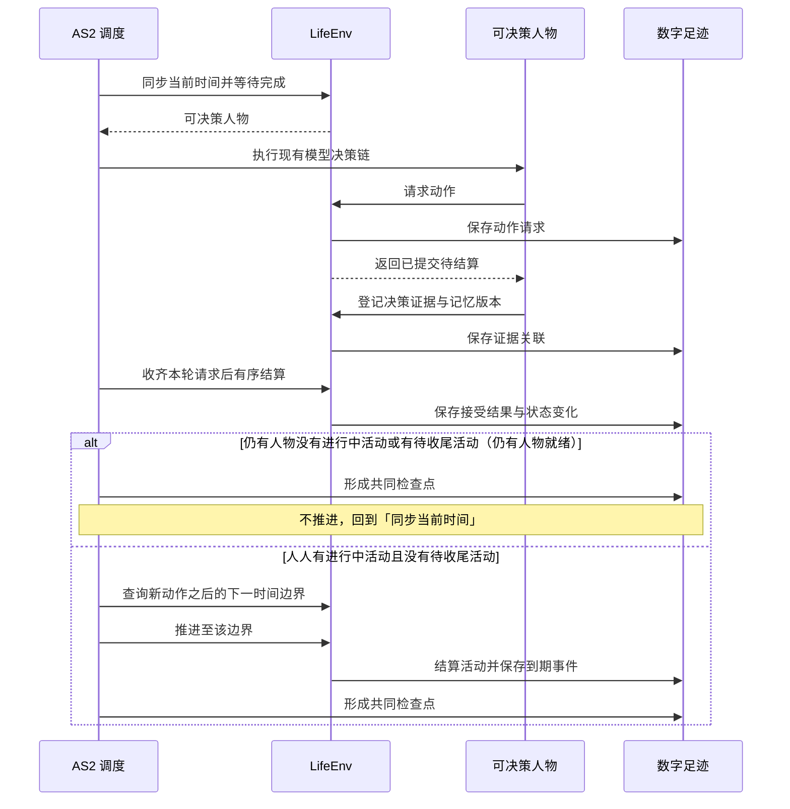
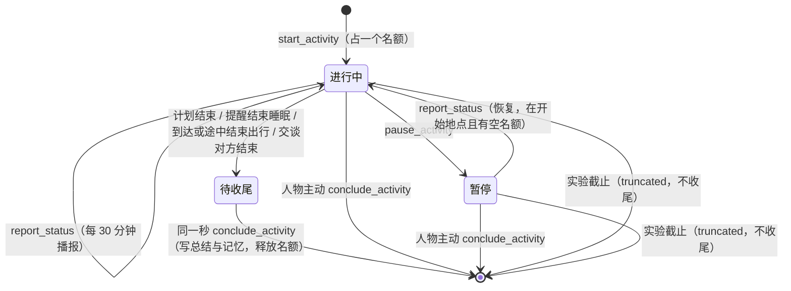
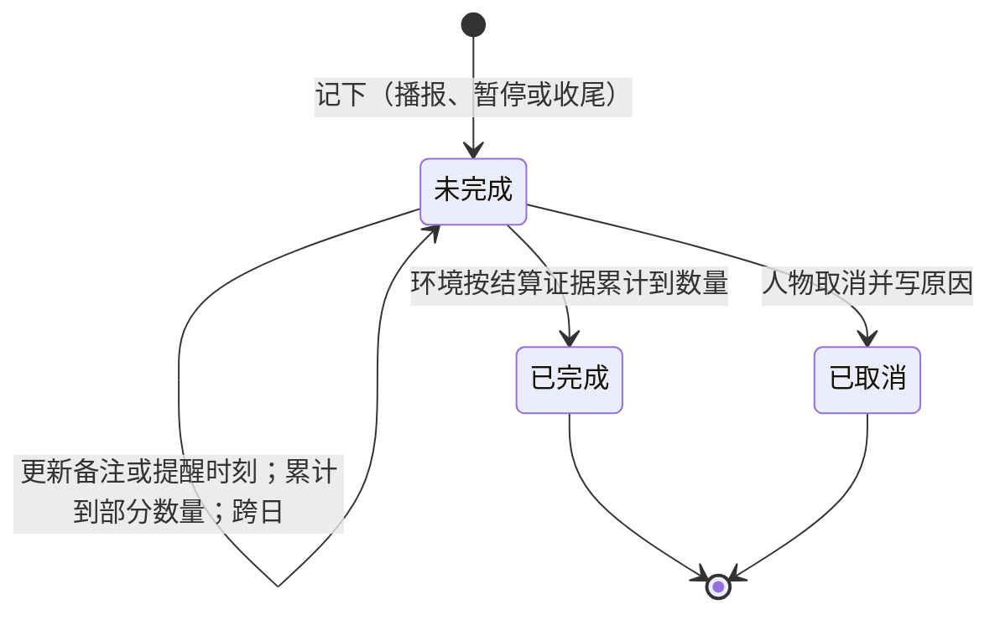

> 历史记录：本文件保存提交 `72f004b0087efa1b6f6d662ac6a143e087e4e21c` 时的过程与判断，不再定义当前系统。
> 当前设计见 [文档入口](../INDEX.md)；正文中的路径、规则和结果按当时上下文理解。

<a name="spec-life-runtime-特性规格lifeenv-运行时行为与结算规则"></a>
# 特性规格：LifeEnv 运行时行为与结算规则

> 按[动作与内容简化规格](SPEC-action-and-content-simplification.md#spec-acs-动作与内容简化开发规格)修订「规则与目录、收货、动作与内容、人物请求、记录导出」（阶段 1–5），并同步加油、长途领取、闹钟与文字聊天补订。

> 2026-10-07 按用户确认的[数据加工归属](../ARCHITECTURE.md#architecture-数据加工归属)修订：WorldMock 负责模拟、记录、完整认证足迹导出与真实性评估；LabelKit 加工、模型任务、训练装载与规则测试归 LabelKit-DataSet；环境素材归 WorldMock-Dataset。历史验收数字只证明原源码基线，不代表本次消费链已验收。

> 状态：FROZEN。现行正文按动作与内容简化规格原位修订，历史身份只证明当时源码。
> 日期：2026-10-07。
> 范围：共享状态与时钟、身体、动作内容、收货、七层请求、社交与个人事务。

规则由 WorldMock 包提供，具体环境目录和场景由 WorldMock-Dataset 发布，经显式环境根加载。
环境不发布规则副本或引擎读取的语料清单。当前目录格式 2、场景结构 8、世界结构 11、运行清单 4、
导出清单 4、质量报告 6。字段、签名和枚举见[接口合同](../CONTRACTS.md#contracts-worldmock-接口合同)。
本规格的睡眠、消息、同刻规则和独立故障边界继续有效；新发布与真实模型运行以实际回执为准。

<a name="spec-life-runtime-共享规则与可重建环境修订"></a>
## 共享规则与可重建环境修订

固定规则、占用和身体常数只来自引擎包，环境登记动作、内容、商品、app、地点和地图。
动作类别与使用方式决定准入和身体效果；内容不带分类、effects 或效率覆盖，只给真实时长、标题和摘要。
活动保存所选内容、类别、app、manner 与 communication_mode，恢复核验快照和最新本人进度，不重新抽取。

<a name="spec-life-runtime-状态归属与生命周期"></a>
## 状态归属与生命周期

<a name="spec-life-runtime-状态归属规则"></a>
### 状态归属规则

| 状态 | 包含内容 | 改变来源 |
| --- | --- | --- |
| 身体 | 能量、睡眠、娱乐/社交需要与结算时钟 | 实际区间推进和真实收货 |
| 资产与驾驶 | 账户、订单、driving_days、last_driving_date | 付款、燃油收货与实际本地驾车日；没有库存 |
| 活动 | wait、sleep、travel、action 的进度、快照、占用与终态 | 人物申请，环境验证执行 |
| 会话 | 停留/路段及当前 app_pushes | 出发、到达、推送 pending/opened/released |
| 内容 | ContentProgress{content_id, position_seconds, completed_rounds, last_consumed_at} | 仅正秒消费创建更新，跨 app 共用、人物隔离 |
| 分配工作 | work_content_ids 和实际内容完成事实 | 场景分配，本人正秒推进；播报只写叙述 |
| 目标、闹钟、事务 | 当日计划、一次性闹钟、七键事务 | 请求、到期和本人真实收货证据 |
| 记忆 | 主观记忆与已核验事件来源 | 人物记忆流程 |

身体准确数值与余额属于世界，人物提示只呈现分级与可读事实。商品、内容和动作是只读登记数据。
没有分配工作内容累计、物品持有或联系人库存；资金与进度分别留证，完成内容不触发工资。

<a name="spec-life-runtime-生命周期行为"></a>
### 生命周期行为

引用 `docs/CONTRACTS.md#contracts-worldmock-接口合同`「LifeEnv 状态字段」章的「生命周期」节。

本规格在此只判定一条行为：`step` 在区间内处理连续变化与到期事件，并按「时间约定」核验本次推进的时间对账。

<a name="spec-life-runtime-时间推进与并发活动"></a>
## 时间推进与并发活动

<a name="spec-life-runtime-共享时钟"></a>
### 共享时钟



同一秒可有多轮决策，每轮各形成检查点。

**时间推进规则**：
1. 先处理当前时刻已到期的通知或活动，再选出需要决策的人物
2. 人物完成本轮选择后，环境先结算本轮请求
3. 无人就绪时（每个人物都有进行中活动且都没有待收尾活动，等待与睡眠都算），调度器再计算下一边界：活动完成、图上出行到达与配送送达、app 内容完成的 `next_interaction_at`、当地 08:00–21:00 推送整点、通知到达、一次闹钟到点、需要重新评估的身体变化、人物选择的等待结束、场景本地零点、当日目标提醒、个人事务提醒、班次与休息时段的起止（这两项只对清醒的人物，睡眠中的人物不计）或实验结束。分配工作内容没有截止边界。
4. 每次推进严格大于零；即时事件在当前边界按稳定序号处理；同一秒的再决策不推进时钟，轮数受同刻上限约束
5. 同刻再决策：人物没有进行中活动或有待收尾活动时，在同一模拟秒再获得决策机会，直到有一项进行中活动且没有待收尾活动；适用于运行开始、活动结束、瞬时动作之后与业务拒绝之后。决策本身不消耗模拟时间
6. 同一人物同一模拟秒的决策轮数以场景参数 `max_same_moment_decisions` 封顶，时钟推进即归零（取值见 `docs/EXPERIMENT.md#experiment-worldmock-实验设置`「场景参数」章的「活动节奏与同刻决策上限」节）；达到上限仍不满足第 5 条的结束条件时进入受限轮：每轮只开放一类动作，收尾、结束与等待不会被业务拒绝，阶梯见 `docs/dev/SPEC-life-runtime.md#time-and-energy-决策不耗时时间只在做事时流动`「一、决策不耗时：时间只在做事时流动」规则 3
7. 有进行中活动且没有待收尾活动时，瞬时动作成功后不在同一秒再给机会，下一次按决策节律；业务拒绝后在同一秒再给一次机会，受同一上限约束，达到上限后按决策节律。拒绝保留在动作结果，不替人物选择动作，也不把业务拒绝写成运行失败

**时间约定**：
- 人物决策收到当前时刻
- 环境 `step(tick, t)` 收到本次结束时刻
- 时间对账：本次推进秒数必须恰好补齐上一确认时刻到本次结束时刻的间隔；接口表述见 `docs/CONTRACTS.md#contracts-worldmock-接口合同`「LifeEnv 状态字段」章的「生命周期」节
- 事件精度为秒；素材本身可保留更细的媒体时间，量化方式固定并记录
- 数据库的模拟时间采用 UTC epoch 秒，交付文件按合同编码为带时区的 ISO 8601；转换不改变时刻或排序

出行与配送到期由发布图的最短距离和固定速度计算，作为同一共享时钟的边界；店铺全天服务，打烊或营业变化不再产生边界。

<a name="spec-life-runtime-决策节律结算边界与唤醒条件分离"></a>
### 决策节律：结算边界与唤醒条件分离

**核心原则**：结算边界与决策机会分离。

`activity_feedback_seconds=900` 作为身体、进度与内容的结算粒度；每个结算边界产生 `activity_progress` 事件并结算资源。

**是否提供决策机会，只由唤醒条件决定**。

唤醒条件和原因闭集由模拟引擎维护。成员只经本文件版本表与数字人交互规格登记的九个同步点增删。
阶段 5 删除 `task_available`、`task_due_soon`、`work_review_result` 后，现行闭集是最终 23 项。
`ScheduledKind` 同步删除 `work_available`、`task_expired`，现行为八项：
`mail_arrival`、`delivery_arrival`、`calendar_flag`、`bill_due`、`payroll`、`message_arrival`、`app_push`、`alarm_ring`。

```python
WakeReason = Literal[
    "planned_end", "felt_band_change", "message_arrival", "delivery_arrival",
    "commitment_threatened",
    "reconsideration_interval", "person_arrived", "person_left",
    "activity_infeasible", "rejection_feedback", "discovery_result", "wake_from_sleep", "run_start",
    "progress_report_due", "no_active_activity", "plan_reminder_due",
    "errand_reminder_due",
    "shift_start", "shift_end", "break_start", "break_end", "app_push", "alarm_ring",
]
```

睡眠期间仍可提供决策的只有 `planned_end`、`wake_from_sleep`、`run_start`、`plan_reminder_due` 与 `alarm_ring`；`errand_reminder_due`、四个班次原因与 `app_push` 都不进入睡眠允许集合。存储层登记同源的 `WAKE_REASON_NAMES` 词表，与 `life.schedule.WakeReason` 由测试互锁防漂移。

记录引擎原样保存本次判定，增量字段见[共同身体结算与决策证据](../design/05-recording-engine.md#recording-engine-共同身体结算与决策证据)；
缺字段时的判定口径见 `docs/VERIFICATION.md#verification-worldmock-验收标准`「协议门禁」。下表把闭集成员对应到触发条件：

| 唤醒原因 | 触发条件 |
| --- | --- |
| `planned_end` | 活动由世界结束：到达引擎派生的计划时长、被提醒结束睡眠，或交谈对方结束（`partner_ended`）；交谈对方结束而本人仍有其他进行中活动时，同刻轮也记此原因 |
| `felt_band_change` | 任一体感分级与上一次实际提供决策时的分级不同 |
| `message_arrival`、`delivery_arrival` | 新消息或配送到达本人 |

| `commitment_threatened` | 保留枚举成员，分配工作内容没有截止预警，当前没有触发来源 |
| `reconsideration_interval` | 距上次实际决策达到当前在手承诺对应的常规或空闲间隔 |
| `person_arrived`、`person_left` | 同一地点的在场人物集合变化 |
| `activity_infeasible` | 保留名称，当前无触发来源 |
| `discovery_result` | 保留名称，当前无触发来源 |
| `rejection_feedback` | 同一秒业务拒绝后的再决策轮，只由同刻规则写入；边界判定不产生它 |
| `wake_from_sleep`、`run_start` | 沿用现有语义 |
| `progress_report_due` | 本人某项进行中活动距其播报锚点已满播报间隔（`progress_report_interval_seconds`）；只计进行中活动，暂停、待收尾与已收尾的活动不播报；锚点为活动的 `report_anchor_at`，在开始、恢复以及对该活动播报时写入当前时刻 |
| `no_active_activity` | 边界结算后没有进行中活动的人物必获决策，同刻再决策轮也记它，不进睡眠允许集合 |
| `plan_reminder_due` | 当日目标的 `remind_time` 到点：同时到期的合并，只计一次，每条提醒只触发一次；非睡眠活动继续进行。睡眠中到点即结束睡眠（`boundary_type` 与 `interruption_reason` 记 `plan_reminder`，按实际时长结算，睡眠成为待收尾），该边界的唤醒原因含 `planned_end`、`wake_from_sleep`、`plan_reminder_due`，睡眠结束后没有其他进行中活动时另含 `no_active_activity`（不按睡眠允许集合过滤）；人物此时已清醒，同一秒成立的其他原因（例如同秒开始的班次的 `shift_start`）照常按枚举顺序并列；睡眠的计划结束与提醒同秒时记 `boundary_type=planned_end`，提醒记为已触发 |
| `errand_reminder_due` | 个人事务的提醒时刻到点：清醒的人物精确在该时刻获得一次决策机会；同一边界到期的多条事务合并为一次机会、本原因只计一次，每条事务各写一条 `environment_event`（`data.kind="errand_reminded"`，人物可见，决策与动作身份为空），与 `plan_reminder_due` 同刻到期时按枚举顺序并列；只提供决策机会，不改变事务状态，进行中的活动继续。不进睡眠允许集合：睡眠中的人物不计入候选、不形成静默边界、不交付也不消耗、不结束睡眠，睡眠期间错过的提醒在人物醒来的那个边界交付、不另起边界；事务办成或取消后不再提醒，更新时写新的提醒时刻重新计一次；只在实际交付决策机会时记账并写事件 |
| `shift_start`、`shift_end`、`break_start`、`break_end` | 结算边界的那一秒是人物工作安排中某个本地日班次的开始或结束（含前一日写到 24:00、落在当日零点的结束），或该班次某个休息时段的开始或结束，而人物此刻没有在睡：他在这一秒得到一次决策机会，其余什么都不发生——不结束、不暂停、不开始任何活动，活动状态、计划结束时刻与下一次交互时刻都不变，不新增拒绝，不写事件，不新增进度层记录；唤醒原因不进提示，人物看到的变化只有环境层 `duty.status` 与观察时刻。起止时刻由场景工作安排与世界时钟直接求值、不存交付状态，预测与唤醒共用同一事实生成器（`src/worldmock/life/duty_edges.py::duty_edges`）：日期例外优先于每周声明，区间半开，与 `duty.status` 用同一组区间按当地墙钟换算，写作 1440 的止点落在次日当地零点；不当班的日子本身没有起止（前一日写到 24:00 的结束照记），没有工作安排的人物没有这些时刻；当日目标的大致时刻与人设层作息的钟点不触发它。同一秒重合的多个起止各记一次，按枚举顺序并列，并与同一秒的其他原因合为一次机会；恰在起止那一秒因计划结束或提醒醒来的人物判定时已清醒，起止照记、排在已有原因之后。在路上、通话、交谈或使用 app 时同样提供机会；app 内容完成仍走自己的静默 `next_interaction_at` 边界。在起止上做完决策后，请求被受理且仍有进行中活动时下一次决策时刻移到下一个候选，被拒或把活动结束时照同刻再决策规则在同一秒再决策，之后的决策都不再带这个名字；同刻决策预算耗尽后的技术停顿期间，本人的起止是时钟边界，记 `no_active_activity` 与对应成员，停顿随之结束。零点上的起止由零点节律入口在零点计划之后判定；运行开始恰在起止上时第一秒只记 `run_start`。不进睡眠允许集合：睡眠中的人物不计入下一边界与下一次决策机会的候选、不形成静默边界、不被叫醒，睡过的起止醒来后不补。检查点恢复与反事实重演不为起止另存状态，按场景与时钟重新求值；已判定而尚未决策的原因随人物状态的 `pending_wake_reasons` 恢复，不重复、不补发。零点上的起止由零点节律入口在零点计划之后判定，零点恰是运行结束时在推进内判定；写到 24:00 而次日休息的班次在 00:00 记 `shift_end`，此时环境层已是次日的 `duty`，看不到「已下班」，如实记录；夏令时跳过的当地时刻按跳变前的偏移换算、重复的取第一次，换算后落到班次之外的休息时段起止照样记 |
| `app_push` | 当地 08:00–21:00 整点为娱乐类、phone_continuous 且真实绑定合格内容的动作与 app 生成一次推送机会；源事件 kind=app_push，保存动作名、标题和摘要，没有 content_kind；推送状态 pending/opened/released，推送本身不是消费，不结束或暂停活动 |
| `alarm_ring` | 一次闹钟精确到点交付；非睡眠活动继续，睡眠按实际时长结束，记录真实唤醒来源；触发后清除，不补发 |

**唤醒条件是判定规则，唤醒原因是本次命中的成员**：上表列出全部唤醒条件；某次结算边界实际命中的成员构成该次边界的唤醒原因。只有命中的边界才提供决策机会并记录这些原因。

**静默边界**：没有任何唤醒条件的边界
- 环境按人物已开始的活动续行
- 不调用人物决策模型
- 不产生 `decision_started`、`observation`、`model_request`、`memory_updated` 事件；带 `data.purpose="plan_day"` 的 `model_request` 例外
- 本区间共同身体结算（`environment_event.data.kind=body_settlement`）写入上述增量字段：本次边界未提供决策，唤醒原因为空
- 续行不是环境替人物选择：人物的选择是它开始的活动，静默边界只是不打断这一选择

**零点计划**：场景本地零点与启动路径由运行时后台任务 `plan_day` 为人物生成当日计划（同联系人回复），不调用人物，
不提供决策，不写 `decision_started`，不计同刻轮数；其模型请求与响应带 `data.purpose="plan_day"`，计划写
`environment_event`（`data.kind="day_plan_generated"`），按记录引擎设计留证。

**提供决策的边界**：
- 同一组增量字段记为提供决策，并记录实际命中的全部唤醒原因

**下一次决策机会**：没有进行中活动或有待收尾活动的人物取当前时刻；其余人物取下列各项的最小值，以本次决策时刻作为上次决策时刻计算
- 计划结束
- 体感分级预计跨越时刻：困意与饥饿都从当前状态扫描预测，步长不超过 900 秒、最多 24 小时，取首个分级变化的步点后二分到整秒；
  饥饿含昼夜项与餐时项及 800、400、100 kcal 三个能量阈值，交谈、通话期间同样预测
- 午餐、晚餐窗口的起止时刻
- 已排定的通知与配送
- 当地 08:00–21:00 的 app 推送整点；同一当地整点映射出的重复 epoch 保留，fold 固定为 0
- app 内容完成的静默 `next_interaction_at` 边界
- 当日目标提醒与一次闹钟（睡眠中也计入）
- 个人事务提醒时刻（睡眠中不计入）
- 班次与休息时段的起止时刻（只对声明了工作安排的人物，睡眠中不计入）
- 进行中活动的播报到期

- 当前在手承诺对应的重估间隔到期

常规间隔 `reconsideration_interval_seconds` 默认 5400 秒；空闲间隔
`idle_reconsideration_interval_seconds` 默认 10800 秒，不能短于常规间隔。进行中的等待不算在手承诺；人物只在等待、
且没有未推进目标、本人分配但未完成的工作内容、暂停活动或其他进行中活动时用空闲间隔。
未完成的个人事务不计入在手承诺，不改变常规与空闲间隔及闭店预警（[个人事务与工作安排规格](SPEC-as2-integration.md#errands-workday-运行修复入库) 2.5）。
两者沿用场景配置；在手承诺闭集、切换和精确威胁候选见
[当日目标的决策节律](SPEC-day-plan-goals.md#spec-day-plan-goals-事件驱动的决策节律)。睡眠继续仅接受睡眠允许的原因。

**验证**：app 内容完成是静默边界，`app_push` 才提供决策机会；睡眠期仍只接受 `planned_end`、`wake_from_sleep`、`run_start`、`plan_reminder_due` 与 `alarm_ring` 五项（见 `tests/life/test_wake_reasons.py`）；
同刻决策与计划提醒另以新增的 `tests/life/test_same_moment_decisions.py`、`tests/life/test_day_planning.py` 验收。

**依据**：Humanoid Agents 每十五分钟只在情绪非中性或某项需要偏低时才提示模型；Generative Agents 按计划执行，只在感知到需要反应的事件时重新规划；目标导向行动规划只在计划失效或更相关目标出现时重规划。重估间隔的取值依据人类注意的基本休息—活动周期约 90 分钟（Kleitman 的休息—活动周期）。

<a name="spec-life-runtime-决策机会规则"></a>
### 决策机会规则

app 使用、工作和睡眠由长期活动表示，不需要每秒运行模型。

**唤醒条件与重估间隔是模拟粒度**，应作为参数记录，不能声称未观察的间隔里发生了逐秒选择。

睡眠不会为每次时间推进自动写一条模型记忆；只有实际形成的观察和记忆进入人物流程。

**人物决策约束**：
- 一轮只提交一个世界请求，`start_activity` 至多同时开始两项
- 一单购买可含多件商品、一餐可含多件持有食品，它们仍分别是一个购买或一个进食行动
- 记忆检索不改变世界
- 同一轮内不能在已登记请求之外再免费使用 app、工作或进食；下一轮何时提供按时间推进规则
- 业务拒绝后的下一次决策机会按时间推进规则第 5–7 条；重复拒绝不会被记为人物决策失败

<a name="spec-life-runtime-并发与占用"></a>
### 并发与占用

占用闭集恰为 wait、travel、talk、use_app、entertainment、work_study、exercise、daily_care 八项。
动作按 category 占类别，social 对应 talk；phone_continuous 另占 use_app，offline_assisted 和 other_device 不额外占手机。

| 活动或类别 | 占用 |
| --- | --- |
| 等待 | wait |
| 步行 | travel |
| 驾车 | travel、wait、entertainment、work_study、exercise、daily_care、use_app |
| 睡眠 | 全部八项 |
| 娱乐 | entertainment；持续使用手机时另占 use_app |
| 工作与学习 | work_study；持续使用手机时另占 use_app |
| 社交 | talk；持续使用手机时另占 use_app |
| 运动 | exercise；持续使用手机时另占 use_app |
| 日常照护 | daily_care；持续使用手机时另占 use_app |

同类别动作互斥；不同类别的两个持续手机动作也互斥。驾车只可再与不持续使用手机的社交动作并行，仍核验对方。
每人两个名额，进行中与待收尾各占一个，暂停不占且个数不限。资源交集以 RESOURCE_CONFLICT 拒绝，
名额超限以 SESSION_LIMIT_EXCEEDED 拒绝；反馈和受理同源，身体能量不参与准入。

模型调用可并发，环境 actor 按实际记录的种子顺序串行结算，所有观察基于共同版本；到达顺序不改结算顺序。
全部必要决策正常结束后才结算，稳定动作身份防止重试重复记账。模型、证据、记忆查询、工具服务失败
保存请求与原始异常、记录英文日志和失败阶段，不执行该轮尚未结算的提案。

<a name="spec-life-runtime-加速"></a>
### 加速

程序执行加速只减少现实等待。模拟中的活动时长来自这次选中内容的真实剩余时长，娱乐类可以静默续接合格内容；程序执行速度不改变内容接触速度。结算按实际模拟秒数推进，其他人的消息、推送、闹钟和送达照常发生。协议没有媒体 playback_speed。整体速度受模型调用、结算与写盘影响，加速比只由实测给出。

<a name="spec-life-runtime-运行观测"></a>
### 运行观测

**只读状态视图**显示模拟时间、现实耗时、运行状态，以及每个人物当前活动、app、当前内容标题与全局位置、最近动作结果、当前 session 的推送状态和下一次决策机会。正常等待、模型调用中、正在写盘和故障停止分别显示，避免把「人物正在睡眠」与「框架没有响应」混为一谈。查看状态使用已确认事件与状态，不唤醒人物、不调用模型、不改变决策。

**质量报告**从同一份数字足迹统计完成、中断、拒绝、app 使用、内容完成轮次、内容接触时长、推送送达与打开、转换效率、记忆写入与来源登记问题、个人事务的登记、办成、取消、跨夜与提醒、收尾记忆的构成与模型成本（个人事务与收尾记忆两组只报告，见个人事务与工作安排规格 6.1）。这些统计用于运行后评估；正式实验期间不根据报告暗中修改提示或替人物选择行动。

**验证**：见 `tests/footprints/test_status.py` 的 `test_status_reads_confirmed_state_without_modifying_any_run_file`。

<a name="spec-life-runtime-身体语义两过程睡眠睡眠不足账体感分级"></a>
## 身体语义：两过程睡眠、睡眠不足账、体感分级

引用 `docs/CONTRACTS.md#contracts-worldmock-接口合同`「LifeEnv 状态字段」章的「资源与需求字段」节。

<a name="spec-life-runtime-两过程睡眠模型"></a>
### 两过程睡眠模型

**状态字段**：`sleep_pressure`（睡眠压力）、`sleep_deficit_hours`（睡眠不足账）

**算法**（Daan、Beersma 与 Borbély 1984；参数取 npj Biological Timing and Sleep 2025 综述标准值）：

```
清醒：S(t+dt) = 1 − (1 − S(t)) · exp(−dt / 18.2h)
睡眠：S(t+dt) = S(t) · exp(−dt / 4.2h)

入睡阈值 H(t) = 0.67 − 0.12 · cos(2π (t − t_min) / 24h)
醒来阈值 L(t) = 0.17 − 0.12 · cos(2π (t − t_min) / 24h)

困意 = (S − L(t)) / (H(t) − L(t))，截断到 [0, 1.2]
```

**参数**：
- `t_min` 为两条阈值的最低点时刻，取人物卡片的 `chronotype_midsleep`（自由日睡眠中点），默认 04:00
- 晚型人物中点每晚一小时，阈值曲线整体后移一小时
- 初始 `sleep_pressure` 假定人物自起点之前最近一次惯常起床时刻（`chronotype_midsleep + sleep_need_hours/2`，按 24 小时取模）
  起一直清醒反推：起床时取睡满后的压力，再按清醒过程推进到起点；不预置活动

**困意分级**（档界按 KSS 等价刻度 `K = 7 + 7.6 · (困意 − 1)` 在 K = 5.5、6.5、7.5、8.4 处切分，属实验假设，登记在 `docs/EXPERIMENT.md#experiment-worldmock-实验设置`「实验假设声明」；档的名称与个数不变）：
- `< 0.80` 清醒
- `0.80–0.93` 有点乏
- `0.93–1.07` 困
- `1.07–1.18` 很困
- `≥ 1.18` 撑不住（留 0.02 余量，不与截断上界 1.2 重合）

**预期行为示例**：
假设按默认参数（睡眠中点 04:00），人物 07:00 起床、起床时压力等于当时的醒来阈值 L(07:00)，此后一直清醒，按上面的公式计算：
约 21:30 起为“有点乏”、22:40 起为“困”、00:05 起为“很困”、01:25 起为“撑不住”；睡眠中点 05:00、08:00 起床的晚型人物整体后移一小时。

场景起点为 00:00 时，按默认参数反推的惯常起床时刻为 07:45，人物在起点已清醒 16.25 小时，困意约 1.04，为“困”；
睡眠中点 05:00 的晚型人物困意约 0.94，同为“困”。去不去睡由人物决定。

<a name="spec-life-runtime-睡眠不足账与效率曲线"></a>
### 睡眠不足账与效率曲线

**累积算法**：
```
清醒每小时累积：sleep_need_hours / (24 − sleep_need_hours)
睡眠每小时恢复：1 小时
下限：0
上限：24
```

**默认参数**：`sleep_need_hours=7.5`（来自人物卡片，允许 7–9 小时），清醒每小时累积约 0.45 小时睡眠不足。

**效率曲线**（输入为 `sleep_deficit_hours`）：

工作效率节点：`(0, 1.0)、(8, 1.0)、(16, 0.85)、(24, 0.65)`
食品利用效率节点：`(0, 0.90)、(8, 0.90)、(16, 0.85)、(24, 0.80)`

节点之间线性插值，两端取边界值。

**分工明确**：
- `sleep_pressure` 决定人物此刻困不困
- `sleep_deficit_hours` 决定连续缺觉对效率的累积影响

<a name="spec-life-runtime-其他体感分级"></a>
### 其他体感分级

**饥饿体感**：
```
appetite = clamp((appetite_anchor_kcal − energy_kcal) / (appetite_anchor_kcal − 400), 0, 1) 
          · (1 + 0.17 · cos(2π (t − 20h) / 24h)) + 餐时项
```

- `appetite_anchor_kcal` 默认 1200
- 由此 800 kcal 对应“饿”；能量低于身体配置的紧急阈值（`emergency_threshold_kcal`，400 kcal）时无条件至少“饿得难受”，不受昼夜项与餐时项影响
- 昼夜项依据 Scheer、Morris 与 Shea 2013 的内源饥饿节律（08:00 低谷、20:00 峰值、峰谷差 17%）
- 餐时项在午餐、晚餐窗口内加 0.15，窗口外为零

**分级**：
- `< 0.15` 不饿
- `0.15–0.35` 有点想吃
- `0.35–0.6` 饿
- `0.6–0.85` 很饿
- `≥ 0.85` 饿得难受
- 能量低于 100 kcal 为第六档“饿得发慌”，只由能量决定；100 kcal 登记在 `docs/EXPERIMENT.md#experiment-worldmock-实验设置`「场景参数」章的「需求状态」节

**娱乐需要分级**：
- `< 0.3` 不闷
- `0.3–0.6` 有点想放松
- `≥ 0.6` 很想放松

**社交需要**（`social_need`，取零到一）：
- 清醒每小时增长 0.04；是否清醒按本区间共同身体结算（`body_settlement.activity_ids`）所用的活动集合判定，不在推进后重新推断，
  所以在边界结束的睡眠整段按睡眠计；没有该结算草稿时（直接调用）按「ACTIVE，或 COMPLETED 且 `ended_at` 等于此刻」判定
- 与在场人物交谈每小时减少 0.5
- 与联系人通话每小时减少 0.4
- 收到并阅读一条来自人物或联系人的消息减少 0.05；睡眠中不读消息，睡眠中送达的消息在醒来后的第一个边界才阅读并计效果
- 共同用餐每小时减少 0.3
- 交谈、通话的覆盖与共同用餐都按上述同一活动集合判定（在边界吃完的一餐仍算共同用餐）

**分级**：
- `< 0.3` 不想找人
- `0.3–0.6` 想和人说说话
- `≥ 0.6` 有点孤单

**情绪**（`mood_valence`，取 −1 到 1）：

按事件加脉冲并以半衰期衰减。

脉冲表：

- 收到人物或联系人的消息 +0.1（睡眠中送达的，醒来后的第一个边界阅读时才计）
- 连续两小时以上饿（饥饿分级“饿”及以上，含“饿得发慌”）或困 −0.1/小时；两小时门槛只判一次：连续不适时长减去两小时为可计费小时，
  每个边界按新增的可计费小时施加，未施加时不消耗计费小时
- 当日目标首次由实际活动推进 +0.05；每条目标只发一次，按当日目标规格核验活动证据
- 业务拒绝 −0.05，同一人物同一模拟秒至多一次；名称类拒绝（码的闭集见[一日运行保真规格](SPEC-life-runtime.md#dayrun-fidelity-身体与需要) 3.4）不施加，每人每秒至多 2 次，第 3 次起照常施加

半衰期：45 分钟 × `(1 + 0.3 · N_norm)`
脉冲幅度：× `(1 + 0.5 · N_norm)`
`N_norm` 为神经质归一到 [−1, 1] 的值

**分级**：
- `< −0.4` 很烦
- `−0.4 – −0.15` 有点烦
- `−0.15 – 0.15` 平静
- `0.15 – 0.4` 挺好
- `≥ 0.4` 很开心

**情绪只影响体感呈现与记忆重要度加权，不直接改变任何动作可行性。**

<a name="spec-life-runtime-滞回规则"></a>
### 滞回规则

分级在每个结算边界重算，但只有与“上一次实际提供决策时的分级”不同才构成唤醒条件。

这以决策而非结算为参照，天然抑制在分级边界附近的抖动，不另设阈值参数。

<a name="spec-life-runtime-数值与分级的分离"></a>
### 数值与分级的分离

所有数值继续写入 `activity_progress` 与 `observation` 事件的 `body` 字段供评估与导出；**给模型的提示只含分级文本**。
商品每份热量与路线费力是商品和路线的事实，可进工具层的目标与动作，不算身体数值。

身体状态与账户余额的准确数值只属于世界事实，但人物拿到的是体感分级，不是精确数值。

**验证**：见 `tests/life/test_sleep_two_process.py`、`test_felt_states.py`、`test_body.py`。

<a name="spec-life-runtime-消费生产与需求模型"></a>
## 消费、生产与需求模型

<a name="spec-life-runtime-资源表达"></a>
### 资源表达

时间是 UTC 整数秒及场景时区，同秒事件用严格序号；金钱是最小单位整数。
可用能量是 kcal，睡眠不足是小时，食品不能直接清除睡眠不足；娱乐与社交按固定类别规则和实际秒数结算。
分配工作是本人的内容实际进度，不是效率产出。规则限制资金、实际地点、类别场所和占用，不替人物优化人生。

<a name="spec-life-runtime-转换效率算法"></a>
### 转换效率算法

BODY_CONSTANTS 唯一维护固定身体参数，这些参数仍是随规则冻结的实验假设。
食品收货按类别热量 × 件数 × 收货当秒食品利用率结算，沿用既有曲线、上下界及 provided/applied/efficiency 守恒分录。
睡眠不足沿用清醒累积与实际睡眠恢复；低能量有饥饿体感，不拒绝或停止合法活动。
娱乐类别按 ENTERTAINMENT_RELIEF_PER_HOUR=0.3 和实际秒数缓解，娱乐期间不再累积娱乐需要。
内容没有类型，偏好散文、重复轮次与接触次数不改变缓解率；社交按实际 app 是否存在和共同区间的固定速率结算。
工作只累计内容实际消费秒数，不乘技能、睡眠、工具或工作效率；工资按明确 payroll 预排事实结算。

<a name="spec-life-runtime-具体活动结算"></a>
### 具体活动结算

| 行为 | 当前结算 |
| --- | --- |
| action | 一个执行器，按当前内容真实秒数推进；类别决定固定效果与代谢 |
| 本人分配工作 | 实际工作地点、未完成内容；做满恰好一次 work_content_completed，随后不再选 |
| 娱乐 | 内容完成静默续选，保持同一活动，每条真实完成独立记轮 |
| 其他类别 | 当前一条内容做完以 planned_end 完成并收尾 |
| 睡眠 | 实际睡眠区间恢复，提醒或闹钟可以结束 |
| 购买 | 受理当秒付款，实际收货才施加效果；每单一次转账及一次配送费 |
| 领取 | 本人在站领取本人已到站订单，零秒收货，无库存 |
| 出行 | 最短路径、真实时长与费用；实际驾车按本地日期扣日，燃油一次加七日 |
| 等待 | 既有反馈间隔派生，身体和预排事件继续 |

报告只写文字，暂停不计秒，提前结束只保留已消费部分。收货、付款、工资各自留下真实证据。

<a name="spec-life-runtime-语料进入环境与内容提供"></a>
## 语料进入环境与内容提供

<a name="spec-life-runtime-数据进入环境的过程"></a>
### 数据进入环境的过程

环境经目录登记进入引擎，见[环境目录如何进入引擎](../ARCHITECTURE.md#architecture-离线语料如何进入环境)。登记对象是 app、地点、商品、动作与内容，另有已发布地图。引擎不读取、校验或钉住语料文件；数据仓维护真实名称、摘要来源与合成数值。

<a name="spec-life-runtime-来源与准入"></a>
### 来源与准入

app 与作品使用真实名称；摘要可以真实或合成，`summary_source` 分别带来源 URL 或合成声明。价格、内容时长、集数与地图长度是声明的仿真假设。清单加六个目录文件经 `catalog.admission` 唯一登记，没有语料清单哈希或规则副本。历史执行证据不改写。

<a name="spec-life-runtime-内容目录契约"></a>
### 内容目录契约

内容包含稳定身份、`action_id`、`title`、`summary`、`summary_source`、`duration_seconds`、`app_ids` 与可选 `series`；没有内容分类。每条绑定恰好一个动作，时长不少于 60 秒，剧集按集登记。

内容必须绑定恰好一个动作；动作可以不绑定 app。动作的 `app_ids` 非空时，`manner` 必须是一种固定使用方式，
每条内容的 `app_ids` 是该动作 app 集合的非空子集；动作没有 app 时，`manner` 为 null、内容 app 集合为空。
每个动作及每个动作与 app 的组合至少有一条内容。空集合从不表示全部 app。
内容 `duration_seconds` 是正整数且不小于 60 秒；动作不登记时长、时间窗、场所或效果。
内容不声明分类；环境维护动作名称、说明及其内容。
系列以 `(action_id, series.title)` 识别，各集具有相同动作与 app 集合，集数为唯一的正整数。

商品绑定店铺，店铺绑定购物 app。`GOODS_CATEGORY_STORE_KINDS` 固定类型可供给的类别，
`"all"` 展开到全部可供给该类别的店铺；显式绑定列表去重排序，同类型店铺同菜单。
购物用途存在当且仅当至少一家店铺绑定该 app；支付绑定非空当且仅当有购物用途，
绑定目标具有支付用途，允许绑定自己。导航与支付 app 可以没有内容；app 必须有用途或动作绑定。

字段权威见[内容目录字段](../CONTRACTS.md#contracts-语料内容目录字段)。

<a name="spec-life-runtime-内容提供行为"></a>
### 内容提供行为

人物只选动作与声明的 app，系统从合格内容集合选择。
资格按动作/app 绑定、本人分配、完成和工作地点过滤；分配给别人或本人已完成工作不可再选。
依次优先当前 session 的同动作同 app 推送、最近未完成、最近已开始系列的下一集、未看单元、完成轮次最少单元。
系列按 action_id 与 series.title 组成单元；并列按规定身份或一次显式抽取决定。其他进行中/暂停活动先预留，
有替代时避开预留和刚完成内容，唯一合格内容允许再选；推送与最近未完分支不抽样。
观察与时长范围只读，不消耗随机/选择状态；具体排除顺序和确定性见动作与内容简化规格「内容选择」。

存在正秒消费生成的 last_consumed_at 才算看过，已送达推送仍可未看，暂停零秒不创建历史。
content_progress 按人物与 content_id 保存，跨 app 共用、人物隔离。本人分配工作仅能在 work_schedule.workplace_location_id
消费，未分配学习可重复；完成的分配内容不重置。空集合返回 CONTENT_EXHAUSTED，仅因工作地点为空时给要求地点的同源原因。
公开结果 details.content{action, app, title, summary, duration, pushed}，app 可空；每次正秒结算记录位置前后与真实完成轮次。
娱乐结束一条静默续选，其他类别做完即完成。恢复读已选内容和当前本人位置，不重抽。
邮件到达时正文直接可见，没有读信活动。证据：tests/life/test_content_select.py、test_action_run.py、test_app_progress.py。

<a name="spec-life-runtime-导航与配送"></a>
### 导航与配送

**路线计算**：运行读取发布的连通加权图，`catalog.graph.Graph` 提供最短距离与完整地点路径。等长时取完整地点标识路径元组字典序较小者，与边插入次序无关；同地点距离为零，但人物不能启动同地点出行。

**路线成本**：`life.travel.plan_trip(graph, origin, destination, mode)` 返回 `Trip(trip_id, path, distance_meters, duration_seconds, fare_fen)`。身份为 `"<origin>-><destination>:<mode>"`，时长为 `ceil(最短距离 ÷ 方式速度)`，方式速度来自 WorldMock 固定常数。
步行费用为零，驾车费用为 `max(500, ceil(Decimal("0.2") × distance_meters))` 分，支付给 `transport:service`。`planned_travel` 是运行的单一出行计算入口，`ROUTE_DURATION_MISMATCH` 按同一图重算。

**配送时间**：备餐时间加 `ceil(图最短距离 ÷ 配送速度)`，常数来自固定规则。配送覆盖全图，没有配送区域、道路不可达或交通状态原因。

**位置与证据**：活动保存 `trip_id`、`path`、`distance_meters`，推进使用图上米数；到达写实际地点。没有 GPS、球面距离、折线插值或交通数据。

**验证**：图查询与出行纯所有者节点验证距离、完整路径决胜、秒数、车费和字段；完整引擎消费者在资源与规则引擎简化规格的共同集成波次验证，实际结果独立登记。

<a name="spec-life-runtime-场景与身体规则"></a>
## 场景与身体规则

场景结构 8 的身体输入只保留初值；身体演化读取 `worldmock.exchange.body.BODY_CONSTANTS`，结算来源 `worldmock:<RULES_VERSION>`。食品效率和能量上限保留，环境目录不提供资源定义或身体系数。

<a name="spec-life-runtime-身体参数与单位"></a>
### 身体参数与单位

场景校验强制每项身体与活动参数带单位、来源类型与取值区间；初始取值按实验假设处理，此后只随时间与动作规则变化。不能把「为了更像人」的运行后指标反馈成秘密行动脚本。

**WorldMock 固定身体参数**（`worldmock.exchange.body.BODY_CONSTANTS`，`source_kind = worldmock:<RULES_VERSION>`）：
- 体重 65 kg
- 初始能量 1600 kcal、上限 2400 kcal
- 初始睡眠不足零小时
- 基础消耗每小时 65 kcal
- 额外活动消耗按已声明的代谢当量扣除基础部分后计算

**能量精度**：
- 结算与预测共用完整能量成本函数
- 分段结算使用浮点数
- 所有活动集合的能量都以 0 截断，不报错
- 能量不参与受理、路线与恢复

**效率曲线**：
- 工作效率曲线节点为 `(0, 1.0)、(8, 1.0)、(16, 0.85)、(24, 0.65)`
- 食品利用效率节点为 `(0, 0.90)、(8, 0.90)、(16, 0.85)、(24, 0.80)`
- 以上两条输入均为 `sleep_deficit_hours`
- 能量效率节点为 `(0, 0.5)、(399.9, 0.5)、(400, 0.8)、(800, 1.0)`，输入为 `energy_kcal`，与工作效率相乘
- 节点之间线性插值，两端取边界值

**睡眠参数**：
- 两过程模型按前述算法
- `sleep_need_hours` 默认 7.5，允许 7–9 小时
- 睡眠不足账清醒每小时累积约 0.45、睡眠每小时恢复 1

**娱乐与社交**：
- 娱乐需要取零到一，清醒每小时增长 0.08，有 app 内容实际推进时不再增长；按固定娱乐缓解率 0.3/小时与实际经过时间减少（见「转换效率算法」），不读画像权重或接触次数
- 社交需要取零到一，清醒每小时增长 0.04（清醒按本区间共同身体结算所用的活动集合判定），交谈、通话、收到并阅读消息与共同用餐按前述规则减少；
  睡眠中不读消息
- app 内容位置、完成轮次与每个区间的固定速率效果都落在数字足迹里

**所有系数作为实验假设记录；真实人类生理有效性不是既得结论。**

身体演化常数的唯一来源是 WorldMock 包，环境不能用资源目录覆盖。场景只给体重、初始能量、睡眠债与娱乐需要。食品每份热量由 `GOODS_ENERGY_KCAL` 按 `GoodsCategory` 求值，800/400 千卡阈值是 WorldMock 常数。


目录不提供代谢当量；动作取 `CATEGORY_MET`，其余仅保留等待、睡眠、步行、驾车四项身体代谢当量。

<a name="spec-life-runtime-活动组合政策"></a>
### 活动组合政策

占用闭集恰为 wait、travel、talk、use_app、entertainment、work_study、exercise、daily_care 八项。
动作按 category 占类别，social 对应 talk；phone_continuous 另占 use_app，offline_assisted 和 other_device 不额外占手机。

| 活动或类别 | 占用 |
| --- | --- |
| 等待 | wait |
| 步行 | travel |
| 驾车 | travel、wait、entertainment、work_study、exercise、daily_care、use_app |
| 睡眠 | 全部八项 |
| 娱乐 | entertainment；持续使用手机时另占 use_app |
| 工作与学习 | work_study；持续使用手机时另占 use_app |
| 社交 | talk；持续使用手机时另占 use_app |
| 运动 | exercise；持续使用手机时另占 use_app |
| 日常照护 | daily_care；持续使用手机时另占 use_app |

同类别动作互斥；不同类别的两个持续手机动作也互斥。驾车只可再与不持续使用手机的社交动作并行，仍核验对方。
每人两个名额，进行中与待收尾各占一个，暂停不占且个数不限。资源交集以 RESOURCE_CONFLICT 拒绝，
名额超限以 SESSION_LIMIT_EXCEEDED 拒绝；反馈和受理同源，身体能量不参与准入。

恢复依次核验开始地点、内容仍合格、空名额、占用冲突，失败保留暂停进度。
含两项请求整组原子受理，不能自动退出旧活动或替人物选组合。有待收尾活动时同秒先结束。
控制请求与 errands 事务变更同批原子校验，事务不是活动，不占名额。

<a name="spec-life-runtime-结算间隔与续行"></a>
### 结算间隔与续行

身体与进度按场景反馈粒度和实际事件边界结算，边界与决策机会分开。无唤醒原因继续已有活动，有原因才请人物决策。
娱乐当前内容完成是静默边界：写回真实位置与轮次、释放匹配推送，同活动续选；其他类别当前内容完成以 planned_end 结束并同秒收尾。
带 progress_report_due 的实际决策一经提出即消耗本人当时每项已到期进行中活动的播报锚点，不论选哪种工具、请求受理或拒绝。
报告仍写 summary，暂停不推进。恢复只在开始地点、内容合格和占用/名额许可时读取本人最新位置，不重抽；已完成分配工作不可恢复。
可重复内容已被其他 app 做完时从新一轮零位置开始。主动结束、暂停、恢复逐活动留证，实验截断与共同检查点一致。
睡眠允许 planned_end、wake_from_sleep、run_start、plan_reminder_due、alarm_ring；app 推送不叫醒。

<a name="spec-life-runtime-资金与合同"></a>
### 资金与合同

资金仍用账户间双边分录，人物账户来自初始余额；工资与账单按明确预排事实结算，不根据人物财富推断能力。
购买只使用固定商品单价与份数，每单一次把货款和一次配送费付给 `merchant:<store_id>`，没有品类系数、供给报价、库存或补货。步行不扣款，驾车付给 `transport:service`。
分配工作内容没有付款、提交或评审状态；完成分配内容不产生工资。明确工资事实仍按 `payroll` 预排事件执行并留下双边分录。

付款成功不产生商品效果，实际收货与资金记录分别留证。

<a name="spec-life-runtime-观察投影与提示合同"></a>
## 观察投影与提示合同

<a name="spec-life-runtime-七层请求"></a>
### 七层请求

每次请求由固定原生 tools、系统 JSON 和 user 的工具层/人设层/记忆层/待办层/环境层/进度层组成。
同秒续接追加原生 assistant/tool 消息，六层链首快照字节不变；时间推进后结束旧链，所有层由确定性代码渲染。
最后回合和截断重试去掉只读查询工具。原生工具十二个，稳定环境工具九个，行动阶段仍只有 action。
工具目标为商品、动作、地点、人物、联系人、自己和活动；app 只作为动作行及用途索引，不是独立目标。
callable_index 四键：goods、navigation_apps、payment_apps、query_categories。内容不作为人物选择对象，活动 state 写客观进度，
work_study 活动可带 last_report。结果为 details.content，app_push 记录含动作名，完成记录为 work_content_completed。
字段、容量、唯一出现与禁键见接口合同和 life/prompt_schemas.py；私有内容、商品、支付和导航身份不公开。

<a name="spec-life-runtime-不进入提示的字段"></a>
### 不进入提示的字段

禁键由接口合同的唯一闭集覆盖七层、原生工具与续接消息。动作名、商品名和可选 app 名公开，
内部 goods_id、content_id、位置、支付/导航 app 身份、推送身份与 session 状态不公开。
准确身体数值不进提示，不以能量可行性收窄 Schema；内容无分类或分类推断。

<a name="spec-life-runtime-观察投影行为规则"></a>
### 观察投影行为规则

**唯一出现**：每项事实在整个模型请求（含原生 tools）只完整出现一次，其他位置只引用名称。观察按记录引擎的单写合同保存，续接消息保留本秒真实调用与结果，不重复序列化六层快照。

**动作与商品**：工具层完整列出登记动作，按此刻真实内容、地点、对象、菜单与并行条件给 available 和英文 reason。未分配的动作仍可呈现；没有合格内容时拒绝 CONTENT_EXHAUSTED。app 是动作的明确绑定参数，内容不作为人物目标。商品从唯一真实供给集合生成，窗口、可调用索引与查询共享该集合，软偏好只改排序。

**名称与购买**：动作按登记名精确解析，商品与地点按同一名称受理链解析；近名只提供至多三个可原样提交的候选，不自动替换。购买一项一件，现场 app=null；线上明确购物 app 与该 app 绑定的支付 app，按合法最早送达门店和稳定身份决胜。长途到站只通知本人领取，领取后才确认收货。价格与余额按真实结算核验，不产生持有库存。

**内容与工作结果**：成功结果公开动作、类别、app、使用方式、选中内容标题、完整摘要、真实剩余时长和推送来源；不公开内部内容身份、位置或完成轮次。分配工作来自本人 work_content_ids，在工作地点进行，按实际内容秒数计进度；已完成内容不再安排，没有主题目录或效率产出。

**结果回灌**：本会话世界调用与公开结果进入进度层 tool_call，同秒续接经原生 tool 消息返回，会话结束后成功事实派生记忆层 settled。人物 summary 不核验进度：report_status 的 summary 仅在本会话，成功 pause_activity 与 conclude_activity 的 summary 进入 self_notes；回复正文作为 self_note 仅留到本会话结束。全局内容进度与推送状态留在权威状态和足迹。

个人事务完整行只在待办层。控制请求的 errands 不重复进入进度参数与 self_notes，结果只以事务名和变更回执引用；errand_reminder 与 errand_completed 由实际可见事件派生，来源计入观察。续接 changes.errands 属原生消息，只保存真实增改完整行和移除名称。事务是否办成由实际 goods_received 证据确认，人物自述不能替代。

直接消息、交谈邀请与邮件到达以真实全文进入进度层；没有另设读信活动。价格、地点、路线分钟数与代价在工具层，暂停活动与今日计划在待办层，在途订单与未回复消息只在各自唯一位置。今天 duty 只在环境层，由 work_schedule 与时钟求值；同秒链内时钟不动，duty 与位置不变，不进入 changes，也不增加新的拒绝条件。

**请求与查询**：start_activity 仅有 items、answering；每项 target、way、app、to、pay_app 五键必填，不用的写 null。整组原子受理。query_world 六键为 name、way、category、app、available_only、offset；前四键至少一个非 null。查询筛选先于完整集合排序和分页，合法空交集返回空页，未知 app 返回完整合法选项与可提交候选，不放宽条件。宿主与 LifeEnv.read_query 在同一冻结观察逐值相等；查询不登记世界请求，不抽内容、不改随机流、进度、曝光、版本或时钟，服务故障按原异常传播。

查询返回 matches、total_count、next_offset，末页偏移 null，逐页无重无漏；结果只进原生交换证据，不写世界动作、进度事件或记忆。查询可同批，世界请求独立提交；最终回合和截断重试不开放只读查询。错误按统一合同给英文 reason、精确 path、完整 allowed_values、expected 与可原样提交的候选，不转储校验器文本。

**跨时刻操作备忘**：rejected_today 从当天已提交的名称与参数拒绝证据派生，跨时刻与地点会话保留，本地次日清空；至多八条，字段 written、why、times、last、accepted_as，why 为至多六十字符英文。成功归一不登记，备忘不新增持久世界状态。

**紧凑工具层**：groups 与 callable_index 仅压缩呈现，按类别、动作、方式分组，共同字段只提升逐值相同的内容；目标保留差异。只省略 null 与空集合，保留 false、零值和未知原因。展开与完整冻结观察等价，changes 使用相同表达；冲突字段视为渲染错误。容量浓缩保护进行中、刚结束、暂停活动、未了结订单和本轮新记录，不改变权威事件、名称受理或真实供给。

<a name="spec-life-runtime-交互菜单的运行边界"></a>
### 交互菜单的运行边界

事件级工具支持数据包含按人物权威位置计算的冻结交互菜单。工具层只列菜单允许的动作，环境层 fixed_rules 说明排除入口；观察、宿主与环境共享冻结事实。原生工具整次运行不变，地点变化在下次观察重算，不改本轮观察。

环境在任何副作用前重验权威菜单，禁用入口以 INTERACTION_MENU_DENIED 原子拒绝，沿用业务拒绝节律、结果回灌和幂等规则。登记动作经 start_activity 开始；分配工作只是具有本人工作内容的动作。恢复按开始地点、内容资格、空名额、占用冲突检查，能量不参与准入。

菜单不改固定占用表、内容选择、商品集合、呈现上限或轮转，也不为关闭入口伪造候选排除原因。领取是零秒原生行为，不增加活动类型。

<a name="spec-life-runtime-系统层"></a>
### 系统层

系统层 JSON 只有 layer、role、rules，十八句及顺序保持，权威全文在 docs/CONTRACTS.md#contracts-model-request，
生产 LIFE_SYSTEM_LAYER 与其逐字相同。只读系统层独立固定。身份只在人设层，工具 description 只写用途。
系统层说明五字段请求、精确 app、实际内容时长、娱乐静默接续、类别与持续手机占用、暂停名额、分配工作、
实际收货、闹钟与文字社交。环境未阻止的组合仍由人物按常理判断；不代选 app 或排活动。
prompt_sha256、tool_schema_sha256 绑定各自最终冻结输入，运行中不变；旧身份运行不能恢复或合并。

<a name="spec-life-runtime-上下文容量"></a>
### 上下文容量

发送每一次实际模型请求前，按所用模型的上下文窗口计算整次请求的 token 占用：原生 `tools`、系统层、六层 JSON、
续接消息（含回传的 `reasoning_content`）与预留输出。达到百分之八十五时依次处理，每步之后重新计数：

0. 提前结束本秒续接：本次请求改为从新快照构造，此前的思考不再出现；
1. 从旧到新去掉未受保护记录的 `self_note`；
2. 把最旧一段未受保护、已有结果的记录折成一条 `condensed` 记录。

仍达阈值或超出输入额度时，按容量故障停止，并按系统层、工具定义、各 user 层、续接消息、预留输出分层记录 token 用量与英文错误日志。
始终完整保留（受保护）：工具层的进行中与刚结束活动、待办层的暂停活动、未了结订单相关的记录、上次请求之后的新记录。
工具层、人设层、待办层与环境层不浓缩；记忆层只受自身 8000 字符窗口约束。
进度层的 `errand_completed` 记录折叠时留一句只含时刻与事务名的句子，`errand_reminder` 与当日目标提醒同等对待、折叠后不留句；
待办层不浓缩，未完成的个人事务不受容量处理影响，其条数由每人至多 8 条的上限约束
（[个人事务与工作安排规格](SPEC-as2-integration.md#errands-workday-运行修复入库) 2.1、2.6）。不静默删减，
不修改权威活动与会话状态或原始结算事件。行为以人物 Prompt 规格第四章为准。

**正式运行目标**：
- `quality.json` 报告每次决策的提示词 token 分布
- 中位数目标为不超过 15000 token
- 该目标只报告不放行

**语言**：提示文本使用场景 `language=zh-CN`

**验证**：见 `tests/life/test_narration.py`、`tests/life/test_revision_contract.py`、
`tests/integration/test_life_agent_protocol.py`；另以阈值时先断链、再依次去 `self_note` 与折叠为 `condensed`、
受保护项完整保留、仍超限时容量故障并分层记日志的测试验收。

<a name="spec-life-runtime-候选契约与呈现规则"></a>
## 候选契约与呈现规则

生成、资格、排序与轮转只作用于商品，kind=product，object_id=goods_id，同商品不按店铺重复。
动作始终列出，没有窗口/轮转；app 通过动作和用途名单呈现。商品窗口、索引与查询共用唯一供给集合。
habit 实际字符串对名称或类别标签的命中贡献既有相关度，再用日期/人物/身份固定哈希决胜，不新增时间窗、家族评分或配置层。

<a name="spec-life-runtime-统一候选契约生成资格排序三段"></a>
### 统一候选契约：生成、资格、排序三段

商品生成来自真实目录菜单；资格来自当前店铺、声明购物 app 与唯一配送规划。途中只保留经购物 app 可长途到站的商品。
排序按 habit 名称/类别命中相关度与固定哈希，人物 taste 散文不生成权重；习惯不是购买资格。
商品目标、callable_index.goods 和完整世界查询同集合，窗口只裁展示，不改变按名调用。

<a name="spec-life-runtime-两条排除纪律"></a>
### 两条排除纪律

供给资格按地点、真实绑定与配送规划，错误说明所属条件。habit 只参与商品相关度，不成为合法供给门槛。
轮转只延后本次呈现，不改目录、对象和内容状态；动作始终列出，可用性按合格内容、场所、名额与占用判断。

<a name="spec-life-runtime-两级上限"></a>
### 两级上限

商品池上限与单次窗口上限分开，不能把池规模直接当提示条数。
单次窗口沿用 candidate_presentation_limit；四键 callable_index 与始终列出的动作不计商品条数，仍计总请求容量。
商品按名调用不依赖刚才是否展示；内容和 app 不成为候选条目，没有动机评分器截断。

<a name="spec-life-runtime-下推两层游标返回体"></a>
### 下推：两层、游标、返回体

**层数限两层**，即品类 → 条目。层的语义是约束传播（上一层选定的品类收窄下一层的可行集合），不是界面分页。

**分页用游标，不用页码**。游标是上一页最后一条的完整稳定排序键；页码与偏移不稳定，目录变动时会重漏。

**返回体必须含三件事**：本次返回条数、总数、下一页游标；最后一页的游标为空。返回体的字段名与结构见 `docs/CONTRACTS.md#contracts-worldmock-接口合同`「候选与呈现合同」。

**游标只能由（冻结目录、世界状态版本、排序键版本、游标）决定**，不得包含模型输出、会话状态或墙钟时间。

**读到什么算通过**：以空游标起、反复带上一页游标下推，得到的序列是一次全量有序候选的无重、无漏子序列；同一游标在同一世界状态版本下重复请求返回同一段。

**读到什么算失败**：下推出现第三层；返回体缺少总数或下一页游标；两次下推之间目录未变而结果出现重复或遗漏。

商品身份以实际 goods_id 标识，同一商品在多门店的供给绑定不增加商品目标；字段不含库存或口味，app 是明确路由参数。

<a name="spec-life-runtime-曝光轮转"></a>
### 曝光轮转

**轮转的判据是「上次呈现时刻」**（字段名 `last_presented_at`），不是互动次数，也不是任何偏好估计量。合同禁止把互动次数当作「受欢迎程度」使用。

**轮转非破坏性**：只改呈现顺序与换新名额，不改目录、不改对象状态、不产生下架事件。每次呈现按场景声明的换新比例留出固定换新名额给「长期未呈现」的对象，其余条数按排序键给出。
每个对象各记自己的 `last_presented_at`，换新名额留给该候选池内最久未呈现的对象；不用人物级的共享偏移量，也不设分区游标。

**最大未呈现间隔必须有界**：给定分区池规模 `N` 与每次呈现的换新名额 `k`，单对象最坏等待间隔的闭式上界为 `⌈N ÷ k⌉ ÷ D`，其中 `D` 为该候选池的每天决策点数。验收断言必须用这个精确形式，不得用它的连续松弛 `N ÷ (k × D)`。`N` 与 `k` 的取值来源见 `docs/CONTRACTS.md#contracts-worldmock-接口合同`「候选与呈现合同」；`D` 的取值按章引用 `docs/EXPERIMENT.md#experiment-worldmock-实验设置`「场景参数」章的「决策点节奏」节，取该节记录的实测区间而非单一估计值，本规格不复述数值。

**轮转的单位是检索分区，不是整个语料池**：分区越细，单池越小（等待变短），但每个分区的可达率也越低（等待变长），两者互相抵消，因此分区不能无限细。
`⌈N ÷ k⌉` 的上界按候选池成立，`N` 与 `k` 取该候选池自己的池规模与换新名额。

**读到什么算通过**：连续 `⌈N ÷ k⌉` 次呈现之后，候选池内每个对象至少被呈现一次；轮转前后目录条目数、对象状态与事件序列中不出现任何下架事件。

**读到什么算失败**：轮转改变了目录或对象状态；换新名额被排序键挤占而长期未呈现的对象永远不出现；用互动次数（`exposure_count` 一类计数）作为轮转判据；把带 `ROTATION_DEFERRED` 的对象当作保留项而不计入排除项计数；用人物级共享偏移量代替逐对象的上次呈现时刻。

**轮转状态**：判据所需的上次呈现时刻是派生量，写入方式与字段面见 `docs/CONTRACTS.md#contracts-worldmock-接口合同`「候选与呈现合同」；它是纯时刻或计数，不含任何偏好推断。

食品曝光只影响呈现，不生成可见凭据或购买权限；固定菜单里的食品可以按名调用，画像散文不参与曝光排序。

<a name="spec-life-runtime-禁止永久退役"></a>
### 禁止永久退役

**禁止按互动统计永久移除对象。** 任何以互动次数、被选择次数或「受欢迎程度」为判据把对象移出对象层的机制都不得实现，因为十二周窗口内的样本量（内容品类最大约 90 条、平均每条约一至两次曝光）支撑不了「谁更受欢迎」的判断，且永久移除意味着一次错判无法挽回（依据：`REPORT.md`「按互动统计淘汰尾部 x% → 拆成『永久退役』与『曝光轮转』，只有前者该被否」）。

**目录条目的退役只允许走墓碑语义**：保留可读、拒绝新场景引用。退役不删除条目，也不改变既有足迹的解释。

**读到什么算通过**：轮转、候选裁剪与淘汰统计都不改动对象层的条目数量；对象层条目数的变化只由目录版本变更产生。

**读到什么算失败**：任何运行期通路按互动统计把条目从对象层移出；「没被选中」被写成「下架」事件。

不得因本轮未呈现把食品永久退役；目录固定菜单不保存下架或库存，候选本轮延后不改变目录绑定。

<a name="spec-life-runtime-地点语义与检索分区"></a>
### 地点语义与候选来源

地点 kind 为固定十种：home、office、park、fitness、restaurant、cafe、convenience_store、supermarket、gas_station、parcel_station。环境由 PLACE_KIND_ENVIRONMENTS 派生，加油站与驿站均为 venue。商品按真实门店绑定生成，加油站只卖 fuel，驿站不绑 app、不卖商品。

动作资格由类别固定规则、本人工作地点与真实合格内容求值，日常照护可在任意地点。地点不保存旧生活动作供给或内容分类。普通店 shipping_seconds 为显式正整数或 null；null 使用既有地图距离规划，非店铺与加油站必须 null。长途配送和最近驿站选择共用唯一运输规划。

候选曝光按商品真实身份保存；app 只是登记动作与商品的路由参数，内容不进入检索分区或候选轮转。

<a name="spec-life-runtime-检索确定性索引与-facet"></a>
### 检索：只读查询与 app 内容边界

callable_index 恰有 goods、navigation_apps、payment_apps、query_categories 四键。登记动作完整列在工具目标，app 声明用途与动作绑定；商品与查询、工具窗口使用同一供给集合。查询以公开动作与商品类别筛选，不恢复旧生活活动、app 目标或主题目标。

内容没有独立搜索结果、facet、向量查询或曝光游标。人物点名动作与其声明 app 后，唯一内容选择器按真实目录与人物状态选择；空合格集合返回 CONTENT_EXHAUSTED，不借别的动作或 app 内容。

同一冻结观察与请求得到相同有序分页。查询不消费随机数、不改选择状态；合法筛选无匹配返回空页，参数或未知 app 错误按统一错误合同返回。

<a name="spec-life-runtime-随身持有与远程订购"></a>
### 商品购买与收货结算

订单 `DeliveryState` 保留订单身份、付款人 `agent_id`、店铺、购物 app、卖方账户、件数、单价、配送费、总价、收货地、履约方式、收货人、关联消息、创建与预计时刻、路径和配送行程；商品用 `goods_id` 与 `category`，另有可空 `payment_app_id`、可空 `received_at`。状态只有 `pending`、`delivered`；pending 的 received_at 为 null，到店收货时等于 created_at。订单数量恒为 1。没有食品持有或联系人持有。

连续身体变化由时钟推进先结算至收货秒；到店购买在当前同刻受理。到店受理与配送到期共用 `worldmock.life.receipt.settle_receipt`，该函数只施加本次瞬时商品效果并取走本次资源分录。函数同时将订单从 `pending` 改为 `delivered`、写 `received_at`、施加效果并取走本次资源分录。到店在付款的同一次提交内收货，配送在 `delivery_arrival` 当秒收货，不看收货人在哪里或是否睡着。
食品的 `provided` 为类别热量乘件数，`applied` 为按当秒睡眠不足利用率与能量上限得到的实际能量增加，超出上限的部分丢失。休闲用品每行降低娱乐需要 0.10（下限 0），日常用品每行施加情绪脉冲 0.05。没有持有、食用时长、份额、丢弃或装备能力。
本次食品 `food:intake` 分录与休闲用品 `goods:receipt` 分录在函数返回前立即取走，主体与时刻都是收货人和收货秒，缓冲为空；日常用品不写资源分录。状态变化与 `goods_received` 同一事务提交，事件的 `caused_by` 指向该提交中的真实购买结果或配送到期事件。
已交付订单再次到期不写状态、效果或事件；重复动作返回已存结果。联系人没有身体，收货只改变订单状态与 `received_at`，不写 `goods_received`。配送保留付款人的到期事件与唤醒，清醒模拟收货人得到同一个到期原因，睡着的不唤醒；到店不唤醒任何人。

<a name="spec-life-runtime-地图与门店供给行为"></a>
## 地图与门店供给行为

场景结构 `7` 通过 `environment` 钉目录，只选择地点身份；地点 `kind` 决定菜单类型，活动环境由固定 `PLACE_KIND_ENVIRONMENTS` 派生。
目录登记与图校验在启动前完成，运行持有同一只读目录与发布图。每个其他已选地点各有一行工具目标，步行和驾车均展示费用、`ceil(距离 ÷ 速度)` 时长与原有 MET；路径可经过未被场景选择的节点。


同类食品店铺共享菜单，食品价格为全店同价；到店地点和 app 绑定决定可选履约方式，外卖覆盖全图。没有营业变化、资格、库存或分时道路状态。
提示只写 `Go to <place>.`，不生成多跳提示或配送区域建议。食品购买与 app 消费的具体消费者按所属阶段切换，图与出行验收不提前代表这些链路已闭合。

<a name="spec-life-runtime-社交最小可行版"></a>
## 社交最小可行版

社交复用 LifeEnv 消息通道，持续行为统一为 social 类 action，不装配第二个社交空间。
无 app 的动作走同处清醒交谈与邀请路径，双方按共同实际秒数结算，任一方结束时对方同秒 partner_ended。
有 app 必须明确 communication_mode=text 或 voice，to 是本人场景联系人，不从名称猜测。时长来自所选内容。
text 按固定远程社交速率、内容位置和实际分钟结算，不生成邀请或自动对方回复，具体进展由人物播报；voice 走既有远程交流路径。
持续手机社交占 talk/use_app，其他方式只占 talk。社交和路上活动不可暂停。

send_message 是零秒独立工具；联系人消息记 outbox，清醒人物同秒获得机会，睡眠不被消息叫醒。
策略回复保持幂等、真实延迟、完整请求响应和原有失败边界；received 只来自实际订单收货，不是联系人库存。
其他人物仅公开姓名、正在做的动作及可交谈状态，不暴露身体、余额、工作分配或记忆。

<a name="time-and-energy-决策不耗时时间只在做事时流动"></a>
## 决策不耗时：时间只在做事时流动

<a name="time-and-energy-决策不耗时时间只在做事时流动-规则"></a>
### 规则

1. **时钟只在人人有事时推进。** 世界推进到下一边界的前提是：每个人物都有进行中活动，且都没有待收尾活动（第七章）。
   等待与睡眠都是活动。决策本身不消耗模拟时间。唯一的例外是规则 3 末尾的技术停顿：受限轮用完仍没有进行中活动或仍有待收尾活动时，
   时钟可以推进。
2. **没有进行中活动或有待收尾活动，就同刻再决策。** 人物没有 `ACTIVE` 活动，或有待收尾活动时，在同一模拟秒立即再获得
   决策机会，直到有一项进行中活动（开始新活动或恢复暂停的活动）且没有待收尾活动。适用情形：运行开始；活动结束
   （计划结束、提醒结束睡眠、到达、交谈对方结束，先按第七章收尾）；瞬时动作之后（发消息、购买或下单、给予、提交成果、
   回看、暂停、结束活动、修订计划）；业务拒绝之后。
3. **同刻上限。** 同一人物在同一模拟秒内的决策轮数由场景参数 `max_same_moment_decisions` 封顶（缺省 3，正整数），
   时钟推进即归零；轮数照旧计入成功、拒绝与重放，它不是连续失败次数；名称类拒绝不计（每人每秒至多 2 次不计，第 3 次起照常计，
   名称类拒绝码的闭集见[一日运行保真规格](SPEC-life-runtime.md#dayrun-fidelity-身体与需要) 3.4）。达到上限后，若仍不满足规则 2 的结束条件，
   就进入受限轮，至多三轮。每个受限轮只开放一类动作：
   - 有待收尾活动：只开放 `conclude_activity`，每项待收尾活动都可以收尾，一次收尾其中几项也受理，这一阶段持续到没有待收尾活动；
   - 没有进行中也没有待收尾的活动：开始或恢复一项持续活动（等待始终可选）；瞬时的 `obtain`（到店、远程下单与由系统定方式的「购买」）与其他瞬时的生活动作
     不在受限轮开放。暂停的活动不占名额，这时两个名额都空着，阶梯不按名额分流（[同时做两件事规格](SPEC-parallel-activities.md#spec-parallel-activities-裁决记录) R2）。

   开始或恢复被拒后留在原阶段，被拒的选项在工具层标原因。受限轮不开放的动作照常列在工具层，标 `available=false`，
   `reason` 为同刻限制的拒绝原文（受限轮的判定先于待收尾；未到上限而有待收尾活动时，其余动作的 `reason` 为英文 `Conclude the completed activity <活动> first.`）；原生工具与名称参数不按阶段收窄
   （人物 Prompt 规格裁决 #26）。形状错误按协议错误在本轮重试，不计轮数。开始或恢复一支里等待始终开放，时长取场景
   `activity_feedback_seconds`（下限 60 秒）；标为可用的收尾与等待都会被受理。交谈对方在同一秒结束交谈造成的
   新待收尾（第五章「交谈」），按本条阶梯从收尾一支重新开始，每次至多另加三轮；除此之外，同一秒内的轮数不超过上限加三。
   受限轮用完仍没有进行中活动，或仍有待收尾活动（待收尾活动旁另有进行中活动时同样要在同一秒收尾，不写该事件这一秒便没有上界）时
   （人物 Prompt 规格裁决 #25），环境不替人物造活动：写一条 `environment_event`
   （`data.kind=decision_budget_exhausted`，`visibility=system`，带最近的拒绝码），设
   `next_decision_at = now + activity_feedback_seconds`，时钟可以推进（技术停顿，身体按静息结算）；质量报告计数，
   不记成人物主动等待。单次决策的回合预算与这一跨决策预算分开计。
   这一收窄只是防止同一秒无限循环的保险，常规路径靠系统层规则与工具层说明。人物始终自己选，系统不替人物选择活动。
4. **有进行中活动时。** 没有待收尾活动时：瞬时动作成功后不在同一秒再给机会，下一次按决策节律；业务拒绝后在同一秒
   再给一次机会，受同一上限约束，达到上限后按决策节律。有待收尾活动时，按规则 2、3 处理，收尾前时钟不推进。
5. **边界兜底。** 任一边界结算后没有进行中活动的人物，必定在该边界获得决策，唤醒原因含 `no_active_activity`。
6. **唤醒原因记录。** 同刻再决策的轮次，`pending_wake_reasons` 替换为本轮原因：没有进行中活动记 `no_active_activity`，
   业务拒绝之后记 `rejection_feedback`；交谈对方在同一秒结束交谈、本人仍有其他进行中活动时记 `planned_end`；人物消息或
   交谈邀请送达而获得同刻机会时（本章「人物之间的消息」）记 `message_arrival`。
   `no_active_activity` 与 `rejection_feedback` 同时成立时按枚举顺序记两项。上一轮的原因（含 `wake_from_sleep`、
   `plan_reminder_due`）不带入，所以每次醒来只做一次就寝后反思。本轮原因由该轮 `decision_started` 与观察记录
   （`src/worldmock/life/decision_start.py`、`src/worldmock/life/observe.py`）。同刻轮次没有结算区间，不写 `body_settlement`。
   - `no_active_activity` 不进入睡眠允许集合，不改变其他唤醒条件；规则 5 的边界兜底靠它提供决策。
   - 新成员依次追加在 `progress_report_due` 之后：`no_active_activity`、`plan_reminder_due`。个人事务与工作安排规格 2.5 在
     `plan_reminder_due` 之后再追加 `errand_reminder_due`（事务提醒到点），它不进入睡眠允许集合。
     [让「等待」成为例外规格](SPEC-idle-fillers.md#spec-idle-fillers-让等待成为例外开发规格)在 `errand_reminder_due` 之后再依次追加
     `shift_start`、`shift_end`、`break_start`、`break_end`（班次与休息时段的起止），四个都不进入睡眠允许集合。
     资源与规则引擎简化已追加 `app_push` 并删除三个工作相关名字；当前有序闭集为 23 项，末项为 alarm_ring。
     新增成员照[数字人交互规格](SPEC-agent-interaction.md#spec-agent-interaction-冻结条款修订)「冻结条款修订」第 1 行登记的同步点办；
     漏登足迹侧词表会让带新原因的事件落不了库。
   - `rejection_feedback` 只由本条写入，边界判定不再产生它。
   - `discovery_result` 保留在闭集中，当前没有触发来源。
7. **候选时刻修正。** 有进行中活动的人物，下一决策候选以本次决策时刻作为上次决策时刻计算（`last_decision_time` 取
   当前时刻），首次决策即含重估项。`next_decision_time` 仍只取严格晚于当前时刻的候选（`src/worldmock/life/schedule.py::next_decision_time`）。
8. **单一来源。** 同刻机会只由 `next_decision_at = 当前时刻` 表达，`_ready` 与 `_require_boundary_action` 无需旁路。
9. **重放。** 幂等重放不重做领域动作；下一次机会按存档结果与当前状态走同一套规则：无进行中活动或有待收尾时同一秒
   再决策，否则按决策节律。重放轮计入同刻轮数，唤醒原因按规则 6 写入。相应的代码改动：
   - `_reused_result` 中无条件加一秒的写法删除；
   - `_after_unknown` 没有调用方，删除；
   - app 内容完成的 `next_interaction_at` 由结算器静默处理，不能因同刻预算把同一区间重复结算；只有真实完成递增轮次。

AS2 调度已支持同刻多轮：`society.step` 在有人就绪时执行决策轮，只有无人就绪才推进时钟
（按 SERIES 重建的 AS2，`vendor/agentsociety2/packages/agentsociety2/agentsociety2/society/society.py::AgentSociety.step`）；每轮照常形成共同检查点。

<a name="time-and-energy-决策不耗时时间只在做事时流动-实现约定"></a>
### 实现约定

- 人物新增字段 `same_moment_rounds: int`（本秒已进行的决策轮数）与 `same_moment_stage`（受限轮阶段，取值 `open`、
  `conclude_pending`、`start_or_resume`、`resume_or_conclude`、`conclude_only`；后两个留在闭集中，现行阶梯不再进入它们，
  世界结构为 11）。受理、业务拒绝、重放各使轮数加一；
  时钟推进时两者归零；随当前世界结构 11 保存，阶段闭集不含 wait_only。阶段依赖上一受限轮的结果，所以单独保存。
  `start_or_resume` 只接受会产生进行中活动的开始或恢复，工具层把到店购买与远程下单标为不可用。
- 观察私有证据携带 `same_moment_stage`。工具层据此把受限轮不开放的动作标 `available=false`，`reason` 取与环境受理
  同一判定的拒绝原文（人物 Prompt 规格第一章「工具层」）；LifeAgent 不按阶段收窄原生工具与名称参数，全部只读查询照常开放。
  请求中没有受限轮的说明句，不写次数。
- 引擎在 `_require_boundary_action` 中用同一判定复核。越界请求（即工具层标为不可用的动作）以业务拒绝
  `SAME_MOMENT_ACTION_RESTRICTED` 返回并计入轮数，拒绝原因与工具层的 `reason` 一字不差。该码登记到接口合同。
- 内部动机评分器与 `AgentState.consecutive_rejections` 已删除；拒绝结果里的 `same_moment_round`、`max_same_moment_decisions`、`next_decision_at` 保持不变。
- `decision_started` 与 `body_settlement` 的写入路径接入 `validate_decision_rhythm`（现在没有生产调用方），让闭集在
  写入时就被校验。

<a name="time-and-energy-决策不耗时时间只在做事时流动-人物之间的消息"></a>
### 人物之间的消息

人物消息与交谈邀请送达时，清醒的收件人按 life-runtime 既有的 `message_arrival`（「新消息到达本人」）获得机会：
`next_decision_at` 取当前时刻，在同一秒决策，计入其同刻轮数；达到上限后改在下一边界提供；睡眠中不唤醒，醒后在观察中
看到消息。这个唤醒在本轮全部动作结算后合并，不会被收件人本轮的 `_after_success` 覆盖。睡眠中也不读消息：睡眠中送达的消息
不记为已读，不计社交缓解与消息情绪脉冲，醒来后的第一个边界再读（[一日运行保真规格](SPEC-life-runtime.md#dayrun-fidelity-身体与需要) 1.5，裁决 D15）。

改造前有两处要改：收件箱在建快照之前就被记为已读，`message_arrival` 只能由预排事件成立。
当前读取在唤醒判定之后，由 `src/worldmock/life/rhythm.py::read_new_messages` 完成；
`src/worldmock/life/session_actions.py::ActionHandlers._deliver_social_message`、
`src/worldmock/life/session_actions.py::ActionHandlers._register_delivered_message` 负责登记收件人就绪。

**联系人回复**（裁决 #21）：联系人的回复登记为预排送达事件，延迟为实验常量
`CONTACT_REPLY_DELAY_SECONDS`（缺省 300 秒）；送达时收件人以 `message_arrival` 获得机会，睡眠中过滤。现状是回复在发送
的同一秒送达，无事可做的人能与联系人在零模拟时间内来回多轮。

<a name="time-and-energy-决策不耗时时间只在做事时流动-同一秒内的呈现与刚才"></a>
### 同一秒内的呈现与「刚才」

- 同一人物同一模拟秒内的各轮，沿用该秒首轮的呈现窗口。本秒的呈现留痕先暂存在世界状态里，时钟推进时才并入
  `presentation_state`；app 始终列出，不依赖浏览结果置顶或内容轮转游标。对象只因世界事实（地点、在场）变化而离开窗口。
- 修一个既有缺陷：引擎只暂存一份呈现留痕，多人同轮时后观察者会覆盖前者（`src/worldmock/life/observe.py`）。改为按人物暂存，由
  `flush_presentation`（`src/worldmock/life/presentation.py::flush_presentation`）逐人合并。
- 同刻再决策的轮次，上一轮本人世界请求的公开结果（受理，或拒绝的原因与下一步）不再写成 `scene.just_now`：同一秒续接时
  它随上一决策世界请求对应的 tool 消息的 `result` 返回；断链时它在进度层该调用的 `result` 中（人物 Prompt 规格第二章
  「同秒续接」）。两处都不含内部身份，也不含登记确认。

对象窗口变化只由地点与在场事实决定，固定食品菜单不因库存、营业或报价变化刷新；同秒呈现与刚才的结算证据仍按已提交事实构造。

<a name="time-and-energy-决策不耗时时间只在做事时流动-拒绝的情绪代价与重估间隔"></a>
### 拒绝的情绪代价与重估间隔

- 业务拒绝的 `service_refused` 情绪脉冲（`src/worldmock/life/engine.py`）对同一人物、同一模拟秒至多施加一次，避免引导性拒绝在
  同一秒叠成「很烦」。名称类拒绝不施加该脉冲，每人每秒至多 2 次，第 3 次起照常施加（[一日运行保真规格](SPEC-life-runtime.md#dayrun-fidelity-身体与需要) 3.4）。
- 时钟推进时人人都有进行中活动。按现行口径（`src/worldmock/life/rhythm.py`，任何进行中或暂停的活动都算在手承诺），空闲间隔永远
  用不上。改为：进行中的等待不算在手承诺。人物只在等待、且没有未推进目标、可见未完成任务、暂停活动或其他进行中活动时，
  才用 `idle_reconsideration_interval_seconds`。句中「可见未完成任务」指本人分配但未完成的工作内容；未完成的个人事务不计入在手承诺，
  不改变常规与空闲重估间隔及闭店预警（个人事务与工作安排规格 2.5，其裁决 E6）。睡眠照常不受重估间隔影响。

<a name="time-and-energy-决策不耗时时间只在做事时流动-场景参数"></a>
### 场景参数

| 参数 | 缺省 | 约束 |
| --- | --- | --- |
| `max_same_moment_decisions` | 3 | 正整数；取代 `max_consecutive_rejections`，后者从场景 Schema与场景文件删除；接口合同本无此键，冻结规格与实验参数中的出处见「冻结条款修订」 |
| `activity_feedback_seconds` | 场景现值 | 下限由 1 改为 60（等待时长取它，必须能受理） |

当前结构身份、版本拒绝与字段定义以 `docs/CONTRACTS.md#contracts-worldmock-接口合同` 和 `docs/design/09-io-formats.md#io-formats-worldmock-产品设计说明书-输入输出格式` 为准；历史首次发布版本只保留在归档证据。

<a name="time-and-energy-决策不耗时时间只在做事时流动-不变项"></a>
### 不变项

- 睡眠中只接受睡眠允许的唤醒原因；`no_active_activity`、`errand_reminder_due` 与 `shift_start`、`shift_end`、`break_start`、`break_end`
  以及 `app_push` 都不进入 SLEEP_ALLOWED_REASONS；alarm_ring 进入，允许集合恰为五项。
- 静默边界不调用人物决策模型；场景本地零点的 `plan_day` 是运行时后台任务，不经人物，按第四章留证；有进行中活动的人物仍按计划结束、30 分钟播报、
  体感、事件、提醒、班次与休息时段的起止、`app_push` 与重估间隔获得机会；app 内容完成本身保持静默。
- 一轮决策一个世界请求（第七章）。

<a name="time-and-energy-能量感知"></a>
## 能量感知

身体数值、阈值与能量预算不进提示。人物通过饥饿分级、商品标签和路线标签感知能量。

<a name="time-and-energy-能量感知-饥饿在低能量时不失灵"></a>
### 饥饿在低能量时不失灵

食欲公式与原五档阈值不变；新增第六档「饿得发慌」，只由能量决定。两条低能量规则：

| 条件 | 显示 |
| --- | --- |
| `energy_kcal` < 400（身体配置 `emergency_threshold_kcal`） | 至少「饿得难受」，不受昼夜项与餐时项影响 |
| `energy_kcal` < 100（新常量 `APPETITE_STARVING_KCAL`，约 1.5 小时基础消耗） | 新档「饿得发慌」 |

- 400 取身体配置的 `emergency_threshold_kcal`（目录 `alert_rules` 中的 `EMERGENCY_ENERGY`），不复用 `felt.py` 的公式
  下限 `APPETITE_KCAL_FLOOR`（`src/worldmock/life/felt.py::APPETITE_KCAL_FLOOR`）。100 是 `felt.py` 的新常量 `APPETITE_STARVING_KCAL`，不进目录，所以目录与
  数据集副本都不变。`BodyConfig.validate_body`改为校验
  `APPETITE_STARVING_KCAL < emergency_threshold_kcal < hunger_threshold_kcal <= maximum_energy_kcal`。
- 分级函数改为 `felt.appetite_level(appetite, energy_kcal, emergency_kcal)`；`summarize_felt_levels` 相应增加这两个参数，
  三处调用都要传入：`projection.body_projection`（`src/worldmock/life/projection.py`）与 `src/worldmock/life/rhythm.py`；`projection.felt_values`
  仍只返回五个数值，`body.values` 的字段不变。`body.values.appetite` 的数值仍按原公式计算。
  「饿得发慌」不进 `APPETITE_BANDS`。
- 「饿得发慌」加入分级序表与饥饿不适档（`rhythm.py` 的 `_BAND_ORDER`、`HUNGRY_BANDS`）。
- 边界预测的能量阈值为 800、400、100（800、400 取身体配置，100 取 `APPETITE_STARVING_KCAL`；`src/worldmock/life/body.py` 现只有
  前两个），跨档照常以 `felt_band_change` 唤醒，睡眠中过滤。
- 能量同时压低工作效率；这一事实只写进系统层规则（人物 Prompt 规格第一章「系统层」），不给数值。
- `body_observation`（`src/worldmock/life/body.py`）与只为它存在的 `body.felt_levels`、`body.felt_values`都没有生产调用方，一并删除；同时删除 `ScenarioSemantics.alert_codes`。目录 `alert_rules`
  仍是 800、400 的来源。`scripts/inspect_run.py` 改读 `body.values` 与 `body.levels`。

本节 800/400 千卡阈值由 `worldmock.exchange.body.BODY_CONSTANTS` 唯一定义，来源为 `worldmock:<RULES_VERSION>`；场景与环境目录不能另设阈值。

<a name="time-and-energy-能量感知-商品热量与路线费力"></a>
### 商品热量与路线费力

商品目标状态写类别、每份固定热量及可下单 app 名称；没有逐食品热量密度、营养来源或口味权重。正餐 `meal`，零食与饮品只作轻食后备。
图连通，可达性恒成立，步行与驾车继续使用固定 MET 费力标签；准确图距离、秒数和费用进入证据。热量与能量感知不构成活动能量准入门槛。

<a name="time-and-energy-能量不拦人"></a>
## 能量不拦人

<a name="time-and-energy-能量不拦人-原则"></a>
### 原则

能量不拒绝、不停止任何活动。人物再饿也能走路、工作、去买吃的；低能量的代价是难受和做事变慢，而不是被卡住。
阻断不会让人去吃，只会让人更快陷入困境：r14 陈曦归零后 69 次决策全部被拒，却没有一次因此吃上饭（issue 实测）。
这也与人的实际情况一致：一项汇总 71 项研究、3484 名受试者的荟萃分析发现，短时空腹（中位 12 小时）
不降低认知表现（[APA 报道](https://www.apa.org/news/press/releases/2025/11/short-fasts-do-not-impair-thinking)）。

<a name="time-and-energy-能量不拦人-删除的机制"></a>
### 删除的机制

- 受理闸门 `_require_energy_plan`（`src/worldmock/life/engine.py`）及其四处调用。
- 结算透支报错（`src/worldmock/life/body.py`）：能量对所有活动集合都以 0 为下限截断，与现行空闲和恢复活动相同。
- 恢复校验中的能量检查（`src/worldmock/life/activity_validation.py`）与 `_activity_infeasible_signatures` 的能量判据
  （`src/worldmock/life/rhythm.py`）。
- 路线 `feasible` 中的能量成分（`src/worldmock/life/observe.py`）、观察事件中的 `energy_feasibility`（`src/worldmock/life/observe.py`）。
- 错误码 `INSUFFICIENT_ENERGY`（只在 `_require_energy_plan` 与数字人交互规格「前置条件前置与前往提醒」出现，接口合同
  本无此码）。
- `activity_infeasible` 失去了唯一来源（`src/worldmock/life/rhythm.py` 只有能量判据）。按唤醒闭集规则保留该成员，当前不产生。
  同时删除：`_activity_infeasible_signatures`；`_warning_signatures` 的 `infeasible` 分支；`WakeSnapshot.activity_infeasible`；
  `commitment_threatened` 中「当前活动不可行」的分支（`src/worldmock/life/schedule.py`）与 `activity_infeasible` 的判定分支
  （`src/worldmock/life/schedule.py`）。此后 `commitment_threatened` 只来自
  临近截止与临近闭店。随之无用的 `RhythmInputs.recovery_kinds` 与 `engine.recovery_kinds`（`src/worldmock/life/engine.py`）一并删除。
- 删除可供性字段 `energy_projection`、派生出的 `energy_limit_kinds`，以及观察合同键 `energy_projection`（`src/worldmock/life/engine.py`，
  合同键由六个改为五个）。注册表用同一个键闭集校验场景目录副本；当前唯一来源为
  `src/worldmock/data/affordances.toml`，Dataset 构建器据此生成冻结副本并刷新目录清单，
  按实际内容发布环境版本，场景钉定其真实身份（原裁决 #25 的行为要求保留，归属按环境数据规格更新）。
- 删除暂停控制行的 `minimum_energy_cost_kcal`、`resume_energy_feasible`（`src/worldmock/life/observe.py`）；删除候选排除理由
  `ELIGIBILITY_ENERGY_INSUFFICIENT`（`candidates.py` 的 `_energy_reason`，生产路径不会触发）；删除无调用方的
  `_remaining_activity_energy`（`src/worldmock/life/engine.py`）；删除闸门移除后无人调用的共同能量预测：`activities` 的
  `active_energy_entries`、`combined_energy_cost`、`maximum_combined_duration`，`body` 的 `shared_energy_cost`、
  `maximum_shared_energy_duration`。
- 保留：内部动机评分（`motivation_internal`，只供评估，不进提示）继续按能量取舍。`energy_floor_exempt`、
  `ENERGY_RECOVERY_ACTIVITY_KINDS`、`maximum_energy_duration_seconds` 只为它保留，不代表世界规则。

<a name="time-and-energy-能量不拦人-低能量的代价保留不新增惩罚"></a>
### 低能量的代价（保留，不新增惩罚）

- 饥饿分级逐档上升（第二章），持续饥饿产生既有的不适情绪脉冲。
- 工作效率随能量下降（既有效率因子：800 kcal 以上为 1.0，400 kcal 时 0.8，更低为 0.5）。

<a name="time-and-energy-能量不拦人-让人物趁早吃"></a>
### 让人物趁早买

1. **饥饿每跨一档都给决策机会**，包括正在工作或使用 app 时（`felt_band_change`；睡眠中照常过滤）。跨档时刻由饥饿跨档扫描
   给出，算法与第八章「节律」的困意扫描相同：按当前共同净消耗推进能量，逐步计算含昼夜项与餐时项的食欲，取首个分级变化
   的整秒，其中含 400、100 千卡两个保底档。交谈、通话与 app 使用期间同样预测，代谢当量取对应活动规则；
   睡眠按睡眠允许原因处理，不另做预测（改 `src/worldmock/life/rhythm.py` 与 `body.py` 的 `next_shared_body_boundary_seconds`）。
2. **购买与收货途径由工具层目标与系统层规则表达**（人物 Prompt 规格第一章）。不再生成购买与收货途径句，`scene.local_food_summary`
   与当地餐食句一并删除。在路上的订单在进度层的调用结果与 `delivery` 记录中，
   跨日未了结的在记忆层；这里能买的与能送到这里的是工具层商品目标的到店与远程下单动作，预计送达写在该动作中；
   附近能买的地点及其路线是工具层的地点目标。固定商品菜单可以通过 `goods` 与 `query_categories` 查询，也可按名称指名购买；不需要耗时浏览活动。
3. **饮食行为。** 按体感档位和平常饭点安排饮食，每个饭点的正餐只吃一次；到店取得或配送收到食品就结算为吃上。提示的唯一权威文本见 `docs/CONTRACTS.md#contracts-model-request`。
4. **工作中也能下单**（第五章），配送时刻写成人读的形式（第八章）。

<a name="time-and-energy-五类生活动作与并行准入"></a>
## 五类生活动作与并行准入

<a name="time-and-energy-五类生活动作与并行准入-人物选择什么"></a>
### 人物选择什么

人物选择出行、等待、睡觉、购买、领取或进行一个登记动作；方式恰有七项。
ActivityKind 只有 wait、sleep、travel、action。购买、领取、发消息、闹钟和控制是零秒行为，不增加活动种类或名额。
人物只选动作和声明 app，系统选内容；类别与使用方式驱动执行、效果、占用。收货立即施加效果，没有食用、使用或给予步骤。
一个世界请求可原子开始一至两项，查询不登记世界请求，不能与世界请求混批；实际模型回复仍计回合预算。

<a name="time-and-energy-五类生活动作与并行准入-请求形状与菜单"></a>
### 请求形状与菜单

start_activity 恰有必填 items 与必填可空 answering。items 一至两项，每项恰为五个必填键
{target, way, app, to, pay_app}，用不上必须为 null。额外键、旧数组、来源和偏好不接受；人物不填写内容、时长、价格或份数。

| 方式 | target | app | to | pay_app |
| --- | --- | --- | --- | --- |
| 步行、驾车 | 地点 | 导航 app 或 null | null | null |
| 进行 | 精确登记动作名 | 声明可用 app，无绑定时 null | 社交对方，其他类别 null | null |
| 购买 | 商品名，每项一件 | 现场 null，在线明确购物 app | 本人 null，其他收货人真实名称 | 现场支付 app 或 null，在线必须明确绑定支付 app |
| 等待、睡觉 | 自己 | null | null | null |
| 领取 | 场景驿站名 | null | null | null |

方式恰为步行、驾车、睡觉、等待、购买、进行、领取。app 按精确名称和声明用途/绑定验证，不默认猜选。
缺动作 app 为 APP_REQUIRED，不提供的 app 为 APP_NOT_OFFERED，缺在线支付为 PAYMENT_APP_REQUIRED，
未绑定支付为 PAYMENT_APP_NOT_BOUND，缺社交对象为 COUNTERPART_REQUIRED。不符合字段用途以 ROUTE_FIELDS_INVALID 拒绝。
社交 text/voice 由 action.communication_mode 声明，不根据名称推断。
同请求只有 to 不同时才可重复 target，全部名称、路由与准入通过后原子执行，失败不写活动、内容、推送或随机状态。

```json
{
  "items": [{"target": "办公", "way": "进行", "app": null, "to": null, "pay_app": null}],
  "answering": null
}
```

answering 关联可见未回复消息及相应收货人，不替换商品或付款人。三个控制工具的 errands 每条恰有
change、name、item、quantity、memo、remind_time、reason 七个必填键；没有 outcome，没有请求级完成，
无变更写 []。控制和事务同批原子提交。

query_world(name, way, category, app, available_only, offset) 六键全部必填，无缺省。
四个筛选字段为非空白字符串或 null，至少一个非 null；全空时逐项定位。available_only 是严格布尔，
offset 是严格非负 JSON 整数，拒绝布尔、浮点或数字字符串。app 只接受实际声明的可查询 app 名，未知 app
返回完整合法名称和至多三个完整请求候选，不能变成空页或自动换值。

查询权限内完整商品与动作集合，商品与窗口/索引共用唯一真实发现路径，不受本次商品展示窗口限制。
筛选在排序和分页前施加；app、way 必须匹配同一个动作行，available_only 只保留该匹配行当前可执行对象。
类别取商品与动作的固定中文标签。合法筛选无匹配时返回 {matches: [], total_count: 0, next_offset: null}，
不自动放宽；返回恒为 matches、total_count、next_offset 三键，末页偏移为空，同一冻结观察逐页无重无漏。

查询只读，不抽内容、不写随机流、内容进度、曝光、版本或时钟，不登记世界请求。
宿主与 LifeEnv.read_query 对同一冻结观察逐值相等；服务故障原异常传播，不能伪装为无数据。
查询可同批，世界请求独立提交；查询回复占模型回合预算，最终回合和截断重试不开放只读查询。

<a name="time-and-energy-五类生活动作与并行准入-并行准入"></a>
### 并行准入

占用闭集恰为 wait、travel、talk、use_app、entertainment、work_study、exercise、daily_care 八项。
动作按 category 占类别，social 对应 talk；phone_continuous 另占 use_app，offline_assisted 和 other_device 不额外占手机。

| 活动或类别 | 占用 |
| --- | --- |
| 等待 | wait |
| 步行 | travel |
| 驾车 | travel、wait、entertainment、work_study、exercise、daily_care、use_app |
| 睡眠 | 全部八项 |
| 娱乐 | entertainment；持续使用手机时另占 use_app |
| 工作与学习 | work_study；持续使用手机时另占 use_app |
| 社交 | talk；持续使用手机时另占 use_app |
| 运动 | exercise；持续使用手机时另占 use_app |
| 日常照护 | daily_care；持续使用手机时另占 use_app |

同类别动作互斥；不同类别的两个持续手机动作也互斥。驾车只可再与不持续使用手机的社交动作并行，仍核验对方。
每人两个名额，进行中与待收尾各占一个，暂停不占且个数不限。资源交集以 RESOURCE_CONFLICT 拒绝，
名额超限以 SESSION_LIMIT_EXCEEDED 拒绝；反馈和受理同源，身体能量不参与准入。

恢复依次核验开始地点、内容仍合格、空名额、占用冲突，失败保留进度；已完成分配工作返回 CONTENT_EXHAUSTED。
超限点名实际占位活动，下一步只要求暂停真正能暂停的活动；待收尾先结束。含多项开始请求整组原子处理。
途中不等于人在出发地；现场购买/领取和分配工作要求真实在场。日常照护不另加地点限制，运动按固定类别场所。
出发前处理进行中活动；同请求出行与合格道路动作按真实目的、资源和类别校验，身体共同时间只结算一次，各活动不折半。
本人短途自送要求真实停留地点，长途按家庭最近驿站规划，途中也可在线下单到站；给他人按真实收货地规划。
所有可独立确定的错误按既定准入次序收集，依赖合法对象的条件不猜测；不默认猜 app/支付 app，不让领取给他人。

<a name="time-and-energy-五类生活动作与并行准入-动作照常列出做错了再说明"></a>
### 动作照常列出，做错了再说明

属于本人或未分配内容的动作始终列出；合格内容、地点、名额和占用只影响 available/reason。
动作行含 action、way、app、available、reason、price、duration、quantity、note，没有工作合同目标。
空内容返回 CONTENT_EXHAUSTED，其他条件返回与受理一致的原因/下一步；不根据当前占用隐藏动作。
商品共用真实供给集合，人物与联系人是 to/send_message 对象，邮件到达全文可见，不作为阅读对象。
合法而不可用的对象返回真实条件，服务失败不能变成无数据。环境不承诺跨类别组合在身体上可行。
外部约束拒绝闭集为空，这些实际人物拒绝计入 other_rejections。

<a name="time-and-energy-五类生活动作与并行准入-交谈"></a>
### 交谈

无 app 的 social 动作要求同处清醒伙伴，发起保留本人的内容并发送邀请。
对方接受仍选择自己的合格内容，计划结束按双方可共同进行的真实剩余时间对齐，低于一分钟余量仍允许接受。
同一对不能重复发起进行中交谈；一方结束，另一方同秒 partner_ended 完成并收尾。
共同社交按推进前活动集合判定，不受人物推进顺序影响；收货不构成共同用餐。
有 app 按明确 text/voice 路径，时长同样来自内容，没有独立社交时长请求。

<a name="time-and-energy-五类生活动作与并行准入-派生时长上限"></a>
### 派生时长上限

action 时长来自内容真实余量，按 DERIVED_DURATION_CAP_SECONDS 封顶；余量向上取整，至少一秒。
登记内容至少六十秒与实际余量不是同一限制，不足一分钟的真实余量仍可开始/恢复。恢复不重抽，已完成分配工作不能重启。
娱乐内容逐条静默接续，其他类别当前内容完成即结束；等待、睡眠、出行保留既有派生规则，过长路线仍拒绝。
工具只读显示可续内容余量，否则合格内容最小至最大时长，不消耗随机或历史状态。

<a name="time-and-energy-会话活动与记忆提示中不出现内部身份"></a>
## 会话、活动与记忆；提示中不出现内部身份

<a name="time-and-energy-会话活动与记忆提示中不出现内部身份-三层结构"></a>
### 三层结构

| 层 | 是什么 | 谁开始、谁结束 |
| --- | --- | --- |
| 当日目标 | 当天想推进的事（第四章） | 零点计划（`plan_day`）生成，人物可修订，次日零点失效 |
| 会话 | 在一个地点的一段连续停留，或两地之间的一段路，并保存该 session 的 `app_pushes`。例如「在家（1月5日 00:00 起）」「去张江办公室的路上（1月5日 14:17 起）」 | 系统随出发与到达切换；人物不手动开始或结束会话。路由或 session 切换使旧 session 推送不再可打开，全局内容进度保留 |
| 活动 | 进行中与待收尾时占一个名额的具体事情：工作、app 使用、吃饭、出行、睡觉、等待等 | 人物开始并结束（`conclude_activity`）；计划结束、提醒结束睡眠、到达或交谈对方结束使活动结束时，世界要求人物当即收尾 |

- 会话是组织单位，不是生命周期：它不播报、不暂停，人物不为它写总结。会话结束时，系统从已提交事件派生一条记忆
  （`settled` 与 `self_notes`），由记忆层呈现，不新增持久状态（人物 Prompt 规格第三章，其裁决 #32）。进度层只含当前会话的
  有序记录，不按会话分组。
- **会话结束前，人物要处理完其中仍在进行的活动。** 进行中的活动不跨越出行：出发前要结束或暂停；路上开始的活动在到达或
  途中结束出行时结束；暂停的活动随地点保留，回到该地点时归入新会话。
  - 出发：出行动作照常列出，未满足时带英文说明 `Conclude or pause your active activities first.`。人物仍有进行中活动时选择出行，
    以业务拒绝返回，点名要先处理的活动；人物结束或暂停它们（瞬时，同一秒）后再出发。系统层规则写明这条规矩。
  - 到达：出行结束与路上会话结束在同一秒发生，世界在这一秒请人物给出行和路上开始的其他活动收尾（见下「活动一结束就要
    结束它」）。路上的活动不能暂停，因为回不到那段路。
  - app 使用不能跨 session 继续保持同一活动；离开前结束或暂停。回到开始地点并恢复时，从人物全局 `content_progress`
    的最新位置继续；若同一内容已在另一 app 完成，则从新一轮位置 0 开始。切 session 只影响推送可用性，不回退内容位置。
- 暂停的活动属于它的地点，不占名额；回到该地点时归入那里的新会话，有空名额时可恢复，活动记录它先后所属的会话（`session_ids`）。
  在别处恢复以 `ACTIVITY_PRECONDITION_UNMET` 拒绝并点名该地点；人在别处可以直接结束它。只有暂停的活动时可以出发，它们留在原地。
- recall_task_summary 按当日目标名或实际活动名回看；名称来自冻结观察，不公开会话或内容身份，个人事务不另设回看。结果首键 kind 为 goal 或 activity，直接经 tool 消息返回，不登记世界请求、进度事件或模拟时间；目标返回实际目标与是否推进，活动返回名称、地点、阶段、客观进度与自述。已在记忆层的 summary 只引用所在记忆，不重复正文。

<a name="time-and-energy-会话活动与记忆提示中不出现内部身份-会话与活动的字段"></a>
### 会话与活动的字段

| 模型 | 当前字段语义 |
| --- | --- |
| SessionState | stay 或 transit 会话，含人物、地点或路段、起止、活动列表、名称与 app_pushes；推送状态 pending/opened/released |
| ActivityState | 活动生命周期、concluded_at、report_anchor_at、session_ids、name 与人物自述 note_history；kind 仅 wait/sleep/travel/action |
| ContentProgress | 人物全局 content_progress 按 content_id 保存 position_seconds、completed_rounds、last_consumed_at；最后消费时刻必填整数，只在真实正消费时写入 |
| 动作快照 | action 的名称、类别、app、使用方式、通信方式与内容绑定来自真实登记快照；played 区间只有 content_id、from_position、to_position，没有内容分类 |
| 世界状态 | 世界结构 11，包含 driving_days、last_driving_date、一次闹钟与收货订单状态；没有库存、主题累计或旧 app 活动 |

停留会话名是地点与开始日期时刻，路途会话名是目的地与开始日期时刻，活动名是动作、对象与开始日期时刻。结束不改名，同轮重名使用可读重复序号。内部身份不进人物文本。

进度 events 只属于当前会话，包含真实调用、消息、送达、推送和提醒。推送公开 app、动作名、内容标题与摘要，不带内容分类。rejected_today 是当天跨会话操作备忘。活动客观状态在工具层，暂停活动和未完成事务在待办层；控制事务参数不重复，回执以事务名引用。容量阈值保护当前、刚结束、暂停活动与在途订单，浓缩不改变权威来源。

工作回看、目标自述与播报锚点读取实际 ActivityState。会话切换遵循真实位置：开始时首个停留会话；出发开始路途，到达或途中结束关闭路途并开始实际地点停留。路上开始的其他动作到路途结束一并结束，内容位置保留并待收尾；路上动作与社交不可暂停。实验截止截断活动和会话，不要求收尾。会话状态随共同检查点保存，不新增事件类型。

<a name="time-and-energy-会话活动与记忆提示中不出现内部身份-活动的生命周期"></a>
### 活动的生命周期



登记动作沿用同一生命周期。内容由唯一选择器按动作、明确 app 和人物状态选择；暂停、主动结束和
计划结束保留全局 content_progress 的实际位置。内容真实完成时静默递增轮次并释放关联推送；推送消息本身不改变生命周期或进度。

- **两个名额。** 进行中与待收尾的活动各占一个名额，暂停的不占，暂停的个数不设上限；`pause_activity` 让出名额，
  进行中与待收尾的活动在 `conclude_activity` 之后释放名额；开始、出行与恢复暂停的活动都要有空名额（第五章「并行准入」）。
- **待收尾的表示。** `ActivityState` 增加 `concluded_at: int | None`。由世界结束的活动（`completed`、`failed`，以及因
  到达或途中结束出行而记为 `cancelled` 的路上活动；交谈对方结束的交谈记为 `completed`，见第五章「交谈」），在 `concluded_at` 为空时
  就是待收尾（即「刚结束」）；`ActivityStatus` 闭集不变。人物主动结束的活动，在结束时即写 `concluded_at`。`truncated` 的活动不需要收尾。
- **活动一结束就要结束它。** 活动因计划结束、提醒结束睡眠、到达（出行本身与路上开始的活动）、途中结束出行（路上开始的
  活动）或交谈对方结束而结束时，成为待收尾。世界在同一秒请人物决策：工具层以 `phase=刚结束` 的活动目标列出它们
  （`state` 写终态原因），其余动作标不可用，原因为英文 `Conclude the completed activity <活动> first.`；私有绑定含待收尾项。
  人物用 `conclude_activity` 点名它们，同时结束的两项可以一次结束，也可以逐项结束；达到同刻上限后的受限轮中同样逐项或一次收尾，工具层每项待收尾活动的 `conclude_activity` 都标可用。
  这时做别的事，以业务拒绝 `ACTIVITY_CONCLUSION_REQUIRED` 返回「先给刚结束的某事收尾」。总结与记忆在这一轮写下，名额随即释放。「刚结束」只存在于这一秒之内，不跨时间：第一章
  规则 1、3 保证待收尾时时钟不推进，达到上限后只开放收尾。另一项仍在进行的活动不受影响：边走边使用 app 时，
  app 使用先达到计划结束，人物在那一秒结束 app 使用，步行继续，到达时再结束步行。这一轮计入同刻轮数。
- **`conclude_activity` 的效果。** 对待收尾活动：不改终态，只写总结与记忆，并置 `concluded_at`。对进行中或暂停的活动：
  先转为 `cancelled`（`interruption_reason=agent_cancelled`），再置 `concluded_at`。
- **内容的暂停与结束。** 暂停保留人物全局内容位置，恢复重验当前内容资格而不重新抽取；主动结束不抹掉实际进度。收货即时施加商品效果，没有独立进食活动、opened 库存或丢弃摄入。

- **人物也可以主动结束**进行中或暂停的活动，效果同上。
- **只有暂停的活动时**，人物没有进行中活动，世界在同一秒请人物决策（第一章）。暂停的活动不占名额，两个名额都空着：
  恢复其中一项、开始别的活动或出发（暂停的活动留在原地）即重新有事可做；结束暂停的活动不改变名额，人物仍在同一秒继续决策，
  直到有进行中活动。到达同刻上限后的受限轮一律开放开始或恢复（第一章规则 3）。不另设限制。
- **播报与控制都作用于活动。** `report_status`、`pause_activity`、`conclude_activity` 的 `items[].activity_name` 逐项点名活动（一日运行保真规格第六章，原为 `task[]`），
  名称是「做什么＋对象＋开始时刻」的可读短语。播报唤醒（`progress_report_due`）只针对进行中的活动；`report_status` 点名
  暂停的活动即恢复它（在开始地点，且要有空名额）；工具层 `phase=进行中` 的活动目标只列进行中的活动，暂停的活动只在待办层。三个请求另带请求级必填的 `errands`
  （与 `items` 平级，可为 `[]`），用来新增、更新或取消个人事务，不点名活动；所以只有本次决策能点名一项活动时才能变更事务：
  进行中的可播报、暂停或结束；暂停的在其开始地点可用 `report_status`（会恢复它，要有空名额），在任何地点都可用 `conclude_activity`（会结束它）；
  待收尾的用 `conclude_activity`。空闲、只做瞬时动作（购买、领取、发消息、设置闹钟、修订计划）期间没有入口；点名活动的既有效果不因携带事务而改变
  （个人事务与工作安排规格 2.2）。

<a name="time-and-energy-会话活动与记忆提示中不出现内部身份-finish-并入-conclude_activity"></a>
### `finish` 并入 `conclude_activity`

- **一轮决策 = 恰好一个世界请求。** 决策就是所选的世界请求（第五章所列世界请求工具之一），不再有决策自述阶段；回复正文
  可有可无，有就作为该调用的 `self_note` 保留到本会话结束，不进入记忆（人物 Prompt 规格第二章）。请求登记后本轮即结束，
  不向模型发送登记确认。记忆查询是观察，可以在请求之前多次使用，不结束本轮。取消 `finish` 工具：LifeAgent 覆写 AS2 的
  `_run_react_turn`，在世界请求登记后结束本轮，AS2 锁定版本不改；每次决策至多 16 个回合，全部归行动阶段，为世界请求保留
  1 个，剩余不少于 2 个时才开放记忆查询，写入接口合同。人物的只读问答保留 AS2 的 `finish`，不在本规格范围。
- **同秒续接**（人物 Prompt 规格第二章「同秒续接」，其裁决 #27、#28）。同一人物在同一模拟秒、同一会话内的相邻两次决策，
  两者之间没有反事实干预、此前各 assistant 回合都带非空 `reasoning_content`、上一决策以恰好一个世界请求结束时成链：
  后一决策的消息等于上一决策末次请求的全部消息（链首快照 user 逐字节不变）加上一决策的最终 assistant 消息与一条对应其世界
  请求的 tool 消息 `{result, changes, events}`。续接所需的消息由环境从模型证据重建，经观察返回体的私有键交给宿主，
  不另存、不导出。条件不满足即断链，此外开关 `same_second_continuation` 关闭、模型证据缺失或上一世界请求的结果记录缺失时也断链；
  时间推进后，受理或业务拒绝的结果连同 `self_note` 从事件重建进进度层，思考不再出现。
- **人物在决策中只在结束活动时写记忆**（此外只有既有的就寝反思与阈值巩固，二者保留，巩固计数口径见下，巩固摘要不进提示
  （人物 Prompt 规格裁决 #36）；`plan_day` 不写记忆，见第四章）。
  - 签名（按[一日运行保真规格](SPEC-life-runtime.md#dayrun-fidelity-身体与需要)第六章，裁决 D9，一项活动一个对象）：
    `conclude_activity(items: list[{activity_name, summary, memories, views}], errands: list[{change, name, outcome, item, quantity, memo, remind_time, reason}])`，
    `items` 一至两项；`errands` 必填、可为 `[]`、一次至多 4 条，每条八个键全部必填；同一请求内按取消、更新、新增的次序求值，
    同一条未完成事务在一次请求里至多被一条更新或取消点名，两条新增不得同名（个人事务与工作安排规格 2.2）；`activity_name` 取活动名（取代 `task`），
    `summary` 为该活动的总结，`memories`、`views` 都是必填字段、允许空列表，两者合计不超过八条。旧 `task[]`、`summary[]`、`memories[][]` 直接拒绝，`control_items` 只读取当前 `items` 形状。缺 `errands` 键的控制请求（含事件与导出里的旧记录）同样直接拒绝，不留读取分支。
  - `memories[]` 的条目为 `{type, text, importance, keywords}`：`type` 取 commitment、goal、conflict、resolution、identity、routine、
    reflection 七类，没有 `subject` 字段；`views[]` 的条目为 `{type, about, text, importance, keywords}`：`type` 取 relationship、
    preference，`about` 写这条看法或偏好关于的对象，relationship 的 `about` 须是已知人物（卡片关系名、联系人姓名或称谓、
    同世界人物名）（人物 Prompt 规格裁决 #33）。`text` 非空、不超过 1000 字符，不含八位以上十六进制身份（与接口合同「记忆字段」一致）；
    `keywords` 不超过 12 个；`epistemic_status` 由系统固定为 `subjective`。
  - 宿主把 `views` 转回现行带 `subject` 的记忆条目（请求里叫 `about`，存储里叫 `subject`，指同一件事），存储形状不变。
    relationship、preference 记忆只在人设层按 `subject` 原地替换（同一对象按事件顺序取最后一条，存储仍只追加），不进记忆层，
    也从进度层该调用的参数中略去。`subject` 写入 AS2 记忆前去掉。
  - 写入时机：`conclude_activity` 登记时，宿主把各项的 `memories` 与转换后的 `views` 按 `activity_name` 展平，交给本轮的 `after_step`
    写入人物记忆，与原来 `finish.memories` 走同一路径。环境只校验形状，并随 `action_requested` 留证，不写记忆。登记后结算被拒的
    `conclude_activity`，其记忆仍作为人物自述保留，来源标为该动作，只是不呈现。同一请求的 `errands` 与活动状态转换同批校验、
    同一事务提交：请求被业务拒绝时事务变更一并不生效，任何一条事务变更不合法则整请求被拒、世界不变；宿主不旁路写入事务，
    事务变更不是记忆写入点、不产生 `memory_updated`，所以被拒的收尾其记忆保留而事务未登记（个人事务与工作安排规格 2.2）。
  - 超限处理：`memories` 与 `views` 合计超过八条、项数不在一至二、`text` 超长或含十六进制身份、`keywords` 超过 12 个时，由 LifeAgent 的本地请求模型
    校验拒绝（与现在 `FinishRequest`、`LifeMemoryEpisode` 的校验相同），按协议错误在本轮重试，不计同刻轮数。
- **`report_status`、`pause_activity` 不带记忆。** 参数为 `{items: [{activity_name, summary}], errands: [...]}`（`items` 按一日运行保真规格第六章，`errands` 与 `conclude_activity` 同形）。播报每 30 分钟一次，
  会产生大量重复记忆并过早触发巩固；暂停不是结束，`summary` 已记下停在哪里。事务按名称新增、更新或取消，已有同名或同（结果种类，商品）的
  未完成事务时再次新增由校验拒绝，播报不会重复登记。
- **来源由系统记录。** 记忆不再有 `refs`。`conclude_activity` 的 `action_result.data` 增加私有字段
  `memory_sources: [{task, activity_id, session_id, verified_event_ids}]`。`memory_updated.data` 增加写入点列表 `trigger`
  （按 `activity_conclusion`、`reflection` 的顺序列出本步实际发生的写入点；醒来那一轮的收尾记忆与就寝反思
  可同在一步，见 `src/worldmock/agents/life_memory.py` 的 `after_step`），并以 `decision_id` 关联。条目的 `source` 由系统固定为同一组
  取值，取代「`finish` 固定为 `decision_observation`」。模型不填、不选任何身份。字段定稿在记录引擎设计「已核验经历与主观
  记忆」中。
- **瞬时的生活动作**（发消息、下单、提交成果）不是活动，不另写记忆；就寝反思保留。
- **巩固。** 结束活动写入的条目，计入待巩固条数与重要度累计；就寝反思的条目不计。
  `src/worldmock/agents/life_memory.py::WorldMockMemoryRuntime` 负责业务触发：只按 `unconsolidated()` 中
  `source` 不为 `reflection` 的条目计条数与重要度，固定阈值为十条或重要度累计 3.0；就寝边界触发不变。
  阈值与同类记忆合并由 WorldMock 维护，AS2 的通用配置不承载生活业务规则。
  当前源码来源、唯一摘要及测试归属按[共享规则与可重建环境规格](SPEC-shared-rules-and-rebuildable-env.md#shared-rules-源码与换行身份)。

<a name="time-and-energy-会话活动与记忆提示中不出现内部身份-发给模型的内容不含内部身份"></a>
### 发给模型的内容不含内部身份

- 适用范围：人物模型的全部请求（生活决策与只读问答）与零点计划 `plan_day` 的请求，覆盖系统层、user 各层、原生工具 Schema、
  续接消息与工具返回。以下不在此限：
  - 完整认证导出保留 `event_id` 来源，LabelKit-DataSet 自行定义加工窗口；
  - 就寝反思是记忆运行时的后台调用，沿用 AS2 的条目身份作为内部 `refs`（AS2 `_reflection_messages` 传入条目 `id`；
    输出不再经 AS2 `_parse_reflection`，由 WorldMock 记忆运行时覆写的 `_run_reflection` 以唯一严格工具 `submit_reflection`
    （`tool_choice=required`；不属于人物工具面；请求不带 `purpose`，思考由 AS2 记忆调度关闭）接收并在本地校验：恰一次调用、
    一至五条洞见、每条 `refs` 非空且条内不重复并全部取自本次输入；洞见正文与收尾记忆同一校验，不含八位以上十六进制串，
    条目身份只留在 `refs`、不随正文进入记忆层；输出不合合同是协议违约，取与零点计划同形的有界校验重试：附回英文校验错误重新请求，
    首次之外至多三次（独立常量，与零点计划的次数同值，与传输重试分开计数），耗尽为运行故障，不写洞见、不登记 `memory_updated`、
    不降级为空反思；每次尝试是 AS2 记忆调度下的一次独立模型调用，请求与响应照常留证，校验错误随下一次请求的附回消息留证；
    AS2 必需调度补丁保留、其记忆调度不覆写，见个人事务与工作安排规格 1.1）；阈值巩固（`src/worldmock/agents/life_memory.py` 的 `_consolidate_subjective`）
    只传 {type, text, time}，不传完整内部记录；
  - `tool_call_id` 是协议句柄，不属于内部身份。
- 发给模型的名称都是人能读懂的短语，内部身份只存在于私有绑定中。
- 已核验经历不再作为独立的提示块发给人物模型：生活决策中的结算事实由记忆层的 `settled` 句子呈现，零点计划输入的经历句与
  `settled` 由同一模块生成（`src/worldmock/life/settled_text.py`，人物 Prompt 规格第三章「`settled` 的写法」）：零点计划输入的经历句
  例如「14:17 开车到了张江办公室」，记忆层 `settled` 的活动句写作「<活动名>：HH:MM–HH:MM，<终局>…」；都不带
  `source_event_id`、`activity_id`、`event_seq`、`product_id`、`agent_id`。已核验经历的结构行（`footprints/experiences.py`
  与观察的 `data.verified_experiences`）不变，仍是私有证据，记忆写入证据依赖它。
- 记忆查询只返回 {type, text, time, epistemic_status}，由 LifeAgent 的 `_dispatch_strict_memory` 投影，不改 AS2。删除按
  条目身份读取的 `memory_read`（`custom/agents/life_agent.py`）。
- 生活工具 Schema 不包含来源身份枚举。

<a name="persona-prompt-交互语义"></a>
## 交互语义

<a name="persona-prompt-交互语义-来源与去向"></a>
### 来源与去向

渠道由明确 app 表达，没有来源字段；现场 app=null，付款可选支付 app，在线明确购物与绑定支付 app。
系统在该购物 app 合法在售店中选预计送达最早者，并列按固定店铺身份。每单同店/同履约/同收货人和地点，付款一次。
本人短途收货地是实际停留地，同世界人物取真实位置，联系人取 receive_location_id；现场给别人买要求真实同处。
店铺 shipping_seconds 是完整运输时长，显式 null 才使用原地图算子。超过一天按收货人家庭最近驿站到站，联系人按收货地址最近站。
到站只写 ready_for_pickup 与通知，不算收到；本人到场领取后真实收货。付款与收货人身份分开，不代人移动或结束睡眠。

<a name="persona-prompt-交互语义-进食"></a>
### 食品收货

没有进食这一步，食品在收货当秒结算；规则见[收货结算](SPEC-action-and-content-simplification.md#spec-acs-收货结算)。

<a name="persona-prompt-交互语义-指名购买"></a>
### 指名购买

商品按登记名称唯一解析，近名只给候选，不自动替换。现场 app=null，仅所在在售店可购买，不默认购物 app。
在线 app 必须有 shopping 用途并绑定在售店，pay_app 属于该 app.payment_app_ids；缺失或错误分别按明确路由码拒绝，整组原子执行。
商品 goods_id、name、category、price_fen、store_ids 冻结，同商品全店同价，all 只展开到固定可供给店型。
fuel 只在 gas_station 出售，parcel_station 无商品/app；系统按真实规划选最早送达店，没有购买偏好或店铺参数。

<a name="persona-prompt-交互语义-代点请求与订单关联"></a>
### 代点请求与订单关联

- `answering` 填一条可见的直接消息的规范名称「<发件人> HH:MM 的消息」（不是今天的加「M月D日」），由私有绑定映射到消息；可见指出现在进度层
  `message_arrival` 或记忆层的未回复消息。它只关联 `to` 等于该消息发件人的那几项，写入 `request_message_id`。
- 已有同一（消息，收货人，商品）的未取消关联订单时再提交，以 `REQUEST_ALREADY_HANDLED` 业务拒绝，并列出已关联订单与预计送达时刻。
  换了商品、回应新消息或不关联时照常购买，不全局禁止复购。
- 关联在进度层的参数与结果中可见，session 结束后写进 settled 句。

<a name="persona-prompt-交互语义-联系人往来"></a>
### 联系人往来

- 发给场景联系人的消息记入新增的 `AgentState.outbox`。
- 联系人回复请求增加 `history[{speaker, time, text}]`（双方消息按时间排序，至多 20 条）与 `received[{item, quantity, time}]`（对方实际收到的物品）。
- 回复仍按联系人回复策略与延迟送达（时间与能量规格裁决 #21）。
- 按一日运行保真规格 7.3（裁决 D11）：回复请求另带 `sender_name`、`now`（场景本地时刻）、`presence: "remote"` 与 `receive_location`（收货地名，可空）；
  提示写明联系人只通过消息来往，不说自己在赶来或已到场、不约当面、不说已替对方做完什么或揽下对方的活，打算只写成打算；
  后验守卫按闭集正则（到达或在路上、已完成或带来、揽活、保证结果）检查，命中就在同一结算内重试一次，仍命中则用固定兜底句；
  每条来信仍只写一条回复事件，事件 `data` 增 `attempts[]` 与 `guard_applied`。

<a name="persona-prompt-交互语义-失败后强制等待与跨决策预算"></a>
### 失败后强制等待与跨决策预算

- 删除受限轮阶梯中的 `wait_only` 阶段及其两条升级（`src/worldmock/life/same_moment.py`、:53、:58-71）；开始或恢复被拒后留在原阶段，被拒的选项在工具层标原因。
- 同刻轮数照旧计入成功、拒绝与重放（`src/worldmock/life/decision_coordinator.py::DecisionCoordinator._after_success`、
  `src/worldmock/life/decision_coordinator.py::DecisionCoordinator._after_rejection`、
  `src/worldmock/life/decision_coordinator.py::DecisionCoordinator._reused_result`），它不是连续失败次数；名称类拒绝不计，也不施加 `service_refused` 脉冲，
  每人每秒至多 2 次，第 3 次起照常（一日运行保真规格 3.4，裁决 D7）。达到上限后仍给至多三轮受限轮。
- 受限轮用完仍没有进行中活动时（〔#25〕），环境不替人物造活动：写一条 `environment_event`（`data.kind=decision_budget_exhausted`，`visibility=system`，
  带最近的拒绝码），设 `next_decision_at = now + activity_feedback_seconds`，时钟可以推进（技术停顿，身体按静息结算）；质量报告计数；
  不记成人物主动等待。
- 单次决策的回合预算（16）与跨决策预算分开计；前者耗尽时的处理不变。

<a name="dayrun-fidelity-身体与需要"></a>
## 身体与需要

<a name="dayrun-fidelity-身体与需要-区间事实只有一个来源社交账与共同用餐"></a>
### 区间事实只有一个来源：社交账与共同交谈通话

**规则。** 一段结算区间里有哪些活动，以该区间共同身体结算（`body_settlement.activity_ids`）所用的活动集合为准；
社交账的「是否在睡」、交谈与通话的覆盖判断都改用这个集合，不在推进后重新推断。社交账的计费小时取本边界的区间
（`inputs.interval_seconds`，与现行相同），活动集合取该区间的共同身体结算草稿。代谢账不变：基础代谢与
额外代谢不分清醒睡眠照常扣除，饥饿在睡眠中照常上升；娱乐需要在睡眠中不增长。


**验收。** 睡眠在边界完成：社交不变，能量按基础代谢乘小时数下降，睡眠压力下降；睡眠被提醒提前结束：同上；醒后第一段清醒区间：
社交增加 0.04 × 0.25；性质测试：社交账的清醒分类与共同身体结算所用集合一致。

社交账只读取共同交谈与通话，食品收货不构成共同用餐；收货资源分录由 goods_received 自己保存，不进入区间身体结算。

<a name="dayrun-fidelity-身体与需要-下限缓解与累积口径"></a>
### 固定缓解与累积口径

app 内容按实际经过时间，以内容类型的固定每小时速率缓解娱乐需要：

| 内容类型 | 每小时缓解率 |
| --- | --- |
| `article` | 0.2 |
| `image_text` | 0.2 |
| `short_video` | 0.3 |
| `long_video` | 0.4 |
| `live` | 0.3 |

画像散文、口味权重、下限参数与接触次数不改变速率。有 app 内容实际推进的区间不再同时累积娱乐需要；
暂停区间不缓解。共同区间与单活动结算必须对同一内容类型、同一实际秒数给出相同净变化。
内容完成轮次只在真实到达结尾时递增；切 app、结束和恢复只读写全局位置，不用完成次数衰减缓解。

**验收。** 五类内容逐类验证固定速率，暂停为零，两个结算入口一致；相同内容跨 app 恢复同一位置，
真实完成后下一次从新一轮位置 0 开始。场景不再声明 `entertainment_relief_preference_floor` 或 `w`。

<a name="dayrun-fidelity-身体与需要-运行输入警告"></a>
### 运行输入警告

运行输入警告闭集为 `CONTENT_EMPTY_WITH_MEDIA_TASTES`、`COVERAGE_BELOW_THRESHOLD`、`CARD_FIELD_OVERRIDDEN`、`CARD_FIELD_CONFLICT`、`PERSONA_AGREEMENT_LOW`、`LOCATION_NAME_SUSPICIOUS`。
无媒体内容警告指没有任何 app 绑定内容，`details={media, habits}`，没有 `card_content_genres`。作息覆盖、冲突与编译一致性仍报告实际原值；坐标状地点名字是质量警告，不改变登记准入。
没有口味权重、游戏权重或配送路线警告。警告冻结在 `input_warnings`，恢复继承不重算，运行只警告；`validate` 覆盖率低于 `0.8` 仍失败。

覆盖率目标由登记目录确定：习惯反应对动作名与地点显示名按关键词匹配，饮食喜好对 meal、snack、drink 商品名匹配，媒体对登记动作名作双向子串匹配、对全部 app 名作精确匹配。
不读取内容题材或手机配置，不把 app 名子串当作习惯反应命中；`missing[].kind` 仅 `habit_response`、`food_preference`、`media`。阈值 `0.8` 不变，报告缺项、可执行比例与实际目标集，运行低覆盖只警告。

<a name="dayrun-fidelity-身体与需要-困意档界"></a>
### 困意档界

**规则。** 困意 `f = (S − L(t)) / (H(t) − L(t))`（`src/worldmock/life/sleep.py`）不变，只改档界；档的名称与个数不变（人物 Prompt 规格裁决 #10）。
按 KSS 等价刻度 `K = 7 + 7.6 · (f − 1)`（斜率由 Shochat 等 2021 的两个锚点对三个人物的工作日稳态拟合，得 7.47–7.81，取 7.6；
就寝前 4 小时 KSS 约 4，入睡时约 7），在 K = 5.5、6.5、7.5、8.4 切档：

| 档 | 现行下界 | 新下界 |
| --- | --- | --- |
| 有点乏 | 0.5 | **0.80** |
| 困 | 0.75 | **0.93** |
| 很困 | 0.9 | **1.07** |
| 撑不住 | 1.0 | **1.18**（留 0.02 余量，不与截断上界 1.2 重合） |

- 现行「有点乏」一档 0.25 宽（「困」0.15、「很困」0.10），晚上 `f` 每小时约升 0.10，「困」出现在模型自身入睡点之前约 2.4 小时（WC 21:45、BIZ 20:56），
  「撑不住」恰落在惯常就寝时刻；两份运行的人物都在「困」时上床。
- 不采用清醒维持区抑制项：文献显示这段时间主观困意并不下降，而且单加它修不好（裁决 D5）。
- 已知局限：两过程常数的周期解本身约睡 7.9 小时，需要量越短、模型入睡点越早，BIZ（7 小时）的「困」在新档界下仍比就寝早 1:20；改 S/C 标定不在本次范围，由第二章的系统层规则兜底。
- 早晨不受影响：醒来只由「睡够」（睡眠活动的计划时长 `sleep_need_hours × 3600`，`src/worldmock/life/session_actions.py`）或提醒触发，不由压力触发；所有正常早晨 `f < 0.4`，两套映射都是「清醒」。
- 困意的不适档 `SLEEPY_BANDS` 从「困」起算（`rhythm.py`），「困」后移到 0.93 也就推迟了困意不适脉冲的起点；这是有意的。
- 档界标定是实验假设（KSS 等价刻度与斜率 7.6），登记进 `docs/EXPERIMENT.md#experiment-worldmock-实验设置`「实验假设声明」。
- 档界有两份常数（`src/worldmock/life/felt.py`，与只有测试在用的 `src/worldmock/life/sleep.py`），同步修改并加一条两者一致的测试；`src/worldmock/life/felt.py` 的注释随之改写
  （:57 写「输入为 sleep.py 演化的原始压力值」，实际输入是 `sleep.sleepiness` 归一后的 `f`，`src/worldmock/life/body.py`；:58 写「修订合同冻结阈值，无文献出处」）。
- life-runtime 规格「两过程睡眠模型」的困意分级（:261-266）与预期行为示例（:268-272）重算。按模型自身公式（默认中点 04:00，07:00 起床且起床时压力等于当时的醒来阈值），
  新档界下约 21:30 起「有点乏」、22:40 起「困」、00:05 起「很困」、01:25 起「撑不住」；现行示例所写的 20:00/21:00/22:00/22:45 与同一假设下的
  18:33/21:00/22:24/23:23 不符（`tests/life/test_sleep_two_process.py` 的注释已指出 22:00 是「困」不是「很困」），本次一并以计算值改写并写明假设。
  该测试的锚点轨迹（20:00 f=0.644、21:00 0.750、22:00 0.857、22:45 0.937）在新档界下为清醒、清醒、有点乏、困，`tests/life/test_sleep_two_process.py` 的对应断言要改写而不只是换阈值。

**验收。** 五档名称不变；两份常数一致；WC/BIZ 工作日稳态的各档起点与提案表一致（WC 22:13/23:26/00:51/02:09，BIZ 21:25/22:40/00:04/01:18）；
`tests/life/test_felt_states.py`、`tests/life/test_sleep_two_process.py` 按新档界改写。

<a name="dayrun-fidelity-身体与需要-不适脉冲与睡眠中的消息"></a>
### 不适脉冲与睡眠中的消息

- **改造前不适脉冲的门槛被算了两次。** `src/worldmock/life/rhythm.py::_settle_discomfort` 按连续不适时长减去 2 小时触发门槛（`felt.MOOD_DISCOMFORT_TRIGGER_HOURS`）得到可计费小时，取新增部分
  （通常 0.25 小时）传给 `apply_discomfort_pulse`；`felt.discomfort_pulse`（`src/worldmock/life/felt.py`）却对传入的小时数再施加一次 2 小时门槛（已复核：0.25 小时→0，1.99→0，2.0→−0.2），
  而且当时在脉冲为 0 时照样把这些小时记为已计费。只有单个边界的新增计费小时不少于 2 小时时才会触发，边界间隔不超过 2 小时的运行里从未生效。
  改为：`discomfort_pulse` 直接返回 `MOOD_PULSES["discomfort_hourly"] × hours`，2 小时门槛只在 `src/worldmock/life/rhythm.py` 判定一次；不适档不变
  （饥饿 `HUNGRY_BANDS`：饿、很饿、饿得难受、饿得发慌；困意 `SLEEPY_BANDS`：困、很困、撑不住）；life-runtime 规格「其他体感分级」脉冲表
  （:344，连续两小时以上，−0.1/小时）不变，本项是恢复对它的符合。
- **睡眠中不读消息。** 改造前判定段对每个边界无条件调用 `read_new_messages`（当前职责见 `src/worldmock/life/rhythm.py::read_new_messages`），睡眠中送达的消息被标为已读、
  社交需要 −0.05（`felt.SOCIAL_NEED_MESSAGE_RELIEF`）、情绪 +0.1（`MOOD_PULSES["message_received"]`），与 life-runtime「阅读」的语义（:327）、
  接口合同「已读指全文已呈现」（:749，人物 Prompt 规格第六章）和时间与能量规格「睡眠中不唤醒，醒后在观察中看到消息」（:182-184）不符。
  改为睡眠中不读，醒来后的第一个边界再读（裁决 D15）。

**验收。** 连续饿 2.25 小时、边界间隔 0.25 小时时施加 −0.025 的脉冲，1.75 小时不施加，且未施加时不消耗计费小时；睡眠中送达的消息在醒来后的第一个边界才计阅读效果。

<a name="dayrun-fidelity-结束播报暂停改为一项一个对象"></a>
## 结束、播报、暂停改为一项一个对象

**当前形状**（一至两项活动，记忆合计不超过八条，关系与偏好必须写对象）：

```json
{"items": [{"activity_name": "食用牛肉炒面（9月28日 10:20 起）",
            "summary": "10:20–10:45 在工位把一份牛肉炒面吃完…",
            "memories": [{"type": "routine", "text": "…", "importance": 0.4, "keywords": ["午饭"]}],
            "views": [{"type": "relationship", "about": "王磊", "text": "…", "importance": 0.6, "keywords": ["同事"]}]}],
 "errands": []}
```

- 一项活动一个对象，不再靠下标对齐三组数组。
- 看法与偏好单独放进 `views`，用 `about` 写对象；`memories[].type` 只取另外 7 类（commitment、goal、conflict、resolution、identity、routine、reflection），没有 `subject` 字段。
  「一维与二维混淆」和「`subject` 误填」在结构上无法写出。宿主把 `views` 转回现行的 `subject` 再写入记忆，存储形状与接口合同「记忆字段」（:1466-1476）不变：
  请求里叫 `about`、存储里叫 `subject`，两个名字指同一件事，接口合同注明对应关系。
- 字段名 `activity_name` 取代 `task`，避免与当日目标和分配工作内容混淆。
- 每个字段写一句「格式与来源」说明（如「照待办层或进度层原样抄写，包括『（9月28日 12:05 起）』这样的开始时刻」）；现行请求模型的多数字段没有 `description`
  （`src/worldmock/life/models.py::purpose_only_schema` 只替换对象级说明，字段级说明保留）。工具 description 仍只写用途（所属现行合同、:1098）；
  字段说明是参数 Schema 的一部分，不是 description，两处各补一句区分。
- `report_status`、`pause_activity` 改为 `{"items": [{"activity_name", "summary"}], "errands": [...]}`。
- 三个控制工具各带请求级必填字段 `errands`（与 `items` 平级，可为 `[]`）：个人事务的新增、更新、取消，一条一个封闭对象，`change`、`name`、`item`、`quantity`、`memo`、`remind_time`、`reason`
  七个键全部必填（备注键叫 `memo`，不与拒绝结果里环境给出的 `next_step` 同名）；不放进 `items[]`（事务不属于某项活动）；一次请求至多 4 条变更，同一条未完成事务至多被一条更新或取消点名，
  两条新增不得同名，同一请求内按取消、更新、新增的次序求值；条数与长度上限在本地校验（个人事务与工作安排规格 2.2、2.3，阶段 2 落地）。
- 外层键用 `items`，不用 `activities`（后者在提示字段黑名单里，`src/worldmock/life/narration.py`）；嵌套对象以 `WithJsonSchema` 内联
  （`src/worldmock/life/models.py::ActivityConclusionItem` 与 `src/worldmock/life/models.py::ConcludeActivityRequest`），
  `views[]` 同样内联：`tests/integration/test_activity_schema.py` 禁止 `$ref` 与 `$defs`。
- 数量与长度上限继续在本地校验（`custom/agents/life_agent.py`）：仓库的严格 Schema 禁止 `oneOf`、`minLength`、`maxLength`、`minItems`、`maxItems`、`default`，
  受约束解码也可能欠约束，本地校验是最终权威；因此 `views`、`memories` 与 `errands` 都是必填字段，允许空列表。
- `start_activity` 直接使用 `items[{target, way, app, to, pay_app}]` 一至两项，删除旧平行数组和 `actions`；方式唯一推导内部动词。

**当前读取。** `control_items(tool, request)` 只读取当前形状（`items` 加请求级 `errands`），
`task[]`、`summary[]`、`memories[][]` 与旧 `subject` 请求字段直接拒绝。缺 `errands` 键的控制请求同样按完整性故障直接拒绝。
进度层、记忆层、质量报告、零点计划输入、宿主与环境控制，以及运行查看器统一改用当前形状，都要求请求带 `errands` 键（个人事务与工作安排规格 2.3、2.9，阶段 2 落地）；
不保留旧形状读取、迁移或回退。`views.about` 转成存储记忆的 `subject`，属于当前接口的字段映射。

**验收。** 新形状经本地校验的上限（1–2 项、≤ 8 条记忆、文本长度）；`views` 写入后的持久记忆带 `subject`；`control_items` 对旧形状直接报错；
查看器、质量报告、进度层、零点计划输入与记忆层都不再直接读 `task`/`memories`。

<a name="tool-interaction-工具请求"></a>
## 工具请求

<a name="tool-interaction-工具请求-开始活动"></a>
### 开始活动

start_activity 恰有必填 items 与必填可空 answering。items 一至两项，每项恰为五个必填键
{target, way, app, to, pay_app}，用不上必须为 null。额外键、旧数组、来源和偏好不接受；人物不填写内容、时长、价格或份数。

| 方式 | target | app | to | pay_app |
| --- | --- | --- | --- | --- |
| 步行、驾车 | 地点 | 导航 app 或 null | null | null |
| 进行 | 精确登记动作名 | 声明可用 app，无绑定时 null | 社交对方，其他类别 null | null |
| 购买 | 商品名，每项一件 | 现场 null，在线明确购物 app | 本人 null，其他收货人真实名称 | 现场支付 app 或 null，在线必须明确绑定支付 app |
| 等待、睡觉 | 自己 | null | null | null |
| 领取 | 场景驿站名 | null | null | null |

方式恰为步行、驾车、睡觉、等待、购买、进行、领取。app 按精确名称和声明用途/绑定验证，不默认猜选。
缺动作 app 为 APP_REQUIRED，不提供的 app 为 APP_NOT_OFFERED，缺在线支付为 PAYMENT_APP_REQUIRED，
未绑定支付为 PAYMENT_APP_NOT_BOUND，缺社交对象为 COUNTERPART_REQUIRED。不符合字段用途以 ROUTE_FIELDS_INVALID 拒绝。
社交 text/voice 由 action.communication_mode 声明，不根据名称推断。
同请求只有 to 不同时才可重复 target，全部名称、路由与准入通过后原子执行，失败不写活动、内容、推送或随机状态。

```json
{
  "items": [{"target": "办公", "way": "进行", "app": null, "to": null, "pay_app": null}],
  "answering": null
}
```

answering 关联可见未回复消息及相应收货人，不替换商品或付款人。三个控制工具的 errands 每条恰有
change、name、item、quantity、memo、remind_time、reason 七个必填键；没有 outcome，没有请求级完成，
无变更写 []。控制和事务同批原子提交。

<a name="tool-interaction-工具请求-只读查询"></a>
### 只读查询

query_world(name, way, category, app, available_only, offset) 六键全部必填，无缺省。
四个筛选字段为非空白字符串或 null，至少一个非 null；全空时逐项定位。available_only 是严格布尔，
offset 是严格非负 JSON 整数，拒绝布尔、浮点或数字字符串。app 只接受实际声明的可查询 app 名，未知 app
返回完整合法名称和至多三个完整请求候选，不能变成空页或自动换值。

查询权限内完整商品与动作集合，商品与窗口/索引共用唯一真实发现路径，不受本次商品展示窗口限制。
筛选在排序和分页前施加；app、way 必须匹配同一个动作行，available_only 只保留该匹配行当前可执行对象。
类别取商品与动作的固定中文标签。合法筛选无匹配时返回 {matches: [], total_count: 0, next_offset: null}，
不自动放宽；返回恒为 matches、total_count、next_offset 三键，末页偏移为空，同一冻结观察逐页无重无漏。

查询只读，不抽内容、不写随机流、内容进度、曝光、版本或时钟，不登记世界请求。
宿主与 LifeEnv.read_query 对同一冻结观察逐值相等；服务故障原异常传播，不能伪装为无数据。
查询可同批，世界请求独立提交；查询回复占模型回合预算，最终回合和截断重试不开放只读查询。

<a name="tool-interaction-每次错误都要足够具体"></a>
## 每次错误都要足够具体

<a name="tool-interaction-每次错误都要足够具体-唯一错误结构"></a>
### 唯一错误结构

宿主解析、请求模型、名称解析、环境业务拒绝和查询错误共用 `error_code`、`reason`、`fix`、`items`、`unmet`。
所有错误输出和日志使用英文；中文对象名称作为原始名称保留。reason、fix 不含校验器转储、内部身份或验收答案。
异常分支写英文错误日志，结构化证据另外持久化，不从日志文本反解析参数位置。

| items 字段 | 合同 |
| --- | --- |
| path | 从本次模型工具调用根开始的完整位置数组，保留所有数组下标；替代 index 和 field |
| written | 该位置所写的 JSON 值；缺失时为 null，并在 expected 明确 required |
| error_code | 该位置的具体错误码；顶层码表达整批结果 |
| allowed_values | 有限闭集的全部 JSON 合法选项，保留 null 的真实类型；不存在闭集时为 [] |
| expected | 英文说明类型、格式、范围、所需条件；不能用空枚举假装没有限制 |
| why | 参数、名称或世界前置条件的英文说明；不把原因另做一套枚举体系 |
| candidates | 至多三个 {tool, arguments, note}；note 必填可空、非空时为英文，arguments 是可直接提交的完整新请求 |

allowed_values 从该位置的 Pydantic Enum、Literal、JSON Schema 或冻结对象的有限方式选项直接生成。
本轮冻结观察里的有限集合同样完整返回：查询的公开品类标签，以及更新、取消个人事务时本人全部未完成事务名（至多八个）。
app 与 pay_app 的合法选项来自真实动作、购物用途和支付绑定；不需要路由时只返回 [null]。
方式未合法时只说明字段类型与真实闭集，不推断后续路由。
活动项数、分页范围、价格范围、格式、自由文本、对象名称不冒充静态枚举；分别在 expected 给约束，在 candidates 给可执行选项。
个人事务名是本人此刻的有限集合，不属此列；商品名仍不进 allowed_values，新增个人事务时最接近的至多三个商品名写在 why。
个人事务的名称类错误不带 candidates（完整请求候选要回显人物刚写的 summary 与记忆文字），与控制工具活动名错误不带候选的现行做法一致。
未知方式返回方式闭集，存在对象但方式不支持时返回该对象可写方式；世界暂时不可用仍说明时间、地点、资金和真实内容条件。
枚举为 null-only 时必须返回 [null]，不返回字符串“null”。合法枚举不能因为超过三条候选上限而截断。

```json
{
  "error_code": "ARGUMENTS_INVALID",
  "reason": "A route field is not declared for this action.",
  "fix": "Set unused route fields to null.",
  "items": [{
    "path": ["tool_calls", 0, "function", "arguments", "items", 0, "pay_app"],
    "written": "支付应用",
    "error_code": "ROUTE_FIELDS_INVALID",
    "allowed_values": [null],
    "expected": "This action requires pay_app to be null.",
    "why": "The action does not accept a payment route.",
    "candidates": []
  }],
  "unmet": []
}
```

<a name="tool-interaction-每次错误都要足够具体-所有入口必须覆盖"></a>
### 所有入口必须覆盖

| 错误入口 | 定位和合法选项 |
| --- | --- |
| 参数 JSON 损坏或被截断 | 定位到 function.arguments，expected 含解析行列及完整对象要求；不猜未完成的字段 |
| 缺字段、类型、界限、额外字段 | 保留完整 Pydantic loc；根级跨字段验证也必须明确受影响字段，不能只返回空根位置 |
| 未知或本轮未提供的工具 | 定位到 function.name，allowed_values 是本轮全部可用工具名称 |
| 没有调用、多个世界请求、混批 | 定位到 tool_calls，expected 给合法组合；allowed_values 列本轮可用工具 |
| 活动项超限、项内字段或重复对象 | 定位 items 或 items 中具体字段；expected 给一至两项、重复规则及原子受理要求 |
| 控制请求及记忆种类 | 定位到 items 中具体元素和字段；记忆 type 返回实际合法种类闭集 |
| 个人事务变更 | 定位到 `errands[j].<键>`；`change` 返回全部合法值，`expected` 给类型与格式，长度、单次条数与未完成条数上限随校验原因写在 `why`；缺键、类型、枚举、交叉约束、长度、单次条数、两条新增同名或同一事务被两条更新或取消点名，以及新增的名称与已有未完成事务归一后相同、商品与已有或同请求另一条新增相同、新增后未完成数超过八条，都是 `ARGUMENTS_INVALID`，`why` 写明冲突的事务名或上限；更新、取消的 `name` 找不到或不唯一为 `NAME_NOT_FOUND`、`NAME_AMBIGUOUS`，`allowed_values` 列本人全部未完成事务名（至多八个），不替换；新增的 `item` 解析不到唯一商品同为这两码，最接近的至多三个商品名写在 `why`，不把全量商品名放进 `allowed_values`；这些错误都不带 `candidates`；环境用同一函数复核，失败合并为一次 `ACTION_REQUEST_INVALID` |
| 计划意图重复、时刻格式错误 | 零点计划与 `revise_day_plan` 共用同一校验函数；每个重复的意图同时定位首次出现与其后每次出现的 `goals[i].intent_kind`，条数超过八条与重复意图在同一次校验里一并报告、定位在 `goals`，不因超限提前返回。修订入口照错误合同给完整 path、written（该意图字符串；超限时为提交的 `goals`）与 allowed_values（全部意图）；零点计划入口不经这一错误结构，附回文本逐条列位置与原因。时刻错误指出 HH:MM 范围 |
| 查询请求、名称、方式或 app 错误 | 六键全部必填，枚举与动态 app 合法值完整返回；未知 app 定位 app 并给可提交查询候选，available_only 必须布尔；独立错误一次全报，分页范围在筛选合法后核验；失败不登记世界，不以空页代替错误 |
| 进行、购买、领取等业务失败 | 定位回原模型参数；expected 写明确的真实条件，unmet 保留既有领域约束 |
| 输出截断、服务或证据失败 | 定位到 tool_calls 或该调用根；无参数枚举时 []，说明失败阶段，不伪造已执行结果；服务与证据失败的阶段码为 `MODEL_SERVICE_FAILED`、`EVIDENCE_WRITE_FAILED`、`MEMORY_QUERY_FAILED`、`TOOL_SERVICE_FAILED`，只标出失败阶段与调用位置，不是对请求参数的协议纠错；四码随个人事务与工作安排规格阶段 1 补登进接口合同的宿主错误码表 |

可独立判定的错误一次全报；必须先有合法对象才能判断的后续业务条件不凭空推断。
整组接受或拒绝，禁止部分执行后才发现另一项参数不合法。宿主与环境共用纯校验、方式映射和错误构造，
在同一冻结观察中对名称和方式的判定一致。

<a name="tool-interaction-每次错误都要足够具体-世界事实与候选"></a>
### 世界事实与候选

近名只在真实合法对象集合比较，既有二字匹配门槛不变，相似度永不自动替换。
动作精确按登记名，app 必须明确点名；真实无内容、地点不对或余额不足分别返回真实条件，不能以换名伪造成功。
候选 {tool, arguments, note} 带完整五字段开始或六字段查询，可原样提交；未知名称、路由和服务失败分开解释。
同一次错误留操作备忘，不因重复次数放宽条件，不由查询制造新的供给权限。

<a name="tool-interaction-普通工作与预约活动"></a>

## 分配工作内容

场景以 agents[].work_content_ids 分配登记的 work_study 内容，有分配时必须有工作安排。
本人只在 work_schedule.workplace_location_id 消费分配内容，途中不算在场；未分配学习内容没有此限制且可重复。
进度取本人 content_progress 的实际消费位置，跨 app、暂停和重开保持，播报只写文字。
做满恰好一次 work_content_completed{content_id}，之后不再选；没有主题工时表、合同上限、提交或评审，工资由 payroll 独立支付。
其他活动/暂停不增加本内容秒数，不以叙述提前完成；动作不因完成隐藏，state 展示客观余量，工作活动可带 last_report。

<a name="tool-interaction-料理与习惯"></a>
## 料理与习惯


<a name="errands-workday-个人事务"></a>
## 个人事务

<a name="errands-workday-个人事务-范围与状态"></a>
### 范围与状态

- 个人事务只表达**能由世界结算确认的事**：取得一件具体商品若干份。不能绑定具体商品的打算（「买点菜」「早点睡」「回个电话」）不记成事务，仍写当日目标、summary 或记忆（裁决 E2）。
- 状态闭集三值：未完成、已完成、已取消。没有截止与过期；运行结束时仍未完成的照实留在最终状态。
- 「已完成」只由确定性环境代码按结算证据写入；请求里没有「标记完成」。「已取消」由人物请求触发并必须写原因。
- 事务是人物记下的打算，与当日目标文字、活动自述同类：它随人物状态保存，但不是世界事实，不改变余额、身体、订单与验收。文字字段只用于呈现，不参与结算与完成判定。
  一日行为规格与接口合同「记忆字段」里「自由主观文字永远不能进入世界状态」一句据此改写为「不能成为完成事实、结构化经历或客观指标的依据，也不能改变任何世界事实」：目标文字与活动自述早已随人物状态保存，原句本就不精确。
- 分配工作内容、订单、未回复消息的呈现位置与完成事实不变，待办层不复述它们（裁决 E1）。



**存放。** `AgentState.errands: dict[str, ErrandState]`（键为事务身份），只保存未完成事务；完成或取消时从字典移出，终态、原因与证据只写进同一提交的事件。
这样状态有硬上界，恢复后「不重复完成」由「事务已不在未完成集合」保证。事务不放进 `DayPlan`：零点置空与修订整表替换都不得波及它。

| `ErrandState` 字段 | 类型 | 含义 |
| --- | --- | --- |
| `errand_id` | 字符串 | 由来源动作身份与序号确定性生成，只存状态与事件 |
| `name` | 字符串 | 人物起的名称 |
| `product_id` | 字符串 | 记下时由商品名解析 |
| `quantity` | 整数 | 要办成的份数 |
| `progress` | 九位小数 | 已累计量，恒小于数量 |
| `memo` | 字符串或 null | 人物写的备注 |
| `registered_at` | 时刻 | 记下的时刻 |
| `remind_at`、`reminded_at` | 时刻或 null | 提醒时刻与已提醒时刻 |
| `origin_action_id`、`origin_event_id` | 字符串 | 来源动作与请求事件 |

**上限（实验假设，登记进 `docs/EXPERIMENT.md#experiment-worldmock-实验设置`）。** 每人未完成事务至多 8 条；一次请求至多 4 条变更；名称至多 30 字符；备注与取消原因各至多 120 字符；数量 1 至 9。
待办层不浓缩，没有上限就只能以容量故障收场；上限由校验执行，不静默截取、不自动合并。

同一人物对同一商品至多一条未完成事务，没有 outcome 字段。

<a name="errands-workday-个人事务-记下更新取消"></a>
### 记下、更新、取消

**入口。** `report_status`、`pause_activity`、`conclude_activity` 各增一个请求级必填字段 `errands`（与 `items` 平级，可为 `[]`）（裁决 E3）。
不放进 `items[]`：事务不属于某项活动。不扩到 `start_activity`、`revise_day_plan`，也不新增工具。

入口的边界照实写明：只有本次决策能点名一项活动时才能变更事务——进行中的可播报、暂停或结束；暂停的在其开始地点可用 `report_status`（会恢复它），在任何地点都可用 `conclude_activity`（会结束它）；待收尾的用 `conclude_activity`。
空闲、只做瞬时动作（购买、发消息、交工、修订计划）期间没有入口；这些既有效果不因携带事务而改变。
就寝反思里想到的事，由人物在其后下一次播报、暂停或收尾时记下；反思文字次日起才进入记忆层。

**每条变更。** 封闭对象，七个键全部必填：

| 键 | 类型 | 说明 |
| --- | --- | --- |
| `change` | 「新增」「更新」「取消」 | 没有「完成」 |
| `name` | 非空白字符串 | 新增时由人物写，兼作描述；更新与取消照待办层写法 |
| `item` | 字符串或 null | 商品名称，按名称解析到唯一商品 |
| `quantity` | 整数或 null | 份数 |
| `memo` | 字符串或 null | 人物写的备注：打算怎么办、去哪办 |
| `remind_time` | `HH:MM` 或 null | 想被提醒的钟点，与当日目标的 `remind_time` 同名同形 |
| `reason` | 字符串或 null | 取消原因 |

备注不叫 `next_step`：那是拒绝结果里环境给出的下一步指引，同名会混淆环境核验的内容与人物自述。枚举值不用「登记」：工具说明的扫描把它判为协议说法，说明与枚举用同一个词。

| 变更 | 必须非空 | 必须为 null | 其余 |
| --- | --- | --- | --- |
| 新增 | `item`、`quantity` | `reason` | `memo`、`remind_time` 可空 |
| 更新 | — | `item`、`quantity`、`reason` | `memo`、`remind_time` 为替换语义，null 即清空 |
| 取消 | `reason` | `item`、`quantity`、`memo`、`remind_time` | — |

- 完成依据记下后不可改；要改就取消后重新新增，二者可以在同一请求里完成，并可沿用原名。
- 同一请求内按「取消、更新、新增」的次序求值：重名、同商品与上限都按扣除本请求取消之后的未完成集合判定。同一条未完成事务在一次请求里至多被一条更新或取消点名；两条新增不得同名。
- 事务记下后不可改名，终结后名称可以再用。

```json
{
  "items": [{"activity_name": "睡觉", "summary": "睡醒了，今天需要买份正餐。"}],
  "errands": [{
    "change": "新增",
    "name": "补一份素炒什锦食材包",
    "item": "素炒什锦食材包",
    "quantity": 1,
    "memo": "下班前下单送到家",
    "remind_time": "17:00",
    "reason": null
  }]
}
```

**原子性。** 事务变更与同一请求的活动状态转换同批校验、同一事务提交。请求因任何原因被业务拒绝时事务变更一并不生效；任何一条事务变更不合法则整请求被拒、世界不变。
每条被受理的变更恰好写一条事务事件（内容没有变化的更新也写），只在成功分支生成，不经拒绝分支也会提交的暂存通道。
宿主不得旁路写入事务；事务变更不是记忆写入点，不产生 `memory_updated`。同一请求里的 `memories` 仍按既有规则在登记时由宿主写入，二者落地规则不同，验收各守一条。
成功结果恒带回执 `details.errands`：`[{errand, change}]`（`errand` 为名称），顺序同请求里的顺序，没有变更时为 `[]`；被拒结果没有该键。回执是「结果不复述参数」的声明例外：进度层的调用参数略去了 `errands`，回执是事务变更在进度层的唯一呈现。

<a name="errands-workday-个人事务-校验与错误"></a>
### 校验与错误

宿主与环境对同一冻结观察调用同一纯函数，判定一致；不新增任何业务拒绝码。

| 情形 | 宿主纠错 | 说明 |
| --- | --- | --- |
| 缺键、类型、枚举、交叉约束、长度、单次条数、两条新增同名、同一事务被两条更新或取消点名 | `ARGUMENTS_INVALID` | `path` 完整到 `errands[j].<键>`，枚举给全部合法值；`expected` 给类型与格式，上限随校验原因写在 `why` |
| 更新或取消的 `name` 找不到、多于一个 | `NAME_NOT_FOUND`、`NAME_AMBIGUOUS` | `allowed_values` 列本人全部未完成事务名；不替换 |
| 新增的 `item` 解析不到唯一商品 | `NAME_NOT_FOUND`、`NAME_AMBIGUOUS` | 最接近的至多三个商品名写在 `why`；不把全量商品名放进 `allowed_values` |
| 新增的名称与已有未完成事务归一后相同；商品与已有或同请求另一条新增相同；新增后未完成数超过 8 | `ARGUMENTS_INVALID` | 状态相关，但只读冻结观察的私有绑定即可判定；`why` 写明冲突的事务名或上限 |

- 这些错误都不带 `candidates`，与控制工具活动名错误的现行实现一致：完整请求候选要回显人物刚写的 summary 与记忆文字，不值得。数字人交互规格写控制工具的名称错误「给可照填的候选」与实现不符，一并更正。
- 事务名是此刻至多 8 个的有限集合，列进 `allowed_values` 是对「名称字段不列全量」的明示例外（先例：动态品类标签）；商品名仍不列全量。
- 上限写在 `why`、`expected` 只给类型与格式是现行实现的做法；工具交互规格把范围与项数写在 `expected` 的表述属既有漂移，一并更正。
- 同一人物同时至多一条相同商品的未完成事务。这从源头消除「一条证据完成多条事务」的歧义。
- 环境在三个处理器里用同一函数复核，失败合并为一次 `ACTION_REQUEST_INVALID`（业务拒绝，照常计同刻轮数）。绑定指向的事务不在本人未完成集合（观察与世界对不上）按既有做法处理。
- 事件或导出里的控制请求缺 `errands` 键是完整性故障：旧形状记录直接拒绝，不留读取分支。
- 观察新增两类私有绑定并列入提示禁键：`errand_bindings`（名称、事务身份、商品身份）与 `errand_item_bindings`（全部商品名到商品身份）；`errand_id` 同列禁键。商品名本就可按名调用，不扩大权限。事务名不进回看名称。

<a name="errands-workday-个人事务-完成依据与结算"></a>
### 完成依据与结算

个人事务只表达取得一件具体商品若干份，同一人物对同一商品至多一条未完成事务。变更为七个必填键 `change`、`name`、`item`、`quantity`、`memo`、`remind_time`、`reason`，没有 `outcome`；新增必填 item 与 quantity，item 说明为「要取得的商品名称。」。
完成依据只读取事务所有人自己的 `goods_received`，按 goods_id 匹配并累加 quantity；到店成交、配送送达与别人买给本人都算，买给别人或联系人不算本人取得。证据必须排在记下事件之后，同次提交中已取消的事务不再接受证据；重复提交与恢复不重复累计。达到数量即办成，未完成的保留累计量；待办层的 done_when 与 progress 仍写取得与已取得。

每次提交在全部动作或后台事件并入之后恰好调用 errands.settle；evidence_rows 只读取本人 goods_received，不能从动作结果、付款、活动进度或联系人订单合成证据。事件草稿顺序决定本次登记之后的证据，取消优先移出。达标写 errand_completed，未达标写 errand_progressed；重复到期不提供新证据。

<a name="errands-workday-个人事务-提醒时刻"></a>
### 提醒时刻

- 只支持时刻，不支持条件。`remind_time` 换算为绝对时刻：该钟点的今日时刻严格晚于受理时刻取今天，否则取下一本地日（按本地日历换算），所以它总在二十四小时之内。
- 到点只提供一次决策机会并记一次，不改变事务状态；更新时写新的 `remind_time` 重新计一次；事务完成或取消后不再提醒。没有提醒时刻的事务不另外提供决策机会，只在平常的决策机会里可见。
- 唤醒原因新增成员 `errand_reminder_due`，追加在 `plan_reminder_due` 之后，**不进入睡眠允许集合**（裁决 E5）。想在某个时刻起床仍只用当日目标的提醒。
  新增成员按[数字人交互规格](SPEC-agent-interaction.md#spec-agent-interaction-冻结条款修订)「冻结条款修订」第 1 行登记的同步点办。
- **调度口径。** 清醒人物的未提醒时刻进入下一边界与下一次决策机会的候选，精确在该时刻到点，预测与唤醒共用同一事实生成器；候选只取严格晚于此刻的时刻。睡眠中的人物不计入候选、不形成静默边界、不交付也不消耗。
  每个为清醒人物提供决策机会的边界（含人物刚醒来的那个边界），都把该人物全部已到点未提醒的事务一并交付：`errand_reminder_due` 与该边界的其他原因按枚举顺序并列、只计一次，每条事务各写一条提醒事件。睡眠期间错过的提醒因此在醒来的边界交付，不另起边界；这期间人物没有观察，待办层显示的钟点不会被读错。
- 事务提醒的候选在下一边界与下一次决策机会两处各自并入、各自按是否在睡过滤；当日目标提醒的候选与到期判定（它会结束睡眠）保持只管当日目标。提醒草稿追加到边界的事件草稿（平常边界与零点边界同理），引擎不为此新增接线。
- 未完成事务不计入在手承诺，不改变常规与空闲重估间隔及闭店预警（裁决 E6）。

<a name="errands-workday-个人事务-待办层与进度层呈现"></a>
### 待办层与进度层呈现

待办层增一个必填键 `errands`（没有时为 `[]`），键序为 `layer, paused_activities, errands, day_plan`；行按记下的时刻与身份排序，每行：

| 键 | 内容 |
| --- | --- |
| `name` | 人物起的名称 |
| `done_when` | 「取得<商品名> N 份」 |
| `progress` | 「已取得 N 份」，尚无进展写 0 份；数量写法复用既有的份量短语 |
| `memo` | 人物写的备注，可为 null |
| `remind_time` | 尚未提醒的钟点 `HH:MM`；没有或已提醒为 null |
| `noted_on` | 记下的本地日期 |

- 行内不含内部身份、状态枚举与可用性；个人事务不进记忆层，不占记忆层的字符窗口，记忆层不为它写 `settled` 句。
- 进度层新增两种只写名称的记录：`errand_reminder{errand}`（提醒到点）与 `errand_completed{errand}`（环境确认办成），都由事件派生、来源事件计入观察的进度来源。办成的事务由此对人物可见，随后从待办层消失；取消的事务只从待办层消失。
- 记录按所在提交归属 session：落在开启新 session 的那次提交里的办成或提醒（例如一次请求里到店买下并出发、到达那一秒配送送达）归旧 session，不出现在新 session 的进度层；这时办成由事务从待办层消失与同一提交的购买、送达句体现。
- 上下文容量浓缩时，`errand_completed` 折成一句「HH:MM 办成「<事务名>」」（跨日加日期），只用于进度层折叠，记忆层与零点计划输入不写；`errand_reminder` 与当日目标提醒同等对待，折叠后不留句。
- 进度层的工具调用参数略去 `errands`（先例：`views`），本 session 内由结果的 `details.errands` 回执可见。
- **唯一出现的口径。** 在每次请求的六层快照内，事务的完整行只在待办层；别处只以名称引用（进度层两种记录与回执的 `errand` 键）。三处照原始证据回显所写内容的位置不在此列：同秒续接中上一决策原样带回的调用参数与 tool 消息里的改动、当日操作备忘的所写与受理写法、被拒结果明细里的所写内容（与 `views` 的现行处理相同）。
- **同秒续接。** `changes` 增 `errands` 的 `added`（新增或内容有变的完整行）与 `removed`（名称）；两种新记录有来源事件，属于 tool 消息的 `events`，每条只出现一次。

<a name="errands-workday-个人事务-事件检查点与恢复"></a>
### 事件、检查点与恢复

事件类型闭集不变，在 `environment_event` 下登记六个 `kind`（登记落点为记录引擎设计）：

| `kind` | 何时写 | `caused_by` | 可见性 |
| --- | --- | --- | --- |
| `errand_registered`、`errand_updated`、`errand_cancelled` | 控制请求受理时，每条变更一条；取消带 `reason` | 请求事件 | `system` |
| `errand_progressed` | 结算证据命中但未达数量 | 证据事件 | `system` |
| `errand_completed` | 结算证据命中并达到数量 | 证据事件 | `agent` |
| `errand_reminded` | 提醒实际交付时 | — | `agent` |

- 六种事件的决策身份与动作身份都为空，只经 `caused_by` 关联：它们不进入任何动作窗口的结果，也不落进别人那次决策的分组（证据可以是别人的动作，例如他人买给本人）。
- 两种被进度层消费的事件必须是人物可见的：进度层要求每个进度来源都是本人可见的结果或事件，否则是完整性故障。其余四种只供审计与指标。
- 一条事件只对应一条事务，人物字段为事务所有人，来源为环境；载荷为 `{kind, errand}`（`errand` 为事务快照），结算两种另带 `quantity_added`，取消另带 `reason`；不得含 `activity` 与 `resource_changes` 键。
- 事务变化与触发它的事件、世界状态在同一 SQLite 事务提交。世界结构版本升为 9（只升一次）：版本 8 的检查点与导出按版本拒绝，不迁移（裁决 E7）。代码注释记载的「其后新增字段都并入 8」随之改写。
- 共同检查点保存未完成事务；恢复后待办层逐字节相同，不重复登记、不重复完成、不重复提醒。

当前快照为无 outcome 的 ErrandState；完成与推进事件只引用事务所有人自己的 goods_received。世界结构 11 的恢复按结构拒绝旧状态，不迁移。

<a name="errands-workday-个人事务-零点计划修订与只读问答"></a>
### 零点计划、修订与只读问答

- 零点置空当日计划、修订计划与推进目标都不改变事务；零点计划只读取事务，不能创建、更改或终结事务。
- 零点计划输入包含只读“个人事务”：名称、完成条件、已推进数量、备注与提醒时刻；“待办任务”只指已分配且未完成的分配工作内容。
- 零点计划不照抄日常作息和事务：天天如此的事（睡觉、起床、上下班、吃饭、休息、每天的消遣）不写成目标，只写今天不同的安排、要办的事与要按时起床或出门的提醒
  （模板第三条，按[让「等待」成为例外规格](SPEC-idle-fillers.md#spec-idle-fillers-让等待成为例外开发规格)改写）；可以为打算执行的事务写一条今天的目标。
- 模板完整文本唯一登记在 `docs/CONTRACTS.md#contracts-model-request`，从真实请求与合同比较；模板不进提示指纹，由代码身份绑定。
- 只读问答只带人设层、记忆层与外部问题，不含待办层，因此外部问答不直接读取未完成事务。

<a name="errands-workday-个人事务-控制请求记录"></a>
### 控制请求记录

- `control_items` 是控制请求的唯一读取入口，缺 `errands` 键即完整性故障；环境处理器、同刻请求分类、宿主校验、进度层、记忆层、记忆证据、零点计划输入与质量报告都按同一形状读取，拒绝缺键的旧形状。查看器读取原始请求时同步拒绝缺键。
- SQLite 和完整导出保留控制请求的完整原始参数，包括 `errands`；进度层记录的控制请求参数与实际请求相同，观察中的待办层保留人物当时可见的事务状态。
- 事务事件不带动作身份，保留所有人、可见性和因果来源。WorldMock 导出这些原始事实并验证来源；意图、动作、dreaming 窗口及训练投影由 LabelKit-DataSet 定义、加工和验收。
- 配对复跑的基线臂产出的是世界结构 8 的运行，用基线提交的查看器查看。


<a name="spec-life-runtime-验收矩阵"></a>
## 验收矩阵

当前要求与证据登记以[动作与内容简化规格](SPEC-action-and-content-simplification.md#spec-acs-动作与内容简化开发规格)为准。历史门禁只证明其源码和输入；当前标准、全量、覆盖、真实完整日、第四基线、独立 Uncle Bob 与平台结果必须分别有实际回执。

| 要求 | 必须通过的行为 | 当前实现与证据入口 |
| --- | --- | --- |
| 固定规则与严格目录 | 目录格式 2 的六文件；五类动作与商品闭集；内容 action/app 绑定、系列、摘要和下限；无旧分类、语料或规则副本 | catalog、exchange；tests/catalog、tests/exchange |
| 生命周期与同秒 | 无活动或待收尾同秒继续；上限与受限阶梯闭集；暂停不占名额，恢复重验地点、内容、名额、占用 | engine、activity_control、same_moment；tests/life/test_same_moment_decisions.py、test_paused_slots.py |
| 唤醒与预排 | 唤醒 23 项、睡眠允许 5 项、预排 8 类；推送与工作边界不叫醒睡眠，一次闹钟按真实秒结算 | schedule、alarm、app_push；tests/life/test_wake_reasons.py、test_acs_amended_runtime.py |
| 商品、车辆与运输 | 每单付款和收货各一次；长途到站不消费、本人领取才收货；燃料增加七驾驶日，首次真实驾车日扣一次 | basket、receipt、travel；tests/life/test_receipt.py、test_acs_system_core.py、test_travel_graph.py |
| 内容选择与动作 | 推送、未完成、系列、未看与最低轮数优先级确定；预留隔离和例外；观察只读；非娱乐真实时长完成，娱乐静默续接 | content_select、action_run；tests/life/test_content_select.py、test_action_run.py、test_acs_runtime.py |
| 分配工作 | 本人 work_content_ids、指定地点、有限内容、真实秒数、完成不再安排；没有旧主题或效率产出 | work、content_select；tests/life/test_work_schedule.py、tests/evaluation/test_workload_metrics.py |
| 请求、名称与查询 | 五字段开始、六字段查询、九个稳定工具、十八句系统层；明确 app 和支付；原子拒绝、完整合法值、候选与查询只读 | routing、world_query、tool_layer、life_prompt；tests/life/test_tool_layer.py、test_world_query.py、tests/integration/test_seven_layer_request.py |
| 单一呈现与真实来源 | 同秒续接原生链可追溯；每项事实完整出现一次；商品画像只改排序，保护记录不受容量裁剪 | projection、presentation；tests/integration/test_same_second_continuation.py、test_unique_presence_run.py、test_presentation_habits.py |
| 认证导出与评估 | 世界 11、运行清单 4、导出 4、质量 6；五工件、六字段 app 事实；手机由实际使用方式判定，付款与收货分开核验 | footprints、evaluation；tests/footprints/test_acs_export.py、tests/evaluation |
| 完整日与发布 | 同场景种子真实双日一致后冻结第四基线，历史三份字节保持；门禁和平台分别记录，不以本机证据代替其他平台 | tests/integration/test_dayrun_complete_days.py、scripts/freeze_rrs_baseline.py、docs/VERIFICATION.md |

环境素材与正式发布归 WorldMock-Dataset；下游 LabelKit 加工归 LabelKit-DataSet。归属不替代当前模拟、事件和导出的可执行证据。

<a name="spec-life-runtime-版本表"></a>
## 版本表

| 版本 | 日期 | 修订内容 |
| --- | --- | --- |
| `2026-10-01-tool-interaction` | 2026-10-01 | 工具交互修订冻结并已实现：任务通知与真实开放分离、普通工作收件即开放、预约依据与加载校验；请求删除 actions、消费两端严格为空、prefer 严格闭集；回看与世界查询归只读；英文逐位置错误、跨时刻操作备忘和紧凑呈现；新验收实际结果单独记录，历史证据仅保留原行为 |
| 1 | 2026-09-18 | LifeEnv 运行时行为与结算规则从主设计单体拆分并冻结为本规格 |
| 2 | 2026-09-18 | 接口事实改为引用：社交字段与闭集、结算费率与工具签名归 `docs/CONTRACTS.md#contracts-worldmock-接口合同`，观察投影字段清单与汉字上限归 `docs/CONTRACTS.md#contracts-worldmock-接口合同`，语料数据流与离线整理理由归 `docs/ARCHITECTURE.md#architecture-worldmock-架构设计`；删除带占位符的伪代码块与重复数据流图；术语统一为「决策机会」，并写明唤醒条件与唤醒原因的区分 |
| 3 | 2026-09-18 | 决策节律增量字段改为引用：唤醒原因的字段名、冻结闭集与缺省语义归 `docs/design/05-recording-engine.md#recording-engine-worldmock-产品设计说明书-记录引擎`「决策节律增量字段」节，状态类别的字段面归「状态归属」节，社交回复的请求字段与落库标记归「联系人回复」节；写入时机、静默边界留痕与睡眠期判定等行为规则仍在本规格 |
| 4 | 2026-09-18 | 生命周期行为节改为引用：接口签名、逐接口行为与验证口径归 `docs/CONTRACTS.md#contracts-worldmock-接口合同`「LifeEnv 状态字段」章的「生命周期」节，删除该表的整段复述，只留本规格判定的 `step` 区间处理行为 |
| 5 | 2026-09-18 | 清掉与 `docs/CONTRACTS.md#contracts-worldmock-接口合同` 逐字重合的残留复述：状态归属表的「谁可以改变」列、核心原则里数值与分级的表述、数值与分级分离节的口径、社交章的三条行为句，全部改写成本规格自己的措辞；验收矩阵的状态归属与生命周期观察项改为按章引用 `docs/CONTRACTS.md#contracts-worldmock-接口合同`「LifeEnv 状态字段」章的「状态归属」与「生命周期」两节；`step` 的时间对账恒等式表述保持不变 |
| 6 | 2026-09-18 | 清掉与其他文档逐字重合的复述，只留本规格判定的行为与算法：训练数据导出裁剪按章引用 `docs/design/05-recording-engine.md#recording-engine-worldmock-产品设计说明书-记录引擎`「来源与可见性」；具体产品白名单、地点坐标与素材哈希的冻结及其运行前核验按章引用 `docs/EXPERIMENT.md#experiment-worldmock-实验设置`「内容与语料绑定」；币种、账户初始余额、合同金额与工作机会时长、交通服务账户与报价公式等冻结参数按章引用 `docs/EXPERIMENT.md#experiment-worldmock-实验设置`「场景参数」，本规格只保留资金结算行为；观察记录的单写形态改为引用 `docs/design/05-recording-engine.md#recording-engine-worldmock-产品设计说明书-记录引擎`「数字足迹事件结构」章的「事件字段」节与 `docs/dev/SPEC-as2-integration.md#spec-as2-integration-特性规格agentsociety-2-集成与改动`「观察记录单写」，并去掉变更叙述；睡眠期决策机会、购物结算、离线整理理由、身体参数校验、重复接触留痕、睡眠与食品利用效率的假设标注、验收矩阵引言、商品可见期观察项等本职条款保留原意并改写措辞 |
| 7 | 2026-09-18 | 时间对账不再复述接口原文：生命周期行为与「时间约定」两条改按本规格措辞描述同一条对账义务，接口表述按章引用 `docs/CONTRACTS.md#contracts-worldmock-接口合同`「LifeEnv 状态字段」章的「生命周期」节；连续业务拒绝上限与工作速率的取值按章引用 `docs/EXPERIMENT.md#experiment-worldmock-实验设置`「场景参数」章的「活动节奏与拒绝边界」与「工作参数」两节，两处行为措辞改写为不再与实验文档逐字重合 |
| 8 | 2026-09-19 | 新增「候选契约与呈现规则」章：统一候选契约三段式与派生量身份、两条排除纪律（只有世界事实可排除、软偏好只改序、被排除项带原因码）、两级上限（分区池上限与单次呈现上限分离，呈现上限默认 20）、两层下推与游标返回体、曝光轮转（判据为上次呈现时刻、非破坏性、最大未呈现间隔闭式上界 `⌈N ÷ k⌉ ÷ D`）、禁止永久退役与墓碑语义、地点语义与检索分区分离、确定性索引与 facet 并禁止向量检索与近似最近邻、随身持有的手边语义与远程订购复用交付语义；商品可见期条款就地修订为离开商家地点与 1800 秒两条并列，取代只按时间判定的旧口径；验收矩阵补入该章各项观察项 |
| 8（复判刷新） | 2026-09-19 | 该章落地后逐行复判验收矩阵：九行中八行由「待实现」改记「代码层已验证」并填入证据位置（`tests/life/test_candidates.py`、`test_rotation.py`、`test_candidate_constants.py`、`test_candidate_wiring.py`、`test_retrieval.py`、`tests/catalog/test_reachability_admission.py`、`test_activity_location_kinds.py`），「随身持有与远程订购」一行保留「待实现」（持有面 `AgentState.inventory` 缺地点嵌套、两个原因码未分野）；新增表下复判说明，记录分句级的未达成项与该章一项独立缺陷（`scripts/check_reachability.py --scenario` 退出码 1，86 条场景内容条目落不进分区）；头部状态同步改写 |
| `2026-09-20-decision-context` | 2026-09-20 | 对齐决策上下文特性规格：统一决策自述命名，明确登记与结算结果的通道、场景信息和预算边界 |
| `2026-09-20-interaction-menu` | 2026-09-20 | 对齐有效菜单的观察冻结、模型与宿主共用、环境重验、拒绝副作用和候选不变边界；删除固定地点偏好表述；如实标明正式地点 `location_kinds` 仍未贯通且与菜单地点类不同 |
| `2026-09-21-daily-goals` | 2026-09-21 | 补记 `2d97d3d` 的就地改动：唤醒闭集以 `commitment_threatened` 取代 `plan_block_boundary`；下一次决策机会删计划段起点，加任务截止与闭店的精确预警边界；重估间隔按在手承诺取常规或空闲间隔；情绪脉冲「完成计划段」改为当日目标首次由实际活动推进 |
| `2026-09-21-concurrent-activities` | 2026-09-21 | 补记 `d998a31` 的就地改动：活动组合政策改为活动集合由 `WorldState.activities` 唯一保存、按显式占用交集准入，播放可与步行、等待、进食并行；活动控制逐项独立，不允许的组合整组拒绝 |
| `2026-09-24-activity-execution` | 2026-09-24 | 补记 `2913546` 的就地改动：业务拒绝达到连续阈值后推迟到活动反馈间隔、不记运行失败，取代原失败终止；「字符预算」改为「上下文容量」（整次请求 token 计数与 85% 进度浓缩）；工作提交按可读标题私下绑定任务；动作结果回灌归进度层；交互菜单的运行边界与两级上限的下推判据按新工具面改写；验收矩阵同步 |
| `2026-09-24-time-and-energy` | 2026-09-24 | 按[时间与能量规格](../VERIFICATION.md#verification-incremental-evidence)修订 2–11 与修订 30（裁决 #22 采纳）改写：决策不消耗时间，没有进行中活动或有待收尾活动时同一秒再决策，同刻上限与受限轮取代一秒反应边界与连续拒绝冷却；静默边界与零点计划 `plan_day` 的留证；下一次决策机会的候选与空闲间隔口径；初始睡眠压力按惯常起床时刻反推；低能量两档饥饿显示；能量以 0 截断，不参与受理、路线与恢复，工作效率乘能量效率；接触次数只在首次与从头重看时加一；占用按注册表重列，另按准入事实判定，每人两个活动名额，控制集合含待收尾活动；活动结束同一秒收尾，暂停的活动只在开始地点恢复；进度层按会话分组，系统提示含「怎样过一天」；社交按同秒消息机会、交谈接受与结束、通话派生时长与预排的联系人回复改写；他处持有物可知、只能在当地使用；验收矩阵改动行记「本次离线验收待执行」。唤醒闭集新成员与触发表的改动随对应代码落地 |
| `2026-09-25-time-and-energy-stage-1` | 2026-09-25 | 时间与能量规格阶段 1（LR5、LR7）：唤醒原因闭集改为不可改名、不可删除，新增走版本表；词表依次写全 `progress_report_due` 并追加 `no_active_activity`、`plan_reminder_due`；睡眠期间仍可提供决策的原因加 `plan_reminder_due`，不加 `no_active_activity`；触发表的 `planned_end` 改为活动由世界结束（含交谈对方结束），`discovery_result` 删「下一秒」、当前无触发来源，`rejection_feedback` 单列为同一秒业务拒绝后的再决策轮、只由同刻规则写入，增 `no_active_activity` 行（边界兜底与同刻再决策轮） |
| `2026-09-25-time-and-energy-stage-2` | 2026-09-25 | 时间与能量规格阶段 2（身体与能量）随代码落地触发表的改动：`commitment_threatened` 只来自任务截止与闭店预警，删「或当前活动不可行」；`activity_infeasible` 保留名称，当前无触发来源 |
| `2026-09-25-time-and-energy-stage-3` | 2026-09-25 | 时间与能量规格阶段 3（LR7）：触发表增 `progress_report_due` 行：只计本人进行中活动，锚点为活动的 `report_anchor_at`（开始、恢复以及对该活动播报时写入）；「活动进度的结算口径」写明实验结束时每项被截断的活动（进行中或暂停）写一条 `activity_truncated`（带截断后的活动快照），导出据此与最终检查点逐项一致 |
| `2026-09-25-time-and-energy-stage-5` | 2026-09-25 | 时间与能量规格阶段 5（LR7）：触发表增 `plan_reminder_due` 行：当日目标提醒到点，同时到期的合并、只计一次，每条提醒只触发一次，非睡眠活动继续；睡眠中到点即结束睡眠（`boundary_type` 与 `interruption_reason` 记 `plan_reminder`，按实际时长结算，成为待收尾），该边界的唤醒原因为 `planned_end`、`wake_from_sleep`、`plan_reminder_due`，没有其他进行中活动时另含 `no_active_activity`；计划结束与提醒同秒时记 `planned_end`，提醒记为已触发。`planned_end` 行「被提醒结束睡眠」的措辞阶段 1 已写入，不改 |
| `2026-09-26-time-and-energy-stage-7` | 2026-09-26 | 时间与能量规格阶段 7 文档一致性核对（LR1–LR32 对照最终代码）：「决策节律：结算边界与唤醒条件分离」的静默边界与「结算间隔与续行」改为按人物已开始的活动续行（时长由引擎派生，人物不提交计划时长），该节结算口径的「退出」改「提前结束」；「验收矩阵」「随身持有与远程订购」行改引现有测试 `test_remote_inventory_is_not_a_current_interactive_object` 与 `test_products_and_inventory_show_food_energy_and_elsewhere_holdings`，删去已不存在的 `test_consume_rejects_inventory_held_at_another_location` |
| `2026-09-26-time-and-energy-stage-9` | 2026-09-26 | 时间与能量规格实现后（阶段 9）：最终源码 `ef13dc5` 通过全量、覆盖率、风格与文档门禁，验收矩阵中按 LR31 记「本次离线验收待执行」的八行（决策节律、同刻决策、身体语义、资源结算、具体活动结算、观察投影、随身持有与远程订购、完整请求容量）改记「代码层已验证」；「社交」行按 LR30 改写后的社交行为补观察（途中人物不算在场、对发起人选择交谈即接受、一方结束时对方同秒结束、重复发起被拒、清醒收件人同秒获得机会、派生时长不因派生值拒绝、`none` 与 `template` 策略、联系人回复预排送达）与证据 `tests/life/test_social_rounds.py`、`tests/life/test_same_moment_decisions.py`；状态头改为受影响条款已重新验收，链接时间与能量验收记录 |
| `2026-09-27-persona-prompt` | 2026-09-27 | 按[人物 Prompt 规格](../VERIFICATION.md#verification-incremental-evidence)修订 7–9、14–16、22、24、28 改写（人物 Prompt 台账 LR1–LR6），修订部分待实现：状态归属的人物资产加送达只入收货人与给予；核心原则与「数值与分级的分离」的场景段落、事实清单改为七层；「具体活动结算」的进食改为开吃份量（暂停保留、结束丢弃、不补算摄入、不足一份按份量折算时长），购物写明一单一个收货人，新增给予行；「观察投影三部分」改为「七层请求」，禁止键清单覆盖七层、原生 `tools` 与续接消息；「观察投影行为规则」的不重复序列化并入唯一出现，可见期只管展示与比较并加指名购买，工作材料按人物 Prompt 规格「范围外登记」删去字数字段，字幕落在内容目标 `state`，结果回灌改为进度层 `tool_call` 与会话结束后的记忆层，目标行不显示自述，收件头、吃饭途径句与场景句删除，链接改指决策上下文规格「七层归属」；交互菜单只经工具层与环境层 `fixed_rules` 呈现，原生工具不按菜单收窄；「系统提示与身份前言」改为「系统层」，身份前言、「怎样过一天」与 50% 比例废止；「上下文容量」按人物 Prompt 规格第四章（先提前结束续接，再去 `self_note`、折叠为 `condensed`）；随身持有的通过判据改为工具层目标，配送不校验在场改由系统层规则或动作 `note` 说明，远程订购写明收货人与联系人收货地点；社交写明消息全文进入进度层、联系人 `outbox`、收货地点与联系人持有、回复请求的双方往来与对方收到的物品；验收矩阵具体活动结算、观察投影、随身持有与远程订购、完整请求容量、社交五行改写并记「本次离线验收待执行」 |
| `2026-09-28-persona-prompt-implemented` | 2026-09-28 | 人物 Prompt 七层规格实现后文档（人物 Prompt 台账阶段 8，按最终代码 `f798ea7` 核对）：状态头改为修订部分已实现并通过离线验收；验收矩阵中记「本次离线验收待执行」的五行改为「代码层已验证」，「完整请求容量」的证据改指实际守卫的测试（原引的跨轮容量场景不存在）；禁止键校验的覆盖范围按代码写明；「字幕与内容片段」改为字幕正文不进入七层，内容目标的 `state` 只写观看进度 |
| `2026-09-29-dayrun-fidelity` | 2026-09-29 | 按[一日运行保真规格](../VERIFICATION.md#verification-incremental-evidence)修订 1–3、10–12、15、16 改写（一日运行保真 LR1–LR8，随该规格冻结）：「两过程睡眠模型」困意档界改为 0.80、0.93、1.07、1.18（KSS 等价刻度标定，实验假设），预期行为示例按公式重算并写明假设（07:00 起床、起床时压力等于醒来阈值：约 21:30 有点乏、22:40 困、00:05 很困、01:25 撑不住；旧示例 20:00/21:00/22:00/22:45 与同一假设下按旧档界算得的 18:33/21:00/22:24/23:23 不符），起点 00:00 的例子改为困意约 1.04 为「困」、晚型人物约 0.94 同为「困」；「其他体感分级」社交需要的清醒按本区间共同身体结算的活动集合判定，交谈、通话覆盖与共同用餐同一口径，睡眠中不读消息，脉冲表注明两小时门槛只判一次、未施加时不消耗计费小时，业务拒绝脉冲补名称类拒绝不施加；「转换效率算法」改为有效偏好 `f + (1 − f)·w`（排序仍用原始权重，游戏同一算法，有缓解时不累积，下限偏好为场景层字段），「身体参数与单位」的娱乐与社交两条随之改写；「内容提供行为」补摘录按字数核对（其余不变）；「观察投影行为规则」可见期不放宽、离开后凭完整标签按名下单，全部目录类可按名调用、归一唯一即受理、候选可照填且不替换，指名购买改为 `from` 可选约束、分段匹配、方式「购买」与按 `prefer` 选定；「统一候选契约」加相关度并补资格与排序的现行口径（地点类资格、哈希决胜、`ORDER_KEY_VERSION` 2）；「两条排除纪律」补地点类资格在生成时施加；「两级上限」补可调用索引不计上限；「曝光轮转」补逐对象 `last_presented_at`、上界按分区、失败判据加共享偏移量；「随身持有与远程订购」改为渠道只是门店集合的称呼；验收矩阵同刻决策、身体语义、资源结算、工作与验收、观察投影、统一候选契约、两条排除纪律、两级上限、曝光轮转、随身持有与远程订购、社交十一行改写，标注尚待本规格实现后重新验收；文件头补修订说明，日期改写 |
| `2026-09-29-dayrun-fidelity-implemented` | 2026-09-29 | 一日运行保真规格实现后（按 `e377669` 的代码与测试核对）：验收矩阵中由 LR8 改写的同刻决策、身体语义、资源结算、工作与验收、观察投影、统一候选契约、两条排除纪律、两级上限、曝光轮转、随身持有与远程订购、社交十一行重新验收，改记「代码层已验证」，证据位置补实际守卫的测试（名称类预算、睡眠计费、困意档界、不适脉冲与睡眠中的消息、下限缓解与评分器预演、中文摘录、按名调用、浏览结果与可达提示、指名购买的分段匹配与按 `prefer` 选定、地点类资格与相关度、可调用索引、按对象轮转与哈希决胜、购买渠道与订单的 `channel_id`）；「七层请求」原生 `tools` 的例外补输出截断后的那次重试同样去掉记忆查询工具（该规格 7.2，冻结时漏改）；文件头「定稿不等于已实现」改为修订部分已实现并通过离线验收 |
| `2026-10-02-errands-workday` | 2026-10-02 | 按[个人事务与工作安排规格](../VERIFICATION.md#verification-incremental-evidence)「冻结条款修订」修订（[实施计划](../archive/errands-workday/errands-workday-implementation-plan.md)文档同步作业 RT2–RT24、RT27–RT29，随该规格冻结），修订部分在冻结时未随文实现（阶段 1–4 实现后的核对见 `2026-10-04-errands-workday-implemented` 行）：状态归属增「个人事务」行，「世界」行补场景声明的工作安排；唤醒原因闭集在 `plan_reminder_due` 之后追加 `errand_reminder_due`（不进睡眠允许集合），触发表增一行（清醒时精确到点，同一边界多条合并为一次机会、每条事务各写一条提醒事件，睡眠中不形成边界、错过的提醒在醒来的那个边界交付），下一边界与下一次决策机会增个人事务提醒，在手承诺写明不含个人事务、「可见未完成任务」改写为工作任务；同轮竞争处理第 9 条补异常日志与失败阶段码的登记位置；质量报告统计项增个人事务与收尾记忆；活动控制补三个控制请求的 `errands` 与原子受理；「观察投影行为规则」写明事务变更不进进度层参数与 `self_notes`、新增两种进度层记录、事务完整行只在待办层、上班安排只在环境层 `duty`（同秒续接链内不变）且不新增拒绝，`query_world` 改为六键并写明筛选、两种参数错误之外的空页与不再逐项附候选，补只读查询的执行位置；「上下文容量」补两种进度层记录的浓缩口径；顺带更正三处既有漂移：`report_status` 的 summary 不进记忆层，`from` 的写法由「门店名」改为地点显示名（含住处）或渠道称呼，可调用索引括注补第四键 `query_categories`；验收矩阵决策节律行改写，新增只读查询转发与故障传播、个人事务、工作安排与上班安排呈现、世界查询筛选与返回四行，冻结时各记未实现一档并指向该规格的对应阶段；文件头补修订说明，日期改写 |
| `2026-10-04-errands-workday-implemented` | 2026-10-04 | 个人事务与工作安排规格实现后文档（[实施计划](../archive/errands-workday/errands-workday-implementation-plan.md)文档同步作业 RT25，按 `d8a41d3` 的代码与测试核对）：文件头改为修订部分已实现并通过离线验收，链接[个人事务与工作安排验收记录](../archive/errands-workday/errands-workday-verification.md)；「决策节律：结算边界与唤醒条件分离」删去 `errand_reminder_due` 进入两处代码词表之前的过渡说明（调度枚举 `life.schedule.WakeReason` 与存储层 `WAKE_REASON_NAMES` 现都含它，枚举里排在 `plan_reminder_due` 之后，睡眠允许集合不含它）；验收矩阵「决策节律」行与「只读查询转发与故障传播」「个人事务」「工作安排与上班安排呈现」「世界查询筛选与返回」四行改记「代码层已验证」，证据列补登记到该规格验收台账的测试节点（只读查询转发为 `tests/integration/test_read_query_runtime.py` 中已登记的四个节点）；矩阵前的状态说明随之改写，`2026-10-02-errands-workday` 行里的冻结期状态注记改为指向本行；条款正文不变。证据为离线测试；配对全天复跑（该规格阶段 6）未执行，「真实端点集成」行仍为「待真实运行」 |
| `2026-10-05-layering-and-test-tiers` | 2026-10-05 | 五项已验收增量行为并回所属正文；提示唯一文本、机器验收登记与稳定引用同步，历史过程归档 |
| 共享规则与可重建环境 | 2026-10-05 | 同步唯一规则归宿、固定源码补丁和平台验收合同 |
| `2026-10-05-idle-fillers-c` | 2026-10-05 | 按[让「等待」成为例外规格](SPEC-idle-fillers.md#spec-idle-fillers-让等待成为例外开发规格)阶段 1 改写：唤醒闭集在 `errand_reminder_due` 之后依次追加 `shift_start`、`shift_end`、`break_start`、`break_end`，四个都不进睡眠允许集合；「决策节律：结算边界与唤醒条件分离」触发表增班次与休息时段起止一行（清醒人物精确在起止那一秒得到一次决策机会，活动照常继续，不结束、暂停或开始活动，不写事件、不进提示；起止由场景与时钟求值、不存交付状态；睡眠中不入候选、不形成静默边界、不被叫醒，睡过的不补），`plan_reminder_due` 一行写明提醒结束睡眠的边界上人物已清醒、同秒成立的其他原因照常按枚举顺序并列，下一次决策机会增班次与休息时段的起止时刻；「共享时钟」推进规则第 3 条与「决策不耗时」的不变项补清醒人物的起止；规则 6 与「个人事务」的「提醒时刻」把新增成员的程序改为照数字人交互规格「冻结条款修订」第 1 行登记的同步点；验收矩阵「决策节律」「工作安排与上班安排呈现」两行补判据与该规格验收台账的证据，矩阵前言补一句；文件头补修订说明；版本表并回表外的末两行 |
| `2026-10-05-idle-fillers-b` | 2026-10-05 | 按[让「等待」成为例外规格](SPEC-idle-fillers.md#spec-idle-fillers-让等待成为例外开发规格)阶段 3 修订「个人事务」的「零点计划、修订与只读问答」：零点计划不照抄日常作息和事务，天天如此的事（睡觉、起床、上下班、吃饭、休息、每天的消遣）不写成目标，只写今天不同的安排、要办的事与要按时起床或出门的提醒（模板第三条），可以为打算执行的事务写一条今天的目标；模板仍不进提示指纹、由代码身份绑定；文件头修订说明补本阶段 |
| `2026-10-06-parallel-activities-slots` | 2026-10-06 | 按[同时做两件事规格](SPEC-parallel-activities.md#spec-parallel-activities-同时做两件事开发规格)阶段 1（暂停的活动不占名额）改写：「活动组合政策」「并行准入」「三层结构」「活动的生命周期」的名额口径为进行中与待收尾的活动各占一个，暂停的不占、个数不设上限，`pause_activity` 让出名额，开始、出行与恢复暂停的活动都要有空名额；「并行准入」删去两个名额都被暂停活动占满时出行一支，写明名额超限的两种原因与按被点名活动能否暂停分三种写法的下一步、恢复的检查次序（开始地点、工作截止与合同、空名额、占用冲突）与一个请求恢复两项时逐项检查，只有暂停的活动时可以出发、它们留在原地；生命周期状态图的恢复边补「在开始地点且有空名额」，「两项都暂停时」一段改为「只有暂停的活动时」；「决策不耗时」规则 3 的阶梯写成有待收尾时只收尾、没有进行中也没有待收尾时开始或恢复，不按名额分流，「实现约定」写明 `resume_or_conclude` 与 `conclude_only` 留在闭集中、现行阶梯不再进入，世界结构仍为 9；「验收矩阵」同刻决策一行随之改写；只变 `code_sha256`；文件头补修订说明、日期改为 2026-10-06 |
| `2026-10-06-parallel-activities-claims` | 2026-10-06 | 按[同时做两件事规格](SPEC-parallel-activities.md#spec-parallel-activities-同时做两件事开发规格)阶段 2（乙）修订：「活动组合政策」与「并行准入」的占用重列为 `wait`、`work`、`watch`、`screen`、`play_game`、`read_mail`、`browse`、`consume`、`lifestyle`、`talk`、`travel` 十一个，每种动作占自己的名字，只有同一种动作互斥，睡眠与一切互斥，驾车只能再听播客或和人说话，`screen` 只用来让驾车拒绝播客以外的内容；旧的 `idle`、`eyes`、`ears`、`hands`、`voice` 与此前退役的名字一样在解析时拒绝；「社交最小可行版」的通话与交谈同占 `talk`；同时发生的组合表里观看与游戏、读信、浏览、交谈、通话、生活活动，食用与生活活动、读信、浏览，读信、浏览与游戏两两之间，等待与工作、步行改为受理，同种的两件仍以 `RESOURCE_CONFLICT` 拒绝，步行与办公室工作仍按目标在场拒绝 |
| `2026-10-06-rrs-rules` | 2026-10-07 | 阶段 1：固定规则与 RULES_VERSION、七份环境目录、真实环境命令和五字段运行身份；旧品类合同归档，后续消费者按阶段闭合 |
| `2026-10-06-rrs-map` | 2026-10-07 | 随机连通加权图、最短距离出行与环境恢复身份；对应正文按资源与规则引擎简化规格地图阶段修订 |
| `2026-10-06-rrs-store` | 2026-10-07 | 食品、店铺 app 来源、固定价格与单订单结算；类别消费、六个输入警告和目录覆盖率，删除本阶段退役正文 |
| `2026-10-06-rrs-app` | 2026-10-07 | 阶段 4：娱乐统一为 app 使用、全局内容进度与 session 推送；当前唤醒闭集 25 项、预排事件 9 项，工作相关成员留到阶段 5；固定 1800 秒与五类缓解率，八项占用闭集 |
| `2026-10-06-rrs-work` | 2026-10-07 | 同步工作主题运行合同 |
| `2026-10-06-rrs-prompt` | 2026-10-07 | 剩余系统规则与提示身份、当前 app 和工作主题查看器；工具身份保持已验收形状 |
| `2026-10-07-acs-rules` | 2026-10-07 | 固定规则版本 2；目录格式 2、场景结构 8、世界结构 11、运行清单 4；环境仅发布目录与场景，规则只从包读取。 |
| `2026-10-07-acs-receipt` | 2026-10-07 | 付款与收货分别留证，收货由唯一函数恰好结算一次，效果与证据归收货人；个人事务七键，用餐目标按本人 meal 收货推进。 |
| `2026-10-07-acs-action` | 2026-10-08 | 动作类别与使用方式派生占用；真实内容选择、系列、预留、人物全局消费时刻与有限分配工作，删除旧内容分类、固定 app 时长和独立进食。 |
| `2026-10-07-acs-request` | 2026-10-08 | 五字段动作请求、明确 app 和支付绑定、六字段查询、九工具与十八句系统层；商品轮转和画像排序、只读查询、原子拒绝与唯一呈现。 |
| `2026-10-07-acs-record` | 2026-10-08 | 世界 11、导出 4、质量 6；真实 app 使用方式、付款与收货分别核验；同步燃料驾驶日、长途驿站、一次闹钟和文字社交。 |
