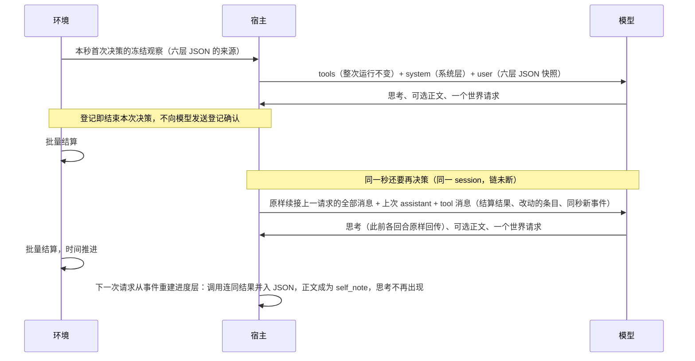

# 特性规格：人物 Prompt 七层与交互修复

> 状态：**FROZEN**。2026-09-27 用户指示实施本方案、不延后任何待实现项，「裁决记录」#21–#38 据此按推荐定为已定，`docs/INDEX.md` 状态列同步；「冻结条款修订」随冻结生效；定稿不等于已实现，实施进度记在实施计划（实施台账）。
> 按[一日运行保真规格](SPEC-dayrun-fidelity.md#冻结条款修订)修订 6–8、10、11、13–15、17–19、24 与其 3.5 改写（一日运行保真 PP1–PP5）：浏览结果列完整标签，工具层增 `callable_index`、
> 地点类不符的生活活动不进窗口，人设层读场景作息覆盖后的卡片、看法与偏好来自 `views`，进度层结果增 `fix`、`items`、`resolved`、`notes`，截断重试，
> `prefer` 与方式「购买」、`from` 可选约束、分段匹配与按名调用，联系人回复的请求字段与守卫，名称类拒绝不计轮数；「系统层」规则列表按修订 7 改为 18 条，
> 与 `LIFE_SYSTEM_LAYER` 同批改写；修订部分已实现并通过离线验收。
> 日期：2026-10-03
> 来源：[人物 Prompt 与交互修复方案](PROPOSAL-decision-context.md)（已裁决，含会话中已确认的决定）；[七层字段与来源](research/persona-prompt-seven-layers.md)；[白领全天根因研究](research/white-collar-dayrun-root-cause-2026-09-28.md)；九路只读核查（宿主协议、观察投影、记忆与人设、交互语义与程序错误、下游、接口合同、冻结规格、设计文档、Schema 一致性）。
> 代码基线：`3ea5b06`，代码与 `bda42ee` 相同。代码与文档的行号都取 `3ea5b06`；AS2 行号取锁定提交 `8768e14`（本机 `vendor/agentsociety2` 子模块未检出，源码取自锁定提交的解包副本）。
> 本文只写现行设计；方案的演变见「版本表」，取舍依据见提案与研究。
> 配套：[实施计划](research/persona-prompt-implementation-plan.md)（实施台账：阶段、文档同步作业、文件修改清单与工程约束）。

> 2026-10-01 按[工具交互规格](SPEC-tool-interaction.md)修订当前工具请求、查询与错误合同；本次设计已冻结，生产代码已实现，旧验收证据不覆盖新增条款。
> 本特性首次受影响的发布升级为场景 4、地图 3、目录 5.0、品类与规则绑定 3，世界结构仍为 8。各阶段独立发布；后续格式或内容再次变化时另升相应版本，禁止同目录版本覆盖内容。

> 2026-10-02 按[个人事务与工作安排规格](SPEC-errands-workday.md#冻结条款修订)修订（逐条作业见其配套[实施计划](research/errands-workday-implementation-plan.md)的文档同步作业，
> 人物 Prompt 规格各行；与一日运行保真 PP1–PP5 以特性名区分）：待办层增 `errands`，进度层增 `errand_reminder`、`errand_completed` 两种记录并略去控制请求的 `errands` 参数，
> 错误合同补个人事务名称与商品名称错误的载体，环境层增 `duty`，人设层 `rhythm` 增 `leave_work`、`arrive_home`、场景作息覆盖扩为七字段，
> `query_world` 改六键且结果不再逐项附候选，第七章补事件种类与可见性、质量报告结构 4 与各结构版本（世界结构 9、场景结构 5、卡片结构 3）；
> 「系统层」第 1、4、6 条随该规格阶段 2、第 1、14 条随阶段 3 与 `LIFE_SYSTEM_LAYER`、接口合同同批原位改写，仍为 18 条；
> 可调用索引补登 `query_categories` 与购买来源写法的更正随阶段 4。阶段 2（个人事务与提示分工）的修订已随代码落地（按 `d09d574` 核对），
> 阶段 3（作息与工作安排）与阶段 4（查询）的修订也已随代码落地。

## 摘要

| 主题 | 要改什么 | 章节 |
| --- | --- | --- |
| 七层请求 | system 为系统层 JSON；user 为工具、人设、记忆、待办、环境、进度六层 JSON；工具定义只经原生 `tools`，整次运行不变；每项信息在整个请求中只出现一次；删除 `scene`、`facts`、身份前言、「怎样过一天」和各独立内容块 | 一 |
| 决策与思考 | 删除决策自述阶段，一次决策只有一个行动阶段，决策就是所选的世界请求；回复正文可有可无，有就作为该调用的 `self_note` 保留到 session 结束；思考只在同一秒的连续决策中续接回传，时间推进后丢弃 | 二 |
| 进度与记忆 | 进度层是当前 session 的有序记录；session 结束时系统派生一条记忆（`settled` 与 `self_notes`）；零点把当日条目并入更早日期；关系与偏好带 `subject`，在人设层原地更新 | 三 |
| 预算 | 沿用发送前整次计数与 85% 阈值：先提前结束本秒续接，再浓缩进度层 JSON，仍超限按容量故障停止；记忆层自带 8000 字符窗口 | 四 |
| 交互语义 | `obtain`、`consume` 增加 `from`、`to`；食用方式由环境确定本人消费，给予方式显式填写人物去向；进食暂停保留本次剩余，结束则丢弃；指名购买不受轮转限制；代点请求与订单关联；联系人可收货，回复时能看到双方往来 | 五 |
| 程序错误 | 七项已登记错误与五项缺口：消息全文、恢复不越过截止、工时达标与提交分开说明、逾期任务保留、小数份、购买记录去重、零条记忆；删除失败后强制等待 | 六 |
| 下游 | `decision_started` 在首个行动请求时写入；清单阶段只剩 `action`、`work_review`；交付不再重新渲染 `scene`；查看器识别七层与续接；导出购买事实；续接效果只报告对比 | 七 |

## 心智模型

人物看到的是一份按用途分层、每件事只写一次的上下文：世界怎样运作（系统层），此刻能对什么做什么（工具层），
自己是谁（人设层），之前发生过什么（记忆层），还有什么没做完（待办层），身体、所在地点与今天的上班安排（环境层），
这一段停留或路程中已经发生的事（进度层）。人物每次决策选择一个世界请求。同一秒接着决策时，
它还记得刚才怎么想；时间一旦推进，它依靠记录下来的事实、待办层里登记的个人事务与自己写下的 summary 继续判断，而不是依靠旧的思考。

三条硬边界不变：只有环境能改世界状态；一次决策恰好一个世界请求，登记即结束，生活决策没有 `finish`；
身体数值、内部身份与预算数值不进入发给人物模型的任何内容。

## 证据与范围

### 证据口径

| 来源 | 实情 | 用法 |
| --- | --- | --- |
| 会话中确认的决定 | 提案「已确认的方案边界」「已确认的交互语义」与「统一修复的程序错误」 | 写入「裁决记录」第一张表，按已定处理 |
| 白领全天运行 `2026-09-28-c9a4fc1-day-r3` | 原始事件在数据集仓库 `WorldMock-Dataset`；本次只读重算了研究中的主要数字（140 次决策均带自述；177 次世界请求中 97 次正文为空；思考中位约 1,258 token；同秒跟进 53/140，最长连续 5 次，用掉 46.5% 的思考 token；咖啡出现在 20 次决策的思考里；缓存命中中位 2,688/19,620 token） | 作症状与规模证据；研究中「跟进与其他决策的思考中位 1,486 与 1,373」按决策汇总与按回复都复现不了，研究须补写统计口径 |
| 代码 | `3ea5b06` 上逐条核对，行号见各章 | 机制一律以代码为准 |
| 提供商协议 | DeepSeek 思考模式文档（在线核对）：请求带 `tools` 时，此前每个 assistant 回合的 `reasoning_content` 都须原样回传，否则返回 400；不在消息中的回合不受此约束 | 决定「本秒原生消息＋进度层 JSON」的切分 |

### 决定方案形状的事实

1. **登记确认从未发给模型。** 世界请求登记后，宿主立即返回（`custom/agents/life_agent.py:720-728`），AS2 循环随之结束
   （AS2 `agent/base/agent_runtime.py:535-538`）；登记确认只留在内存中。提案时序图中的「登记确认」并不存在，本规格直接删除它。
2. **人物对象每次决策都从工作区重建。** AS2 每次决策 `from_workspace`→`step`→`to_workspace`→`close`（AS2 `agent/runner.py:126-131`、
   :162-183），消息在准备阶段清空（`agent_runtime.py:639-648`）；只有 `_react_messages` 为空时才构造初始消息（:830-832）。
   续接所需的消息必须从已持久化的证据重建；宿主在 `prepare_react_loop`（`life_agent.py:615-617`）之后注入即可，不必改 AS2。
3. **工具定义每轮都在变。** 名称枚举按每次观察绑定（`life_agent.py:362-368`、:1121-1142），预算 JSON 追加在 system 尾部
   （:385-390）。实测 141 次两条消息的行动请求有 111 种工具摘要，53 次同秒跟进中只有 11 次与链首相同，缓存命中中位仅 2,688 token。
4. **结果游标靠文本嗅探。** 是否已呈现结果，取决于 `messages[1]` 中有没有 `"progress":`（`src/worldmock/footprints/store.py:185-193`）；
   改成七层 JSON 后会静默失效。
5. **观察重复门禁按决策计。** 同一 user 文本在不同 `decision_id` 中最多出现一次（`src/worldmock/evaluation/behavior_metrics.py:189-211`）；
   续接复用链首 user，按现口径必然失败。
6. **8000 字符记忆窗口在代码中不存在。** 它只是规格常数（`SPEC-agent-interaction.md:161`、:489-494）；代码中主观归纳与 MEMORY.md
   视图各截到 4000 字符（`custom/agents/life_memory.py:168`、:176-181），最近条目按条数取，`recent(limit=0)` 被改回 8
   （AS2 `agent/memory.py:735`）。
7. **就寝反思提供不了关系与偏好。** 反思在醒来那一轮执行（`src/worldmock/life/rhythm.py:505-512`），只产出 `type=reflection`
   （AS2 `agent/memory_runtime.py:68-84`、:545-552）；AS2 记忆条目字段是闭集（`agent/memory.py:46-50`、:694），存不下 `subject`。
   `subject` 只能放在 WorldMock 的请求与事件中（请求原文由 `action_requested` 完整保存，`src/worldmock/life/engine.py:402-406`）。
8. **pause、conclude 的 summary 不在 AS2 记忆中。** 它们只存在活动的记录与 `action_requested` 事件里
   （`src/worldmock/life/session_actions.py:517-539`、`activity_control.py:169-182`），记忆查询取不到，`recall_task_summary` 可以。
9. **展示限制购买资格共有七处。** 呈现窗口（`observe.py:180-191`、:818-833）、Schema 枚举（`life_agent.py:1137-1142`）、宿主校验
   （:1103-1106、:760-762）、宿主菜单映射（:1112-1118）、环境解析（`session_actions.py:110-116`→`interaction_menu.py:127-144`）、
   冻结报价（`session_actions.py:373-379`）与可见凭据（`storefront_runtime.py:21-24`）。

### 权威来源与范围

| 内容 | 权威 |
| --- | --- |
| 本文各章行为 | 本规格 |
| 字段、Schema、错误码、提示模板（系统层全文）与生成参数 | [接口合同](../CONTRACTS.md)（按「冻结条款修订」第 1 行改写） |
| 七层 Schema 的机器可读形式 | 新模块 `src/worldmock/life/prompt_schemas.py`（Python 常量，由 `code_sha256` 覆盖），由接口合同登记；`docs/dev/research/persona-prompt-schemas/` 降为快照 |
| 动作登记、回执隔离、公开结果字段与递归泄漏校验 | [决策上下文规格](SPEC-decision-context.md)（按「冻结条款修订」第 2–7、14、27 行改写，保留这些约束） |
| 地点 session 与活动生命周期、两个名额、同刻上限、批量结算 | [时间与能量规格](SPEC-time-and-energy.md)（除本文所列修订外不变） |
| 个人事务（登记、完成依据与结算、提醒、事件与检查点）、工作安排（`work_schedule` 声明与环境层 `duty` 求值）、`query_world` 的来源与可执行筛选、就寝反思的严格工具通道 | [个人事务与工作安排规格](SPEC-errands-workday.md)；本文只保留它们在七层中的呈现位置与字段 |
| 事件类型与记录字段、检查点、导出与质量报告 | [记录引擎设计](../design/05-recording-engine.md) |
| 实验参数与实验假设 | `docs/EXPERIMENT.md` |
| 验收门禁与测试矩阵 | `docs/VERIFICATION.md` |

**不变**：地点 session、活动生命周期、两个活动名额、出发与到达规则、批量结算与同刻上限的数值；世界请求独立提交与只读查询职责（请求形状按第五章修订）；交互菜单的冻结与剪裁；零点计划与 `revise_day_plan`；人物卡片编译、三次一致性与冻结恢复；记忆只追加，主观记忆固定为
未经核验；就寝反思；私有绑定；提示不含内部身份与身体数值；邮件正文须阅读后才可知。

**不在范围**：见「范围外登记」。

## 一、七层请求

### 请求组成

| 位置 | 内容 | 更新 |
| --- | --- | --- |
| `tools`（原生参数） | 七个世界请求工具、两个世界查询工具与三个记忆查询工具的定义。description 只写用途；参数不带逐轮名称枚举（〔#26〕），名称的合法性由宿主本地校验与环境受理判定。稳定的世界请求与查询工具始终都在，此刻不能用的由工具层 `available`、`reason` 说明，提交时业务拒绝 | 整次运行不变；例外是本次决策只剩最后一个回合时，以及输出截断后的那次重试（[一日运行保真规格](SPEC-dayrun-fidelity.md) 7.2），都去掉全部查询工具，只能给出世界请求（只读问答只剩 `finish`） |
| system | 系统层 JSON（紧凑序列化，键序固定）。生活决策与只读问答各一份固定文本 | 整次运行逐字节不变 |
| user | JSON 数组，依次为工具层、人设层、记忆层、待办层、环境层、进度层六个对象 | 每个时间点构造一次；续接链内逐字节不变 |
| 续接消息 | 同一秒后续决策追加的原生 assistant 与 tool 消息（第二章） | 时间推进后不再出现 |

发送前不做逐层 Schema 校验（已定 #2）；测试用 `src/worldmock/life/prompt_schemas.py` 校验各层构建器的输出。

### 唯一出现原则

每项信息在整个模型请求中只有一处完整内容，其他位置只用名称引用。原生 `tools` 也是请求的一部分。

| 信息 | 唯一位置 | 不再出现的位置 |
| --- | --- | --- |
| 世界交互规则；登记与结果的区别 | 系统层 `rules` | 工具 description、身份前言、「怎样过一天」 |
| 工具名称与参数定义 | 原生 `tools` | 工具层 JSON |
| 目标、动作、方式、条件、价格、耗时、数量；在场的人；持有物（含他处持有物） | 公开工具层的 `groups`；冻结观察保留 `targets` | 场景、事实清单、环境层 |
| 工作合同的截止、剩余要求与前景 | 工具层 task 目标的 `contract` | 待办层、截止提醒事件、活动的客观进度 |
| 进行中与刚结束活动的客观进度 | 工具层 activity 目标的 `state` | 进度层、环境层 |
| 暂停活动的地点、进度与可用的控制工具 | 待办层 | 工具层、进度层、记忆层 |
| 今日目标与提醒时刻 | 待办层 `day_plan` | 目标提醒事件只写目标名 |
| 人物记下的个人事务（名称、要办成什么、已办到哪、备注、提醒钟点、登记日期） | 待办层 `errands`（六层快照内事务的完整行只在这里） | 记忆层（不写 `settled` 句，不进 `self_notes`）、进度层 `tool_call.arguments`（三个控制工具的请求级 `errands` 略去）；别处只以名称引用：进度层 `errand_reminder`、`errand_completed` 记录与成功结果 `details.errands` 回执的 `errand` 键；系统不把事务抄进 `day_plan` 目标行。三处照原始证据回显所写内容的位置不在此列：同秒续接中上一决策原样带回的调用参数与 tool 消息的 `changes.errands`、当天操作备忘 `rejected_today` 的所写与受理写法、被拒结果明细里的所写内容（与 `views` 的现行处理相同） |
| 身份、作息、习惯、口味、关系与偏好的当前看法 | 人设层 | 系统层、记忆层、进度层中 `conclude_activity` 的参数 |
| 体感分级；所在地点或路程的静态信息 | 环境层 | 场景 |
| 今天的上班安排（是否当班、班次起止、工作地点名、休息时段与此刻状态） | 环境层 `duty` | 人设层、待办层、工具层、今日计划目标行；宿主不渲染人物档案里的工作安排 |
| 本 session 的调用与结果、世界事件；在途订单 | 进度层 JSON；链首之后同秒发生的在续接消息 | 记忆层（session 结束后才迁入） |
| 更早 session 与更早日期；跨日未了结的订单与消息 | 记忆层 | 进度层 |
| 人物写下的 summary | 本 session 内是进度层中该调用的参数；session 结束后是记忆层 `self_notes` | 待办层、目标行 |
| 回复正文 | 进度层中对应调用的 `self_note`，只到本 session 结束 | 记忆层 |
| 思考 | 本秒续接消息中 assistant 的 `reasoning_content` | 七层中的任何一层 |
| 邮件正文 | 阅读动作的结果 | 到达事件、工具层 |
| 记忆查询返回的条目 | 本秒续接消息中的 tool 消息 | 不登记进度层事件 |
| 浏览得到的供给 | 工具层商品目标 | 浏览调用的结果只列名称，名称写完整标签「<门店>出售的<商品>」（[一日运行保真规格](SPEC-dayrun-fidelity.md) 5.3） |
| 回看的 summary | 仍在记忆层时不重复，结果只写「已在记忆层」与活动名；不在时写入回看结果 | — |

### 通用格式

- 每层都有字符串字段 `layer`，取固定的中文层名。
- 数量、价格与时长写成人读短语（「约 12 分钟」「32 元」「0.25 份」），不给原始秒数或以分为单位的整数。
- 时刻字段（`*_at`、`date`、`deadline`）用带时区的 ISO 8601；短语里的时刻用场景本地 `HH:MM`，跨日时加「M月D日」；
  `remind_time`（当日目标与个人事务）保持 `HH:MM`，与 `revise_day_plan`、三个控制工具请求级 `errands` 的同名字段同形；
  个人事务的 `noted_on` 为场景本地日期，与 `preferences[].noted_on` 同形；环境层 `duty` 的 `hours`、`breaks` 写成「HH:MM–HH:MM」。
- 没有内容的列表写 `[]`，允许为空的写 `null`，不填编造的值。
- 名称沿用现行的唯一可读标签：交互对象标签须唯一（现行检查在 `projection.py:729-732`，迁入工具层后照旧），活动名重名时追加「（第二次）」
  （`activity_control.py:155`）；他处持有物的名称带地点，保证与手边同名持有物不重名。
- 人物写下的内容（`self_note`、`self_notes`、人设层的看法与偏好、待办层个人事务的名称与备注）是否经核验，由系统层规则统一说明，各字段不逐条标注。

### 系统层

字段：`layer`、`role`、`rules`。`rules` 每条只写一次机制，不要求人物每次写正文；工具 description 不再重复这些规则。
下面是生活决策系统层的定稿文案，冻结后逐字登记进接口合同「请求组成」，并由提示指纹绑定。[个人事务与工作安排规格](SPEC-errands-workday.md)原位改写的第 1、4、6 条（其 3.1，随阶段 2）与第 1、14 条（其 4.6，随阶段 3）都已随代码落地，下列列表即两次改写后的文本，条数仍为 18，与 `LIFE_SYSTEM_LAYER`、接口合同「请求组成」逐字相同，各次改写与代码同一变更集。

`role`：你是模拟世界中的一个人物，依据人设层选择下一步行动；世界的时间、状态与结算由环境负责。

`rules`（每条一项）：

1. 请求由七层组成：本层是交互规则；工具层列出此刻可操作的目标，以及各目标的动作、条件与代价；人设层是你是谁；记忆层是此前各段停留、路程与更早日期中已经发生的事；待办层是暂停的活动、还没办完的个人事务与今日计划；环境层是此刻的身体感受、所在地点与今天的上班安排；进度层是本段停留或路程中已经发生的事。
2. 每次决策恰好提交一个世界请求：start_activity、report_status、pause_activity、conclude_activity、revise_day_plan、submit_work、send_message 之一；提交前可以查询自己的记忆、回看任务或查询已知世界。只读查询可以同批，世界请求单独提交。
3. 世界请求提交后只是登记；环境结算后，结果写进进度层，同一时刻接着决策时，结果随工具结果返回。说打算做或说已经做过，都不等于做了。
4. 进度层的结果与记忆层的 settled 是环境核验的事实；self_note、self_notes 以及人设层的看法与偏好是你自己写下的，未经核验。待办层个人事务的文字是你自己记下的，办没办成由环境按实际结算确认，自己说办完了不算；办成或取消的事务不再列在待办层。消息只核验了对方这样说过，说已经做了、正在赶来，都不等于发生了。
5. 回复正文可以留空；写了会作为该次调用的 self_note 保留到本段停留或路程结束，不进入记忆。
6. 思考只在同一时刻的连续决策之间保留，时间推进后丢弃。以后要买到、拿到或吃掉的具体东西，在 report_status、pause_activity 或 conclude_activity 的 errands 里记成个人事务，它一直留在待办层，到提醒时刻只提醒一次，不会叫醒睡着的你；其他需要延续的打算写进 pause_activity 或 conclude_activity 的 summary，report_status 的 summary 只留到本段停留或路程结束。想记住的事只记以后做决定用得上的新情况，人设层已有的作息和待办层已有的事务不再记。
7. 时间只在你有进行中的活动时推进；没有进行中的活动时，同一时刻会继续请你决策。等待与睡觉也是活动。
8. 你最多同时有两项活动，进行中、暂停与刚结束的都算；活动一结束，同一时刻先用 conclude_activity 收尾，再做别的。
9. 出发前先结束或暂停手上的活动，交谈与通话不能暂停；路上开始的活动不能暂停，到达时与出行一起结束，再逐项收尾。
10. 暂停的活动只能回到原来的地点恢复，用 report_status 点名即恢复；在别处可以直接结束。
11. 工具层列出的动作都可以提交；available 为 false 的会被拒绝，原因就是 reason 所写，照着调整即可。
12. 名称照工具层、待办层中的写法填写；商品、生活活动、内容、地点都可以直接写名称，即使此刻没有展示；写得不准时会返回最接近的候选，不会替你改。
13. start_activity 一项一个对象，写 target、way、from、to；方式决定动作。to 写 null 统一表示本人，给他人写实名；给予必须写他人，其他非转移动作的 from、to 都写 null。购买 from 可写门店或渠道，prefer 必须写最快拿到或到手价最低；不购买时 prefer 写 null。替别人办事时用 answering 关联未回复消息。
14. 人设层的作息和习惯是你平常的过法：到了平常的钟点、在平常的地方，就照平常做；今日计划写明今天与平常不同的安排时，按计划；身体的感觉没到更强的一档，就不为它改作息。人设层没写作息，或者今天不在平常的环境里，就按身体的感觉来。环境层写了上班安排的日子，那是定下的安排，不是习惯：今日计划改不了它，手上的工作交了也还在班上，写明的休息时段和工作要求去别处的外出除外。
15. 你会饿、会困、会累，饿着或困着做事会慢，走路比坐车更费力。只是「有点想吃」时，等平常的饭点再吃正餐，离饭点还早可以喝点东西或吃点手边的零食；到了「饿」，离平常饭点一小时以内可以提前准备或下单，更早就先垫一点；到了「很饿」或更饿，别等饭点，马上弄吃的。手边的、在路上的、这里能买的、能送到这里的都算；下单后要等送到，拿到手才能吃。每个饭点的正餐只吃一次，提前吃过的那顿就算吃过了。
16. 晚上照人设层作息里的就寝时间去睡（没写就寝时间，就困了再睡）：有点乏、困是睡前的常态，不必因此提早上床；很困或撑不住了可以提前，精神还好也可以晚些。想在某个时刻起来，就给今日计划的目标写上提醒时刻；睡着时只有提醒或睡够了才会醒，早睡也就早醒。
17. 工作要在要求的地点做，留意截止时间与已完成的有效工时；工时达标不等于已经提交，提交前先结束正在做的工作，过了截止再提交会被拒绝。
18. 花钱量力而行；有人找你时，按你们的关系与当时的情况回应。联系人只能发消息或通话，不会来到你身边。

只读问答的系统层：`role` 为「你是模拟世界中的一个人物，依据人设层与记忆层回答外部问题。」；`rules` 为：
（1）请求由人设层、记忆层与外部问题组成；（2）记忆层的 settled 是环境核验的事实，self_notes 与人设层的看法、偏好是你自己写下的，
未经核验；（3）只能查询自己的记忆，不能改变世界，也不写入记忆；（4）回答完成后单独调用 finish。

### 工具层

字段定义见 `prompt_schemas.py` 的工具层 Schema。冻结观察的本层 JSON 保留 `targets`；发给模型的本层 JSON 为 `{layer, groups, callable_index}`，其中只列名称的可调用索引 `callable_index`
（[一日运行保真规格](SPEC-dayrun-fidelity.md) 5.2）；工具定义只在原生 `tools` 中。

| 冻结观察与解组后的字段 | 含义 |
| --- | --- |
| `name`、`kind` | 可读名称；类别取地点、商品、人物、内容、游戏、目录、生活、任务、活动、消息、自己（在提案八类之外补游戏、目录、生活，场景联系人并入人物） |
| `phase` | 只有活动目标有：「进行中」或「刚结束」；其他为 `null` |
| `state` | 此刻的可读状态：营业情况、每份热量、在场的人在做什么、内容剩余与否、邮件是否已读、活动的客观进度（刚结束时写终态原因）；没有时为 `null`。工作活动不再写「还差」，剩余只在 `contract` |
| `contract` | 只有任务目标有，恰好 `opens`、`deadline`、`place`、`remaining`、`outlook` 五键；`opens` 为带时区开放时刻，`place` 为公开地点名；`remaining`（有效工时的达标情况，例如「有效工时已达标（约 6.4/4 小时）」）、`outlook`（「到截止前做不完」「已过截止」或 `null`） |
| `actions[]` | 冻结观察保存的动作与方式；`action` 是环境由方式推导的五类动词之一，人物请求不再填写，`way` 取方式闭集（新增「给予」）；`available`、`reason`（不可用时必填，可用时为 `null`）；`price`、`duration`、`quantity`（可为小数份）、`note` |
| `tools[]` | 以本目标名称为参数的其他工具（`report_status`、`pause_activity`、`conclude_activity`、`submit_work`、`send_message`），各带 `available`、`reason` |

- **可用性只有一个来源。** `available` 与 `reason` 由一个与环境受理同序的判定函数产生（菜单→同刻阶段→待收尾→名额与出发前→准入组→
  对象自身条件，`engine.py:1004-1011`→`session_actions.py:77-81`），`reason` 取拒绝时的原文。提示与拒绝一字不差。
- **列出即可提交。** 列出的动作都可以提交；不可用的由环境以同一原因业务拒绝。受限轮与待收尾期间，其余动作标 `available=false`，
  原因分别是同刻限制与 `Conclude the completed activity <活动> first.`。运行内可能满足的条件照常列出并标原因。
  已知任务即使技能不足也保留合同并写明不可用原因；没有路线的地点不列入可达候选。
  这一条只约束进了窗口的目标的动作：地点类不符的生活活动在生成候选时就不进窗口（排除项记 `ELIGIBILITY_LOCATION_KIND_MISMATCH`），
  仍可按名调用（一日运行保真规格 5.1）。
- **活动也是目标。** 进行中与刚结束的活动是控制工具的对象；暂停的活动只在待办层。
- **他处持有物与送达的订单。** 他处持有物作为目标列出，名称带地点，食用与使用标不可用并写明只能在当地用；送达的订单成为持有物目标。
- **逾期任务保留。** 未付款的逾期任务保留到截止当日的本地日结束：`outlook` 写「已过截止」，`submit_work` 标不可用并写原因（第六章）。
- **展示不是资格上限。** `targets` 是本轮展示的目标；所有目录类对象都可以按名调用（一日运行保真规格 3.1），指名购买按第五章解析，不受轮转与可见期限制。
- **可调用索引。** `callable_index` 只列此地此刻可做的生活活动名称，内容和商品只给品类计数与每类至多 3 个示例名；
  另有 `query_categories[{category, count}]`，列 `query_world` 的 `category` 可写的公开类别标签与本轮查询权限内该类的完整条目数
  （整数，不按呈现窗口截断，也不受查询筛选影响）；它不是目标，不带动作与条件，
  不计入单次呈现上限、计入整次请求的容量计数；索引里的名称按名调用，受理时照常做资格与准入判定。
- **`to` 的候选**是 `null`（本人）或本层的他人人物目标。

### 工具层的紧凑编码与即时查询

公开工具层恰为 `{layer, groups, callable_index}`；每组为 `{kind, action, way, shared, targets}`。
控制对象的 `action`、`way` 为 `null`，仍保留控制工具和状态；解组按名称合并并逐值恢复全部公开字段，
冲突元信息是渲染错误。只省略 `null` 和空集合，保留 `false`、零值与明确的未知原因。
工具层提示使用按对象类别与方式分组的紧凑 JSON：共同字段只写一次，名称、可用性及其差异留在组内，
空字段省略，共同不可用原因提至组级；续接 `changes` 使用同一确定性编码。
编码必须能无损还原目标、方式、可用性、原因、价格、时长、数量、任务合同和其他工具可用性；
冻结观察的工具层结构、私有绑定、可调用索引与世界权限不变。紧凑编码不是预算浓缩，不能减少对象或事实。

`recall_task_summary`、`query_world` 与 `memory_recent`、`memory_search`、`memory_time_range` 属于只读查询，
在生活决策中可同批调用；整批参数通过校验后按请求顺序返回。查询不登记世界请求、不结束决策、不推进模拟时间、
不增加同刻轮数，每次实际模型回复仍占用 `MAX_REACT_TURNS=16` 的回合预算。世界请求必须单独调用，
与查询混批或含多个世界请求时整批拒绝，所有调用均未执行。
`query_world(name, way, category, from, available_only, offset)` 六键均必填、无缺省，旧四键请求按缺字段拒绝；
`name`、`way`、`category`、`from` 为 `str|null`，非 null 不得为空白，四者至少一个非 null（全空时在四个位置各报一条，不落在空根位置），只写 `from` 合法；
`name` 只写对象名称，`from` 只写购买来源：地点显示名（含「家」「住处」）或渠道称呼，与 `start_activity` 购买项的 `from` 同名同义、同一解析函数，
只匹配供给条目（门店名写在 `name` 里仍按地点目标匹配）；`available_only` 为严格布尔（拒绝字符串、数字与 null），
`true` 只留本轮冻结观察里已确认此刻可执行的条目（报价或营业未知的也滤掉），不单独构成查询条件；
`offset` 为严格非负 JSON 整数（拒绝布尔值、数字字符串及浮点数），首批显式写 `0`，不能省略；`way` 取现有方式闭集，
写「购买」及其同义写法时等同于同时写「到店」与「远程下单」；`category` 匹配公开 `callable_index.query_categories` 的类别标签。
查询只读取本轮冻结观察、已有私有绑定与可调用索引权限内的完整匹配集合，
不读未揭示邮件正文、不公开超权限报价或世界库存，不替代耗时浏览的揭示行为。
筛选在排序与切页之前施加，不产生可见凭据、不扩大读取权限；`from` 不按需求反查门店、不算路线、不按距离或价格排序。
`query_world` 的固定返回为 `{matches, total_count, next_offset}`，不新增说明键；`matches` 每项是冻结目标的无损紧凑投影
（键取 `name, kind, phase, state, contract`（仅任务）`, actions, tools`，动作取 `action, way, available, reason, price, duration, quantity, note`），
只省略 `null` 与空集合，`false`、零价格、零剩余与明确的未知原因逐值保留，紧凑规则复用工具层分组已有的实现；
不再逐项附完整请求候选（候选只出现在错误合同里）；每批沿用现有 `candidate_presentation_limit=20`；
`total_count` 是全部筛选取交集后的完整匹配数，`offset` 的合法范围按它计算，`next_offset` 必填可空。
还有结果时返回下一批偏移，没有更多结果时为 `null`；同一冻结观察内重复传回偏移可遍历筛选后的全集。
各键取值合法、`offset` 在范围内时，除两种查询参数错误（`from` 既不是地点显示名也不是渠道称呼；`from` 为 `null`、`name` 按对象名称无任何匹配且其写法恰是一个渠道称呼）外，
任何筛选组合无匹配都返回 `matches=[]`、`total_count=0`、`next_offset=null`，不报错、不自动放宽、不换来源（`total_count` 为 0 时合法的 `offset` 只有 0，越界仍按既有错误处理）；
两种参数错误的顶层与明细码都是 `ARGUMENTS_INVALID`，候选是换了 `from`（或把该值移到 `from`、`name` 写 `null`）的完整 `query_world` 请求；不另设分页配置。
查询结果即时通过原生 tool 消息返回，留存于模型交互证据；外部只读问答仍只开放人物记忆查询与 `finish`。

### 人设层

| 字段 | 含义 |
| --- | --- |
| `identity` | `name`、`age`、`occupation`、`living_arrangement` |
| `rhythm` | 键序 `wake, leave_home, lunch, leave_work, arrive_home, dinner, bedtime, sleep_midpoint, sleep_need`：起床、出门、午餐、下班、到家、晚餐、就寝窗口与睡眠中点、睡眠需要，均为可读短语；`leave_work`、`arrive_home` 没有固定时刻或故事未提及时为 `null`，不取缺省（刻钟也要写对，现行 `_hour_text` 只识别半点，`src/worldmock/profile/textgen.py:53-56`） |
| `habits` | 至多五条 `{trigger, response, time_window}` |
| `tastes`、`coping` | 卡片原有的口味与压力时的应对方式 |
| `relationships[]` | `person`、`role`、`closeness`、`channels`、`view`（人物对此人的最新看法；提案中的同名字段 `self_note` 改名为 `view`，以免与进度层的 `self_note` 混淆） |
| `preferences[]` | 人物写下的偏好 `{subject, preference, noted_on}`，`noted_on` 为写下的本地日期 |

- **来源。** 新建运行时，卡片的结构化字段另存进人物 `profile` 的 `persona_card_struct`（现行 `profile` 只存渲染文本，`src/worldmock/runtime.py:1064-1071`），
  恢复时校验。宿主用它与人物姓名、场景联系人渲染人设层；环境只下发由事件派生的看法与偏好。卡片结构版本升为 3（抽取提示 `card-v3`，
  时间锚点增必填可空、不取缺省的 `leave_work`、`arrive_home`，抽取时单独取共识；新锚点乱序时按固定顺序降级为 `null`：单次采样只为放行校验而降级，
  不写回载荷、不触发解析重试，降级说明只在共识后的最终卡片上生成，不让卡片编译失败；降级说明经 `PERSONA_AGREEMENT_LOW`（改为泛指画像编译留下的警告）
  进运行输入警告），三次一致性与冻结恢复的机制不变，缺这两个必填键的旧结构化卡片在恢复校验时被拒；
  `render_card` 在两个新锚点各自非空时各追加一个分句（下班、到家；都为 `null` 时输出逐字节不变，追加分句计入 600 汉字预算），
  输入的卡片先经场景作息覆盖：场景显式声明的七个作息字段（`chronotype_midsleep`、`sleep_need_hours`、`lunch_window`、`dinner_window`、
  `bedtime_window`、`leave_work_window`、`arrive_home_window`）覆盖卡片抽取值，卡片槽为 `null` 时同样可覆盖；覆盖与冲突规则不变并一体适用于两个新槽：
  场景声明的窗口落下后违反顺序约束，或量化后写不成合法窗口时，该槽保留卡片值（新槽的卡片值可以是 `null`）并记 `CARD_FIELD_CONFLICT`；
  `persona_card_struct` 保存覆盖后的值，所以 `rhythm` 与身体结算、零点计划读同一组作息（一日运行保真规格 2.1）；
  600 汉字上限只约束卡片派生的字段。没有结构化卡片的人物（`custom/agents/life_context.py:13-22`）只填姓名，其余为 `null` 或 `[]`。
- **合并。** 卡片关系与场景联系人按名称精确合并（卡片 `name_or_appellation` 等于联系人姓名或称谓）；对不上的各占一项。只来自场景联系人的项，
  `closeness` 为 `null`、`channels` 为 `[]`：场景联系人的亲密度与渠道仍不进提示（接口合同 :569 不变，〔#35〕）。
- **原地更新。** `view` 与 `preferences` 只来自成功的 `conclude_activity` 中 `type` 为 relationship、preference 的看法与偏好（〔#33〕）：
  请求里写在各项的 `views`（`about` 写对象），宿主转为存储的 `subject`，存储形状不变（一日运行保真规格第六章；原为带 `subject` 的 `memories` 条目）；
  同一对象按事件顺序取最后一条，存储仍只追加。relationship 的 `about`（存储为 `subject`）须是已知人物（卡片关系名、联系人姓名或称谓、同世界人物名）。
  这两类条目只在人设层出现，不进记忆层，也从进度层该调用的参数中略去。
- **反例。** 购买本身不写偏好。首次购买后人物只写了「明天还想吃」这类非偏好记忆时，`preferences` 为空；巩固摘要不进提示（〔#36〕）。

### 记忆层

| 字段 | 含义 |
| --- | --- |
| `earlier_days[]` | `{date, settled, self_notes}`：起源于该日且此刻仍未了结的事实，加上归属该日的就寝反思 |
| `earlier_today[]` | `{recorded_at, settled, self_notes}`：今天已结束的每个 session 一条，`recorded_at` 为 session 结束时刻；没有可保留的内容就不出现 |
| `settled` | 系统写的确定性句子，规则见第三章 |
| `self_notes` | `[{activity, text}]`：pause、conclude 写下的 summary 与记忆原文，按活动名标注 |

记忆层在构建提示时由环境从已提交事件与世界状态派生（〔#32〕），不新增持久状态；构建结果随观察事件保存，导出的就是模型所见。
窗口、零点与不写入的内容见第三章。

### 待办层

| 字段 | 含义 |
| --- | --- |
| `paused_activities[]` | 按暂停时刻从老到新，同刻按事件顺序：`name`、`paused_at`、`place`（只能回这里恢复）、`progress`（客观进度短句；进食写「已吃 0.2 份，剩 0.8 份」）、`tools[]`（`report_status` 表示恢复，`conclude_activity` 表示结束，各带 `available`、`reason`；人在别处时恢复标不可用，原因点名地点） |
| `day_plan` | 零点计划生成前或当日结束后为 `null`；之后为 `{date, goals}`，至多八条，保持计划顺序 |
| `day_plan.goals[]` | `intent_kind`（十一种意图）、`goal`、`progressed`、`remind_time`、`around_time`（两种时刻均只显示 `HH:MM` 或 `null`） |
| `errands[]` | 必填，没有时为 `[]`，层键序为 `layer, paused_activities, errands, day_plan`；未完成的个人事务，按登记时刻、同刻按身份排序，至多 8 条：`name`（人物起的名称）、`done_when`（可读短语，如「取得素炒什锦食材包 2 份」）、`progress`（可读短语，如「已取得 1 份」）、`memo`（人物写的备注，可为 `null`）、`remind_time`（尚未提醒的钟点 `HH:MM`；没有或已提醒为 `null`）、`noted_on`（登记的本地日期）；行内不含内部身份、状态枚举与可用性 |

`paused_at` 是活动状态的新字段（随世界结构版本 8），暂停时写入、恢复时清空；排序不再用开始时刻（现行 `src/worldmock/life/models.py:639-643` 按开始时刻）。
`progressed` 为真只表示目标得到推进，不等于完成。目标行不显示人物自述：`PlanGoal.progress_note` 照存，不进提示。

个人事务不放进 `day_plan`：零点置空、零点计划与 `revise_day_plan` 整表替换都不增删它，跨午夜保留；办成（环境按结算确认）或取消后从本层消失；
本层不浓缩，也不重算可用性。新增、更新、取消只经 `report_status`、`pause_activity`、`conclude_activity` 的请求级 `errands`，
完成依据、提醒与上限见[个人事务与工作安排规格](SPEC-errands-workday.md)第二章。

### 环境层

| 字段 | 含义 |
| --- | --- |
| `observed_at` | 当前观察时刻 |
| `body` | 五项体感分级 `appetite`、`sleepiness`、`entertainment`、`social`、`mood`，取值就是现有分级文字（`src/worldmock/life/felt.py:283-295`）；数值不进提示 |
| `location` | `session_kind`（`stay` 或 `transit`）、`name`（停留时为地点名，路程中为路段标签，现行路程中误写出发地）、`place_type`（停留时为场所类型的中文标签，路程中为出行方式）、`fixed_rules`（场所的固定规则，取菜单排除的动作的可读说法；现有场景菜单全开时为 `[]`） |
| `duty` | 必填可空，排在 `location` 之后，由环境按场景 `work_schedule` 与世界时钟求值：人物没有工作安排为 `null`；当日不当班为 `{"day": "休息日", "hours": null, "place": null, "breaks": [], "status": null}`；当日当班为 `{"day": "工作日", "hours": "09:00–18:00", "place": "<工作地点名>", "breaks": ["12:00–13:30"], "status": "<状态>"}`，`status` 取「未到上班时间」「当班中」「休息时段」「已下班」，只由时钟与班次决定，不含人物在不在场；键与值不含内部身份。它是呈现的事实：今日计划、`revise_day_plan` 与工作提交都不改变它，环境不因它新增任何拒绝 |

### 进度层

`session_started_at` 为当前 session 的开始时刻；`events` 是本 session 的有序记录：按 `occurred_at` 排列，同一时刻按事件序号。
JSON 部分写到构造本请求快照的那一刻：续接链的快照在链首决策时构造，此后同秒发生的事只经续接消息出现；不续接的请求写到此刻。

| `type` | 内容字段 | 含义 |
| --- | --- | --- |
| `tool_call` | `tool`、`arguments`、`result`，可选 `self_note` | 一次世界请求连同公开结果。全部即时查询保存在模型交互证据，不登记 `action_requested` 或进度层事件；`conclude_activity` 参数略去 relationship、preference 记忆（改形后即各项的 `views`）；`report_status`、`pause_activity`、`conclude_activity` 的参数略去请求级 `errands`（先例：`views`），本 session 内由结果的回执可见 |
| `message_arrival` | `sender`、`kind`（`direct`、`chat_invite`、`mail`），`text` 或 `subject` | 直接消息与交谈邀请带全文；邮件只有主题，正文在阅读结果中；邮件的 `sender` 可为 `null`（场景没有发件人字段） |
| `delivery` | `order`、`status`、`message` | 订单的可读名称与送达进展；`status` 取 `ready`、`delivered`、`cancelled` |
| `task_deadline` | `task`、`stage` | `due_soon` 在截止前 1800 秒（与唤醒同源），`expired` 在截止时刻；截止时刻本身只在工具层 |
| `plan_reminder` | `goal` | 当日目标的提醒到时；提醒时刻本身只在待办层 |
| `errand_reminder` | `errand` | 个人事务的提醒到点，只写事务名；提醒钟点本身只在待办层；同一边界到期的多条事务各一条 |
| `errand_completed` | `errand` | 环境按结算证据确认事务办成，只写事务名；该事务随后从待办层消失（取消的事务不产生记录） |
| `condensed` | `until_at`、`lines` | 预算浓缩产生的折叠记录，`lines` 为 settled 写法的句子（第四章）；`errand_completed` 折成一句只含时刻与事务名的句子（只用于折叠，记忆层不为它写 `settled` 句），`errand_reminder` 与 `plan_reminder` 一样折叠后不留句 |

- **`result`** 含 `occurred_at`、`status`（取现行动作状态闭集）、`error_code`、`message` 与 `details`，工作结果另带公开 `work_review`。
  `details` 只放本次新产生的可读事实（商品、份数、付款、送达地点与时刻、计划时长、进食的实际份量、终局 `outcome`、近似候选 `candidates`、个人事务变更的回执 `errands`（`[{errand, change}]`，`errand` 为事务名称；只在成功结果里，被拒结果没有该键）），不复述参数（个人事务变更的回执是声明的例外），不含内部身份与资源账户。调用与结果合为一条记录，不给模型任何调用编号。
  按一日运行保真规格第四章，宿主纠错与环境拒绝共用一个错误结构（`error_code`、`reason`、`fix`、`items`、`unmet`）：公开的 `details` 另增
  `fix`（一句可照做的改法）、逐项明细 `items[]`（`path`、`written`、`error_code`、`allowed_values`、`expected`、英文 `why` 与至多 3 个可照填的 `candidates`）、
  受理时的归一结果 `resolved` 与说明 `notes`；`message` 直接取 `reason`，不再拼成英文前缀。
- **业务拒绝**照常记录，带 `error_code` 与 `details` 中的原因和下一步；协议纠错不伪造世界事件，结构化纠错保存于 `model_response.data.protocol_feedback` 并派生当天操作备忘。
- **session 下界。** 运行开始为 0；到达（发生在时钟推进中）取该 session 的开始时刻；由决策引起的切换（出发、途中结束出行）取引起切换的
  那条结果的事件序号，为此 `SessionState` 增 `opened_by_action_id`（随版本 8）。结果游标及其文本嗅探删除。
- **截止与提醒**由截止时刻与提醒写入时刻推导，不新增事件类型（现行 `task_expired` 事件不带人物身份，按人物读取不到）；
  个人事务的两种记录由人物可见的 `environment_event`（`kind` 为 `errand_reminded`、`errand_completed`，`visibility=agent`）派生，不由状态推导（办成的事务已移出状态），
  来源事件计入 `progress_event_ids`，事件类型闭集不变。

进度层另有 `rejected_today` 当天操作备忘：从本人当天已持久化的 `model_response.data.protocol_feedback`
与非重放 `action_rejected` 确定性推导，跨时刻和地点会话保留，跨场景本地日期清空。
每条恰含 `written`、英文 `why`、`times`、`last` 与可空的 `accepted_as`；按原始证据中的相同工具、参数位置和原文合并，
最近使用的至多八条，每条英文 `why` 至多六十字符。它说明系统曾怎样拒绝，不重放整段调用或模型思考，
不新增检查点字段、不写入或迁入人物记忆；会话事件 `events` 的范围仍只限当前会话。
同秒续接对备忘的更新随 `changes.rejected_today` 整体替换，链首快照保持逐字节不变。

所有接口错误均使用英文 `reason`、`fix`、`message`、`why` 与错误日志，中文对象名保留原样。
错误顶层沿用 `{error_code, reason, fix, items, unmet}`；`items` 必须定位实际错误，
每项为 `{path, written, error_code, allowed_values, expected, why, candidates}`，不保留旧 `index`、`field` 定位字段。
`path` 是从工具调用根开始的完整位置数组，如
`["tool_calls", 0, "function", "arguments", "items", 0, "views", 1, "type"]`。
有限枚举在 `allowed_values` 完整列出；无枚举时为 `[]`，`expected` 写明类型、范围、格式、字段关系或世界条件。
未知工具定位 `function.name` 并列出本次实际提供的合法工具；组合错误定位 `tool_calls` 并说明合法调用组合。
不完整 JSON 定位该调用的 `function.arguments`，`expected` 含解析器的行列与该工具参数所需的闭集，
不推测尚未成功解析的参数字段。所有可独立确定的参数与名称错误一并报告，不能用一个粗略顶层字段掩盖嵌套位置。
候选统一为 `{tool, arguments, note}`，`note` 为英文说明或 `null`；`arguments` 是该工具完整合法的新请求，候选可原样提交。
`prefer` 的错误枚举按已合法的方式判定：含购买项返回 `["最快拿到", "到手价最低"]`，
没有购买项返回 `[null]`；尚不能判明方式时列声明的三值并说明跨字段约束，不猜购买类型。
名称字段不是封闭枚举，不把全量商品名塞进 `allowed_values`。
个人事务的名称与商品名称错误不带 `candidates`（与控制工具活动名错误的现行做法一致：完整请求候选要回显人物刚写的 summary 与记忆文字）。
更新、取消的 `errands[j].name` 找不到或不唯一时报 `NAME_NOT_FOUND`、`NAME_AMBIGUOUS`，`allowed_values` 列本人全部未完成事务名（至多 8 个，是此刻的有限集合），不替换；
新增的 `errands[j].item` 解析不到唯一商品时同码，最接近的至多三个商品名写在 `why`，仍不把全量商品名放进 `allowed_values`；
结构、交叉约束、重名与上限错误为 `ARGUMENTS_INVALID`，`path` 完整到 `errands[j].<键>`，`expected` 给类型与格式，上限随校验原因写在 `why`。
业务前置条件中所有可独立确定的问题按既定准入顺序列出，
定位有关请求参数并给合法方式或下一步；需要合法对象才能判定的条件不凭空推断。

## 二、决策、回复正文与思考

### 单一行动阶段

- **删除决策自述阶段。** 删除 LifeAgent 对自述钩子的覆写后，AS2 基类钩子返回 `None`（`agent_runtime.py:541-551`、:567-569），锁定的 AS2 不改。
  一次决策只有一个行动阶段，可以先做只读查询，也可能有协议纠错回合；世界请求登记即结束本次决策。
- **生成参数**沿用接口合同生成参数表的行动行（thinking 开启、`tool_choice=auto`、`max_tokens=8000`）。输出在思考阶段用尽而截断
  （`finish_reason=length` 且正文为空）时，丢弃截断的回合，改发错误码 `OUTPUT_TRUNCATED` 的结构化纠错（相同纠错替换、不叠加），
  并以关闭思考、`tool_choice=required`、`max_tokens` 不变的请求重试一次；只有这一次重试这样发送，`reasoning_effort` 仍不发送；
  上限保持 8000（一日运行保真规格 7.2，裁决 D10）。
- **回合预算**：每次决策至多 16 个回合（`MAX_REACT_TURNS`），全部归行动阶段；为世界请求保留 1 个回合，剩余不少于 2 个时才开放全部只读查询。
  预算 JSON 与低预算提示不再追加到 system（`life_agent.py:309-314`、:385-390）；耗尽时的处理不变。
- **`decision_started`** 在本次决策的首个行动请求（`phase=request`、带生活工具、thinking 开启、无 `purpose`）与该请求同批提交，排在请求之前；
  `data` 为闭集 `{round_id, round_order, world_state_version, wake_reasons}`。引擎直驱路径的兜底写入保留。
- **登记后不追加任何 tool 消息**；`ActionReceipt` 仍在宿主侧完整保存，用于审计与幂等。记忆查询的结果只序列化一次
  （现行在 observation 与 data 两处重复，`life_agent.py:800-801`）。

### 回复正文

- 提交世界请求那一次回复的非空正文，写入 `action_requested.data.self_note`；只做只读查询的回复，其正文随续接消息保留，折叠后不再出现。
- 不要求、不重问、不代写；进度层中对应调用带 `self_note`，只到本 session 结束，不进入记忆。
- 交付时，`self_note` 作为实际请求的一部分进入动作与意图窗口，并进入 dreaming 输入（第七章）。

### 同秒续接

**成链条件**：同一人物在同一模拟秒内的相邻两次决策，同一 session；两者之间没有反事实干预；此前各 assistant 回合都带非空
`reasoning_content`；上一决策以恰好一个世界请求结束。条件不满足即断链，下一次请求从新快照构造，进度层写到此刻，此前的思考不再出现。

**缓冲来源**（〔#28〕）：环境从模型证据重建上一决策的末次请求与响应，在观察事件提交后挂到观察返回体的私有键上交给宿主；
不另存、不导出，并加入禁止渲染的键表。普通恢复同样可以续接；反事实分支一律断链（〔#29〕）。

**消息布局**：决策 k+1 的消息 = 决策 k 末次请求的全部消息（system、链首快照 user、此前各原生回合，含全部只读查询与纠错回合）
＋ 决策 k 的最终 assistant 消息（`reasoning_content`、`content`、`tool_calls`）＋ 一条对应其世界请求 `tool_call_id` 的 tool 消息。
续接本身不改变原生 `tools`。

**tool 消息**（〔#27〕）是一个 JSON 对象，空键省略：

| 键 | 内容 |
| --- | --- |
| `result` | 该世界请求的公开结果，与进度层 `tool_call.result` 同一投影 |
| `changes` | 相对于模型当前所见（链首快照依次叠加此前各 `changes`）的改动：`targets` 的 `updated`（完整目标对象）与 `removed`（名称）；`paused_activities` 的 `added` 与 `removed`；`errands` 的 `added`（新增或内容有变的完整行）与 `removed`（名称）；`day_plan` 整体替换；`body` 整体替换；`relationships`、`preferences` 的更新项。以最新为准 |
| `events` | 链首快照之后同秒发生、且不是本结果的进度层事件，例如他人同秒发来的消息（带全文）；个人事务的 `errand_reminder`、`errand_completed` 有来源事件，同秒发生时在这里出现，每条只出现一次（办成的事务另在 `changes.errands.removed` 列名称） |

记忆层、`location` 与环境层 `duty` 在链内不会改变：它们只随时间推进或 session 切换而变，而这两者都会断链。

**折叠**：不需要单独的转换步骤。时间推进后，进度层从事件重建：调用来自 `action_requested`，结果来自 `action_result`，
`self_note` 来自 `action_requested.data.self_note`；思考从不读取，纠错回合丢弃。

**上界**：链长不超过同刻上限加受限轮（交谈对方结束另加的轮次照旧计入），每次决策另受 16 个回合约束。名称类拒绝不计同刻轮数
（每人每秒至多 2 次不计，一日运行保真规格 3.4），链长上界相应至多另加这 2 次。

**协议自检**：发送前检查续接链中每个 assistant 都带 `reasoning_content`；缺失就断链。本次决策内缺失时以明确的英文错误失败。

**开关**（〔#31〕）：运行参数 `same_second_continuation`（缺省开），冻结进清单 `stages.action` 与人物配置，恢复与重放继承父清单的值，
不能覆盖。关闭时每次决策都从新快照构造请求，只用于对比运行。

### 只读问答

system 为只读系统层；user 为人设层与记忆层两个对象组成的 JSON 数组，外部问题作为其后一条 user 消息原样给出。
两层取自最近一次生活决策保存在人物工作区的快照（〔#38〕），运行开始后尚无决策时记忆层的两个列表都为空。工具只有 `memory_recent`、
`memory_search`、`memory_time_range` 与只读 `finish`；不写世界与记忆，不产生决策事件。

### 删除与去重

| 旧内容 | 处理 |
| --- | --- |
| 身份前言与「怎样过一天」 | 删除；世界规则只在系统层写一次，身份只在人设层 |
| 工具 description 中的协议与阶段规则、`_ACTION_PROTOCOL` | 移入系统层；description 只写用途；数值上限由 Schema 与本地校验报错 |
| 场景与事实清单（可达地点、路线、商品、库存、在场的人、交互对象、工作任务、联系人、收件箱） | 按唯一出现原则分入各层 |
| `just_now`、`inbox_head`、`inbox_has_older_unread`、`todos_summary`、`local_food_summary`、`precondition_hints`、`same_moment_note`、`drive_summary`、`experiences`、`progress.sessions`、`current_epoch` | 删除 |
| 人物卡片里的当下处境 `situation` | 不进提示；卡片编译照旧 |
| 主观归纳、最近条目窗口、已核验经历句子 | 删除提示块；私有 `verified_experiences` 证据保留（记忆写入证据依赖它） |
| 决策自述阶段与「你刚才心里想的是」 | 删除 |
| 登记确认 | 删除（从未发给模型） |
| 预算附录、低预算提示 | 不再追加到 system |
| `memory_step_range`、`memory_tick_range` | 生活决策不再开放（〔#37〕）：提示中没有步号与秒数坐标 |
| 任务的 `new_material_chars`、`required_skill`、`minimum_skill` | 删除这些内部参数；技能不足的已知任务保留合同和准确不可用原因 |

## 三、进度与记忆的更新

### session 与记忆条目

- **边界。** session 由出发、到达、到达被拒、途中结束出行、实验截止切换（`session_actions.py:169-174`、`engine.py:1439-1447`、
  `session_actions.py:620-621`、`engine.py:635-639`）。会话切换仍不写事件；记忆条目按边界所在的提交识别。
- **归属。** 一个 session 的记录区间是「前一边界提交的末事件序号，到本边界提交的末事件序号」，同一提交按 `state_version_after` 聚合：
  出发请求整体归旧 session；到达那一秒的收尾调用归新 session；路程中收到的消息、送达与发出的消息归路程 session。
- **不新增工具或模型总结请求，不为 session 建档。** 条目是派生视图；会话本身仍不写总结。

### `settled` 的写法

只收人物可见、状态为 `completed` 或 `in_progress`、且不是重放的结果与世界事件。句式由共享模块生成（同时替换 `day_plan_inputs.py:153-177`
与 `projection.py:327-344` 的旧句式），金额按元，份数至多两位小数，时长用人读短语，跨日加「M月D日」。

| 来源 | 句式 |
| --- | --- |
| 瞬时世界请求（下单、给予、发消息、提交工作） | 各一句：「10:20 远程下单牛肉炒面 1 份，付 32 元，预计 10:35 送到练秋湖研发中心办公室（回应王磊 10:15 的消息，收货人王磊）」「HH:MM 给<人>发消息：<全文>」「HH:MM 提交「<任务>」，通过／未通过」 |
| 在本 session 结束的活动 | 每项一句：起止（含暂停区间）、终局（按计划、提前结束、到达、对方结束、失败）、实际份量或有效工时；完成的浏览另写浏览到的完整标签「，浏览到<门店>出售的<商品>、…」（[一日运行保真规格](SPEC-dayrun-fidelity.md) 5.3，没有取得结果的浏览不写） |
| 世界事件 | 收到直接消息（全文）、邮件（主题）、送达、新工作，各一句 |

不写：失败的请求、记忆查询、回看、`report_status`、暂停与恢复（仍暂停的在待办层）、`revise_day_plan`、提醒、截止预警、身体结算、
个人事务的新增、更新、取消、进展、完成与提醒（`errand_completed`、`errand_reminded` 虽是人物可见的事件，也不写句；未完成的在待办层，办成所依据的订单、给予与进食照常各写各的句子）、
其他层的当前状态（未读、剩余份数）。购买句只由订单生成；未完成的浏览不产生购买句。

### `self_notes`

取本 session 区间内成功的 `pause_activity`、`conclude_activity` 请求中各项的 `summary` 与 `memories[].text`，按该项的 `activity_name` 标注
（请求只接受带 `items[]` 与请求级 `errands` 的当前形状，缺 `errands` 键的旧控制请求是完整性故障，旧平行数组不再读取）；
条目内不重名时去掉开始时刻后缀。看法与偏好（`views`，存储为带 `subject` 的 relationship、preference 记忆），请求级 `errands` 的文字（名称、备注与取消原因），`report_status` 的 summary，回复正文与被拒请求的内容都不进入。
被拒的 `conclude_activity` 写下的记忆照旧存入主观记忆（接口合同 :1146-1148 的存储规则不变），只是不呈现。
个人事务变更不是记忆写入点，不写入主观记忆，也不产生 `memory_updated`；同一请求里的 `memories` 仍按既有规则由宿主写入。

### 零点、反思与未了结

- **零点不切断 session**，也不需要钩子：按当前时刻的本地日期分区。`earlier_today` 取结束时刻落在今天的已结束 session。
- **`earlier_days[d]`** = 起源于 d 且此刻仍未了结的事项 ＋ 归属 d 的就寝反思；空日期不出现。未了结按此刻判断：
  订单为本人状态 `pending` 或 `ready`；直接消息为收到之后没有成功 `send_message` 回复发件人（通话不算回复）。已了结的旧事项自动消失。
- **反思归属**（〔#34〕）：由含 `wake_from_sleep` 的那一轮找到刚结束的睡眠，归属日期取「睡眠开始时刻前推 6 小时」的本地日期。
  宿主覆写 AS2 的记忆快照记录（`agent/person.py:557-587`），为反思条目加来源，引擎据此识别。

### 窗口

- 记忆层 JSON 不超过 8000 字符（新常量）。超出时依次删去最旧日期的反思、再把最旧的今日条目缩成只剩未了结的 settled 句；
  未了结事项与最近一个 session 的条目永不删去。仍超出时写英文日志，交给整次请求的 85% 阈值处理。
- 记录不删除。更早的 summary 可按活动名用 `recall_task_summary` 回看；结束活动写下的记忆与反思可用记忆查询取得。
- 阈值巩固保留（〔#36〕），它的摘要不再进提示。

## 四、预算

发送每一次实际模型请求前，仍按所用模型的上下文窗口计算整次请求的 token 占用：原生 `tools`、系统层、六层 JSON、续接消息
（含回传的 `reasoning_content`）与预留输出。达到 85% 阈值时依次：

0. **提前结束本秒续接**（〔#30〕）：本次请求改为从新快照构造，思考不再出现；
1. 从旧到新去掉未受保护记录的 `self_note`；
2. 把最旧一段未受保护、已有结果的记录折成一条 `condensed` 记录；

每步之后重新计数。仍达阈值或超出输入额度时，按容量故障停止，并按系统层、工具定义、各 user 层、续接消息、预留输出分层记录 token 用量与英文错误日志。

始终完整保留（受保护）：工具层的进行中与刚结束活动、待办层的暂停活动、未了结订单相关的记录、上次请求之后的新记录。
工具层、人设层、待办层与环境层不浓缩；记忆层只受自身 8000 字符窗口约束。不静默删减。

## 五、交互语义

### 来源与去向

工作场景输入只保留显式必填的 `appointment`：普通工作写 `null`，真实预约写 `{starts_at, reason}`；
删除输入 `available_at`、`availability_kind`、`appointment_reason`。内部 `RuntimeWorkTask.available_at`
由最早发给本人且关联该任务的邮件 `sent_at` 或预约 `starts_at` 派生，不写回输入、不增加检查点字段。
普通工作收到通知后，在地点及既有截止、技能、素材条件满足时即可开始；任务的 `contract.opens` 使用同一派生时刻。
每封 `related_task_id` 非空的邮件都必须关联已存在的任务，且收件人必须是该任务受派人；另外，每个任务都至少有一封本人关联邮件。
预约只要求最早本人关联通知的 `sent_at <= appointment.starts_at`，后续合法提醒可晚于预约开始，不改变内部 `available_at`。
邮件到达不公开正文；阅读结果保留实际所读正文，仅不重复任务合同时间、地点或验收答案。

`start_activity` 参数为必填 `items[{target, way, from, to}]` 一至两项，四键显式必填；
请求级 `answering` 必填可空，`from`、`to` 为 `str|null`。`prefer` 显式必填可空：只要含「购买」「到店」或「远程下单」项，就必须写「最快拿到」或「到手价最低」；没有购买项时必须为 `null`。`null` 不再默认最快，不接受旧英文或短名。
旧平行数组、`actions` 和旧英文偏好直接拒绝。

| 动词 | `items[i].from` | `items[i].to` | 方式 |
| --- | --- | --- | --- |
| `obtain` | 可选约束：`null`、地点显示名（含「家」「住处」）或渠道称呼（App 名，按场景钉定的手机配置解析为成员门店），其他写法报 `SOURCE_NOT_FOUND`；目标是完整标签「<门店>出售的<商品>」时为 `null`、该门店或包含该门店的渠道；方式为制作时为 `null` | 购买为 `null`（本人）或他人人物名；制作为 `null` | 购买（由系统定到店或远程下单）、到店、远程下单；制作由引擎确定本人去向 |
| `consume` | `null`，本人手边来源由引擎推导 | 食用、使用为 `null`；给予为人物名 | 食用、使用只表示本人消费；给予只配人物 |
| 其他动词 | `null` | `null` | 不变 |

`from=null` 在购买时表示不额外限定卖方或渠道，完整商品标签仍限定标签门店；其他方式的来源由引擎推导，只允许 `null`。
`to=null` 始终表示本人，购买收货地沿用当前地点规则，不等于本人住处；只有购买或给予给他人时写真实人物名称。
食用、使用、制作及其他方式的 `to` 只允许 `null`；给予必须写他人，不能给予本人。
不接受在 `to` 填「自己」或本人姓名的旧写法；出行目的地由 `target` 与方式确定，`from/to` 不承载路线起止地点。

- **收货地点不作参数。** 自己的收货地是当前地点；同世界人物是其所在地点；场景联系人取新增的 `Contact.receive_location_id`（可空，
  为空时不能收实物）。
- **订单只有一个收货人。** `DeliveryState` 增 `recipient_id` 与 `request_message_id`；送达只入收货人的持有：同世界人物入其库存，
  联系人入新增的 `WorldState.contact_holdings`。付款人仍是执行人物。同一请求中只有 `to` 不同时才允许重复目标；订单按（方式，收货地）拆分，
  去重键为（供给，收货人）。
- **给予**是瞬时动作，不占名额，任何人都不增加摄入：从本人手边移出每件 `min(1, 持有)`，记入对方持有；要求同处（同世界人物在同一地点；
  联系人则本人位于其收货地点）。内部标准动作仍记为 `consume`（「收件人不是自己」分支），菜单、可供性目录与品类配对不变。
  拒绝码：手边没有用 `PRODUCT_NOT_HELD`；不同处用 `ACTIVITY_PRECONDITION_UNMET`（`unmet=recipient_present`，英文原因如 `You must be at the same location as 王磊 to give this item.`）；
  收件人不存在用 `RECIPIENT_NOT_FOUND`；直接配送到联系人却送不到用 `ACTIVITY_PRECONDITION_UNMET`（英文原因如 `Delivery to 王磊 is currently unavailable.`）。
- **合成一餐**只在各项方式都是食用、`to` 都是 `null` 时发生。
- **直接送给他人与自己收货后再给予不会重复转移**：订单只入一个收货人，给予只能转出真实持有的量。

### 进食

- **开吃份量。** 开始进食时，每件取 `min(1, 手边持有)` 从库存移入活动数据的 `opened`；摄入只按 `opened` 与实际进度计算，不再扣库存。
- **暂停**保留 `opened` 的剩余，别处不能用；恢复时不再核库存。
- **结束**（进行中或暂停的进食）丢弃 `opened` 减已吃的部分，写入活动与结果，不补算摄入，其他份数不动；自然吃完丢弃为 0；
  实验截止截断时不丢弃。
- **不足一份**也可以吃：份量取实际持有，时长为 `max(60, round(整份时长 × 份量))` 秒，进食时长的校验按份量折算；工具层的数量、时长与热量同一口径。
- **收尾结果**的 `details.outcome` 逐项写终局（完成、提前结束、失败）与已吃、丢弃、剩余份量。人物写「吃完了」不能覆盖结算结果。

### 指名购买

本节按[一日运行保真规格](SPEC-dayrun-fidelity.md) 3.1–3.3 与 3.5「收敛」改写（裁决 S10）；原「多店同名报 `SUPPLY_NAME_AMBIGUOUS`」与
「其余动词须是本轮列出的名称」两条由此取代。

- `obtain` 的商品目标不论是否本轮列出，都可以按名称解析：先精确匹配标签「<门店>出售的<商品>」，再经无损归一匹配商品名。
  `from` 是可选约束：`null` 为全部门店，地点显示名（含「家」「住处」）为该地点，渠道称呼为该渠道的成员门店，其他写法报 `SOURCE_NOT_FOUND`；
  完整标签配一致的 `from` 照常受理，配另一家已知门店报 `SUPPLY_SOURCE_MISMATCH`。
- 分段匹配依次报：M0 没有这件商品 `SUPPLY_NOT_FOUND`；M1 `from` 限定的门店不卖 `SUPPLY_NOT_AT_STORE`（`from` 为 `null` 时跳过）；
  M2 不支持所选方式 `FULFILLMENT_NOT_SUPPORTED`（方式为「购买」时跳过）；M3 此刻不能服务（到店要人在店里，远程下单要能送到收货地）
  以 `ACTIVITY_PRECONDITION_UNMET` 说明要去哪里或送不到哪里。方式「购买」由系统在来源范围内定，不定交不到收货人手上的方式：人在出售门店里、
  东西在那里交得到收货人手上（收货人是自己，或此刻也在那家店里）就到店，否则能送到就远程下单；都不行时送给自己的 `next_step` 写路线最短的
  能到店买的出售门店（出售门店都只能远程下单时与远程下单的拒绝同一说法），送给别人时写先送到自己这里再当面给。候选至多 3 个，按此刻可行过滤，
  写成可照填的请求（词项相似度，不用向量检索与近似最近邻）。
- 多于一个可服务的匹配时按请求级 `prefer` 选定一家：`最快拿到` 取远程下单预计送达最早或到店路线最短者，`到手价最低` 取到手价最低者，
  并列时先比到手价、再比门店标识，所选门店写进 `details.notes`；商品购买不再以 `SUPPLY_NAME_AMBIGUOUS` 拒绝。恰好确定一家时按当前报价
  在同一秒批量结算，价格、余额、营业与库存照常检查。不自动换成别的商品。
- 指名路径取消可见凭据门（`storefront_runtime.py:21-24`）；浏览与轮转本身不变，可见期只管展示与比较。其余动词的目标也可以直接写名称：
  宿主与环境共用同一名称解析，无损归一后唯一即受理，否则以名称类错误给可照填的候选（宿主的在本轮按协议纠错重试）。

### 代点请求与订单关联

- `answering` 填一条可见的直接消息的规范名称「<发件人> HH:MM 的消息」（不是今天的加「M月D日」），由私有绑定映射到消息；可见指出现在进度层
  `message_arrival` 或记忆层的未回复消息。它只关联 `to` 等于该消息发件人的那几项，写入 `request_message_id`。
- 已有同一（消息，收货人，商品）的未取消关联订单时再提交，以 `REQUEST_ALREADY_HANDLED` 业务拒绝，并列出已关联订单与预计送达时刻。
  换了商品、回应新消息或不关联时照常购买，不全局禁止复购。
- 关联在进度层的参数与结果中可见，session 结束后写进 settled 句。

### 联系人往来

- 发给场景联系人的消息记入新增的 `AgentState.outbox`。
- 联系人回复请求增加 `history[{speaker, time, text}]`（双方消息按时间排序，至多 20 条）与 `received[{item, quantity, time}]`（对方实际收到的物品）。
- 回复仍按联系人回复策略与延迟送达（时间与能量规格裁决 #21）。
- 按一日运行保真规格 7.3（裁决 D11）：回复请求另带 `sender_name`、`now`（场景本地时刻）、`presence: "remote"` 与 `receive_location`（收货地名，可空）；
  提示写明联系人只通过消息来往，不说自己在赶来或已到场、不约当面、不说已替对方做完什么或揽下对方的活，打算只写成打算；
  后验守卫按闭集正则（到达或在路上、已完成或带来、揽活、保证结果）检查，命中就在同一结算内重试一次，仍命中则用固定兜底句；
  每条来信仍只写一条回复事件，事件 `data` 增 `attempts[]` 与 `guard_applied`。

### 失败后强制等待与跨决策预算

- 删除受限轮阶梯中的 `wait_only` 阶段及其两条升级（`same_moment.py:41`、:53、:58-71）；开始或恢复被拒后留在原阶段，被拒的选项在工具层标原因。
- 同刻轮数照旧计入成功、拒绝与重放（`engine.py:899`、:933、:989），它不是连续失败次数；名称类拒绝不计，也不施加 `service_refused` 脉冲，
  每人每秒至多 2 次，第 3 次起照常（一日运行保真规格 3.4，裁决 D7）。达到上限后仍给至多三轮受限轮。
- 受限轮用完仍没有进行中活动时（〔#25〕），环境不替人物造活动：写一条 `environment_event`（`data.kind=decision_budget_exhausted`，`visibility=system`，
  带最近的拒绝码），设 `next_decision_at = now + activity_feedback_seconds`，时钟可以推进（技术停顿，身体按静息结算）；质量报告计数；
  不记成人物主动等待。
- 单次决策的回合预算（16）与跨决策预算分开计；前者耗尽时的处理不变。

## 六、统一修复的程序错误

这些错误都通过改程序修复，不靠提示让模型补救。每项保留一条能复现旧错误的回归用例：把修复改回去时用例必须失败。

| 程序错误 | 根因 | 修复 | 七层呈现 |
| --- | --- | --- | --- |
| 直接消息截断，没有全文入口 | 收件头取 `text[:40]`（`projection.py:620-621`），直接消息不可阅读（:1024-1033），一经展示即记为已读（`same_moment.py:211-233`） | 直接消息以全文进入进度层；「已读」改为全文已呈现 | 进度层 `message_arrival.text`；之后记忆层 settled |
| 恢复工作越过合同截止 | `_resume` 只算「现在＋剩余」（`activities.py:381-389`），截止约束只在开工时生效（`session_actions.py:290-297`） | 恢复上限取 min（距截止，合同上限减已累计），由 `_resume_at_start_location`（`session_actions.py:562-573`）算出传入；不足 60 秒以 `ACTIVITY_DURATION_INVALID` 业务拒绝；截止同秒仍按「晚于截止才算迟交」 | task 目标 `contract.deadline`；恢复结果的计划时长 |
| 工时达标与提交状态不一致 | 私有 `submission_ready` 把「已达标」与「未在做」合成一个布尔（`observe.py:292`），提示里没有已完成的有效工时 | 三件事分开：`contract.remaining` 写达标情况，activity 目标 `state` 写进行中，`submit_work` 标不可用并写英文 `End the active work activity first.`；不新增唤醒原因 | 工具层三个字段各说一件事 |
| 逾期工作从观察和工具中消失 | 观察跳过已过截止的任务（`observe.py:246-250`、:286-287、:623-625） | 未付款的逾期任务保留到截止当日结束；`outlook` 写「已过截止」；提交以 `WORK_SUBMISSION_LATE` 业务拒绝（代码已有，登记进接口合同）；不新增迟交规则，不把没有提交说成提交失败 | task 目标保留 |
| 不足一份的食物无法消费 | 执行固定一份（`session_actions.py:402`），按一份核库存后拒绝（`basket.py:299-303`） | 第五章「进食」 | 商品目标 `consume` 的 `quantity`、`duration` |
| 混合动作的购买记录遗漏 | 并行结果整体为 `in_progress`，订单在顶层 `data.orders`；数据集侧 `simulate_phone.py` 只收整体 `completed` | 导出新增购买事实（第七章），按订单去重，与整体状态无关；数据集侧改读它 | 不在七层 |
| 零条最近记忆失效 | 覆写 `build_context` 时丢了 `>0` 守卫（`life_memory.py:53`），AS2 又把 0 改回 8 | 恢复守卫：零条返回空列表 | 记忆层不再单列最近条目；零值仍按零处理 |

| 缺口 | 修复 | 七层呈现 |
| --- | --- | --- |
| 进食提前结束只显示「已收尾」 | 收尾结果写终局与已吃、丢弃、剩余份量 | 收尾调用结果的 `details.outcome` |
| 提示菜单与受限工具不一致 | 可用性只有一个来源，列出即可提交，受限项标不可用 | 工具层 `available`、`reason` |
| 未完成浏览被写成采购完成 | 收尾结果写「提前结束，未取得浏览结果」；购买句只由订单生成 | 各自调用的结果；settled 只有订单购买句 |
| 联系人回复缺少双方历史 | 第五章「联系人往来」 | 不在人物七层 |
| 把没有订单当作没有使用应用 | 购买事实区分浏览、尝试下单与成功购买；报告写「没有成功购买凭据」 | 不在七层 |

## 七、下游

- **事件。** `decision_started.data` 为闭集（第二章），带退役字段即以英文错误拒绝；`action_requested.data` 增 `self_note`；
  观察事件保存环境构建的工具层、待办层、环境层、记忆层与看法偏好原文，以及私有绑定与证据；进度层只存来源事件引用（`progress_event_ids`），
  完整 JSON 由实际请求的 `model_request` 保存。新增 `environment_event` 的 `decision_budget_exhausted`；事件外壳与类型闭集不变。
  个人事务与工作安排规格在 `environment_event` 下再登记六个 `kind`：`errand_registered`、`errand_updated`、`errand_cancelled`
  （控制请求受理时写，每条变更一条，`caused_by` 为请求事件，`visibility=system`）、`errand_progressed`（结算证据命中但未达数量，`system`）、
  `errand_completed`（达到数量，`agent`）、`errand_reminded`（提醒实际交付时写，`agent`）；结算两种的 `caused_by` 为证据事件；
  六种事件的决策身份与动作身份都为空，只经 `caused_by` 关联，不进入任何动作窗口的结果，也不落进别人那次决策的分组。
  人物可见的两种是进度层 `errand_completed`、`errand_reminder` 记录的来源，计入 `progress_event_ids`；其余四种只供审计与指标。
  载荷为 `{kind, errand}`（`errand` 为事务快照），结算两种另带 `quantity_added`，取消另带 `reason`；事件类型闭集仍不变。
  观察事件保存的待办层含 `errands`、环境层含 `duty`；私有绑定增 `errand_bindings`（名称、事务身份、结果种类、商品身份）与
  `errand_item_bindings`（全部商品名到商品身份），连同 `errand_id` 列入提示禁键；阶段 4 另增渠道索引 `world_query_channels`（列入提示禁键）
  与供给条目的私有键 `location_id`（已在禁键内）。
- **清单。** `stages` 只剩 `action`、`work_review`，`action` 增 `same_second_continuation`；`two_stage_model_identity` 改名为 `stage_model_identity`。
  新建、打开、恢复、从工作区加载与校验五个入口经同一校验函数拒绝含 `decision_statement` 的清单；恢复与重放继承开关。
- **质量与指标。** 删除 `decision_started_with_decision_statement`、`decision_started_missing_decision_statement`；dreaming 私有事件集等于私有事件集；
  统计 `decision_budget_exhausted`。观察重复门禁改按（人物，模拟秒）的续接链计：链内复用链首 user 合法，跨秒重复仍失败。
  一日运行保真规格为 `quality.json` 另增 `input_warnings`、`truncations`、`timeline_labels`、`contact_reply_guard`、`name_rejections` 五节，
  质量报告 `schema_version` 升到 3，全部只报告不放行；`OUTPUT_TRUNCATED` 作为协议错误串记录。
  个人事务与工作安排规格为 `quality.json` 再增 `errand_metrics`、`conclusion_memories` 两个顶层分组，`schema_version` 升到 4（阶段 2 一次升完），
  全部只报告不放行，既有记忆重复比例门禁的口径与阈值不变；唤醒原因分桶把新增成员 `errand_reminder_due` 计入已知原因；
  工作负荷 `workload` 与作息偏离 `routine_deviation` 进行为评估的 `reports`（结构标识 `behavior-metrics-1` 不变），不进质量报告。
- **交付。** 删除交付时的 `render_scene` 重渲染（`src/worldmock/delivery/windows.py:15`、:171-178）。动作与意图窗口仍以同人物、同决策、
  动作前最后一次实际行动请求为 prompt 权威（取动作之前最后一份不带 `purpose` 的请求，并核对其工具含该动作的工具名，不满足是完整性故障、不回退到更早的请求；
  截断重试请求照此被选中，就寝反思请求晚于动作登记、不会被选中），原样保留其中的 assistant `reasoning_content`（接口合同 :1214），续接请求自然带上本秒前序决策；
  dreaming 读 `self_note` 与实际请求中的层 JSON，不再读自述与 `scene`。意图与 dreaming 窗口对三个控制工具请求的投影恒不带请求级 `errands`
  （与 `memories`、`views` 同等对待），动作窗口的目标保留完整请求，观察里的待办层原样进入窗口；缺 `errands` 键的旧控制请求是完整性故障；
  六种事务事件都不带决策与动作身份，不进入任何窗口的目标与动作结果，含事务提醒与办成记录的导出须能构造动作、意图与 dreaming 三类窗口。
  交付清单升 2，交付入口按现行世界结构版本设门禁（个人事务与工作安排规格阶段 2 起为 9）。
- **查看器。** 删除自述阶段；system 为 JSON 且 `layer=系统层` 时判为行动请求；首个 user 按顶层数组无损切片，每片可解析且层序正确才分段，
  否则显示为未解析；工具层与进度层按真实字段下钻，`self_note` 标「未经核验」；一次决策的首个请求多于两条消息时判为续接，前序 assistant 按
  `tool_call` 身份匹配来源决策，回传的思考单列；旧运行的自述请求显示为「其他调用·未解析」。
  个人事务与工作安排规格：查看器是 `control_items` 的独立镜像实现，读取控制请求时缺 `errands` 键即报错，不留旧形状读取；
  世界结构 8 的旧运行（含配对复跑的基线臂）用基线提交的查看器查看。
- **导出。** 新模块 `footprints/purchases.py` 输出 `purchases.jsonl`：`purchase`（取结果顶层与各活动结果的订单，按订单去重，不看整体状态，
  重放回执不重复计）、`order_attempt`（方式为到店或远程下单的请求，带状态与错误码）、`app_browse`（方式为浏览的活动）。加入导出工件闭集与重算校验；
  导出清单与质量报告升 2。一日运行保真规格另给购买事实与订单载荷增 `channel_id`（写了渠道称呼时所用的渠道），不进世界状态。
- **续接对比（只报告）。** `scripts/inspect_run.py` 新增只读子命令 `continuation`：逐决策给出链位置、请求数、`reasoning_tokens`
  （缺失时报字符数，两者不混算）、协议错误与传输失败（400 单列）、缓存命中与计价成本、话题命中（如咖啡）、工具是否与链首相同、按订单去重后的重复下单、
  链完整性。对比协议：同一提交、同一场景文件、同一模型身份，两臂只有开关不同；`--baseline` 核对两份清单，其余不同即拒绝比较；每臂至少三次白领全天运行，
  另加一次双人半日，交替启动；`2026-09-28-c9a4fc1-day-r3` 带自述阶段，不能作关闭臂。
- **其他读者。** `scripts/render_day.py` 读取观察键（:99-134），随观察形状改读；零点计划输入改用共享句式（`day_plan_inputs.py:133-198`）。
- **版本。** 世界结构版本由 7 升到 8，只升一次：`DeliveryState.recipient_id`、`request_message_id`，`WorldState.contact_holdings`，
  `AgentState.outbox`，`ActivityState.paused_at`，`SessionState.opened_by_action_id`，活动数据中的 `opened`，`SameMomentStage` 去掉 `wait_only`，
  观察形状改变。`prompt_sha256` 与 `tool_schema_sha256` 随模板与工具面改变；生活场景 `Contact` 增 `receive_location_id`（可空），场景与数据集场景同步，
  这批原有修改未改变 `catalog_version`；2026-10-01 工具交互首次受影响的发布使用目录 `5.0`、品类与规则绑定 `3`、场景 `4`、地图 `3`，世界结构仍为 `8`。一日运行保真规格的系统层 18 条、待办层 `around_time` 与工具层 `callable_index` 再改 `prompt_sha256`，控制工具的 `items`、
  `revise_day_plan` 的 `around_time` 与 `start_activity` 的 `prefer`、方式「购买」再改 `tool_schema_sha256`；世界结构版本不因它升级。
  个人事务与工作安排规格：阶段 1（运行修复）只变 `code_sha256`。世界结构版本由 8 升到 9，只升一次（阶段 2，人物状态增未完成的个人事务 `AgentState.errands`；
  版本 8 的检查点与导出按版本拒绝，不迁移）；场景结构由 4 升到 5（阶段 3，人物配置增必填可空的 `work_schedule` 与可选的 `leave_work_window`、`arrive_home_window`，
  仓库三份场景的 `scenario_sha256` 随之改变）；卡片结构由 2 升到 3、抽取提示 `card-v3`（阶段 3）；质量报告结构由 3 升到 4（阶段 2）。
  系统层第 1、4、6 条与待办层、进度层 Schema（阶段 2），系统层第 1、14 条与人设层、环境层 Schema（阶段 3）各改一次 `prompt_sha256`；
  三个控制工具的 `errands` 及用途句、字段说明（阶段 2）与 `query_world` 六键及用途句（阶段 4）各改一次 `tool_schema_sha256`；
  `submit_reflection` 与反思文案不进这两个指纹，由 `code_sha256` 绑定。地图 3、目录 5.3、品类合同与规则绑定 3、导出清单 2、运行清单 2、
  行为评估结构标识 `behavior-metrics-1` 与 AS2 锁定摘要不变。

## 范围外登记

- **工作材料正文。** 现行提示只给新揭示材料的字数（`projection.py:690`），材料正文从不进提示，与接口合同 :664 的「揭示」不符；本规格删去字数字段，
  材料正文进入哪一层另立规格。字数字段已随本规格删除，材料正文仍不进提示；一日运行保真规格同样把它列为范围外（其裁决 D13），另立规格时优先处理。
- **结果说明 `message` 的语言。** 现行多为英文，本规格不改。
- **数据集仓库。** `simulate_phone.py` 改读 `purchases.jsonl`、LabelKit 输入脚本随交付窗口同步，在数据集仓库单独提交。
- **`start_activity` 的可选 summary。** 提案记录：若真实复验发现人物在时间推进后反复改变打算，最小的补法是给 `start_activity` 加可选 summary
  （严格模式下写成必填可空），与三个控制工具一致，而不是保留思考。本规格不加；阶段 7 的复验出现该现象时另行裁决。
  个人事务与工作安排规格（裁决 E3）以 `report_status`、`pause_activity`、`conclude_activity` 的请求级 `errands` 承接可由结算确认的延续事务；
  `start_activity` 仍不加 summary，也不带 `errands`。本条所说「时间推进后反复改变打算」未由该规格裁决，出现时仍按本条另行裁决。
- **随身携带即买即食、模型自定时长、任何身体数值进提示**，仍不在范围。
- **研究材料。** `persona-prompt-framework.html`、七份 Schema 与示例是提案时的快照；冻结时在页头标明快照，与定稿不一致处以本规格为准。

## 裁决记录

「已定」为会话中已确认的方向，出自提案「已确认的方案边界」「已确认的交互语义」与「统一修复的程序错误」。第二张表列本规格的推荐与另一选项；
2026-09-27 用户指示实施本方案、不延后任何待实现项，各行据此整体采纳「推荐」列定为已定（不是逐行裁定），「另一选项及后果」列保留作取舍记录；
正文在相应位置以〔#N〕标注。

| # | 事项 | 结论 | 状态 |
| --- | --- | --- | --- |
| 1 | 范围与顺序 | 先完成整体方案、图示与 Schema 留档，方案完成后统一改程序 | 已定 |
| 2 | 名称与格式 | 只保留指定的七层，全部 JSON，每层独立 Schema；Schema 定义字段，不引入每次发送前的逐层校验 | 已定 |
| 3 | 人设更新 | 关系与偏好原地更新，当日处境不进入人设；不增加「承诺」分类 | 已定 |
| 4 | session 边界 | 沿用地点停留或路程；出发前处理完进行中的活动，到达时路上活动结束并同秒收尾 | 已定 |
| 5 | 记忆更新 | session 结束时整理已有 pause、conclude summary；不新增工具或模型总结请求，不为每个 session 建档 | 已定 |
| 6 | 消息与进度 | 新消息、送达、截止提醒与决策、工具结果共用有序记录，各事件出现一次；思考不进入进度 | 已定 |
| 7 | 独立自述与旧内容块 | 删除专门生成并回贴自述的额外阶段，以及不属于七层的独立提示内容块 | 已定 |
| 8 | 唯一出现 | 同一信息在整个请求中只有一处完整内容，其他位置只引用名称；关系与偏好只在人设层 | 已定 |
| 9 | 工作合同 | 截止、剩余要求与能否按时完成放在工具层 task 目标，待办层不另列 | 已定 |
| 10 | 身体状况 | 沿用现有五项体感分级，不新增分级 | 已定 |
| 11 | 决策 | 进度层的决策就是人物选择的动作（工具调用）；不要求回复正文，数据集不需要每次决策一句自述 | 已定 |
| 12 | 回复正文 | 写了就作为该调用的 `self_note` 保留到 session 结束，标明未经核验；不要求、不重问、不代写，不进入记忆 | 已定 |
| 13 | 思考 | 不进入任何一层；只在同一秒的连续决策里按提供商协议原样回传，时间推进后丢弃；效果待真实运行验证 | 已定 |
| 14 | 来源与去向 | `obtain`、`consume` 增加 `from`、`to`，实际归属与结算必须使用它们 | 已定 |
| 15 | 进食 | 食用方式的来源和去向写 `null`、由环境确定本人消费，按实际吃掉的部分计算摄入 | 已定 |
| 16 | 给予 | `consume` 指向他人表示给予，只转移物品，不增加任何人的摄入 | 已定 |
| 17 | 暂停进食 | 保留本次餐食的剩余部分，之后允许恢复 | 已定 |
| 18 | 结束进食 | 丢弃本次已开吃餐食的剩余部分，不补算摄入，不销毁其他未开吃的份数 | 已定 |
| 19 | 指名购买 | 环境存在的商品不因轮转未展示而禁止购买；不存在时返回错误和近似候选，不自动替换 | 已定 |
| 20 | 程序错误 | 七项已登记程序错误通过修改程序统一修复，不以提示代替 | 已定 |

| # | 事项 | 推荐 | 另一选项及后果 | 状态 |
| --- | --- | --- | --- | --- |
| 21 | 规格载体 | 另立本规格；冻结时按「冻结条款修订」改写决策上下文规格，保留其登记与结果通道约束 | 把决策上下文规格原地换代为新主版本：只有一份「决策所见」的权威，但冻结前现行合同的文本会被草稿取代 | 已定 |
| 22 | 开始活动的形状与去向 | `items[{target, way, from, to}]` 一至两项，删除旧数组和 `actions`；`to=null` 统一本人，他人才写名称，给予必须他人；购买偏好为精确中文枚举，无购买项为 `null` | 保留平行数组会继续允许参数错位，且固定本人名称与 null 产生双写法 | 已定 |
| 23 | 代点请求与订单关联 | 请求级 `answering` 引用消息；按（消息，收货人，商品）判重，重复以 `REQUEST_ALREADY_HANDLED` 拒绝 | 由引擎按发件人与商品名推断关联：凭自然语言相似认定同一请求，会误拦新需求 | 已定 |
| 24 | 联系人收货与往来 | `Contact.receive_location_id`、`WorldState.contact_holdings`；回复请求带双方往来与对方收到的物品 | 只允许给同世界人物，联系人只能收直接配送：王磊这类同事无法当面收下 | 已定 |
| 25 | 强制等待与跨决策预算 | 删除 `wait_only` 升级；受限轮用完仍无进行中活动时写 `decision_budget_exhausted` 并技术停顿 | 受限轮用完即 `run_failed`：模型输入会触发故障路径，违反「不新增故障路径」 | 已定 |
| 26 | 原生工具的形状 | 整次运行不变，不再逐轮绑定名称枚举；受限与可用性只在工具层 `available`、`reason`，本地校验与环境受理兜底；一日运行保真规格 3.1 把兜底改为宿主与环境共用的名称解析：无损归一后唯一即受理，否则给可照填的候选，不替换 | 保留逐轮枚举：名称写错可在 Schema 层拦住，但实测 42/53 次同秒跟进的前缀不同，续接的缓存收益被抵消，指名购买也被枚举挡住 | 已定 |
| 27 | 续接的 tool 消息 | 一条 tool 消息 `{result, changes, events}` | tool 只放结果，另加一条 user 写改动：语义更纯，但多一种角色，折叠时的对应关系更复杂 | 已定 |
| 28 | 续接缓冲的来源 | 环境从模型证据重建，经观察返回体交给宿主，不另存 | 放在人物工作区文件：每个检查点都复制一份思考，session 切换与反事实仍要环境给标志，过期文件会残留 | 已定 |
| 29 | 恢复与反事实 | 普通恢复继续续接，反事实分支一律断链 | 一律断链：更简单，但从中秒检查点恢复的运行会与原运行分叉 | 已定 |
| 30 | 预算的第 0 步 | 达到阈值时先提前结束本秒续接，再浓缩进度层 | 本秒原生消息从不提前结束：长链在阈值附近直接走向进度层浓缩与容量故障 | 已定 |
| 31 | 续接开关 | 运行参数 `same_second_continuation`，缺省开，冻结进清单，恢复与重放继承 | 不设开关：无法在同一代码、同一场景下对比开启与关闭 | 已定 |
| 32 | 记忆层的存储 | 构建提示时从事件与世界状态派生，不新增持久状态 | 持久化条目：升版、四个结束点接线，反思次日才到还要回改条目，破坏只追加 | 已定 |
| 33 | 关系与偏好的来源 | 只来自 `conclude_activity.memories`（带 `subject`）；就寝反思仍只写 reflection；一日运行保真规格裁决 D9 改为来自 `conclude_activity` 各项的 `views`（`about` 写对象，宿主转为存储的 `subject`），普通记忆不再有 `subject` | 让就寝反思也产出这两类：要覆写 AS2 反思的提示与解析，并扩大快照键集 | 已定 |
| 34 | 反思的归属日期 | 睡眠开始时刻前推 6 小时的本地日期 | 醒来日期减一天：规则更简单，但小睡的反思会记到前一天 | 已定 |
| 35 | 场景联系人的亲密度与渠道 | 维持不进提示（接口合同 :569），只有卡片关系带亲密度与渠道 | 修订 :569，把联系人渠道经中文映射写进人设层：需要渠道代码的闭集映射与场景校验 | 已定 |
| 36 | 阈值巩固 | 保留巩固，摘要不进提示 | 删除巩固：省一次模型调用，但要改人物规格、一日行为规格的巩固条款与相关证据路径 | 已定 |
| 37 | 记忆查询工具 | 生活决策不再开放 `memory_step_range`、`memory_tick_range` | 保留五个：模型拿不到步号与秒数，这两个工具只能靠猜测参数 | 已定 |
| 38 | 只读问答的记忆来源 | 用最近一次生活决策保存在工作区的人设层与记忆层快照 | 只读问答只带人设层：与提案「只带人设层、记忆层和外部问题」不符 | 已定 |

## 冻结条款修订

修订随本规格冻结生效；括号中是[实施计划「文档同步作业」](research/persona-prompt-implementation-plan.md#文档同步作业)的作业编号，逐句改法以作业为准；
〔#N〕标出按「裁决记录」第 N 行写成的内容。行号取 `3ea5b06`。标【同】的作业随所在阶段的代码变更集落地，此前被修订文档中的对应条款仍为 `3ea5b06` 文本。

| # | 文档与条款 | 修订后 |
| --- | --- | --- |
| 1 | 接口合同：作业所列各节（「状态归属」:16、:22；「人物工具与管理接口」:50-65；「请求字段与结算检查」:216-244；「请求模型的闭集与字面边界」:250-262；「领域枚举」:329；「地点发现与购买身份」:405-406；「供给结算与事件载荷」:446-448；「场景联系人」:458-465；「联系人回复」:502、:511；「观察投影字段」:535-599；「活动控制行」:617-631；「已核验经历与当地餐食」:638-651；「可见期与提示预算」:659-677；「禁止进入提示的字段」:804-822；「人物决策提示与生成参数」:830-865；「工具返回通道」:907-916；「回合预算」:918-922；「生成参数」:924-949；「模型身份」:951-976；「思考回传」:978-980；「决策自述证据」:982-985；「人格与卡片字段」:1086-1109；「记忆字段」:1131-1172；「窗口声明与字段字典编码」:1208-1216；「CLI 命令接口」:1366） | 七层请求组成与系统层全文；七层 Schema 登记；`start_activity` 增 `from`、`to`、`answering`〔#22〕〔#23〕；指名购买与新拒绝码；进食开吃份量与小数份；给予；联系人收货与往来〔#24〕；逾期任务与 `WORK_SUBMISSION_LATE`；记忆 `subject`〔#33〕；删决策自述阶段、阶段键与两项计数；续接〔#27〕〔#28〕；预算〔#30〕；世界结构版本 8；版本表追加（C1–C30、C32） |
| 2 | 决策上下文规格「心智模型」:9-28、「权威来源与裁决」:41-45 | 决策就是所选世界请求，登记即结束，不发送登记确认；同秒续接时序（DC1、DC2） |
| 3 | 决策上下文规格「唯一命名」:48-64；时间与能量规格 :779-782；人物规格「两阶段决策」:86-112、:422、:433、:438、:488-489 | 删决策自述阶段；决策就是所选的工具调用，回复正文可有可无；`decision_started` 在首个行动请求时写入且不带自述；删对应质量计数与清单阶段 `decision_statement`；dreaming 读 `self_note`；回合预算全部归行动阶段（DC3、TE8、RL3、RL6） |
| 4 | 决策上下文规格「登记确认与结算结果」:94-124 | 回执隔离、`tool_call_id` 保留、公开结果字段与递归泄漏校验保留；公开结果在本 session 内一直留在进度层，session 结束后进入记忆层；浓缩按第四章（DC5） |
| 5 | 决策上下文规格「上下文与阶段相互独立」:77-92；时间与能量规格 :779-782；AS2 集成规格「决策自述与推理内容保留」:211-222 | 同秒续接：链首快照 user 逐字节不变，后续决策追加原生 assistant（含 `reasoning_content`）与一条 tool 消息〔#27〕；时间推进、session 切换、反事实或缺思考时断链；AS2 锁定提交不改（DC4、TE8、AS2） |
| 6 | 决策上下文规格「场景信息」:126-139 | `scene`、`facts` 各字段按唯一出现原则分入七层；删收件头与未读提示、待办一句话、`drive_summary`、`local_food_summary`、`experiences`、`same_moment_note`、`just_now`、`precondition_hints`；「邮件正文须阅读后才可知」（:138）保留（DC6） |
| 7 | 决策上下文规格「预算与失败」:141-148；数字人交互规格「发送前 token 计数与进度浓缩」:456-479；life-runtime「上下文容量」:749-766 | 第四章：先提前结束续接〔#30〕，再浓缩进度层 JSON，仍超限按容量故障停止；记忆层 8000 字符窗口为新常量（DC6、AI6、LR4） |
| 8 | 数字人交互规格「上下文分层」:407-452；life-runtime「观察投影三部分」:689-697；时间与能量规格「会话与活动的字段」:725-726 | 请求改为七层，system 为系统层 JSON，user 为六层 JSON 数组，工具定义只经原生 `tools`；进度层 `events` 只含当前 session，`rejected_today` 为当天跨会话派生的拒绝备忘，取代「所有历史会话都有对应行」（:440-441）与按会话分组（AI6、LR2、TE7） |
| 9 | life-runtime「系统提示与身份前言」:742-747 | 系统层正式、简洁（第一章）；删身份前言、「怎样过一天」、人物内容不少于 50% 的比例及其测试；工具 description 只写用途；禁止评价性措辞的规定保留（LR4） |
| 10 | 时间与能量规格「三层结构」:694 | 会话仍不写总结；session 结束时系统派生一条记忆（`settled` 与 `self_notes`）〔#32〕；进度层不再按会话分组（TE7） |
| 11 | 人物规格「画像编译」:341-347 | 提示渲染去掉 `situation`，改为人设层 JSON；卡片编译、三次一致性、冻结与 600 汉字上限不变，上限只约束卡片派生字段（RL5） |
| 12 | 时间与能量规格 :783-793；人物规格「记忆合同」:114-145；一日行为规格「已核验经历与人物自述」:163-210；数字人交互规格「午夜浓缩」:481-494 | relationship、preference 记忆带 `subject`，只在人设层按对象原地替换〔#33〕；记忆层取代主观归纳与最近条目窗口；已核验经历不再写成提示句，私有证据保留；阈值巩固保留、摘要不进提示〔#36〕；零点按场景本地日期分区（TE8、RL4、DR2、DR3、AI6） |
| 13 | 时间与能量规格「五类生活动作与并行准入」:456-498、:535；数字人交互规格 :35-36、:182、「对象与动作选择」:256、:264-275、:589 | `start_activity` 使用 `items[{target, way, from, to}]` 与请求级 `answering`、`prefer`〔#22〕〔#23〕；`consume` 指向他人为给予（瞬时、同处、只转移）；新增方式「给予」（TE4、AI3） |
| 14 | 决策上下文规格 :73；life-runtime :709；人物规格「呈现轮转」:311-337 | 轮转与可见期只管展示与比较；指名购买按场景供给解析，不存在报 `SUPPLY_NOT_FOUND` 并附近似候选，重名报 `SUPPLY_NAME_AMBIGUOUS`，不替换（DC4、LR3、RL5） |
| 15 | 时间与能量规格 :603-605、:768-769；数字人交互规格 :256、:258；一日行为规格 :158-161、:178；人物规格 :408-411；life-runtime :449 | 开吃份量：暂停保留、结束丢弃、不补算摄入、其他份数不动；不足一份可以吃，时长按份量折算且不少于 60 秒；收尾结果写明已吃、丢弃、剩余（TE5、TE7、AI3、DR2、RL5、LR1） |
| 16 | 数字人交互规格 :160、:166、:201-202、:416、:588；时间与能量规格 :891-893；life-runtime :716 | 目标行不显示人物自述（`progress_note` 照存）；同一段 summary 只在进度层或记忆层（AI1、TE9、LR3） |
| 17 | AS2 集成规格流程图 :56-67、:143、:157-165、「观察记录单写」:264-284、验收 :372、:376、:379 | 删自述钩子覆写；续接由宿主在准备阶段之后注入，不改 AS2；观察仍每次决策一次、单写（AS1、AS3、AS4） |
| 18 | LabelKit 交付规格 :103-104、:108、:206、验收 :228；时间与能量规格 :1043-1045 | 动作与意图窗口仍以实际请求为 prompt 权威，原样保留续接中本秒前序 assistant 的 `reasoning_content`（接口合同 :1214）；`self_note` 随实际请求进入窗口；dreaming 读 `self_note` 与请求中的层 JSON；删「交付时重新渲染 `observation.data.scene`」（LK1、TE9） |
| 19 | 时间与能量规格第六章 :617-682、摘要 :17、:20、心智模型 :49、「让人物趁早吃」:307-324、裁决 #8 :1073、#16 :1081、验收 :1196、:1199 | 常驻提示整章由系统层 `rules` 取代；吃饭途径句删除，吃饭途径由工具层目标与系统层规则表达；保留 :680-682「吃饭路径可发现」的验收；裁决 #8、#16 注明被取代（TE1、TE2、TE6、TE10）。一日运行保真规格改写系统层的饥饿规则（按档位与饭点吃，其 2.2），本行不变 |
| 20 | 时间与能量规格 :156-158、:182-191、验收 :1192；数字人交互规格 :426-427、:594 | 删 `just_now` 与受限轮说明句；受限只由工具层 `available`、`reason` 表达；同秒上一轮的结果由续接 tool 消息交还（TE1、AI6） |
| 21 | 时间与能量规格 :102-105、:115-121、:151-153、裁决 #2 :1067；数字人交互规格 :303-304 | 删 `wait_only` 阶段及其升级；受限轮用完仍无进行中活动时写 `decision_budget_exhausted` 并技术停顿〔#25〕（TE1、TE10、AI4） |
| 22 | 时间与能量规格 :250-253、:426-428、:555-558、:567、:573、:589、:605、:706-709、:762-765、:775、:894、:901-904、:922-929、:1054-1056、验收 :1195、:1198、:1200-1201；数字人交互规格 :183、:216-221、:366-388；life-runtime :367、:715-725、:729-731、:937-938 | `facts`、`scene` 字段改落七层：「刚结束」「正在做」→ 活动目标的 `phase` 与 `state`；`completion_outlook` → `contract.outlook`；`delivery_eta`、`energy`、`effort` → 工具层动作与状态；收件箱 → 进度层 `message_arrival`（全文）；`recall` → 即时查询 tool 结果与实际模型交互证据；`reason`、`next_step` → 世界请求的 `tool_call.result.details`；提醒 → `plan_reminder`，只写目标名；「已过截止的任务照旧不列出」（:901-902）改为保留到截止当日结束并写明原因；回看的名称只取七层中出现的名称（TE2、TE5、TE7、TE9、TE11、AI2、AI3、AI5、LR1、LR3、LR4、LR5） |
| 23 | 时间与能量规格 :388、:391-393、:449、:811、:819-825；人物规格 :418-419；一日行为规格 :167-173 | 清单阶段键为 `action`、`work_review`；零点计划不读清单中删「决策自述」；经历不再写成句子发给模型（TE3、TE9、RL6、DR2） |
| 24 | life-runtime :709、:925、:970；地图与门店规格 :77、:85、:87、:89、:110-111、:140；一日行为规格 :152-153；人物规格 :397-398；交互菜单规格 :86、:105、:118；数字人交互规格 :191-197、:232-233、:241-242；时间与能量规格 :310、:490-491、:677、:1003-1006 | 可见期与可见凭据只管展示与比较；不再逐轮绑定名称枚举〔#26〕；「所填名称不在本轮对象中按协议错误」改为：`obtain` 走指名购买解析，其余动词仍须是本轮列出的名称（LR3、LR5、MS1、DR2、RL5、IM2、AI2、AI3、TE4、TE9）。其中「其余动词仍须是本轮列出的名称」已被一日运行保真规格 3.1 修订：全部目录类对象按名调用，归一后唯一即受理，否则给可照填的候选 |
| 25 | 人物规格 :16-25、:31-47、:56、:82、:97-99、「动机层」:155-157、:448-461、验收 :490-491、:493、:496 | 删自述、`drive_summary` 与「卡片渲染成中文文本进入提示」；:82「恢复身份前言」注明被取代；:77 的验收覆盖「购买本身不写偏好」的反例（RL1、RL2、RL5、RL6） |
| 26 | 数字人交互规格 :48、:93、:152-155、:161-164、:249、:487-494、:529-531、:557-558、:567、验收 :593-596、:600、:602 | 进度层 `events` 只含当前 session，`rejected_today` 为当天跨会话派生的拒绝备忘；8000 字符为记忆层窗口；开工与恢复都受工作截止约束；该规格冻结条款修订 #4–#6 注明被取代（AI1、AI3、AI6、AI7） |
| 27 | 决策上下文规格 :90-92、:150-159、:163-181 | 只读路径（只读系统层、人设层、记忆层与外部问题〔#38〕）；文件修改清单与验收台账改写；版本表追加（DC4、DC7） |
| 28 | life-runtime :891-897、:937-941、验收 :965、:980-982；交互菜单规格 :12、:95-96、:121-127、:184；当日目标规格 :99-101；查看器上下文规格 :16、:24-33、:39-46、:53；品类契约规格 :102-104、:131 | 「description 点明配送不校验在场」改为系统层规则或动作 `note`；联系人收货地点与往来〔#24〕；目标只在待办层；菜单条款的载体改为七层；给予沿用内部动作 `consume`，菜单、可供性目录与品类配对不变；查看器按 `layer` 分段并识别续接（LR5、LR6、IM1、IM3、DP1、RV1、CC1） |
| 29 | 实验设置「交互菜单与运行身份」:68-69、「决策点节奏」:244、「冻结地图与场景引用」:278、「实验假设声明」:312 | 七层模板、只写用途的 description 与 `from`、`to` 改变两个指纹；阶段键去掉 `decision_statement`，旧清单拒绝；决策点按首个行动请求写入的 `decision_started` 逐次计；世界结构版本 8；删吃饭途径句的 3600 秒假设，登记新假设：思考只在同一秒内回传、记忆层 8000 字符窗口、联系人在其收货地点即视为同处、预算耗尽的技术停顿按静息结算（EX1、EX3、EX4、EX5） |
| 30 | 架构设计「活动与经历的唯一归属」:43-44、「核心决策」:73 | 长期记忆视图改为记忆层（结算事实与人物自述分开），关系与偏好在人设层；提示按七层 JSON 组织并同秒续接，AS2 人物循环照旧复用（AR1、AR2） |

各文档的文件头与版本表作业随该文档的修订同批落地（DC7、AI7、LR6、TE11 等，见实施计划「文件头与版本表」）。

**未被修订的既有语义**：只有环境能改世界状态；一次决策至多一个生活动作，且恰好一个世界请求；静默边界不调用人物决策模型；身体数值不进提示；
睡眠只接受睡眠允许的唤醒原因；持有物按地点；SQLite 记录是唯一提交权威。

## 实施计划

阶段详述见[实施阶段](research/persona-prompt-implementation-plan.md#实施阶段)，逐文档的作业见
[文档同步作业](research/persona-prompt-implementation-plan.md#文档同步作业)，文件改动见
[文件修改清单](research/persona-prompt-implementation-plan.md#文件修改清单)，工程约束见
[工程约束](research/persona-prompt-implementation-plan.md#工程约束)。本节只列阶段总表与先后约束。

| 阶段 | 内容 | 完成判据 |
| --- | --- | --- |
| 冻结 | 裁定 #21–#38；规格改 FROZEN；实施计划改为实施台账；全部【冻】作业；不动代码 | 文档门禁通过；冻结条款修订逐行对上作业；变更集只含文档 |
| 0 基线 | 在冻结提交上全量测试 | `pytest tests` 全绿（`3ea5b06` 的实测见实施计划「阶段 0：基线」）；AS2 子模块检出或使用锁定解包副本 |
| 1 七层请求与单一行动阶段 | 第一章、第二章（续接除外）；可用性单一来源与稳定工具；删决策自述；下游随改（事件、清单、质量、交付、查看器、游标、重复门禁）；世界结构版本 8；消息全文 | 请求只有七层且各层过 Schema；没有自述请求；`decision_started` 先于首个行动请求；交付不调用渲染器；查看器能分层 |
| 2 同秒续接 | 第二章「同秒续接」；预算第 0 步；开关；`inspect_run continuation` | 续接前缀逐字节一致；断链条件全部成立；中秒恢复与不中断运行一致 |
| 3 记忆层与人设层 | 第一章「人设层」「记忆层」、第三章；`subject`；只读问答；零条记忆守卫 | 四种 session 结束与零点分区正确；恢复前后逐字节相同；反例通过 |
| 4 最小完整路径 | 第五章：来源与去向、给予、联系人收货与往来、代点关联、指名购买、进食开吃份量与小数份 | 请求→下单→实际送达或给予→后续决策连成一条链，重复请求被拒；进食 0.2/0.8/3 的守恒成立 |
| 5 其余程序错误与缺口 | 第六章其余各行；删 `wait_only` 与预算耗尽；购买事实导出 | 每项回归用例改回旧代码即失败 |
| 6 全量门禁与突变审查 | 全量测试、风格、覆盖率、文档门禁；独立语义突变审查 | 全部门禁通过；覆盖率报告重新生成并提交 |
| 7 真实复验（只报告） | 白领全天运行；续接开与关的对比；双人半日 | 指标写入验收记录；不作门禁 |
| 8 实现后文档 | 全部【后】作业，实现状态最后 | 文档门禁通过；实现状态是最后一个提交 |

先后约束与门禁：

- **先合同后代码。** 冻结变更集只含文档；此后每个阶段先提交本阶段的【同】作业，再改代码（`docs/INDEX.md`「状态与变更约定」）。
- **原人物 Prompt 特性的世界结构发布记录。** 原计划把结构由 7 升到 8，只升一次；本特性不再新增检查点字段，保持 8。原计划为： 阶段 1 升版；阶段 3–5 新增的状态字段在发布前并入版本 8；版本 7 的检查点一律以版本不符拒绝。
- **文件行数。** `engine.py` 现 1,822 行、`projection.py` 1,061 行、`life_agent.py` 1,238 行，风格门禁上限 2,000 行：新逻辑放进新模块，引擎只接线。
- **不新增故障路径。** 模型输入或世界状态能触发的情形一律表达为业务拒绝或状态转换；`ProtocolError` 只留给协议违约。
- **门禁。** 每阶段合入前全量测试（含风格门禁与查看器回归）、`scripts/coverage_gate.py`（分支覆盖率不低于 85%，未覆盖公共接口为零）与
  `scripts/documentation_gate.py` 都通过。
- **实现状态最后更新。** `docs/dev/implementation-status.md` 只在实现并验证后更新，是最后一个提交。

## 验收台账

每行必须有实际运行证据；纯结构匹配不能替代真实请求或环境结算路径。

| 契约点 | 必须通过的验证 |
| --- | --- |
| 七层请求 | 生活决策请求只有原生 `tools`、系统层 system 与六层 user（续接时另加原生消息）；各层通过 `prompt_schemas.py` 校验；user 数组层序固定；请求中没有 `scene`、`facts`、身份前言、「怎样过一天」、预算附录与内部身份；时刻带时区，数量、价格、时长为人读短语 |
| 唯一出现 | 性质测试：消息正文只在进度层或记忆层之一；暂停活动只在待办层；工作合同只在 task 目标；关系与偏好只在人设层且不在进度层参数中；记忆查询条目在折叠后不出现；浏览得到的供给只在工具层；回看已在记忆层的 summary 时结果不重复正文 |
| 系统层与工具 | system 在同一决策的多个回合、同一秒的多个决策之间逐字节相同；原生 `tools` 在整次运行中不变；description 不含协议句；系统层文案与接口合同登记逐字相同 |
| 单一行动阶段 | 没有只读查询或协议纠错的决策恰好一次模型请求，参数符合生成参数表；不产生自述请求；`decision_started` 与首个行动请求同批且在前，`data` 为闭集；登记后不追加 tool 消息；全部只读查询结果只序列化一次 |
| 回复正文 | 有正文时写入 `action_requested.data.self_note` 并在本 session 的进度层出现；session 结束后不进入记忆层；没有正文时不重问、不代写 |
| 同秒续接 | 第二次决策的前缀等于上一决策末次请求的消息，assistant 原样带思考，tool 消息含 `result`、`changes`、`events` 且不含登记确认与内部身份，链首 user 字节不变；他人同秒发来的消息在整个请求中只出现一次；时间推进后请求中没有原生 assistant/tool 回合、上一秒的思考原文不出现、进度层有该调用与 `self_note`；出发后同秒、反事实分支、缺思考、证据缺失时断链；从中秒检查点普通恢复与不中断运行一致；开关关闭时每次决策首个请求恰好两条消息；开关冻结进清单且恢复继承 |
| 可用性 | 性质测试：工具层每个 `available=false` 的动作提交后，拒绝原因与 `reason` 一字不差；标为可用的动作宿主与环境都受理；受限轮与待收尾期间的标注与环境受理一致 |
| 进度层 | 结果在整个 session 保留；截止点按快照；同秒事件顺序稳定；300 字直接消息全文可见；送达、截止（`due_soon`、`expired`）、提醒各只出现一次；session 下界在出发、到达、途中结束出行时正确；结果游标与文本嗅探已删除 |
| 记忆层 | 四种 session 结束方式与同秒归属；各句式的份数、金额与跨日写法；失败、重放、回看、查询不进入；空条目不出现；零点分区；未了结订单与消息在处理后消失；反思日期（23:00、01:00 入睡与 14:00 小睡）；窗口删减顺序与豁免；恢复前后逐字节相同 |
| 人设层 | 不含 `situation`；卡片与联系人按名称合并；刻钟时刻写对；同一对象后写的看法替换先写的，事件中两条都保留；反例：首次购买后只写「明天还想吃」时 `preferences` 为空，送达并跨零点后记忆层没有这次购买，巩固摘要不进提示 |
| 预算 | 阈值时先断链，再依次去 `self_note`、折叠为 `condensed`；受保护项完整保留；仍超限时容量故障并分层记日志；记忆层按自身窗口截取 |
| 来源与去向 | `from`、`to`、`answering` 的合法组合与非法组合（业务拒绝或协议纠错）；直接配送给王磊后王磊持有、双方摄入都不变；自己收货后给予只转移一次；同一请求里同名商品分给两人；给予要求同处 |
| 进食 | 4 份里拿 1 份，吃到 300/1500 秒时结束：摄入 0.2、丢弃 0.8、库存 3；暂停保留剩余并可恢复；持有 0.25 份时受理、时长 375 秒、热量按 0.25 份；收尾结果写终局与份量 |
| 指名购买 | 被轮转隐藏但存在的商品按名称可买，按当前报价结算；不存在时给至多 3 个近似候选且不替换；多店同名时报歧义；其余动词的未列名称仍按协议纠错（后两项已被一日运行保真规格修订，新行为按其验收台账「名称解析」「指名购买」「购买渠道」验证） |
| 代点关联 | 同一消息同一商品同一收货人再次提交以 `REQUEST_ALREADY_HANDLED` 拒绝并指向原订单；新需求照常购买 |
| 最小完整路径 | 真实 LifeEnv 与 SQLite 上，脚本化模型重现根因研究的代点场景：请求、下单、实际送达或给予、后续决策连成一条链，后续决策在进度层或记忆层看到订单与送达，不再重复下单 |
| 程序错误 | 第六章每行的回归用例（消息全文、恢复不越截止、达标与提交分开、逾期任务保留且提交被业务拒绝、小数份、购买事实去重、零条记忆）通过，改回旧代码即失败 |
| 强制等待与预算 | 不再出现 `wait_only`；受限轮用完仍无进行中活动时写 `decision_budget_exhausted`、不造等待活动、时钟推进、无 `run_failed`；质量报告计数 |
| 下游 | 两项自述计数删除；观察重复门禁对续接链合法、跨秒重复仍失败；交付不调用渲染器且原样保留实际请求；`purchases.jsonl` 去重并受重算校验；查看器分层、识别续接、当前工具形状可读，旧形状不提供兼容读取；`inspect_run continuation` 只读并拒绝不可比的对比；五个入口拒绝含 `decision_statement` 的清单 |
| 真实复验（只报告） | 白领全天与双人半日：重复下单次数、同秒跟进的思考 token、协议错误与 400、话题重复推敲、计入缓存命中后的成本、续接开关两臂对比；只报告，不作门禁 |
| 文档一致性 | 「冻结条款修订」与文档同步作业逐条完成；现行条款中决策自述、身份前言、「怎样过一天」、`scene`、`facts`、吃饭途径句的表述全部消失或注明被取代；触及文件中带锚点的链接指向现有标题（一次性脚本核对并附结果）；`scripts/documentation_gate.py` 通过 |
| 工程门禁 | 风格、覆盖率与文档门禁都通过；`tests/test_style_gate.py` 没有新增违规；覆盖率报告重新生成并提交 |

## 版本表

以下记录保留当时的变更与验证证据；当前接口约束以正文和工具交互规格为准。

| 版本 | 日期 | 修订内容 |
| --- | --- | --- |
| 0.1 | 2026-09-27 | 初稿：由人物 Prompt 与交互修复方案收敛为开发规格；九路只读核查确认实现细节、文件修改清单与文档影响；已确认的决定列为已定，提案「尚需定稿的实现选择」与核查中发现的矛盾列为待确认 #21–#38，各给推荐；「冻结条款修订」按真实条款标题与行号重排；拆出实施计划 |
| 1.0 | 2026-09-27 | 冻结：用户指示实施本方案、不延后任何待实现项，「裁决记录」第二张表 #21–#38 据此整体采纳推荐列定为已定（不是逐行裁定），表前说明随之改写，行为同 0.1；状态改 FROZEN，「冻结条款修订」随冻结生效；实施计划改为实施台账；来源中的提案注明已裁决 |
| `2026-09-29-dayrun-fidelity` | 2026-09-29 | 按[一日运行保真规格](SPEC-dayrun-fidelity.md#冻结条款修订)修订 6–8、10、11、13–15、17–19、24 与其 3.5 改写（一日运行保真 PP1–PP5，随该规格冻结）：「唯一出现原则」浏览结果列完整标签；「工具层」增可调用索引 `callable_index`，「列出即可提交」注明只约束进了窗口的目标、地点类不符的生活活动不进窗口，「展示不是资格上限」补全部目录类按名调用；「人设层」`render_card` 的输入先经场景作息覆盖，看法与偏好来自 `conclude_activity` 各项的 `views`（`about` 存储为 `subject`）；「进度层」`conclude_activity` 参数略去 `views`，结果的 `details` 增 `fix`、`items`、`resolved`、`notes`，`message` 直接取 `reason`；「单一行动阶段」补截断时丢弃截断回合、纠错替换、关闭思考并 `tool_choice=required` 重试一次；「同秒续接」上界补名称类拒绝；「来源与去向」增请求级 `prefer`，`obtain` 行改为 `from` 可选约束与方式「购买」；「指名购买」按分段匹配、渠道与 3.5「收敛」改写，多店同名不再报歧义，其余动词也按名调用；「联系人往来」补请求字段、提示与后验守卫；「失败后强制等待与跨决策预算」补名称类拒绝不计轮、不施加脉冲；第七章补质量报告五节与 `schema_version` 3、`channel_id`、两个指纹再变；「范围外登记」工作材料正文注明仍在范围外（:535 不变）；裁决 #22、#26、#33 与「冻结条款修订」第 19、24 行注明被修订的部分；验收台账「指名购买」行注明后两项被修订；「系统层」规则列表（18 条全文）与 `LIFE_SYSTEM_LAYER` 同批改写，不在本行；文件头补修订说明，日期改写 |
| `2026-09-29-dayrun-fidelity-implemented` | 2026-09-29 | 一日运行保真规格实现后（按 `e377669` 的代码核对，补冻结时漏改的三处）：「请求组成」`tools` 行补输出截断后的那次重试同样去掉记忆查询工具、只能给出世界请求（只读问答只剩 `finish`，该规格 7.2）；「`settled` 的写法」活动句补完成的浏览另写浏览到的完整标签「，浏览到<门店>出售的<商品>、…」（该规格 5.3）；「`self_notes`」改为取控制工具各项的 `summary` 与 `memories[].text`、按 `activity_name` 标注，旧形状经 `control_items` 读出，看法与偏好来自 `views`（该规格第六章）；文件头改为修订部分已实现并通过离线验收；验收台账、第六章两表与裁决记录不改 |
| `2026-09-29-dayrun-fidelity-purchase-way` | 2026-09-29 | 按[一日运行保真规格](SPEC-dayrun-fidelity.md#35-更简单的购买请求裁决-s10)版本 0.7（实现复核后细化 3.5「收敛」第 2 条）同步「指名购买」中方式「购买」一句：系统不定交不到收货人手上的方式，到店只在东西在店里交得到收货人手上（收货人是自己，或此刻也在那家店里）时才算能服务，否则能送到就远程下单；都不行时送给自己的 `next_step` 写路线最短的能到店买的出售门店（原句「写路线最短的出售门店」照字面会指向只能远程下单、去了也买不到的门店），出售门店都只能远程下单时与远程下单的拒绝同一说法，送给别人时写先送到自己这里再当面给；其余条款不变 |
| `2026-10-01-tool-interaction` | 2026-10-01 | 按工具交互规格直接修订当前条款：逐项对象请求、方式推导、严格中文购买枚举与完整错误定位、即时只读查询、当天操作备忘及紧凑呈现；合同已实现，验收证据另列，历史验收不证明新增功能。 |
| `2026-10-01-tool-interaction-review` | 2026-10-01 | 按附件复核定稿：开始活动改逐项对象、购买偏好用精确中文枚举且非购买为 null、to=null 统一本人、查询四键与二十项分页；合同已实现，验收证据另列，错误语言仍待澄清且暂维持英文。 |
| `2026-10-02-errands-workday` | 2026-10-02 | 按[个人事务与工作安排规格](SPEC-errands-workday.md#冻结条款修订)修订（逐条作业见其配套实施计划的文档同步作业，随该规格冻结落地的各行）：「心智模型」补个人事务与上班安排；「权威来源与范围」增一行；「唯一出现原则」增个人事务（六层快照内完整行只在待办层，别处只以名称引用）、上班安排两行；「通用格式」补 `remind_time`、`noted_on` 与人物所写内容的范围；「工具层的紧凑编码与即时查询」`query_world` 改六键（`from`、`available_only`），结果改无损紧凑投影、不再逐项附候选，除两种查询参数错误外无匹配为合法空页；「人设层」`rhythm` 增 `leave_work`、`arrive_home`，场景作息覆盖扩为七字段、覆盖与冲突规则不变（冲突时该槽保留卡片值并记冲突），卡片结构升 3、新锚点降级不失败、`render_card` 追加分句；「待办层」增 `errands`；「环境层」增 `duty`；「进度层」控制请求参数略去 `errands`、结果增回执 `[{errand, change}]`，增 `errand_reminder`、`errand_completed` 两种记录及其折叠写法，错误合同补个人事务名称与商品名称错误的载体；「同秒续接」`changes` 增 `errands`、`events` 含两种事务记录，`duty` 列为链内不变；「`settled` 的写法」「`self_notes`」注明个人事务不进记忆层；第七章补六个事件种类及其可见性、质量报告结构 4、交付投影不带 `errands` 与决策提示选取的表述更正、查看器缺键报错、各结构版本和指纹；「范围外登记」`start_activity` 的可选 summary 一条加注；「系统层」引言加修订指针；文件头补修订说明，日期改写。「系统层」第 1、4、6 条与第 1、14 条分别随该规格阶段 2、阶段 3 与 `LIFE_SYSTEM_LAYER`、接口合同同批改写，可调用索引补登 `query_categories` 与购买来源写法的更正随阶段 4，都不在本行；第六章两张表、裁决记录与验收台账不改。修订部分未实现，见个人事务与工作安排规格阶段 2、3、4 |
| `2026-10-03-errands-workday-stage-2` | 2026-10-03 | 个人事务与工作安排规格阶段 2（个人事务与提示分工，按 `d09d574` 核对）：「系统层」第 1 条待办层一句改为「暂停的活动、还没办完的个人事务与今日计划」、第 4 条在「未经核验。」之后插入个人事务的核验口径、第 6 条整条替换（该规格 3.1），与 `LIFE_SYSTEM_LAYER`、接口合同「请求组成」逐字一致，仍为 18 条，第 16 条不动，旧延续句不再出现，`prompt_sha256` 随之改变；「系统层」引言的修订指针改为只预告阶段 3 对第 1、14 条的改写；文件头改为阶段 2 的修订已随代码落地、阶段 3 与阶段 4 的修订部分未实现，日期改写。冻结时按该规格写入的待办层、进度层、同秒续接、记忆层与第七章各条经与代码核对一致，不改；第六章两张表、裁决记录与验收台账不改 |
| `2026-10-03-errands-workday-stage4` | 2026-10-03 | 个人事务与工作安排规格阶段 4：既有漂移更正两处，行为不变——「工具层」可调用索引补登 `query_categories`（代码里索引为四键），「工具层的紧凑编码与即时查询」`category` 一句点名该键；「来源与去向」「指名购买」购买来源的写法由「门店名」更正为地点显示名（含「家」「住处」）或渠道称呼；其余条款不改；随与阶段 2 的合并，文件头改为阶段 2、阶段 4 的修订已随代码落地，阶段 3 的修订部分未实现 |
| `2026-10-03-errands-workday-stage3` | 2026-10-03 | 个人事务与工作安排规格阶段 3：「系统层」第 1 条环境层一句补「今天的上班安排」、第 14 条末尾追加上班安排一句（该规格 4.6），与 `LIFE_SYSTEM_LAYER`、接口合同「请求组成」逐字一致，仍为 18 条，`prompt_sha256` 重钉；「系统层」引言的修订指针改为第 1、4、6 条与第 1、14 条都已随代码落地；其余条款不改；阶段 3 并入主线（阶段 2、4 之后）时文件头改为阶段 2、3、4 的修订都已随代码落地 |
