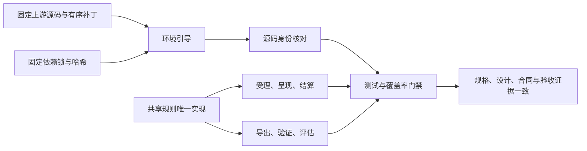

# 特性规格：共享规则单一归宿与可重建环境

> 状态：FROZEN；2026-10-05。冻结描述要求，实现和验收证据分别登记。
> 基线：`2cf230115f4084aef2376e9d77bc976efbed43ea`。
> 来源：[共享规则与可重建环境提案](PROPOSAL_2026-10-04_SHARED_RULES_AND_REBUILDABLE_ENV.md)。
> 本文件是本次特性的唯一开发规格；提案中的机器现状、估计行数、顺序建议不是验收事实。
> 范围：提案列出的共享规则、漂移修复、依赖来源、引导、门禁和重建验证；全部要求必须实现。

## 用户行为与实现边界

同一条规则由所有调用点读取同一个实现；合法输入的既有结果保持一致，已确认的漂移按本规格统一。
开发者取得仓库后，使用 Python 和 Git 即可建立固定依赖的环境，不需要 SSH 密钥或预先安装 uv。
安装位置、操作系统和 Git 换行设置不能改变同一版本的运行身份。

不增加业务工具、模型调用、数据格式兼容、迁移或回退；旧身份直接拒绝。
不实现另一个未冻结的[代码分层与测试分层提案](PROPOSAL_2026-10-04_LAYERING_AND_TEST_TIERS.md)。
这里的快速检查是固定的重建检查命令，不建立新的测试档位注册表或通用配置框架。
向上游提交改动属于外部协作，不是本次仓库功能。

## 共享规则

### 摘要、安全路径、持久写入与错误

| 规则名称 | 唯一归宿与冻结行为 | 必须验证的调用边界 |
| --- | --- | --- |
| 规范 JSON 摘要 | `footprints.models.canonical_json` 和 `sha256_json`；UTF-8、键排序、紧凑分隔符、拒绝 NaN 与无穷值 | 候选、请求、工作验收的结构化值、品类身份、交付 trace 使用相同字节；工作验收纯字符串仍哈希原文，这是独立输入合同 |
| SHA-256 形式 | `footprints.models.is_sha256`；仅小写十六进制 64 字符 | 原先业务函数与直接正则匹配调用相同谓词；字段 Schema 保留既有模式；非字符串不能通过 |
| 安全文件 | `corpora.manifest`；拒绝绝对或含 `..` 的相对路径，解析前检查根以内每个组件的符号链接，拒绝越界和非普通文件 | 语料、地图、应用覆盖、内容、品类身份的原有入口；错误文案与构造函数由所属入口传入，只在失败时构造一次，不改变错误分类 |
| 原子写 | `footprints.assets.atomic_write`；只写字节，创建父目录、同目录临时文件、文件 fsync、os.replace，POSIX 同步父目录；Windows 按平台能力执行文件同步与替换 | 素材、内容 manifest、品类身份等写入；临时文件失败清理，异常转换为所属模块错误；JSON 文件使用 LF |
| 故障日志 | `WorldMockError` 构造已经记录错误，删除额外先记日志再抛出的包装 | 同一故障只生成一条构造日志；稳定英文错误内容与异常因果链保留；普通声明 ValueError 的日志拒绝共用 `errors.reject_value` |

安全路径校验顺序固定为声明路径、符号链接、解析边界、普通文件、文件身份。
拒绝 `..` 是当前格式约束，不新增旧路径读取分支。

### 活动规则

| 规则名称 | 唯一归宿与冻结行为 | 必须验证的调用边界 |
| --- | --- | --- |
| 活动时长 | `life.durations` 推导；上限归 `life.models`，一般活动封顶 86400 秒、消费时长范围 60–14400 秒且越界拒绝 | 工具层、会话动作、按名调用清单的同一状态输入得到同一秒数；会话动作仍在逐项状态变化后重新检查 |
| 开工阻断 | `life.work.work_start_refusal` | 工具层与受理层复用同一原因和下一步 |
| 出行时长 | `life.travel.planned_travel` | 工具层、受理层与引擎校验复用路线选择与时长；引擎仍检查请求与路线不符，保留 `ROUTE_DURATION_MISMATCH` |
| 缓解速率 | `life.activities` 的速率函数；MET 键从可供性注册表的 `met_lookup_key` 读取 | 预估与结算相同；继续内容缺少、布尔、非整数或小于一的 `exposure_count` 均明确报错，不默认接触一次；预估的既有资格拒绝处理仍保留 |
| 候选种类 | `life.candidates` | 删除无人使用的 `presentation.ACTIVITY_OF_KIND`；其它生产调用直接使用唯一映射 |
| 活动家族 | `life.schedule.activity_family` | 生产受理缺生活活动仍以 `LIFESTYLE_ACTIVITY_NOT_FOUND` 拒绝；离线缺品类返回未知，计划不猜测进度、相关度不给家族加分、评估保留缺证和未归类统计 |
| 中文活动名称 | `life.readable` | 工具层动词说明、时间线与报告都由唯一中文种类表派生，删除 `_DOING` 的复制表 |
| 睡眠通道 | 保留可供性注册表声明，身体睡眠仍使用现行睡眠判定 | 不启用 `sleep_channel`，手册准确说明其当前语义 |
| 模块说明 | 工具层说明明确受理会调用其资格判定 | 不将本次规则抽取描述为取消既有受理检查 |

按名调用清单必须描述受理时实际采用的封顶时长，包含超过一天的内容。
游戏轨迹内容按观看（WATCH）的内容时长规则处理并受一般活动上限约束；TextWorld 游戏按场景反馈间隔处理，不增加游戏轨迹内容的 PLAY_GAME 入口。
函数移动时同步修订 monkeypatch 测试，使测试确实替换新的权威调用点。
可供性声明中声称 `sleep_channel` 已控制身体结算的旧注释改为当前未启用的语义。
该文件字节进入目录内容身份，因此按既有发布合同将目录次版本从 5.3 升为 5.4，同步生成器、清单、场景引用和当前文档。
只修订说明，不改变资源、对象、身体数值或交换规则；品类与规则绑定版本仍为 3，历史运行不重写。

### 事件区间、日期、记忆与评估

| 规则名称 | 唯一归宿与冻结行为 | 必须验证的调用边界 |
| --- | --- | --- |
| 有效区间 | `footprints.intervals`；端点严格为非布尔整数，起点小于终点 | 质量报告、行为指标、目标指标、计划推进与工作负荷共用；浮点、NaN、无穷、布尔与空区间不计为有效结算 |
| 共同身体结算筛选 | `footprints.intervals` | 质量、行为与工作负荷读取同一主体、同一共同身体结算事件 |
| 场景本地日 | `footprints.timeline_labels` 的公开日期与日边界函数 | 导出、标签检查、行为报告和 `render_day` 使用运行清单的 `window.timezone`，覆盖非上海时区与夏令时；不保留固定上海时区路径 |
| 主观记忆证据 | `life.memory_evidence` | 既有主观记忆类型及两处快照写入复用相同校验；反思缺活动来源属于合法独立反思，不算畸形 episode；读取方原有报告或拒绝语义保持 |
| 日期区段 | `evaluation.metrics` | 同一输入只用一个日期区段实现 |
| 世界事件解析 | `evaluation.adapters` | 评估适配每行只解析一次，统计与公开投影直接消费已解析事件；导出身份认证保留独立验证 |
| 社交活动家族 | `life.schedule.activity_family` | 行为指标的 chat/call 家族与计划、目标、相关度一致 |
| 邮件头 | `life.content.mail_headers` | 观察与内容呈现共用相同邮件字段提取 |
| 社交资源分录 | 身体与社交动作读取同一个分录应用函数 | 原有资源守恒、双方身体结算和失败分类不变 |
| 合同对象集合 | 目录的唯一合同对象集合 | 场景加载与资源映射直接读取同一集合 |

### 模型客户端与公共模型

| 规则名称 | 唯一归宿与冻结行为 | 必须验证的调用边界 |
| --- | --- | --- |
| 独立模型客户端 | `model_endpoint` 共用客户端实现，联系人、零点计划和工作验收保留各自业务类 | 身份校验、零内部协议重试和响应序列化共用；业务名称决定现行英文错误文案 |
| 纠正消息 | 共用 `correction_message`、Schema 错误格式与工具参数提取实现 | 保留已有通道的回显、指令、请求工具与重试预算；工作验收反馈按合同登记，三条请求逐次验证 |
| 品类与目录错误 | `categories.common.CategoryError` 的稳定错误码错误实现 | 目录和品类直接使用 CategoryError，删除 CatalogError，不保留第二个类或别名；评估与资源错误保留已规定的不同基类与消息形状，分别增加必需错误日志，不为合并而改变语义 |
| 公共枚举 | `categories.common` 的来源与守恒枚举 | 目录直接导入使用；删除重复枚举定义 |
| 严格模型 | `worldmock.base_models` 的基础模型 | 仅字段冻结与 extra=forbid 的基础模型统一；品类的深度冻结模型明确命名，保留递归冻结语义；不同 LineageEntry 不合并 |
| 曲线与效率因子 | 唯一公共模型 | 曲线输入和输出均为有限非负数，拒绝布尔；资源名至少含一个非空白字符，曲线非空；life 与 catalog 使用同一模型 |

公开名字保留仅限实际仍有业务职责的类和入口；不增加只供旧导入使用的别名或兼容包装。
冻结的测试文本钉改为当前真实公共导入与行为断言，不保留重复常量来满足旧文本。

### 其余已存在的同义规则表

提示 Schema 的动词、方式、动作状态、意图、体感等级、活动控制工具、上班状态和可调用示例上限，
直接读取生产领域定义；地点类只由检索地点词表声明，地图与目录准入直接读取。
记忆层与进度层共用未了结订单状态，记忆层与结算文字共用成功结果状态。
动机资源键读取可供性资源闭集，品类排除字段及资源数值类型也各自只声明一次。
这些既有闭集的取值、顺序和领域语义不变，不新增业务行为。

### 防漂移守卫

`tests/test_single_source.py` 扫描 `src/worldmock` 与 `custom`，登记本节共享规则的唯一允许定义位置。
在其它模块定义共享函数、类、枚举或规则表即失败；导入同一实现不是重复定义。
去掉 docstring 的函数体至少两条语句时，以 AST 结构比较完全相同的函数体；模块级非平凡规则表也比较 AST。
普通模块 logger、类型声明、不同作用域的协议钩子和单纯导入绑定不作为业务克隆。
必须列明这些语义排除，不能为遗漏的业务克隆增加例外。已知业务克隆清单在验收时必须为空。
守卫用临时样例证明新增克隆、复制常量表和错误归宿确实失败，而非只测试当前仓库能通过。

## 可重建环境

### 源码与换行身份

根 `.gitattributes` 固定 Python、TOML、依赖锁为 LF；补丁和源制品按原始字节保存。
不在身份哈希函数内转换换行；身份仍绑定实际生产字节与根依赖文件。
测试用 `core.autocrlf=true` 与 `false` 的独立检出核对同一提交的代码身份。

AS2 使用可匿名取得的固定上游 `670c94fff7c64c4f79b632125f2ccf968155e746`，
仓库内 `patches/agentsociety2/SERIES` 固定来源地址、基线制品哈希、有序 Git 补丁与重建后的源码摘要。
补丁须含新增文件，不依赖 fork 的私有 SSH 地址；标准 Git apply 执行，不自己实现补丁解析器。
AS2 的 WorldMock 专用测试移至 `tests/as2`，由根测试发现和覆盖率流程执行。
上游许可和修改说明随源码与补丁保存。

先以完整补丁复现当前 `65a902ec66df42296d4e4c85e424bce3512e437133fc6be9fa597766fc30a334`，
证明重建本身没有改变身份。随后完成提案要求的缩小：WorldMock 专用记忆规则移至 `custom/agents`，
观察单写的业务覆写归 LifeAgent。环境注册扫描必须继续接受完整实现直接环境合同的 LifeEnv；
保留通用直接环境合同的注册校验，其必要性由真实运行装配、环境 actor 和只读查询测试证明。
扫描校验检查完整方法集合，不按 WorldMock 类名放行；不新增另一套注册路径或兼容格式。
AS2 保留调度、失败传播、恢复、直接环境注册、工具请求与模型生命周期的必要改动。
缩小后的唯一源码摘要为 `bb655cb3b4d7a68c725431a507192389b4e6770015e9673d6f5e9ef92dba1c46`，必须同步记录在 SERIES、运行核对、规格和验收记录中，旧摘要只作历史证据。
本次不保留两套安装来源；生成源码的目录由引导管理，Git 状态必须如实呈现，不宣称普通目录是原子模块指针。

LabelKit 固定 `d0afd606decbc3f4aa64c64ef5339586120c5a7a` 的匿名 HTTPS 源制品和哈希，
从已有源码与锁建立独立 `.venv`，WorldMock 不在进程内 import LabelKit。
不发布新外部制品、不假定 LabelKit 许可；仅消费其当前公开固定源码。

### 环境引导与收据

`scripts/bootstrap.py` 只用标准库，参数为 `--profile release|dev`、`--wheelhouse`、`--use-uv`。
明确选择 Python 3.12，当前解释器符合时直接使用；Windows 用 `py -3.12`，其它系统用 `python3.12`。
不可用时用英文报错，不能选择不符合版本的 Python。

创建根 `.venv`，用 `python -m pip install --require-hashes` 安装 `requirements/lock.txt`；
锁由 `uv.lock` 导出，排除本地 editable 来源，包含固定构建后端；安装源码使用 `--no-deps --no-build-isolation`。
LabelKit 使用 `requirements/labelkit-lock.txt` 和独立的 `requirements/labelkit-build-lock.txt`，
构建依赖不得覆盖应用原锁中已有的版本；同样全部记录哈希；测试验证导出内容与原锁一致，不依赖机器装有 uv。
wheelhouse 明确使用 `--no-index --find-links` 和固定源制品，不访问网络，不静默改成在线下载。
`--use-uv` 仅是用户显式选择的同一锁安装入口，uv 缺失必须报错。

引导先恢复并核对固定源码，再安装 editable AS2、WorldMock 和独立进程 LabelKit。
有效既有源码要核对身份；错误源码不能被引导静默覆盖成正确结果。
收据包含 Python 版本、各依赖锁摘要、AS2 摘要、LabelKit 制品身份、Node 版本、profile 和缺失部件，
只使用相对项目路径，不含机器身份、密钥或私有凭据。

### 门禁、可选部件与操作系统

覆盖率门禁用 `sys.executable -m coverage`，不需要 uv；`--shards N` 以目录连续顺序分配测试文件，
每个用例恰跑一次，每片使用独立 coverage 文件后 combine；测试失败或跳过不能报告 `passed: true`。
保留整体分支覆盖率至少 85% 与未覆盖公共接口为零两项既有阈值。

release 缺少 Node 或 LabelKit 即失败；dev 明确记录缺失，并按固定原因跳过对应检查，
不能因此取得最终通过。删除 validation 的静默跳过，使用同一 profile 规则。
本项目当前 Linux 64 位 release 环境与 TextWorld 语料验收范围为 x86_64。
锁定 TextWorld 1.7.0 的安装脚本按 `uname -m` 从固定 Inform7 Linux 归档选择编译器；
归档包含 i386、x86_64、ppc 与 armv6lhf 制品，缺少 aarch64 制品。
因此 Linux ARM64/aarch64 下该锁定组合无法完成安装，不在当前完整环境支持范围，不能产生通过收据。
Windows 必须完成跨平台核心与重建验收，Linux x86_64 必须实际执行 TextWorld 语料验收；
完整放行必须合并两者成功证据，任何缺少的检查都不能当通过。
不把 Windows 无 wheel 的组件强行装进环境，也不把其依赖留成无法安装的无条件传递依赖。

测试文件复制用唯一“同卷硬链接、跨卷复制”辅助函数；跨卷错误触发复制是文件复制的规定行为，
不新增业务回退路径。守卫禁止直接 `copy_function=os.link`，测试模拟跨卷错误验证真实字节复制。

### 新机器检查

`scripts/fresh_check.py` 用 `git clone --no-recurse-submodules` 克隆指定提交到临时目录，
设 `GIT_SSH_COMMAND=false`，不用 pip 缓存，执行引导、源码身份核对和固定快速检查。
任何命令失败即终止并保留错误说明，成功后返回环境收据与检查结果。
CI 在 Ubuntu x86_64 与 Windows 执行同一路径，checkout 不初始化子模块、不配置 SSH 或模型密钥。
快速检查涵盖共享规则、AS2 专用测试、身份与引导本身；Linux x86_64 的语料边界另执行对应实际测试。
CI 比较两系统代码摘要，不能只分别检查摘要格式。

## 文档原子同步清单

| 文档 | 必须同步的主题 |
| --- | --- |
| `docs/dev/SPEC-shared-rules-and-rebuildable-env.md`、`shared-rules-and-rebuildable-env-verification.md` | 本规格为唯一开发权威；验收记录登记具体测试节点、实际结果与独立变异证据，冻结要求和验收完成分别记录 |
| `docs/CONTRACTS.md` | 共享错误和纠正消息、引导参数、严格模型与安全文件输入合同 |
| `docs/design/00-overview.md` | AS2 与宿主业务职责、固定 Python 3.12 与模型故障传播、相对交付引用、Windows 核心与重建验收及 Linux x86_64 TextWorld 必需门禁与锁定 aarch64 安装限制 |
| `docs/design/01-architecture.md` | 唯一共享规则归宿与生成依赖来源 |
| `docs/design/02-exchange-engine.md` | 活动时长、预估和结算、社交分录共用规则 |
| `docs/design/03-resource-engine.md` | 路径安全、公共曲线、效率与品类模型 |
| `docs/design/04-simulation-engine.md` | AS2 补丁、WorldMock 记忆归属、模型客户端和活动家族 |
| `docs/design/05-recording-engine.md` | 规范 JSON、原子写、整数区间、本地日与实际字节身份 |
| `docs/design/06-delivery.md` | trace 摘要与固定 LabelKit 独立环境 |
| `docs/design/07-evaluation.md` | 区间、事件一次解析、活动家族缺证、反思证据 |
| `docs/design/08-configuration.md`、`09-io-formats.md` | 环境 profile、收据、依赖锁、源码来源与严格数值 |
| `docs/design/README.md`、`SUMMARY.md`、`worldmock-design.html` | 入口职责、当前目录身份与特性引用；重新生成汇编并通过 --check |
| `docs/dev/SPEC-as2-integration.md` | 删除对子模块指针的现行安装依赖，登记记忆规则归属和新唯一摘要、测试位置 |
| `docs/dev/SPEC-time-and-energy.md` | 推导函数权威归宿、时长上限与新的依赖来源，实际字节身份算法不变 |
| `docs/dev/SPEC-dayrun-fidelity.md` | 预估与结算一致、中文名称单一来源、工具纠正原预算 |
| `docs/dev/SPEC-day-plan-goals.md` | 统一活动家族，缺品类不猜进度的既有条款保留 |
| `docs/dev/SPEC-life-realism.md` | 记忆规则实现归 WorldMock，阈值与语义不改变 |
| `docs/dev/SPEC-persona-prompt.md` | 历史行号与现行源码来源分开，续接职责保持 LifeAgent，删除 AS2 固定旧来源的现行描述 |
| `docs/dev/SPEC-map-and-storefront.md` | 当前目录发布为 5.4，保留地图、场景及世界结构边界与历史发布版本 |
| `docs/dev/SPEC-life-runtime.md`、`SPEC-category-contract.md`、`SPEC-labelkit-delivery.md` | 曲线、模型冻结、资源日志与制品安装来源 |
| `docs/ARCHITECTURE.md`、`docs/EXPERIMENT.md` | 共享规则职责、固定源码补丁、宿主记忆与最终运行身份 |
| `README.md`、`docs/manual/runtime.md` | 替换安装步骤，记录 Python、Node、profile、离线和新机器检查 |
| `docs/manual/README.md`、`personas.md`、`delivery.md`、`scenarios.md` | 入口说明激活后的命令环境，画像命令删除隐式 uv，LabelKit 使用独立已安装 CLI；场景手册区分历史与当前目录身份 |
| `docs/manual/resources.md`、`rules.md`、`evaluation.md` | 路径、睡眠通道和评估边界 |
| `docs/VERIFICATION.md`、`docs/dev/coverage-baseline.md` | 无 uv 门禁、跳过拒绝放行、双平台与语料证据边界 |
| 原提案、`docs/INDEX.md`、`docs/dev/implementation-status.md` | 指向本规格，标记历史提案不再是实施权威 |

每个修改的冻结文档补本次版本记录，描述当前语义，删除被替换的旧约束；不得并列相互矛盾的现行规则。
现行业务协议、同秒进度、重试预算、记忆类型和 sleep_channel 语义没有被本次规格推翻。
无新增依赖层级配置、测试层级工具、运行兼容格式、热更新或外部发布功能。

## 验收与闭合台账

验收记录保存需求名称、实现文件、具体测试节点、结果和变异审查证据；不允许 pending、defer、skip 或 xfail 作为完成。
共享规则必须同时覆盖原先多个消费者，而非只测试新辅助函数；环境必须验证实际源码、实际锁与实际安装入口。
新机器检查、平台身份核对、完整测试、风格、文档链接、设计汇编与覆盖率均是必要门禁。
新功能按 `uncle-bob-review` 在干净提交的隔离 worktree 中执行语义变异，存活变异补测试后重审。
真实模型全天运行与十二周实验仍由已有总体规格验收，本特性不凭离线测试声称这些实验完成。

## 版本表

| 版本 | 日期 | 修改 |
| --- | --- | --- |
| 共享规则与可重建环境冻结 | 2026-10-05 | 根据当前源码及并发审查裁决提案，冻结共享规则、环境重建、原子文档修订和完整验收边界 |
