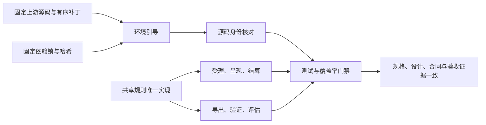

# 特性规格：共享规则单一归宿与可重建环境

> 按[动作与内容简化规格](SPEC-action-and-content-simplification.md#spec-acs-动作与内容简化开发规格)修订「固定规则、目录格式与加载边界」（阶段 1）。

> 2026-10-07 按用户确认的[数据加工归属](../ARCHITECTURE.md#architecture-数据加工归属)修订：WorldMock 负责模拟、记录、完整认证足迹导出与真实性评估；LabelKit 加工、模型任务、训练装载与规则测试归 LabelKit-DataSet；环境素材归 WorldMock-Dataset。历史验收数字只证明原源码基线，不代表本次消费链已验收。

> 2026-10-07：按[资源与规则引擎简化规格](SPEC-resource-and-rule-simplification.md#spec-rrs-资源与规则引擎简化开发规格)同步阶段 5 的工作主题摘要与安全路径。

> 按[资源与规则引擎简化规格](SPEC-resource-and-rule-simplification.md#spec-rrs-资源与规则引擎简化开发规格)修订「活动规则、共享规则、防漂移守卫、新机器检查、文档原子同步清单、摘要、安全路径、持久写入与错误」（阶段 1）；「摘要、安全路径、持久写入与错误」（阶段 2）；「app 资源与内容规则、活动常数、候选种类与平台证据边界」（阶段 4）。

> 状态：FROZEN；2026-10-05。冻结描述要求，实现和验收证据分别登记。
> 2026-10-06 修订「共享规则」的「安全文件」一行（Windows 路径加固），见版本表。
> 基线：`2cf230115f4084aef2376e9d77bc976efbed43ea`。
> 来源：[共享规则与可重建环境提案](PROPOSAL_2026-10-04_SHARED_RULES_AND_REBUILDABLE_ENV.md)。
> 本文件是本次特性的唯一开发规格；提案中的机器现状、估计行数、顺序建议不是验收事实。
> 范围：提案列出的共享规则、漂移修复、依赖来源、引导、门禁和重建验证；全部要求必须实现。

当前环境归属按[环境数据归属规格](SPEC-environment-data-ownership.md)执行：具体 `corpora/`、`catalog/`、`scenarios/`
及制作工具由 WorldMock-Dataset 维护，正式环境为 `environment/zhangjiang-baseline/`；通用活动、动机与人物映射
由 WorldMock 包资源提供，环境冻结副本须逐字节一致。当前场景结构为 `6`，单人物文件为 `single-person.json`。
本文中的新环境放行须另核对本次收据，历史验收数字不证明当前组合已经通过。

## 用户行为与实现边界

同一条规则由所有调用点读取同一个实现；合法输入的既有结果保持一致，已确认的漂移按本规格统一。
开发者取得仓库后，使用 Python 和 Git 即可建立固定依赖的环境，不需要 SSH 密钥或预先安装 uv。
安装位置、操作系统和 Git 换行设置不能改变同一版本的运行身份。

不增加业务工具、模型调用、数据格式兼容、迁移或回退；旧身份直接拒绝。
代码分层与测试层次已由主分支的[冻结规格](SPEC-layering-and-test-tiers.md#layering-outcome)实现，
本次整合保留其引擎职责、现行文档归属与唯一测试入口；共享规则直接由实际职责对象消费。
新机器快速检查仍是固定的重建检查集合，不新增测试层或通用配置框架。
向上游提交改动属于外部协作，不是本次仓库功能。

## 共享规则

共享规则的当前归属表由下列各节维护。环境错误归 `catalog.errors.RegistrationError`，环境身份归 `catalog.identity`，固定分类、常数与算子归 `worldmock.exchange`；登记与运行消费者复用唯一定义。历史共享规则验收记录保持原始被测提交。

### 摘要、安全路径、持久写入与错误

| 规则名称 | 唯一归宿与冻结行为 | 必须验证的调用边界 |
| --- | --- | --- |
| 图上出行响应 | `catalog.graph.Graph` 提供最短距离与完整路径，等长按完整路径元组字典序决胜 | 出行、配送、地点比较与记录读取同一结果，禁止重新解释道路响应、几何或交通状态 |
| 规范 JSON 摘要 | `footprints.models.canonical_json` 和 `sha256_json`；UTF-8、键排序、紧凑分隔符、拒绝 NaN 与无穷值 | 候选、请求、共享内容进度、环境目录身份与交付 trace 使用相同字节 |
| SHA-256 形式 | `footprints.models.is_sha256`；仅小写十六进制 64 字符 | 原先业务函数与直接正则匹配调用相同谓词；字段 Schema 保留既有模式；非字符串不能通过 |
| 安全文件 | `corpora.manifest`；声明须是只用 `/` 分隔的根内相对路径：拒绝绝对路径（含 Windows 上无盘符的根路径）、`..` 与反斜杠，以及任一平台不能原样保存的名字（以点或空格结尾、Windows 设备名、Windows 禁用字符与数据流冒号、控制字符、孤立代理码点、超过 255 字节）；解析前检查根以内每个组件的符号链接与目录联接，拒绝越界和非普通文件 | 应用、地点、商品、动作、内容、地图及清单的实际环境入口；退役的语料加载入口已删除；工作区快照与恢复的成员名使用同一声明规则；错误文案与构造函数由所属入口传入，只在失败时构造一次，不改变错误分类 |
| 原子写 | `footprints.assets.atomic_write`；只写字节，创建父目录、同目录临时文件、文件 fsync、os.replace，POSIX 同步父目录；Windows 按平台能力执行文件同步与替换 | 素材、内容 manifest、环境目录身份等写入；临时文件失败清理，异常转换为所属模块错误；JSON 文件使用 LF |
| 故障日志 | `WorldMockError` 构造已经记录错误，删除额外先记日志再抛出的包装 | 同一故障只生成一条构造日志；稳定英文错误内容与异常因果链保留；普通声明 ValueError 的日志拒绝共用 `errors.reject_value` |

安全路径校验顺序固定为声明路径、符号链接、解析边界、普通文件、文件身份。
拒绝 `..` 是当前格式约束，不新增旧路径读取分支。

### 活动规则

| 规则名称 | 唯一归宿与冻结行为 | 必须验证的调用边界 |
| --- | --- | --- |
| 活动时长 | 动作时长仅来自实际选中内容及共享剩余；等待与睡眠保留系统推导，出行读图最短路和固定速度 | 工具层、选择器与实际受理使用同一当前输入；零秒展示不选择内容或消费随机状态 |
| 地点资格 | exercise 限 home、outdoor、fitness；人物分配工作内容要求其工作地点 | 工具行与受理同码同文；恢复先地点、再原内容合格、再名额和占用 |
| 出行时长 | 出行计划只用目录图的最短路径、固定速度与费用 | 地点列表、工具行、受理与活动校验读取同一个计划 |
| 内容执行 | entertainment 静默接续，其余类别单条完成；共享 ContentProgress 只由正秒实际消费更新 | 暂停、恢复、推送和观察不增加位置或完成轮数；恢复读取原 content_id 不重抽 |
| 缓解速率 | exchange 固定娱乐每小时 0.3；社交按真实共同、未接受或远程秒数分别计算 | daily_care 每条完成脉冲 0.05，分配 work_study 完成脉冲 0.1，暂停不产生效果 |
| 候选种类 | 商品是唯一候选，动作及 app 组合始终列出、不轮转 | callable_index 恰为 goods、navigation_apps、payment_apps、query_categories |
| 活动家族 | 系统活动 sleep、travel、wait；ACTION 只取实际快照 category | 计划推进与评估共用家族来源，叙述不改变进度；用餐只取本人 meal 收货 |
| 占用 | 注册表固定 wait、travel、use_app、entertainment、work_study、talk、exercise、daily_care | phone_continuous 额外占 use_app；睡眠占八项，驾车仅容纳 talk；暂停让出名额 |
| 中文活动名称 | 活动名称来自真实动作、可空 app 和开始时刻；系统活动保持自身名称 | 工具层、回看、时间线与报告均不公开内容身份或私有对象身份 |
| 睡眠通道 | 睡眠的身体结算只由真实睡眠状态和秒数决定，不由声明的其它资源通道控制 | 睡眠不产生娱乐流；工具层的声明不能改变实际身体效果 |
| 模块说明 | 各模块的说明描述当前动作、内容、地点与执行职责 | 说明与真实出行时长读取同一个目录图计划 |

目录冻结 app、地点、商品、动作、内容和图；固定规则与常数归 WorldMock 包，环境没有规则副本。读取不维护选择历史，模拟引擎保存实际活动、内容进度、推送、订单、驾驶天数与闹钟。

### 事件区间、日期、记忆与评估

| 规则名称 | 唯一归宿与冻结行为 | 必须验证的调用边界 |
| --- | --- | --- |
| 有效区间 | `footprints.intervals`；端点严格为非布尔整数，起点小于终点 | 质量报告、行为指标、目标指标、计划推进与工作负荷共用；浮点、NaN、无穷、布尔与空区间不计为有效结算 |
| 共同身体结算筛选 | `footprints.intervals` | 质量、行为与工作负荷读取同一主体、同一共同身体结算事件 |
| 场景本地日 | `footprints.timeline_labels` 的公开日期与日边界函数 | 导出、标签检查、行为报告和 `render_day` 使用运行清单的 `window.timezone`，覆盖非上海时区与夏令时；不保留固定上海时区路径 |
| 主观记忆证据 | `life.memory_evidence` | 既有主观记忆类型及两处快照写入复用相同校验；反思缺活动来源属于合法独立反思，不算畸形 episode；读取方原有报告或拒绝语义保持 |
| 日期区段 | `evaluation.metrics` | 同一输入只用一个日期区段实现 |
| 世界事件解析 | `evaluation.adapters` | 评估适配每行只解析一次，统计与公开投影直接消费已解析事件；导出身份认证保留独立验证 |
| 社交活动家族 | `life.schedule.activity_family` | 行为指标按实际 social 类动作与通信方式读取，不由名称猜测 |
| 社交资源分录 | 身体与社交动作读取同一个分录应用函数 | 原有资源守恒、双方身体结算和失败分类不变 |
| 环境登记身份 | `catalog.identity` 的清单文件表与框架化目录摘要 | 加载、环境检查、运行清单和恢复使用同一五字段环境身份 |

### 模型客户端与公共模型

| 规则名称 | 唯一归宿与冻结行为 | 必须验证的调用边界 |
| --- | --- | --- |
| 独立模型客户端 | `model_endpoint` 共用客户端实现，联系人、零点计划与就寝反思保留各自业务类 | 身份校验、零内部协议重试和响应序列化共用；业务名称决定现行英文错误文案 |
| 纠正消息 | 共用 `correction_message`、Schema 错误格式与工具参数提取实现 | 保留联系人、零点计划与就寝反思各自的回显、指令、请求工具与重试预算；工作内容没有独立模型请求或纠正通道 |
| 环境登记错误 | `catalog.errors.RegistrationError` 的稳定码和英文原因 | 统一登记器、目录加载、环境 CLI 与场景准入复用；评估与资源错误保留各自语义和错误日志，不引入兼容类 |
| 公共枚举 | `worldmock.exchange.types` 的固定地点、商品、动作类别、使用方式、应用用途、通信方式与摘要来源闭集；资源守恒保留既有所属定义 | 目录与运行消费者直接导入唯一定义，不复制词表 |
| 严格模型 | `worldmock.base_models` 的基础模型 | 仅字段冻结与 extra=forbid 的基础模型统一；品类的深度冻结模型明确命名，保留递归冻结语义；不同 LineageEntry 不合并 |
| 曲线与效率因子 | 唯一公共模型 | 曲线输入和输出均为有限非负数，拒绝布尔；资源名至少含一个非空白字符，曲线非空；life 与 catalog 使用同一模型 |

公开名字保留仅限实际仍有业务职责的类和入口；不增加只供旧导入使用的别名或兼容包装。
冻结的测试文本钉改为当前真实公共导入与行为断言，不保留重复常量来满足旧文本。

### 其余已存在的同义规则表

提示 Schema 的动词、方式、动作状态、意图、体感等级、活动控制工具、上班状态和可调用示例上限，
直接读取生产领域定义；地点类只由检索地点词表声明，地图与目录准入直接读取。
记忆层与进度层共用未了结订单状态，记忆层与结算文字共用成功结果状态。
动机资源键读取可供性资源闭集，品类排除字段及资源数值类型也各自只声明一次。
这些既有闭集的取值、顺序和领域语义不变，不新增业务行为。

### 防漂移守卫

`tests/test_single_source.py` 扫描 `src/worldmock` 与 `custom`，登记本节共享规则的唯一允许定义位置。
在其它模块定义共享函数、类、枚举或规则表即失败；导入同一实现不是重复定义。
去掉 docstring 的函数体至少两条语句时，以 AST 结构比较完全相同的函数体；模块级非平凡规则表也比较 AST。
普通模块 logger、类型声明、不同作用域的协议钩子和单纯导入绑定不作为业务克隆。
必须列明这些语义排除，不能为遗漏的业务克隆增加例外。已知业务克隆清单在验收时必须为空。
守卫用临时样例证明新增克隆、复制常量表和错误归宿确实失败，而非只测试当前仓库能通过。

`tests/test_single_source.py::OWNERS` 登记固定类别、`MANNER_DEVICE`、`STORE_KINDS`、`GOODS_CATEGORY_STORE_KINDS`、`GOODS_ENERGY_KCAL`、`GOODS_RECEIPT_EFFECTS`、`CONTENT_MIN_SECONDS`、`CATEGORY_MET`、`ENTERTAINMENT_RELIEF_PER_HOUR`，以及迁入 exchange 的社交需要、情绪脉冲与半衰期、运动情绪常数。原有固定定义仍由唯一定义处读取，旧食品与内容分类表直接删除。

## 可重建环境

### 源码与换行身份

根 `.gitattributes` 固定 Python、TOML、依赖锁为 LF；补丁和源制品按原始字节保存。
不在身份哈希函数内转换换行；身份仍绑定实际生产字节与根依赖文件。
测试用 `core.autocrlf=true` 与 `false` 的独立检出核对同一提交的代码身份。

AS2 使用可匿名取得的固定上游 `670c94fff7c64c4f79b632125f2ccf968155e746`，
仓库内 `patches/agentsociety2/SERIES` 固定来源地址、基线制品哈希、有序 Git 补丁与重建后的源码摘要。
补丁须含新增文件，不依赖 fork 的私有 SSH 地址；标准 Git apply 执行，不自己实现补丁解析器。
AS2 的 WorldMock 专用测试移至 `tests/as2`，由根测试发现和覆盖率流程执行。
上游许可和修改说明随源码与补丁保存。

先以完整补丁复现当前 `65a902ec66df42296d4e4c85e424bce3512e437133fc6be9fa597766fc30a334`，
证明重建本身没有改变身份。随后完成提案要求的缩小：WorldMock 专用记忆规则归 `src/worldmock/agents`，框架注册入口保留在 `custom/agents`，
观察单写的业务覆写归 LifeAgent。环境注册扫描必须继续接受完整实现直接环境合同的 LifeEnv；
保留通用直接环境合同的注册校验，其必要性由真实运行装配、环境 actor 和只读查询测试证明。
扫描校验检查完整方法集合，不按 WorldMock 类名放行；不新增另一套注册路径或兼容格式。
AS2 保留调度、失败传播、恢复、直接环境注册、工具请求与模型生命周期的必要改动。
缩小后的唯一源码摘要为 `bb655cb3b4d7a68c725431a507192389b4e6770015e9673d6f5e9ef92dba1c46`，必须同步记录在 SERIES、运行核对、规格和验收记录中，旧摘要只作历史证据。
本次不保留两套安装来源；生成源码的目录由引导管理，Git 状态必须如实呈现，不宣称普通目录是原子模块指针。

LabelKit 的安装、模型任务与数据加工由 LabelKit-DataSet 管理。

### 环境引导与收据

`scripts/bootstrap.py` 只用标准库，参数为 `--profile release|dev`、`--wheelhouse`、`--use-uv`。
明确选择 Python 3.12，当前解释器符合时直接使用；Windows 用 `py -3.12`，其它系统用 `python3.12`。
不可用时用英文报错，不能选择不符合版本的 Python。

创建根 `.venv`，用 `python -m pip install --require-hashes` 安装 `requirements/lock.txt`；
锁由 `uv.lock` 导出，排除本地 editable 来源，包含固定构建后端；安装源码使用 `--no-deps --no-build-isolation`。
wheelhouse 明确使用 `--no-index --find-links` 和固定源制品，不访问网络，不静默改成在线下载。
`--use-uv` 仅是用户显式选择的同一锁安装入口，uv 缺失必须报错。

引导先恢复并核对固定源码，再安装 editable AS2 与 WorldMock。
有效既有源码要核对身份；错误源码不能被引导静默覆盖成正确结果。
收据包含 Python 版本、各依赖锁摘要、AS2 摘要、Node 版本、profile 和缺失部件，
只使用相对项目路径，不含机器身份、密钥或私有凭据。

### 门禁、可选部件与操作系统

测试运行的唯一入口为 `scripts/run_tests.py`，快速、标准与全量集合按分层与测试层次规格定义。
覆盖率门禁无参数或 `--shards N` 均调用同一 full runner，`--shards` 映射为 worker 数；
完整发布环境回归须通过 `--environment-root ../WorldMock-Dataset/environment/zhangjiang-baseline` 显式选择，
门禁绑定该外部环境实际字节摘要，不使用旧根目录数据或隐式相邻仓搜索。
按既有实测文件权重分配完整测试文件，每份文件内部保持正常目录收集顺序。
每个预收集节点恰跑一次，进程与覆盖数据隔离，使用当前解释器的 coverage 后 combine，不需要 uv。
runner 使用本次运行的唯一身份绑定 collection、summary、worker 选择清单和完成回执；覆盖数据生成后，
其实际字节摘要也绑定到同一运行。`--from-json` 必须核对这些绑定，不能接受其它运行的绿色覆盖数据或回执。
预收集、各 worker 选择与实际收集均非空且节点唯一，其全局多重集与完成回执精确相等；
每个全量节点的 setup、call、teardown 三阶段完整且均为 passed，未知阶段结果也按失效回执拒绝。
输入摘要绑定本次真实读取的源码、测试、设计、依赖锁、源码补丁、人工测试环境与显式外部环境、根 `.gitattributes`，
自动生成的计时与覆盖报告及 `__pycache__` 仍按现有排除范围处理；下游数据加工不作为引擎测试输入。
空集合、失败、跳过、缺失或失效收据、输入字节变化均不能报告 `passed: true`，不得另建测试执行器。
保留整体分支覆盖率至少 85% 与未覆盖公共接口为零两项既有阈值。

release 缺少 Node 或中文图表字体即失败；dev 明确记录缺失，Node 消费者按固定原因跳过对应检查，
不能因此取得最终通过。删除 validation 的静默跳过，使用同一 profile 规则。
阶段 4 只登记当前 macOS 上实际执行的 app 资源与纯行为门禁；它不等于完整引擎闭环，也不是跨平台放行。
Windows 重建回执尚未执行，必须单独标为未执行；没有真实成功回执时不能据 macOS 结果宣称 Windows 或跨机器通过。
阶段 1–5 的最小完整引擎闭环到阶段 5 才首次要求，平台状态继续按实际运行分别登记。

可变测试工作区使用标准库 `shutil.copytree` 的普通独立 `copy2` 复制，不以硬链接共享仓库输入，
不增加复制辅助抽象或回退路径；真实夹具构建和修改后必须保持源文件字节不变，副本与源文件不共享 inode。

### 新机器检查

`scripts/fresh_check.py` 用 `git clone --no-recurse-submodules` 克隆指定提交到临时目录，
设 `GIT_SSH_COMMAND=false`，不用 pip 缓存，执行引导、源码身份核对和固定快速检查。
任何命令失败即终止并保留错误说明，成功后返回环境收据与检查结果。
CI 在 Ubuntu x86_64 与 Windows 执行同一路径，checkout 不初始化子模块、不配置 SSH 或模型密钥。
快速检查涵盖共享规则、AS2 专用测试、身份与引导本身；Linux x86_64 的语料边界另执行对应实际测试。
CI 比较两系统代码摘要，不能只分别检查摘要格式。

阶段 1 的 `tests/test_single_source.py::OWNERS` 登记 `FOOD_CONSTANTS`、`CONTENT_RELIEF_PER_HOUR`、`PLACE_KIND_ENVIRONMENTS`、`TARGET_LABELS`、`START_ACTIVITY_ACTIONS`、`BODY_CONSTANTS` 及现行唯一归属，原二十项保持。`QUICK_TESTS` 到阶段 4 才改为新目录、交换规则与 app 纯测试，不在本阶段提前声明该快速集合已经替换。

## 文档原子同步清单

| 文档 | 必须同步的主题 |
| --- | --- |
| `docs/dev/SPEC-shared-rules-and-rebuildable-env.md`、`shared-rules-and-rebuildable-env-verification.md` | 本规格为唯一开发权威；验收记录登记具体测试节点、实际结果与独立变异证据，冻结要求和验收完成分别记录 |
| `docs/dev/coverage-report.json`、`shared-rules-fresh-macos.json`、`shared-rules-fresh-linux.json`、`shared-rules-platform-verification.json` | 实际机器报告和生产重建收据保留原被测提交；平台记录区分成功、失败和未执行，不能改写失败为通过 |
| `docs/CONTRACTS.md` | 共享错误和纠正消息、引导参数、严格模型与安全文件输入合同 |
| `docs/design/00-overview.md` | AS2 与宿主业务职责、固定 Python 3.12 与模型故障传播、相对交付引用、app 资源和内容规则，以及 macOS 当前证据与尚未执行的 Windows 回执边界 |
| `docs/design/01-architecture.md` | 唯一共享规则归宿与生成依赖来源 |
| `docs/design/02-exchange-engine.md` | 活动时长、预估和结算、社交分录共用规则 |
| `docs/design/03-resource-engine.md` | 路径安全、严格环境登记、固定身体常数与只读目录模型 |
| `docs/design/04-simulation-engine.md` | AS2 补丁、WorldMock 记忆归属、模型客户端和活动家族 |
| `docs/design/05-recording-engine.md` | 规范 JSON、原子写、整数区间、本地日与实际字节身份 |
| `docs/design/07-evaluation.md` | 区间、事件一次解析、活动家族缺证、反思证据 |
| `docs/design/08-configuration.md`、`09-io-formats.md` | 环境 profile、收据、依赖锁、源码来源与严格数值 |
| `docs/design/README.md`、`SUMMARY.md`、`worldmock-design.html` | 入口职责、当前目录身份与特性引用；重新生成汇编并通过 --check |
| `docs/dev/SPEC-as2-integration.md` | 删除对子模块指针的现行安装依赖，登记记忆规则归属和新唯一摘要、测试位置 |
| `docs/dev/SPEC-day-plan-goals.md` | 统一活动家族，缺品类不猜进度的既有条款保留 |
| `docs/dev/SPEC-life-realism.md` | 记忆规则实现归 WorldMock；人物 Prompt 已并入的七层请求与 LifeAgent 续接职责保持，阈值与语义不改变 |
| `docs/dev/SPEC-life-runtime.md` | 已并入时间与能量、一日运行保真及工具交互的现行正文：内容声明时长、固定娱乐缓解率、全局内容进度、session 推送、八项占用、中文名称和纠正预算；固定源码来源与实际字节身份 |
| `docs/dev/SPEC-layering-and-test-tiers.md` | 共享规则由实际职责对象直接消费；统一 full runner、实测文件权重调度、节点恰一次和同次收据核验 |
| `docs/dev/SPEC-map-and-storefront.md` | 当前目录清单与六个目录文件 与 RULES_VERSION 身份；历史发布版本保留在记录 |
| `docs/dev/SPEC-life-runtime.md`、`SPEC-resource-and-rule-simplification.md` | 固定规则、环境登记身份、模型冻结、资源日志与制品安装来源 |
| `docs/ARCHITECTURE.md`、`docs/EXPERIMENT.md` | 共享规则职责、固定源码补丁、宿主记忆与最终运行身份 |
| `README.md`、`docs/manual/runtime.md` | 替换安装步骤，记录 Python、Node、profile、离线和新机器检查 |
| `docs/manual/README.md`、`personas.md`、`scenarios.md` | 入口说明激活后的命令环境，画像命令删除隐式 uv；场景手册区分历史与当前目录身份 |
| `docs/manual/resources.md`、`rules.md`、`evaluation.md` | app 目录与内容、路径、睡眠通道和评估边界 |
| `docs/VERIFICATION.md`、`docs/dev/coverage-baseline.md` | 无 uv 门禁、跳过拒绝放行、双平台与目录证据边界 |
| 原提案、`docs/INDEX.md`、`docs/dev/implementation-status.md` | 指向本规格，标记历史提案不再是实施权威 |

每个修改的冻结文档补本次版本记录，描述当前语义，删除被替换的旧约束；不得并列相互矛盾的现行规则。
现行业务协议、同秒进度、重试预算、记忆类型和 sleep_channel 语义没有被本次规格推翻。
无新增依赖层级配置、测试层级工具、运行兼容格式、热更新或外部发布功能。

## 验收与闭合台账

验收记录保存需求名称、实现文件、具体测试节点、结果和变异审查证据；不允许 pending、defer、skip 或 xfail 作为完成。
共享规则必须同时覆盖原先多个消费者，而非只测试新辅助函数；环境必须验证实际源码、实际锁与实际安装入口。
新机器检查、平台身份核对、完整测试、风格、文档链接、设计汇编与覆盖率均是必要门禁。
新功能按 `uncle-bob-review` 在干净提交的隔离 worktree 中执行语义变异，存活变异补测试后重审。
真实模型全天运行与十二周实验仍由已有总体规格验收，本特性不凭离线测试声称这些实验完成。

## 版本表

| 版本 | 日期 | 修改 |
| --- | --- | --- |
| 共享规则与可重建环境冻结 | 2026-10-05 | 根据当前源码及并发审查裁决提案，冻结共享规则、环境重建、原子文档修订和完整验收边界 |
| 主分支分层整合 | 2026-10-05 | 按主分支现行文档归属整合共享规则，历史增量规格保持归档；统一测试入口、权重分片及同次收据精确核验，合并后证据独立登记 |
| 门禁独立复核 | 2026-10-05 | 明确同次运行身份和覆盖摘要绑定、真实输入范围、阶段全部通过及选择/收集/完成多重集恰一次 |
| `2026-10-06-windows-path-safety` | 2026-10-06 | 「安全文件」补 Windows 下的声明规则：无盘符的根路径算绝对路径，反斜杠与任一平台不能原样保存的名字一并拒绝，目录联接与符号链接同样拒绝；工作区快照与恢复的成员名使用同一声明规则；消费者补列工作材料、出行响应与文字游戏；文件头增本次修订行；版本表去掉隔开末两行的空行 |
| `2026-10-06-rrs-rules` | 2026-10-07 | 阶段 1：固定规则与 RULES_VERSION、七份环境目录、真实环境命令和五字段运行身份；旧品类合同归档，后续消费者按阶段闭合 |
| `2026-10-06-rrs-map` | 2026-10-07 | 随机连通加权图、最短距离出行与环境恢复身份；对应正文按资源与规则引擎简化规格地图阶段修订 |
| `2026-10-06-rrs-app` | 2026-10-07 | 阶段 4：共享活动规则登记 app 固定时长、五类固定缓解率与三种候选；删除文字游戏门禁，分开记录当前 macOS 证据和未执行的 Windows 回执 |
| `2026-10-06-rrs-work` | 2026-10-07 | 同步工作主题摘要与安全路径 |
| `2026-10-07-acs-rules` | 2026-10-07 | 固定规则版本 2；目录格式 2、场景结构 8、世界结构 11、运行清单 4；环境仅发布目录与场景，规则只从包读取。 |
