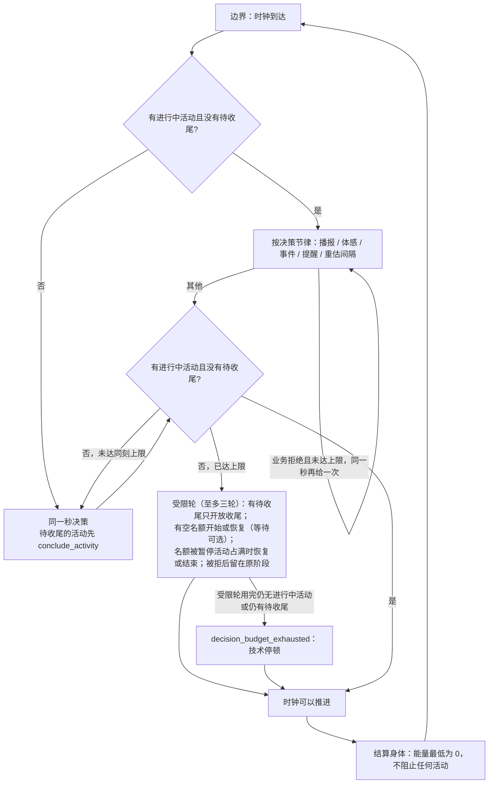
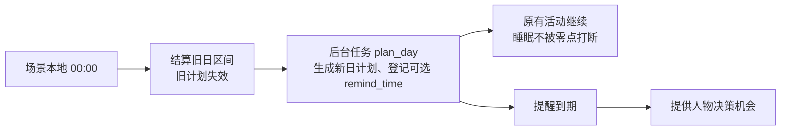
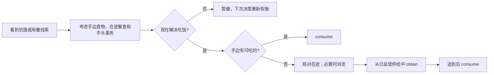
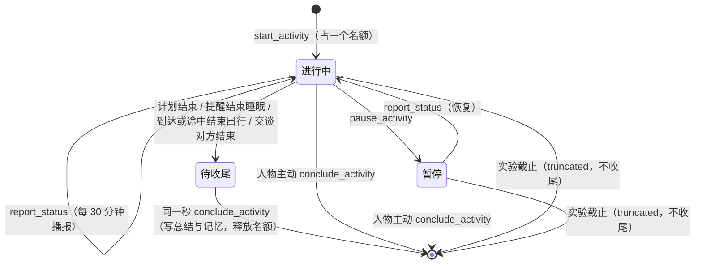

# 特性规格：数字人的时间与能量

> 状态：**FROZEN**。2026-09-24 用户指示按本规格实现，「裁决记录」#19–#23、#25 按推荐定为已定，`docs/INDEX.md` 状态列同步；「冻结条款修订」随冻结生效；本规格已实现并通过离线验收，证据见[时间与能量验收记录](research/time-and-energy-verification.md)；实施过程记在实施计划（实施台账）。
> 按[人物 Prompt 规格](SPEC-persona-prompt.md#冻结条款修订)修订 3、5、8、10、12、13、15、16、18–24 改写（人物 Prompt 台账 TE1–TE11）：
> 第六章「怎样过一天」与吃饭途径句由系统层与工具层取代，`just_now` 与决策自述删除，同秒续接、`wait_only` 删除与预算耗尽、
> `from`、`to` 与给予、进食开吃份量、七层呈现与记忆 `subject` 随之改写；按人物 Prompt 规格修订，修订部分已实现并通过离线验收（证据见[人物 Prompt 验收记录](persona-prompt-verification.md)）。
> 文中「人物 Prompt 规格裁决 #N」指该规格「裁决记录」第 N 行，与本规格裁决编号无关。
> 按[一日运行保真规格](SPEC-dayrun-fidelity.md#冻结条款修订)修订 8–10、13、15、17、18、20、23 与其 3.5 改写（一日运行保真 TE1–TE7）：名称类拒绝不计同刻轮数、不施加脉冲，
> 睡眠中不读消息，「趁早吃」改为按档位与饭点吃，零点计划不重述作息、目标带大致时刻 `around_time`，联系人回复的守卫重试，按名调用推广，
> `start_activity` 增请求级 `prefer` 与方式「购买」、`from` 为可选约束，控制工具改为 `items`，两种配送原因分开写，新码按「对新增行为的约束」登记；
> 修订部分已实现并通过离线验收。文中「一日运行保真规格裁决 X」指该规格「裁决记录」的编号。
> 按[个人事务与工作安排规格](SPEC-errands-workday.md#冻结条款修订)「冻结条款修订」改写（作业 TE2–TE31、TE34–TE36，编号见该规格配套的
> [实施计划](research/errands-workday-implementation-plan.md)）：就寝反思经严格工具 `submit_reflection` 提交并做与零点计划同形的有界校验重试；
> 三个控制请求增请求级 `errands`，事务提醒记 `errand_reminder_due` 且不叫醒睡眠，未完成事务不计在手承诺；
> 零点计划输入增「个人事务」「上班安排」与下班、到家时段，重复意图逐条定位；`query_world` 改六键、返回不再附候选；
> 交付的意图与 `dreaming` 投影不带 `errands`；修订部分已实现并通过离线验收（证据见[个人事务与工作安排验收记录](errands-workday-verification.md)）。
> 文中「个人事务与工作安排规格裁决 X」指该规格「裁决记录」的编号。
> 日期：2026-10-04
> 来源：[issue #2](https://github.com/HoldThatThgt/WorldMock/issues/2)（r14 运行，数据不在本机）；
> [issue #1](https://github.com/HoldThatThgt/WorldMock/issues/1)（第九章复核）；本机练秋湖运行（第八章）；后续设计讨论。
> 代码基线：`778beca`。其后到冻结为止的提交只改文档，代码相同。代码与已提交文档的行号都取 `778beca`。
> 本文只写现行设计，已放弃的方案不再保留；演变见「版本表」。
> 配套：[实施计划](research/time-and-energy-implementation-plan.md)（实施台账：阶段、文档同步作业与文件修改清单）

> 2026-10-01 按[工具交互规格](SPEC-tool-interaction.md)修订当前工具请求、查询与错误合同；本次设计已冻结，生产代码已实现，旧验收证据不覆盖新增条款。
> 本特性首次受影响的发布升级为场景 4、地图 3、目录 5.0、品类与规则绑定 3，世界结构仍为 8。各阶段独立发布；后续格式或内容再次变化时另升相应版本，禁止同目录版本覆盖内容。

## 摘要

| 主题 | 要改什么 | 章节 |
| --- | --- | --- |
| 时间与决策 | 决策不消耗模拟时间；没有进行中活动或有待收尾活动的人物在同一秒继续决策，直到有一项进行中活动（开始新活动或恢复暂停的活动；等待、睡眠都算）且没有待收尾活动，时间线不再留空 | 一 |
| 能量感知 | 饥饿在低能量时不再被钳住：能量低于 400 kcal 至少显示「饿得难受」，低于 100 kcal 显示新档「饿得发慌」；商品标每份热量；路线标轻松、一般或费力。身体数值仍不进提示 | 二 |
| 能量不拦人 | 能量不拒绝、不停止任何活动，最低为 0；靠饥饿每跨一档就唤醒、工具层列出的吃饭途径与系统层按档位与饭点吃的规则（一日运行保真规格 2.2），让人物在还有力气时吃饭 | 三 |
| 当日计划 | 场景本地零点（或中途启动时）由运行时后台任务 `plan_day` 生成当日计划，不经人物、不占决策；目标可带提醒时刻，提醒可叫醒睡着的人 | 四 |
| 生活动作 | 模型为每个对象选择方式，由方式推导五类内部动词（`travel`、`interact`、`obtain`、`consume`、`sleep`）（裁决 #20）；发消息、提交成果仍是独立工具；并行准入按注册表声明的占用（裁决 #23），以及目标、地点、出行方式与物品状态判定；动作不按当前状态隐藏，条件不满足时带说明，做错了以业务拒绝说明原因与下一步；超过 24 小时的派生时长取上限（裁决 #19） | 五 |
| 常驻提示 | 已被[人物 Prompt 规格](SPEC-persona-prompt.md)的系统层取代：「怎样过一天」一节删除，世界规则只在系统层 `rules` 写一次；只保留「吃饭路径可发现」的验收 | 六 |
| 会话、活动与记忆 | 会话是一段地点停留或一段路，由系统随出发与到达开始和结束；出发前人物须结束或暂停仍在进行的活动，路上开始的活动随出行结束，暂停的活动只能回原地点恢复；每人两个活动名额，每项活动独立走完开始、播报、结束，活动一结束同一秒就要 `conclude_activity`；取消 `finish`，一轮决策提交一个世界请求，记忆随 `conclude_activity` 写入（参数形状已由一日运行保真规格改为 `items[{activity_name, summary, memories, views}]`；`report_status`、`pause_activity`、`conclude_activity` 另增请求级必填的 `errands`，见个人事务与工作安排规格 2.2）；发给人物模型的内容不含内部身份 | 七 |
| 本机运行的修复 | 困意预测、播报只针对进行中活动、作息初值、活动进度、截止前 60 秒、结束留终态、配送时刻可读、运行身份覆盖 AS2 | 八 |
| issue #1 遗留 | 恢复 `778beca` 弄红的 50 项测试并升世界结构版本；修目标回看与跨任务提交两处崩溃；先于其余改动 | 九 |

## 心智模型

人手上没事时会马上决定下一件事，想事情本身不花时间；做完一件事会马上给它收个尾；饿了会越来越难受、做事变慢，
所以会趁还有力气时去吃；知道手里的东西顶不顶饿、走路比坐车累。系统掌握全部数值与结算，人物只拿到分级和可读事实，
发给人物模型的内容里没有任何内部身份。

三条硬边界：只有环境能改世界状态；一轮决策至多一个生活动作，本规格收紧为恰好一个世界请求（`start_activity` 一次至多开始两项）；身体数值、阈值与预算不进提示。

**交互原则：引导而不拦截。** 规矩写在系统层 `rules` 里，动作照常列在工具层并以 `available`、`reason` 标明未满足的条件；人物做错了，世界以业务拒绝说明原因和下一步，拒绝原因与 `reason` 一字不差。只有第一章的同刻上限在人物同一秒内反复没有落到进行中活动时收窄选项（受限的动作在工具层标不可用），作为防止同一秒无限循环的保险。

## 证据与范围

### 证据口径

| 来源 | 实情 | 用法 |
| --- | --- | --- |
| r14（issue #2） | 数据库在另一台机器上，本机没有 `runs/` | 数字按 issue 转述，标「issue 实测」 |
| 本机练秋湖运行 | 数据集仓库 `WorldMock-Dataset/requests/0001-white-collar-lianqiu/runs/` 只保留跑完的 `2026-09-28-deepseek-flash-after-wake-fix`（该请求 README：「`runs/` 只保留成功运行」）；第八章表中前四个运行已删除 | 跑完那次本机复算，标事件序号 seq；其余四个的数字为删除前所见，标「不可复算」 |
| 源码身份 | 本机运行都产生于 `2913546` 与 `eee89fc` 之间的未提交代码；`code_sha256` 不含实际导入的 AS2，对不回任何提交 | 运行只作症状证据，机制一律在 `778beca` 上复核 |

### 决定方案形状的事实

1. **首次决策丢失重估候选。** `_after_success`（`engine.py:830-850`）在 `_snapshot_decision_references`
   （`engine.py:427` → `observe.py:561-577`）写入本次决策时刻之前计算候选。首次决策时该值为 `None`，
   重估项被整项剔除（`schedule.py:329`）；此后总按上一次决策时刻计算，过期的候选还会被「严格晚于现在」
   过滤掉（`schedule.py:340`）。
2. **没有活动的人会被晾着。** 下一决策只来自唤醒候选，没有一项表达「此人手上没事」；冻结规则中
   「瞬时动作后下一秒反应」从未落地。r14 空转 13500 秒（issue 实测）；本机各运行 00:00 后都空转 225 分钟
   （跑完那次可复算，其余不可复算），跑完那次在 32.33 小时里有 10.21 小时没有进行中活动。
3. **能量闸门把人卡死。** 受理要求当前能量覆盖整段派生时长（`engine.py:1036-1044`），而九工具面不让模型填时长，
   能量上限也不再出现在提示里。r14 陈曦 18:37 能量归零后 69 次决策 69 次被拒（issue 实测）：闸门没有让她去吃，
   只是让她什么都做不了。
4. **结算与恢复都把透支当错误。** `settle_shared_body`（`body.py:186-188`）遇透支抛 `ValueError`；
   恢复校验（`activity_validation.py:26-34`）遇整段成本超余额报 `IntegrityError`。取消闸门必须同时改这两处。
5. **饥饿在最需要时失灵。** 食欲在 400 kcal 以下被钳住（`felt.py:27`），08:00 前后昼夜项处于谷底，
   0 kcal 也只显示「很饿」。本机跑完那次次日醒来时能量为 0，提示仍是「很饿」。
6. **会话从不收尾。** 开始新活动不要求结束旧会话；本机跑完那次 13 个会话到结束仍有 10 个 `active`，
   53 次提供决策的唤醒中 50 次带这些会话的播报原因，其中 22 次仅因播报；醒来时提示仍写「正在做：睡眠」。

### 权威来源与范围

| 内容 | 权威 |
| --- | --- |
| 本文各章行为 | 本规格 |
| 唤醒闭集与决策节律总则、身体语义 | [life-runtime 规格](SPEC-life-runtime.md)（按「冻结条款修订」修订） |
| 工具面、会话与引擎派生参数 | [数字人交互规格](SPEC-agent-interaction.md)（同上） |
| 当日目标证据与度量 | [当日目标规格](SPEC-day-plan-goals.md)（提交方式按第四章修订） |
| 个人事务（登记、完成依据与结算、提醒、待办层呈现）、下班与到家作息锚点、场景工作安排与环境层 `duty`、`query_world` 的筛选与返回、就寝反思的严格工具 | [个人事务与工作安排规格](SPEC-errands-workday.md)（按其「冻结条款修订」修订本文相应条款） |
| 记忆合同 | [life-realism 规格](SPEC-life-realism.md)、[一日行为规格](SPEC-dayrun-behavior.md)（写入点按第七章修订） |
| 动作登记与结果通道 | [决策上下文规格](SPEC-decision-context.md)（按「冻结条款修订」与人物 Prompt 规格修订） |
| 发给人物模型的请求组成（七层、系统层、同秒续接）、`from` 与 `to`、给予与进食开吃份量 | [人物 Prompt 规格](SPEC-persona-prompt.md) |
| 交互菜单 | [交互菜单规格](SPEC-interaction-menu.md)（同上） |
| 交付窗口 | [LabelKit 交付规格](SPEC-labelkit-delivery.md)（只作澄清修订，见「冻结条款修订」第 27 行与第九章） |
| 字段、错误码与场景参数的 Schema，提示模板 | [接口合同](../CONTRACTS.md) |
| 事件类型与记录字段 | [记录引擎设计](../design/05-recording-engine.md) |
| 场景参数取值与实验假设 | `docs/EXPERIMENT.md` |

**不在范围**：持有物随身携带（见「范围外登记」）；模型自定时长；任何身体数值进提示。

## 一、决策不耗时：时间只在做事时流动

### 规则

1. **时钟只在人人有事时推进。** 世界推进到下一边界的前提是：每个人物都有进行中活动，且都没有待收尾活动（第七章）。
   等待与睡眠都是活动。决策本身不消耗模拟时间。唯一的例外是规则 3 末尾的技术停顿：受限轮用完仍没有进行中活动或仍有待收尾活动时，
   时钟可以推进。
2. **没有进行中活动或有待收尾活动，就同刻再决策。** 人物没有 `ACTIVE` 活动，或有待收尾活动时，在同一模拟秒立即再获得
   决策机会，直到有一项进行中活动（开始新活动或恢复暂停的活动）且没有待收尾活动。适用情形：运行开始；活动结束
   （计划结束、提醒结束睡眠、到达、交谈对方结束，先按第七章收尾）；瞬时动作之后（发消息、购买或下单、给予、提交成果、
   回看、暂停、结束活动、修订计划）；业务拒绝之后。
3. **同刻上限。** 同一人物在同一模拟秒内的决策轮数由场景参数 `max_same_moment_decisions` 封顶（缺省 3，正整数），
   时钟推进即归零；轮数照旧计入成功、拒绝与重放，它不是连续失败次数；名称类拒绝不计（每人每秒至多 2 次不计，第 3 次起照常计，
   名称类拒绝码的闭集见[一日运行保真规格](SPEC-dayrun-fidelity.md) 3.4）。达到上限后，若仍不满足规则 2 的结束条件，
   就进入受限轮，至多三轮。每个受限轮只开放一类动作：
   - 有待收尾活动：只开放 `conclude_activity`，每项待收尾活动都可以收尾，一次收尾其中几项也受理，这一阶段持续到没有待收尾活动；
   - 否则有空名额：开始或恢复一项持续活动（等待始终可选）；瞬时的 `obtain`（到店、远程下单与由系统定方式的「购买」）与其他瞬时的生活动作
     不在受限轮开放；
   - 否则（两个名额都被暂停的活动占着）：恢复或结束其中一项。

   开始或恢复被拒后留在原阶段，被拒的选项在工具层标原因。受限轮不开放的动作照常列在工具层，标 `available=false`，
   `reason` 为同刻限制的拒绝原文（受限轮的判定先于待收尾；未到上限而有待收尾活动时，其余动作的 `reason` 为英文 `Conclude the completed activity <活动> first.`）；原生工具与名称参数不按阶段收窄
   （人物 Prompt 规格裁决 #26）。形状错误按协议错误在本轮重试，不计轮数。等待只在有空名额时开放，时长取场景
   `activity_feedback_seconds`（下限 60 秒）；标为可用的收尾、结束与等待都会被受理。交谈对方在同一秒结束交谈造成的
   新待收尾（第五章「交谈」），按本条阶梯从收尾一支重新开始，每次至多另加三轮；除此之外，同一秒内的轮数不超过上限加三。
   受限轮用完仍没有进行中活动，或仍有待收尾活动（待收尾活动旁另有进行中活动时同样要在同一秒收尾，不写该事件这一秒便没有上界）时
   （人物 Prompt 规格裁决 #25），环境不替人物造活动：写一条 `environment_event`
   （`data.kind=decision_budget_exhausted`，`visibility=system`，带最近的拒绝码），设
   `next_decision_at = now + activity_feedback_seconds`，时钟可以推进（技术停顿，身体按静息结算）；质量报告计数，
   不记成人物主动等待。单次决策的回合预算与这一跨决策预算分开计。
   这一收窄只是防止同一秒无限循环的保险，常规路径靠系统层规则与工具层说明。人物始终自己选，系统不替人物选择活动。
4. **有进行中活动时。** 没有待收尾活动时：瞬时动作成功后不在同一秒再给机会，下一次按决策节律；业务拒绝后在同一秒
   再给一次机会，受同一上限约束，达到上限后按决策节律。有待收尾活动时，按规则 2、3 处理，收尾前时钟不推进。
5. **边界兜底。** 任一边界结算后没有进行中活动的人物，必定在该边界获得决策，唤醒原因含 `no_active_activity`。
6. **唤醒原因记录。** 同刻再决策的轮次，`pending_wake_reasons` 替换为本轮原因：没有进行中活动记 `no_active_activity`，
   业务拒绝之后记 `rejection_feedback`；交谈对方在同一秒结束交谈、本人仍有其他进行中活动时记 `planned_end`；人物消息或
   交谈邀请送达而获得同刻机会时（本章「人物之间的消息」）记 `message_arrival`。
   `no_active_activity` 与 `rejection_feedback` 同时成立时按枚举顺序记两项。上一轮的原因（含 `wake_from_sleep`、
   `plan_reminder_due`）不带入，所以每次醒来只做一次就寝后反思。本轮原因由该轮 `decision_started` 与观察记录
   （`decision_start.py:42`、`observe.py:105`）。同刻轮次没有结算区间，不写 `body_settlement`。
   - `no_active_activity` 不进入睡眠允许集合，不改变其他唤醒条件；规则 5 的边界兜底靠它提供决策。
   - 新成员依次追加在 `progress_report_due` 之后：`no_active_activity`、`plan_reminder_due`。个人事务与工作安排规格 2.5 在
     `plan_reminder_due` 之后再追加 `errand_reminder_due`（事务提醒到点），它不进入睡眠允许集合。新增成员照数字人交互规格
     「冻结条款修订」第 1 行规定的程序办：同步调度枚举、足迹侧的唤醒原因词表与写入期校验、质量报告的分桶与两处互锁测试，
     并登记接口合同枚举表、life-runtime 规格的冻结词表与触发表、记录引擎设计；漏登词表会让带新原因的事件落不了库。
   - `rejection_feedback` 只由本条写入，边界判定不再产生它。
   - `discovery_result` 保留在闭集中，当前没有触发来源：浏览已经是活动，结果随浏览结束或在下一次观察时回灌。
7. **候选时刻修正。** 有进行中活动的人物，下一决策候选以本次决策时刻作为上次决策时刻计算（`last_decision_time` 取
   当前时刻），首次决策即含重估项。`next_decision_time` 仍只取严格晚于当前时刻的候选（`schedule.py:340`）。
8. **单一来源。** 同刻机会只由 `next_decision_at = 当前时刻` 表达，`_ready` 与 `_require_boundary_action` 无需旁路。
9. **重放。** 幂等重放不重做领域动作；下一次机会按存档结果与当前状态走同一套规则：无进行中活动或有待收尾时同一秒
   再决策，否则按决策节律。重放轮计入同刻轮数，唤醒原因按规则 6 写入。相应的代码改动：
   - `_reused_result` 中无条件加一秒的写法删除；
   - `_after_unknown` 没有调用方，删除；
   - `_put_agent_and_defer_feedback` 只保留游戏回合顺延（把 `next_interaction_at` 等于当前时刻的游戏活动推后一秒，
     防止达上限后在同一秒再就绪），随之改名并改文档串。

AS2 调度已支持同刻多轮：`society.step` 在有人就绪时执行决策轮，只有无人就绪才推进时钟
（锁定的 AS2 `8768e14`，`society/society.py:224-240`）；每轮照常形成共同检查点。

### 实现约定

- 人物新增字段 `same_moment_rounds: int`（本秒已进行的决策轮数）与 `same_moment_stage`（受限轮阶段，取值 `open`、
  `conclude_pending`、`start_or_resume`、`resume_or_conclude`、`conclude_only`）。受理、业务拒绝、重放各使轮数加一；
  时钟推进时两者归零；随世界结构版本 7 保存，阶段闭集删去 `wait_only` 随版本 8。阶段依赖上一受限轮的结果，所以单独保存。
  `start_or_resume` 只接受会产生进行中活动的开始或恢复，工具层把到店购买与远程下单标为不可用。
- 观察私有证据携带 `same_moment_stage`。工具层据此把受限轮不开放的动作标 `available=false`，`reason` 取与环境受理
  同一判定的拒绝原文（人物 Prompt 规格第一章「工具层」）；LifeAgent 不按阶段收窄原生工具与名称参数，全部只读查询照常开放。
  请求中没有受限轮的说明句，不写次数。
- 引擎在 `_require_boundary_action` 中用同一判定复核。越界请求（即工具层标为不可用的动作）以业务拒绝
  `SAME_MOMENT_ACTION_RESTRICTED` 返回并计入轮数，拒绝原因与工具层的 `reason` 一字不差。该码登记到接口合同。
- 连续拒绝计数：`AgentState.consecutive_rejections` 保留，只作动机层挫败感的输入。挫败感分母改为
  `max_same_moment_decisions`，结果截到 1（`motivation.py:381-382`、`observe.py:388-389`）。它不再参与唤醒与冷却：
  删除 `WakeSnapshot.consecutive_rejections` 及其派生（`rhythm.py:384-385`）。拒绝结果 `data` 用 `same_moment_round`、
  `max_same_moment_decisions`、`next_decision_at` 取代 `consecutive_rejections`、`maximum_rejections`
  （`engine.py:873-875`）。
- `decision_started` 与 `body_settlement` 的写入路径接入 `validate_decision_rhythm`（现在没有生产调用方），让闭集在
  写入时就被校验。

### 人物之间的消息

人物消息与交谈邀请送达时，清醒的收件人按 life-runtime 既有的 `message_arrival`（「新消息到达本人」）获得机会：
`next_decision_at` 取当前时刻，在同一秒决策，计入其同刻轮数；达到上限后改在下一边界提供；睡眠中不唤醒，醒后在观察中
看到消息。这个唤醒在本轮全部动作结算后合并，不会被收件人本轮的 `_after_success` 覆盖。睡眠中也不读消息：睡眠中送达的消息
不记为已读，不计社交缓解与消息情绪脉冲，醒来后的第一个边界再读（[一日运行保真规格](SPEC-dayrun-fidelity.md) 1.5，裁决 D15）。

现状有两处要改。`rhythm.py` 的 `_read_new_messages` 在建快照之前就把收件箱记为已读，`message_arrival` 只能由预排事件
成立；改为移到唤醒判定之后。`engine.py` 的 `_deliver_social_message`、`_register_delivered_message` 负责登记收件人就绪。

**联系人回复**（裁决 #21）：联系人的回复登记为预排送达事件，延迟为实验常量
`CONTACT_REPLY_DELAY_SECONDS`（缺省 300 秒）；送达时收件人以 `message_arrival` 获得机会，睡眠中过滤。现状是回复在发送
的同一秒送达，无事可做的人能与联系人在零模拟时间内来回多轮。

### 同一秒内的呈现与「刚才」

- 同一人物同一模拟秒内的各轮，沿用该秒首轮的呈现窗口。本秒的呈现留痕先暂存在世界状态里，时钟推进时才并入
  `presentation_state`；轮转游标与上次呈现时刻取该秒开始时的值。本秒首轮回灌的浏览结果，在后续轮次中继续置顶。
  对象只因世界事实（库存、营业、地点、在场）变化而离开窗口。
- 修一个既有缺陷：引擎只暂存一份呈现留痕，多人同轮时后观察者会覆盖前者（`observe.py:45`）。改为按人物暂存，由
  `flush_presentation`（`state_commit.py:46-59`）逐人合并。
- 同刻再决策的轮次，上一轮本人世界请求的公开结果（受理，或拒绝的原因与下一步）不再写成 `scene.just_now`：同一秒续接时
  它随上一决策世界请求对应的 tool 消息的 `result` 返回；断链时它在进度层该调用的 `result` 中（人物 Prompt 规格第二章
  「同秒续接」）。两处都不含内部身份，也不含登记确认。

### 拒绝的情绪代价与重估间隔

- 业务拒绝的 `service_refused` 情绪脉冲（`engine.py:864-867`）对同一人物、同一模拟秒至多施加一次，避免引导性拒绝在
  同一秒叠成「很烦」。名称类拒绝不施加该脉冲，每人每秒至多 2 次，第 3 次起照常施加（[一日运行保真规格](SPEC-dayrun-fidelity.md) 3.4）。
- 时钟推进时人人都有进行中活动。按现行口径（`rhythm.py:276-286`，任何进行中或暂停的活动都算在手承诺），空闲间隔永远
  用不上。改为：进行中的等待不算在手承诺。人物只在等待、且没有未推进目标、可见未完成任务、暂停活动或其他进行中活动时，
  才用 `idle_reconsideration_interval_seconds`。句中「可见未完成任务」指工作任务；未完成的个人事务不计入在手承诺，
  不改变常规与空闲重估间隔及闭店预警（个人事务与工作安排规格 2.5，其裁决 E6）。睡眠照常不受重估间隔影响。

### 场景参数

| 参数 | 缺省 | 约束 |
| --- | --- | --- |
| `max_same_moment_decisions` | 3 | 正整数；取代 `max_consecutive_rejections`，后者从场景 Schema（`scenario.py:537`、`:679`）与场景文件删除；接口合同本无此键，冻结规格与实验参数中的出处见「冻结条款修订」 |
| `activity_feedback_seconds` | 场景现值 | 下限由 1 改为 60（等待时长取它，必须能受理） |

工具交互首次受影响发布的生活场景 `schema_version` 为 4；地图结构为 3、目录为 5.0、品类和规则绑定为 3，世界结构保持 8。个人事务与工作安排规格阶段 3 把生活场景 `schema_version` 升为 5（人物配置增必填可空的 `work_schedule`），旧场景按版本拒绝，不迁移。含旧字段 `max_consecutive_rejections` 的场景按未知字段拒绝（`extra=forbid`），这与
交互菜单加入时的先例、以及配置设计「9. 配置版本与运行绑定」中「旧字段和失效配置直接删除，不提供格式迁移或兼容层」的
约定一致。

### 不变项

- 睡眠中只接受睡眠允许的唤醒原因；`no_active_activity` 与 `errand_reminder_due` 都不进入 `SLEEP_ALLOWED_REASONS`。
- 静默边界不调用人物决策模型；场景本地零点的 `plan_day` 是运行时后台任务，不经人物，按第四章留证；有进行中活动的人物仍按计划结束、30 分钟播报、
  体感、事件、提醒与重估间隔获得机会。
- 一轮决策一个世界请求（第七章）。

## 二、能量感知

身体数值、阈值与能量预算不进提示。人物通过饥饿分级、商品标签和路线标签感知能量。

### 饥饿在低能量时不失灵

食欲公式与原五档阈值不变；新增第六档「饿得发慌」，只由能量决定。两条低能量规则：

| 条件 | 显示 |
| --- | --- |
| `energy_kcal` < 400（身体配置 `emergency_threshold_kcal`） | 至少「饿得难受」，不受昼夜项与餐时项影响 |
| `energy_kcal` < 100（新常量 `APPETITE_STARVING_KCAL`，约 1.5 小时基础消耗） | 新档「饿得发慌」 |

- 400 取身体配置的 `emergency_threshold_kcal`（目录 `alert_rules` 中的 `EMERGENCY_ENERGY`），不复用 `felt.py` 的公式
  下限 `APPETITE_KCAL_FLOOR`（`felt.py:27`）。100 是 `felt.py` 的新常量 `APPETITE_STARVING_KCAL`，不进目录，所以目录与
  数据集副本都不变。`BodyConfig.validate_body`（`scenario.py:84`）改为校验
  `APPETITE_STARVING_KCAL < emergency_threshold_kcal < hunger_threshold_kcal <= maximum_energy_kcal`。
- 分级函数改为 `felt.appetite_level(appetite, energy_kcal, emergency_kcal)`；`summarize_felt_levels` 相应增加这两个参数，
  三处调用都要传入：`projection.body_projection`（`projection.py:109`）与 `rhythm.py:179`、`:357`；`projection.felt_values`
  仍只返回五个数值，`body.values` 的字段不变。`body.values.appetite` 的数值仍按原公式计算。
  「饿得发慌」不进 `APPETITE_BANDS`。
- 「饿得发慌」加入分级序表与饥饿不适档（`rhythm.py` 的 `_BAND_ORDER`、`HUNGRY_BANDS`）。
- 边界预测的能量阈值为 800、400、100（800、400 取身体配置，100 取 `APPETITE_STARVING_KCAL`；`body.py:478-484` 现只有
  前两个），跨档照常以 `felt_band_change` 唤醒，睡眠中过滤。
- 能量同时压低工作效率；这一事实只写进系统层规则（人物 Prompt 规格第一章「系统层」），不给数值。
- `body_observation`（`body.py:327-349`）与只为它存在的 `body.felt_levels`、`body.felt_values`（`:309-324`，和
  `projection.felt_values` 重复）都没有生产调用方，一并删除；同时删除 `ScenarioSemantics.alert_codes`。目录 `alert_rules`
  仍是 800、400 的来源。`scripts/inspect_run.py` 改读 `body.values` 与 `body.levels`。

### 商品热量与路线费力

- 工具层商品目标与持有物目标中的食品（`use_modes` 含 `eat`）在 `state` 写每份热量，例如「每份约 250 千卡」：取
  `energy_kcal_per_unit`，按 5 进位取整到 10 千卡；不足 5 千卡写「几乎不含热量」；非食品不写热量。数值来自目录的
  份量声明，与价格同类；合成条目的份量是场景假设（第八章「数据集侧」）。
- 路线的费力随工具层地点目标的出行动作给出：MET < 2 为「轻松」，2 ≤ MET < 3 为「一般」，≥ 3 为「费力」。
  现有方式中，驾车（MET 1.5，约 97.5 kcal/h）为轻松，步行（MET 3.5，约 227.5 kcal/h）为费力。费力按出行方式给出，
  未核实的路线也给。
- 路线的 `feasible` 取 `status == "reachable"`（`observe.py` 的 `_route_rows`），不再按能量计算（第三章）。事件级路线
  目录删除 `minimum_energy_cost_kcal`、`energy_feasible`，保留 `duration_seconds`、`travel_time_factor`。
- 分界与常量（100 千卡、MET 分界、热量按 5 进位取整到 10 千卡）与第三章的能量效率
  节点是实验假设，登记在 `docs/EXPERIMENT.md`；MET 分界是 `projection.py` 常量。

## 三、能量不拦人

### 原则

能量不拒绝、不停止任何活动。人物再饿也能走路、工作、去买吃的；低能量的代价是难受和做事变慢，而不是被卡住。
阻断不会让人去吃，只会让人更快陷入困境：r14 陈曦归零后 69 次决策全部被拒，却没有一次因此吃上饭（issue 实测）。
这也与人的实际情况一致：一项汇总 71 项研究、3484 名受试者的荟萃分析发现，短时空腹（中位 12 小时）
不降低认知表现（[APA 报道](https://www.apa.org/news/press/releases/2025/11/short-fasts-do-not-impair-thinking)）。

### 删除的机制

- 受理闸门 `_require_energy_plan`（`engine.py:1036-1044`）及其四处调用（`:1016`、`:1084`、`:1124`、`:1302`）。
- 结算透支报错（`body.py:146-147`、`:186-188`）：能量对所有活动集合都以 0 为下限截断，与现行空闲和恢复活动相同。
- 恢复校验中的能量检查（`activity_validation.py:26-34`）与 `_activity_infeasible_signatures` 的能量判据
  （`rhythm.py:450-465`）。
- 路线 `feasible` 中的能量成分（`observe.py:599-620`）、观察事件中的 `energy_feasibility`（`observe.py:623-631`）。
- 错误码 `INSUFFICIENT_ENERGY`（只在 `_require_energy_plan` 与数字人交互规格「前置条件前置与前往提醒」出现，接口合同
  本无此码）。
- `activity_infeasible` 失去了唯一来源（`rhythm.py:450-465` 只有能量判据）。按唤醒闭集规则保留该成员，当前不产生。
  同时删除：`_activity_infeasible_signatures`；`_warning_signatures` 的 `infeasible` 分支；`WakeSnapshot.activity_infeasible`；
  `commitment_threatened` 中「当前活动不可行」的分支（`schedule.py:286`）与 `activity_infeasible` 的判定分支
  （`schedule.py:296-297`）。此后 `commitment_threatened` 只来自
  临近截止与临近闭店。随之无用的 `RhythmInputs.recovery_kinds` 与 `engine.recovery_kinds`（`engine.py:776`）一并删除。
- 删除可供性字段 `energy_projection`、派生出的 `energy_limit_kinds`，以及观察合同键 `energy_projection`（`engine.py:170`，
  合同键由六个改为五个）。注册表用同一个键闭集校验场景目录副本，所以本仓库的 `catalog/affordances.toml` 与数据集副本
  要同批更新，并刷新目录清单；按目录自身约定（`catalog/affordances.toml:9`「修改即 catalog_version 级变更」）升
  `catalog_version`，三份仓库场景与数据集场景同步（裁决 #25）。
- 删除暂停控制行的 `minimum_energy_cost_kcal`、`resume_energy_feasible`（`observe.py:634-647`）；删除候选排除理由
  `ELIGIBILITY_ENERGY_INSUFFICIENT`（`candidates.py` 的 `_energy_reason`，生产路径不会触发）；删除无调用方的
  `_remaining_activity_energy`（`engine.py:1742-1749`）；删除闸门移除后无人调用的共同能量预测：`activities` 的
  `active_energy_entries`、`combined_energy_cost`、`maximum_combined_duration`，`body` 的 `shared_energy_cost`、
  `maximum_shared_energy_duration`。
- 保留：内部动机评分（`motivation_internal`，只供评估，不进提示）继续按能量取舍。`energy_floor_exempt`、
  `ENERGY_RECOVERY_ACTIVITY_KINDS`、`maximum_energy_duration_seconds` 只为它保留，不代表世界规则。

### 低能量的代价（保留，不新增惩罚）

- 饥饿分级逐档上升（第二章），持续饥饿产生既有的不适情绪脉冲。
- 工作效率随能量下降（既有效率因子：800 kcal 以上为 1.0，400 kcal 时 0.8，更低为 0.5）。

### 让人物趁早吃

1. **饥饿每跨一档都给决策机会**，包括正在工作或观看时（`felt_band_change`；睡眠中照常过滤）。跨档时刻由饥饿跨档扫描
   给出，算法与第八章「节律」的困意扫描相同：按当前共同净消耗推进能量，逐步计算含昼夜项与餐时项的食欲，取首个分级变化
   的整秒，其中含 400、100 千卡两个保底档。交谈、通话期间同样预测，代谢当量取 `CHAT_MET`、`CALL_MET`；游戏按回合、
   睡眠按睡眠允许原因处理，不另做预测（改 `rhythm.py:140-149` 与 `body.py` 的 `next_shared_body_boundary_seconds`）。
2. **吃饭途径由工具层目标与系统层规则表达**（人物 Prompt 规格第一章）。不再生成吃饭途径句，`scene.local_food_summary`
   与当地餐食句一并删除。手边能吃的是工具层现场持有物目标的食用动作；在路上的订单在进度层的调用结果与 `delivery` 记录中，
   跨日未了结的在记忆层；这里能买的与能送到这里的是工具层商品目标的到店与远程下单动作，预计送达写在该动作中；
   附近能买的地点及其路线是工具层的地点目标。当前地点有供给但本轮没有呈现时，人物仍可按名称指名购买（第五章「请求形状与菜单」）。
3. **系统层第 15 条写明按档位与饭点吃**（人物 Prompt 规格第一章「系统层」，按[一日运行保真规格](SPEC-dayrun-fidelity.md) 2.2 改写；
   本节原则的「不阻断、每档唤醒」两半不变，「趁早吃」改为「按档位与饭点吃」）：「你会饿、会困、会累，饿着或困着做事会慢，走路比坐车更费力。
   只是『有点想吃』时，等平常的饭点再吃正餐，离饭点还早可以喝点东西或吃点手边的零食；到了『饿』，离平常饭点一小时以内可以提前准备或下单，
   更早就先垫一点；到了『很饿』或更饿，别等饭点，马上弄吃的。手边的、在路上的、这里能买的、能送到这里的都算；下单后要等送到，拿到手才能吃。
   每个饭点的正餐只吃一次，提前吃过的那顿就算吃过了。」
4. **工作中也能吃、能下单**（第五章），配送时刻写成人读的形式（第八章）。

## 四、零点计划与计划提醒

### 运行时机

`plan_day` 不再是人物工具，改为运行时在场景本地零点执行的独立后台任务，由它生成当日计划。场景本地 `00:00` 加入下一
边界候选（`engine.py:1529-1545` 的 `_next_epoch`），无论这一刻有无活动变化。在该边界，世界照常结算前一日区间、使旧计划
失效，然后为每个人物执行 `plan_day`，根据下述输入生成新日计划。

`plan_day` 无论人物在睡觉、工作还是做别的都执行。它不是决策，不占用决策轮，也不调用人物：

- 不提供生活决策机会，不暂停、结束或重启活动，睡眠不被零点打断；
- 不调用 LifeAgent，不读写人物工作区与记忆运行时（`custom/agents/life_memory.py` 不因 `plan_day` 改动）；
- 不产生 `observation`、`decision_started`、`memory_updated`，不计同刻轮数；
- 不改 `last_decision_time`、`felt_bands_at_last_decision`、`people_at_last_decision`、`known_task_ids`、
  `pending_wake_reasons`、`next_decision_at`。
- 对个人事务只读：未完成事务作为输入「个人事务」进入请求，`plan_day` 不创建、不更改、不终结事务；零点边界结算旧日、
  使旧计划失效时也不清空 `AgentState.errands`（个人事务与工作安排规格 2.1、2.8）。

零点边界上，`advance` 只结算旧日区间、使旧计划失效并提交；随后执行 `plan_day`；该秒的唤醒原因与下一决策候选由节律在
`plan_day` 提交之后判定（在手承诺按新计划计，新计划的提醒进入下一边界候选），然后才提供决策。运行终点恰为零点时不执行
`plan_day`，节律照旧在 `advance` 内判定。

- **执行位置**（裁决 #24，已定）。照搬联系人回复的后台调用方式（`runtime.py:747` 的 `settle_pending_model_replies`）：
  - 运行时新增与它并列的后台任务，调用方式同联系人回复（LifeEnv 在引擎提交之后 await 运行时函数），但挂点不同：零点由
    `LifeEnv.step` 在 `engine.advance` 提交之后调用；启动路径（见下）的新建运行与反事实分支由 `LifeEnv.checkpoint` 在初始
    或干预检查点提交之后调用；普通恢复（子清单 `branch_kind` 为 `resume`，`footprints/checkpoint.py:118`）由 `LifeEnv.init`
    在引擎打开之后、首次决策之前调用，因为锁定的 AS2 在恢复模式不形成初始检查点（`society/society.py:167-168`），首轮决策
    又先于推进；该调用早于 AS2 `Society.init` 登记故障的 `try`（:162、:164），任务异常由 `init` 先经 `engine.fail_run`
    登记运行故障再抛出。联系人回复挂在 `commit_decision_round`（`life_env.py:109-110`），而零点无人就绪时只经
    `step` 推进、没有决策轮（锁定的 AS2 `society/society.py:232-238`），所以不挂在那里。没有人物缺当日计划时，不建客户端
    即返回；
  - 独立客户端使用运行清单中的模型身份，身份核对与联系人回复相同；
  - 计划经引擎的系统登记入口写入世界状态：`engine.py:1165` 的 `_plan_day` 移出 `_dispatch`（`:927`，处理表 `:945`），
    改为系统入口，不进人物工具面，不产生 `action_requested`；
  - 零点边界的计划与证据在该边界的共同检查点之前提交，该边界照常形成共同检查点；启动路径的计划在初始（或反事实干预）
    检查点之后、普通恢复的计划在 `init` 中提交，由下一个共同检查点封存。
- **终点。** 运行终点恰为本地零点时，该边界只结算旧日并结束运行，不执行 `plan_day`。
- **启动路径。** 新建运行时，在初始共同检查点之后、首个 `run_start` 决策之前执行，生成时刻就是起点。
  起点恰为零点时，只按启动路径执行一次。恢复与反事实分支按世界状态中既有的 `AgentState.plan_submitted_dates`
  （`models.py:332`，本地日期集合）判定当日是否已执行：已执行不重复；未执行则在首次决策之前执行，反事实分支在干预之后执行。
  启动路径之后的首个决策仍带 `run_start`。

`plan_day` 不写记忆；既有的阈值巩固与就寝反思保留（第七章）。

### 输入、调用、失败与记录

- **输入**（只读，全部来自世界状态与足迹记录，不读人物工作区）：
  - 场景声明的人物档案（输入键「人物」：名字、背景原文 `background_story`、健康习惯、社交风格与午饭、晚饭、就寝时段，未声明的省略；
    不读人物工作区里编译后的卡片）；个人事务与工作安排规格 4.2 增「下班时段」「到家时段」，取场景的 `leave_work_window`、
    `arrive_home_window`，未声明省略，只来自卡片的下班与到家时刻不进入输入；
  - 当日已核验经历的句子（第七章口径）；
  - 本人当日已结算的公开动作结果（消息送达、订单受理与交付、成果评审）；
  - 当日 `conclude_activity` 请求中记录的 `summary` 与 `memories`（标「你自己记下的，未经核验」）。所以睡前收尾时写下
    「明早 7:30 起」，零点计划就能据此生成提醒；
  - 零点可见的事实子集：可见的工作任务（输入键「待办任务」）、收件箱、在途订单及预计送达、联系人、旧日目标的推进情况。
  - 未完成的个人事务（输入键「个人事务」）：名称、要办成什么、已办到哪、备注、提醒时刻，取自 `AgentState.errands`，不含内部身份；
    输入键「待办任务」含义不变，仍指工作任务（个人事务与工作安排规格 2.8）。
  - 计划日期当天的上班安排（输入键「上班安排」）：与环境层 `duty` 同源，不含 `status`；人物没有工作安排时为 `null`。
    这里的当天是输入键「计划日期」所指的本地日（零点边界上即新开始的一日），不是下文回顾经历所说的「当日」
    （个人事务与工作安排规格 4.6）。

  不读：身体数值、交互对象、私有绑定、未到期的预排事件、人物的主观记忆库。来源由系统登记为这些事件，模型
  不填身份。「当日」在零点边界指刚结束的本地日（前一日 00:00 至本次零点），在启动路径指生成时刻所在本地日中生成
  时刻之前的部分。
- **调用与输出。** 与联系人回复一样，由独立客户端使用运行清单中的模型身份。不新增模型阶段键：阶段运行身份
  `stage_model_identity` 的 `stages` 恰为 `action`、`work_review`（人物 Prompt 规格第七章），`plan_day` 不在其中。生成参数必须给出 `max_tokens`（第八章 `-rerun` 就是因为缺它而失败）；
  参数、中文模板与输出 Schema 写入接口合同「请求组成」「生成参数」。输出为唯一严格工具 `submit_day_plan`（`tool_choice=required`）的参数 `{goals: [{intent_kind, goal, remind_time, around_time}]}`
  （`around_time` 按[一日运行保真规格](SPEC-dayrun-fidelity.md) 8.2 增加），没有记忆。请求照常按整次 token 计数；达到窗口 85% 时先裁掉较早的当日经历句子，仍超限则按容量故障处理。
- **失败。** 输出不是合法计划时（JSON、条数、意图唯一性、文字长度、`remind_time` 的格式或时刻、`around_time` 的格式有误），
  其中重复意图的错误同时定位首次出现与其后每次出现的条目，条数超限与重复意图同批报告，零点计划与 `revise_day_plan`
  共用同一校验函数（个人事务与工作安排规格 1.3）；把英文错误附回模型重试，至多 3 次。这是 `plan_day` 自有的校验重试计数，数值与接口合同「模型身份」的 `transport_max_retries` 相同，
  但分开计数，不借用传输预算（该节规定协议错误不得借用）；联系人回复不附回校验错误重试，只在后验守卫命中越界说法（到达或在路上、
  已完成或带来、揽活、保证结果）时在同一结算内重试一次、仍命中则用固定兜底句（一日运行保真规格 7.3；原引的 `runtime.py:689` 已过期），
  瞬时传输失败与它一样另用调度器的传输预算。次数登记在「生成参数」。校验重试或传输重试耗尽时，按联系人回复的同一边界作运行故障，
  并保留请求、响应与错误证据；不用空计划或丢弃字段兜底。这属于协议或模型错误，不是业务情形，不受第九章「不得新增故障路径」约束。
- **记录**（不新增事件类型）：

  | 内容 | 事件 | 要点 |
  | --- | --- | --- |
  | 模型请求与响应 | `model_request`、`model_response` | `visibility=system`，`data.purpose="plan_day"`，计入 `model_usage`；交付窗口、决策 token 统计与行为指标的决策请求按 `purpose` 排除它们 |
  | 计划登记 | `environment_event` | `data.kind="day_plan_generated"`，`visibility=system`；`data.day_plan` 与修订结果同形（含 `remind_time`，目标的 `registered_at` 为该事件时刻）；`data.source_event_ids` 为输入来源；`goal_metrics` 以它作为登记来源 |

  计划、提醒、来源与模型证据在同一次提交中写入；幂等键为既有字段 `AgentState.plan_submitted_dates`（`models.py:332`），
  不新增字段，同一人物同一本地日只生成一次。事件字段登记在记录引擎设计「事件正文与资源证据」。

### 计划与提醒

- 零至八条有序目标，沿用 `intent_kind`、`goal` 与意图唯一性。`goal` 可写粗略时段与准备动作；文字不驱动活动。
  计划只写今天与平常不同的事（提前、推迟、取消、和谁一起）、要办的事（截止的任务、要回的消息、要买的东西、要去的地方）与需要的提醒；
  已经记成个人事务的事不必照抄成目标，今天打算去办的可以写一条目标说明什么时候办（零点计划模板第七条，个人事务与工作安排规格 2.8）；
  人设层作息里已有的事（睡觉、起床、上下班、吃饭）不写，除非今天与平常不同或需要提醒，写时写清楚哪里不同；平常的一天可以没有目标
  （[一日运行保真规格](SPEC-dayrun-fidelity.md) 2.3，裁决 S11）。零点计划不再为就寝写提醒，提醒只留给起床、出门与约定的时刻。
  输入里有上班安排的日子，目标不安排在上班时间离开上班地点，写明的休息时段和工作要求去别处的外出除外：今日计划改不了场景声明的工作安排
  （零点计划模板第八条与系统层第 14 条，个人事务与工作安排规格 4.6，收窄一日运行保真规格裁决 S11）。
- 每条目标带 `remind_time: str | null`：必填、可为空，取场景本地 `HH:MM`（小时 00–23，分钟 00–59）。格式错误报
  `ACTION_REQUEST_INVALID`。换算为该日绝对时刻后，若不晚于生成或修订时刻、或不早于次日零点，报新错误码
  `PLAN_REMIND_TIME_INVALID`（加入接口合同「当日目标请求」的错误码表）。`plan_day` 的输出不合法时按「失败」重试。当日目标里只有这个
  字段触发定时决策，系统不从目标文字推断时刻；个人事务自带的 `remind_time` 是另一显式字段，换算为受理时刻之后第一次到达该钟点的绝对时刻，
  不适用 `PLAN_REMIND_TIME_INVALID`（个人事务与工作安排规格 2.5）。`PlanGoal` 增加 `remind_at: int | null` 与 `reminded_at: int | null`。
- 每条目标另带大致时刻 `around_time: str | null`（一日运行保真规格 8.2，裁决 D12）：必填、可为空，取场景本地 `HH:MM`，由写计划的模型填，
  零点计划模板要求每条目标都写（不确定就写大致时段的中点）；格式错误报 `ACTION_REQUEST_INVALID`；不要求晚于修订时刻，也不触发任何决策。
  `PlanGoal` 另增 `around_at: int | null`（当日绝对时刻），待办层 `around_time` 只写 `HH:MM` 或 `null`。推进要求同家族、登记后的正时长结算，且活动在当日内的进行区间
  与 `[around − 90 分钟, around + 90 分钟] ∩ [00:00, 24:00)` 有交集；`around_time` 为空的条目沿用原判定。容差 90 分钟是实验假设。
  例行意图（睡眠、晨间例程、通勤、用餐）的目标照常受理、判定与记录，质量报告的推进比例只计非例行意图的目标。
- 新计划、提醒与来源证据同一次提交；恢复和重放不得重复生成。
- `revise_day_plan` 是人物清醒时的瞬时动作，可改未推进的目标及其提醒。
  - 与原条目 `intent_kind`、`goal`、`remind_time`、`around_time` 四个字段完全相同的条目：保留登记时刻与提醒状态，不重校时刻，所以原样重发
    已触发提醒的目标不会被拒绝。
  - 只改了 `remind_time` 的条目：保留登记时刻，换成新提醒。只改了 `around_time` 的条目：保留登记时刻（一日运行保真规格 8.2）。
  - 被替换或删除的目标：旧提醒取消。
- 提醒与推进无关：到点就触发一次；只在修订替换或删除该目标、或当日结束时失效。睡眠或等待推进了「睡眠」「晨间例程」
  目标，不会让闹钟失效。
- 提醒到期只提供一次带对应目标的决策机会，同时到期的合并，`plan_reminder_due` 只计一次。非睡眠活动继续进行。呈现上：
  提醒时刻只在待办层 `day_plan.goals[].remind_time`（如 `08:15`）；到点时进度层记一条 `plan_reminder`，只写目标名，
  在本会话内保留（人物 Prompt 规格第一章「进度层」）。提醒触发不另写事件，由该轮 `decision_started.data.wake_reasons`
  中的 `plan_reminder_due` 与 `PlanGoal.reminded_at` 记录；提醒结束的睡眠由其终态（`boundary_type=plan_reminder`）记录。
- 人物在睡觉时，提醒结算并结束睡眠：`status=completed`，`ended_at` 为提醒时刻，`boundary_type` 与 `interruption_reason`
  都记 `plan_reminder`（与 `experiment_end` 同形），按实际时长结算。该边界的唤醒原因含 `planned_end`、`wake_from_sleep`、
  `plan_reminder_due`，并按第一章规则 5 含 `no_active_activity`（睡眠已结束，不按睡眠允许集合过滤），就寝后的巩固与反思
  照常做一次。睡眠随即成为待收尾，人物按第七章收尾，再按第一章决定下一件事。
  计划结束与提醒落在同一秒时，记 `boundary_type=planned_end`，提醒记为已触发。零点的 `plan_day` 本身不唤醒任何人。
- 次日零点之后才要起床的时刻，由人物在睡前收尾（`conclude_activity` 的 `summary` 或 `memories`）中写明；零点的 `plan_day`
  依据这些收尾记录与人物卡片生成带 `remind_time` 的目标。
- `plan_reminder_due` 进入唤醒闭集与睡眠允许集合，既参与下一边界预测，也参与唤醒判定。个人事务的提醒记 `errand_reminder_due`：
  进入唤醒闭集、不进入睡眠允许集合。人物清醒时，未提醒的事务提醒时刻进入下一边界与下一次决策机会的候选，精确在该时刻到点，
  预测与唤醒共用同一事实生成器；睡眠中的人物不计入候选、不形成静默边界、不交付也不消耗。每个为清醒人物提供决策机会的边界
  （含人物刚醒来的那个边界）都把该人物全部已到点未提醒的事务一并交付：`errand_reminder_due` 与该边界的其他原因（含同刻到期的
  `plan_reminder_due`）按枚举顺序并列、只计一次，每条事务各写一条 `errand_reminded` 事件（`environment_event`，人物可见，
  决策与动作身份都为空）；睡眠期间错过的提醒因此在醒来的边界交付，不另起边界。只在实际交付决策机会时记账并写事件，零点边界同理；
  到点只提供一次机会、不改变事务状态，更新时写新的 `remind_time` 重新计一次，事务完成或取消后不再提醒；进度层记一条
  `errand_reminder`，只写事务名。想在某个时刻起床仍只用当日目标的提醒（个人事务与工作安排规格 2.5、2.7，其裁决 E5）。

例：人物 05:57 入睡、原定 13:57 醒，目标 `remind_time` 为 08:15，则 08:15 结束睡眠并提供决策；没有提醒时不从「八点起床」推断。

验收：跨零点的长睡眠中没有生活决策；零点成为边界，其后已有新计划；同一日只生成一次（恢复、反事实分支也不重复）；
从计划尚未生成的检查点普通恢复时，首次决策之前生成一次；终点为零点的场景没有 `plan_day` 请求，`run_ended` 之后没有事件；
`plan_day` 不改 `last_decision_time`、`felt_bands_at_last_decision`、`people_at_last_decision`（重估、体感与在场的参照），
零点该秒的唤醒原因与 `next_decision_at` 在计划提交之后判定，在手承诺按新计划计；空提醒不唤醒；提醒准确唤醒且只唤醒
一次；带提醒的目标被睡眠或等待推进后，提醒仍按时触发；被提醒叫醒后照常做一次就寝后反思；非睡眠活动不被停止；修订会取消旧提醒，原样重发已触发的目标不被拒绝；睡眠按实际结束时刻结算；23:00 前在收尾中记下的次日
起床时刻，由零点的 `plan_day` 生成对应提醒；运行记录以 `purpose` 区分 `plan_day` 与人物决策，交付窗口与决策 token 统计不含
`plan_day` 请求，`model_usage` 含它；`plan_day` 请求带 `max_tokens`，达到窗口 85% 时先裁掉较早的当日经历句子；`plan_day`
输出不合法时附回错误重试，至多 3 次，重试耗尽或传输失败为运行故障并保留证据；`plan_day` 不调用 LifeAgent，人物工作区与
记忆的字节不变，不产生 `observation`、`decision_started`、`memory_updated`；运行清单的阶段键为 `action`、`work_review` 两个，
`plan_day` 不新增阶段键；
`revise_day_plan` 的 `remind_time` 格式错误报
`ACTION_REQUEST_INVALID`，不晚于修订时刻或不早于次日零点报 `PLAN_REMIND_TIME_INVALID`；计划结束与提醒同秒时记
`boundary_type=planned_end`，提醒记为已触发。

## 五、五类生活动作与并行准入

### 人物选择什么

人物生活动作的每一项由方式唯一推导五类内部动词；一个 `start_activity` 请求（一至两项）整组算一个生活动作。活动的播报、暂停、结束与目标修订是控制；任务回看、世界查询与记忆查询是观察，不登记世界请求；它们都不算生活动作。一轮决策只提交一个世界请求（第七章）；`start_activity` 请求至多包含
两项同时开始的持续活动。瞬时动作指不产生持续活动的世界请求：发消息、提交成果、到店购买、远程下单、给予这五种瞬时的
生活动作，以及暂停、结束活动、修订计划等控制。

| 动词 | 对象与方式 | 覆盖的能力 |
| --- | --- | --- |
| `travel` | 目的地；步行或驾车 | 前往地点 |
| `interact` | 人、内容、工作任务、游戏、目录、生活活动或自己；对象给出可用方式 | 工作、观看、游玩、交谈、通话、阅读、浏览、生活活动、等待 |
| `obtain` | 商品与取得方式；到店、远程下单、购买（由系统定到店或远程下单）或制作；`from` 可写地点显示名（含「家」「住处」）或渠道称呼（可选约束），`to=null` 表示本人，他人写真实人物名称；购买的 `prefer` 写「最快拿到」或「到手价最低」 | 购买与订单；制作须对象、材料与产物规则齐备才开放 |
| `consume` | 已取得的物品及其使用方式；`from=null`，食用与使用的 `to=null`，给予的 `to` 写人物 | 食用、使用由环境确定本人；给予只转移持有 |
| `sleep` | 自己 | 入睡；时长由身体睡眠需要派生，只有计划结束、醒来与计划提醒能结束它 |

发消息与提交成果仍是独立工具 `send_message`、`submit_work`（正文与成果由人物撰写），分类上属于 `interact`，但不经
`start_activity`；它们是瞬时动作，不占名额。世界请求工具为 `start_activity`、`submit_work`、`send_message`、`report_status`、`pause_activity`、`conclude_activity`、`revise_day_plan`；
任务回看 `recall_task_summary`、世界查询 `query_world` 与记忆工具属于只读查询；
`plan_day`、`finish` 删除。

- `sleep` 单列，因为它改变唤醒规则（睡眠中只接受睡眠允许原因），需要清醒的活动都不能与它并行。
  等待仍属 `interact` 的「自己」对象，短而可随时结束。
- 旧的细分动作名不再是人物词表，不留兼容入口；领域执行仍按对象的真实能力处理路线、媒体、社交、工作、交易与身体效果。
- 浏览只取得信息，不产生订单或持有物；下单、购买与制作属于 `obtain`。浏览占用活动名额；到店购买与远程下单都是瞬时的，
  不占名额。
- 远程下单只产生订单，送达收货人或到店取得后物品才可使用。订单只有一个收货人，送达只入收货人的持有：同世界人物入其库存，
  场景联系人入 `WorldState.contact_holdings`；付款人仍是执行人物。
- 给予是瞬时的，不占名额，任何人都不增加摄入：从本人手边移出每件 min(1, 持有)，记入对方持有；要求同处（同世界人物在同一
  地点，联系人则本人位于其收货地点）。内部标准动作仍记为 `consume`（收件人不是自己），菜单、可供性目录与品类配对不变。
  手边没有以 `PRODUCT_NOT_HELD` 拒绝；不同处以 `ACTIVITY_PRECONDITION_UNMET`（`unmet=recipient_present`）拒绝；
  收件人不存在以 `RECIPIENT_NOT_FOUND` 拒绝。直接送给他人与自己收货后再给予不会重复转移。

### 请求形状与菜单

本节按裁决 #20 与人物 Prompt 规格裁决 #22、#23 写，`prefer`、方式「购买」与按名调用按一日运行保真规格裁决 S10 与 3.1 补。

- `start_activity(items, answering, prefer)`：`items[{target, way, from, to}]` 一至两项、每项四键必填，另有必填可空的 `answering` 与
  `prefer`；`items[i].from`、`items[i].to`、`answering` 都是 `str|null`；含购买项时 `prefer` 必须写「最快拿到」或「到手价最低」，无购买项时必须 `null`，不设默认最快。不接受 `actions`；`items[i].way` 唯一推导内部动词，并取
  `items[i].target` 本轮列出的可读方式短语（步行、驾车；工作、观看、游玩、交谈、通话、阅读、浏览、进行、等待；到店、
  远程下单、制作；食用、使用、给予；接着看、从头再看、接着听、从头再听；睡觉），或 `obtain` 的「购买」：它属于 `obtain`，
  对任何商品目标都受理，由系统在来源范围内定方式，不定交不到收货人手上的方式——人在出售该商品的门店里、东西在那里交得到收货人手上
  （收货人是自己，或此刻也在那家店里）就到店，否则能送到收货地就远程下单；两者都不行以 `ACTIVITY_PRECONDITION_UNMET` 拒绝，送给自己时
  `next_step` 写路线最短的能到店买的出售门店（出售门店都只能远程下单时与远程下单的拒绝同一说法），送给别人时写先送到自己这里再当面给；
  工具层的动作不列「购买」。只有一种方式的对象也要照填。
- 来源与去向（人物 Prompt 规格第五章「来源与去向」）：

  | 动词 | `items[i].from` | `items[i].to` | 方式 |
  | --- | --- | --- | --- |
  | `obtain` | 可选约束：`null`、地点显示名（含「家」「住处」，指本人住处）或渠道称呼（其他写法报 `SOURCE_NOT_FOUND`）；目标是完整标签「<门店>出售的<商品>」时为 `null`、该门店或包含该门店的渠道；方式为制作时为 `null` | 购买为 `null`（本人）或他人人物名；制作为 `null` | 购买、到店、远程下单；制作由引擎推导本人去向 |
  | `consume` | `null`，引擎推导本人来源 | 食用与使用为 `null`；给予为人物名 | 食用与使用由引擎推导本人去向；给予只配人物 |
  | 其他动词 | `null` | `null` | 不变 |

`from=null` 在购买时表示不额外限定卖方或渠道，完整商品标签仍限定标签门店；其他方式的来源由引擎推导，只允许 `null`。
`to=null` 始终表示本人，购买收货地沿用当前地点规则，不等于本人住处；只有购买或给予给他人时写真实人物名称。
食用、使用、制作及其他方式的 `to` 只允许 `null`；给予必须写他人，不能给予本人。
不接受在 `to` 填「自己」或本人姓名的旧写法；出行目的地由 `target` 与方式确定，`from/to` 不承载路线起止地点。

  收货地点不作参数：自己的收货地是当前地点，同世界人物是其所在地点，场景联系人取 `Contact.receive_location_id`
  （可空，为空时不能收实物）。`answering` 填一条可见的直接消息的规范名称「<发件人> HH:MM 的消息」，只关联 `to` 等于该消息
  发件人的那几项；已有同一（消息，收货人，商品）的未取消关联订单时再提交，以 `REQUEST_ALREADY_HANDLED` 拒绝
  （人物 Prompt 规格第五章「代点请求与订单关联」）。
- 私有绑定把（对象，动词，方式）映射到内部标准动作、出行方式、履约方式与 `use_mode`。映射不唯一、或不在本轮闭集中时，
  报 `ACTION_REQUEST_INVALID`；名称与方式写得不准时按一日运行保真规格 3.1 报名称类错误（`NAME_NOT_FOUND`、`NAME_AMBIGUOUS`、
  `WAY_NOT_OFFERED` 等）并给可照填的候选。所有目录类对象都可以直接写名称：宿主与环境共用同一名称解析，无损归一后唯一即受理，
  否则给候选，不替人物改；`obtain` 的商品目标按指名购买解析（人物 Prompt 规格第五章「指名购买」，按一日运行保真规格 3.2、3.3、3.5
  改为分段匹配与按 `prefer` 选定）。同一请求中只有 `to` 不同时才允许重复目标；两个对象同为 `obtain` 时按（方式，收货地）
  拆单，去重键为（供给，收货人）；同为 `consume` 且方式相同、食用的各项 `to` 都是 `null` 时合成一餐。
  `obtain` 的方式「制作」映射到品类契约既有的库存转换配方（内部动作 `consume`，`use_mode` 为 `use`，配对键
  `consume:use`）：对象的 `consume:use` 规则是库存转换配方时列「制作」，否则列 `consume` 的「使用」（现由 `engine.py` 的
  `_consume` 经 `prepare_inventory_recipe` 区分）；不新增内部动作，品类契约不改。
- 内部标准动作不变：`START_ACTIVITY_ACTIONS`、注册表的 `kinds.*.action` 与 `habit_members`、场景交互菜单的
  `allowed_actions` 及保护项 `wait`、`sleep` 都沿用内部名，场景文件不改。菜单按映射后的内部动作判定
  （`interaction_menu.py` 的 `menu_allows_action`）：菜单外的能力不列出；菜单内但条件不满足的，照常列出并标
  `available=false`、写明 `reason`。
- 出行途中 `agent.location_id` 仍是出发地，菜单按出发地的地点类解析，再由出行方式的准入规则收窄。

`recall_task_summary`、`query_world` 与 `memory_recent`、`memory_search`、`memory_time_range` 属于只读查询，
在生活决策中可同批调用；整批参数通过校验后按请求顺序返回。查询不登记世界请求、不结束决策、不推进模拟时间、
不增加同刻轮数，每次实际模型回复仍占用 `MAX_REACT_TURNS=16` 的回合预算。世界请求必须单独调用，
与查询混批或含多个世界请求时整批拒绝，所有调用均未执行。
`query_world(name, way, category, from, available_only, offset)` 六键均必填、无缺省，旧四键请求按缺字段拒绝；
`name`、`way`、`category`、`from` 为 `str|null`，至少一个非 null、非 null 不得为空白，四者全空时在四个位置各报一条；
`from` 写购买来源（地点显示名，含「家」「住处」，或渠道称呼），与 `start_activity` 购买项的 `from` 同名同义、共用同一解析函数，只匹配供给条目；
`available_only` 为严格布尔，true 只留已确认此刻可执行的条目（取冻结观察里动作的 `available`），不单独构成查询条件；
`offset` 为严格非负 JSON 整数（拒绝布尔值、数字字符串及浮点数），首批显式写 `0`，不能省略；`way` 取现有方式闭集，写「购买」时等同同时写「到店」与「远程下单」，`category` 匹配公开 `callable_index` 的类别标签（个人事务与工作安排规格 5.1–5.3）。
查询只读取本轮冻结观察、已有私有绑定与可调用索引权限内的完整匹配集合，
不读未揭示邮件正文、不公开超权限报价或世界库存，不替代耗时浏览的揭示行为。
`query_world` 的固定返回为 `{matches, total_count, next_offset}`；`matches` 每项是冻结目标的无损紧凑投影
（键取 `name, kind, phase, state, contract`（仅任务）`, actions, tools`，动作取 `action, way, available, reason, price, duration, quantity, note`；
只省略 null 与空集合，false、零价格、零剩余与明确的未知原因逐值保留，紧凑规则复用工具层分组已有的实现），不再逐项附请求候选，候选只出现在错误合同里；
每批沿用现有 `candidate_presentation_limit=20`；筛选在排序与切页之前施加，`total_count` 是全部筛选交集后的完整权限内匹配数，`next_offset` 必填可空。
还有结果时返回下一批偏移，没有更多结果时为 `null`；同一冻结观察内重复传回偏移可遍历权限内全集。
各键取值合法、`offset` 在范围内时，除两种参数错误外（`from` 既不是地点显示名也不是渠道称呼；`from` 为 null、`name` 按对象名称无任何匹配
且其写法恰是一个渠道称呼，后者给一条把该值移到 `from`、`name` 写 null 的完整请求候选，不自动改写），任何筛选组合无匹配时返回 `matches=[]`、
`total_count=0`、`next_offset=null`，不报错、不自动放宽、不换来源；`total_count` 为 0 时合法的 `offset` 只有 0，越界仍按既有错误处理；
来源解析成功但没有权限内供给、完整标签与另一家店的 `from` 不相交，都是合法空页；
顶层恒为三键、不新增说明键；不另设分页配置（个人事务与工作安排规格 5.3–5.5）。
查询结果即时通过原生 tool 消息返回，留存于模型交互证据；外部只读问答仍只开放人物记忆查询与 `finish`。

所有接口错误均使用英文 `reason`、`fix`、`message`、`why` 与错误日志，中文对象名保留原样。
错误顶层沿用 `{error_code, reason, fix, items, unmet}`；`items` 必须定位实际错误，
每项为 `{path, written, error_code, allowed_values, expected, why, candidates}`，不保留旧 `index`、`field` 定位字段。
`path` 是从工具调用根开始的完整位置数组，如
`["tool_calls", 0, "function", "arguments", "items", 0, "views", 1, "type"]`。
有限枚举在 `allowed_values` 完整列出；无枚举时为 `[]`，`expected` 写明类型、范围、格式、字段关系或世界条件。
未知工具定位 `function.name` 并列出本次实际提供的合法工具；组合错误定位 `tool_calls` 并说明合法调用组合。
不完整 JSON 定位该调用的 `function.arguments`，`expected` 含解析器的行列与该工具参数所需的闭集，
不推测尚未成功解析的参数字段。所有可独立确定的参数与名称错误一并报告，不能用一个粗略顶层字段掩盖嵌套位置。
候选统一为 `{tool, arguments, note}`，`note` 为英文说明或 `null`；`arguments` 是该工具完整合法的新请求，候选可原样提交。
`prefer` 的错误枚举按已合法的方式判定：含购买项返回 `["最快拿到", "到手价最低"]`，
没有购买项返回 `[null]`；尚不能判明方式时列声明的三值并说明跨字段约束，不猜购买类型。
名称字段不是封闭枚举，不把全量商品名塞进 `allowed_values`。个人事务的名称类错误照此办，并有一处明示例外：更新或取消的 `name`
找不到或多于一个时，`allowed_values` 列本人全部未完成事务名（此刻至多 8 个的有限集合，是对「名称字段不列全量」的明示例外，先例是动态品类标签），
不替换；新增的 `item` 解析不到唯一商品时，最接近的至多三个商品名写在 `why`，不把全量商品名放进 `allowed_values`；上限写在 `why`，
`expected` 给类型与格式；这些错误都不带 `candidates`，与控制工具活动名错误的现行做法一致（个人事务与工作安排规格 2.3）。
业务前置条件中所有可独立确定的问题按既定准入顺序列出，
定位有关请求参数并给合法方式或下一步；需要合法对象才能判定的条件不凭空推断。

### 并行准入

**名额。** 活动名额见第七章：每人两个；进行中、暂停中与待收尾的活动都占名额，`conclude_activity` 之后释放；出行也占
名额。瞬时的生活动作（发消息、提交成果、到店购买、远程下单、给予）不占名额。开始后所占名额会超过两个时，以
`SESSION_LIMIT_EXCEEDED` 整组拒绝；只剩一个名额却请求开始两项，同样拒绝。该码此前只用于请求数组不合法（`session_actions.py:51-55`）；数组
items 不合法、项数越界或目标重复（`to` 也相同），改报 `ACTION_REQUEST_INVALID`。名额是常量 2；数字人交互规格修订 #2 的场景参数
`max_concurrent_sessions` 从未实现，删除。两个名额都被暂停活动占满时，出行以 `SESSION_LIMIT_EXCEEDED` 拒绝，并提示先
结束一项。

**占用**（裁决 #23）。准入保留注册表显式声明的占用交集判定（life-runtime「活动组合政策」的机制
不变），只重列占用。占用名是内部声明：槽位闭集为 `src/worldmock/catalog/affordances.py` 的 `RESOURCE_CLAIM_SLOTS`
（`:38`，现为 `position`、`attention`、`device`、`hands`、`vehicle`，改为下表七个），各活动的占用写在
`catalog/affordances.toml` 的 `resource_claims` 与 `social_actions.py` 的 `SOCIAL_RESOURCE_CLAIMS` 中。播客与其他观看同属
`watch`，现行条件占用只接受 `mode:` 条件（`affordances.py` 的 `_parse_resource_claims`，`:454`），所以增加按内容类型的
条件，`affordances.resource_claims` 与 `_expected_activity_claims`（`models.py:610-623`）同步。暂停与终态释放占用，名额
另计。表中未列的组合按此表判定。

| 活动 | 占用 |
| --- | --- |
| 等待 | `idle` |
| 睡眠 | `idle`、`travel`、`eyes`、`ears`、`hands`、`voice`、`work`（全部） |
| 步行 | `travel`、`idle` |
| 驾车 | `travel`、`idle`、`eyes`、`hands` |
| 工作 | `work`、`idle` |
| 视频、剧集、网文、段子等观看 | `eyes`、`ears` |
| 播客（`podcast_episode`） | `ears` |
| 游戏、读信、浏览 | `eyes`、`hands` |
| 食用或使用、生活活动 | `hands` |
| 交谈、通话 | `voice`、`ears` |

| 准入事实 | 规则 |
| --- | --- |
| 实际地点 | 出行中，人物的在场资格是「途中」；`agent.location_id` 保留出发地，作路线身份与菜单解析用；判定现场资格时同时检查进行中的出行 |
| 目标在场 | 办公室工作、当面交谈、现场制作与到店取得，都要求人在目标地点。出发前须先结束或暂停所有进行中的活动（第七章），否则以 `ACTIVITY_PRECONDITION_UNMET` 拒绝，并点名这些活动 |
| 出行方式 | 驾车途中，需要手动操作的瞬时动作（发消息、远程下单、提交成果）以 `ACTIVITY_PRECONDITION_UNMET` 拒绝；步行途中受理，其中远程下单的送达地取 `agent.location_id`（出发地），配送资格按同一地点判定 |
| 物品状态 | `consume`（食用、使用与给予）只接受此刻所在地点的已取得物品；途中没有可用的持有物；未交付的订单不可用；给予另要求与收件人同处 |

两项活动共享的真实时间里，身体只结算一次，各活动分别累计自己的进度并留证。工作可与进食、观看同时进行，不默认折半。

| 同时发生 | 结果 |
| --- | --- |
| 驾车与播客、通话 | 受理：与出行在同一请求中开始，或在途中的决策机会开始；归入路上会话，到达时一并结束 |
| 驾车与视频、游戏、浏览、食用、睡眠 | 拒绝（`RESOURCE_CONFLICT`） |
| 驾车与办公室工作、当面交谈、到店取得 | 拒绝（目标在场） |
| 工作与食用、观看、播客 | 受理 |
| 两段观看、观看与游戏、交谈与通话、两条出行 | 拒绝（`RESOURCE_CONFLICT`） |
| 驾车时发消息、远程下单、提交成果 | 拒绝（`ACTIVITY_PRECONDITION_UNMET`） |

整组提交中任一项不成立，就整组拒绝。有待收尾活动时，开始请求的顶层码为 `ACTIVITY_CONCLUSION_REQUIRED`（第七章「活动一结束
就要结束它」）。其余准入按名额、目标在场与实际地点、出行方式、占用、物品状态的顺序报告所有可独立确定的问题，
不能因一个业务问题隐藏已经能够确定的其他问题；依赖合法对象或方式的后续判定不凭空推断。顶层码取排序后的首项，
各问题在 `items` 中带完整参数路径。例如驾车途中开始办公室工作先列 `ACTIVITY_PRECONDITION_UNMET`，还能够确定的占用问题一并列出；
驾车途中开始食用先列 `RESOURCE_CONFLICT`，可独立确定的持有物问题也一并列出。能量不参与准入（第三章）。

### 动作照常列出，做错了再说明

- 冻结观察的工具层 `targets` 列出人物此刻可见的全部对象与动作；公开提示由 `groups` 无损组织这些事实，不按人物的当前状态剪掉。每个动作为
  `{action, way, available, reason, price, duration, quantity, note}`：`action` 取五个动词，`way` 取方式；`available` 为假时
  `reason` 是未满足条件的一句说明，取环境拒绝时的原文，可用时为 null；它取代 `preconditions_met`（`projection.py:589-593`）。
  可用性只有一个来源，与环境受理同序判定（人物 Prompt 规格第一章「工具层」），`reason` 同源使用英文。例如
  `Conclude or pause your active activities first.`、`You must be at 张江办公室.`、`Conclude an activity before starting another one.`。`start_activity` 的工具描述只写用途，不写条件。
- 撤回 `2913546` 至 `778beca` 间先后加入的按人物状态的剪裁：资源与前置条件（`projection.py:508-512`，`778beca`、
  `eee89fc`）；整行丢弃动作为空的对象（`:493-494`）；任务剩余不足 60 秒（`_task_object_rows`）；内容剩余不足 60 秒
  （`_content_object_rows`，改为「从头再看」，见第八章），后三项出自 `2913546`。按世界事实做的过滤保留：菜单外的能力、
  不可达或未核实的路线、不出售的供给，都不列出。那次改动要解决的逐秒重试，现在由第一章的同刻上限兜住。
  一日运行保真规格维持不可达路线不列（裁决 S9），去不了的地点由被拒时的 `reason`、`next_step` 与只指向可达地点的下一步提示说明；
  地点类不符的生活活动同样按世界事实不进窗口，仍可按名调用（该规格 5.1，裁决 S8）。
- 没有任何可见对象时列表为空，这是合法状态；`start_activity` 照常可见，`custom/agents/life_agent.py:966-968` 不再把空
  列表当作致命错误（第九章）。撤回剪裁后，「自己」对象（等待、睡觉）恒在列表中，所以正常运行不会出现空层。
- 列出的每个动作都必须有可满足的条件：
  - 同场人物只列交谈；通话只对通讯录联系人开放。
  - 交谈邀请、人物消息与联系人回复以全文在进度层的 `message_arrival` 中呈现（会话结束后由记忆层的 `settled` 呈现），
    不作为阅读对象。
  - 给 `none` 策略联系人发的消息照常送达，只是不回复；`template` 策略落一条占位回复（接口合同「联系人回复」），不再以
    `CONTACT_REPLY_NOT_MODEL` 拒绝。
- 人物选了不满足条件的动作时，以业务拒绝返回原因与下一步，点名要先处理的活动或要去的地点。`unmet`、`suggested` 现在只
  写进私有 `ActionResult.data`（`engine.py:879-882`），公开结果（`result_projection.py` 的 `public_action_result`）和
  进度层（`projection.py` 的 `_progress_result`）都不含，模型只能看到「Action rejected: <CODE>」。本规格补上：
  进度层 `tool_call.result.details` 增加 `reason`（一句英文原因）与 `next_step`（可读的活动名或地点名，不含身份），由
  确定性代码从拒绝结果生成；`suggested` 里的内部地点身份在投影时换成地点名。引导性拒绝码：
  - 需要在某地（含在别处恢复暂停的活动）、出发前需要先结束或暂停手上的事、驾车时需要手动操作的瞬时动作：
    `ACTIVITY_PRECONDITION_UNMET`（附 `unmet`、`suggested`，登记接口合同）；
  - 有待收尾时做别的：`ACTIVITY_CONCLUSION_REQUIRED`（第七章）；
  - 名额已满：`SESSION_LIMIT_EXCEEDED`。

  占用冲突不属于上述三类，仍报 `RESOURCE_CONFLICT`，同样在 `details` 中带 `reason` 与 `next_step`。
- 上述拒绝都是人物选了带说明的动作，归入当日目标度量的 `other_rejections`，不计为外部约束。外部约束闭集删去
  `PICKUP_LOCATION_REQUIRED`，以及工作地点、技能不符（代码中是 `ACTIVITY_PRECONDITION_UNMET`，冻结文本中是
  `WORK_LOCATION_REQUIRED`）；只保留营业、到达准入、路线与工作可用性（`goal_metrics.py:13-19` 同步）。

### 交谈

- 对方对发起人选择交谈，而发起人正有以对方为伙伴的进行中交谈，这就是接受：不再发邀请，对方交谈的计划结束时刻对齐
  发起方。同一对人物只能有一项进行中交谈，重复发起以业务拒绝 `CHAT_ALREADY_ACTIVE` 返回（登记接口合同「社交拒绝错误码」）。
  发起方的交谈结束后邀请失效，此后对其发起交谈算新邀请。邀请在进度层的 `message_arrival`（`kind=chat_invite`）中写明
  回应方式：「对某某选择交谈即接受」。
- 一方结束交谈（包括出发前、入睡前结束）时，对方以其为伙伴的进行中交谈在同一秒结束：`status=completed`，
  `boundary_type` 与 `interruption_reason` 都记 `partner_ended`。对方随即在同一秒收尾（第七章），计入同刻轮数；
  由此超出同刻上限时按第一章规则 3 另计。
- 接受带来的缓解，按区间内双方交谈同时进行的秒数结算，以推进前的状态判定，不受人物推进顺序影响（改 `social_actions.py`
  的 `chat_accepted` 与 `engine.py` 的 `_advance_activities`）。一日运行保真规格 1.1 以本条为依据：社交账的清醒、交谈与通话的覆盖
  和共同用餐同样按本区间共同身体结算所用的活动集合判定。没有生产调用方的 `social.chat_settlement` 删除。
- 交谈、通话不可分段，时长由场景 `activity_feedback_seconds` 派生后截取：通话 600–3600 秒，交谈 60–7200 秒，受理结果中
  写明计划时长。派生值不再触发 `CALL_DURATION_OUT_OF_RANGE`，也不再触发请求模型的校验异常（`session_actions.py:262-271`；
  `StartSocialActivityRequest.duration_minutes` 的 `le=120` 在构造时会越界）。

### 派生时长上限

本节按裁决 #19 写。

观看、游戏内容与生活活动的派生时长超过 86400 秒时，按 86400 秒受理。工作已经取上限（`session_actions.py:200-219`）；
进食时长仍按 60–14400 秒校验，越界以 `ACTIVITY_DURATION_INVALID` 拒绝（`session_actions.py:310-312`），不取上限；
不足一份也可以吃：份量取实际持有，时长为 max(60, round(整份时长 × 份量)) 秒，进食时长的校验按份量折算，工具层的数量、
时长与热量同一口径（人物 Prompt 规格第五章「进食」）。按反馈间隔派生的活动（等待）不变。计划时长以人读形式写进工具层动作的
`duration` 与受理结果的 `details.planned`。
仓库正式场景（`scenarios/white-collar-12-weeks.json`、`multi-person.json`；`multi-person-half-day.json` 含其中两条）中的
段子流（138264 秒）、微博流（96759 秒）与 `novel-0003`（88324 秒）从头开始永远报 `ACTIVITY_DURATION_INVALID`，由此修复；
练秋湖数据集场景没有超长内容。出行超过上限仍以 `ROUTE_DURATION_INVALID` 拒绝；非出行活动最短 60 秒；地点、截止时间仍须
校验。`ACTIVITY_DURATION_INVALID` 与 `ROUTE_DURATION_INVALID` 一起写入接口合同「请求字段与结算检查」下新设的「活动受理
拒绝码」表。模型不填时长；进行中活动有 30 分钟播报，可随时结束。

验收：真实引擎与人物观察覆盖上表各组合、途中的地点投影与菜单、订单与取得的先后、共同身体只结算一次、各活动分别留证。
非法组合整组拒绝后，余额、库存、位置和已有活动都不变。互斥只由注册表声明的占用判定，不另设按动作名的规则。交谈被接受
时不再发邀请，一方结束时对方同秒结束；同一对人物重复发起交谈以 `CHAT_ALREADY_ACTIVE` 拒绝。反馈间隔为 60、7200、86400 秒的场景中，交谈、通话、等待都不产生 `run_failed`。
列出的每个动作都存在能满足其条件的状态。

## 六、常驻生活提示：怎样过一天

> **已被取代。** 本章由[人物 Prompt 规格](SPEC-persona-prompt.md)第一章「系统层」取代：身份前言与「怎样过一天」删除，
> 世界规则只在系统层 `rules` 写一次，工具描述只写用途；吃饭途径句与当地餐食句删除，吃饭途径由工具层目标与系统层规则表达；
> 「未呈现的商品不能变成可用动作」由指名购买取代（第五章「请求形状与菜单」）。下文「位置与约束」「文案」「吃饭路径」只作历史
> 保留，不再约束实现；只有章末「吃饭路径可发现」的验收继续有效，按系统层规则与工具层执行。

### 位置与约束

人物生活决策的系统提示新增固定一节「怎样过一天」：

- 决策自述与动作两阶段收到同一段文字，每次决策都在；
- 不由事件触发，不写进工具描述；工具描述只说明参数与前置条件；
- 只陈述世界规则与生活常识，不排日程、不给脚本；
- 不写身体数值或阈值，不写奖励性措辞；
- 遵守现有系统提示测试（`tests/integration/test_life_agent_protocol.py:478-484` 禁用「评审」「评分」「引擎期望」「tool」
  「finish」「回合」「budget」，并检查中文句子占比）；
- 只读问答不需要这一节。

这一节追加在 `_LIFE_INSTRUCTIONS` 的身份前言之后，前言其余句子不动；同时删除 `life_agent.py:357-358` 两行过时的供给
差异协议句（含 `based_on_action_id`、`supply_id`，代码自 `2913546` 起已不再产生该格式）。`scene` 的当地餐食句按第三章
保留并扩展。

### 文案

实施时与实际开放的动作词表一致。下列每段是提示中的一行，行间以换行分隔：

> 你的一天由你自己安排。时间只在你做着某件事时流逝，所以每次想好之后都要落到一件具体的事上，哪怕只是歇一会儿或去睡觉。
>
> 一件事做完了，先给它收个尾，说说做得怎样、有什么想记住的，再开始下一件。
>
> 你手上最多同时挂两件事，暂停的也算；暂停的事只能回到原来的地方接着做，在别处可以直接收尾。
>
> 要出门，先把手上的事收尾或暂停；交谈和通话不能暂停，只能先结束。路上想听点什么、打个电话，出发时一并开始，到了再收尾，到了地方还可以接着听。
>
> 有的事一时做不了，世界会告诉你原因和该先做什么，照着调整就好。
>
> 困了就去睡。想在某个时刻起来，就在当天的目标里写上提醒时间；要到明天才起的，睡前收尾时说清几点起。睡着时只有提醒或睡够了才会醒。
>
> 工作要在要求的地方做，留意截止时间和已经做了多少；来不及做完时，想清楚先做哪部分。
>
> 你会饿、会困、会累。力气来自吃下去的东西，饿着或困着做事会慢，走路比坐车更费力。饿了就趁早去弄吃的，别拖到饿得发慌。
>
> 感到饿，或到了你的用餐时段，就把吃饭和手头的事一起考虑：先看手边能吃的和已经在路上的餐食；手边没有时，看看列出的餐食，需要时浏览商品。当前地点没有卖吃的，不代表不能送到这里。下单后要等送到，拿到手才能吃。
>
> 花钱量力而行；有人找你时，按你们的关系和当时的情况回应。
>
> 说打算做、说已经做过，都不等于真的做了，只有实际开始并完成的事才算数。你可以暂缓一件事，下次有机会时再随身体和处境重新权衡。

### 吃饭路径

- 触发是人物依本轮观察应用这一节，不是事件或调度规则：饥饿为「饿」「很饿」「饿得难受」「饿得发慌」，或已到用餐时段。
  「有点想吃」时可以主动考虑，但不强制。
- 已有可吃的或在途餐食时，不机械地重复浏览或下单；未呈现的商品、方式和并行能力不能因为提示而变成可用动作。
- 暂缓后在后续决策中重新权衡；饥饿再跨一档时世界会再给机会（第三章）。

验收（吃饭路径可发现，继续有效）：办公室没有现场餐食但可配送时，人物能发现浏览、取得、等交付、食用的路径；
浏览不可用、没有可配送供给、已有在途餐食时不虚构商品、不重复下单、不把自述当成食用。
评价以路径可发现、选择有据为准，不以每次饥饿都下单为通过条件。

## 七、会话、活动与记忆；提示中不出现内部身份

### 三层结构

| 层 | 是什么 | 谁开始、谁结束 |
| --- | --- | --- |
| 当日目标 | 当天想推进的事（第四章） | 零点计划（`plan_day`）生成，人物可修订，次日零点失效 |
| 会话 | 在一个地点的一段连续停留，或两地之间的一段路。例如「在家（1月5日 00:00 起）」「去张江办公室的路上（1月5日 14:17 起）」「张江办公室（1月5日 14:34 起）」 | 系统：出发时结束当前地点的会话、开始路上的会话；到达时结束路上的会话、开始新地点的会话。人物不手动开始或结束会话 |
| 活动 | 占一个名额的具体事情：工作、观看、吃饭、出行、睡觉、等待… | 人物开始并结束（`conclude_activity`）；计划结束、提醒结束睡眠、到达或交谈对方结束使活动结束时，世界要求人物当即收尾 |

- 会话是组织单位，不是生命周期：它不播报、不暂停，人物不为它写总结。会话结束时，系统从已提交事件派生一条记忆
  （`settled` 与 `self_notes`），由记忆层呈现，不新增持久状态（人物 Prompt 规格第三章，其裁决 #32）。进度层只含当前会话的
  有序记录，不按会话分组。
- **会话结束前，人物要处理完其中仍在进行的活动。** 进行中的活动不跨越出行：出发前要结束或暂停；路上开始的活动在到达或
  途中结束出行时结束；暂停的活动随地点保留，回到该地点时归入新会话。
  - 出发：出行动作照常列出，未满足时带英文说明 `Conclude or pause your active activities first.`。人物仍有进行中活动时选择出行，
    以业务拒绝返回，点名要先处理的活动；人物结束或暂停它们（瞬时，同一秒）后再出发。系统层规则写明这条规矩。
  - 到达：出行结束与路上会话结束在同一秒发生，世界在这一秒请人物给出行和路上开始的其他活动收尾（见下「活动一结束就要
    结束它」）。路上的活动不能暂停，因为回不到那段路。
  - 想在路上接着听同一个播客，就在出发前结束它，出发时与出行一起重新开始（同一请求的两项）；到了再结束，进门后还可以
    接着听。内容从上次的位置接着放，「接着听」不算新的一次接触：`exposure_count` 只在第一次和从头重看时增加
    （改 `rules.py:76`），否则每重开一次，娱乐缓解都会按接触次数被摊薄（`activities.py:321`）。
- 暂停的活动属于它的地点，占着名额；回到该地点时归入那里的新会话并可恢复，活动记录它先后所属的会话（`session_ids`）。
  在别处恢复以 `ACTIVITY_PRECONDITION_UNMET` 拒绝并点名该地点；人在别处可以直接结束它。
- `recall_task_summary` 可按任务名、当日目标名或活动名回看，名称只取七层中出现的名称（会话名不在七层中出现，不可回看；待办层的个人事务名也不进回看名称，其状态已全量在待办层，见个人事务与工作安排规格 2.3）。
  结果直接在本次 tool 消息返回（首键 `kind` 为 task、goal 或 activity，逐键形状见接口合同「七层字段」），不登记世界请求或进度层事件：任务给 {名称, 截止, 最近自述}；目标给 {目标, 意图, 是否已推进}；活动给 {名称, 地点, 阶段, 客观进度（已做与有效时长）, 自述}；
  都不带身份。回看的 summary 仍在记忆层时不重复正文，结果只写「已在记忆层」与活动名。人物写下的内容是否经核验由系统层规则
  统一说明，各字段不逐条标注。回看的调用与结果由实际模型交互证据留存，不推进模拟时间。

### 会话与活动的字段

| 模型 | 字段 |
| --- | --- |
| 会话 `SessionState` | `session_id`、`agent_id`、`kind`（`stay` 停留 / `transit` 路上）、`location_id`（停留时）或 `origin_id`、`destination_id`（路上时）、`status`（`active`、`ended`）、`started_at`、`ended_at`、`activity_ids`、`name` |
| 活动 `ActivityState` 新增 | `concluded_at`、`report_anchor_at`（第八章）、`session_ids`、`name`；从原会话移来的 `task_kind`、`task_ref`、`plan_goal_intent_kind`、`progress_note`、`note_updated_at`、`note_history`（`report_status`、`pause_activity`、`conclude_activity` 的 `summary` 照旧写入 `progress_note`，并把前一条推入 `note_history`） |
| 删除 | 会话的 `task_name`、`session_name`（由 `name` 取代，名称格式见下）、`task_kind`、`task_ref`、`plan_goal_intent_kind`、`targets`、`segments`、`invested_seconds`、`effective_seconds`、`remaining_contract_seconds`、`preconditions_unmet`、`progress_note`、`note_updated_at`、`note_history`；会话状态 `paused`、`concluded`、`aborted` |

- 以上字段随世界结构版本 7 生效（第九章）。逐字段登记在输入输出格式设计
  「3.1 WorldState（世界状态）」「3.4 ActivityState（活动状态）」（E9-2、E9-4）；接口合同「状态归属」（C1）与记录引擎设计
  「地图与供给的恢复身份」（E5-13）补地点会话与名额。
- 名称格式：停留会话「<地点>（<M月D日> HH:MM 起）」；路上会话「去<目的地>的路上（<M月D日> HH:MM 起）」；活动
  「<做什么><对象>（<M月D日> HH:MM 起）」。日期用绝对日期，结束后不改名。同一轮可见的名称重复时，追加「（第二次）」这类
  序号，不抛错（改 `observe.py:727-735` 的 `ValueError`）。
- 进度层的 `events` 只含当前会话：`session_started_at` 与按时刻排序的调用结果、消息、送达、截止、提醒（含事务提醒 `errand_reminder{errand}` 与办成记录 `errand_completed{errand}`，都由人物可见的事件派生、只写事务名，来源事件计入观察的进度来源）；`rejected_today` 保留当天跨会话的拒绝备忘，由持久证据派生。活动的客观进度
  在工具层活动目标的 `state`，暂停活动与未完成的个人事务在待办层（`errands` 不浓缩、不占记忆层字符窗口，容量由事务条数与字段长度上限保证）；
  控制请求的 `errands` 从进度层该调用的参数中略去，回执在结果的 `details.errands`（`[{errand, change}]`，`errand` 为事务名称）
  （个人事务与工作安排规格 2.1、2.2、2.6）。85% 阈值的处理按人物 Prompt 规格第四章：先提前结束本秒续接，再去掉
  未受保护记录的 `self_note`、把最旧一段折成 `condensed`；进行中与刚结束的活动、暂停活动与未了结订单相关的记录受保护。
  折叠时 `errand_completed` 折成一句只含时刻与事务名的句子，`errand_reminder` 与当日目标提醒同等对待、折叠后不留句
  （个人事务与工作安排规格 2.6）。
- 工作回看、目标自述与播报锚点都改读活动字段（`session_actions.py` 的 `_recall_task_summary`、`_with_goal_summaries`，
  `rhythm.py:487-528`）。
- 会话切换的边界情形：
  - 运行开始时，按初始地点开始首个停留会话。
  - 途中结束出行：路上会话结束；路上开始的其他活动仍在进行的，与到达时一样由世界结束（`status=cancelled`，
    `boundary_type` 与 `interruption_reason` 都记 `route_ended`，媒体位置保留），成为待收尾；人仍在出发地（未到达时不改
    地点，见 `travel.py` 的 `update_travel`），开始该地的新停留会话。
  - 到达被拒：出行记为 `failed`；人已在目的地，开始目的地的停留会话。
  - 到达时，路上开始的其他活动由世界结束：`status=cancelled`，`boundary_type` 与 `interruption_reason` 都记 `route_ended`，
    媒体位置保留，这些活动成为待收尾。
  - 路上活动的 `pause_activity` 以业务拒绝 `ACTIVITY_PAUSE_UNAVAILABLE` 返回；交谈、通话沿用 `SOCIAL_ACTIVITY_CANNOT_PAUSE`。
  - 实验截止时，所有会话结束；活动按既有的 `truncated` 处理，不要求收尾。
  - 会话的开始与结束只写入世界状态（`WorldState.sessions`，随共同检查点保存），不写事件，也不新增事件类型；活动所属的
    会话由活动快照的 `session_ids` 记录。

### 活动的生命周期

- **两个名额。** 进行中、暂停中与待收尾的活动各占一个名额；只有 `conclude_activity` 之后名额才释放。
- **待收尾的表示。** `ActivityState` 增加 `concluded_at: int | None`。由世界结束的活动（`completed`、`failed`，以及因
  到达或途中结束出行而记为 `cancelled` 的路上活动；交谈对方结束的交谈记为 `completed`，见第五章「交谈」），在 `concluded_at` 为空时
  就是待收尾（即「刚结束」）；`ActivityStatus` 闭集不变。人物主动结束的活动，在结束时即写 `concluded_at`。`truncated` 的活动不需要收尾。
- **活动一结束就要结束它。** 活动因计划结束、提醒结束睡眠、到达（出行本身与路上开始的活动）、途中结束出行（路上开始的
  活动）或交谈对方结束而结束时，成为待收尾。世界在同一秒请人物决策：工具层以 `phase=刚结束` 的活动目标列出它们
  （`state` 写终态原因），其余动作标不可用，原因为英文 `Conclude the completed activity <活动> first.`；私有绑定含待收尾项。
  人物用 `conclude_activity` 点名它们，同时结束的两项可以一次结束，也可以逐项结束；达到同刻上限后的受限轮中同样逐项或一次收尾，工具层每项待收尾活动的 `conclude_activity` 都标可用。
  这时做别的事，以业务拒绝 `ACTIVITY_CONCLUSION_REQUIRED` 返回「先给刚结束的某事收尾」。总结与记忆在这一轮写下，名额随即释放。「刚结束」只存在于这一秒之内，不跨时间：第一章
  规则 1、3 保证待收尾时时钟不推进，达到上限后只开放收尾。另一项仍在进行的活动不受影响：边走边听播客时，播客先放完，
  人物在那一秒结束播客，步行继续，到达时再结束步行。这一轮计入同刻轮数。
- **`conclude_activity` 的效果。** 对待收尾活动：不改终态，只写总结与记忆，并置 `concluded_at`。对进行中或暂停的活动：
  先转为 `cancelled`（`interruption_reason=agent_cancelled`），再置 `concluded_at`。
- **进食的暂停与结束**（人物 Prompt 规格第五章「进食」）。开始进食时每件取 min(1, 手边持有) 从库存移入活动数据的
  `opened`，摄入只按 `opened` 与实际进度计算。暂停保留 `opened` 的剩余，别处不能用，恢复时不再核库存。结束进行中或暂停的
  进食时丢弃 `opened` 中未吃的部分，写入活动与结果，不补算摄入，其他份数不动；自然吃完丢弃为 0；实验截止截断时不丢弃。
  收尾结果的 `details.outcome` 逐项写终局（完成、提前结束、失败）与已吃、丢弃、剩余份量，人物写「吃完了」不能覆盖结算结果。
- **人物也可以主动结束**进行中或暂停的活动，效果同上。
- **两项都暂停时**，人物没有进行中活动，世界在同一秒请人物决策（第一章）。恢复其中一项即重新有事可做；结束其中一项只
  释放名额，人物仍在同一秒继续决策，直到有进行中活动。不另设限制。
- **播报与控制都作用于活动。** `report_status`、`pause_activity`、`conclude_activity` 的 `items[].activity_name` 逐项点名活动（一日运行保真规格第六章，原为 `task[]`），
  名称是「做什么＋对象＋开始时刻」的可读短语。播报唤醒（`progress_report_due`）只针对进行中的活动；`report_status` 点名
  暂停的活动即恢复它；工具层 `phase=进行中` 的活动目标只列进行中的活动，暂停的活动只在待办层。三个请求另带请求级必填的 `errands`
  （与 `items` 平级，可为 `[]`），用来新增、更新或取消个人事务，不点名活动；所以只有本次决策能点名一项活动时才能变更事务：
  进行中的可播报、暂停或结束；暂停的在其开始地点可用 `report_status`（会恢复它），在任何地点都可用 `conclude_activity`（会结束它）；
  待收尾的用 `conclude_activity`。空闲、只做瞬时动作（购买、给予、发消息、交工、修订计划）期间没有入口；点名活动的既有效果不因携带事务而改变
  （个人事务与工作安排规格 2.2）。

### `finish` 并入 `conclude_activity`

- **一轮决策 = 恰好一个世界请求。** 决策就是所选的世界请求（第五章所列世界请求工具之一），不再有决策自述阶段；回复正文
  可有可无，有就作为该调用的 `self_note` 保留到本会话结束，不进入记忆（人物 Prompt 规格第二章）。请求登记后本轮即结束，
  不向模型发送登记确认。记忆查询是观察，可以在请求之前多次使用，不结束本轮。取消 `finish` 工具：LifeAgent 覆写 AS2 的
  `_run_react_turn`，在世界请求登记后结束本轮，AS2 锁定版本不改；每次决策至多 16 个回合，全部归行动阶段，为世界请求保留
  1 个，剩余不少于 2 个时才开放记忆查询，写入接口合同。人物的只读问答保留 AS2 的 `finish`，不在本规格范围。
- **同秒续接**（人物 Prompt 规格第二章「同秒续接」，其裁决 #27、#28）。同一人物在同一模拟秒、同一会话内的相邻两次决策，
  两者之间没有反事实干预、此前各 assistant 回合都带非空 `reasoning_content`、上一决策以恰好一个世界请求结束时成链：
  后一决策的消息等于上一决策末次请求的全部消息（链首快照 user 逐字节不变）加上一决策的最终 assistant 消息与一条对应其世界
  请求的 tool 消息 `{result, changes, events}`。续接所需的消息由环境从模型证据重建，经观察返回体的私有键交给宿主，
  不另存、不导出。条件不满足即断链，此外开关 `same_second_continuation` 关闭、模型证据缺失或上一世界请求的结果记录缺失时也断链；
  时间推进后，受理或业务拒绝的结果连同 `self_note` 从事件重建进进度层，思考不再出现。
- **人物在决策中只在结束活动时写记忆**（此外只有既有的就寝反思与阈值巩固，二者保留，巩固计数口径见下，巩固摘要不进提示
  （人物 Prompt 规格裁决 #36）；`plan_day` 不写记忆，见第四章）。
  - 签名（按[一日运行保真规格](SPEC-dayrun-fidelity.md)第六章，裁决 D9，一项活动一个对象）：
    `conclude_activity(items: list[{activity_name, summary, memories, views}], errands: list[{change, name, outcome, item, quantity, memo, remind_time, reason}])`，
    `items` 一至两项；`errands` 必填、可为 `[]`、一次至多 4 条，每条八个键全部必填；同一请求内按取消、更新、新增的次序求值，
    同一条未完成事务在一次请求里至多被一条更新或取消点名，两条新增不得同名（个人事务与工作安排规格 2.2）；`activity_name` 取活动名（取代 `task`），
    `summary` 为该活动的总结，`memories`、`views` 都是必填字段、允许空列表，两者合计不超过八条。旧 `task[]`、`summary[]`、`memories[][]` 直接拒绝，`control_items` 只读取当前 `items` 形状。缺 `errands` 键的控制请求（含事件与导出里的旧记录）同样直接拒绝，不留读取分支。
  - `memories[]` 的条目为 `{type, text, importance, keywords}`：`type` 取 commitment、goal、conflict、resolution、identity、routine、
    reflection 七类，没有 `subject` 字段；`views[]` 的条目为 `{type, about, text, importance, keywords}`：`type` 取 relationship、
    preference，`about` 写这条看法或偏好关于的对象，relationship 的 `about` 须是已知人物（卡片关系名、联系人姓名或称谓、
    同世界人物名）（人物 Prompt 规格裁决 #33）。`text` 非空、不超过 1000 字符，不含八位以上十六进制身份（与接口合同「记忆字段」一致）；
    `keywords` 不超过 12 个；`epistemic_status` 由系统固定为 `subjective`。
  - 宿主把 `views` 转回现行带 `subject` 的记忆条目（请求里叫 `about`，存储里叫 `subject`，指同一件事），存储形状不变。
    relationship、preference 记忆只在人设层按 `subject` 原地替换（同一对象按事件顺序取最后一条，存储仍只追加），不进记忆层，
    也从进度层该调用的参数中略去。`subject` 写入 AS2 记忆前去掉。
  - 写入时机：`conclude_activity` 登记时，宿主把各项的 `memories` 与转换后的 `views` 按 `activity_name` 展平，交给本轮的 `after_step`
    写入人物记忆，与原来 `finish.memories` 走同一路径。环境只校验形状，并随 `action_requested` 留证，不写记忆。登记后结算被拒的
    `conclude_activity`，其记忆仍作为人物自述保留，来源标为该动作，只是不呈现。同一请求的 `errands` 与活动状态转换同批校验、
    同一事务提交：请求被业务拒绝时事务变更一并不生效，任何一条事务变更不合法则整请求被拒、世界不变；宿主不旁路写入事务，
    事务变更不是记忆写入点、不产生 `memory_updated`，所以被拒的收尾其记忆保留而事务未登记（个人事务与工作安排规格 2.2）。
  - 超限处理：`memories` 与 `views` 合计超过八条、项数不在一至二、`text` 超长或含十六进制身份、`keywords` 超过 12 个时，由 LifeAgent 的本地请求模型
    校验拒绝（与现在 `FinishRequest`、`LifeMemoryEpisode` 的校验相同），按协议错误在本轮重试，不计同刻轮数。
- **`report_status`、`pause_activity` 不带记忆。** 参数为 `{items: [{activity_name, summary}], errands: [...]}`（`items` 按一日运行保真规格第六章，`errands` 与 `conclude_activity` 同形）。播报每 30 分钟一次，
  会产生大量重复记忆并过早触发巩固；暂停不是结束，`summary` 已记下停在哪里。事务按名称新增、更新或取消，已有同名或同（结果种类，商品）的
  未完成事务时再次新增由校验拒绝，播报不会重复登记。
- **来源由系统记录。** 记忆不再有 `refs`。`conclude_activity` 的 `action_result.data` 增加私有字段
  `memory_sources: [{task, activity_id, session_id, verified_event_ids}]`。`memory_updated.data` 增加写入点列表 `trigger`
  （按 `activity_conclusion`、`reflection` 的顺序列出本步实际发生的写入点；醒来那一轮的收尾记忆与就寝反思
  可同在一步，见 `custom/agents/life_memory.py` 的 `after_step`），并以 `decision_id` 关联。条目的 `source` 由系统固定为同一组
  取值，取代「`finish` 固定为 `decision_observation`」。模型不填、不选任何身份。字段定稿在记录引擎设计「已核验经历与主观
  记忆」中。
- **瞬时的生活动作**（发消息、下单、提交成果）不是活动，不另写记忆；就寝反思保留。
- **巩固。** 结束活动写入的条目，计入待巩固条数与重要度累计；就寝反思的条目不计。现状是反思条目也计入：AS2
  `append_episodes` 每次写入都累加 `pending_episode_count`（`agent/memory.py:537-539`），`should_consolidate` 按
  `unconsolidated()` 累计重要度（`:889-895`），而反思在归纳重置计数之后写入（`custom/agents/life_memory.py:73-76`）。AS2
  不改，所以由 `life_memory.py` 的 `after_step` 自行判定阈值触发：只按 `unconsolidated()` 中 `source` 不为 `reflection`
  的条目计条数与重要度，阈值沿用 `MemoryConsolidationConfig`（10 条、3.0）；就寝边界触发不变。

### 发给模型的内容不含内部身份

- 适用范围：人物模型的全部请求（生活决策与只读问答）与零点计划 `plan_day` 的请求，覆盖系统层、user 各层、原生工具 Schema、
  续接消息与工具返回。以下不在此限：
  - 交付给 LabelKit 的窗口按 `event_id` 引证（交付设计「6.4 语义校验规则」）；
  - 就寝反思是记忆运行时的后台调用，沿用 AS2 的条目身份作为内部 `refs`（AS2 `_reflection_messages` 传入条目 `id`；
    输出不再经 AS2 `_parse_reflection`，由 WorldMock 记忆运行时覆写的 `_run_reflection` 以唯一严格工具 `submit_reflection`
    （`tool_choice=required`；不属于人物工具面；请求不带 `purpose`，思考由 AS2 记忆调度关闭）接收并在本地校验：恰一次调用、
    一至五条洞见、每条 `refs` 非空且条内不重复并全部取自本次输入；洞见正文与收尾记忆同一校验，不含八位以上十六进制串，
    条目身份只留在 `refs`、不随正文进入记忆层；输出不合合同是协议违约，取与零点计划同形的有界校验重试：附回英文校验错误重新请求，
    首次之外至多三次（独立常量，与零点计划的次数同值，与传输重试分开计数），耗尽为运行故障，不写洞见、不登记 `memory_updated`、
    不降级为空反思；每次尝试是 AS2 记忆调度下的一次独立模型调用，请求与响应照常留证，校验错误随下一次请求的附回消息留证；
    AS2 锁定提交不改、其记忆调度不覆写，见个人事务与工作安排规格 1.1）；阈值巩固（`custom/agents/life_memory.py` 的 `_consolidate_subjective`）
    改为只传 {type, text, time}，现在传整条记录（`:136-139`）；
  - `tool_call_id` 是协议句柄，不属于内部身份。
- 发给模型的名称都是人能读懂的短语，内部身份只存在于私有绑定中。
- 已核验经历不再作为独立的提示块发给人物模型：生活决策中的结算事实由记忆层的 `settled` 句子呈现，零点计划输入的经历句与
  `settled` 由同一模块生成（`src/worldmock/life/settled_text.py`，人物 Prompt 规格第三章「`settled` 的写法」）：零点计划输入的经历句
  例如「14:17 开车到了张江办公室」，记忆层 `settled` 的活动句写作「<活动名>：HH:MM–HH:MM，<终局>…」；都不带
  `source_event_id`、`activity_id`、`event_seq`、`product_id`、`agent_id`。已核验经历的结构行（`footprints/experiences.py`
  与观察的 `data.verified_experiences`）不变，仍是私有证据，记忆写入证据依赖它。
- 记忆查询只返回 {type, text, time, epistemic_status}，由 LifeAgent 的 `_dispatch_strict_memory` 投影，不改 AS2。删除按
  条目身份读取的 `memory_read`（`life_agent.py:136-146`、`:327`）。
- 删除现状中写进 `finish` Schema 的来源身份枚举（`life_agent.py:942-956`、`:1203-1211`）。

## 八、本机运行暴露的问题与修法

### 运行概况

| 运行 | 结局 | 原因 | 状态 |
| --- | --- | --- | --- |
| `2026-09-28-deepseek-flash` | 启动失败 | Ray 节点启动超时 | 运行环境问题 |
| `-rerun` | 模拟 11:45 失败 | 记忆摘要请求不带 `max_tokens`，用量核对要求输出预留 | `eee89fc` 已修 |
| `-after-memory-fix` | 模拟 13:35 被外部终止 | 工作中菜单仍给「开始工作」，25 次 `RESOURCE_CONFLICT` 逐秒重试 | `eee89fc`、`778beca` 已修 |
| `-after-resource-fix` | 模拟 13:30 手工终止 | 出行途中仍给出行动作 | `778beca` 已修 |
| `-after-wake-fix` | 跑完 32 小时 20 分 | 53 次决策、186 次调用；下表问题 | 本规格修 |

前四个运行已从数据集仓库删除，表中所述为删除前所见，不可复算（见「证据口径」）。

### 问题与修法

| 问题 | 本机证据 | 修法 |
| --- | --- | --- |
| 交互对象为空即致命（HEAD） | 工作、驾车、浏览进行中，交互对象全部不满足条件（工作 seq 206–522 共 21 次；驾车 seq 158、173、604、621；浏览 seq 772）；按 HEAD 规则全部剔除后抛错，最早发生在 14:26:51 驾车途中（seq 158）；`tests/integration/test_dayrun_complete_days.py` 两项因此失败 | 第五章「动作照常列出，做错了再说明」；第九章，最先修 |
| 没有活动的长空档 | 00:00→03:45 空转 225 分钟；次日 06:37 能量为 0 仍空等到结束 | 第一章 |
| 困意跨越预测过晚 | 00:00 预测 08:44 进入「有点乏」，实际 04:15 | 本节「节律」 |
| 播报风暴与陈旧的「正在做」 | 53 次提供决策的唤醒中 50 次带播报原因；13 个会话结束时 10 个仍 `active`；醒来时提示「正在做：睡眠」 | 第七章（活动一结束即结束、会话按地点）；本节「活动」 |
| 午夜精神饱满到清晨 | 00:00 困意为 0，05:57 才睡 | 本节「作息初值」 |
| 睡 8 小时错过早上 | 05:57 睡到 13:57，08:55 打卡只是手机模拟目标 | 第四章提醒；数据集把打卡写进人物背景 |
| 活动进度恒为 0 | 提示总是「已投入0秒，有效进度0秒」，连续 6 次提交被拒 | 本节「活动」 |
| 截止当秒开工 | 17:30:00 开工得到 0 秒时长，`ACTIVITY_DURATION_INVALID`（seq 551） | 本节「工作」 |
| 主动结束时活动无终态 | 导出仍显示「等待中」，数据集运行报告因此写错 | 本节「活动」 |
| 吃不上饭 | 办公室 28 次观察无商品（seq 191–621，其中 2 次在回家途中）；工作中全被挡；全天只吃了剩饭；盒马配送 13 小时 | 第三、五、六章；本节「呈现」；数据集补供给与路线 |
| 自述吃饭被当成事实 | 19:33 播报说吃了晚饭（seq 661），之后在提示中重放 | 本节「活动」；第六、七章 |
| 低能量无感知 | 低于 400 kcal 共 13.3 小时，0 kcal 时显示「很饿」 | 第二、三章 |
| 看完的内容整段重看 | 22:00 以为只剩几分钟，实际从头重看 2226 秒 | 本节「呈现」 |
| 协议错误 | 6 次，全部重试恢复：调用不存在的工具、JSON 不合法、`summary` 传成字符串 | 第四章去掉日首只有 `plan_day` 的一轮；第七章去掉 `finish`；保持非致命 |
| 运行对不回提交 | 五个运行的 `code_sha256` 都不匹配任何提交 | 本节「运行身份」 |

### 节律

困意跨越预测（`body.py` 的 `_felt_band_boundaries`）按 `-ln(1 - P_edge) · τ` 求时间，相当于从压力 0 起算，而且把昼夜
阈值冻结在了起算时刻。修法：

- 从当前压力出发，按清醒过程（`sleep.py` 的 `pressure_after_awake`）推进，逐时刻计算含昼夜项的困意。以不超过 900 秒的
  步长正向扫描，最多扫 24 小时；取首个分级与当前不同（升或降）的步点，再在该步内二分到整秒，作为候选。扫描范围内分级
  不变，就没有困意候选。候选宁早勿晚，提前的边界由唤醒判定裁为静默。
- 饥饿跨档使用同一种扫描（第三章）。
- 午餐、晚餐窗口的起止时刻加入体感跨越候选，因为食欲的餐时项在这些时刻跳变。

### 活动

- **播报只针对进行中的活动。** 锚点取活动字段 `report_anchor_at`（在开始、恢复以及对该活动播报时写入当前时刻）；
  `progress_report_due` 与下一播报候选只遍历本人的 `ACTIVE` 活动（改 `rhythm.py:487-528`，现按会话 `note_updated_at` 计）。
  删除场景的 `current_sessions`（`projection.py:227`、`:302-317`）与 `narration.py` 的 `_session_sentences`（`:258`）；
  进行中活动已由 `_activity_sentences`（`:183`）呈现，「正在做」不再重复。
- **活动客观进度。** 活动在每次结算时已经累加 `elapsed_seconds` 与 `effective_work_seconds`（`activities.py` 的
  `_advanced_activity`），任务累计取 `work_totals`（`work.py:175`）。进度恒为 0，是因为进度层与场景读的是没有写入方的
  `SessionState.invested_seconds`、`effective_seconds`（`models.py:272-273`）。改为从活动与任务读取，写成人读时长，例如
  「已做约 2 小时，有效约 1.5 小时」（进行或暂停中另写本次计划的「还剩」时长），写在工具层活动目标的 `state`；工作的剩余要求只写在 task 目标的 `contract.remaining`
  （人物 Prompt 规格第一章「工具层」）；按第七章的字段表删除会话上没有写入方的 `segments`、
  `invested_seconds`、`effective_seconds`、`remaining_contract_seconds`、`preconditions_unmet`（`models.py:271-275`）。
- **结束、暂停与恢复都留记录。** `conclude_activity`、`pause_activity` 与 `report_status` 的恢复，每改变一项活动就写一条
  `environment_event`：`data.kind` 取 `activity_concluded`、`activity_paused` 或 `activity_resumed`；`activity_id` 为该活动；
  `data.activity` 为活动快照；`caused_by` 含本次请求事件；一条事件只对应一项活动。原始动作的全部子活动都终结时，按自然
  结束的同一路径（`action_evidence.py` 的 `_terminal_action_records`）写一次终态，并更新 `processed_actions`。同源两项的
  聚合终态不带快照，导出也不依赖它重建。暂停不是终态。导出的活动状态与最终检查点逐项一致（改
  `session_actions.py:474-564` 与 `engine.py` 的 `_resolve`）。
- **自述不当事实。** 人物决策请求中，人物写下的 summary 在本会话内只是进度层中该调用的参数，会话结束后是记忆层的
  `self_notes`（进入 `self_notes` 的只有 `pause_activity` 与 `conclude_activity` 的 summary；`report_status` 的 summary 不进记忆层，
  只留到本段停留或路程结束，系统层第 6 条据此改写，个人事务与工作安排规格 3.1）；回复正文只是该调用的 `self_note`；它们未经核验，
  由系统层规则统一说明，各字段不逐条标注，不写成现在时的事实。
  目标行不显示人物自述（`PlanGoal.progress_note` 照存，不进提示）；同一段 summary 只在进度层或记忆层之一出现
  （人物 Prompt 规格第一章「唯一出现原则」）。零点计划输入中的收尾 `summary` 与 `memories` 按第四章带「你自己记下的，未经核验」。
  待办层个人事务的 `name` 与 `memo` 同样是人物自己记下的文字，只用于呈现；事务办没办成只由环境按实际结算确认，自己说办完了不算，
  办成或取消的事务不再列在待办层（系统层第 4 条，个人事务与工作安排规格 2.1、3.1）。

### 工作

工作场景输入只保留显式必填的 `appointment`：普通工作写 `null`，真实预约写 `{starts_at, reason}`；
删除输入 `available_at`、`availability_kind`、`appointment_reason`。内部 `RuntimeWorkTask.available_at`
由最早发给本人且关联该任务的邮件 `sent_at` 或预约 `starts_at` 派生，不写回输入、不增加检查点字段。
普通工作收到通知后，在地点及既有截止、技能、素材条件满足时即可开始；任务的 `contract.opens` 使用同一派生时刻。
每封 `related_task_id` 非空的邮件都必须关联已存在的任务，且收件人必须是该任务受派人；另外，每个任务都至少有一封本人关联邮件。
预约只要求最早本人关联通知的 `sent_at <= appointment.starts_at`，后续合法提醒可晚于预约开始，不改变内部 `available_at`。
邮件到达不公开正文；阅读结果保留实际所读正文，仅不重复任务合同时间、地点或验收答案。
人物级的 `work_schedule`（个人事务与工作安排规格 4.3）是另一项场景声明，不属于上述任务输入：它不参与 `available_at` 的派生，
不改变开工、恢复、提交与迟交判定，不延长或缩短任何截止；班前到岗可以开工，班后可以继续做未到截止的任务（该规格 4.7）。

- 开工条件为「距截止与剩余合同都不少于 60 秒」。开工动作照常列出（第五章）；不足 60 秒时带英文说明
  `Less than one minute remains before the deadline; this work cannot be started.`，人物选了就以业务拒绝 `ACTIVITY_DURATION_INVALID` 返回原因与下一步（例如提交已完成的部分）。投影改
  `projection.py:617-633` 的 `_task_object_rows`（现在只看剩余合同，不足时直接剪掉动作）；受理侧 `session_actions.py:200-219`
  已按同一公式拒绝。`observe.py:218` 是工具层 task 目标与提交绑定的来源，`:550` 只供品类计数，都不是开工判定，不改。
  未付款的逾期任务保留到截止当日的本地日结束：`contract.outlook` 写「已过截止」，`submit_work` 标不可用并写原因，提交以
  `WORK_SUBMISSION_LATE` 业务拒绝；不新增迟交规则，不把没有提交说成提交失败（人物 Prompt 规格第六章）。
- 剩余要求的有效秒数大于 min(距截止秒数, 剩余合同秒数) 时，工具层 task 目标的 `contract.outlook` 写「到截止前做不完」，
  否则为 `null`（过了截止写「已过截止」）。按时长上界判定，不暴露效率。

### 作息初值

`initial_body`（`body.py:381-398` → `sleep.py:131-146`）假定人物在起点之前刚好睡满。改为「自最近一次惯常起床时刻起一直
清醒」：

- 惯常起床时刻 `t_wake = (chronotype_midsleep + sleep_need_hours / 2) mod 24`，取起点之前最近的一次；惯常睡眠时段为它
  之前的 `sleep_need_hours` 小时。
- 起床时刻的压力取 `initial_sleep_pressure(t_wake, sleep_need_hours, chronotype_midsleep)`，即睡满后的衰减值；此后按清醒
  过程（`pressure_after_awake`）推进到起点。
- 不读 `bedtime_window`。

起点落在惯常睡眠时段内或接近它时，人物以困倦状态开始，去不去睡由人物决定，不预置任何活动。以上属实验假设，登记在
`docs/EXPERIMENT.md`。

### 呈现

- 配送时间：按 `basket.py:149-180`（`_order_fulfillment`、`_delivery_route`）的同一算法求预计送达时刻，即最慢的备货时间
  加上出发时刻的驾车规划时长，送达地取 `agent.location_id`（出行途中为出发地）。该算法抽成纯函数，供购买与工具层投影共用。
  呈现为动作 `note`「预计 11:16 送到」（跨日时为「预计 M月D日 HH:MM 送到」），写在工具层商品目标的远程下单动作中，取代 `delivery_delay_seconds`（`projection.py` 的
  `_public_products`）。送达地不在可配送目的地，或路线未知、不可达时，远程下单标不可用，不给时刻；两种情形的原因分开写
  （[一日运行保真规格](SPEC-dayrun-fidelity.md) 5.3）：送达地不在该供给的配送范围与到送达地的配送路线缺失（未知或不可达）各一句，
  拒绝时分别以 `ACTIVITY_PRECONDITION_UNMET` 的 `unmet=delivery_destination`、`delivery_route` 表达，不再共用「暂时送不到这里」一句。
- 内容对象的方式为「接着看」或「从头再看」（播客为「接着听」或「从头再听」），都映射为观看，加入方式短语闭集
  （`interaction_menu.py` 的 `ACTION_LABELS`、`canonical_action`）。已看完的，或剩余不足 60 秒的，给出全长，并从头派生时长（改 `session_actions.py:200-219` 的
  `_targeted_duration`，以及 `rules.py:72-76` 的 `validate_start`：剩余不足 60 秒与已看完同样记 `repeat`、从 0 起播，
  `exposure_count` 随之加一）；未看完的给剩余时长。时长写在工具层该动作的 `duration`，不放进方式短语。

### 运行身份

`runtime_code_sha256`（`src/worldmock/runtime.py:428-445`）现在哈希的是 `vendor/agentsociety2/...` 下的 `.py` 文件；本机该
子模块是空的，AS2 实际从别处以可编辑方式安装并导入，所以哈希不含 AS2。改为：

- 覆盖范围：`src`、`custom`、`pyproject.toml`、`uv.lock`，以及实际导入的 AS2 包，即
  `importlib.util.find_spec("agentsociety2")` 所在包目录下除 `__pycache__` 外的全部文件；标签为 `agentsociety2/<相对路径>`，
  与安装位置无关。
- 锁定身份为 AS2 `8768e14` 的源码摘要，以代码常量登记，并与 EXPERIMENT「AS2 基线与框架依赖」中的值相同。包目录为空、导入
  失败或摘要不符时，`run`、`resume`、`replay`、`validate` 以 `IntegrityError`
  （`AS2 runtime identity differs from the locked source`）拒绝。
- 清单新增 `git_commit` 与 `git_dirty`：`git_dirty` 取 `git status --porcelain` 是否非空（含未跟踪文件，不含忽略文件）。
  非 Git 检出时二者为 null。它们只记录，不参与恢复比对。

真实复验以此为前提。

### 数据集侧（不改 WorldMock 代码）

WorldMock 侧的改动只有一项：`plan_day` 的输入包含场景 `background_story`（第四章）。其余由数据集请求
`requests/0001-white-collar-lianqiu` 补齐或写明。改完后只经 `build_runtime_dataset.py` 重建，不手改地图 JSON 与哈希。

| 问题 | 改法 |
| --- | --- |
| 23 个开放地图地点（含星巴克、7-Eleven）没有供给；1233 条供给全部只能配送 | 是否补到店供给由数据集裁定；不补则写入 `ENVIRONMENT_DATASETS.md`，第三章的「附近能买的」在本场景不会出现 |
| 咖啡与午餐只配送到办公室，到 `home` 的配送路线未知 | 加上配送到 `home`，补 `coffee→home`、`lunch→home` 的可达驾车路线 |
| 外卖商户只在 10:00–15:00 营业 | 补晚餐时段 |
| 盒马配送延迟 13 小时 | 改为场景假设值 |
| 外卖菜品与盒马熟食按 100 g 计热量，整份只有 60–230 千卡 | 按一份餐的标准份量与能量计，不以 100 g 计；包装食品保持每 100 g，并写明份量（`product_object`、`add_hema`、`add_menu`、`add_unpriced_merchants`、`ENERGY_BY_CATEGORY`） |
| 08:55 打卡 | 写进场景 `background_story`：「工作日 08:00 闹钟叫醒，08:20 出门，08:55 前在北二门打卡」，由零点计划生成带提醒的目标；`ISSUE.md` 不改 |
| 地图只有驾车 | 真实复验的步行占比与「费力」标签在本场景不适用 |

导出的 `activity_type` 或购买结果的形状若有变化，同步修改 `simulate_phone.py`。`prepare_labelkit_input.py` 与第九章的交付
口径保持一致，即裁去控制请求各项的 `memories`、`views`，并且不带请求级 `errands`。

## 九、issue #1 复核

### 结论

issue #1 在 `778beca` 上没有完全关闭。多数条目已修复，或因工具面重做而不再成立；未关闭的是：

- **50 项测试失败**（`tests/life` 与 `tests/integration` 共 1878 项）：
  - 48 项都是 `tests/life/test_dayrun_inventory_regressions.py:12` 这一个参数化用例（2–49 等分）；缺字段的是
    `tests/life/test_domain_branch_coverage.py:265-273` 的 `_activity` 夹具，它用 `model_construct` 构造，不含 `778beca`
    新增的必填 `location_id`；
  - 2 项是完整自然日测试遇到空交互对象层；
  - 这 50 项在前一提交上全部通过。本机已复跑确认。
- **两处仍会以故障结束运行**（见下）。
- **issue 引用的分析报告** `ANALYSIS-agent-interaction-runs.md` 不在仓库中。

**本规格的实现以绿色基线为前提**：先完成本章「仍须修复」，再开始第一章以后的改动。

### 逐项状态

| 条目 | 状态 |
| --- | --- |
| 地图与出行、出行时长秒数、缺参拒绝 | 不再成立：模型不填时长与参数，引擎派生 |
| 预算熔断、`facts.sessions` 增长 | 设计已变：整次请求 token 计数与 85% 进度浓缩；活动一结束即结束、会话按地点自动结束，进一步限制增长 |
| 查看器 | 已修（`1e05064`） |
| 足迹 `location_id` | 已修；含义待统一（见下） |
| refs 指向提示里没有的东西 | 由第七章解决：取消 `finish` 与 `refs`，身份不进提示 |
| 交付窗口：prompt 重建、禁用字段、状态重复、评审泄漏 | 已修（`delivery/windows.py:52-57` 评审泄漏、`:71-98` prompt 重建、`:163-179` 禁用字段、`:291-301` 状态重复） |
| 交付：导出件校验、`run_ended` 要求 | 按设计不变 |
| LabelKit `sequence_delivery_exhausted` | 未处理，不在本规格范围 |
| 投影列出引擎必拒的动作 | 改为第五章的原则：动作照常列出并带说明，做错了业务拒绝并给下一步；逐秒重试由同刻上限兜住；能量不再拒绝任何动作（第三章） |
| 评审重校验、生活活动键空间、场景重复提醒、连续返工致命 | 已修 |
| 读取已删除的 `task_progress` | 任务分支已修，目标分支仍崩溃（见下） |
| 评审未登记时提交崩溃 | 未修（见下） |
| 足迹第二层（从记录到训练数据的采集仪表） | 不在本规格范围 |
| 一次决策多次调用、含失败响应 | 不在本规格范围；第四章去掉了日首的 `plan_day` 轮，第七章去掉了 `finish`，减少了重试来源 |

### 仍须修复

1. **空交互对象层**：按第五章改为合法状态：`life_agent.py:966-968` 不再抛错，`start_activity` 照常可见。第五章撤回剪裁后，
   「自己」（等待、睡觉）恒在列表中，正常运行不会出现空层。原生工具整次运行不变，不再按本轮对象绑定名称与方式的 `enum`
   （人物 Prompt 规格裁决 #26）；`obtain` 所填名称不在本轮对象中时按指名购买解析，其余动词所填名称不在本轮对象中时，
   由 LifeAgent 本地校验（`_validate_start_activity`）按协议错误在本轮重试。按一日运行保真规格 3.1，所有动词所填名称都经宿主与环境共用的
   名称解析：无损归一后唯一即受理，否则以名称类错误给可照填的候选（宿主的在本轮按协议纠错重试，环境的按业务拒绝），不替人物改。
2. **夹具、版本与 `location_id` 含义。**
   - `_activity` 夹具补 `location_id`；回归文件本身不改。
   - 绿色基线就把 `WORLD_SCHEMA_VERSION`（`src/worldmock/life/models.py:23`）由 6 升为 7：`778beca` 新增必填 `location_id`
     却没有升版本，旧状态只报「Field required」，而不是明确的版本拒绝。本规格其后各阶段新增的世界结构字段都并入版本 7，
     不再另升；阶段 5 合入前（世界结构字段全部落地前，见「实施计划」）产生的 7 版检查点不作恢复承诺。
   - 活动快照的 `location_id` 固定为开始地点，与记录引擎设计一致。`_advance_one_activity` 不再用人物当前地点覆盖它
     （`engine.py:1399`）。到达地点已由活动 `data.arrival.location_id` 记录，人物地点只在到达时改变，不另设字段。到达经历
     的校验（`footprints/experiences.py:262-267`）随之不再要求快照的 `location_id` 等于到达地点，否则一到达就报
     `IntegrityError`。
3. **目标回看崩溃**：`session_actions.py:411` 读 `g.kind`，`PlanGoal` 只有 `intent_kind`；未捕获的 `AttributeError` 会结束
   运行。改后补按目标名称回看的往返测试。
4. **跨任务提交崩溃。**
   - 本人有任何工作在进行时，评审准备直接跳过（`engine.py:312-314`），提交随即抛出 `ProtocolError`（`:1138-1139`）；而
     `submission_ready` 只排除正在做的同一任务。两处改用同一判定：「被提交的任务本身不在进行中」。
   - 被提交的任务正在进行时，以业务拒绝 `WORK_TASK_IN_PROGRESS` 返回。判定放在 `work.py` 的
     `_validate_submission_contract`，评审准备与提交共用。`:1138-1139` 的 `ProtocolError` 只留给「应评审而未评审」这一
     协议错误。
   - 按第五章，`submit_work` 的任务名枚举不再按 `submission_ready` 剪裁（`life_agent.py:1017`），列出全部可见的未付款
     任务；未达标的以 `WORK_INCOMPLETE` 说明原因。
   - 新增用例：做甲任务时提交已达标的乙任务，评审准备照常进行、结算付款、甲继续。`tests/life/test_engine_branch_coverage.py`
     的同任务用例 `test_prepare_pending_work_review_during_independent_wait`（`:958`）与未留证守卫用例
     `test_submit_work_guards_review_presence_and_identity`（`:1234`）都不变。

### 对新增行为的约束

`_resolve` 只捕获 `BusinessRuleError`（`engine.py:814`）。本规格新增的同刻决策、地点会话切换、活动一结束即结束、计划提醒
与空层处理，其中所有业务情形都必须表达为状态转换或业务拒绝，不得新增故障路径。`plan_day` 的协议错误与模型故障按第四章
处理，不属于业务情形。就寝反思输出不合合同同样是协议违约而不是业务情形：与零点计划同形的校验重试耗尽即运行故障，本轮中止、
不提交、不登记 `memory_updated`（第七章，个人事务与工作安排规格 1.1）。本规格新增的错误码为 `SAME_MOMENT_ACTION_RESTRICTED`、`ACTIVITY_CONCLUSION_REQUIRED`、
`PLAN_REMIND_TIME_INVALID`、`WORK_TASK_IN_PROGRESS`、`ACTIVITY_PAUSE_UNAVAILABLE`、`CHAT_ALREADY_ACTIVE`；新增的结束原因为
`plan_reminder`、`route_ended`、`partner_ended`。全部登记到接口合同。[一日运行保真规格](SPEC-dayrun-fidelity.md)另增的环境拒绝码
（`SUPPLY_NOT_AT_STORE`、`SUPPLY_SOURCE_MISMATCH`、`FULFILLMENT_NOT_SUPPORTED`、`SOURCE_NOT_FOUND`）、宿主错误码闭集、`unmet` 的
`delivery_destination` 与 `delivery_route` 和运行输入警告码同样按本约束全部登记到接口合同；其中的业务情形一律表达为业务拒绝或状态转换，
输入警告永不让运行失败。

交付链改两处：

- `conclude_activity.memories` 属于记忆写入，会随 `action_requested.data.request` 整体进入交付（`delivery/windows.py:175-176`）。
  意图窗口与 `dreaming` 窗口的输入投影裁去 `request.memories`，只保留 `task` 与 `summary`，符合交付设计「3.3 动作窗口提取
  规则」中「输入排除记忆更新」。动作窗口的目标保留完整请求，因为记忆是人物本轮的产出。按一日运行保真规格第六章改形后，
  裁去的是各项的 `memories` 与 `views`，保留 `activity_name` 与 `summary`；请求级的 `errands` 同样不进意图与 `dreaming` 窗口的投影
  （与 `memories`、`views` 同等对待，投影函数签名不变，由用例守住而不是靠白名单遗漏），动作窗口的目标仍保留含 `errands` 的完整请求，
  观察里的待办层原样进入窗口（个人事务与工作安排规格 2.9）；`control_items` 只读取当前 `items` 形状，旧形状直接拒绝。
- 交付不再重新渲染 `observation.data.scene`（人物 Prompt 规格第七章「下游」）：动作与意图窗口以同人物、同决策、动作前
  最后一次实际行动请求为 prompt 权威，原样保留续接中本秒前序 assistant 的 `reasoning_content`，`self_note` 随实际请求进入
  窗口，`dreaming` 读 `self_note` 与请求中的层 JSON。交付（`delivery/pipeline.py` 的 `deliver`）仍核对导出最终检查点的
  `state.schema_version` 等于当前 `WORLD_SCHEMA_VERSION`，不符即拒绝。

不变的部分：动作与意图窗口携带实际发送的请求，新增的分级与标签随七层一起进入。零点计划的记录带 `purpose="plan_day"` 与
系统可见性（第四章），不进动作与意图窗口；决策提示的选取按 `purpose` 排除它（`delivery/windows.py:73-75`）。
就寝反思的请求不带 `purpose`、只带严格工具 `submit_reflection`：它不是行动请求，不产生 `decision_started`；
凡以「不带 `purpose` 且带工具」筛选行动请求的读者（决策 token 统计、行为指标）都按工具中有 `start_activity` 判定。
决策提示取动作之前最后一份不带 `purpose` 的请求并核对其工具含该动作的工具名，不满足是完整性故障、不回退到更早的请求；
反思请求晚于本步动作登记，不会被选中（个人事务与工作安排规格 1.1）。

## 范围外登记：买得起、够不着

- 持有物留在取得地点、不引入随身背包的冻结语义不变（life-runtime 规格「随身持有与远程订购」；
  [地图与门店规格](SPEC-map-and-storefront.md)）。r14 陈曦买下的牛奶留在好德，人在办公室时手边没有吃的（issue 实测）。
- 列出全部地点的持有物（原 `facts.inventory`，`projection.py:390-396`；现为工具层中名称带地点的他处持有物目标）与该规格的
  失败判据「跨地点可见的持有集合」冲突，但这是人物知道「牛奶还在好德」的唯一途径。裁决 #22 把该规格改为「可以知道他处持有物
  及地点，只能在当地使用」，修订见「冻结条款修订」第 30 行；他处持有物的食用与使用在工具层标不可用，并写明只能在当地用。
- 随身携带即买即食的商品需要单独规格。

## 裁决记录

「已定」为已确认的方向。第二张表各行冻结前待确认，列本规格的推荐与另一选项；2026-09-24 用户指示按本规格实现，各行按推荐
定为已定，正文在相应位置注明裁决编号。编号按提出顺序；#24 已由用户裁定，列入第一张表。

| # | 事项 | 结论 | 状态 |
| --- | --- | --- | --- |
| 1 | 决策是否消耗时间 | 不消耗；没有进行中活动时同刻再决策，时间线不留空 | 已定 |
| 2 | 同刻决策如何封顶 | 上限缺省 3；达上限后进入受限轮（第一章规则 3）：有待收尾时只开放收尾；否则有空名额时开放开始或恢复（等待可选），名额被暂停活动占满时开放恢复或结束；开始或恢复被拒后只开放等待，名额满时先只开放结束；收尾、结束与等待不会被业务拒绝；同一秒不超过上限加三（交谈对方同秒结束交谈造成的新待收尾，每次至多另加三轮）；待收尾时时钟不推进；取代连续拒绝冷却。其中「开始或恢复被拒后只开放等待，名额满时先只开放结束」的升级已被人物 Prompt 规格裁决 #25 取代：被拒后留在原阶段，受限轮用完仍无进行中活动时写 `decision_budget_exhausted` 并技术停顿（第一章规则 3）；另按[一日运行保真规格](SPEC-dayrun-fidelity.md)裁决 D7，名称类拒绝不计同刻轮数、不施加情绪脉冲，每人每秒至多 2 次 | 已定 |
| 3 | 同刻轮次的唤醒原因 | 新增 `no_active_activity`，作记录标签：不进睡眠允许集合，不改变其他唤醒条件；只在第一章规则 5 的边界兜底中作为唤醒条件；与 `plan_reminder_due` 同一版本登记，依次追加在 `progress_report_due` 之后 | 已定 |
| 4 | 能量是否阻断活动 | 不阻断、不停止任何活动，能量最低为 0；靠饥饿每档唤醒、饿时场景点明吃饭途径与常驻提示让人趁早吃；其中「趁早吃」已由[一日运行保真规格](SPEC-dayrun-fidelity.md)改为「按档位与饭点吃」（系统层第 15 条），「不阻断、每档唤醒」两半保留；吃饭途径句与常驻提示按 #8、#16 的说明已被人物 Prompt 规格取代 | 已定 |
| 5 | 模型是否填时长 | 不填 | 已定 |
| 6 | 能量感知方式 | 修饥饿的低能量显示并加「饿得发慌」，不另设体力信号；商品标热量、路线标费力；不给「够走 N 分钟」 | 已定 |
| 7 | 睡眠是否单列动词 | 单列为第五个动词 `sleep` | 已定 |
| 8 | 生活常识放在哪里 | 系统提示中固定的「怎样过一天」一节；已被人物 Prompt 规格取代：世界规则与生活常识只在系统层 `rules` 写一次 | 已定 |
| 9 | 模型可见的身份 | 发给人物模型的内容一律不出现内部身份；不在此限的只有第七章所列三项：交付窗口按 `event_id` 引证；就寝反思沿用 AS2 条目身份作内部 `refs`，这是锁定 AS2 反思实现的既有事实（AS2 锁定不改；阈值巩固的载荷改为不含身份）；`tool_call_id` 是协议句柄、不算内部身份。生活决策与零点计划的请求一律不含内部身份；经历写成句子；其中反思输出的接收与引用校验已由个人事务与工作安排规格 1.1 改为 WorldMock 的严格工具 `submit_reflection`（不再经 AS2 `_parse_reflection`），条目身份仍只作内部 `refs`，不得写进洞见正文 | 已定 |
| 10 | `finish` 与记忆 | `finish` 并入 `conclude_activity(task[], summary[], memories[][])`；播报与暂停不带记忆；来源由系统记录；其中参数形状已由[一日运行保真规格](SPEC-dayrun-fidelity.md)裁决 D9 改为 `items[{activity_name, summary, memories, views}]`（看法与偏好放 `views`，`about` 对应存储的 `subject`），播报与暂停为 `items[{activity_name, summary}]`；另按个人事务与工作安排规格 2.2（其裁决 E3），三个控制请求增请求级必填的 `errands`，播报与暂停仍不带记忆，工具个数不变 | 已定 |
| 11 | 动作是否按状态隐藏 | 不隐藏：动作照常列出并带未满足条件的说明，规矩写在常驻提示里，做错了业务拒绝并给下一步；撤回 `2913546` 至 `778beca` 间按人物状态的剪裁；空列表合法，撤回剪裁后「自己」恒在，正常运行不出现空层；常驻提示已被人物 Prompt 规格的系统层 `rules` 取代，条件说明写在工具层动作的 `available`、`reason`；「不隐藏」针对身体与占用状态，不针对地点类：地点类不符的生活活动不进窗口、仍可按名调用（[一日运行保真规格](SPEC-dayrun-fidelity.md) 5.1，裁决 S8） | 已定 |
| 12 | 活动的生命周期与名额 | 每人两个名额；每项活动独立走完开始、播报、结束；活动一结束同一秒就要 `conclude_activity`，待收尾时时钟不推进；名额在结束后释放；两项都暂停时照常同刻决策，不另设限制 | 已定 |
| 13 | 会话是什么 | 一段地点停留或一段路，由系统随出发与到达开始和结束；结束前人物须结束或暂停其中仍在进行的活动（做错了业务拒绝提示，不隐藏出行）；进行中的活动不跨越出行，想在路上接着听就在出发时重新开始；暂停的活动随地点保留，只在原地点恢复；只作组织单位，不播报、不写总结 | 已定 |
| 14 | 初始身体 | 按人物作息反推清醒时长，不预置睡眠 | 已定 |
| 15 | 运行身份缺 AS2 | AS2 缺失、为空或与锁定版本不符时拒绝启动 | 已定 |
| 16 | 饿时场景点明吃饭途径 | 饥饿为「饿」及以上时，`scene` 用一句确定性生成的话说出最近的一条真实途径：手边、在途、当地可买、可配送、附近能买；都没有时，浏览可用就提示浏览；已被人物 Prompt 规格取代：吃饭途径句删除，吃饭途径由工具层目标与系统层规则表达 | 已定 |
| 17 | 当日计划由谁生成 | 当日计划由零点后台任务 `plan_day` 生成，不经人物、不改人物状态与记忆，`plan_day` 移出人物工具；目标可带 `remind_time`，提醒可结束睡眠 | 已定 |
| 18 | 接着看是否算新接触 | 不算，`exposure_count` 只在第一次观看与从头重看时增加 | 已定 |
| 24 | `plan_day` 的执行位置 | 运行时的独立后台任务，照搬联系人回复的后台调用方式（`runtime.py:747` 的 `settle_pending_model_replies`），不是决策轮，也不占用决策轮；挂点与联系人回复不同：零点在 `LifeEnv.step`，启动路径在 `LifeEnv.checkpoint`，普通恢复在 `LifeEnv.init`，因为零点无人就绪时没有决策轮，计划又须先于该秒的决策与首次决策（第四章「执行位置」） | 已定（用户裁定） |

| # | 事项 | 推荐 | 另一选项及后果 | 状态 |
| --- | --- | --- | --- | --- |
| 19 | 超长派生时长 | 观看、游戏内容与生活活动的派生时长超过 86400 秒时按 86400 秒受理，并公开计划时长；出行仍拒绝（第五章） | 改为拒绝并在说明中给出可受理的时长：三条超长内容从头开始时仍永远不可用 | 已定（2026-09-24 用户指示按本规格实现，取推荐） |
| 20 | 方式由什么承载 | `items[i].way` 取现有方式闭集，由方式唯一推导内部动词；删除 `actions` 和旧平行数组，请求使用一至两项 `items[{target, way, from, to}]`，旧字段直接拒绝 | 同时要求人物填写动词会重复表达相同决定，增加错误位置 | 已按工具交互规格修订，已实现，验收证据另列 |
| 21 | 联系人回复何时送达 | 登记为预排送达事件，延迟为实验常量 `CONTACT_REPLY_DELAY_SECONDS`（缺省 300 秒），送达时以 `message_arrival` 唤醒，睡眠中过滤（第一章） | 保持当秒送达：无事可做的人能与联系人在零模拟时间内来回多轮，每轮一次模型调用，只受同刻上限约束 | 已定（2026-09-24 用户指示按本规格实现，取推荐） |
| 22 | 他处持有物 | 人物可以知道他处持有物及其地点，只能在当地使用；life-runtime「随身持有与远程订购」随之修订（「冻结条款修订」第 30 行） | 维持冻结语义，`facts.inventory` 只列当前地点的持有物：人物不再知道「牛奶还在好德」 | 已定（2026-09-24 用户指示按本规格实现，取推荐） |
| 23 | 并行准入的载体 | 保留注册表占用声明的交集判定，按第五章重列占用；`RESOURCE_CONFLICT`、`occupied_resources`、`resource_claims`、`ELIGIBILITY_RESOURCE_CONFLICT` 保留 | 删除占用这套载体，只按准入事实判定：要删除上述字段与原因码，并改写恢复校验 `_validate_activity_collection` 与 `_expected_activity_claims` | 已定（2026-09-24 用户指示按本规格实现，取推荐） |
| 25 | `catalog_version` | 按 `catalog/affordances.toml` 自身约定（「修改即 catalog_version 级变更」）升版，三份仓库场景与数据集场景同步 | 沿用 `2913546` 的先例，只刷新目录清单摘要：目录内容已变而版本号不变 | 已定（2026-09-24 用户指示按本规格实现，取推荐） |

## 冻结条款修订

修订随本规格冻结生效；括号中的【同】与【条·#25】作业随所列阶段落地，见表后。各行写被修订条款修订后的语义，条款后的行号取 `778beca`；括号内是
[实施计划「文档同步作业」](research/time-and-energy-implementation-plan.md#文档同步作业)的作业编号，逐句改法以作业为准；〔#N〕标出按
「裁决记录」裁决 #N 写成的内容。

| # | 文档与条款 | 修订后 |
| --- | --- | --- |
| 1 | 接口合同：作业所列各节 | 人物工具与请求（五个动词与方式、`conclude_activity.memories`、删 `plan_day`、`remind_time`）、活动名额、活动受理错误码与结束原因、决策节律场景参数、事实清单与禁止进入提示的字段、提示组成与生成参数（含零点计划）、记忆字段按本规格改写；新增错误码与结束原因见第九章「对新增行为的约束」；世界结构版本改 7；版本表追加一行，并补登 2026-09-21 以来未入表的改动；`catalog_version` 升版（裁决 #25）后，「品类契约与目录字段」:870 的当前原生目录版本随阶段 4 的目录变更改写（C1–C35、C37–C39，C39 为【条·#25】）〔#19〕〔#20〕〔#21〕〔#22〕〔#23〕〔#25〕 |
| 2 | life-runtime「共享时钟」时序图 :53-66、**时间推进规则** :72-76 | 决策不消耗时间。仍有人物没有进行中活动或有待收尾活动时，同一秒再开一轮并形成检查点，不推进时钟；人人有进行中活动且没有待收尾活动（等待、睡眠都算）才计算下一边界并推进，边界含场景本地零点与当日目标提醒。同一人物同一秒的轮数受 `max_same_moment_decisions` 约束，推进即归零，达到上限后进入受限轮。有进行中活动时，瞬时动作成功后按决策节律，业务拒绝后同一秒再给一次机会。删除一秒反应边界与连续拒绝冷却。「每次推进严格大于零；即时事件按稳定序号」保留，只约束时钟推进（LR3、LR4） |
| 3 | life-runtime「决策节律：结算边界与唤醒条件分离」闭集 :93-104、锚点 :106、触发表 :108-120、**验证** :147 | 闭集不可改名、不可删除，新增走版本表；依次追加 `progress_report_due`、`no_active_activity`、`plan_reminder_due` 及其触发条件。睡眠允许集合加 `plan_reminder_due`，不加 `no_active_activity`。`planned_end` 的触发条件改为活动由世界结束：到达引擎派生的计划时长、被提醒结束睡眠，或交谈对方结束；提醒结束睡眠时，该边界的唤醒原因含 `planned_end`、`wake_from_sleep` 与 `plan_reminder_due`。`progress_report_due` 只计进行中活动。`activity_infeasible` 保留名称，当前无来源；`commitment_threatened` 只来自临近截止与临近闭店；`discovery_result` 删「下一秒」，当前无来源；`rejection_feedback` 单列为同一秒业务拒绝后的再决策轮。锚点与测试名更正（LR5–LR7、LR10） |
| 4 | life-runtime「决策节律：结算边界与唤醒条件分离」**静默边界** :124-129；「决策机会规则」:160-164 | 静默边界不调用人物决策模型；场景本地零点的 `plan_day` 是运行时后台任务，不提供生活决策，不写 `decision_started`，其模型请求、响应与计划登记按第四章留证。增量字段的写入者改为本区间的共同身体结算。一轮决策一个世界请求，`start_activity` 至多同时开始两项；下一轮何时提供按修订 2（LR8、LR11） |
| 5 | life-runtime「决策节律：结算边界与唤醒条件分离」**下一次决策机会** :134-145 | 没有进行中活动的人物取当前时刻。候选以本次决策时刻为上次决策时刻计算。困意与饥饿从当前状态扫描预测，能量阈值为 800、400、100 kcal。餐时窗口起止、当日目标提醒（睡眠中也计入）、进行中活动的播报到期都入候选。进行中的等待不算在手承诺：人物只在等待、且没有未推进目标、可见未完成任务、暂停活动或其他进行中活动时用空闲间隔（LR9） |
| 6 | life-runtime「两过程睡眠模型」**参数** :229、示例 :239；「其他体感分级」:273-282、:310、:312；「数值与分级的分离」:335 | 初始睡眠压力按惯常起床时刻反推，不预置活动。低能量两条显示规则与第六档「饿得发慌」；「400 kcal 对应饿得难受」改为「能量低于 400 kcal 时至少饿得难受，不受昼夜项与餐时项影响」。持续饥饿情绪条件中的「饿」指「饿」及以上，含「饿得发慌」。业务拒绝的情绪脉冲对同一人物同一模拟秒至多施加一次。商品每份热量与路线费力是商品和路线事实，不是身体数值（LR14–LR16；:310、:312 并入 LR15） |
| 7 | life-runtime「转换效率算法」:365-401、「具体活动结算」:418、「身体参数与单位」**能量精度** :551-556、**效率曲线** :558-562、**娱乐与社交** :570-572 | 能量对所有活动集合以 0 截断、不报错，不参与受理、路线与恢复。有效工作量乘能量效率因子，登记该因子。接触次数只在首次与从头重看时加一；接着看从上次位置继续（LR17–LR19） |
| 8 | life-runtime「状态归属规则」:25、「并发与占用」:168-172、「活动组合政策」:579-591 | 准入保留注册表声明的占用交集判定，按第五章重列占用；另按目标在场、实际地点、出行方式与物品状态判定；能量不参与。互斥只由注册表声明的占用判定，不另设按动作名的规则。每人两个名额，进行中、暂停中与待收尾的活动都占名额；整组原子受理。状态归属补地点会话与当日计划提醒两行。控制集合含待收尾活动，此时做别的以 `ACTIVITY_CONCLUSION_REQUIRED` 拒绝（LR2、LR12、LR20）〔#23〕 |
| 9 | life-runtime「结算间隔与续行」:602-617、「地图与门店供给行为」:851 | 活动因计划结束、提醒结束睡眠、到达、途中结束出行或交谈对方结束而结束时，同一秒收尾。暂停的活动只在开始地点恢复并重验环境：在别处恢复以 `ACTIVITY_PRECONDITION_UNMET` 拒绝并点名该地点，在别处可以直接结束。投入与有效秒数随结算累加；结束、暂停与恢复写 `environment_event` 记录（LR21、LR29） |
| 10 | life-runtime「不进入提示的字段」:650、「观察投影行为规则」:662、:668、「交互菜单的运行边界」:681-682、「系统提示与身份前言」:689、「上下文容量」:698-700 | 能量数值与能量可行性不约束工具 Schema。进度层是按会话分组的活动客观进度与人物自述，自述只在进度层的活动行（含 `results[].details.recall` 的回看结果）与 `facts.day_plan` 的目标行出现，标「你自己记下的，未经核验」。饥饿为「饿」及以上时的吃饭途径句是「场景只保留名称与营业状态」的例外，可带一条途径的人读时长或送达时刻。恢复须回到开始地点，重验注册表占用，能量不参与。系统提示由身份前言与固定一节「怎样过一天」组成，两阶段同文，只读问答不含，人物与情境内容不少于 50%。浓缩单位改为会话中已收尾的活动（LR22–LR26）〔#23〕。其中按会话分组的进度层、自述的呈现位置、吃饭途径句、「怎样过一天」与 50% 比例、按会话浓缩已被人物 Prompt 规格「冻结条款修订」第 7–9、22 行取代 |
| 11 | life-runtime「运行观测」:202、「统一候选契约」:726、「两条排除纪律」:741、:745、「社交最小可行版」:881-886、「验收矩阵」:903-926、「版本表」 | 质量报告的「记忆引用问题」改为记忆写入与来源登记问题。能量不构成排除；资源占用冲突仍是排除原因，按第五章重列的占用判定。途中人物不算在场，通话可与驾车并行；交谈的接受与结束按第五章「交谈」，消息到达按第一章「人物之间的消息」，联系人回复按裁决 #21。验收矩阵按新行为改写，改动行记「本次离线验收待执行」（LR13、LR27、LR30–LR32）〔#21〕〔#22〕〔#23〕 |
| 12 | 一日行为规格「唯一状态与资源准入」:59-85 | 资源表按第五章重列占用，冲突仍由注册表声明的占用交集判定，另加第五章的准入事实；不按动作名另设互斥表；能量不参与；恢复核对准入条件并补两个名额（DR4）〔#23〕 |
| 13 | 一日行为规格「人物入口与独立控制」:89-106 | 五个动词；取消 `finish`；控制点名活动；暂停的活动只在开始地点恢复，能量不参与；路上的活动不能暂停，到达时同一秒结束并收尾；接着听不增加接触次数（DR5）〔#20〕〔#23〕 |
| 14 | 一日行为规格「等待与内容接触」:37、「共同时间与身体结算」:110-118 | 时钟只在人人有进行中活动时推进，不再有空白区间；边界来源加计划提醒、餐时窗口起止与场景本地零点；零能量与低能量不限制任何活动的开始、继续与恢复；恢复与非恢复活动在能量上不再区分；共同成本只用于结算与预测（DR3、DR6） |
| 15 | 一日行为规格「人物体验与范围」:11、:18、「餐馆的实际进食路径」:136-139、「事件投影」:151-154、「主观记忆与巩固」:169-190、「持续活动与必要唤醒」:194-195、:204-205、「实现顺序与完整验收」:219 | 准入按注册表占用、目标、地点与出行方式；到达收尾那一秒起呈现本店可购供给，饿时补吃饭途径句；身份只留在私有观察，经历写成句子；记忆写入点为 `conclude_activity` 与就寝反思（阈值巩固保留），取消 `finish.memories` 与 `refs`；边界首轮之外允许同刻再决策；不可行预警当前无来源（DR2、DR7–DR11）〔#23〕 |
| 16 | life-realism「产品行为」:16-21、「两阶段决策」:89-107、「记忆合同」:116-141、「当日目标」:177-185、「`location_kinds` 的运行期强制语义」:214-215、「验收矩阵」:487-488 | 两次请求，动作登记即结束；system 含「怎样过一天」；记忆随 `conclude_activity.memories` 写入，无 `refs`，来源由系统登记；巩固与就寝反思保留；目标由零点计划 `plan_day` 生成，可带提醒；地点不可行与资源冲突仍是两个原因码（RL1–RL3、RL5–RL8）〔#23〕。其中「两次请求」与「system 含『怎样过一天』」已被人物 Prompt 规格「冻结条款修订」第 3、25 行取代：一次决策只有一个行动阶段，system 为系统层 JSON |
| 17 | 数字人交互规格「心智模型」:16-35、「权威来源与范围裁决」:53-54、「三级结构与概念边界」:59-116、「会话字段」:118-168 | 三级结构改为「当日目标 → 会话（地点停留或一段路，系统开始与结束）→ 活动（生命周期单位，占名额）」；进度与自述挂在活动上；会话结束前须结束或暂停其中进行中的活动，暂停的活动随地点保留；到达时出行与路上的活动一并结束（AI2–AI5）〔#20〕 |
| 18 | 数字人交互规格「稳定工具面」:172-214、「保护项修订」:280-294 | 取消 `finish`，`plan_day` 移出，七个世界请求工具、两个世界查询工具与三个记忆查询工具。`conclude_activity` 增 `memories[][]`，可结束进行中、暂停或待收尾的活动。`start_activity` 永远可见（同刻上限的受限轮除外）。保护项按五类改写，当日目标登记只剩 `revise_day_plan`。交互对象不按人物状态剪裁，未满足条件的动作带可读说明：撤回 `2913546` 至 `778beca` 间写入的「只列当前可执行的对象与动作」（数字人交互规格 :369-370，接口合同 :470-471、:515）。活动结束的那一秒人物须先收尾，做别的以业务拒绝提示（AI6、AI8；:369-370 由 AI10 执行，接口合同 :470-471、:515 由 C26、C28 执行）〔#20〕。其中 `memories[][]` 的参数形状已被一日运行保真规格第六章改为 `items[{activity_name, summary, memories, views}]`，播报与暂停为 `items[{activity_name, summary}]`；另按个人事务与工作安排规格 2.2（其裁决 E3），三个控制请求增请求级必填的 `errands`，播报与暂停仍不带记忆，工具个数不变 |
| 19 | 数字人交互规格「对象与动作选择」:218-278（含 **Schema 约束** :263-265） | 方式唯一推导内部动词，`start_activity` 为 `items[{target, way, from, to}]` 一至两项必填对象数组，另有显式必填且可空的 `answering`、`prefer`；删除并拒绝旧 `actions`。观看、游戏内容与生活活动的派生时长超过 86400 秒取上限并公开计划时长，出行超限以 `ROUTE_DURATION_INVALID` 拒绝；交谈、通话的派生时长截取为交谈 60–7200 秒、通话 600–3600 秒；距截止与剩余合同都不少于 60 秒才开工；能量不参与（AI7）〔#19〕〔#20〕 |
| 20 | 数字人交互规格「决策轮循环与播报节律」:298-345、「前置条件前置与前往提醒」:353-372 | 播报只针对进行中活动，锚点为活动的开始、恢复或上次播报；唤醒表增 `no_active_activity`、`plan_reminder_due`；业务拒绝按修订 2，删冷却与 `RESOURCE_CONFLICT` 的延迟排期；能量不是前置条件；动作照常列出并带说明，拒绝的公开结果给出原因与下一步（AI9、AI10）〔#23〕 |
| 21 | 数字人交互规格「游戏简化」:388、「上下文分层」:398-426、「发送前 token 计数与进度浓缩」:451-455、「事件与重建约束」:481-497、「冻结条款修订」:505-511、「实现顺序」:526、「与既有文档的一致性核对」:536、:544、「验收台账」:566-581、「版本表」:583-588 | 游戏是 `interact` 的合法目标；进度层按会话分组；提示不含内部身份；该规格修订 #2 改为：保留占用交集，进行中、暂停中与待收尾的活动合计不超过 2（常量），删除 `max_concurrent_sessions`；修订 #7 由本表修订 2 取代；结束、暂停与恢复写 `environment_event`，不新增事件类型；实现顺序与一致性核对使用当前世界请求与查询分类，保护项只约束世界请求（AI11–AI13、AI15–AI19）〔#20〕〔#23〕 |
| 22 | 当日目标规格「心智模型与范围」:9-22、「提交与修订」:33-43、「实际推进与情绪」:58-59、「事件驱动的决策节律」:63-87、「人物可见内容与工具」:91-98、「度量输出合同」:151、:158-163、「验收台账」:195-197 | 零点计划 `plan_day` 生成计划，同一人物同一本地日一次，允许空清单；目标可带 `remind_time`，提醒与推进无关，可结束睡眠；进行中的等待不算在手承诺，只在等待且没有其他在手承诺时用空闲间隔；人物工具只有 `revise_day_plan`；外部约束闭集删去 `PICKUP_LOCATION_REQUIRED` 与工作地点、技能不符（冻结文本为 `WORK_LOCATION_REQUIRED`，代码为 `ACTIVITY_PRECONDITION_UNMET`），引导性拒绝计入 `other_rejections`（DP1–DP9） |
| 23 | 决策上下文规格「心智模型」「权威来源与裁决」「地点发现与供给比较」「上下文与阶段相互独立」「登记确认与结算结果」「验收台账」「当日目标边界」「场景信息」:129 | 一轮决策为自述加一个世界请求，登记即结束；人物选择对象与方式，由方式唯一推导内部动词；删日首 `plan_day` 与来源引用句；当日目标由零点计划生成；只读问答保留只读 `finish`；饥饿为「饿」及以上时，`scene.local_food_summary` 的吃饭途径句是「场景可达地点只保留名称与营业状态」的例外，可带一条途径的人读时长或送达时刻，只引用本轮观察已有的事实（DC1–DC9）〔#20〕。其中「自述加一个世界请求」与吃饭途径句已被人物 Prompt 规格「冻结条款修订」第 2、3、6 行取代 |
| 24 | 交互菜单规格「心智模型」「权威来源与范围裁决」「声明与准入」「地图地点与发现工具」「观察与人物工具」「环境执行与拒绝」「验收台账」「当日目标保护项」 | 菜单仍以内部能力名判定，人物所选方式唯一推导内部动词，再经私有绑定判定（第五章「请求形状与菜单」）；删能量与日首计划门控；不按人物状态隐藏动作，未满足条件的带说明；控制作用于活动；`plan_day` 不再有保护资格（IM1–IM9）〔#20〕 |
| 25 | 地图与门店规格「地点发现与候选呈现」:65、:91、:93、「记录、恢复与交付」:118、「验收台账」:135 | 浏览是 `interact` 的对象，占一个名额，不排「下一秒」；暂停活动只在开始地点恢复，不查能量；提示中的供给行写完整行，不用增量引用（MS1–MS4） |
| 26 | AS2 集成规格「决策调度改动」「失败传播改动」「恢复与检查点改动」「记忆运行时改动」「AS2 基线与分支」「LifeEnv 职责」:320-330、「验收矩阵」 | 有人就绪就执行一轮，不推进；LifeAgent 覆写 `_run_react_turn`，世界请求登记后结束本轮，只读问答保留 `finish`，AS2 锁定提交 `8768e14` 不改；`conclude_activity` 可提交空记忆数组；零点计划 `plan_day` 是运行时后台任务（同联系人回复），不经人物；LifeEnv 不代替 AS2 管理人物的模型调用；运行身份覆盖实际导入的 AS2（AS1–AS9） |
| 27 | LabelKit 交付规格（只作澄清）「证据窗口与输入结构」:103、:108、:109、「验收矩阵」:228 | 带 `purpose="plan_day"` 的零点计划请求不作动作 prompt；`conclude_activity.memories` 不进意图与 `dreaming` 输入，动作目标保留完整参数；验收矩阵的私有载体边界补同一口径（LK2、LK3） |
| 28 | 实验设置「交互菜单与运行身份」「AS2 基线与框架依赖」「身体初始值」「效率曲线」「需求状态」「活动节奏与拒绝边界」「决策点节奏」「地图与门店供给的实验身份」「实验假设声明」 | 同刻上限 3 取代最大连续业务拒绝 10；登记新实验假设（100 kcal 档、MET 分界、热量取整、能量效率节点、初始睡眠压力、吃饭途径句的 3600 秒与联系人回复延迟）；代码身份覆盖实际导入的 AS2；决策点 `D` 按 `decision_started` 逐轮计，静默边界不计；世界结构版本 7；`catalog_version` 升版（裁决 #25）后，「地图与门店供给的实验身份」的当前目录版本随阶段 4 改写（EX1–EX3、EX5–EX7、EX8a、EX8b、EX9–EX13，EX13 为【条·#25】）〔#21〕〔#25〕 |
| 29 | 架构设计「活动与经历的唯一归属」:40-41、「必须达到的行为」:56、「核心决策」:73-75、「整体架构」:98、「必须修改的核心行为」:137-141 | 决策不消耗模拟时间，没有进行中活动者同一秒再决策；每人两个活动名额，能否同时进行按注册表声明的占用与准入事实判定，能量不参与；生活决策无 `finish`；当日计划由零点计划生成，人物可修订（AR2–AR7）〔#23〕 |
| 30 | life-runtime「随身持有与远程订购」:836、:838、:840 | 人物可以知道他处持有物及其地点，只能在当地使用：:836 的可见性、:838 的通过判据随之改写，:840 的失败判据改为「把他处持有物呈现为手边可用」；该条验收状态改回待重新验收（LR28）〔#22〕 |

各文档的文件头与版本表作业随该文档的修订同批落地；上表括号中未列的 LR1（修订 2–11，〔#22〕另含修订 30）、DR1 与 DR12
（修订 12–15）、AI1（修订 17–21）同样如此。

括号中的【同】与【条·#25】作业不随冻结落地，随「实施计划」阶段总表所列阶段的代码变更集落地，此前被修订文档中的对应条款仍为
`778beca` 文本：修订 1 的 C1（阶段 1、3、4）、C3（4）、C4（3–5）、C5（4）、C6（3、5）、C8–C11（5）、C13（5）、C14（1）、
C15（2–5）、C16（4）、C17（3–5）、C18（1、3）、C19（0、1、3、4）、C20（0、3–5）、C21（0、1）、C23（0）、C25（〔#21〕1、4）、
C27（2–4）、C28（0、2–5）、C30（2–4）、C32（2、4）、C33（2–4）、C34（3、5）、C35（3、5）、C37（3）、C38 的各阶段版本行（0–5）
与【条·#25】C39（4）；修订 3 的 LR5（1）、LR7（1、2、3、5）；修订 18 的 AI6（3–5）、AI8（1、3–5）与 C28；修订 19 的 AI7（4）；
修订 21 的 AI15（3、5）；修订 26 的 AS6（6）；修订 28 的 EX2、EX3（6）、EX10（0）与【条·#25】EX13（4）。

**未被修订的既有语义**：只有环境能改世界状态；一轮决策至多一个生活动作；静默边界不调用人物决策模型（零点计划
是运行时后台任务，见修订 4）；身体数值不进提示；睡眠只接受睡眠允许的唤醒原因；持有物按地点；SQLite 记录是唯一提交权威。

## 实施计划

阶段详述见[实施阶段](research/time-and-energy-implementation-plan.md#实施阶段)，逐文档的作业（带作业编号）见
[文档同步作业](research/time-and-energy-implementation-plan.md#文档同步作业)，文件改动见
[文件修改清单](research/time-and-energy-implementation-plan.md#文件修改清单)，工程约束见
[工程约束](research/time-and-energy-implementation-plan.md#工程约束)。本节只列阶段总表与先后约束；阶段总表与「冻结条款修订」
各行括号中的作业编号与该计划一致。

记号：【冻】【同】【后】的含义见表后「先后约束与门禁」；〔#N〕标出取决于「裁决记录」裁决 #N 的内容；【条·#N】标出
整项取决于裁决 #N 的作业。跨阶段的【同】作业按条款拆分，表中只列编号，拆分见实施计划。

| 阶段 | 内容 | 先落地的文档作业（作业编号） | 完成判据 |
| --- | --- | --- | --- |
| 冻结 | 裁定 #19–#23、#25；规格改 FROZEN；实施计划改为实施台账；不动代码 | 全部【冻】；C38、E4-21、E5-19 的冻结部分；IX1–IX4、IX6；【条·#22】LR28 | 文档门禁通过；冻结条款修订逐行对上作业；变更集只含文档 |
| 0 绿色基线 | 第九章：空层合法、夹具、版本 7、快照地点、目标回看、跨任务提交、交付版本核对 | 【同】C19、C20、C21、C23、C28、C38、E3-1、E3-2、E5-13、E6-5、E8-2、E9-2、E9-4、EX10、VF1、VF10 | `pytest tests` 全绿，原 50 项失败转绿；版本 6 检查点被拒；四处抛错点消失 |
| 1 同刻决策 | 第一章（「刚才」与依赖名额、待收尾的受限轮分支除外）；唤醒词表加两员；同刻轮次度量；删旧场景参数 | 【同】C1、C14、C18、C19、C21、C38、LR5、LR7、AI8、E5-3、E5-4、E5-6、E5-13、E5-18、E7-1、E8-1、E8-2、E9-2、E9-3、VF2、MA1、MA2、MA5；〔#21〕C25 | 同秒轮数不超过上限加三；推进时人人有进行中活动且没有待收尾活动；四处唤醒词表成员一致；旧键场景被拒 |
| 2 身体与能量 | 第二章；第三章（目录除外）；第八章节律、作息初值、配送时刻 | 【同】C15、C27、C28、C30、C32、C33、C38、E9-2、LR7、MA3、MA7、MA9、MA13 | 0 kcal 下活动全受理且无 `ValueError`；跨档预测不晚于实际；代码无能量闸门符号 |
| 3 活动、会话与记忆 | 第七章（接着看除外）；第八章播报、进度、终态与自述不当事实；取消 `finish`；交付裁去记忆；第一章受限轮中依赖名额与待收尾的三支（`conclude_pending`、`resume_or_conclude`、`conclude_only`） | 【同】C1、C4、C6、C15、C17、C18、C19、C20、C27、C28、C30、C33、C34、C35、C37、C38、AI6、AI8、AI15、E5-5、E5-11、E5-13、E5-18、E8-2、E9-2、E9-3、E9-4、LR7、MA4 | 会话随出行切换；待收尾同秒收尾；每轮恰好一个世界请求；提示无内部身份；导出等于检查点 |
| 4 生活动作与并行准入 | 第五章；「刚才」；接着看；开工 60 秒与「做不完」标记；唯一一次目录变更与数据集重建 | 【同】C1、C3、C4、C5、C15、C16、C17、C19、C20、C25、C27、C28、C30、C32、C33、C38、AI6、AI7、AI8、E9-3、E9-4、MA4、MA8、MA13；【条·#25】C39、E3-3、E8-7、EX13 | 组合表逐行成立；「自己」恒在；选错得原因与下一步；目录核对通过 |
| 5 零点计划、提醒与常驻提示 | 第四章；第六章 | 【同】C4、C6、C8–C11、C13、C15、C17、C20、C28、C34、C35、C38、AI6、AI8、AI15、E5-5、E5-6、E5-13、E7-1、E8-1、E8-2、E9-2、E9-3、E9-4、LR7、VF2、MA2、MA6、MA11 | 同日只生成一次；提醒只触发一次；七个世界请求工具、两个世界查询工具与三个记忆查询工具；零点计划不进决策统计与交付 |
| 6 运行身份 | 第八章运行身份；与阶段 1–5 并行 | 【同】AS6、E5-12、EX2、EX3、MA10、MA11、MA12、RM1 | AS2 缺失或不符即拒绝启动；清单含 `git_commit`、`git_dirty` |
| 7 查看器与全量门禁 | 查看器；复验统计子命令；全量门禁与突变测试 | 无新增作业；执行 VF4；验收记录建档 | 全部门禁通过；覆盖率报告重新生成并提交 |
| 8 真实复验 | 练秋湖与 r14 复跑，只报告 | 无 | 八项指标写入验收记录；不作门禁 |
| 9 实现后文档 | 全部【后】作业，实现状态最后 | 【后】E4-21、E4-24、E5-19、E5-20、VF12、IX5、AN1、CB1、IS1 | 文档门禁通过；IS1 是最后一个提交 |

先后约束与门禁：

- **issue #1 绿色基线先行。** 阶段 0 完成、`uv run pytest tests` 全绿之后，才开始第一章以后的改动（第九章）。
- **先合同后代码。** 接口或行为变更先更新所属合同再改代码（`docs/INDEX.md`「状态与变更约定」）。冻结变更集只含文档，
  所有代码阶段都在它之后；【同】作业在所属变更集内先于代码提交。
- **批次标记。** 【冻】规格冻结时落地，先于任何代码；【同】与所在阶段的代码同一变更集，适用于由代码或测试互锁的闭集词表、错误码、事件 `data.kind`、
  工具面、枚举、结构版本与场景参数名；【后】实现并验证后落地。
- **历史实施的世界结构版本。** 原时间与能量计划将世界结构升到 7，只升一次；工具交互发布时实现与本特性均使用版本 8；个人事务与工作安排规格阶段 2 升为 9（人物状态增 `AgentState.errands`），版本 8 的检查点与导出按版本拒绝，不迁移。原计划为： 阶段 0 把 `WORLD_SCHEMA_VERSION`（`src/worldmock/life/models.py:23`）由 6 升为 7；阶段 1、
  3、5 新增的世界结构字段与阶段 4 重列的占用名都并入版本 7；版本 6 的检查点一律以版本不符拒绝。
- **`engine.py` 行数。** 现为 1749 行，风格门禁上限 2000 行（`tests/test_style_gate.py:25`）；同刻计数与受限轮、地点会话
  切换与待收尾、零点计划与提醒都放进新模块，引擎只接线。
- **门禁。** 每阶段合入前 `uv run pytest tests`（含风格门禁与查看器回归）、`scripts/coverage_gate.py`（分支覆盖率不低于
  85%，未覆盖公共接口为零）与 `scripts/documentation_gate.py` 全部通过；风格门禁不得新增违规。
- **实现状态最后更新。** `docs/dev/implementation-status.md` 只在实现并验证后更新，是最后一个提交（IS1）。

## 验收台账

| 契约点 | 必须通过的验证 |
| --- | --- |
| 绿色基线 | 实现前 `pytest tests` 全量无失败（含 `tests/footprints`、`tests/delivery`）；按目标名称回看成功；做甲任务时提交已达标的乙任务能进入评审，提交正在做的任务以 `WORK_TASK_IN_PROGRESS` 拒绝；出行快照的 `location_id` 为出发地，到达经历照常产生；工作、驾车、浏览进行中交互对象为空时决策继续，无 `run_failed`；旧检查点以版本不符被拒绝 |
| 同刻决策 | 运行开始、活动结束、瞬时动作、业务拒绝之后，都在同一秒再决策；同刻轮数不超过上限加三（包括：待收尾时屡次做别的、两个名额都被暂停活动占满、反馈间隔为 60 秒），交谈对方同秒结束交谈造成的新待收尾每次至多另加三轮；受限轮中到店购买与远程下单在工具层标不可用；受限轮按第一章规则 3 的阶梯开放动作，标为可用的收尾、结束与等待都被受理，开始或恢复被拒后留在原阶段、被拒的选项在工具层标原因，不再出现 `wait_only`；受限轮用完仍无进行中活动或仍有待收尾活动时写 `decision_budget_exhausted`、不造等待活动、时钟推进、无 `run_failed`，质量报告计数；除这一技术停顿外，时钟推进时每人都有进行中活动且没有待收尾活动；有进行中活动时，播报后不在同秒再决策；`no_active_activity` 不在 `SLEEP_ALLOWED_REASONS` 中；同刻轮次的原因写入 `decision_started`、不写 `body_settlement`，上一轮原因不带入，醒来那一秒只做一次就寝后反思；重放轮计入同刻轮数；同一秒各轮的呈现窗口不变，收尾后的同秒轮次仍能选到浏览结果；同一秒至多施加一次 `service_refused` 脉冲；人物消息到达时，清醒的收件人在同秒获得机会；含 `max_consecutive_rejections` 的场景被拒；工具层标为不可用的越界请求以 `SAME_MOMENT_ACTION_RESTRICTED` 拒绝，原因与 `reason` 一字不差，并计入轮数；同刻轮次中上一轮本人世界请求的公开结果随续接 tool 消息的 `result` 返回（断链时在进度层该调用的 `result` 中），请求中没有 `just_now`；交谈对方结束、本人仍有其他进行中活动时，同刻轮的原因为 `planned_end`；两人同轮时各自的呈现留痕互不覆盖；收件人已达同刻上限时消息机会改在下一边界，睡眠中不唤醒；`activity_feedback_seconds` 小于 60 的场景加载时被拒；拒绝结果 `data` 含 `same_moment_round`、`max_same_moment_decisions`、`next_decision_at`，不含 `consecutive_rejections`、`maximum_rejections`；挫败感以 `max_same_moment_decisions` 为分母并截到 1；〔#21〕联系人回复在发送后 `CONTACT_REPLY_DELAY_SECONDS` 送达，清醒的收件人以 `message_arrival` 获得机会，睡眠中不唤醒 |
| 候选时刻 | 首次决策后含重估候选，重估候选恒为本次决策时刻加间隔；困意与饥饿的预测不晚于实际（误差不超过 1 秒，升档、降档都给候选）；餐时窗口的起止为候选；只有在等待且没有其他在手承诺时才用空闲间隔 |
| 唤醒词表 | 新成员依次追加在 `progress_report_due` 之后；四处成员表（`src/worldmock/life/schedule.py`、`src/worldmock/footprints/models.py`、`tests/footprints/test_event_fields.py`、`tests/life/test_wake_reasons.py`）成员一致；`src/worldmock/footprints/quality.py` 经导入的 `WAKE_REASON_NAMES` 统计，新成员不计入「未识别」（见实施计划「文件修改清单」的「唤醒词表」行）；`decision_started` 与 `body_settlement` 写入时经 `validate_decision_rhythm` 校验，未知原因被拒；质量报告中没有「未识别」原因；`activity_infeasible` 不再产生；`commitment_threatened` 只来自临近截止与临近闭店 |
| 能量感知 | 低于身体配置的紧急阈值（400 kcal）时至少「饿得难受」，低于 100 kcal 时为「饿得发慌」，任何时刻都成立；紧急阈值不高于 100 kcal 的场景加载时被拒；提示中不含身体数值；工具层食品目标的 `state` 写每份热量（不足 5 千卡写「几乎不含热量」），出行动作写费力，路线可行只看是否可达 |
| 能量不拦人 | 任何能量下活动都能开始、继续与恢复；结算在 0 截断，全程无 `ValueError`；长时观看的检查点可恢复；饥饿每跨一档都在进行中活动里唤醒（含交谈与通话）；请求中没有吃饭途径句与当地餐食句，手边的食物、在途订单、这里能买的与能送到这里的都由工具层目标、进度层与记忆层呈现；代码中不再有 `INSUFFICIENT_ENERGY`、`energy_feasibility`、`ELIGIBILITY_ENERGY_INSUFFICIENT` 与 `energy_projection`（可供性字段与观察合同键），观察合同键为五个 |
| 零点计划与提醒 | 见第四章验收 |
| 五个动词与并行 | 见第五章验收；动作不因人物当前状态被剪掉，未满足条件的标 `available=false` 并带 `reason`，提交后的拒绝原因与 `reason` 一字不差；撤回剪裁后工具层恒含「自己」，工具层目标为空时决策继续、无 `run_failed`；选错时以业务拒绝，在进度层 `tool_call.result.details` 中给出 `reason` 与 `next_step`；引导性拒绝不计外部约束；138264 秒的条目按 86400 秒受理（裁决 #19）；items 不合法或项数越界或目标重复（`to` 也相同）报 `ACTION_REQUEST_INVALID`；`from`、`to`、`answering` 的合法组合被受理、非法组合被拒绝或按协议纠错；给予只转移持有、要求同处、双方摄入都不变，自己收货后再给予只转移一次；同一消息同一商品同一收货人再次提交以 `REQUEST_ALREADY_HANDLED` 拒绝；持有 0.25 份时进食受理，时长按份量折算且不少于 60 秒；给 `none` 策略联系人的消息照常送达、不回复，`template` 策略落一条占位回复；交谈被接受后的缓解按双方同时进行的秒数结算，与人物推进顺序无关 |
| 常驻提示 | 第六章已被人物 Prompt 规格的系统层取代；只保留第六章末「吃饭路径可发现」的验收 |
| 会话、活动与记忆 | 出发与到达时会话自动切换，人物不手动结束会话；运行开始、途中结束出行、到达被拒、实验截止时的会话切换按第七章执行；名额未满而有进行中活动时选择出行，以 `ACTIVITY_PRECONDITION_UNMET` 返回并点名要先处理的活动；名额已满时按第五章判定顺序以 `SESSION_LIMIT_EXCEEDED` 返回并提示先结束一项；到达的同一秒，出行与路上的活动一并结束并成为待收尾；途中结束出行时，路上开始的其他活动同秒结束并成为待收尾；在别处恢复暂停的活动以 `ACTIVITY_PRECONDITION_UNMET` 拒绝并点名开始地点，在别处可以直接结束；路上活动的 `pause_activity` 以 `ACTIVITY_PAUSE_UNAVAILABLE` 拒绝；接着看同一内容不增加接触次数；一项活动结束的同一秒人物被请去收尾，做别的以 `ACTIVITY_CONCLUSION_REQUIRED` 提示，另一项活动不受影响，收尾前时钟不推进；两个名额被进行中、暂停中或待收尾的活动占满时不能开始新活动，`conclude_activity` 后释放；两项都暂停时同一秒再决策，恢复其一后时钟可推进，结束其一后仍同秒再决策；每轮决策恰好一个世界请求且没有 `finish`；人物决策中的记忆只经 `conclude_activity` 写入，此外只有就寝反思与阈值巩固（`trigger` 按顺序列出本步的写入点 `activity_conclusion`、`reflection`，收尾与就寝反思同在一步时两项都列），数量与字段受限，来源由系统登记；一日内经结束活动写入 10 条、重要度合计低于 3.0 的记忆后恰好触发一次巩固，此前写入的就寝反思条目不影响触发；任何发给人物模型的消息、Schema 与返回中都没有内部身份；回看结果在即时 tool 消息返回，不登记世界请求或进度层事件，调用与结果由实际模型交互证据留存，按七层中出现的任务、当日目标与活动名称都能回看，summary 仍在记忆层时不重复正文；会话结束时系统派生一条记忆（`settled` 与 `self_notes`），进度层 `events` 只含当前会话，`rejected_today` 保留当天跨会话拒绝备忘；relationship、preference 记忆带 `subject`，只在人设层按对象原地替换，不进记忆层与进度层参数；进食暂停保留开吃份量的剩余，结束丢弃未吃部分、不补算摄入，收尾结果写终局与已吃、丢弃、剩余份量；主动结束、暂停与恢复逐活动各写一条 `environment_event`（`activity_concluded`、`activity_paused`、`activity_resumed`）；会话切换不写事件；同一分钟内先后开始的同名活动同轮可见时追加「（第二次）」，不抛错；瞬时动作不另写记忆 |
| 本机运行修复 | 播报只针对进行中活动，锚点为 `report_anchor_at`；请求不含 `current_sessions`，目标行不显示人物自述；活动进度随结算增长；截止前不足 60 秒的开工动作标不可用并带原因，选择时业务拒绝、无 `run_failed`；`contract.outlook` 的「到截止前做不完」只在时长上界不足时出现；未付款的逾期任务保留到截止当日结束，`contract.outlook` 为「已过截止」，提交以 `WORK_SUBMISSION_LATE` 业务拒绝、无 `ProtocolError`；主动结束的活动在导出中为已取消，暂停与恢复在导出中与最终状态一致；练秋湖 00:00 起点的首个观察，困意为「困」或以上；远程下单动作给出人读的送达时刻，且与实际送达一致；看完或剩余不足一分钟的内容为「从头再看」并给全长，未看完的为「接着看」并给剩余时长；AS2 缺失、为空或摘要不符时拒绝启动；清单含 `git_commit` 与 `git_dirty`，运行身份可对回提交 |
| 交付 | 带记忆的 `conclude_activity` 进入意图与 `dreaming` 窗口时不含 `memories`，动作窗口保留完整请求；交付不调用 `render_scene`，原样保留实际请求（含续接中本秒前序 assistant 的 `reasoning_content`），`self_note` 随实际请求进入窗口；导出最终检查点的 `state.schema_version` 不等于当前 `WORLD_SCHEMA_VERSION` 时交付被拒 |
| 无新增故障 | 能量为 0、对象全被挡、提醒与活动结束同秒、出发与到达同秒、检查点恢复、交谈对方结束、反馈间隔为 60 秒、同轮可见名称重复、到达被拒、途中结束出行、零点计划与决策同秒等极端输入下无 `run_failed` |
| 真实复验 | 在修复后的代码上复跑练秋湖场景（与 `-after-wake-fix` 对照），并在持有数据的机器上复跑 r14 场景。由 `scripts/inspect_run.py` 的新子命令只读计算下列各量；只报告，不作门禁；除同刻轮数分布外不登记为常设报告项：无进行中活动总时长（每人共同身体结算区间的并集，减去活动实际区间的并集）；同刻轮数分布（与质量报告 `decision_rhythm` 的同刻轮次统计同一口径，即按（人物，`occurred_at`）计 `decision_started` 数，见实施计划 E5-18；复验直接读取该统计）；播报唤醒占比（提供决策的唤醒中带 `progress_report_due` 的比例，及仅因它的比例；`-after-wake-fix` 为 50/53、22/53）；最低饥饿分级（观察中最饿的一档）；首次进食前最低能量（每人每个本地日第一次 eat 正进度之前，`body_settlement` 的最低 `energy_kcal`，只进报告）；进食次数（eat 正进度的活动数）；步行占比（步行出行时长 / 全部出行时长，只有驾车的场景不适用）；零点计划是否含早于 08:30 的提醒 |
| 文档一致性 | 「冻结条款修订」与文档同步作业逐条完成；现行条款中旧工具面、生活决策的 `finish`（只读问答的 `finish` 保留）、能量闸门、一秒边界的表述全部消失；本规格同步任务触及的文件中，「文档路径加『标题』」形式的引用与带锚点的链接都指向现有标题（门禁不检查锚点，由一次性脚本核对并附结果）；`scripts/documentation_gate.py` 通过 |
| 工程门禁 | 覆盖率、风格与文档门禁都通过；`tests/test_style_gate.py` 没有新增违规；覆盖率报告重新生成并提交 |

## 版本表

以下记录保留当时的变更与验证证据；当前接口约束以正文和工具交互规格为准。

| 版本 | 日期 | 修订内容 |
| --- | --- | --- |
| 0.1 | 2026-09-24 | 初稿：issue #2 三个问题的方案与五个未决项建议 |
| 0.2 | 2026-09-24 | 零点计划与提醒 |
| 0.3 | 2026-09-24 | 生活动作动词与并行准入 |
| 0.4 | 2026-09-24 | 饥饿时的食物路径提示 |
| 0.5 | 2026-09-24 | 锚点改到 `778beca`；本机运行问题、issue #1 复核 |
| 0.6 | 2026-09-24 | 按讨论收敛并删除过时设计：决策不耗时、修饥饿显示、`sleep` 单列、常驻「怎样过一天」、`finish` 并入 `conclude_activity`、提示不含内部身份、交互对象为空合法；增加摘要 |
| 0.7 | 2026-09-24 | 活动结束后先结束；确认同刻上限、记录标签、不给时长参数、作息初值与运行身份 |
| 0.8 | 2026-09-24 | 每人两个活动名额，每项活动独立走完生命周期 |
| 0.9 | 2026-09-24 | 能量不再阻断或停止任何活动，改为让人物趁早吃；会话改为系统管理的地点停留；活动结束的同一秒必须结束；暂停不能使人既无进行中活动又无空名额 |
| 0.10 | 2026-09-24 | 会话结束前须结束或暂停其中的活动，活动不跨会话；到达时一并结束；「接着看」不增加接触次数；去掉暂停限制；写明吃饭途径句的生成方式 |
| 0.11 | 2026-09-24 | 交互原则改为引导而不拦截：动作照常列出并带条件说明，规矩写进常驻提示，做错了业务拒绝给下一步；撤回 `778beca` 的剪裁；出发与活动结束收尾都按此处理；确认吃饭途径句 |
| 0.12 | 2026-09-24 | 按审计修订：同刻上限覆盖待收尾，受限轮的收尾、结束与等待不被业务拒绝；一轮决策一个世界请求，人物工具面为八个；待收尾与会话、活动字段；当日计划的执行位置、输入、调用、失败与记录；提醒与推进无关，并写明结束睡眠的终态；并行准入重列占用声明；动作说明与拒绝的公开字段；交谈的接受与结束；交付裁去 `conclude_activity.memories`；运行身份的比对依据；证据与引用更正；裁决 #17、#18 记为已定，新增待确认 #19–#25；「冻结条款修订」按真实条款标题与行号重排并标注作业编号；拆出实施计划文档；已定行 #2、#3、#9、#11–#13、#15、#16 的措辞按正文精确化，含义不变，其中 #9 补记锁定 AS2 的就寝反思沿用条目身份这一既有事实 |
| 0.13 | 2026-09-24 | 按用户裁定改当日计划的生成方式：由运行时在场景本地零点执行的独立后台任务 `plan_day` 生成，照搬联系人回复的后台调用方式（挂点不同：零点在 `LifeEnv.step` 推进之后、启动路径在检查点之后、普通恢复在 `init` 中，零点无人就绪时没有决策轮，`life_env.py` 因此另增这些调用），不经人物、不改人物工作区与记忆，不是决策轮，也不占用决策轮；零点边界的唤醒原因与下一决策候选在 `plan_day` 提交之后判定；第四章改名「零点计划与计划提醒」；删去零点的记忆归纳与瞬时动作的记忆补写，记忆只经 `conclude_activity` 写入，此外只有就寝反思与阈值巩固；输入改读当日收尾的 `summary` 与 `memories`，不读主观记忆库；沿用 `plan_submitted_dates`，不新增阶段键与字段；数字人交互规格的「午夜浓缩」与其修订 #3 不再改动；裁决 #17 按裁定改写，#24 记为已定（用户裁定）并列入已定表；冻结条款修订、实施计划阶段总表与验收台账随之更新 |
| 1.0 | 2026-09-24 | 冻结：用户指示按本规格实现，裁决 #19–#23、#25 按推荐定为已定，正文去掉「待确认」标注，行为同 0.13；状态改 FROZEN，「冻结条款修订」随冻结生效；实施计划改为实施台账；「冻结条款修订」表后注明【同】与【条·#25】作业的落地阶段 |
| `2026-09-27-persona-prompt` | 2026-09-27 | 按[人物 Prompt 规格](SPEC-persona-prompt.md#冻结条款修订)修订 3、5、8、10、12、13、15、16、18–24 改写（人物 Prompt 台账 TE1–TE11），修订部分待实现：摘要、心智模型与交互原则改为系统层规则与工具层 `available`、`reason`，权威来源补人物 Prompt 规格；第一章删 `wait_only` 及其升级，受限轮不开放的动作在工具层标不可用、不按阶段收窄原生工具与名称枚举，受限轮用完写 `decision_budget_exhausted` 并技术停顿，`just_now` 由续接 tool 消息与进度层取代；第二、三章商品热量与路线费力落在工具层，吃饭途径句与当地餐食句删除；第四章提醒呈现为待办层 `remind_time` 与进度层 `plan_reminder`，零点计划不读项删「决策自述」，阶段键为 `action`、`work_review`；第五章五种瞬时生活动作加给予，`start_activity` 增 `from[]`、`to[]` 与请求级 `answering`，方式闭集增「给予」，`obtain` 可指名购买，给予只转移持有、要求同处，条件说明改为工具层动作的 `available`、`reason`，进食不足一份时时长按份量折算；第六章注明被系统层取代，只保留「吃饭路径可发现」的验收；第七章会话结束时派生记忆、进度层不按会话分组、回看结果进 `tool_call.result.details.recall`，待收尾与进行中的活动改为工具层活动目标，补进食开吃份量的暂停与结束，一轮决策删自述并加同秒续接，`Memory` 增 `subject`，已核验经历不再写成提示句；第八章活动进度不写「还差」，自述不当事实改为进度层参数与记忆层 `self_notes`，逾期任务保留到截止当日结束，`contract.outlook` 取代 `completion_outlook`，送达时刻与内容时长写在工具层动作；第九章不再绑定名称枚举，交付不再重渲染 `scene`；裁决 #2、#8、#16 与「冻结条款修订」第 10、16、23 行注明被取代的部分；验收台账同刻决策、能量感知、能量不拦人、五个动词与并行、常驻提示、会话活动与记忆、本机运行修复、交付各行改写 |
| `2026-09-28-persona-prompt-implemented` | 2026-09-28 | 人物 Prompt 七层规格实现后文档（人物 Prompt 台账阶段 8，按最终代码 `f798ea7` 核对）：状态头改为修订部分已实现并通过离线验收；第一章规则 1、3、流程图与验收台账「同刻决策」行写明受限轮用完仍有待收尾活动时同样写 `decision_budget_exhausted` 并技术停顿，受限轮收尾须一次点名全部待收尾活动，受限轮中其余动作的 `reason` 为同刻限制原文；五个动词表与 `from`、`to` 表写明 `to` 为人物目标的名称、给予须方式「给予」；回看结果首键 `kind`、活动给阶段与客观进度；同秒续接补开关与证据缺失的断链；零点计划经历句与记忆层活动句同出一个模块但句式不同；活动客观进度的「还剩」；远程下单的送达写作动作 `note`「预计 HH:MM 送到」，送不到时是不可用的 `reason` |
| `2026-09-28-persona-prompt-spec-fixes` | 2026-09-28 | 按人物 Prompt 规格「工具层」的「列出即可提交」修正受限轮收尾（见[人物 Prompt 验收记录](persona-prompt-verification.md#代码与规格的出入)）：第一章规则 3 与第七章「活动一结束就要结束它」由「须一次点名全部待收尾活动」改为每项待收尾活动都可以收尾、一次收尾其中几项也受理，收尾阶段持续到没有待收尾活动，工具层每项待收尾活动的 `conclude_activity` 都标可用（可用性与受理同一判定） |
| `2026-09-29-dayrun-fidelity` | 2026-09-29 | 按[一日运行保真规格](SPEC-dayrun-fidelity.md#冻结条款修订)修订 8–10、13、15、17、18、20、23 与其 3.5 改写（一日运行保真 TE1–TE7，随该规格冻结）：第一章规则 3 补名称类拒绝不计同刻轮数（每人每秒至多 2 次），受限轮不开放的瞬时 `obtain` 含「购买」，「人物之间的消息」补睡眠中不读、醒来后的第一个边界再读，「拒绝的情绪代价」补名称类拒绝不施加脉冲；「让人物趁早吃」第 3 条改为引系统层第 15 条（按档位与饭点吃），节名不改，摘要一行随之改写，裁决 #4 注明「趁早吃」被改、「不阻断、每档唤醒」保留；「输入、调用、失败与记录」的输出与失败补 `around_time`，联系人回复改为守卫命中时在同一结算内重试一次；「计划与提醒」补计划不重述作息与不写就寝提醒、目标的 `around_time` 与推进口径、例行意图、四字段等价与只改 `around_time` 保留登记时刻；第五章 `obtain` 行、`start_activity` 签名与方式闭集补请求级 `prefer` 与「购买」，「来源与去向」表 `obtain` 行改为 `from` 可选约束，私有绑定一段补名称类错误与按名调用推广，「动作照常列出」补不可达路线仍不列与地点类资格，「交谈」注明作为一日运行保真 1.1 的依据；第七章 `conclude_activity` 改为 `items[{activity_name, summary, memories, views}]`（`about` 对应存储的 `subject`），播报与暂停为 `items[{activity_name, summary}]`，控制点名改为 `items[].activity_name`，摘要一行、裁决 #10 与「冻结条款修订」第 18 行注明被改的形状；第八章「呈现」两种配送原因分开写；第九章「仍须修复」第 1 条补按名调用推广，「对新增行为的约束」补一日运行保真规格新码的登记，交付链裁剪按新形状；裁决 #2 补名称类拒绝，裁决 #11 注明「不隐藏」不针对地点类；验收台账不改；文件头补修订说明，日期改写 |
| `2026-09-29-dayrun-fidelity-implemented` | 2026-09-29 | 一日运行保真规格实现后（按 `e377669` 的代码核对）：文件头「定稿不等于已实现」改为修订部分已实现并通过离线验收；条款正文与验收台账不改 |
| `2026-09-29-dayrun-fidelity-purchase-way` | 2026-09-29 | 按[一日运行保真规格](SPEC-dayrun-fidelity.md#35-更简单的购买请求裁决-s10)版本 0.7（实现复核后细化 3.5「收敛」第 2 条）同步「请求形状与菜单」中「购买」的定方式一句：系统不定交不到收货人手上的方式，到店只在东西在店里交得到收货人手上（收货人是自己，或此刻也在那家店里）时才算能服务，否则能送到收货地就远程下单；两者都不行时送给自己的 `next_step` 写路线最短的能到店买的出售门店（原句「写路线最短的出售门店」照字面会指向只能远程下单、去了也买不到的门店），出售门店都只能远程下单时与远程下单的拒绝同一说法，送给别人时写先送到自己这里再当面给；其余条款不变 |
| `2026-10-01-tool-interaction` | 2026-10-01 | 按工具交互规格直接修订当前条款：逐项对象请求、方式推导、严格中文购买枚举与完整错误定位、即时只读查询、当天操作备忘及紧凑呈现；合同已实现，验收证据另列，历史验收不证明新增功能。 |
| `2026-10-01-tool-interaction-review` | 2026-10-01 | 按附件复核定稿：开始活动改逐项对象、购买偏好用精确中文枚举且非购买为 null、to=null 统一本人、查询四键与二十项分页；合同已实现，验收证据另列，错误语言仍待澄清且暂维持英文。 |
| `2026-10-02-errands-workday` | 2026-10-02 | 按[个人事务与工作安排规格](SPEC-errands-workday.md#冻结条款修订)「冻结条款修订」改写（作业 TE1–TE31、TE34–TE36，随该规格冻结）：权威来源表增一行，摘要一行补 `errands`；第一章规则 6 与不变项补 `errand_reminder_due`（追加在 `plan_reminder_due` 之后，不进睡眠允许集合，新增成员照五处同步程序办），在手承诺不含未完成事务，场景参数注明场景结构 5；第四章 `plan_day` 对事务只读，输入补「个人事务」「上班安排」与下班、到家时段并更正「人物」输入取场景档案，输出更正为严格工具 `submit_day_plan`，重复意图逐条定位，计划不照抄事务、不安排在上班时间离开上班地点，「只有这个字段触发定时决策」限定在当日目标内，事务提醒清醒时精确到点、睡眠中不入候选、在为清醒人物提供决策机会的边界一并交付（只计一次）并逐条写 `errand_reminded`；第五章购买来源的写法更正为地点显示名或渠道称呼（既有漂移），`query_world` 改六键（`from`、`available_only`）、返回改紧凑投影并删逐项候选，错误合同补事务名称与商品名称错误的载体；第七章回看名称不含事务名，进度层与待办层补事务记录及其浓缩口径，三个控制请求签名增 `errands`（备注键 `memo`）及其原子受理，就寝反思改经 `submit_reflection` 并做与零点计划同形的校验重试；第八章自述不当事实补事务文字并注明 `report_status` 的 summary 不进记忆层，工作一节写明 `work_schedule` 不参与任务合同；第九章写明反思的协议违约不属业务情形、反思请求不是行动请求，交付的意图与 `dreaming` 投影不带 `errands`（第八章「数据集侧」的口径同步），更正 `control_items` 只读当前形状；裁决 #9、#10 与「冻结条款修订」第 18 行注明被改部分；实施计划注明世界结构 9；验收台账不改；文件头补修订说明并更正首行状态，日期改写。修订部分在冻结时未随文实现（该规格阶段 1（反思、重复意图）、阶段 2（个人事务）、阶段 3（作息与工作安排）、阶段 4（查询）实现后的核对见 `2026-10-04-errands-workday-implemented` 行）。 |
| `2026-10-04-errands-workday-implemented` | 2026-10-04 | 个人事务与工作安排规格实现后文档（[实施计划](research/errands-workday-implementation-plan.md)作业 TE32，按 `d8a41d3` 的代码核对）：文件头改为修订部分已实现并通过离线验收，链接[个人事务与工作安排验收记录](errands-workday-verification.md)（证据是离线测试；该规格阶段 6 的配对全天复跑只报告，没有执行），日期改写；`2026-10-02-errands-workday` 行里的冻结期状态注记改为指向本行；条款正文与验收台账不改 |
