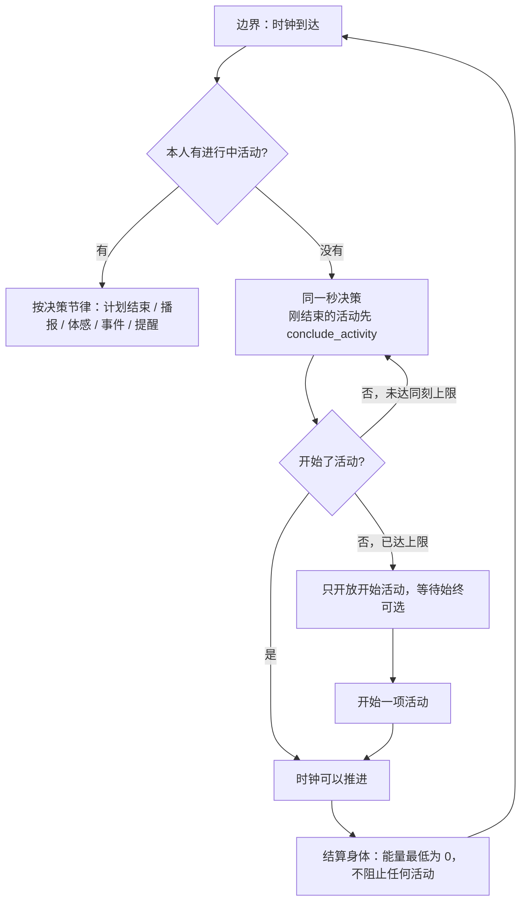
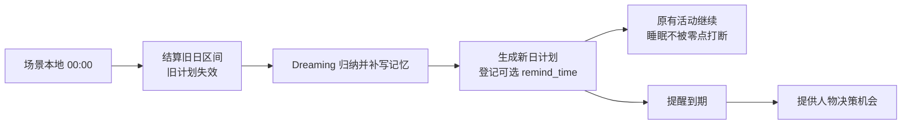
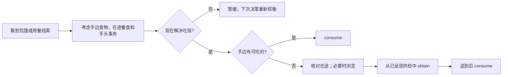
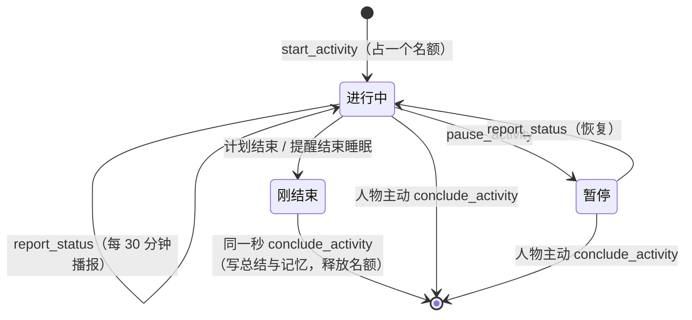

# 特性规格：数字人的时间与能量

> 状态：**DRAFT**。「裁决记录」中标为「待确认」的各行经用户确认后改为 FROZEN；定稿不等于已实现。
> 日期：2026-09-24
> 来源：[issue #2](https://github.com/HoldThatThgt/WorldMock/issues/2)（r14 运行，数据不在本机）；
> [issue #1](https://github.com/HoldThatThgt/WorldMock/issues/1)（第九章复核）；本机练秋湖运行（第八章）；后续设计讨论。
> 代码基线：`778beca`（已推送，与 `origin/main` 一致）。本文只写现行设计，已放弃的方案不再保留；演变见「版本表」。

## 摘要

| 主题 | 要改什么 | 章节 |
| --- | --- | --- |
| 时间与决策 | 决策不消耗模拟时间；没有进行中活动的人物在同一秒继续决策，直到开始一项活动（等待、睡眠都算），时间线不再留空 | 一 |
| 能量感知 | 饥饿在低能量时不再被钳住：能量低于 400 kcal 至少显示「饿得难受」，低于 100 kcal 显示新档「饿得发慌」；商品标每份热量；路线标轻松或费力。身体数值仍不进提示 | 二 |
| 能量不拦人 | 能量不拒绝、不停止任何活动，最低为 0；靠饥饿每跨一档就唤醒、饿时场景点明最近的吃饭途径、常驻提示「趁早吃」，让人物在还有力气时吃饭 | 三 |
| 当日计划 | 零点后台 Dreaming 生成当日计划，不再占人物决策；目标可带提醒时刻，提醒可叫醒睡着的人 | 四 |
| 生活动作 | 模型选五个动词之一：`travel`、`interact`、`obtain`、`consume`、`sleep`；并行准入按目标、地点和出行方式判定；动作不按当前状态隐藏，条件不满足时带说明，做错了以业务拒绝说明原因与下一步；超过 24 小时的派生时长取上限 | 五 |
| 常驻提示 | 系统提示新增固定一节「怎样过一天」：时间、睡眠与提醒、工作、吃饭路径、饿与累、花钱与联系人、说了不等于做了 | 六 |
| 会话、活动与记忆 | 会话是一段地点停留，由系统随出发与到达开始和结束，结束前人物须结束或暂停其中仍在进行的活动，活动不跨会话；每人两个活动名额，每项活动独立走完开始、播报、结束，活动一结束同一秒就要 `conclude_activity`；取消 `finish`，记忆随 `conclude_activity(task[], summary[], memories[][])` 写入；发给模型的内容不含内部身份 | 七 |
| 本机运行的修复 | 困意预测、播报只针对进行中活动、作息初值、活动进度、截止前 60 秒、结束留终态、配送时刻可读、运行身份覆盖 AS2 | 八 |
| issue #1 遗留 | 恢复 `778beca` 弄红的 50 项测试并升世界结构版本；修目标回看与跨任务提交两处崩溃；先于其余改动 | 九 |

## 心智模型

人手上没事时会马上决定下一件事，想事情本身不花时间；做完一件事会马上给它收个尾；饿了会越来越难受、做事变慢，
所以会趁还有力气时去吃；知道手里的东西顶不顶饿、走路比坐车累。系统掌握全部数值与结算，人物只拿到分级和可读事实，
发给模型的内容里没有任何内部身份。

三条硬边界不变：只有环境能改世界状态；一次决策一个生活动作；身体数值、阈值与预算不进提示。

**交互原则：引导而不拦截。** 规矩写在常驻系统提示里，动作照常列出并标明未满足的条件；人物做错了，世界以业务拒绝说明原因和下一步。只有第一章的同刻上限在人物连续出错时收窄选项，作为防止同一秒无限循环的保险。

## 证据与范围

### 证据口径

| 来源 | 实情 | 用法 |
| --- | --- | --- |
| r14（issue #2） | 数据库在另一台机器上，本机没有 `runs/` | 数字按 issue 转述，标「issue 实测」 |
| 本机练秋湖运行 | 数据集仓库 `WorldMock-Dataset/requests/0001-white-collar-lianqiu/runs/`，五个运行，一个跑完 | 本机复算，标事件序号 seq |
| 源码身份 | 本机运行都产生于 `2913546` 与 `eee89fc` 之间的未提交代码；`code_sha256` 不含实际导入的 AS2，对不回任何提交 | 运行只作症状证据，机制一律在 `778beca` 上复核 |

### 决定方案形状的事实

1. **首次决策丢失重估候选。** `_after_success`（`engine.py:830-850`）在 `_snapshot_decision_references`
   （`engine.py:427` → `observe.py:561-577`）写入本次决策时刻之前计算候选。首次决策时该值为 `None`，
   重估项被整项剔除（`schedule.py:329`）；此后总按上一次决策时刻计算，过期的候选还会被「严格晚于现在」
   过滤掉（`schedule.py:340`）。
2. **没有活动的人会被晾着。** 下一决策只来自唤醒候选，没有一项表达「此人手上没事」；冻结规则中
   「瞬时动作后下一秒反应」从未落地。r14 空转 13500 秒（issue 实测）；本机四个运行 00:00 后都空转 225 分钟，
   跑完那次在 32.33 小时里有 10.21 小时没有进行中活动。
3. **能量闸门把人卡死。** 受理要求当前能量覆盖整段派生时长（`engine.py:1036-1044`），而九工具面不让模型填时长，
   能量上限也不再出现在提示里。r14 陈曦 18:37 能量归零后 69 次决策 69 次被拒（issue 实测）：闸门没有让她去吃，
   只是让她什么都做不了。
4. **结算与恢复都把透支当错误。** `settle_shared_body`（`body.py:186-188`）遇透支抛 `ValueError`；
   恢复校验（`activity_validation.py:26-34`）遇整段成本超余额报 `IntegrityError`。取消闸门必须同时改这两处。
5. **饥饿在最需要时失灵。** 食欲在 400 kcal 以下被钳住（`felt.py:27`），08:00 前后昼夜项处于谷底，
   0 kcal 也只显示「很饿」。本机跑完那次次日醒来时能量为 0，提示仍是「很饿」。
6. **会话从不收尾。** 开始新活动不要求结束旧会话；本机跑完那次 13 个会话到结束仍有 10 个 `active`，
   53 次唤醒中 50 次是这些会话的播报，醒来时提示仍写「正在做：睡眠」。

### 权威来源与范围

| 内容 | 权威 |
| --- | --- |
| 本文各章行为 | 本规格 |
| 唤醒闭集与决策节律总则、身体语义 | [life-runtime 规格](SPEC-life-runtime.md)（按「冻结条款修订」修订） |
| 工具面、会话与引擎派生参数 | [数字人交互规格](SPEC-agent-interaction.md)（同上） |
| 当日目标证据与度量 | [当日目标规格](SPEC-day-plan-goals.md)（提交方式按第四章修订） |
| 记忆合同 | [life-realism 规格](SPEC-life-realism.md)、[一日行为规格](SPEC-dayrun-behavior.md)（写入点按第七章修订） |
| 字段、错误码、场景参数 | [接口合同](../CONTRACTS.md) |

**不在范围**：持有物随身携带（见「范围外登记」）；模型自定时长；任何身体数值进提示。

## 一、决策不耗时：时间只在做事时流动

### 规则

1. **时钟只在人人有事时推进。** 世界推进到下一边界，前提是每个人物都有进行中活动；等待与睡眠都是活动。
   决策本身不消耗模拟时间。
2. **没有进行中活动就同刻再决策。** 人物没有 `ACTIVE` 活动时，在同一模拟秒立即再获得决策机会，直到开始一项活动。
   适用于运行开始、活动结束（计划结束、提醒结束睡眠；先按第七章结束该活动）、瞬时动作之后（发消息、下单、提交成果、
   回看、播报、暂停、结束活动、修订计划），以及业务拒绝之后。
3. **同刻上限。** 同一人物在同一模拟秒内的决策轮数由场景参数 `max_same_moment_decisions` 封顶（缺省 3，
   正整数）。时钟推进即归零。达到上限而仍无进行中活动时，下一轮只开放能让人物重新有事做的动作：有空名额时开始一项活动
   （等待始终可选）；两个名额都被暂停的活动占着时，恢复或结束其中一项。若这一选择仍被拒绝，再下一轮先只开放结束
   （名额满时），再只开放等待。结束与无事时的等待都不会被拒绝，所以同一秒内的轮数不超过上限加三。
   这一收窄只是防止同一秒无限循环的保险，常规路径靠提示与错误说明。人物始终自己选，系统不替人物选择活动。
4. **有进行中活动时。** 瞬时动作成功后不在同一秒再给机会，下一次按决策节律。业务拒绝后在同一秒再给一次机会，
   受同一上限约束；达到上限后按决策节律。
5. **边界兜底。** 任一边界结算后没有进行中活动的人物，必定在该边界获得决策，唤醒原因含 `no_active_activity`。
6. **唤醒原因记录。** 同刻再决策的轮次以 `no_active_activity`（无进行中活动）或 `rejection_feedback`（拒绝之后）
   写入人物的 `pending_wake_reasons`，并由该轮 `decision_started` 与观察记录（`decision_start.py:42`、`observe.py:105`）。
   同刻轮次没有结算区间，不写 `body_settlement`。`no_active_activity` 只是记录标签，不改变任何行为。
7. **候选时刻修正。** 有进行中活动的人物，其下一决策候选以本次决策时刻作为上次决策时刻计算，
   首次决策不再丢失重估项，过期候选不再被丢弃。
8. **单一来源。** 同刻机会只由 `next_decision_at = 当前时刻` 表达，`_ready` 与 `_require_boundary_action` 无需旁路；
   `_ready` 的文档改为「`next_decision_at` 已到的人物可决策」。

AS2 调度已支持同刻多轮：`society.step` 在有人就绪时执行决策轮，只有无人就绪才推进时钟
（锁定的 AS2 `8768e14`，`society/society.py:224-240`）；每轮照常形成共同检查点。

| 参数 | 缺省 | 约束 |
| --- | --- | --- |
| `max_same_moment_decisions` | 3 | 正整数；取代 `max_consecutive_rejections`，后者从场景与合同中删除 |

### 不变项

- 睡眠中只接受睡眠允许的唤醒原因；`no_active_activity` 不进入 `SLEEP_ALLOWED_REASONS`。
- 静默边界不调用模型；有进行中活动的人物仍按计划结束、30 分钟播报、体感、事件、提醒与重估间隔获得机会。
- 一轮决策一个生活动作。

## 二、能量感知

身体数值、阈值与能量预算不进提示。人物通过饥饿分级、商品标签和路线标签感知能量。

### 饥饿在低能量时不失灵

食欲公式与五档分级不变，只加两条低能量规则：

| 条件 | 显示 |
| --- | --- |
| `energy_kcal` < 400（身体配置紧急阈值） | 至少「饿得难受」，不受昼夜项与餐时项影响 |
| `energy_kcal` < 100（新常量，约 1.5 小时基础消耗） | 新档「饿得发慌」 |

- 「饿得发慌」加入分级序表与饥饿不适档（`rhythm.py` 的 `_BAND_ORDER`、`HUNGRY_BANDS`）。
- 边界预测的能量阈值为 800、400、100（`body.py:478-484` 现只有前两个），跨档照常以 `felt_band_change` 唤醒，睡眠中过滤。
- 能量同时压低工作效率；这一事实只写进第六章的世界规则句，不给数值。
- `body_observation.alert`（`body.py:327-349`）没有生产调用方，删除；`scripts/inspect_run.py` 改读 `body.values` 与 `body.levels`。

### 商品热量与路线费力

- `facts.products[]` 与 `facts.inventory[]` 的食品增加 `energy`：「每份约 250 千卡」，取 `energy_kcal_per_unit`
  四舍五入到 10 千卡。这是包装标签上的商品事实，与价格同类。
- `facts.routes[]` 增加 `effort`：MET < 2 为「轻松」，2 ≤ MET < 3 为「一般」，≥ 3 为「费力」。
  现有方式中，驾车（MET 1.5，约 97.5 kcal/h）为轻松，步行（MET 3.5，约 227.5 kcal/h）为费力。
  路线的 `feasible` 只表示能否到达，不再按能量计算（第三章）。
- 分界与常量是实验假设，登记在 `docs/EXPERIMENT.md`。

## 三、能量不拦人

### 原则

能量不拒绝、不停止任何活动。人物再饿也能走路、工作、去买吃的；低能量的代价是难受和做事变慢，而不是被卡住。
阻断不会让人去吃，只会让人更快陷入困境：r14 陈曦归零后 69 次决策全部被拒，却没有一次因此吃上饭（issue 实测）。
这也与人的实际情况一致：一项汇总 71 项研究、3484 名受试者的荟萃分析发现，短时空腹（中位 12 小时）
不降低认知表现（[APA 报道](https://www.apa.org/news/press/releases/2025/11/short-fasts-do-not-impair-thinking)）。

### 删除的机制

- 受理闸门 `_require_energy_plan`（`engine.py:1036-1044`）及其四处调用（`:1016`、`:1084`、`:1124`、`:1302`）。
- 结算透支报错（`body.py:146-147`、`:186-188`）：能量对所有活动集合都以 0 为下限截断，与现行空闲和恢复活动相同。
- 恢复校验中的能量检查（`activity_validation.py:26-34`）与 `_activity_infeasible_signatures` 的能量判据（`rhythm.py:450-465`）。
- 路线 `feasible` 中的能量成分（`observe.py:599-620`）、观察事件中的 `energy_feasibility`（`observe.py:623-631`）。
- 错误码 `INSUFFICIENT_ENERGY`。

### 低能量的代价（保留，不新增惩罚）

- 饥饿分级逐档上升（第二章），持续饥饿产生既有的不适情绪脉冲。
- 工作效率随能量下降（既有效率因子：800 kcal 以上为 1.0，400 kcal 时 0.8，更低为 0.5）。

### 让人物趁早吃

1. **饥饿每跨一档都给决策机会**，包括正在工作或观看时（`felt_band_change`；睡眠中照常过滤）。跨档时刻由第二章的能量阈值
   与第八章的餐时窗口预测，不会迟到。
2. **饿时场景点明最近的吃饭途径。** 饥饿为「饿」及以上时，`scene` 用一句话说出当下最近的一条真实途径。
   这句话由确定性代码生成，扩展既有的「当地餐食」一句（`dining.py:8-22`，`scene.local_food_summary`），
   只汇总本轮观察里已经有的事实，不调用模型、不授权未呈现的供给。按顺序取第一条成立的：

   | 顺序 | 途径 | 取自 | 例句 |
   | --- | --- | --- | --- |
   | 1 | 手边能吃的 | 当前地点持有物中可食用的（`inventory[当前地点]`） | 「你手边有剩下的番茄炒蛋，可以直接吃。」 |
   | 2 | 在路上的 | 本人未送达的配送订单及其预计送达时刻（`pending_events`） | 「你点的五指毛桃鸡煲预计明天 11:16 送到。」 |
   | 3 | 能送到这里的 | 本轮已呈现、可配送到当前地点的食品供给 | 「列出的餐食里，有几样能送到这里，最快约 30 分钟。」 |
   | 4 | 附近能买的 | 人物已知（已呈现或已发现）的有食品供给、且此刻营业的地点，取路线最短的 | 「最近能买到吃的是好德便利店，步行约 8 分钟。」 |
   | 5 | 都没有 | — | 「现在不知道附近哪里有吃的，可以浏览商品看看。」 |

   第 2 条如果送达时刻很晚，仍继续给出第 3、4 条中最近的一条，方便人物判断要不要另想办法。
3. **常驻提示写明「饿了就趁早去吃」**（第六章）。
4. **工作中也能吃、能下单**（第五章），配送时刻写成人读的形式（第八章）。

## 四、跨日 Dreaming 与当日计划提醒

### 运行时机

`plan_day` 是系统为人物生成当日意向的后台任务，不是人物的生活动作。场景本地 `00:00`，世界先完成前一日的结算
并使旧计划失效，再为每个人物运行 Dreaming：

- 归纳截至该边界已形成的主观记忆；
- 为当日没有经 `conclude_activity` 留下记忆的经历（主要是瞬时动作），依已核验经历与活动自述补写主观记忆（第七章）；
  以会话（地点停留）为段落整理；
- 根据人物画像、记忆、已知承诺和该时刻可见的世界事实生成新日计划。

Dreaming 无论人物在睡觉、工作还是做别的都执行，不提供人物决策机会，不暂停、结束或重启活动。
场景在本地日中途启动时，同一路径在人物首次决策前生成该日计划；同一人物同一本地日只生成一次。
Dreaming 借鉴 [OpenClaw 的后台记忆巩固](https://docs.openclaw.ai/concepts/dreaming)；数据交付模块的离线 `dreaming`
另是一回事，默认不写回运行人物。既有阈值巩固与就寝反思保留。

### 计划与提醒

- 零至八条有序目标，沿用 `intent_kind`、`goal` 与意图唯一性。`goal` 可写粗略时段与准备动作，文字不驱动活动。
- 每条目标可带 `remind_time`（场景本地 `HH:MM`）。非空值换算为该日绝对时刻，须晚于生成或修订时刻、早于次日零点，
  否则拒绝。只有该字段触发定时决策，系统不从目标文字推断时刻。
- 新计划、提醒与来源证据同一次提交；恢复和重放不得重复生成。Dreaming 只用零点或启动边界已知的信息。
- `revise_day_plan` 是人物清醒时的瞬时动作，可改未推进目标及其提醒；被替换或删除目标的旧提醒取消。
  目标已推进或当日结束时，未触发的提醒失效。
- 提醒到期只提供一次带对应目标的决策机会，同时到期的合并。非睡眠活动继续。人物在睡觉时，提醒结算并结束睡眠
  （结束原因 `plan_reminder`），人物随即按第七章结束睡眠这项活动，再按第一章决定下一件事。零点 Dreaming 本身不唤醒。
- `plan_reminder_due` 进入唤醒闭集与睡眠允许集合，既参与下一边界预测，也参与唤醒判定。

例：人物 05:57 入睡、原定 13:57 醒，目标 `remind_time` 为 08:15，则 08:15 结束睡眠并提供决策；没有提醒时不从「八点起床」推断。

验收：跨零点长睡眠无人物决策；零点后已有新计划；同日只生成一次；空提醒不唤醒；提醒准确唤醒且只一次；
非睡眠活动不被停止；修订取消旧提醒；睡眠按实际结束时刻结算；恢复后计划与提醒不重复；记录区分后台 Dreaming、
提醒触发的人物决策与离线 `dreaming`。

## 五、五类生活动作与并行准入

### 人物选择什么

人物的生活动作是五个动词之一；活动的播报、暂停、结束，目标修订与记忆查询是控制或观察，不算生活动作。
一轮决策只提交一个生活动作请求；请求至多包含两项同时开始的持续活动。

| 动词 | 对象与方式 | 覆盖的能力 |
| --- | --- | --- |
| `travel` | 目的地；步行或驾车 | 前往地点 |
| `interact` | 人、内容、工作任务、游戏、目录、生活活动或自己；对象给出可用方式 | 工作、观看、游玩、交谈、通话、阅读、浏览、生活活动、等待、发送消息、提交成果 |
| `obtain` | 商品与取得方式；到店、远程下单或制作 | 购买与订单；制作须对象、材料与产物规则齐备才开放 |
| `consume` | 已取得的物品及其使用方式 | 食用或使用 |
| `sleep` | 自己 | 入睡；时长由身体睡眠需要派生，只有计划结束、醒来与计划提醒能结束它 |

- `sleep` 单列，因为它改变唤醒规则（睡眠中只接受睡眠允许原因），需要清醒的活动都不能与它并行。
  等待仍属 `interact` 的「自己」对象，短而可随时结束。
- 旧的细分动作名不再是人物词表，不留兼容入口；领域执行仍按对象的真实能力处理路线、媒体、社交、工作、交易与身体效果。
- 浏览只取得信息，不产生订单或持有物；下单、购买与制作属于 `obtain`。浏览占用活动名额，瞬时下单不占。
- 远程下单只产生订单，交付或到店取得后物品才可使用。

### 并行准入

活动名额见第七章：每人两个，进行中与暂停中的活动占名额，`conclude_activity` 后释放；瞬时消息、成果提交和远程订单不占名额。
两个名额都被占时开始新活动以 `SESSION_LIMIT_EXCEEDED` 拒绝。通用拒绝只有两类：同时两次 `travel`，以及途中到店取得。
其余组合按各目标的实际条件受理，整组提交任一项不成立即整组拒绝。能量不参与准入（第三章）。

| 准入事实 | 规则 |
| --- | --- |
| 实际地点 | 出行中人物在场资格是「途中」；`agent.location_id` 可保留出发地作路线身份，现场资格须同时检查进行中的出行 |
| 目标在场 | 办公室工作、当面交谈、现场制作与到店取得要求人在目标地点；出发前须先结束或暂停所有进行中的活动（第七章） |
| 出行方式 | 驾车可与真实的音频播放或免提通话并行；需要看屏幕、手动操作或入睡的目标不行。步行不另设按动作名的互斥表 |
| 物品状态 | `consume` 只接受此刻能用的已取得物品；持有物仍按地点，未交付订单不可用 |

两项活动共享的真实时间里，身体只结算一次，各活动分别累计自己的进度并留证。工作可与进食、观看同时进行，不默认折半。

| 同时发生 | 结果 |
| --- | --- |
| 驾车与播客音频、免提通话 | 受理：上路后开始，到达时结束 |
| 驾车与视频、睡眠、办公室工作 | 拒绝 |
| 工作与食用、观看 | 受理 |
| 驾车与远程下单 | 仅有免手动下单方式时受理 |
| 两条出行、途中到店取得 | 拒绝 |

### 动作照常列出，做错了再说明

- 交互对象列出人物此刻可见的全部对象与动作，不按当前状态剪掉。前置条件未满足的动作带一句可读说明，
  例如「需要先结束或暂停手上的事」「需要在张江办公室」「两件事都在做，先结束一件」。
- 人物选了不满足条件的动作时，以业务拒绝返回原因与下一步（既有 `unmet` / `suggested` 通道，`engine.py:879-882`），
  点名要先处理的活动或要去的地点。
- 这取代 `778beca` 按资源与前置条件剪掉动作的做法（`projection.py:503-512`）。那次改动要解决的逐秒重试，
  现在由第一章的同刻上限兜住。
- 没有任何可见对象时列表为空，这是合法状态；`start_activity` 照常可见，`custom/agents/life_agent.py:966-968`
  把空列表当作致命错误，必须改掉（第九章）。

### 派生时长上限

可分段活动（出行以外）的派生时长超过 86400 秒时按 86400 秒受理，并在受理结果中写明计划时长。本机场景中段子流
（138264 秒）、微博流（96759 秒）与 `novel-0003`（88324 秒）从头开始永远报 `ACTIVITY_DURATION_INVALID`，由此修复。
出行超过上限仍拒绝；最短 60 秒、地点、截止时间仍须校验。`ACTIVITY_DURATION_INVALID` 写入接口合同的错误码表。
模型不填时长；进行中活动有 30 分钟播报，可随时结束。

验收：真实引擎与人物观察覆盖上表组合、途中地点投影、订单与取得先后、共同身体只结算一次、各活动分别留证，
非法组合整组拒绝后余额、库存、位置和已有活动不变；实现删除按细分动作名硬编码的互斥规则。

## 六、常驻生活提示：怎样过一天

### 位置与约束

人物生活决策的系统提示新增固定一节「怎样过一天」：

- 决策自述与动作两阶段收到同一段文字，每次决策都在；
- 不由事件触发，不写进工具描述；工具描述只说明参数与前置条件；
- 只陈述世界规则与生活常识，不排日程、不给脚本；
- 不写身体数值或阈值，不写奖励性措辞；
- 遵守现有系统提示测试（`tests/integration/test_life_agent_protocol.py:478-484` 禁用「评审」「评分」「引擎期望」「tool」「finish」「回合」「budget」，并检查中文句子占比）；
- 只读问答不需要这一节。

这一节取代原先分散的「身体句」和只针对饥饿的食物提示。

### 文案

实施时与实际开放的动作词表一致：

> 你的一天由你自己安排。时间只在你做着某件事时流逝，所以每次想好之后都要落到一件具体的事上，哪怕只是歇一会儿或去睡觉。
> 一件事做完了，先给它收个尾，说说做得怎样、有什么想记住的，再开始下一件。
> 要出门，先把手上的事收尾或暂停；路上想听点什么，上路后再开始，到了再收尾，到了地方还可以接着听。
> 有的事一时做不了，世界会告诉你原因和该先做什么，照着调整就好。
> 困了就去睡。想在某个时刻起来，就在当天的目标里写上提醒时间；睡着时只有提醒或睡够了才会醒。
> 工作要在要求的地方做，留意截止时间和已经做了多少；来不及做完时，想清楚先做哪部分。
> 你会饿、会困、会累。力气来自吃下去的东西，饿着或困着做事会慢，走路比坐车更费力。饿了就趁早去弄吃的，别拖到饿得发慌。
> 感到饿，或到了你的用餐时段，就把吃饭和手头的事一起考虑：先看手边能吃的和已经在路上的餐食；手边没有时，看看列出的餐食，需要时浏览商品。当前地点没有卖吃的，不代表不能送到这里。下单后要等送到，拿到手才能吃。
> 花钱量力而行；有人找你时，按你们的关系和当时的情况回应。
> 说打算做、说已经做过，都不等于真的做了，只有实际开始并完成的事才算数。你可以暂缓一件事，下次有机会时再随身体和处境重新权衡。

### 吃饭路径

- 触发是人物依本轮观察应用这一节，不是事件或调度规则：饥饿为「饿」「很饿」「饿得难受」「饿得发慌」，或已到用餐时段。
  「有点想吃」时可以主动考虑，但不强制。
- 已有可吃的或在途餐食时，不机械地重复浏览或下单；未呈现的商品、方式和并行能力不能因为提示而变成可用动作。
- 暂缓后在后续决策中重新权衡；饥饿再跨一档时世界会再给机会（第三章）。

验收：两阶段收到同一节文字；办公室没有现场餐食但可配送时，人物能发现浏览、取得、等交付、食用的路径并说明取舍；
浏览不可用、没有可配送供给、已有在途餐食时不虚构商品、不重复下单、不把自述当成食用。
评价以路径可发现、选择有据为准，不以每次饥饿都下单为通过条件。

## 七、会话、活动与记忆；提示中不出现内部身份

### 三层结构

| 层 | 是什么 | 谁开始、谁结束 |
| --- | --- | --- |
| 当日目标 | 当天想推进的事（第四章） | 零点 Dreaming 生成，人物可修订，次日零点失效 |
| 会话 | 在一个地点的一段连续停留，或两地之间的一段路。例如「在家（00:00–14:17）」「去办公室的路上」「在张江办公室（14:34 起）」 | 系统：出发时结束当前地点的会话、开始路上的会话；到达时结束路上的会话、开始新地点的会话。人物不手动开始或结束会话 |
| 活动 | 占一个名额的具体事情：工作、观看、吃饭、出行、睡觉、等待… | 人物开始并结束（`conclude_activity`）；计划结束或提醒使活动结束时，世界要求人物当即结束它 |

- 会话是组织单位，不是生命周期：它不播报、不暂停、不写总结。进度层按会话分组显示这段停留里做过和正在做的事；
  零点 Dreaming 以会话为段落整理当天的经历。
- **会话结束前，人物要处理完其中仍在进行的活动。** 活动不跨会话。
  - 出发：出行动作照常列出，未满足时带说明「需要先结束或暂停手上的事」。人物仍有进行中活动时选择出行，
    以业务拒绝返回，点名要先处理的活动；人物结束或暂停它们（瞬时，同一秒）后再出发。常驻提示写明这条规矩（第六章）。
  - 到达：出行结束与路上会话结束在同一秒发生，世界在这一秒请人物给出行和路上开始的其他活动收尾（见下「活动一结束就要结束它」）。
    路上的活动不能暂停，因为回不到那段路。
  - 想在路上接着听同一个播客，就在出发前结束它，上路后再开始；到了再结束，进门后还可以接着听。
    内容从上次的位置接着放，「接着听」不算新的一次接触：`exposure_count` 只在第一次和从头重看时增加（改 `rules.py:76`），
    否则每重开一次，娱乐缓解都会按接触次数被摊薄（`activities.py:321`）。
- 暂停的活动属于它的地点，占着名额，回到该地点时归入那里的新会话并可恢复；人在别处也可以结束它。
- `recall_task_summary` 可按任务名、活动名或会话名（地点加开始时刻，如「张江办公室 14:34 起」）回看。

### 活动的生命周期

- **两个名额。** 进行中与暂停中的活动各占一个名额；只有 `conclude_activity` 之后名额才释放。
- **活动一结束就要结束它。** 活动因计划结束或提醒结束睡眠而结束时，世界在同一秒请人物决策，场景写明要先给哪些活动收尾；
  人物用 `conclude_activity` 点名它们，同时结束的两项可以一次结束。这时做别的事以业务拒绝返回「先给刚结束的某事收尾」。
  总结与记忆在这一轮写下，名额随即释放。
  「刚结束」只存在于这一秒之内，不跨时间。另一项仍在进行的活动不受影响：边走边听播客，播客先放完，
  人物在那一秒结束播客，步行继续，到达时再结束步行。这一轮计入同刻轮数。
- **人物也可以主动结束**进行中或暂停的活动，效果相同。
- **两项都暂停时**，人物没有进行中活动，世界在同一秒请人物决策（第一章）；恢复或结束其中一项都算重新有事可做，
  不另设限制。
- **播报与控制都作用于活动。** `report_status`、`pause_activity`、`conclude_activity` 的 `task[]` 逐项点名活动，
  名称是「做什么＋对象＋开始时刻」的可读短语。播报只针对进行中的活动；`scene` 的「正在做」只列进行中的活动。

### `finish` 并入 `conclude_activity`

- **一轮决策 = 决策自述 + 恰好一个生活动作。** 取消 `finish` 工具，生活动作被本轮登记受理后决策即结束。
  动作前仍可使用记忆查询工具。人物的只读问答保留自己的结束方式，不在本规格范围。
- **记忆只在结束活动时写。**
  - 签名：`conclude_activity(task: list[str], summary: list[str], memories: list[list[Memory]])`，三数组等长。
  - `memories[i]` 是关于 `task[i]` 的零至多条记忆，总数不超过八条。
  - `Memory` 为 `{type, text, importance, keywords}`：`type` 取既有九种 WorldMock 记忆类型；
    `text` 不超过 1000 字符且不得含十六进制身份；`keywords` 不超过 12 个；`epistemic_status` 由系统固定为 `subjective`。
- **`report_status`、`pause_activity` 不带记忆。** 播报每 30 分钟一次，会产生大量重复记忆并过早触发巩固；
  暂停不是结束，`summary` 已记下停在哪里。
- **来源由系统记录。** 记忆不再有 `refs`。引擎把所结束的活动、它的已核验经历、所在会话、本次决策与观察登记为记忆来源，
  模型不填、不选任何身份。
- **瞬时动作**（发消息、下单、提交成果）不是活动，它们的记忆由零点 Dreaming 补写（第四章）；就寝反思保留。
- 记忆巩固的阈值计数按新的写入点（结束活动、Dreaming、就寝反思）重新核对。

### 发给模型的内容不含内部身份

- 适用于系统提示、用户消息、工具 Schema（含枚举）与工具返回。
- 发给模型的名称都是人能读懂的短语，内部身份只存在于私有绑定中。
- 已核验经历写成句子，例如「14:17 开车到了张江办公室」「13:57–14:17 吃了剩下的番茄炒蛋」，
  不带 `source_event_id`、`activity_id`、`event_seq`、`product_id`、`agent_id`。
  现状是整行 JSON 原样写入用户消息（`life_agent.py:553-554` → `footprints/experiences.py:29-46`）。
- 记忆查询的返回同样不带条目身份。
- 删除现状中写进 `finish` Schema 的来源身份枚举（`life_agent.py:942-956`、`:1203-1211`）。

## 八、本机运行暴露的问题与修法

### 运行概况

| 运行 | 结局 | 原因 | 状态 |
| --- | --- | --- | --- |
| `2026-09-28-deepseek-flash` | 启动失败 | Ray 节点启动超时 | 运行环境问题 |
| `-rerun` | 模拟 11:45 失败 | 记忆摘要请求不带 `max_tokens`，用量核对要求输出预留 | `eee89fc` 已修 |
| `-after-memory-fix` | 模拟 13:35 被外部终止 | 工作中菜单仍给「开始工作」，25 次 `RESOURCE_CONFLICT` 逐秒重试 | `eee89fc`、`778beca` 已修 |
| `-after-resource-fix` | 模拟 13:30 手工终止 | 出行途中仍给出行动作 | `778beca` 已修 |
| `-after-wake-fix` | 跑完 32 小时 20 分 | 53 次决策、186 次调用；下表问题 | 本规格修 |

### 问题与修法

| 问题 | 本机证据 | 修法 |
| --- | --- | --- |
| 交互对象为空即致命（HEAD） | 办公室工作期间 77 个对象全不可用；按 HEAD 规则全被剔除后抛错；`tests/integration/test_dayrun_complete_days.py` 两项因此失败 | 第五章「动作照常列出，做错了再说明」；第九章，最先修 |
| 没有活动的长空档 | 00:00→03:45 空转 225 分钟；次日 06:37 能量为 0 仍空等到结束 | 第一章 |
| 困意跨越预测过晚 | 00:00 预测 08:44 进入「有点乏」，实际 04:15 | 本节「节律」 |
| 播报风暴与陈旧的「正在做」 | 53 次唤醒 50 次带播报原因；13 个会话结束时 10 个仍 `active`；醒来时提示「正在做：睡眠」 | 第七章（活动一结束即结束、会话按地点）；本节「活动」 |
| 午夜精神饱满到清晨 | 00:00 困意为 0，05:57 才睡 | 本节「作息初值」 |
| 睡 8 小时错过早上 | 05:57 睡到 13:57，08:55 打卡只是手机模拟目标 | 第四章提醒；数据集把打卡写进人物作息 |
| 活动进度恒为 0 | 提示总是「已投入0秒，有效进度0秒」，连续 6 次提交被拒 | 本节「活动」 |
| 截止当秒开工 | 17:30:00 开工得到 0 秒时长，`ACTIVITY_DURATION_INVALID`（seq 551） | 本节「工作」 |
| 主动结束时活动无终态 | 导出仍显示「等待中」，数据集运行报告因此写错 | 本节「活动」 |
| 吃不上饭 | 办公室 27 次提示无商品；工作中全被挡；全天只吃了剩饭；盒马配送 13 小时 | 第三、五、六章；本节「呈现」；数据集补供给与路线 |
| 自述吃饭被当成事实 | 19:33 播报说吃了晚饭（seq 661），之后在提示中重放 | 本节「活动」；第六、七章 |
| 低能量无感知 | 低于 400 kcal 共 13.3 小时，0 kcal 时显示「很饿」 | 第二、三章 |
| 看完的内容整段重看 | 22:00 以为只剩几分钟，实际从头重看 2226 秒 | 本节「呈现」 |
| 协议错误 | 6 次，全部重试恢复：调用不存在的工具、JSON 不合法、`summary` 传成字符串 | 第四章去掉日首只有 `plan_day` 的一轮；第七章去掉 `finish`；保持非致命 |
| 运行对不回提交 | 五个运行的 `code_sha256` 都不匹配任何提交 | 本节「运行身份」 |

### 节律

困意跨越预测（`body.py:457-465`）按 `-ln(1 - P_edge) · τ` 求时间，相当于从压力 0 起算，还冻结了昼夜阈值。修法：

- 从当前压力求解：`t = -τ · ln((1 - P_edge) / (1 - P_now))`，已越过的档位不给候选；
- 在预测时刻复核昼夜阈值，发现已提前越档时以不超过 1 小时的步长回退重算。候选宁早勿晚，提前的边界由唤醒判定裁为静默；
- 午餐、晚餐窗口的起止时刻加入体感跨越候选，因为食欲的餐时项在这些时刻跳变。

### 活动

- **播报只针对进行中的活动。** 锚点取「上次播报」与「活动最近一次开始或恢复」中较晚者，判定与候选同源
  （改 `rhythm.py:487-528`）。`scene` 的「正在做」只由进行中活动生成（改 `projection.py:302-316`、`narration.py:261-284`）。
- **活动客观进度。** 每条 `activity_progress` 结算累加活动的投入秒数；工作按结算效率累加有效秒数，任务合同的累计仍以任务为准。
  投影写成人读的时长，例如「已做约 2 小时，有效约 1.5 小时，还差约 2 小时」
  （现有 `SessionState.invested_seconds`、`effective_seconds` 没有写入方，`models.py:272-273`）。
- **结束与暂停留终态。** `conclude_activity` 与 `pause_activity` 对活动的取消或暂停，写入与其他结束方式同形的活动终态记录，
  导出重建与世界状态逐项一致（改 `session_actions.py:535-560`）。
- **自述不当事实。** 人物自述只在 `facts.progress` 中以「你自己记下的，未经核验」呈现，不写回场景的现在时。

### 工作

- 可开始工作的条件为「距截止与剩余合同都不少于 60 秒」（改 `observe.py:218`、`:550` 的 `>` 判定）；
  `facts.tasks` 仍列出已到截止的任务及其状态。
- 剩余要求的有效秒数大于距截止秒数时，`facts.tasks` 标「到截止前做不完」。只按时间判定，不暴露效率。

### 作息初值

`initial_body`（`body.py:381-398` → `sleep.py:131-146`）假定人物在起点前刚睡满。改为「自最近一次惯常起床时刻起一直清醒」，
惯常起床时刻为 `chronotype_midsleep + sleep_need_hours / 2`。起点落在惯常睡眠时段时，人物以困倦状态开始，
去不去睡由人物决定；不预置任何活动。

### 呈现

- 配送时间写成人读形式，例如「约 13 小时后送达，明天 11:16」，替代 `facts.products` 中的原始秒数。
- 看完的内容写「从头再看」并给出全长，未看完的写「接着看」并给出剩余时长；派生规则不变。

### 运行身份

`runtime_code_sha256`（`src/worldmock/runtime.py:428-444`）改为哈希实际导入的 AS2 包源码。该路径为空，或与锁定版本不符时，
拒绝启动。清单同时记录 Git 提交与工作树是否有未提交改动。真实复验以此为前提。

### 数据集侧（不改 WorldMock 代码）

真实复验前，由数据集请求补齐或写明以下各项：

- 咖啡与午餐供给只配送到办公室；
- 星巴克与 7-Eleven 没有供给；
- 到咖啡与午餐门店的路线未采样；
- 盒马配送延迟 13 小时；
- 08:55 打卡需要写进人物作息，由 Dreaming 生成带提醒的目标。

## 九、issue #1 复核

### 结论

issue #1 在 `778beca` 上没有完全关闭。多数条目已修复，或因工具面重做而不再成立；未关闭的是：

- **50 项测试失败**（`tests/life` 与 `tests/integration` 共 1878 项）：
  - 48 项是夹具构造 `ActivityState` 时缺 `778beca` 新增的必填 `location_id`；
  - 2 项是完整自然日测试遇到空交互对象层；
  - 这 50 项在前一提交上全部通过。本机已复跑确认。
- **两处仍会以故障结束运行**（见下）。
- **issue 引用的分析报告** `ANALYSIS-agent-interaction-runs.md` 不在仓库中。

**本规格的实现以绿色基线为前提**：先完成本章「仍须修复」，再开始第一章以后的改动。

### 逐项状态

| 条目 | 状态 |
| --- | --- |
| 地图与出行、出行时长秒数、缺参拒绝 | 不再成立：模型不填时长与参数，引擎派生 |
| 预算熔断、`facts.sessions` 增长 | 设计已变：整次请求 token 计数与 85% 进度浓缩；活动一结束即结束、会话按地点自动结束，进一步限制增长 |
| 查看器 | 已修（`1e05064`） |
| 足迹 `location_id` | 已修；含义待统一（见下） |
| refs 指向提示里没有的东西 | 由第七章解决：取消 `finish` 与 `refs`，身份不进提示 |
| 交付窗口：prompt 重建、禁用字段、状态重复、评审泄漏 | 已修（`delivery/windows.py:52-57`、`:71-98`、`:163-179`） |
| 交付：导出件校验、`run_ended` 要求 | 按设计不变 |
| LabelKit `sequence_delivery_exhausted` | 未处理，不在本规格范围 |
| 投影列出引擎必拒的动作 | 改为第五章的原则：动作照常列出并带说明，做错了业务拒绝并给下一步；逐秒重试由同刻上限兜住；能量不再拒绝任何动作（第三章） |
| 评审重校验、生活活动键空间、场景重复提醒、连续返工致命 | 已修 |
| 读取已删除的 `task_progress` | 任务分支已修，目标分支仍崩溃（见下） |
| 评审未登记时提交崩溃 | 未修（见下） |

### 仍须修复

1. **空交互对象层**：按第五章改为合法状态（`life_agent.py:966-968`）。
2. **夹具、版本与 `location_id` 含义。**
   - 48 项夹具补 `location_id`。
   - `WORLD_SCHEMA_VERSION` 由 6 升为 7，与本规格新增的字段一起。当前旧状态只报「Field required」，而不是明确的版本拒绝。
   - 活动快照的 `location_id` 固定为开始地点，与记录引擎设计一致。`_advance_one_activity` 不再用人物当前地点覆盖它（`engine.py:1399`），当前地点另记字段。
3. **目标回看崩溃**：`session_actions.py:411` 读 `g.kind`，`PlanGoal` 只有 `intent_kind`；未捕获的 `AttributeError` 会结束运行。改后补按目标名称回看的往返测试。
4. **跨任务提交崩溃。**
   - 本人有任何工作在进行时，评审准备直接跳过（`engine.py:312-314`），提交随即抛 `ProtocolError`（`:1138-1139`）；而 `submission_ready` 只排除正在做的同一任务。
   - 两处改用同一判定：「被提交的任务本身不在进行中」。
   - `tests/life/test_engine_branch_coverage.py:1234` 的预期改为进入评审。

### 对新增行为的约束

`_resolve` 只捕获 `BusinessRuleError`（`engine.py:814`）。本规格新增的同刻决策、地点会话切换、活动一结束即结束、计划提醒与空层处理，
所有业务情形都必须表达为状态转换或业务拒绝，不得新增故障路径。

交付链无需改动：

- 动作与意图窗口携带实际发送的请求，新增的分级、标签与场景说明随提示进入；
- 私有字段由事件数据白名单挡在训练输入之外。

## 范围外登记：买得起、够不着

- 持有物留在取得地点、不引入随身背包的冻结语义不变（life-runtime 规格「随身持有与远程订购」；
  [地图与门店规格](SPEC-map-and-storefront.md)）。r14 陈曦买下的牛奶留在好德，人在办公室时手边没有吃的（issue 实测）。
- `facts.inventory`（`projection.py:390-396`）列出全部地点的持有物，与该规格的失败判据「跨地点可见的持有集合」冲突，
  但这是人物知道「牛奶还在好德」的唯一途径。建议改规格为「可以知道他处持有物及地点，只能在当地使用」；
  第三章的吃饭途径句不指向无法在此使用的持有物。
- 随身携带即买即食的商品需要单独规格。

## 裁决记录

「已定」为讨论中已确认的方向；「待确认」为本规格的建议。

| # | 事项 | 结论 | 状态 |
| --- | --- | --- | --- |
| 1 | 决策是否消耗时间 | 不消耗；没有进行中活动时同刻再决策，时间线不留空 | 已定 |
| 2 | 同刻决策如何封顶 | 上限缺省 3；满后只开放开始活动，兜底为等待；取代连续拒绝冷却 | 已定 |
| 3 | 同刻轮次的唤醒原因 | 新增 `no_active_activity`，只是记录标签，不改变行为；与 `plan_reminder_due` 同一版本登记 | 已定 |
| 4 | 能量是否阻断活动 | 不阻断、不停止任何活动，能量最低为 0；靠饥饿每档唤醒、饿时场景点明吃饭途径与常驻提示让人趁早吃 | 已定 |
| 5 | 模型是否填时长 | 不填 | 已定 |
| 6 | 能量感知方式 | 修饥饿的低能量显示并加「饿得发慌」，不另设体力信号；商品标热量、路线标费力；不给「够走 N 分钟」 | 已定 |
| 7 | 睡眠是否单列动词 | 单列为第五个动词 `sleep` | 已定 |
| 8 | 生活常识放在哪里 | 系统提示中固定的「怎样过一天」一节 | 已定 |
| 9 | 模型可见的身份 | 一律不出现；经历写成句子 | 已定 |
| 10 | `finish` 与记忆 | `finish` 并入 `conclude_activity(task[], summary[], memories[][])`；播报与暂停不带记忆；来源由系统记录 | 已定 |
| 11 | 动作是否按状态隐藏 | 不隐藏：动作照常列出并带未满足条件的说明，规矩写在常驻提示里，做错了业务拒绝并给下一步；撤回 `778beca` 的剪裁；空列表合法 | 已定 |
| 12 | 活动的生命周期与名额 | 每人两个名额；每项活动独立走完开始、播报、结束；活动一结束同一秒就要 `conclude_activity`；名额在结束后释放；两项都暂停时照常同刻决策，不另设限制 | 已定 |
| 13 | 会话是什么 | 一段地点停留或一段路，由系统随出发与到达开始和结束；结束前人物须结束或暂停其中仍在进行的活动（做错了业务拒绝提示，不隐藏出行）；活动不跨会话，想接着听就结束后在下一会话重新开始；只作组织单位，不播报、不写总结 | 已定 |
| 14 | 初始身体 | 按人物作息反推清醒时长，不预置睡眠 | 已定 |
| 15 | 运行身份缺 AS2 | 拒绝启动 | 已定 |
| 16 | 饿时场景点明吃饭途径 | 饥饿为「饿」及以上时，`scene` 用一句确定性生成的话说出最近的一条真实途径：手边、在途、可配送、附近能买，都没有时建议浏览 | 已定 |

## 冻结条款修订

| # | 文档与条款 | 修订后 |
| --- | --- | --- |
| 1 | life-runtime「时间推进规则」（一秒反应边界、瞬时动作下一秒、连续拒绝冷却） | 决策不消耗时间；没有进行中活动时同刻再决策，受 `max_same_moment_decisions` 约束；有进行中活动时拒绝后同刻再给一次机会；删除一秒边界与 `max_consecutive_rejections` 冷却。「每次推进严格大于零」保留，只约束时钟推进 |
| 2 | life-runtime「决策节律」唤醒闭集 | 不可改名、不可删除，新增走版本表；补列 `progress_report_due`、`no_active_activity`、`plan_reminder_due` 及触发条件；睡眠允许集合加 `plan_reminder_due` |
| 3 | life-runtime「下一次决策机会」 | 候选以本次决策时刻为上次决策时刻；困意从当前压力预测；餐时窗口起止为候选 |
| 4 | life-runtime「身体语义」食欲与初始睡眠压力 | 低能量两条显示规则与「饿得发慌」；「400 kcal 对应饿得难受」改为无条件成立；初始压力按惯常起床时刻反推 |
| 5 | life-runtime「能量精度」「不进入提示的字段」 | 能量对所有活动集合都以 0 为下限截断；删除「更大的负值对非恢复活动报错」及启动、路线、恢复的能量可行性比较；删除「能量可行性上限只出现在工具参数描述中」 |
| 6 | life-runtime「活动组合政策」、一日行为规格「唯一状态与资源准入」 | 按目标、地点与出行方式准入（第五章），能量不参与；保留整组原子受理与两个名额 |
| 7 | 一日行为规格「共同时间与身体结算」 | 零能量与低能量不限制任何活动的开始、继续与恢复；恢复活动与非恢复活动在能量上不再区分；共同成本只用于结算与预测 |
| 8 | 一日行为规格「主观记忆与巩固」、life-realism「记忆合同」 | 记忆写入点为 `conclude_activity`、零点 Dreaming 与就寝反思；取消 `finish.memories` 与 `refs`；巩固计数按新写入点核对 |
| 9 | 数字人交互规格「稳定工具面」「保护项修订」 | 取消 `finish`；`plan_day` 移出人物工具；`conclude_activity` 增加 `memories[][]`；`actions[]` 取五个动词；`start_activity` 永远可见；交互对象不按当前状态剪裁，未满足条件的动作带可读说明（撤回 `778beca` 写入接口合同与本规格「呈现规则」的「只列当前可执行的对象与动作」）；活动结束的那一秒人物须先收尾，做别的以业务拒绝提示 |
| 10 | 数字人交互规格「三级结构与概念边界」及其修订 #2 并发上限 | 三级结构改为「当日目标 → 会话（地点停留，系统开始与结束）→ 活动（生命周期单位）」；播报、暂停、结束作用于活动；每人两个活动名额，进行中与暂停中的活动占名额，`conclude_activity` 后释放；超限报 `SESSION_LIMIT_EXCEEDED`；会话结束前须结束或暂停其中进行中的活动，活动不跨会话；到达时出行与路上的活动一并结束 |
| 11 | 数字人交互规格「对象与动作选择」派生参数政策 | 可分段活动超过 86400 秒取上限并公开计划时长 |
| 12 | 数字人交互规格「前置条件前置」 | 能量不是前置条件；删除 `INSUFFICIENT_ENERGY`；能量数值仍不进提示 |
| 13 | 数字人交互规格「业务拒绝」「播报节律」「上下文分层」 | 拒绝不冷却而按第一章；播报只针对进行中的活动；进度层按会话分组；活动客观进度由结算累加；结束与暂停写终态记录；提示与工具中不出现内部身份 |
| 14 | 当日目标规格「提交与修订」「事件驱动的决策节律」 | 零点 Dreaming 生成计划，目标可带 `remind_time`、文字可写粗略时段；较长重估间隔只作用于有进行中活动的人物 |

**未被修订的既有语义**：只有环境能改世界状态；一轮决策一个生活动作；静默边界不调用模型；身体数值不进提示；
睡眠只接受睡眠允许的唤醒原因；持有物按地点；SQLite 记录是唯一提交权威。

## 与既有文档的一致性核对

| 文档 | 必须同步的内容 |
| --- | --- |
| `docs/CONTRACTS.md` | 工具面（取消 `finish`、`conclude_activity.memories`、五个动词、`plan_day` 后台化、`remind_time`）；三级结构与两个活动名额；唤醒枚举；饥饿新档；`energy`、`effort` 字段；删除 `INSUFFICIENT_ENERGY` 与 `energy_feasibility`，`ACTIVITY_DURATION_INVALID` 入表；`max_same_moment_decisions` 取代 `max_consecutive_rejections`；终止原因 `plan_reminder`；提示不含内部身份 |
| `docs/dev/SPEC-life-runtime.md`、`SPEC-dayrun-behavior.md`、`SPEC-agent-interaction.md`、`SPEC-day-plan-goals.md`、`SPEC-life-realism.md` | 「冻结条款修订」各条 |
| `docs/design/04-simulation-engine.md` | 同刻决策、取消能量阻断、地点会话切换、活动一结束即结束、Dreaming 与提醒 |
| `docs/design/05-recording-engine.md` | 唤醒原因闭集、同刻轮次的记录、地点会话与后台计划的事件归属、记忆来源 |
| `docs/design/06-delivery.md` | 区分运行中 Dreaming 与离线 `dreaming` |
| `docs/design/08-configuration.md`、`docs/manual/scenarios.md` | 新场景参数；删除 `max_consecutive_rejections`；`scenarios/*.json` 与数据集场景同步 |
| `docs/EXPERIMENT.md` | 「饿得发慌」阈值、路线费力分界等实验假设 |
| `docs/INDEX.md` | 登记本规格 |
| `docs/dev/implementation-status.md` | 实现并验证后才更新 |

## 文件修改清单

| 职责 | 文件 |
| --- | --- |
| issue #1 遗留（先做） | `custom/agents/life_agent.py`（空层）；`tests/life/test_dayrun_inventory_regressions.py`（夹具）；`src/worldmock/life/models.py`（版本 7）；`engine.py`（`location_id` 不覆盖、评审判定）；`session_actions.py`（目标回看）；`tests/life/test_engine_branch_coverage.py` |
| 同刻决策 | `src/worldmock/life/engine.py`（`_after_success`、`_after_rejection`、`_reused_result` 与 `_after_unknown` 的 +1 路径、`_ready` 文档）；`rhythm.py`；`schedule.py`（枚举、快照、候选）；`models.py`（人物同刻决策计数）；`scenario.py`、`semantics.py`（参数替换）；`custom/agents/life_agent.py`（达上限后的受限工具面） |
| 唤醒词表 | 五处同步点（[文档影响](research/agent-interaction-document-impact.md)「唤醒词表的五处同步点」）；`tools/run-viewer.html` 原因标签 |
| 能量感知 | `src/worldmock/life/felt.py`、`body.py`（阈值、删除 `alert`）、`rhythm.py`（分级序表）、`projection.py`（`energy`、`effort`）、`scripts/inspect_run.py` |
| 取消能量阻断 | `src/worldmock/life/engine.py`（删除 `_require_energy_plan` 及四处调用）；`body.py`（结算以 0 截断，删除透支报错）；`activity_validation.py`（删除能量校验）；`rhythm.py`（删除能量不可行签名）；`observe.py`（路线 `feasible` 只看可达，删除 `energy_feasibility`）；`narration.py`（禁用键表同步）；`tests/life/test_energy_feasibility.py` 等锁定旧行为的测试 |
| 让人物趁早吃 | `src/worldmock/life/dining.py`（吃饭途径句）、`projection.py`、`narration.py`；`rules.py`（接着看不增加接触次数）；`body.py`、`rhythm.py`（饥饿跨档预测） |
| Dreaming 与提醒 | `src/worldmock/runtime.py`、`src/worldmock/life/engine.py`、`schedule.py`、`rhythm.py`、`models.py`、`custom/agents/life_agent.py`、`life_memory.py` |
| 会话、活动名额与生命周期 | `src/worldmock/life/session_actions.py`（地点会话随出发与到达切换、出发前无进行中活动、到达时一并结束、活动独立生命周期、名额校验、结束那一秒只开放结束）；`engine.py`、`travel.py`（出发与到达时切换会话）；`models.py`（会话改为地点停留）；`projection.py`（进度层按会话分组）；`custom/agents/life_agent.py` |
| 五个动词与并行准入 | `src/worldmock/life/session_actions.py`、`projection.py`（撤回按状态剪裁，改为带条件说明）、`rules.py`、`catalog/affordances.toml`、`custom/agents/life_agent.py`；删除按动作名的互斥规则；派生时长上限 |
| 常驻生活提示 | `custom/agents/life_agent.py`（`_LIFE_INSTRUCTIONS`）；`tests/integration/test_life_agent_protocol.py` |
| 记忆与身份 | `custom/agents/life_agent.py`（取消 `finish`、`conclude_activity.memories`、经历句子化、删除身份枚举）；`src/worldmock/life/session_actions.py`；`src/worldmock/footprints/experiences.py`；记忆运行时与质量报告中依赖 `finish` 的部分 |
| 本机运行修复 | `src/worldmock/life/body.py`（困意预测、初值）、`sleep.py`、`rhythm.py`（播报集合）、`projection.py`、`narration.py`（「正在做」只来自进行中活动、人读时长、配送时刻、「接着看 / 从头再看」）、`engine.py`（活动进度累加）、`session_actions.py`（终态记录）、`observe.py`（60 秒条件、做不完标记）、`src/worldmock/runtime.py`（运行身份） |
| 查看器 | `tools/run-viewer.html`、`tests/tools/run_viewer.test.cjs`：新唤醒原因、`plan_reminder` 终止原因、同刻轮次、地点会话 |

工程约束：

- `tests/test_style_gate.py` 为 `schedule.py` 记有一笔 `FUNCLEN`（`evaluate_wake_reasons`），不得新增违规。
- `engine.py` 现为 1749 行，上限 2000 行，新逻辑放入其他模块、引擎只接线。
- 覆盖率门禁要求分支 ≥ 85% 且未覆盖公共接口为零；已提交的 `docs/dev/coverage-report.json` 是一次中断的运行，验收须重新生成。

## 验收台账

| 契约点 | 必须通过的验证 |
| --- | --- |
| 绿色基线 | 实现前 `tests/life`、`tests/integration` 无失败；目标名称回看成功；做甲任务时提交已达标的乙任务进入评审；旧检查点以版本不符拒绝 |
| 同刻决策 | 运行开始、活动结束、瞬时动作、拒绝之后都在同一秒再决策；同刻轮数不超过上限加三；达上限后只开放能重新有事做的动作（开始、或名额满时恢复与结束），等待可选时始终可选；时钟推进时每人都有进行中活动；有进行中活动时播报后不同刻再决策；睡眠中不因该原因唤醒 |
| 候选时刻 | 首次决策后含重估候选；过期候选不丢失；困意预测不晚于实际；餐时窗口起止为候选 |
| 唤醒词表 | 五处同步点与文档一致；质量报告无「未识别」原因 |
| 能量感知 | 400 kcal 以下至少「饿得难受」，100 kcal 以下「饿得发慌」，任何时刻成立；提示不含身体数值；`energy`、`effort` 进入提示 |
| 能量不拦人 | 任何能量下活动都能开始、继续与恢复；结算在 0 截断，全程无 `ValueError`；长时观看的检查点可恢复；饥饿每跨一档都在进行中活动里唤醒；饿时场景的吃饭途径句按五档顺序取第一条成立的，只引用观察中已有的事实；代码中不再有 `INSUFFICIENT_ENERGY` |
| Dreaming 与提醒 | 见第四章验收 |
| 五个动词与并行 | 见第五章验收；动作不因当前状态被剪掉，未满足条件的带说明，选错时业务拒绝给出原因与下一步；交互对象为空时决策继续、无 `run_failed`；138264 秒条目按 86400 秒受理 |
| 常驻提示 | 见第六章验收 |
| 会话、活动与记忆 | 出发与到达时会话自动切换，人物不手动结束会话；有进行中活动时选择出行以业务拒绝返回并点名要先处理的活动；到达的同一秒出行与路上的活动一并结束；接着看同一内容不增加接触次数；一项活动结束的同一秒人物被请去收尾，做别的以业务拒绝提示，另一项活动不受影响；两个名额被进行中或暂停中的活动占满时不能开始新活动，`conclude_activity` 后释放；两项都暂停时同一秒再决策，恢复或结束其一即可；决策只含一个生活动作且无 `finish`；记忆只经 `conclude_activity` 写入，数量与字段受限；来源由系统登记；任何发给模型的消息、Schema 与返回中都没有内部身份；Dreaming 为瞬时动作补写记忆 |
| 本机运行修复 | 播报只针对进行中活动；「正在做」只列进行中活动；活动进度随结算增长；截止前不足 60 秒不列开工；主动结束的活动在导出中为已取消；起点在惯常睡眠时段时首个观察为「困」或以上；运行身份可对回提交 |
| 无新增故障 | 能量为 0、对象全被挡、提醒与活动结束同秒、出发与到达同秒、检查点恢复等极端输入下无 `run_failed` |
| 真实复验 | 在修复后代码上复跑练秋湖场景（与 `-after-wake-fix` 对照）并在持有数据的机器上复跑 r14 场景；报告无进行中活动总时长、同刻轮数分布、播报唤醒占比、最低饥饿分级、首次进食前的最低能量、进食次数与步行占比；只报告，不作门禁 |

## 版本表

| 版本 | 日期 | 修订内容 |
| --- | --- | --- |
| 0.1 | 2026-09-24 | 初稿：issue #2 三个问题的方案与五个未决项建议 |
| 0.2 | 2026-09-24 | 跨日 Dreaming 与当日计划提醒 |
| 0.3 | 2026-09-24 | 生活动作动词与并行准入 |
| 0.4 | 2026-09-24 | 饥饿时的食物路径提示 |
| 0.5 | 2026-09-24 | 锚点改到 `778beca`；本机运行问题、issue #1 复核 |
| 0.6 | 2026-09-24 | 按讨论收敛并删除过时设计：决策不耗时、修饥饿显示、`sleep` 单列、常驻「怎样过一天」、`finish` 并入 `conclude_activity`、提示不含内部身份、交互对象为空合法；增加摘要 |
| 0.7 | 2026-09-24 | 活动结束后先结束；确认同刻上限、记录标签、不给时长参数、作息初值与运行身份 |
| 0.8 | 2026-09-24 | 每人两个活动名额，每项活动独立走完生命周期 |
| 0.9 | 2026-09-24 | 能量不再阻断或停止任何活动，改为让人物趁早吃；会话改为系统管理的地点停留；活动结束的同一秒必须结束；暂停不能使人既无进行中活动又无空名额 |
| 0.10 | 2026-09-24 | 会话结束前须结束或暂停其中的活动，活动不跨会话；到达时一并结束；「接着看」不增加接触次数；去掉暂停限制；写明吃饭途径句的生成方式 |
| 0.11 | 2026-09-24 | 交互原则改为引导而不拦截：动作照常列出并带条件说明，规矩写进常驻提示，做错了业务拒绝给下一步；撤回 `778beca` 的剪裁；出发与活动结束收尾都按此处理；确认吃饭途径句 |
