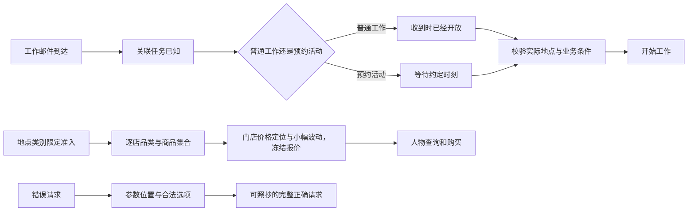
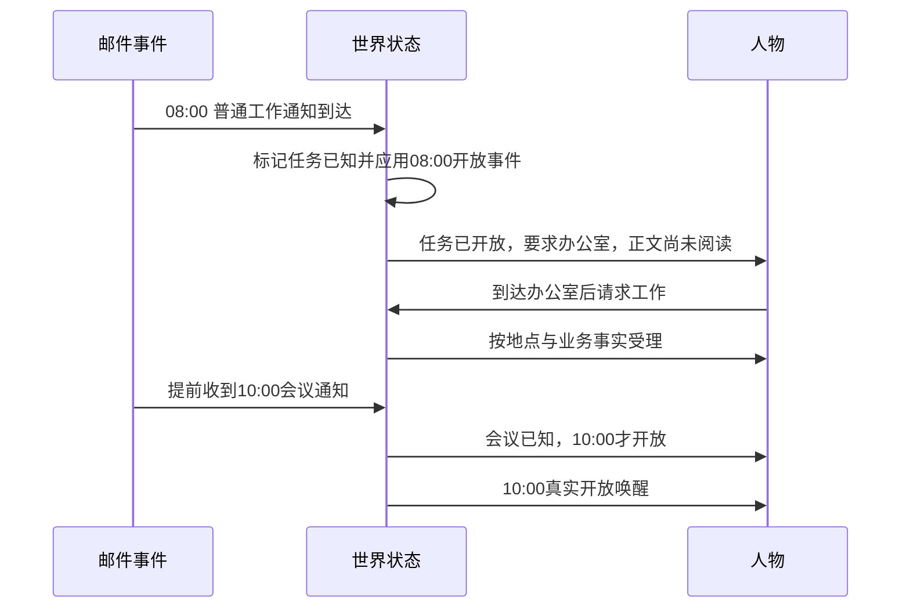
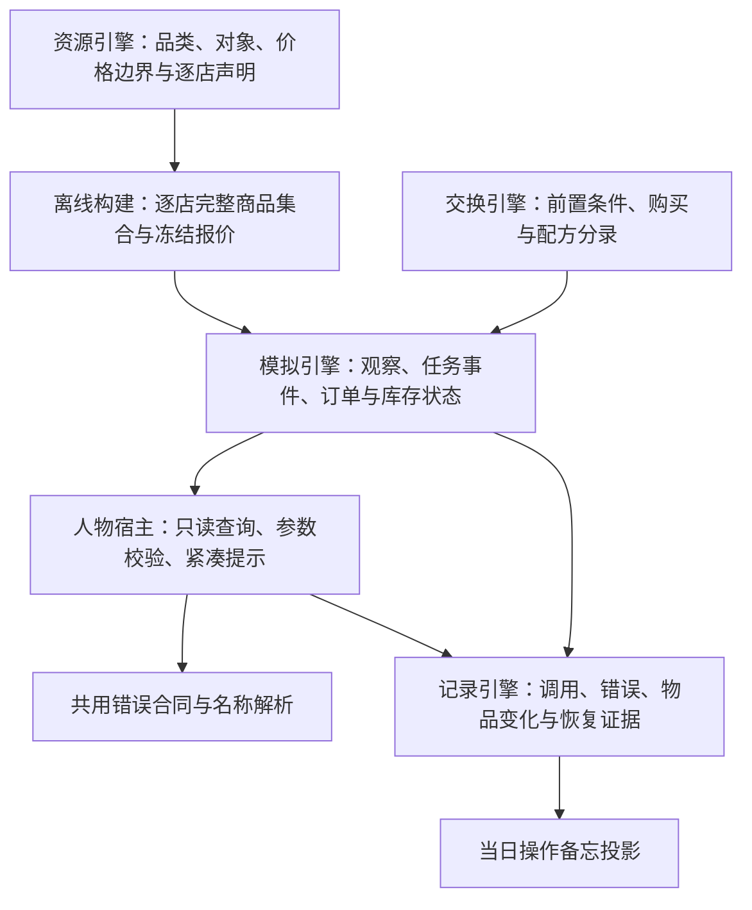

# 工具交互规格

> 状态：**FROZEN，已实现**；2026-10-01 按用户要求完成并发源码审查，并依据附件复审修订。
> 新接口、供给、任务规则与验收守卫已实现；本次实际证据见[验收记录](tool-interaction-verification.md)。
> 更正：`recall_task_summary` 在 `3b4afe5` 的真实 Ray 装配下到不了环境（装配的是 AS2 的 `EnvRouterProxy`，它没有 `read_query`），既有离线验收只覆盖进程内路径；跨进程转发由[个人事务与工作安排规格](SPEC-errands-workday.md)阶段 1 补齐。
> 按[个人事务与工作安排规格](SPEC-errands-workday.md#冻结条款修订)修订「工具请求」「唯一错误结构」「所有入口必须覆盖」：三个控制工具增请求级 `errands` 与对应错误入口；`query_world` 改六键、返回改无损紧凑投影且不再逐项附候选；计划重复意图逐条定位；写明只读查询的执行位置。修订部分未实现，见个人事务与工作安排规格阶段 1（执行位置、重复意图）、阶段 2（`errands`）、阶段 4（查询）。另更正两处既有表述：购买来源的合法写法、四个失败阶段码。「实施与验收」的行为验收表行名不随本次修订增删改，新增验收登记在该规格的验收台账。逐行作业（TI1–TI17）见配套[实施计划](research/errands-workday-implementation-plan.md)，不在规格内。
> 来源：[工具交互提案](PROPOSAL_2026-09-30_TOOL_INTERACTION.md)。
> 实施状态：[开发状态](implementation-status.md)；接口字段唯一维护在[接口合同](../CONTRACTS.md)。

## 人物应当怎样理解世界

人物收到普通工作邮件后，工作已经开放；只要到达要求的地点并满足真实业务条件就可以开始。
会议、面谈等确实需要预约的活动仍按约定时刻开始。邮件到达公开关联任务的合同信息，邮件正文需要阅读。
地点类别限定可售品类，每家店声明自己的完整商品集合和价格定位，人物有足够选择，也有理由选择不同门店。
人物提交错误请求时，系统指出具体参数位置、所写内容和完整合法选项，不让人物靠换名字猜世界规则。



## 范围和取舍

| 提案内容 | 最终决定 | 原因 |
| --- | --- | --- |
| 已知任务与开放状态分开 | 采纳；普通工作收件即开放，预约活动提前可见 | 地点约束已经表达办公要求，不再人为排队到九点 |
| 名称拒绝说明世界事实 | 采纳；每种接口错误都使用完整参数位置与合法选项 | 只改名称错误仍遗漏结构、枚举和批次错误 |
| 活动参数与购买偏好 | 一项一个 items 对象；删除 actions；购买偏好用中文闭集 | 消除数组错位与中英文值不一致，不新增旧请求兼容 |
| 来源与收件人 | to=null 统一表示本人；给予他人填写实名 | 删除购买所需的“自己”特殊值，来源仍按方式解释 |
| 收尾省略 views、memories | 不采纳；仍显式填写空数组 | 与现有 strict Schema 的全字段必填口径一致 |
| around_time 接受“约 HH:MM” | 不采纳；显示和接收均为 HH:MM 或 null | 不扩大时间格式闭集 |
| 回看任务归查询 | 采纳；与记忆查询、query_world 同批 | 只读请求不登记世界动作 |
| 操作备忘 | 从当日持久化证据派生，不写人物记忆 | 保留核验事实而不复制状态或污染人物自述 |
| 紧凑工具层 | 无损分组渲染，完整观察保持原结构 | 减少重复，同时保留全部决策事实 |
| 世界查询试点开关 | 直接增加固定 query_world，不加开关 | 当前不存在只读世界查询；沿用已有解析与权限 |
| 系统层增加大量示例 | 不增加；错误候选返回完整可提交请求 | 避免提示中增加另一套接口定义 |
| 习惯覆盖率改为运行硬失败 | 不采纳；保留运行警告，正式数据集增加行为门禁 | 现有关键词覆盖率不证明完整动作链可执行 |
| 料理临时改成现成晚饭 | 不采纳；使用现有单输入、单输出库存配方 | 长期保留制作与食用之间的真实物品关系 |
| 商品集合 | 类别限定准入，逐店声明完整品类与商品，设丰富度门禁 | 避免稀疏抽样，也避免所有同类门店复制同一目录 |
| 工作窗口统一不少于有效工时两倍 | 不采纳固定倍数；验证真实可完成动作链 | 没有依据的倍数会重新制造不必要的时间约束 |

不新增框架、技能加载器、兼容参数、迁移工具或失败回退。名称识别现有的全半角、类别前缀等无损归一继续使用，
它是名称合同的一部分；被删除参数和表外枚举绝不通过归一重新受理。

## 工具请求

### 开始活动

`start_activity` 只有必填的 `items`、`answering`、`prefer`。
items 包含一至两项，每项恰为 `{target, way, from, to}`，四个键都必填。
一项对象表达一次活动，整组原子受理；不截取多余项，不再存在平行数组等长与下标对齐约束。
删除模型参数 actions 和旧 targets/ways/from/to 数组，收到旧字段按多余参数拒绝。
方式经现有闭集解析后唯一确定内部的 travel、interact、obtain、consume、sleep。
地点菜单仍按内部标准动作判准入；工具层 `actions[]` 仍是系统提供的能力事实，不是模型输入。

| 方式 | 每项 from | 每项 to |
| --- | --- | --- |
| 步行、驾车及非转移的交互、睡觉 | null | null；行为作用于本人 |
| 食用、使用 | null；本人来源由引擎推导 | null；作用于本人 |
| 给予 | null；本人来源由引擎推导 | 已知其他人物名称；继续要求同处 |
| 制作 | null | null；输出归本人在当前地点的库存 |
| 到店、远程下单、购买 | null 表示不约束来源，或地点显示名（含「家」「住处」）、渠道称呼 | null 表示本人，或真实其他收货人名称 |

`to=null` 对全部方式统一表示本人，不表示家或默认送回住处；本人的收货地仍是当前地点。
人物名只用于他人；旧的“自己”收件人字符串直接拒绝。非转移动作不接受他人，给予不接受 null。
`from=null` 对购买表示不约束来源，对其他方式由引擎按实际本人位置和库存解释。

`prefer` 必填可空：含到店、远程下单或购买项时只能是“最快拿到”或“到手价最低”；
不含购买项时必须为 null。null 不再默认最快，旧英文值、简称、空串及字符串“null”均拒绝。
字段说明、Schema 枚举和错误合法值使用同一中文精确短语；现有预计送达、到手价和决胜顺序保持。
`answering` 必填可空，关联已知未回复消息。模型不得提交内部身份、价格、时长、数量或报价版本。

```json
{
  "items": [{
    "target": "工作：会议分析与工作总结",
    "way": "工作",
    "from": null,
    "to": null
  }],
  "answering": null,
  "prefer": null
}
```

现有控制工具已使用嵌套闭合 items 对象，现有 strict Schema 能表达这一结构，无需新增提供商能力。
一至两项在本地校验，全部字段必填且 additionalProperties=false。提供商 strict 不代替 Pydantic 本地严格类型校验；
各请求模型拒绝数值字符串、布尔冒充整数等类型转换，不改变无关输入模型的类型策略。`conclude_activity` 的 views、memories 仍必填可写 []。
`report_status`、`pause_activity`、`conclude_activity` 各另有请求级必填字段 `errands`（与 `items` 平级，没有变更写 `[]`，一次至多四条）；
每条是闭合对象，`change`、`name`、`outcome`、`item`、`quantity`、`memo`、`remind_time`、`reason` 八个键全部必填，
`change` 只取「新增」「更新」「取消」，请求里没有「完成」；同一条未完成事务在一次请求里至多被一条更新或取消点名，两条新增不得同名，
同一请求内按取消、更新、新增的次序求值。`start_activity`、`revise_day_plan` 不带该字段，不新增工具；各键类型与交叉约束只在接口合同定义。
`revise_day_plan` 的 around_time、remind_time 均显示并接收本地 HH:MM 或 null；“约”仅用于说明。
旧请求、旧候选、旧控制记录读取分支及不再使用的商品重名拒绝码直接删除，不增加兼容和迁移。
缺 `errands` 键的控制请求按缺字段拒绝，事件与导出里的这类记录是完整性故障，同样不留读取分支。

### 只读查询

固定 `query_world(name, way, category, from, available_only, offset)`，六个键都必填、无缺省；旧四键请求按缺字段拒绝，不留读取分支。
name、way、category、from 为可空字符串，四者至少一个非 null，非 null 值不得为空白；四者全空时在四个位置各报一条，不落在空根位置，只写 from 合法。
available_only 为严格 JSON 布尔，拒绝字符串、数字与 null，不单独构成查询条件。offset 为非负 JSON 整数，拒绝布尔、字符串和非整数，首次写 0。
多条件按交集匹配；way 按现有方式闭集，category 只取本轮 callable_index 已展示的公开品类标签。
way 写「购买」及其同义写法时等同于同时写「到店」与「远程下单」。
from 是购买来源，写地点显示名（含「家」「住处」）或渠道称呼，与 `start_activity` 购买项的 from 同名同义，
并与购买共用同一个来源解析纯函数，同一写法得到的门店集合逐一相等；from 只匹配供给条目，非供给条目一律排除；
name 只写对象名称，门店名写在 name 里仍按地点目标匹配。
available_only 为 true 时只留本轮冻结观察里已确认此刻可执行的条目：取该条目动作的 available
（写了 way 只看方式命中的动作，way 为 null 时看全部动作以及以该目标为参数的工具，「购买」取两种取得动作任一可用），
与工具层和环境受理同源；false 不筛选。保留的条目照常返回全部动作与工具，不可用的仍带原因。
category 不是对象名称，不允许把“食品”当实际商品；标签由现有品类树和内容类别生成，不新增另一套分类词表。
名称只使用已有确定性名称解析，不增加语义检索、向量库、模型裁决或商品需求推断；
from 不按需求反查门店、不计算路线、不按距离或价格排序，两个新字段不引入否定、或、范围与表达式。

返回 `{matches, total_count, next_offset}`，三个键都必填；next_offset 为整数或 null。
matches 每项是冻结目标的无损紧凑投影：键取 name、kind、phase、state、contract（仅任务）、actions、tools，
动作取 action、way、available、reason、price、duration、quantity、note；只省略 null 与空集合，
false、零价格、零剩余与明确的未知原因逐值保留（与「无损分组」同一规则）。
不再逐项附完整请求候选：照抄 name 与所选动作的 way 即可提交，候选只出现在错误合同里；门店商品的来源标记 note 保留。
同一冻结观察与筛选条件下按公开完整名称及内部稳定身份排序，内部身份不返回模型。
沿用 candidate_presentation_limit 作为每页大小，不增加页长参数或配置；
筛选在排序与切页之前施加，total_count 为全部筛选交集后的权限内完整匹配数，offset 的合法范围按它计算；排序键与每页大小不变。
后续原样保持筛选条件并提交 next_offset；最后一页 next_offset=null，offset=total_count 返回空末页，
offset>total_count 按参数错误返回合法范围。超过呈现窗口的商品必须能完整翻页，不能永久只看前二十项。
offset 在范围内时，除错误入口表所列的两种查询参数错误（from 既不是地点显示名也不是渠道称呼；
from 为 null、name 按对象名称解析无任何匹配且其写法恰是一个渠道称呼）外，
任何筛选组合无匹配时返回 matches=[]、total_count=0、next_offset=null，不报错、不自动放宽、不换来源；
from 解析成功但该来源没有权限内供给、或 name 的完整标签与 from 指向不同门店，都是合法空页。
available_only=true 的空页只表示没有已确认此刻可执行的条目
（报价未知、营业未知的条目也被滤掉；因人物级前置条件使全部动作不可用时同样是合法空页），不等于都不能做；
工具层索引显示可查询标签和完整数量，动态标签错误返回全部合法标签。
筛选不改变索引里各品类的计数口径，它仍是查询权限内的完整条目数。

查询不能读取未读正文、验收答案、未揭示内容、他人私有库存或未知报价。
指名购买本已允许的商品可查同等公开事实；读取已经冻结公开的供给不额外要求 browse 菜单，
只有真实耗时浏览需相应准入。查询不扩大购买或正文权限，也不加入新供给、目标或呈现凭据。
它查询已经知道的能力，不是 product_id/business_kind/travel_mode/max_travel_seconds 的地点发现接口；
删除旧 discover_places 请求正文，已有公开地点路线事实仍可按地点名称和方式查询。

query_world、recall_task_summary 和记忆查询可同批；先校验整批，任一无效则整批不执行，报告全部可独立确定错误。
世界请求与任何查询混批、多个世界请求仍整批拒绝。结果直接作为 tool 消息返回，只保存模型工具交换证据，
不登记世界动作、进度 events 或人物记忆，不推进模拟时间、不增加同刻决策轮数。
执行位置：`query_world` 由宿主在本次冻结观察上本地求值；`recall_task_summary` 经环境代理的 `read_query` 送到唯一的环境 actor
并等待真实结果对象，回看的业务拒绝以错误结构作为返回值。
环境侧 `read_query` 的 `query_world` 分支是同一组纯函数的第二入口，两入口对同一观察、同一请求的结果逐值相等。
每个含查询的模型回复仍消耗一次 MAX_REACT_TURNS；保留十六回合和最终世界请求保留回合。
最终回合与截断重试不开放查询，只读问答沿用 finish，生活决策不增加 finish。
原有“浏览”仍耗时并揭示新内容和供给。前两次名称类拒绝也不计同刻轮数，但仍计模型回合；
查询的独立价值是按品类发现和完整遍历，不声称查询凭预算规则就必然节省回合，按固定身份对照实测。

## 每次错误都要足够具体

### 唯一错误结构

宿主解析、请求模型、名称解析、环境业务拒绝和查询错误共用 `error_code`、`reason`、`fix`、`items`、`unmet`。
所有错误输出和日志使用英文；中文对象名称作为原始名称保留。reason、fix 不含校验器转储、内部身份或验收答案。
异常分支写英文错误日志，结构化证据另外持久化，不从日志文本反解析参数位置。

| items 字段 | 合同 |
| --- | --- |
| path | 从本次模型工具调用根开始的完整位置数组，保留所有数组下标；替代 index 和 field |
| written | 该位置所写的 JSON 值；缺失时为 null，并在 expected 明确 required |
| error_code | 该位置的具体错误码；顶层码表达整批结果 |
| allowed_values | 有限闭集的全部 JSON 合法选项，保留 null 的真实类型；不存在闭集时为 [] |
| expected | 英文说明类型、格式、范围、所需条件；不能用空枚举假装没有限制 |
| why | 参数、名称或世界前置条件的英文说明；不把原因另做一套枚举体系 |
| candidates | 至多三个 {tool, arguments, note}；note 必填可空、非空时为英文，arguments 是可直接提交的完整新请求 |

allowed_values 从该位置的 Pydantic Enum、Literal、JSON Schema 或冻结对象的有限方式选项直接生成。
本轮冻结观察里的有限集合同样完整返回：查询的公开品类标签，以及更新、取消个人事务时本人全部未完成事务名（至多八个）。
已确定包含购买时 prefer 的合法值只有两条中文选项，无购买时只有 [null]；方式本身未合法时只给通用三值类型闭集，
不猜依赖方式才能确定的后续条件。
活动项数、分页范围、价格范围、格式、自由文本、对象名称不冒充静态枚举；分别在 expected 给约束，在 candidates 给可执行选项。
个人事务名是本人此刻的有限集合，不属此列；商品名仍不进 allowed_values，新增个人事务时最接近的至多三个商品名写在 why。
个人事务的名称类错误不带 candidates（完整请求候选要回显人物刚写的 summary 与记忆文字），与控制工具活动名错误不带候选的现行做法一致。
未知方式返回方式闭集，存在对象但方式不支持时返回该对象可写方式；世界暂时不可用仍说明时间、地点、库存等真实条件。
枚举为 null-only 时必须返回 [null]，不返回字符串“null”。合法枚举不能因为超过三条候选上限而截断。

```json
{
  "error_code": "ARGUMENTS_INVALID",
  "reason": "Invalid value at tool_calls[0].function.arguments.prefer.",
  "fix": "For purchases, set prefer to 最快拿到 or 到手价最低.",
  "items": [{
    "path": ["tool_calls", 0, "function", "arguments", "prefer"],
    "written": "最快",
    "error_code": "ARGUMENTS_INVALID",
    "allowed_values": ["最快拿到", "到手价最低"],
    "expected": "A purchase requires one of the two declared preferences; non-purchases require null.",
    "why": "The value is outside the declared enum.",
    "candidates": []
  }],
  "unmet": []
}
```

### 所有入口必须覆盖

| 错误入口 | 定位和合法选项 |
| --- | --- |
| 参数 JSON 损坏或被截断 | 定位到 function.arguments，expected 含解析行列及完整对象要求；不猜未完成的字段 |
| 缺字段、类型、界限、额外字段 | 保留完整 Pydantic loc；根级跨字段验证也必须明确受影响字段，不能只返回空根位置 |
| 未知或本轮未提供的工具 | 定位到 function.name，allowed_values 是本轮全部可用工具名称 |
| 没有调用、多个世界请求、混批 | 定位到 tool_calls，expected 给合法组合；allowed_values 列本轮可用工具 |
| 活动项超限、项内字段或重复对象 | 定位 items 或 items 中具体字段；expected 给一至两项、重复规则及原子受理要求 |
| 控制请求及记忆种类 | 定位到 items 中具体元素和字段；记忆 type 返回实际合法种类闭集 |
| 个人事务变更 | 定位到 `errands[j].<键>`；`change`、`outcome` 返回全部合法值，`expected` 给类型与格式，长度、单次条数与未完成条数上限随校验原因写在 `why`；缺键、类型、枚举、交叉约束、长度、单次条数、两条新增同名或同一事务被两条更新或取消点名，以及新增的名称与已有未完成事务归一后相同、结果种类与商品都与已有或同请求另一条新增相同、新增后未完成数超过八条，都是 `ARGUMENTS_INVALID`，`why` 写明冲突的事务名或上限；更新、取消的 `name` 找不到或不唯一为 `NAME_NOT_FOUND`、`NAME_AMBIGUOUS`，`allowed_values` 列本人全部未完成事务名（至多八个），不替换；新增的 `item` 解析不到唯一商品同为这两码，最接近的至多三个商品名写在 `why`，不把全量商品名放进 `allowed_values`；这些错误都不带 `candidates`；环境用同一函数复核，失败合并为一次 `ACTION_REQUEST_INVALID` |
| 计划意图重复、时刻格式错误 | 零点计划与 `revise_day_plan` 共用同一校验函数；每个重复的意图同时定位首次出现与其后每次出现的 `goals[i].intent_kind`，条数超过八条与重复意图在同一次校验里一并报告、定位在 `goals`，不因超限提前返回。修订入口照错误合同给完整 path、written（该意图字符串；超限时为提交的 `goals`）与 allowed_values（全部意图）；零点计划入口不经这一错误结构，附回文本逐条列位置与原因。时刻错误指出 HH:MM 范围 |
| 查询请求、名称、方式或来源错误 | 同一结构，顶层与明细码都是 `ARGUMENTS_INVALID`，不把环境名称类码带进宿主协议反馈；from 既不是地点显示名也不是渠道称呼时定位 from，allowed_values 为 []，expected 写 `null, a known place name, or a known channel name is required.`，why 与购买侧同句，candidates 给至多三条换了 from 的完整 `query_world` 请求（来源只取权限内有供给条目的门店与渠道）；from 为 null、name 按对象名称解析无任何匹配且其写法恰是一个渠道称呼时（与其余筛选是否为空无关）定位 name，expected 写 `A channel name belongs in from; name takes an object name.`，candidates 给一条把该值移到 from、name 写 null 的完整请求，不自动改写；available_only 非布尔按类型错误定位；来源、方式、品类错误一次全报，offset 范围只在全部筛选合法后计算；查询失败不登记世界，不以 NO_DATA 代替原因 |
| 开工、购买、食用等业务失败 | 定位回原模型参数；expected 写明确的真实条件，unmet 保留既有领域约束 |
| 输出截断、服务或证据失败 | 定位到 tool_calls 或该调用根；无参数枚举时 []，说明失败阶段，不伪造已执行结果；服务与证据失败的阶段码为 `MODEL_SERVICE_FAILED`、`EVIDENCE_WRITE_FAILED`、`MEMORY_QUERY_FAILED`、`TOOL_SERVICE_FAILED`，只标出失败阶段与调用位置，不是对请求参数的协议纠错；四码随个人事务与工作安排规格阶段 1 补登进接口合同的宿主错误码表 |

可独立判定的错误一次全报；必须先有合法对象才能判断的后续业务条件不凭空推断。
整组接受或拒绝，禁止部分执行后才发现另一项参数不合法。宿主与环境共用纯校验、方式映射和错误构造，
在同一冻结观察中对名称和方式的判定一致。

### 世界事实与候选

找不到名称时只在所选方式对应的对象类别中比较；除单字名称外，至少共有一个连续二字词才给近名候选。
相似度永不自动替换。真实但不可用的对象返回自己的原因；世界中没有对应对象时明确说明换名字无法得到它。
食用候选只给持有物；需要先取得食物时，下一步候选改为完整购买或制作请求，标明工具和方式。
名称不存在、当前库存不足、地点不对和任务未开放不得混报为同一种“没有数据”。

候选只能来自同一冻结观察的准入判定。可执行候选可原样提交；因真实前置条件不可用的候选明确标原因，
不能宣称立即执行成功。同一次请求重复出现的错误合并到操作备忘，不增加重复次数触发的特殊放宽规则。

## 地点供给和价格

### 类别准入与逐店商品集合

同一冻结 `corpora/zhangjiang-map/category-assignment.json` 恰含 kinds、locations、source 三键：
kinds 为 kind 到 category_id 数组的准入表，locations 为逐店声明数组，source 沿用现有 DataSource。
kind 使用现有 LocationConfig.kind，品类引用现有 category_id 并包含后代，由 is_descendant 判断。
地点类别只决定允许售卖的范围，不把这个范围的全部对象复制到每一家店。

| 地点 kind | 允许的对象品类 |
| --- | --- |
| restaurant | prepared-meal 及后代 |
| convenience_store | food 及后代；实际选择包装食品品类，不将正餐根集合全部纳入 |
| supermarket | food、durable、ingredient 及后代 |
| wet_market | ingredient 及后代 |
| merchant | food、durable、ingredient 及后代 |
| home、office、fitness、park 及其他不售卖地点 | 空集合；保留真实库存、饮水、内容和生活活动 |

每个售卖地点恰有 `{location_id, category_ids, object_ids, price_position_percent, source}` 声明，所有键必填；
source 复用现有 DataSource 的事实/场景、许可、截止与适用边界，不另建来源字符串结构。
实际商品集合是 category_ids 的全部准入后代对象与 object_ids 显式对象的并集，再校验全部属于该 kind 准入池。
品类批量展开，必要的菜单商品显式列出，去重后为每店构建全部声明对象；无按比例随机抽样或稀疏抽样策略。
超市、便利店选择具体食品子品类；不能因为商品根是 food 就把所有正餐和食品塞进所有店。
正式 prepared-meal 已发布有来源的菜单子品类，正餐归入实际发布的品类，不按店名推断菜系。
正式发布必须提供有来源的菜单子品类或完整显式菜单，禁止根据店名或现有 meal_class 猜菜系。
新增 ingredient、原料子品类及有来源对象属于正式数据发布，未发布前不得声称菜市场已丰富。

下列数量是当前正式场景的验收假设，必须在数据来源中注明，不是行业通用规则，也不做可配置策略层。

| 售卖地点 | 最低商品与品类覆盖 |
| --- | --- |
| 每家餐馆 | 八个可购买正餐；每对餐馆菜单不同，双方各至少有三个对方没有的菜 |
| 每家便利店 | 四十个商品、六个最终商品品类，覆盖食品及饮品 |
| 每家超市 | 八十个商品、八个最终商品品类 |
| 每家商户 | 四十个商品、六个最终商品品类，包含日用品 |
| 每家菜市场 | 八个真实原料对象、两个已发布原料子品类 |

统计按不同 object_id 及其最终 category_id 去重，品类祖先不重复计数；正式声明不足直接拒绝发布，
不能临时复制商品、生成假对象或随机补齐。行为夹具须在正常营业时到店，验证足量对象有货、存在购买配对，
食品可实际购买并食用，食材可用于真实配方；目录存在不等于本店可取得。正式场景的 products、supplies 显式选择必须包含选中售卖地点的
全部声明商品及生成供给，库存覆盖仍沿用现有字段；不得只发布丰富地图而运行仍选旧稀疏 supply_id 清单。
加载与正式场景验收核对选择后的实际集合，不新增自动选择或缺项补齐分支。
所有 kind 必须显式声明，包括空集合；每个售卖地点必须声明菜单和来源，漏配不作为空集合默认值。
同商品保持一个对象定义，各店有独立 supply_id、卖方、Quote、库存和履约。
既有稳定身份与去重规则保证构建顺序无关，营业、资格、配送、路线和卖方账户显式绑定，缺资料拒绝构建。

### 范围内定价

对象有效属性 purchase_price_fen_min/purchase_price_fen_max 为有来源的正整数人民币分边界，min<=max；
可由品类继承、对象覆盖，min==max 合法。它们是构建输入，不是实际 Quote，对象不携带卖方、库存和报价版本。
非货币交换和家庭初始库存不伪造零价供给。

每家店声明整数 price_position_percent，取 5 至 95，表示在同一商品价格范围内的位置，来源注明事实或仿真假设。
本正式地图中的门店按同一地区比较，所有便利店定位比地图内普通超市至少高十个百分点。
这是本场景价格假设，不宣称行业必然规律，不新增地区策略字段。
不同门店可有不同菜单和价格定位，不能将每个商品的整段范围独立均匀抽价。

以 canonical JSON `[random_seed, location_id, object_id]`（ensure_ascii=False、separators=(",", ":")）的 UTF-8
字节计算 SHA-256，digest_integer 为无符号大端整数。固定公式如下，不开放额外抖动配置：

```text
jitter_percent = digest_integer % 11 - 5
percent = price_position_percent + jitter_percent
price_fen = min + ((max - min) * percent + 50) // 100
```

采用整数四舍五入，percent 始终在 0 至 100，相同输入跨机器、跨平台得到同报价。
差价可因整数分舍入相同，不强制每对门店每件商品都不同；定位相差至少十个百分点时，同商品不会逆转高低顺序。
min==max 始终得到该值。扰动只在构建时应用一次，生成带来源、有效期与 price_version 的冻结 Quote。
MapDataset 必填 random_seed、category_assignment_sha256，哈希同时绑定 kind、逐店集合和价格定位，加载核对。

观察、查询、候选、购买、结算和恢复读取实际有效 Quote，不重新抽价。
显式调价沿用报价事件且仍在商品范围内，配送费单列不算商品范围；已受理订单保留成交价。
恢复沿用持久化当前报价和库存。价格定位决定初始构建报价，真实调价不被伪装为重新构建。

## 普通工作与预约活动

输入 WorkTaskConfig 只增加必填 appointment：null 表示普通工作，或 `{starts_at, reason}` 表示预约。
预约两个键都必填，starts_at 带时区，reason 非空并说明现实预约依据；不依据任务标题推断类型。
删除输入 available_at、availability_kind、appointment_reason，不保留重复通知时间及旧字段。
“会议分析与工作总结”是独立办公，不因标题含“会议”而成为预约。
不新增前序任务依赖配置；工作素材在通知前有效，首次世界保存和观察之前复用既有加载器核验，缺素材拒绝正式构建。

每封非空 related_task_id 通知都须引用存在任务，收件人为该任务受派人物，逐封校验；
每任务另须至少一封覆盖通知，名称指同一完整标题；缺通知或错配拒绝构建。
装配时生成 RuntimeWorkTask：内部 available_at 对普通工作取最早本人关联邮件 sent_at，对预约取 starts_at。
这是运行时事实，供调度与工作判断使用，不要求作者重复填写，不写回输入或新增检查点字段。
预约最早通知不晚于 starts_at，后续合法提醒可晚于开始但不改变开放时间；due_at 晚于内部 available_at 和运行起点，不晚于运行结束；开放可早于运行起点。
启动先应用已送达通知和已开放任务，再生成首次观察。素材、技能、工资、地点、工时和真实截止保持原合同。

同一模拟秒先应用邮件到达及相关任务开放事实，再构建人物观察；两者没有可供模型决策的中间状态。
邮件到达把关联任务写入 visible_task_ids，它只表示本人已知任务，不能用该集合新增来替代真正开放事件。
普通任务此时已开放；预约任务已知但动作 available=false，reason 写准确的约定时刻。
提前收到预约邮件只产生邮件通知，不产生 task_available；WORK_AVAILABLE 仍在实际内部 available_at 唤醒。
睡眠中不唤醒规则保留，人物醒来时看到已到达的通知和已开放的工作。

任务 contract 为 `{opens, deadline, place, remaining, outlook}`：opens/deadline 是带时区的可读绝对时间，
place 是要求地点的公开名称。合同五键只在任务目标出现；邮件到达不公开正文，阅读结果保留实际所读正文；两种结果只引用关联任务完整名称，
不重复任务合同的时刻、地点或验收答案。
提交、回看和工具层名称都从同一任务合同与已知集合生成。
在错误地点尝试开放工作返回地点条件，不返回“尚未开放”；预约未到点返回开放时刻，不返回 NAME_NOT_FOUND。
到截止同秒的提交仍按原合同允许；超过截止拒绝，逾期展示保留到当地日结束。



## 料理与习惯

制作沿用 inventory_recipe 的单输入对象到单输出对象转换。发布可制作的一份食材包、库存转换规则、
输出品类和 recipe_output_bindings；输入和输出 inventory_unit 均为 item，库存资源仍为 inventory/item，并符合唯一输出绑定。
若多个菜品共用输出品类会产生歧义，发布明确的输出子品类，不从人物叙述猜一道菜。
不开发多材料自动配方；人物已有菜谱之外的世界事实不能由模型写“出锅了”创建。
食材实际消耗、菜品实际入库、地点和份量由引擎结算，再允许食用。
具有真实产出含义的做饭对象直接使用制作路径，删除无产出的重复生活活动绑定。
活动结束结果总是写物品变化；没有变化时明确返回英文“没有物品变化”的语义。

运行输入 COVERAGE_BELOW_THRESHOLD 继续只警告，validate 的既有覆盖率要求保持；
正式数据集另用显式原生动作夹具验证每条声明的习惯与前后依赖链。
夹具写明对象、方式、地点、通知和库存前置事实，由同一引擎回放。
不能把关键词命中率当行为完成率，也不能声称可自动理解和回放任意散文日程。

## 操作备忘与紧凑提示

### 当日操作备忘

进度层增加 rejected_today，从持久化 model_response 的 protocol_feedback 与 action_rejected 证据派生。
字段为 written、why、times、last、accepted_as；按同一参数位置及写法汇总，后续受理记录更新 accepted_as。
至多八条，最近使用优先，why 使用英文、每条至多六十字符；完整原文仍留审计证据，不能删原始证据来缩短提示。
跨模拟时刻与会话保留，下一本地日清空呈现窗口；不写人物记忆、不新增检查点状态。
备忘只记录实际拒绝，不能把人物自述或查询空结果当失败。

### 无损分组

完整冻结观察保留 targets、actions、tools、contract 和私有绑定；紧凑格式只发生在提示与公开 changes 的渲染。
公开工具层使用 groups 与 callable_index；每组为 kind、action、way、shared、targets。
按现有类别和相同动作方式分组，shared 只承载整组逐值相同的公开字段，targets 保存名称和各自不同的字段。
没有 start_activity 动作的控制对象使用 action=null、way=null，仍保留 tools 和状态。
解组按名称合并动作及一致元信息，冲突元信息视为渲染错误，不从另一组随意选值。
只省略 null 和空集合；false、零价格、零剩余、明确的未知原因不能因为真假值检查而丢失。
共同不可用原因及 changes 中相同原因的出现、解除可以合并，但每个受影响对象必须仍可恢复。
名称、可用性、原因、价格、份量、时长、任务合同、资格和控制工具信息逐值守恒。
同秒续接链首前缀仍逐字节稳定；工具层计入总提示容量，不通过裁掉名称绕过容量门禁。

## 分层职责



Pydantic 负责结构与完整 loc；jsonschema 负责提示格式；jsonpointer 与现有路径处理负责结构定位；
现有类别树负责后代判定；hashlib 和 canonical JSON 负责可重复构建。
TextWorld 的 admissible_commands 思路用于公开当前可做能力，不接入另一个世界状态或结算器。
现有依赖已能满足需求，本特性不加新包。

## 首次受影响发布身份与恢复

| 产物 | 首次更新身份 | 原因 |
| --- | --- | --- |
| 场景 | schema_version 4，替代 3 | 删除输入开放时间，使用预约对象与通知派生 |
| 地图 | MAP_SCHEMA_VERSION 3，替代 2 | MapDataset 新增生成种子和类别声明哈希 |
| 目录 | 5.0，替代 4.1 | 新价格边界槽、食材对象及构建声明 |
| 品类合同和规则绑定 | contract_version 3 | 属性与配方品类扩充，规则绑定同版 |
| 世界状态 | WORLD_SCHEMA_VERSION 8 保持 | 任务已知集合、报价和库存沿用现有字段，备忘由事件派生 |
| 工具与提示身份 | 重新计算 tool_schema_sha256、prompt_sha256 | 请求模型、查询、系统规则和渲染 Schema 修改 |

MapDataset 的生成种子等于场景 random_seed；二者不一致拒绝加载。
保留白领现有种子20260105、多人两份场景现有种子20260106，分别构建并钉定两份地图供给发布；
地点和路线来源可以共享，三场景不得继续共用一份种子报价，也不为共图修改人物实验种子。所有路径以仓库或场景文件为基准的相对路径表示。
上表为各产物首次受影响的发布目标，阶段独立验收；后续目录内容修改按现有规则发布新版本，最终认证记录实际版本和摘要，不得同版覆盖。
版本、数据、代码和提示身份全部按既有清单冻结。旧输入、旧工具请求、旧错误候选和旧控制记录不保留读取分支；
旧运行恢复按既有身份校验拒绝，重新运行。不创建迁移命令、旧结构适配或替代模型回退。

## 与现有规格的逐项一致性

| 权威文档 | 本次直接修订 | 保留的约束 |
| --- | --- | --- |
| SPEC-time-and-energy | 删除模型 actions；查询不计同刻轮数；HH:MM一致 | 世界时钟、两项名额、十六模型回合、能量不阻断 |
| SPEC-dayrun-fidelity | 精确错误路径和全部枚举；候选按方式类别；严格 prefer | 指名购买、真实报价、名称无损归一和原子受理 |
| SPEC-persona-prompt | 查询归类、紧凑层、操作备忘、任务合同字段 | 七层分工、正文阅读权限、前缀稳定、预算边界 |
| SPEC-agent-interaction / SPEC-as2-integration | 逐项请求、品类分页查询、删除旧控制读取 | 自述不转移世界状态、既有工具登记和故障传播 |
| SPEC-life-runtime / SPEC-life-realism | 收件即普通工作开放、预约例外、料理产物 | 地点、截止、技能、素材和库存结算 |
| SPEC-map-and-storefront | 类别准入和逐店集合、定位加小幅波动、生成身份 | 独立供给、营业、路线、卖方、Quote、配送与恢复 |
| SPEC-category-contract | 允许构建价格边界，仍禁止对象真实报价 | 品类继承、独立规则、来源和单输入单输出配方 |
| SPEC-interaction-menu / SPEC-decision-context | 方式推导动作、固定查询工具与共享错误 | 菜单仍管内部标准动作、可见性与候选资格 |
| SPEC-day-plan-goals / SPEC-dayrun-behavior | 时间值一致；正餐和习惯动作链核验 | 真实证据推进目标、正式日运行独立验收 |

上表列的是具体替换位置，不能用一条“新规格优先”保留两套矛盾的正文。
旧运行统计和既有验收报告只证明当时接口，必须与本次实现的独立验收证据区分。

## 文件修改清单

下表列出必改入口及需要检查的消费链；新建文件明确标“新增”。同一责任中简写的文件名相对同组已写目录。
声明、解析、实际状态和公开反馈入口必须修改；已经通用处理新形状的消费模块只核验，不为了清单制造改动。
本次实际文档修订见开发状态。

### 设计及权威文档

| 文件 | 修改内容 |
| --- | --- |
| docs/dev/SPEC-tool-interaction.md（新增） | 最终行为、接口约束、发布身份、测试与修改范围 |
| docs/dev/PROPOSAL_2026-09-30_TOOL_INTERACTION.md | 删除未裁决、兼容归一、回退和试点方案；记录最终取舍 |
| docs/CONTRACTS.md | 逐项请求、品类分页查询、完整错误、预约对象、门店集合和价格定位与 Schema |
| docs/design/00-overview.md | 用户需求到四个引擎职责的映射 |
| docs/design/01-architecture.md | 复用依赖、共享纯函数、只读与写请求边界 |
| docs/design/02-exchange-engine.md | 真正报价、范围约束、原子购买与料理分录 |
| docs/design/03-resource-engine.md | 类别继承、逐店商品集合、边界和定位来源与价格冻结 |
| docs/design/04-simulation-engine.md | 任务事件顺序、已知与开放、查询权限、提示和料理 |
| docs/design/05-recording-engine.md | 错误结构、查询证据、操作备忘来源、成交与物品变化 |
| docs/design/06-delivery.md | 只读查询与执行证据区分，新请求和候选形状消费 |
| docs/design/07-evaluation.md | 供给/价格/任务/错误的行为测试与变异要求 |
| docs/design/08-configuration.md | 预约对象、通知派生、种子、范围、逐店声明和拒绝条件 |
| docs/design/09-io-formats.md | 新版场景/地图输入与公开输出字段导航 |
| docs/design/README.md、SUMMARY.md、worldmock-design.html | 阅读入口及重新汇编，HTML不得手改 |
| docs/dev/SPEC-time-and-energy.md、SPEC-dayrun-fidelity.md、SPEC-persona-prompt.md | 本文一致性表的对应替换 |
| docs/dev/SPEC-agent-interaction.md、SPEC-as2-integration.md、SPEC-life-runtime.md、SPEC-life-realism.md | 本文一致性表的对应替换 |
| docs/dev/SPEC-map-and-storefront.md、SPEC-category-contract.md、SPEC-interaction-menu.md | 本文一致性表的对应替换 |
| docs/dev/SPEC-decision-context.md、SPEC-day-plan-goals.md、SPEC-dayrun-behavior.md | 本文一致性表的对应替换 |
| docs/INDEX.md、ARCHITECTURE.md、EXPERIMENT.md、VERIFICATION.md、docs/dev/implementation-status.md | 权威导航、实验身份、放行门禁与实际验收状态 |
| docs/manual/README.md、runtime.md、resources.md、rules.md、personas.md、scenarios.md | 新接口与正式发布格式；示例区分当前实现和目标发布 |
| catalog/README.md | 品类构建边界、供给生成和冻结数据职责 |

### 生产代码与数据

| 文件 | 修改内容 |
| --- | --- |
| src/worldmock/life/models.py、scenario.py、map_models.py、map_data.py | 严格逐项请求、预约输入/RuntimeWorkTask派生、场景/地图新版、生成身份及引用验证 |
| src/worldmock/life/error_contract.py、request_errors.py（新增）、business_feedback.py（新增）、name_resolution.py、routing.py、guidance.py | 真实校验位置与 Schema 条件、方式推导、完整定位、合法枚举、共用错误和完整候选 |
| custom/agents/life_agent.py、life_feedback.py、life_truncation.py、life_prompt.py | 解析错误入口、查询分组、真实位置保留、提示渲染与稳定续接 |
| src/worldmock/life/world_query.py（新增） | 复用冻结名称、能力与权限的纯只读查询 |
| src/worldmock/life/session_actions.py、named_purchase.py、named_catalog.py、tool_layer.py、discovery.py | 新请求解析、同源可用性、方式候选、固定查询能力与既有地点/供给事实投影 |
| src/worldmock/life/observe.py、prompt_schemas.py、progress_layer.py、result_projection.py、narration.py | 任务合同、紧凑格式、备忘、物品变化；expected禁键改为具体评估证据路径 |
| src/worldmock/life/control_items.py、memory_layer.py、day_plan_inputs.py、todo_layer.py | 删除旧形状读取，空数组显式，HH:MM显示与接收一致 |
| src/worldmock/life/work.py、rhythm.py、engine.py、rules.py、motivation.py | RuntimeWorkTask消费类型、收件与开放原子事件、真实唤醒、地点优先事实和查询不登记 |
| src/worldmock/scheduling/compile.py、effects.py、events.py | 内部任务编译、普通通知同秒开放、预约分离、幂等与按受派人物告知 |
| src/worldmock/corpora/map_prepare.py、src/worldmock/catalog/builder.py、compiler.py、admission.py、src/worldmock/categories/contract.py | 复用类别树的供给构建、边界校验、发布身份 |
| src/worldmock/life/storefront_runtime.py、basket.py、commerce.py、category_contract.py、inventory_recipe.py | 真正Quote、调价边界、库存转换和订单原子性 |
| src/worldmock/runtime.py、validation.py、profile/coverage.py、profile/injection.py | 新身份装配、正式行为夹具门禁，保留运行警告与validate语义 |
| src/worldmock/delivery/windows.py、src/worldmock/evaluation/metrics.py、public_evidence.py | 消费新请求/错误/查询证据；保持只读与实际执行区分 |
| tools/run-viewer.html、run-viewer-context.js、run-viewer-context-view.js | 展示逐项请求、分页查询、分组能力和精确错误，不读旧请求字段 |
| custom/envs/life_env.py | 固定工具面门禁、query_world注册与即时只读派发 |
| src/worldmock/life/semantics.py、interaction_menu.py、menu_execution.py | 任务输入与运行时合同分离、通知派生、种子核对、方式动作与查询准入 |
| src/worldmock/life/storefront_state.py | 显式调价与恢复时验证价格范围，保持已成交订单价格 |
| src/worldmock/life/activity_evidence.py、settled_text.py | 制作输出及无物品变化的真实公开结论 |
| scripts/build_catalog.py、scripts/prepare_map.py、src/worldmock/corpora/fetch.py、manifest.py | 正式发布入口、类别文件与按种子供给发布身份 |
| catalog/category-contract.json、exchange-rules.json、manifest.json | 价格边界槽、ingredient、既有输出对象/单位及绑定核验、规则与版本绑定 |
| catalog/objects.jsonl、corpora/meals/items.json、corpora/lifestyle/items.json | 有来源对象、料理食材包与输出，删除无产出重复绑定 |
| corpora/zhangjiang-map/category-assignment.json（新增）、supply-assumptions.json、corpora/manifest.json | kind准入与逐店集合/定位哈希；替换旧逐条商品价和稀疏restaurant_offers，保留真实库存、履约与来源 |
| corpora/zhangjiang-map/ 下按20260105与20260106分别发布的dataset.json和supplies.json | 逐店完整供给、生成种子、定位内小幅扰动冻结Quote；各场景钉对应发布身份 |
| scenarios/white-collar-12-weeks.json、multi-person.json、multi-person-half-day.json | 删除旧开放时间；预约对象、完整通知、完整products/supplies选择、配方绑定和对应种子地图 |

### 测试与验收工具

| 文件范围 | 修改内容 |
| --- | --- |
| tests/life/、tests/integration/、tests/scheduling/ | 逐项请求、所有错误入口、查询分页分批、任务已知和真实唤醒 |
| tests/catalog/、tests/categories/、tests/corpora/、tests/resources/ | 逐店完整集合、丰富度和菜单差异、价格定位、来源及真实配方库存 |
| tests/delivery/、tests/evaluation/、tests/tools/、tests/fixtures/ | 新形状、只读证据、旧字段拒绝与场景更新 |
| tests/tool_interaction_acceptance.py（新增）、tests/test_tool_interaction_acceptance.py（新增） | 无模型端到端行为矩阵与源码变异审查入口 |
| scripts/documentation_gate.py、build_design_doc.py及对应已有测试 | 使用既有门禁验证文档链接、设计汇编；不为本特性改成宽松规则 |

## 实施与验收

每个阶段都是可以独立运行、验收并冻结身份的完整变化；各阶段提交只携带自己所需的数据和消费者修改。
首次受影响发布身份表不是最终认证身份；每阶段只更新自己触及的产物，最终记录实际版本和摘要，不能一次升级所有数据。前一阶段已验收的主链持续可运行，
进入下一阶段后直接采用新合同，删除旧格式，不加运行开关、双读、兼容或迁移。


| 独立实施阶段 | 最小端到端结果与门禁 | 本阶段身份 |
| --- | --- | --- |
| 逐项接口与精确错误 | 本地请求、宿主、环境、候选、查看器同步；一项成功，两项原子，旧数组与英文偏好拒绝；行为与独立源码变异通过 | 工具、提示及代码身份；不改变场景、地图和目录版本 |
| 普通工作与真实预约 | 最小场景八点收件、到公司开工、提交；预约提前可见而到点才开；补齐正式通知和素材校验，睡眠及恢复行为通过 | 场景4；地图、目录、品类仍为已验收版本 |
| 门店集合与价格 | 每店完整声明、有足够且有差异的对象，按实际报价购买；跨平台构建、调价、成交与恢复门禁通过 | 地图3、目录5.0、品类合同与规则绑定3；不捆绑后续料理或提示功能 |
| 真实料理 | 完整食材包购买、制作、成品入库、食用；拒绝无产出假料理，行为与源码变异通过 | 按现有发布规则冻结对象、规则和场景；已发布目录有内容变更时发布新版本，不能同版覆盖 |
| 品类分页查询 | 同权限列表跨页到全集，嵌套错误与查询批次原子，查询不登记世界，最终回合门禁通过 | 工具及代码身份 |
| 操作备忘与无损分组 | 真实拒绝跨会话呈现、次日清空；公开信息逐值可恢复，前缀与容量门禁通过 | 提示及代码身份；世界8不新增状态 |

每阶段使用固定人物、模型参数和对应实验种子保留前后指标，分别报告协议错误、业务拒绝、
查询模型回合成本、成功行为和门店选择；发生数据或 Schema 变更时记录准确身份，不能把累计下降归因于某一处修改。
完成各阶段后再发布三份正式场景并真实全天复验，不能用文档门禁代替生产行为和变异结果。

注：下表行名被工具交互登记守卫按表解析，[个人事务与工作安排规格](SPEC-errands-workday.md)的任何阶段都不在本表增删改行；六键查询、个人事务与运行修复的验收登记在该规格的「验收台账」，守卫里的查询字段集断言随该规格阶段 4 由四键改为六键。

| 行为验收 | 必须观察到的结果 |
| --- | --- |
| 八点普通工作通知，八点五十五到公司 | 可直接开始；不出现九点开放拒绝，wrong location时准确点名办公室 |
| 提前收到十点预约会议 | 提前可见并说明十点；收件时无假task_available，十点正常唤醒 |
| 未读、阅读与睡眠 | 到达不公开正文，阅读结果保留正文；逐封校验受派人，睡眠不被通知唤醒 |
| 全部接口错误入口 | 每条错误含真实path和合法枚举或expected；嵌套type和root validator不遗漏位置 |
| 原子批次 | 混批和多项无效全部不执行；可独立判定的错误一次全报 |
| 类别供给 | 每店集合严格等于逐店品类展开与显式菜单并集；达到丰富度和菜单差异门禁，正常营业有货可买 |
| 地点定价 | 每个商品价在范围内；门店定位加±五个百分点扰动，至少十个百分点定位差不逆转价序；跨机器相同、不重抽 |
| 购买与食用 | 当前Quote付款、真实扣库存、交付后才能食用；旧actions/旧候选明确拒绝 |
| 料理 | 输入真实消耗、输出真实入库后可食用；无物品变化时不暗示已做出食物 |
| 查询与预算 | 按公开品类跨页到全集，末页next_offset=null；offset严格整数；冻结公开读取不要求browse；无世界差分、不越权、仍计模型回合 |
| 操作备忘 | 跨时刻/会话出现，恢复相同，次日窗口清空；不进入人物记忆 |
| 紧凑呈现 | 解组逐值等于公开完整观察，false/零值/合同/控制工具不丢，同秒前缀稳定 |
| 文档与身份 | 本文所有冲突正文同步，目标版本一致，HTML与源一致，相对链接可解析 |

源码变异必须覆盖：删掉allowed_values、丢掉嵌套下标、把null变字符串、漏报批内错误、查询写世界、
开放延迟到九点、重复输入开放时间、预约收件产生假唤醒、错配通知未拒绝、跨人物任务泄露、后续预约提醒改动开放时间、丢失阅读正文、按呈现窗口裁掉供给、
把kind准入全集复制到每店、丢失菜单差异、错误继承类别、遗漏分页尾页或错算next_offset、
忽略门店价格定位、价格越界或观察重抽、调价改旧订单、配方不扣输入或不产出、备忘丢失或跨日残留、紧凑层丢false或控制工具。
每个非等价变异必须被行为测试杀死；存活变异、未执行变异或基础测试失败都不放行。
真实两个人物的全天复跑用于报告拒绝率、重复尝试、查询次数、token和预算耗尽；不将历史提案估计当新接口的通过结果。

## 成熟方案依据

已在线核验：Pydantic 提供错误位置、输入及上下文，可直接承接本项目的精确错误结构；
Shopify 将产品和地点库存分别管理；Dynamics 365 用品类展开商品集合并按门店管理报价；Jira 可以移除工作开始日期约束，截止和开始不是一个概念。
这是本项目对这些已有做法的应用，丰富度门槛、价格定位及小幅扰动公式是本项目明确的仿真假设。

- [Pydantic 错误结构](https://docs.pydantic.dev/latest/errors/errors/)
- [Dynamics 365 门店商品集合](https://learn.microsoft.com/en-us/dynamics365/commerce/set-up-assortments)
- [Dynamics 365 门店报价](https://learn.microsoft.com/en-us/dynamics365/commerce/tasks/base-price-trade-agreements)
- [Shopify 地点库存](https://help.shopify.com/en/manual/fulfillment/setup/locations/setting-up-locations)
- [Jira 工作开始与截止日期](https://support.atlassian.com/jira-software-cloud/docs/schedule-work-for-kanban-teams-on-your-roadmap/)
- [Anthropic 工具设计](https://www.anthropic.com/engineering/writing-tools-for-agents)
- [TextWorld 当前可执行命令](https://textworld.readthedocs.io/en/stable/textworld.html)

## 版本表

| 版本 | 日期 | 修订 |
| --- | --- | --- |
| 工具交互定稿 | 2026-10-01 | 逐项请求、中文购买偏好、逐店商品集合与价格定位、品类分页、通知派生已实现；实际证据独立记录 |
| 个人事务与工作安排修订 | 2026-10-02 | 按[个人事务与工作安排规格](SPEC-errands-workday.md#冻结条款修订)修订（[实施计划](research/errands-workday-implementation-plan.md)作业 TI1–TI11、TI14–TI17）：三个控制工具增请求级 `errands`（备注键 `memo`）与对应错误入口，事务名错误在 `allowed_values` 列本人全部未完成事务名、商品名错误把最接近的名称写在 `why`，都不带候选；`query_world` 改六键（`from`、`available_only`），「购买」展开为两种取得方式，返回改无损紧凑投影并不再逐项附候选，补筛选后计数、空页与两种参数错误的边界；计划重复意图同时定位首次与其后各次出现并与超限同批报告；写明 `query_world` 本地求值、`recall_task_summary` 经环境 actor。逐店供给、价格、通知派生开放、操作备忘与无损分组条款不变；「实施与验收」行为验收表不改。补记与更正既有表述：回看任务在 `3b4afe5` 的真实 Ray 装配下不可达；购买来源的合法写法是地点显示名（含「家」「住处」）或渠道称呼；四个失败阶段码此前只存在于代码。修订部分未实现，见个人事务与工作安排规格阶段 1、2、4 |
