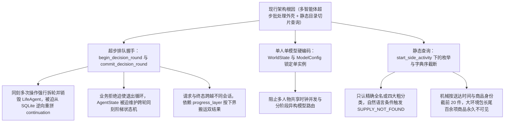
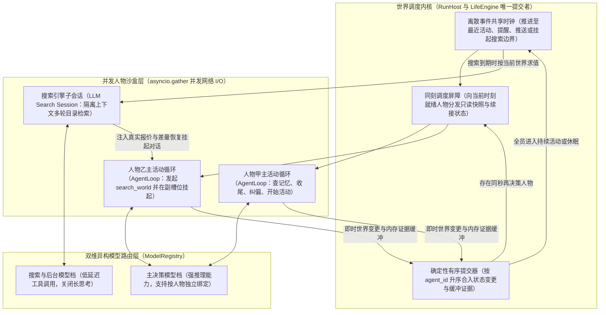
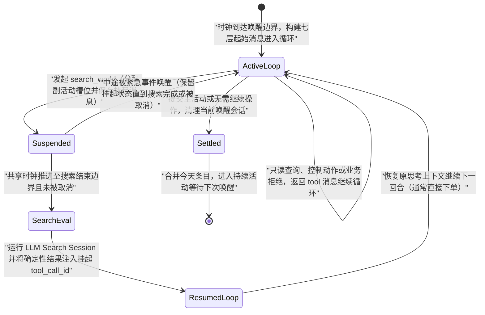
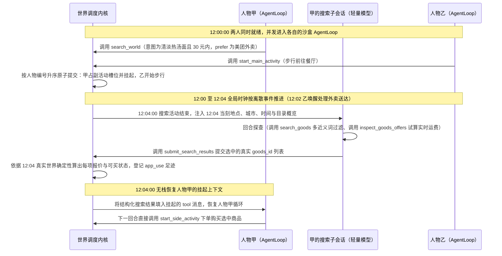

# 模拟引擎主活动循环重构与多 LLM 搜索子会话架构提案

> 状态：提案，待评审；本文不改变当前运行规则与代码实现。
> 代码基线：`6440605a`（`RULES_VERSION = 6`、`WORLD_SCHEMA_VERSION = 16`、`EXPORT_SCHEMA_VERSION = 8`）。
> 核心目标：
> - 模拟引擎内核转为「全局确定性时钟屏障 + 人物级沙盒 `AgentLoop` + 无栈挂起恢复」；
> - 剥离静态商品查询，升级为独立原生工具 `search_world` 与隔离上下文的 `LLM Search Session`（覆盖商品报价、商铺与同城地点探索）；
> - 一步到位支持「认知阶段 × 多数字人」双维异构模型路由（`ModelRegistry`）与多人物并发确定性落库；
> - 记忆层「今天条目」按单次唤醒会话归并，不保留旧批处理外壳、单人锁、兼容层或迁移路径。

## 现行批处理回合与静态查询的架构瓶颈



| 瓶颈维度 | 现行代码与文档出处 | 现行实现约束 | 架构与运行后果 |
| --- | --- | --- | --- |
| **超步排队握手** | [run_host.py](../../../src/worldmock/runtime/lifecycle/run_host.py)、[life_agent.py](../../../src/worldmock/agents/life_agent.py)、[decision_coordinator.py](../../../src/worldmock/simulation_engine/decisions/decision_coordinator.py) | 沿用多智能体超步批处理模式：`submit_action` 只登记 `PendingAction` 并返回空回执 `ActionReceipt`，随即销毁 `LifeAgent` 并由 `commit_decision_round` 在轮尾结算 | 人物在当前推理循环内看不到世界请求的实际执行结果、余额变化或业务拒绝原因，同刻收尾后再开始新活动必须强行拆分成多个决策轮，衍生出 `abort_decision_round` 与延迟写入 `decision_started` 等复杂状态机 |
| **逆向同秒续接** | [continuation.py](../../../src/worldmock/simulation_engine/decisions/continuation.py)、[life_continuation.py](../../../src/worldmock/agents/protocol/life_continuation.py) | 因为前一个 `LifeAgent` 已销毁，同秒再决策时只能由环境侧从 SQLite 反查上次 `model_request`、`model_response` 与 `action_result`，重排 JSON 键序并叠加计算 `layer_changes` | 为迁就跨轮重建而维护大量脆弱的序列化反推代码与 `same_second_continuation` 开关；一旦任意辅助键序或 `reasoning_content` 校验失配即断链重发整份七层大快照 |
| **跨轮同刻阶梯** | [same_moment.py](../../../src/worldmock/simulation_engine/decisions/same_moment.py)、[agent.py](../../../src/worldmock/state/world/agent.py) | 每次业务拒绝都退出当前回合，被迫在 `AgentState` 持久化 `same_moment_rounds` 与 `same_moment_stage`，并在工具层与受理侧双线同步开放阶段 | 将本来属于单次唤醒会话内的纠错循环外溢为世界持久化状态，抬高状态恢复与反事实校验的耦合度 |
| **双结果搬运机制** | [progress_layer.py](../../../src/worldmock/simulation_engine/observation/layers/progress_layer.py)、[06-agent.md](../../design/06-agent.md) | 受理与终结分属不同一次性会话，每条开始动作写两份 `action_result`，由进度层按停留与路程下界筛选带入记录 | 人物常在活动进行期间漏读第一份结果，仅在活动结束后于进度层读取末份结果；查询答案需滞留到本段停留结束，再依靠进度层搬运进记忆层 |
| **静态枚举查询** | [query_activity.py](../../../src/worldmock/simulation_engine/activities/query/query_activity.py)、[query_answer.py](../../../src/worldmock/simulation_engine/activities/query/query_answer.py)、[name_resolution.py](../../../src/worldmock/simulation_engine/actions/name_resolution.py) | `start_side_activity` 的 `query` 动作仅接受精确商品名或四个固定类别名，`ordered_answer` 按可下单状态、送达时间与 `goods_id` 硬截 `QUERY_PRODUCT_LIMIT`（固定二十件） | 面对大环境包下成百上千件商品（见[人物设计](../../design/06-agent.md)示例「查完美团外卖·食品：20项可买（另160项未列）」），人物既无法按口味、预算或地点特征筛选，也永远看不到排位靠后的长尾商品；每次盲查固定空耗 300 至 600 秒并强制打断决策 |
| **单人单模型锁定** | [world.py](../../../src/worldmock/state/world/world.py)、[models.py](../../../src/worldmock/configuration/inputs/models.py)、[environment.py](../../../src/worldmock/configuration/inputs/environment.py)、[model_client.py](../../../src/worldmock/configuration/model/model_client.py) | `WorldState.validate_world` 强制 `len(self.agents) != 1`；配置只读取单一 `persona.toml` 与单一 `[model]` 节；运行宿主只构造唯一 `ModelClient` | 无法在同一世界时钟下让多个数字人并发过日子，也无法把高频工具检索、回顾整理等轻量工作路由到快速低成本模型 |

## 多 LLM 并发与主活动循环内核架构

为了既消除超步批处理外壳带来的逆向重建负担，又完整保留**纵向异构多模型**与**横向多人物并发**能力，新内核严格遵循**「全局确定性时钟屏障 + 人物级沙盒 `AgentLoop` + 无栈挂起恢复」**三层职责边界：不耗时（零模拟秒）的连续查询、状态控制与拒绝纠偏留在各自人物的内存 `AgentLoop` 中即时结算并回传；一旦推进模拟时间或需要跨人物同步，交还全局调度屏障按 `agent_id` 升序确定性提交。



### 同刻零耗时沙盒闭环与包袱清除

主人物决策与搜索子会话共享同一套与具体业务解耦的通用 **`AgentLoop`** 引擎（从现行 [react_loop.py](../../../src/worldmock/agents/protocol/react_loop.py) 提炼），承担回合预算控制、发送前容量预检、`model_request` 与 `model_response` 证据缓冲、截断关闭思考重试与原生工具解析纠错。

- **单次唤醒内的沙盒即时结算**：在模拟时刻 `t` 的同刻调度屏障中，每个就绪人物持有一份基于当前已提交世界克隆的个人沙盒状态与内存证据缓冲 `EvidenceBuffer`。人物在主活动循环中调用只读工具（`search_memory`、`recall_task_summary`）或零耗时世界控制工具（`conclude_activity`、`pause_activity`、`report_status`、`revise_day_plan`），以及发生任何协议错误或业务规则拒绝时，模拟引擎直接在沙盒状态上完成校验与结算，随即将结果、错误引导和由原 `layer_changes` 纯函数计算出的状态差量写回当前内存 `messages` 列表末尾的 `tool` 消息，**在同一个 `AgentLoop` 进程态循环内无缝进入下一模型回合**。
- **推理模型思考链的安全边界**：DeepSeek 等推理模型要求同一轮 `user` 问答下的连续 `assistant -> tool` 调用链完整携带每步的 `reasoning_content`，跨 `user` 轮次边界时方可清理历史思考链。以**单次唤醒会话**作为内存 `AgentLoop` 的生命周期边界，既保证唤醒内部“收尾 → 查记忆 → 被拒换选 → 开始新活动”完整命中前缀 KV 缓存与思考链协议，又在跨越模拟时间的不同唤醒边界自然重置为最新七层快照，彻底避免整天历史思考链呈平方级膨胀而击穿上下文窗口。
- **彻底删除的旧机制与类型**：删除 [continuation.py](../../../src/worldmock/simulation_engine/decisions/continuation.py)、[life_continuation.py](../../../src/worldmock/agents/protocol/life_continuation.py)、[decision_coordinator.py](../../../src/worldmock/simulation_engine/decisions/decision_coordinator.py) 的排队轮状态机、`LifeEngine` 门面的 `begin_decision_round` / `submit_action` / `commit_decision_round` / `abort_decision_round` 接口、`ActionReceipt`、`PendingAction`、`DecisionRoundState`，以及 `RunConfig` / 运行清单中的 `same_second_continuation` 开关与 `AgentState` 上的 `same_moment_rounds` / `same_moment_stage` 持久化字段。循环内部单次唤醒的护栏上限统一收口为配置中的回合预算 `max_react_turns`（与单次唤醒持续动作提交规则共同防止无限空转）。

### 多人物并发执行与确定性屏障提交

为在异步并发模型推理下保持世界状态演进、随机流与事件日志的**完全可复现性**，所有外部网络调用与底层状态落库严格分离：

- **只读输入与并发网络 I/O**：在当前边界时刻 `t`，运行宿主筛选出所有 `next_decision_at <= t`（或存在已到期挂起恢复）的就绪人物集合，使用 `asyncio.gather` 并发执行各自沙盒内的 `AgentLoop`。各人物只读自己的冻结观察与目录，模型调用互不阻塞。
- **证据内存缓冲与有序原子落库**：各人物循环期间产生的 `model_request`、`model_response` 与动作请求草稿先暂存在各自私有的 `EvidenceBuffer`，绝不在模型并发等待途中抢写 SQLite。待该批就绪人物全部收口退出循环或进入跨时刻挂起后，世界调度内核严格按 `agent_id` 升序依次核验并发合入：若不存在跨人物共享资源冲突，则连同所有 `EvidenceBuffer` 在**单次 SQLite 原子事务**中提交并令世界版本加一；若未来扩展跨人物交互（如同一物理位置资源占用或面对面邀约）导致后位人物的动作前置条件被前位人物的变更破坏，内核回滚该后位人物的冲突动作并生成带拒绝反馈的同秒再决策状态，由下一次同刻屏障重新唤醒该人物在 `t` 时刻即时改选。
- **时钟推进与共同检查点**：当同刻屏障提交后不再存在任何 `next_decision_at <= t` 的人物，运行宿主将共享时钟精确推进到全体活动、预排事件、生理阈值、本地零点与挂起搜索中最早的下一个事件边界，随后写出覆盖全体人物工作区的共同检查点并结算零点回顾与计划任务。

### 无栈挂起恢复状态机

在多人物并发世界里，`search_world` 占用真实模拟时间并生成手机前台使用区间，绝不能在人物私有协程里私自推进全局时钟；同时又要保证搜到结果后人物能在原思考链中紧接着调用 `purchase` 或 `travel` 而不必重发七层全景快照。**无栈挂起恢复（Stackless Suspend & Resume）**在 `AgentState` 上持久化纯粹的 JSON 恢复凭证 `suspended_loop`，不保留任何运行时协程帧。



| 挂起与恢复场景 | 状态变更与落盘规则 | 确定性与恢复保障 |
| --- | --- | --- |
| **挂起状态载荷 `AgentState.suspended_loop`** | 恰包含 `{wakeup_id, activity_id, pending_tool_call_id, messages, turn_used}` 五个纯 JSON 字段；写入共同检查点并接受规范 JSON 校验 | 进程在搜索中途退出并执行 `worldmock resume` 后，恢复出的状态完整携带挂起消息，不丢失任何思考与检索上下文 |
| **中途唤醒或提前取消** | 若人物在搜索未结束前因身体跨档、快递到站等原因被唤醒，开启该次唤醒的常规循环时若人物调用 `conclude_activity` 提前取消搜索活动，引擎当场清空 `suspended_loop` | 因为搜索子会话在搜索结束边界才执行，提前取消的搜索**不会浪费任何子模型调用**，也不写入虚假答案 |
| **搜索到期恢复** | 时钟推到搜索活动 `planned_end_at` 且子会话返回真实报价投影后，引擎把结果与经过这几分钟产生的世界事件差量写入 `pending_tool_call_id` 对应的 `tool` 消息，随后恢复 `messages` 进入原循环继续决策；恢复后的总回合数延续 `turn_used` 计数 | 人物在原对话思路中直接衔接下单；若唤醒循环期间发生容量接近阈值，仍沿用 `prompt_capacity` 折叠策略兜底 |
| **反事实分支干预** | 通过 `worldmock replay` 施加反事实干预时，系统强制清空受影响或全员的 `suspended_loop` | 确保反事实分支从干净的七层最新观察起步反映干预条件，不残留干预前的过期消息前缀 |

## 独立原生工具 `search_world` 与隔离上下文搜索子会话



### 接口拆分与准入规则

| 设计维度 | 现行规则（删除） | 新契约规则 |
| --- | --- | --- |
| **工具面拆分** | `start_side_activity` 混装 `purchase`、`interact` 与 `query`；`target` 参数在购买、打开应用与查询间语义分裂 | 从 `start_side_activity` 删除 `query` 分支（仅保留 `purchase` 与 `interact`），删除 [name_resolution.py](../../../src/worldmock/simulation_engine/actions/name_resolution.py) 与 [start_group.py](../../../src/worldmock/simulation_engine/actions/start_group.py) 中的查询特例解析；新增独立严格原生工具 **`search_world`** |
| **工具签名** | `target: list[str]`（只接受精确商品名或四大类别名）、`prefer: str \| None` | `query: str`（非空白自然语言搜索意图，不超过 200 字，说明想找的商品特征、预算或同城地点诉求）、`prefer: str \| None`（意向使用且合法登记的下单应用完整显示名，没有意向写 `null`） |
| **准入与槽位占用** | 人在路上或与出发同组不可查询；独占副活动槽位 `300~600` 秒，不能暂停 | 保留核心空间与槽位约束：须处于地点停留会话（不在路上）、无待收尾活动、且副活动槽位空闲；受理后在副活动槽位生成 `ActivityKind.SEARCH` 活动，时长使用随机流 `search-duration:{action_id}` 抽取（固定 `180~420` 整数秒），不可暂停；如人物在搜索期间收到其他唤醒通知，允许选择取消搜索以解除占用 |
| **应用归属与数字足迹** | 仅根据 `selling_app_ids` 选中或抽取 `app_id` 记入 `app_use` | 若 `prefer` 唯一对应合法下单应用，搜索全程锁定该应用范围且 `app_id` 记为该应用；若 `prefer` 为空或非下单应用，子会话可跨全渠道检索，最终按命中结果主要所属下单应用（无应用时取确定性随机流 `search-app:{action_id}` 从同城/线上可用下单应用中抽取）登记 `app_use` 区间，继续维持 `app-usage.jsonl` 的足迹完整性 |

### 搜索子会话内部工具集与防幻觉铁律

- **严格的上下文信息隔离**：`LLM Search Session` 作为引擎在搜索结束时刻托管运行的只读子循环，其系统提示与初始用户消息**仅注入本次 `query` 文本、解析后的意向应用（如有）、当前停留地点与所在城市、当前本地时刻与天气，以及目录品类统计概览**；人物人设卡片、日记回忆与账户余额均**不进入**子会话上下文，从架构上模拟真实移动应用搜索引擎“只懂用户搜索框输入与定位、不懂用户日记”的信息边界。
- **纯内存零依赖检索工具集**：目录规模通常在百至千级，无需引入外部向量数据库。子会话内置四项纯内存确定性只读工具（与现有 `Catalog` 内存索引无缝集成），并设定保守回合预算 `max_search_turns`（默认 6 回合）且关闭长思考模式：

| 子会话内部工具 | 参数与检索语义 | 防幻觉与边界保证 |
| --- | --- | --- |
| **`search_goods`** | 接收 `keywords: list[str]`（允许子模型自发扩展多组近义词并集匹配商品名称与类别）、`category`、`app`、`store`、`max_price_yuan`、`open_only`、`limit`、`offset` | 在当前城市可售店铺商品与线上商品全集内做子串与归一化多关键词检索；受意向应用限定时自动过滤不售卖商品；不返回内部随机种子或未开放城市门店 |
| **`inspect_goods_offers`** | 接收 `goods_ids: list[str]`（单批至多二十件） | 直接调用现行 `purchase_offers` 报价函数，返回真实价格、运费、店铺名称与评分、预计送达时刻以及此刻不可下单的原因码，让子模型据此二次比价筛除已打烊或高运费选项 |
| **`search_places`** | 接收 `keywords: list[str]`、`kind`、`open_only`、`limit`、`offset` | 检索当前城市内合法注册地点的显示名、营业状态、当日营业时段、商铺评分、当前可点名的地点内容单元（已过滤未开放状态单元），以及从当前所在地点出发的可用出行方式概览 |
| **`submit_search_results`** | 接收 `goods_ids: list[str]`（至多二十件）、`place_ids: list[str]`（至多十个）、`summary: str`（简短检索说明） | 提交最终候选身份序列并结束子会话；若列表包含任何目录中不存在或超出当前视野边界的 `goods_id` / `place_id`，引擎立即报错纠偏，绝不放行编造标识 |

- **确定性事实投影（Fact Guard）**：子会话模型**不被允许输出任何由自己拼写的价格、运费、评分、预计送达时刻或可买状态**。引擎接收 `submit_search_results` 交回的合法有序 `goods_ids` 与 `place_ids` 后，在搜索完成那一秒按实时 `WorldState` 统一调用确定性投影器生成结构化结果（商品行完全对齐现有 `details.query.rows` 结构外加简明的门店/地点营业与出行说明字段）。若 `LLM Search Session` 在 `max_search_turns` 内未能提交合法结果，运行按明确协议错误 `Search session turn budget exhausted` 停止并完整留存子会话证据，**严禁任何静默退回旧版固定排序截断列表的兜底逻辑**。
- **子会话证据与重放一致性**：子会话的每次调用共用运行层的 `ModelClient`，以 `{action_id}:search:{turn:04d}:attempt:1` 为调用身份、以 `search_session` 为阶段用途写入 `model_request` 与 `model_response` 事件，自动纳入 `token_stats` 分类计量与导出；开发重放工具 [recorded_response_run.py](../../../scripts/recorded_response_run.py) 无需特化逻辑即可按请求原文逐字节拦截重放子会话的每一次检索决策。

## 双维多模型路由、多人物环境包与唤醒级记忆归并

### 多人物环境包目录契约与状态解锁

为彻底支持多数字人并发模拟，环境包根目录下原有的单一 `persona.toml` 文件替换为 **`personas/` 目录**（目录下按文件名升序存放零个或多个以 `.toml` 结尾、满足严格 `PersonaConfig` 模型的独立人物声明文件，且要求目录非空）：

- **全局人物身份唯一性校验**：[environment.py](../../../src/worldmock/configuration/inputs/environment.py) 加载环境包时扫描 `personas/*.toml` 全部文件，校验所有人物的 `agent_id` 与 `name` 全局唯一，并逐一计算各自人设文本的 600 汉字上限与字节摘要；整个 `personas/` 目录按文件顺序串联形成运行清单中的冻结人物身份表。
- **解除世界状态单人锁**：修改 [world.py](../../../src/worldmock/state/world/world.py) 中 `WorldState.validate_world` 的账户集核对逻辑，将原写死的 `len(self.agents) != 1` 放开为 `len(self.agents) >= 1` 且账户集恰为 `{f"agent:{agent_id}" for agent_id in self.agents} | {"external:scenario"}`；所有人物独立拥有各自的余额账户、活动槽位、停留会话、身体状态、日计划、个人事务与挂起上下文。

### 阶段与人物双维模型路由 `ModelRegistry`

淘汰 `config.toml` 中单一扁平的 `[model]` 节与全系统唯一 `ModelClient` 的限制，升级为声明式的**模型档案表 `[models.<profile_id>]`** 与**双维路由表 `[model_routing]`**：

```toml
[models.deepseek_reasoner]
provider = "openai_compatible"
base_url = "https://api.deepseek.com"
requested_model = "deepseek-reasoner"
api_key_env = "DEEPSEEK_API_KEY"
metadata_url = "https://api.deepseek.com/models"
context_window = 262144
thinking = true
max_output_tokens = 16000
max_react_turns = 16

[models.fast_search]
provider = "openai_compatible"
base_url = "https://api.deepseek.com"
requested_model = "deepseek-chat"
api_key_env = "DEEPSEEK_API_KEY"
metadata_url = "https://api.deepseek.com/models"
context_window = 262144
thinking = false
max_output_tokens = 4096
max_react_turns = 6

[model_routing]
action = "deepseek_reasoner"
search = "fast_search"
plan_day = "fast_search"
digest = "fast_search"

[model_routing.agent_overrides]
"2" = { action = "fast_search" }
```

- **启动核验与连接池复用**：环境校验阶段 [model_metadata.py](../../../src/worldmock/configuration/model/model_metadata.py) 对所有被 `[model_routing]` 实际引用的档案执行元数据容量核对，并检查环境变量凭据齐全；运行宿主持有一份 `ModelRegistry`，按 `(base_url, api_key_env, max_retries, transport_max_retries)` 复用底层 `ModelClient` 异步 HTTP 连接池与限流停放退避状态，不重复创建冗余连接；`stage_model_identity` 冻结完整路由表与全部激活档案的权威元数据，恢复与重放逐项核对一致。

### 唤醒会话级「今天条目」归并

在主活动循环内，人物同一次唤醒往往跨越「查记忆 → 结束上一活动 → 搜手机或改计划 → 开始下一活动」等多个步骤。若每次世界工具都孤立生成一条「今天条目」，日常记忆层会被大量碎片行淹没并过早触发 14,000 字兜底折叠。

- **按 `wakeup_id` 窗口归并**：将 [entries.py](../../../src/worldmock/simulation_engine/observation/memory/entries.py) 中今天条目的生成粒度由「单次动作提交」调整为**「单次唤醒会话（`wakeup_id`）」**：当唤醒循环退出口（或搜索挂起前的临时提交窗口，以及搜索到期恢复后最终离开唤醒循环的窗口）结束时，把本次 `wakeup_id` 内产生的所有已结算事实、搜索结果摘要、新开始动作、被拒尝试与人物自述按时间先后归并成一条结构紧凑、核验与自述一体化的「今天条目」；唤醒循环内部各回合之间仍通过沙盒增量投影在内存消息里即时互相可见，既保住模型内部连贯性，又保持记忆层的极简信噪比。

## 所属模块变更清单与验收门禁

本架构属于底层运行模式与输入契约的长期重构，实施时须同步升级规则与结构版本号（`RULES_VERSION`、`format_version`、`WORLD_SCHEMA_VERSION`、`EXPORT_SCHEMA_VERSION` 与配置文件 `schema_version`），**不保留任何向后兼容代码、旧格式读取分支或降级兜底**。待本提案评审授权后，按「先修订模块设计正文，再同步源码与行为测试」的顺序推进：

| 受影响模块与文档 | 承担的变更职责 |
| --- | --- |
| [总体架构](../../design/01-architecture.md)、[运行装配与决策循环](../../design/10-runtime.md) | 移除决策轮批处理、同秒续接重建与单人限制，确立「全局确定性时钟屏障 + 人物级沙盒 `AgentLoop` + 并发证据缓冲有序落库 + `ModelRegistry`」运行机制 |
| [资源引擎](../../design/03-resource-engine.md)、[配置](../../design/08-configuration.md)、[状态与序列化](../../design/09-io-formats.md) | 升级 `RULES_VERSION` 与各类结构版本号；定义 `personas/*.toml` 目录准入、`[models.*]` 与 `[model_routing]` 配置模型、`WorldState` 多人校验，以及 `AgentState.suspended_loop` 无栈挂起载荷规范 |
| [模拟引擎](../../design/04-simulation-engine.md) | 删除 `DecisionCoordinator`、`continuation.py`、`same_moment.py`、`query_activity.py` 与 `query_answer.py`；建立同刻沙盒即时执行器、无栈挂起调度、`search_world` 准入与计时、`LLM Search Session` 工具集与确定性事实投影器 |
| [人物](../../design/06-agent.md) | 提炼通用 `AgentLoop`；重构系统层提示词与工具 Schema（剥离 `start_side_activity` 的 `query`，加入 `search_world`）；更新 `entries.py` 按 `wakeup_id` 归并「今天条目」与「当时查到」投影规则 |
| [记录引擎](../../design/05-recording-engine.md) 与查看器（`tools/run-viewer*`） | 扩展模型证据 `purpose` 标识（支持 `search_session`），在导出统计与运行查看器中支持按人物分轨与折叠展示搜索子会话内部多轮检索轨迹 |
| [用户操作手册](../../manual/README.md) | 更新 [编写 persona.toml](../../manual/personas.md)、[编写 config.toml](../../manual/runtime.md) 与 [设计环境数据集](../../manual/resources.md) 中的多人物目录与双维模型路由配置说明 |

实施完成后的核心验收门禁如下：

- **多人物并发与严格确定性**：构造双人物共享同一世界时钟的场景运行，使用固定录音或伪模型服务端验证 `asyncio.gather` 并发下任意网络响应延迟顺序（甲先返回或乙先返回）均产生逐字节完全相同的 `event_seq`、随机流结果与检查点摘要。
- **无栈挂起跨检查点恢复与反事实重放**：验证人物甲在调用 `search_world` 后、`suspended_loop` 非空状态下写入共同检查点；通过 `worldmock resume` 从该检查点恢复后成功在到期时刻将真实报价填入挂起上下文继续下单；验证 `worldmock replay` 施加反事实干预时准确清空 `suspended_loop` 并基于新世界重构观察，且搜索未到期前若由提前唤醒触发取消，不发生任何子会话模型调用。
- **搜索子会话零幻觉与长尾召回**：在大规模商品与多城门店测试目录中（超过一百件商品），验证 `search_world` 能经由子会话多近义词检索召回排位靠后且符合预算/忌口的真实商品；向子模型注入伪造 `goods_id` 或 `place_id` 的测试响应时，验证引擎在子会话内当场拦截纠偏；验证回合耗尽直接失败停机，不存在静态兜底回退。
- **异构多模型路由与工程门禁**：验证 `ModelRegistry` 将主人物决策、搜索子会话、零点回顾路由至不同模型档案并共享连接池，[recorded_response_run.py](../../../scripts/recorded_response_run.py) 跨阶段录音重放零偏差，重冻完整日基线与查看器录制样例，并全量通过风格检查、分支覆盖率门禁、当前文档链接检查及单元/集成/系统全部测试。
