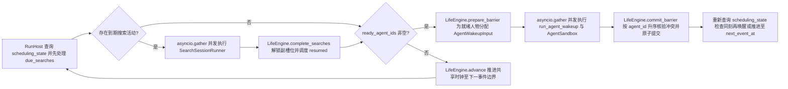
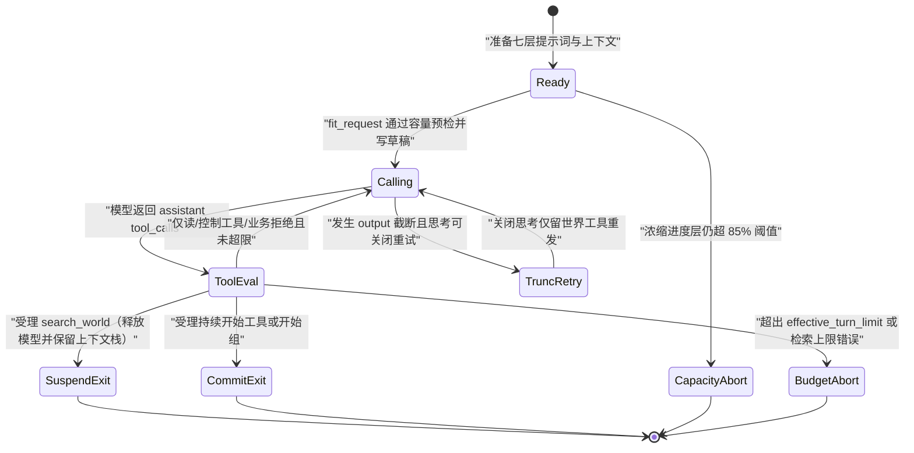
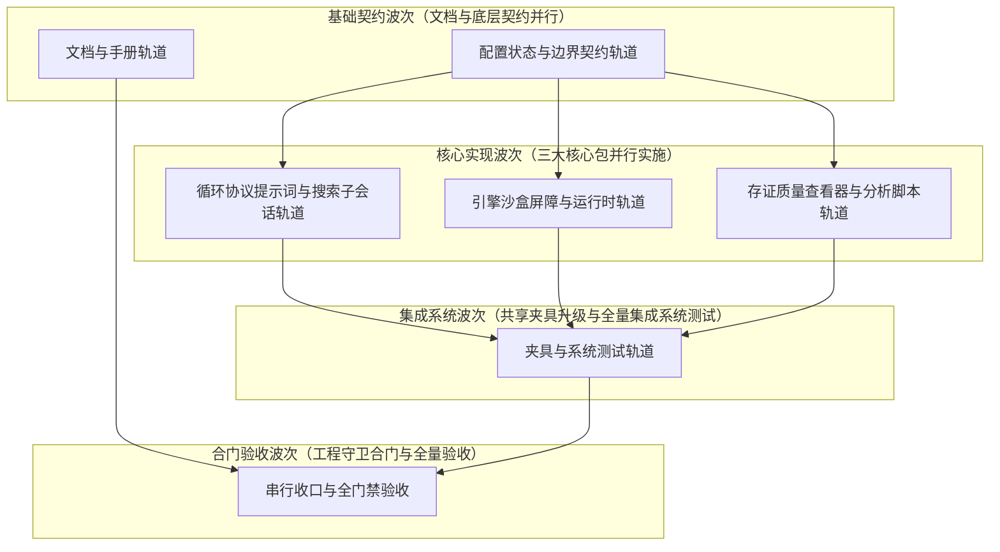

# 模拟引擎主活动循环重构与多 LLM 搜索子会话工程规格说明

> 上游提案：[PROPOSAL.md](PROPOSAL.md)
> 工程守则：[AGENTS.md](../../../AGENTS.md)
> 基线提交：`6440605a`
> 文档状态：冻结规格（供多轨道并行实施与验收合门使用）

## 架构总览与核心不变量

本规格严格执行 [PROPOSAL.md](PROPOSAL.md) 建立的**「全局确定性时钟屏障 + 人物级沙盒 `AgentLoop` + 无栈挂起恢复」**三层架构，全面替换现行批处理决策轮外壳与静态商品查询机制。所有实施须遵守以下刚性不变量：

- **零向后兼容**：不保留旧格式分支、双写逻辑、降级开关或历史兼容别名；过时模块、字段与测试随本批改造一并删除。
- **概念命名全流程一致**：统一使用**七层**（系统层、人设层、记忆层、待办层、工具层、环境层、进度层）、**主槽位**与**副槽位**、**唤醒会话**（以 `wakeup_id` 标识）、**运行查看器**、**LLM Search Session**、**Fact Guard**；文档、提示词、事件字段与测试禁止混用退场概念或缩写。
- **确定性并发隔离**：就绪人物的模型推理与搜索子会话通过 `asyncio.gather` 并发执行网络请求；所有模拟状态修改与事件草稿仅存在于个人内存沙盒（`AgentSandbox`）与 `EvidenceBuffer`，待屏障关闭后由 `LifeEngine` 主线程在单次事务中按人物身份升序确定性提交。
- **异常边界统一**：协议违反与回合预算耗尽统一抛出 `ProtocolError`（继承自 `WorldMockError(RuntimeError)`，见 [errors.py](../../../src/worldmock/foundation/errors.py)），主活动循环 `TURNS_EXHAUSTED` 与搜索子会话 `"Search session turn budget exhausted"` 均属此类。

### 冻结版本常数总表

| 版本常数或字段 | 所属模块与位置 | 基线版本 | 升级版本 | 升版触发原因 |
| --- | --- | --- | --- | --- |
| `RULES_VERSION` | [constants.py](../../../src/worldmock/exchange_engine/definitions/constants.py) | `6` | `7` | `ActivityKind.SEARCH`、双维模型路由与单唤醒契约变更 |
| `CatalogManifest.format_version` | [models.py](../../../src/worldmock/resource_engine/catalog/models.py) | `Literal[6]` | `Literal[7]` | 目录绑定规则随搜索活动与多人环境契约同步升号 |
| `PersonaConfig.schema_version` | [models.py](../../../src/worldmock/configuration/inputs/models.py) | `Literal[2]` | `Literal[3]` | 人物声明目录迁至多文件 `personas/*.toml` 并绑定多数字人规则 |
| `RunConfig.schema_version` | [models.py](../../../src/worldmock/configuration/inputs/models.py) | `Literal[2]` | `Literal[3]` | `models` 字典表、`model_routing` 与 `agent_overrides` 取代单一 `model` |
| `WORLD_SCHEMA_VERSION` | [world.py](../../../src/worldmock/state/world/world.py) | `16` | `17` | 多人物集合、`persona_sha256s`、N+1 资金账户、`suspended_loop`、`origin_wakeup_id`、删去 `same_moment` 与 `same_second_continuation` |
| `RUN_MANIFEST_SCHEMA_VERSION` | [identity.py](../../../src/worldmock/state/identity.py) | `7` | `8` | `agent_ids`、`persona_sha256s`、多配置段 `ModelIdentity` 取代 `stage_model_identity` |
| `EXPORT_SCHEMA_VERSION` | [export.py](../../../src/worldmock/recording_engine/export/export.py) | `8` | `9` | 导出事件采用 `wakeup_id`、`activity_id` 与多人物冻结输入清单 |
| `build_quality_report` `schema_version` | [quality.py](../../../src/worldmock/recording_engine/reports/quality.py) | `10` | `11` | `decision_rhythm` 去除同刻轮分布、新增 `search_session` 调用统计与 `wakeup_id` 口径 |

## 现行机制退场与保留清单

| 类别 | 目标对象与位置 | 处置方式 | 替代归宿或理由 |
| --- | --- | --- | --- |
| 排队逆向续接模块 | [continuation.py](../../../src/worldmock/simulation_engine/decisions/continuation.py) | 彻底删除 | 由唤醒会话内存 `messages` 承载连续多回合上下文 |
| 排队协调器 | [decision_coordinator.py](../../../src/worldmock/simulation_engine/decisions/decision_coordinator.py) | 彻底删除 | 拆分为 [sandbox.py](../../../src/worldmock/simulation_engine/decisions/sandbox.py) 与 [merger.py](../../../src/worldmock/simulation_engine/decisions/merger.py) |
| 延迟决策开始登记 | [decision_start.py](../../../src/worldmock/simulation_engine/decisions/decision_start.py) | 彻底删除 | 由 `AgentSandbox` / `LifeEngine.commit_barrier` 直接按 `wakeup_id` 写出 `decision_started` |
| 只读查询端点 | [read_query.py](../../../src/worldmock/simulation_engine/decisions/read_query.py) | 彻底删除 | 只读工具直接在沙盒或只读 SQLite 连接上执行 |
| 同刻阶梯状态机 | [same_moment.py](../../../src/worldmock/simulation_engine/decisions/same_moment.py) | 彻底删除 | 业务拒绝直接回传当前 `AgentLoop` 纠偏，以 `max_react_turns` 兜底 |
| 静态查询与固定截断 | [query_activity.py](../../../src/worldmock/simulation_engine/activities/query/query_activity.py)、[query_answer.py](../../../src/worldmock/simulation_engine/activities/query/query_answer.py) | 彻底删除（移除空目录） | 由 `search_world` 原生工具与 `activities/search/` 目录代替 |
| 旧循环与续接拼装 | [react_loop.py](../../../src/worldmock/agents/protocol/react_loop.py)、[life_continuation.py](../../../src/worldmock/agents/protocol/life_continuation.py) | 彻底删除 | 由通用 [agent_loop.py](../../../src/worldmock/agents/protocol/agent_loop.py) 代替 |
| 退役状态与模型类 | `DecisionContext`、`DirectToolCall`、`PendingAction`、`DecisionRoundState`、`ActionReceipt`、`SameMomentPresentation`、`ModelConfig`、`ReadQueryRequest` | 彻底删除 | 由 `AgentWakeupInput`、`SandboxOutcome`、`ModelProfileConfig`、`SearchWorldRequest` 与 `wakeup_id` 代替 |
| 退役字段与命令参数 | `same_moment_rounds`、`same_moment_stage`、`same_second_continuation`、`stage_model_identity`、`round_id`、`round_order`、`decision_id`、`origin_decision_id`、`decision_commits`、`--same-second-continuation`、`inspect_run continuation` | 彻底删除 | 统一改为 `suspended_loop`、`wakeup_id`、`origin_wakeup_id`、`wakeup_commits`、`ModelIdentity` |
| 明确保留的调度与存证结构 | [round.py](../../../src/worldmock/state/decisions/round.py) 中的 `SchedulingState`、[state.py](../../../src/worldmock/state/decisions/state.py) 中的 `StoredAction`（移除 `receipt` 字段）、[session_bounds.py](../../../src/worldmock/recording_engine/projections/activities/session_bounds.py) | 精简保留 | `SchedulingState` 为 `LifeEngine.scheduling_state()` 返回模型；`StoredAction` 为 `WorldState.processed_actions` 必需类型；`session_bounds.py` 专供 `progress_layer._finished_searches` 计算 `session_lower` |
| 明确保留的引擎推进入口 | [engine.py](../../../src/worldmock/simulation_engine/engine.py) 中的 `LifeEngine.advance` | 保留原名，移除 `round_open` 入参 | 满足工程边界验收，职责维持离散边界推进至目标时刻 |

## 多人物环境输入与双维异构模型路由契约

### 环境目录 Admission 与错误码闭集

环境包根目录下允许的文件与目录形成严格闭集：`{"catalog", "personas", "config.toml"}`。

- [admission.py](../../../src/worldmock/resource_engine/registration/admission.py) 中的 `validate_environment_entries(root)` 核验根目录及 `personas/` 子目录：根目录存在残留 `persona.toml` 或任何未知文件或目录，或 `personas/` 内出现非 `.toml` 文件或子目录时，抛出 `RegistrationError("ENVIRONMENT_STALE_FILE", str(entry))`；根目录、`catalog`、`personas` 或 `personas/` 内任意文件为符号链接时，抛出 `RegistrationError("ENVIRONMENT_IDENTITY_MISMATCH", str(path))`。
- [environment.py](../../../src/worldmock/configuration/inputs/environment.py) 中的 `parse_personas_dir(personas_dir)` 按 ASCII 文件名升序扫描 `personas/*.toml`：若 `personas/` 缺失或不含 `.toml` 文件，抛出 `EnvironmentInputError("personas", "PERSONA_INVALID", "Environment package requires at least one persona file under personas/")`；逐文件校验 UTF-8 无 BOM、仅 LF 换行、TOML 语法、拒绝旧模板字段、`PersonaConfig` 严格模型校验与 600 汉字预算，任一失败抛出 `EnvironmentInputError(f"personas/{path.name}", "PERSONA_INVALID", reason)`，其中 `_persona_reason` 对未知字段提示由 `is not a persona.toml field` 更新为 `is not a persona field`。
- 全局唯一性校验：任意两个人物存在重复 `agent_id` 或去除首尾空白后重名（`name.strip()`）时，在后者对应的文件条目上抛出 `EnvironmentInputError(f"personas/{path.name}", "PERSONA_INVALID", ...)`。最终按 `agent_id` 升序组装元组。
- `_resolve_personas_locations` 对每位人物独立解析居住地、初始地与工作地，沿用原有错误码 `HOME_LOCATION_REQUIRED`、`HOME_NOT_SLEEPABLE`、`ENVIRONMENT_REF_UNKNOWN`。
- `RunConfig` 解析、`ModelProfileConfig` 校验、`agent_overrides` 引用的人物编号不存在于已加载人物集合、或 `load_model_metadata` 远端/本地元数据核验失败，均抛出 `EnvironmentInputError("config.toml", "RUN_CONFIG_INVALID", reason)`。`_config_reason` 更新字段路径匹配规则，精确识别 `("models", profile_id, "context_window")` 报错。

### RunConfig、ModelProfileConfig 与 ModelRoutingConfig 完整契约

在 [models.py](../../../src/worldmock/configuration/inputs/models.py) 中继续继承 `InputModel`（`ConfigDict(extra="forbid", frozen=True, strict=True)`）。所有现有 `RunConfig` 顶层运行字段与校验规则保持不变，仅将 `model: ModelConfig` 替换为非空配置段字典 `models: dict[str, ModelProfileConfig]` 与路由表 `model_routing: ModelRoutingConfig`。由于 Python 标准库 `tomllib` 解析 TOML 表键一律返回 `str` 且 `InputModel` 开启了 `strict=True`，`agent_overrides` 必须以规范正整数字符串为键。

| 模型类 | 字段名 | 精确类型与约束 | 默认值或说明 |
| --- | --- | --- | --- |
| `PersonaConfig` | `schema_version` | `Literal[3]` | 其余全部字段保持与现行人物表一致，无缺省回退 |
| `ModelProfileConfig` | `provider` | `Literal["openai_compatible"]` | 与模型客户端隔离边界一致 |
| `ModelProfileConfig` | `base_url` | `str = Field(min_length=1)` | OpenAI 兼容服务端点 |
| `ModelProfileConfig` | `requested_model` | `str = Field(min_length=1, pattern=r"\S")` | 向模型端发送的模型标识符 |
| `ModelProfileConfig` | `api_key_env` | `str = Field(pattern=r"^[A-Za-z_][A-Za-z0-9_]*$")` | 凭据环境变量名，运行清单不落盘其值 |
| `ModelProfileConfig` | `metadata_url` | `str = Field(min_length=1)` | 实测元数据服务地址 |
| `ModelProfileConfig` | `context_window` | `int = Field(ge=262144)` | 最小 262144 token |
| `ModelProfileConfig` | `thinking` | `bool`（strict 布尔） | 控制是否下发 `thinking` 参数及检验思考内容 |
| `ModelProfileConfig` | `max_output_tokens` | `int = Field(gt=0)` | 模型档最大输出 token 上限 |
| `ModelProfileConfig` | `max_retries` | `int = Field(default=0, ge=0, le=10)` | 业务客户端内部重试次数 |
| `ModelProfileConfig` | `transport_max_retries` | `int = Field(default=3, ge=0, le=10)` | HTTP 传输层重试次数 |
| `ModelProfileConfig` | `max_react_turns` | `int = Field(default=16, ge=1, le=64)` | 单次唤醒或单次搜索子会话最大模型回合预算 |
| `ModelProfileConfig` | `reflection_validation_max_retries` | `int = Field(default=3, ge=0, le=5)` | 回顾整理格式校验重试上限 |
| `ModelProfileConfig` | `day_plan_validation_max_retries` | `int = Field(default=3, ge=0, le=5)` | 零点日计划格式校验重试上限 |
| `ModelStageOverride` | `action`、`search`、`plan_day`、`digest` | 各为 `str \| None = None` | 至少提供一个非空配置段名称，非空白校验 |
| `ModelRoutingConfig` | `action`、`search`、`plan_day`、`digest` | 各为非空白 `str` | 四阶段默认模型档名称 |
| `ModelRoutingConfig` | `agent_overrides` | `dict[str, ModelStageOverride] = Field(default_factory=dict)` | 键必须为规范正整数字符串，如 `"2"`，校验 `key.isascii() and key.isdigit() and int(key) > 0 and str(int(key)) == key` |
| `RunConfig` | 全部现有运行字段 | `schema_version: Literal[3]`、`seed: int`、`timezone: str`、`start_time: datetime`、`stop_time: datetime`、`activity_feedback_seconds: int`、`reconsideration_interval_seconds: int = 5400`、`progress_report_interval_seconds: int = 1800`、`candidate_presentation_limit: int = 20`、`rotation_quota_ratio: float = 0.15`、`rotation_stale_seconds: int`、`calendar: CalendarConfig` | 原字段名称、含义与校验全部冻结保留 |
| `RunConfig` | `models` | `dict[str, ModelProfileConfig]` | 至少一个配置段，键非空白；配置器检查 `model_routing` 与 `agent_overrides` 引用全部存在 |
| `RunConfig` | `model_routing` | `ModelRoutingConfig` | 四维阶段路由器 |

标准多模型 `config.toml` 示例（`schema_version = 3`）：

```toml
schema_version = 3
seed = 7
timezone = "Asia/Shanghai"
start_time = 2026-01-05T08:00:00+08:00
stop_time = 2026-01-06T08:00:00+08:00
activity_feedback_seconds = 900
reconsideration_interval_seconds = 5400
progress_report_interval_seconds = 1800
candidate_presentation_limit = 20
rotation_quota_ratio = 0.15
rotation_stale_seconds = 86400

[calendar]
spring_festival_dates = ["2026-02-17"]
makeup_work_dates = ["2026-02-14"]
overtime_opportunity_dates = ["2026-01-10"]
sick_leave_date = "2026-01-12"
personal_leave_date = "2026-01-13"
social_dinner_date = "2026-01-16"

[models.reasoner]
provider = "openai_compatible"
base_url = "https://api.deepseek.com/v1"
requested_model = "deepseek-reasoner"
api_key_env = "WORLDMOCK_API_KEY"
metadata_url = "https://api.deepseek.com/v1/models"
context_window = 262144
thinking = true
max_output_tokens = 8192
max_react_turns = 16
reflection_validation_max_retries = 3
day_plan_validation_max_retries = 3

[models.fast_search]
provider = "openai_compatible"
base_url = "https://api.deepseek.com/v1"
requested_model = "deepseek-chat"
api_key_env = "WORLDMOCK_API_KEY"
metadata_url = "https://api.deepseek.com/v1/models"
context_window = 262144
thinking = false
max_output_tokens = 4096
max_react_turns = 6

[model_routing]
action = "reasoner"
search = "fast_search"
plan_day = "reasoner"
digest = "fast_search"

[model_routing.agent_overrides."2"]
action = "fast_search"
```

### EnvironmentInputs 完整不可变契约

`@dataclass(frozen=True) class EnvironmentInputs` 对外暴露以下十三项只读字段，所有映射均以 `MappingProxyType` 包装，有序人物列表使用 `tuple`：

| 字段名 | 类型 | 语义说明 |
| --- | --- | --- |
| `root` | `Path` | 环境包根目录 |
| `catalog` | `Catalog` | 严格解析的不可变目录 |
| `personas` | `tuple[PersonaConfig, ...]` | 按 `agent_id` 升序排列的人物声明集合 |
| `persona_by_id` | `Mapping[int, PersonaConfig]` | `agent_id` 到 `PersonaConfig` 的只读映射 |
| `persona_paths` | `Mapping[int, str]` | `agent_id` 到相对路径 `"personas/<filename>.toml"` 的只读映射 |
| `persona_tomls` | `Mapping[int, str]` | `agent_id` 到原始 TOML 文本的只读映射 |
| `persona_sha256s` | `Mapping[int, str]` | `agent_id` 到原字节 SHA-256 的只读映射 |
| `config` | `RunConfig` | 已校验运行配置 |
| `config_sha256` | `str` | `config.toml` 原字节 SHA-256 |
| `model_metadata` | `Mapping[str, ModelMetadata]` | 配置段名称到已核验 `ModelMetadata` 的只读映射 |
| `home_location_ids` | `Mapping[int, str]` | `agent_id` 到居住地 `location_id` 的只读映射 |
| `initial_location_ids` | `Mapping[int, str]` | `agent_id` 到初始所在地点 `location_id` 的只读映射 |
| `workplace_location_ids` | `Mapping[int, str \| None]` | `agent_id` 到工作地点 `location_id`（无班次安排则为 `None`）的只读映射 |

### ModelRegistry 与清单身份契约

新建 [model_registry.py](../../../src/worldmock/configuration/model/model_registry.py)，严格保持底层 `model_metadata.py` 在导入图基础层的纯净性，并将外部推理依赖隔离在 `model_client.py` 之内：

- **公共类型**：`ModelStage = Literal["action", "search", "plan_day", "digest"]`。
- **`@dataclass(frozen=True, slots=True) class ResolvedModelBinding`**：包含字段 `profile_id: str`、`profile: ModelProfileConfig`、`metadata: ModelMetadata`、`client: ModelClient`、`effective_max_tokens: int`（按 `min(profile.max_output_tokens, metadata.max_output_tokens)` 计算，作为发送请求的 `max_tokens` 输出预留并供 `fit_request` 校验）。
- **连接池共享**：`ModelRegistry` 内部按 `(profile.base_url, profile.api_key_env, profile.max_retries, profile.transport_max_retries)` 复用同一个 `ModelClient` 连接池；不同模型名称若共享相同网关与凭据环境变量则共用客户端连接；提供 `resolve(self, stage: ModelStage, agent_id: int | None = None) -> ResolvedModelBinding` 与 `async def close(self) -> None` 统一关闭全部连接池。
- **零点调用适配器（[midnight.py](../../../src/worldmock/runtime/lifecycle/midnight.py)）**：`PlanDayClient` 与 `MemoryDigestClient` 废弃单一 `client` 与 `manifest["stage_model_identity"]`，改为接收 `ModelRegistry`（或按人物调用 `registry.resolve("plan_day" | "digest", agent_id)`）。每次请求从 `binding` 读取 `profile.requested_model`、`binding.effective_max_tokens`、`binding.metadata`、按 `binding.profile.thinking` 构造 `extra_body={"thinking": {"type": "enabled" if binding.profile.thinking else "disabled"}}`，并分别使用 `binding.profile.day_plan_validation_max_retries` 与 `binding.profile.reflection_validation_max_retries` 控制校验重试上限。
- **清单与世界身份模型（[identity.py](../../../src/worldmock/state/identity.py)，`RUN_MANIFEST_SCHEMA_VERSION = 8`）**：
  - `StageProfileIdentity(FrozenModel)`：`provider`、`base_url`、`requested_model`、`metadata_url`、`context_window`、`thinking`、`max_output_tokens`、`max_retries`、`transport_max_retries`、`max_react_turns`、`reflection_validation_max_retries`、`day_plan_validation_max_retries`、`model_metadata: ModelMetadata`、`effective_max_tokens: int`（明确不含凭据值与凭据环境变量的泄漏；如需可复现检查可只保留 `api_key_env` 非值名称，但凭据值严禁落盘；按现有规则清单不记录 `api_key_env` 亦完全干净）。
  - `ModelIdentity(FrozenModel)`：`profiles: dict[str, StageProfileIdentity]`（仅含被 `model_routing` 实际引用的配置段名称）、`routing: dict[str, Any]`（冻结 `action`、`search`、`plan_day`、`digest`、`agent_overrides`）、`prompt_sha256s: dict[str, str]`（`{"action": life_prompt_sha256(), "search": search_prompt_sha256()}`）、`tool_schema_sha256s: dict[str, str]`（`{"action": life_tool_schema_sha256(), "search": search_tool_schema_sha256()}`）。
  - `RunIdentity(FrozenModel)`：`run_id`、`source_group_id`、`agent_ids: tuple[int, ...]`、`persona_sha256s: dict[int, str]`（经 `FrozenModel` 非 strict 反序列化时校验所有键均为正整数、值均为 SHA-256）、`start_at`、`end_at`、`timezone`、`code_sha256`、`model_identity: ModelIdentity`、`git_commit`、`git_dirty`。

### 多数字人全链路单人假设解除清单

除 `WorldState`（解除 `len(self.agents) != 1` 限制，要求 `len(self.agents) >= 1`、`persona_sha256s: dict[int, str]`）、`EngineContext` 与 N+1 资金账户（`external:scenario` 加上所有 `agent:{agent_id}`，[ledger.py](../../../src/worldmock/recording_engine/validation/ledger.py) 从 `len(accounts) != 2` 改为检查 `external:scenario` 存在且至少一个 `agent:{agent_id}` 账户全部非负整数）外，以下既有单人阻塞点必须同步按 `agent_id` 索引或遍历完成改造：

| 模块与文件 | 现行单人绑定问题 | 多数字人改造规范 |
| --- | --- | --- |
| [context.py](../../../src/worldmock/simulation_engine/world/context.py) | `EngineContext.persona` 与 `EngineContext.body` 为单对象，`context.body` 仅按单个 `persona.body.mass_kg` 组装 | 改为 `personas: Mapping[int, PersonaConfig]` 与 `bodies: Mapping[int, BodyConfig]`，在初始化时为每位 `agent_id` 构造独立 `BodyConfig` |
| [body_config.py](../../../src/worldmock/simulation_engine/body/body_config.py) | 组装入口读取 `inputs.persona.body.mass_kg` | `assemble_body_config(persona: PersonaConfig) -> BodyConfig` 与 `assemble_bodies(inputs: EnvironmentInputs) -> Mapping[int, BodyConfig]` |
| [receipt.py](../../../src/worldmock/simulation_engine/commerce/fulfillment/receipt.py) | 自提或配送结算直接传 `self.context.body` | 改为 `self.context.bodies[order.agent_id]` |
| [interact.py](../../../src/worldmock/simulation_engine/activities/content/interact.py) | 互动结算读取 `self.context.body` | 改为 `self.context.bodies[agent.agent_id]` |
| [start_group.py](../../../src/worldmock/simulation_engine/actions/start_group.py) | 读取 `self.context.persona` 与 `self.context.body` | 改为 `self.context.personas[pending.agent_id]` 与 `self.context.bodies[pending.agent_id]` |
| [observe.py](../../../src/worldmock/simulation_engine/observation/layers/observe.py) | 构造观察时读 `context.persona`、`context.body`、`inputs.home_location_id` | 按入参 `agent_id` 读取 `personas[agent_id]`、`bodies[agent_id]` 与 `inputs.home_location_ids[agent_id]` |
| [purchase_offers.py](../../../src/worldmock/simulation_engine/commerce/purchase/purchase_offers.py) | `courier_offer` 与选店逻辑直接读取单个 `inputs.home_location_id` | 签名显式增加 `agent_id: int` 并读取 `inputs.home_location_ids[agent_id]` |
| [rhythm.py](../../../src/worldmock/simulation_engine/scheduling/clock/rhythm.py) | `meal_windows_by_agent` 读取单一人物，身体结算传 `self.context.body` | `meal_windows_by_agent(personas: Iterable[PersonaConfig])` 映射全员作息窗口，边界计算读取 `self.context.bodies[agent_id]` |
| [time_advance.py](../../../src/worldmock/simulation_engine/scheduling/clock/time_advance.py) | `_run_stop` 取 `self.context.persona.agent_id`，`_body_boundary_at` 取 `self.context.body` 与单个 `meal_windows_by_agent(self.context.persona)` | `_run_stop` 遍历 `sorted(state.agents)` 为全员依次发射 `run_stop` 时间事件与回调；`_body_boundary_at` 取 `self.context.bodies[agent_id]` 与 `self.context.personas.values()` |
| [world_setup.py](../../../src/worldmock/simulation_engine/world/world_setup.py) & [run_identity.py](../../../src/worldmock/simulation_engine/world/run_identity.py) & [frozen_environment.py](../../../src/worldmock/recording_engine/validation/frozen_environment.py) | `_freeze_environment` 硬编码 `"persona.toml"`，`create_world` 只创建一名人物和单人账本 | 按 ASCII 序冻结 `personas/*.toml` 并对齐运行清单 `persona_sha256s`；为所有 `inputs.personas` 初始化 `AgentState`（`location_id = inputs.initial_location_ids[pid]`）与 N+1 资金账本 |
| [compile.py](../../../src/worldmock/simulation_engine/scheduling/clock/compile.py)、[duty_edges.py](../../../src/worldmock/simulation_engine/scheduling/clock/duty_edges.py)、[day_plan_inputs.py](../../../src/worldmock/simulation_engine/scheduling/plans/day_plan_inputs.py)、[admission.py](../../../src/worldmock/simulation_engine/actions/admission.py)、[name_resolution.py](../../../src/worldmock/simulation_engine/actions/name_resolution.py)、[environment_layer.py](../../../src/worldmock/simulation_engine/observation/layers/environment_layer.py)、[memory_layer.py](../../../src/worldmock/simulation_engine/observation/layers/memory_layer.py) | 各处引用 `inputs.persona`、`context.persona`、`inputs.home_location_id` | 统一按 `agent_id` 索引 `persona_by_id` / `context.personas` / `home_location_ids` / `workplace_location_ids` |
| [categories.py](../../../src/worldmock/simulation_engine/observation/memory/categories.py) & [workday.py](../../../tools/analysis/behavior/workday.py) & [memory_categories.py](../../../tools/analysis/memory_categories.py) | 读取单人 `workplace_location_id` 与 `inputs.persona` | `category_book(inputs, agent_id)` 按指定 `agent_id` 读取居住地与工作地；`workday_inputs(inputs)` 遍历全员 `inputs.personas`；`memory_categories` CLI 支持按人物参数 `--agent`（默认首位人物或全员校验）并以 `ModelProfileConfig` 构造离线元数据 |

## 全局时钟屏障、人物沙盒、门面与运行时编排



### 跨轨道边界冻结数据结构

全部跨模块边界数据传输对象统一定义于 [barrier.py](../../../src/worldmock/state/decisions/barrier.py)（属基础状态包，确保循环模块、模拟引擎、运行宿主与记录引擎之间零非法反向导入）：

| 模型类名 | 核心字段与精确类型 | 语义归属 |
| --- | --- | --- |
| `SuspendedLoopState` | `wakeup_id: str`、`action_id: str`、`activity_id: str`、`pending_tool_call_id: str`、`messages: tuple[dict[str, Any], ...]`、`turn_used: int`、`memory_search_count: int`、`accepted_action_ids: tuple[str, ...]`、`pending_memories: tuple[dict[str, Any], ...]`、`verified_experiences: tuple[dict[str, Any], ...]`、`local_rejection_counts: dict[str, int]`、`observation_event_id: str`、`observation_parts: dict[str, str]`、`suspended_at: int`、`base_layers: tuple[dict[str, Any], ...]` | 保存在 `AgentState.suspended_loop` 中供无栈挂起恢复使用 |
| `AgentWakeupInput` | `wakeup_id: str`、`agent_id: int`、`observed_at: int`、`world_state_version: int`、`mode: Literal["regular", "resume_search"]`、`observation: dict[str, Any]`、`observation_parts: dict[str, str]`、`pending_presentation: dict[str, int]`、`action_seq_start: int`、`suspended_loop: SuspendedLoopState \| None`、`search_result_payload: dict[str, Any] \| None` | `prepare_barrier` 生成的只读唤醒快照，传给并发唤醒协程 |
| `ToolDispatchResult` | `accepted: bool`、`terminal_exit: bool`、`suspended: bool`、`tool_message_payload: dict[str, Any]`、`pending_memories: tuple[dict[str, Any], ...]` | `AgentSandbox.dispatch_world_tool` 返回给 `AgentLoop` 的工具结果 |
| `SandboxOutcome` | `wakeup_id: str`、`agent_id: int`、`status: Literal["completed", "suspended"]`、`state: WorldState`、`evidence_drafts: tuple[EventDraft, ...]`、`observation_parts: dict[str, str]`、`pending_presentation: dict[str, int]`、`accepted_action_ids: tuple[str, ...]`、`pending_memories: tuple[dict[str, Any], ...]`、`verified_experiences: tuple[dict[str, Any], ...]`、`observation_event_id: str`、`observation_payload: dict[str, Any]`、`memory_evidence: MemoryUpdateEvidence \| None` | 人物唤醒结束或挂起后交由 `BarrierMerger` 核验与合并的完整结果 |
| `SearchTaskSpec` | `action_id: str`、`agent_id: int`、`activity_id: str`、`origin_wakeup_id: str`、`query: str`、`prefer: str \| None`、`scoped_app_id: str \| None`、`current_location_id: str`、`location_name: str`、`opened_at_clock: str`、`local_date: str`、`weather_label: str`、`open_apps: tuple[str, ...]`、`category_overview: dict[str, int]`、`turn_budget: int` | `due_searches` 生成的只读搜索子任务上下文与绑定视图入口 |
| `SearchSessionOutcome` | `action_id: str`、`agent_id: int`、`activity_id: str`、`goods_ids: tuple[str, ...]`、`place_ids: tuple[str, ...]`、`summary: str`、`evidence_drafts: tuple[EventDraft, ...]` | `SearchSessionRunner` 返回的纯 ID 清单、`summary` 与内部模型交互草稿 |
| `SearchCommitReceipt` | `completed_count: int`、`activity_ids: tuple[str, ...]`、`event_seq_last: int` | `complete_searches` 提交回执 |
| `BarrierCommitReceipt` | `committed_agent_ids: tuple[int, ...]`、`conflict_requeued_agent_ids: tuple[int, ...]`、`world_state_version: int`、`event_seq_last: int` | `commit_barrier` 提交回执 |

### LifeEngine 完整门面协议与约束

[engine.py](../../../src/worldmock/simulation_engine/engine.py) 保持模块行数严格不超过 600 行，`LifeEngine.__init__` 实例属性收口为闭集 `{"context", "observations", "actions", "barriers", "clock", "counterfactual"}`。所有公共门面方法均为**同步 `def`**：

| 方法签名 | 门面归属与行为职责 |
| --- | --- |
| `create(cls, inputs, run_dir, identity, model_identity, options=None) -> LifeEngine` | 按多人物 `EnvironmentInputs` 与 `ModelIdentity` v8 创建世界、`N+1` 账本及冻结输入清单 |
| `open(cls, run_dir, expected_identity, model_identity, expected_code_sha256, checkpoint=None) -> LifeEngine` | 校验 v8 运行清单、`persona_sha256s`、v17 世界状态（含 `suspended_loop`）与代码指纹并恢复 |
| `scheduling_state(self) -> SchedulingState` | 返回带时区当前时刻、到期就绪人物（满足 `next_decision_at <= now` 或刚完成搜索待恢复）、下一边界及世界版本 |
| `advance(self, tick: int, target: datetime) -> list[ActionResult]` | 保持原名（移除 `round_open` 参数），检查无就绪决策与到期搜索后推进共享时钟并结算活动与边界事件 |
| `prepare_barrier(self, agent_ids: tuple[int, ...]) -> tuple[AgentWakeupInput, ...]` | 校验 `agent_ids` 严格为当前时刻全部就绪人物，不写库生成每位人物只读 `AgentWakeupInput` 与初始 `decision_started`/`observation` 预编草稿 |
| `commit_barrier(self, outcomes: Sequence[SandboxOutcome]) -> BarrierCommitReceipt` | 委托 `BarrierMerger` 按 `agent_id` 升序核验跨人物资源冲突，无冲突者单事务落盘并更新 `MEMORY.md`，冲突者整分支回滚重置 `next_decision_at = now` |
| `due_searches(self) -> tuple[tuple[SearchTaskSpec, SearchCatalogView], ...]` | 筛选 `ended_at <= current_time` 且 `status == ACTIVE` 的搜索活动，在当前最新已提交世界状态上绑定只读 `SearchCatalogView` |
| `complete_searches(self, outcomes: Sequence[SearchSessionOutcome]) -> SearchCommitReceipt` | 对搜索结果执行 Fact Guard 二次白名单核对并构造 `goods_rows`/`place_rows`；若开始时 `prefer` 为空或未匹配（`data.app_id` 为 `None`），按返回 `goods_rows` 中可下单 `selling_app_id` 众数（平手字典序）或随机流 `search-app:{action_id}` 从可用下单应用归属 `app_use`；将活动转为 `COMPLETED` 并设置 `ended_at = current_time`、`concluded_at = current_time` 立即释放副槽位；写回 `agent.next_decision_at = current_time`、注入搜索结果负载供恢复唤醒并在单事务中写入事件与内部模型交换记录 |
| `record_failed_evidence(self, agent_id: int, wakeup_id: str, drafts: Sequence[EventDraft]) -> None` | 当并发循环发生不可恢复协议或网络故障并中止运行前，补写尚在 `EvidenceBuffer` 的模型证据草稿以保留失败诊断现场 |
| `midnight_rhythm_pending(self) -> dict[str, Any] \| None` | 返回零点节律待办载荷 |
| `decide_midnight_rhythm(self, decision: MidnightRhythmDecision) -> None` | 应用零点作息与跨日身体安排 |
| `register_day_plan(self, agent_id: int, plan: DayPlanSubmission, ...) -> None` | 提交日计划（现有方法保留并按 `agent_id` 隔离） |
| `register_memory_digest(self, agent_id: int, digest: MemoryDigestRecord, ...) -> None` | 提交日/月/年回顾（现有方法保留并按 `agent_id` 隔离） |
| `read_task_summary(self, agent_id: int, request: RecallTaskSummaryRequest) -> dict[str, Any]` | 只读查询当前任务摘要（同步） |
| `search_memory(self, agent_id: int, request: SearchMemoryRequest, cutoff_seq: int \| None = None) -> dict[str, Any]` | 按人物身份与 `cutoff_seq` 上界从只读 SQLite 检索过往条目与回顾（同步） |
| `apply_counterfactual(self, intervention: CounterfactualIntervention) -> CounterfactualReceipt` | 清除全部人物 `suspended_loop = None`（无需 `round_open` 参数），按干预后世界提交新分支 |
| `meal_windows_by_agent(self) -> dict[int, tuple[tuple[float, float], ...]]` | 返回全员餐时窗口 |
| `fail_run(self, reason: str, code: str \| None = None) -> None` | 记录运行故障事件并原子关闭 |
| `checkpoint(self, checkpoint_id: str \| None = None) -> CheckpointRecord` | 生成确定性检查点 |
| `close(self) -> None` | 安全关闭存储连接与文件锁 |

- **`_life_snapshot` 更新**：世界清单与检查点快照统一写出 `persona_sha256s`（替换单一 `persona_sha256`）与全员状态统计。
- **`SameMomentPresentation` 替代与待呈递候选合并**：移除 `SameMomentPresentation`。每次 `prepare_barrier` 将人物当前的 `pending_presentation` 状态连同已呈递计数传入 `AgentWakeupInput`；若 `AgentLoop` 正常退出并在 `SandboxOutcome` 提交成功，则清空本次消费的待呈递并按沙盒最终 `WorldState.presentation_state` 合入；若在副槽位发起 `search_world` 挂起或发生跨人物冲突回滚，则保留原呈现记录至恢复/重试消费，并在 `advance` 推进模拟时间时由时钟统一清理过期待呈递。

### AgentSandbox、BarrierMerger 与 `save_step` 一致性规则

`SandboxHandle` 协议定义于 [engine_handle.py](../../../src/worldmock/agents/protocol/engine_handle.py)（由 `simulation_engine/decisions/sandbox.py` 中的 `AgentSandbox` 实现；`worldmock.agents` 只依赖该抽象协议及 `state/` 下的 DTO）。`AgentSandbox` 在人物唤醒期持有深拷贝沙盒 `WorldState` 与私密 `EvidenceBuffer`：

- **沙盒内零耗时工具结算与 `layer_changes`**：当模型调用控制工具（`conclude_activity`、`pause_activity`、`report_status`、`revise_day_plan`）或发生业务规则拒绝时，`AgentSandbox` 在内存 `EvidenceBuffer` 中依次追加 `action_requested`（带当前 `wakeup_id` 与工具调用产生的 `self_note`）与 `action_result`（或 `action_rejected`，其 `caused_by` 明确指向本组所有 `action_requested.event_id`），在沙盒 `WorldState` 上完成状态变更与身体拒绝脉冲计算，再以纯观察投影函数对比执行前后的观察差量生成 `layer_changes`（包括 `memory.added` 与 `memory.snapshot`），包装为 `{"result": ..., "changes": ..., "events": ...}` 直接写回 `ToolDispatchResult.tool_message_payload` 交还当前 `AgentLoop` 进入下一模型回合。
- **开始动作与唤醒结束**：当模型调用单一持续开始工具或有效开始组（如 `start_side_activity(purchase)` + `start_main_activity`）且沙盒受理成功时，在沙盒更新 `WorldState` 与 `EvidenceBuffer`，返回 `terminal_exit=True`；`AgentLoop` 退出并返回 `SandboxOutcome(status="completed", ...)`。
- **记忆落盘（`save_step`、`MEMORY.md` 与 `memory_updated`）与回滚安全**：`AgentLoop` 运行期间绝不写入工作区 `MEMORY.md`、绝不写 SQLite 也不发射 `memory_updated` 事件；`AgentSandbox` 仅收集待核验经历或已确认经历变化于 `SandboxOutcome.pending_memories` / `verified_experiences` 中。当且仅当 `BarrierMerger.commit_barrier` 完成冲突核验且将该人物列入 `committed_agent_ids`、并在单次 SQLite 原子事务写入全部草稿后，`RunHost` / `BarrierMerger` 才调用 `save_step` 更新该人物工作区 `MEMORY.md` 并在同批次中持久化 `memory_updated`；**一旦人物因 `search_world` 挂起（`status="suspended"`）或因跨人物共享资源冲突被 `BarrierMerger` 整分支回滚，则既不写入 `memory_updated` 也不改动 `MEMORY.md`**，冲突人物仅将 `next_decision_at` 重置为 `current_time`，下一次同刻屏障从最新提交世界重新观察重算。
- **`complete_searches` 与末回合搜索恢复边界**：
  - 搜索子会话完成时，`complete_searches` 将 `ActivityKind.SEARCH` 的 `ended_at` 与 `concluded_at` 同设为 `current_time`（立刻腾空副槽位，确保人物恢复唤醒后可即时使用 `purchase` 等副槽位工具）；若开始时 `data.app_id` 为 `None`（`prefer` 为空或未匹配），按返回 `goods_rows` 中可下单商品所属 `selling_app_id` 的众数（平手按字典序取最小）归属 `app_use`，无众数可归属时通过 `random_stream(random_state, f"search-app:{action_id}")` 从可用范围下单应用确定性抽取；随后将搜索结果的权威投影注入 `suspended_loop` 或恢复载荷，并置 `agent.next_decision_at = current_time`。
  - 当人物当初在主循环最后一回合（`suspended_loop.turn_used >= max_react_turns`）触发 `search_world` 挂起时，恢复进入 `AgentLoop` 若仍死卡 `turn_used < max_react_turns` 将直接误报预算耗尽；因此 `AgentLoop` 对 `mode == "resume_search"` 计算 `effective_turn_limit = max(max_react_turns, suspended_loop.turn_used + 1)`，保证人物恢复后严格获得至少一次额外决策机会；并在剩余预算恰为最后 1 回合时屏蔽只读工具与 `search_world`，引导模型直接提交实体行动结束本轮唤醒。

## 通用 `AgentLoop` 与 LLM Search Session 契约



### `AgentLoop` 复用引擎与 `PromptCapacity` 简并

- [agent_loop.py](../../../src/worldmock/agents/protocol/agent_loop.py)（完整保留原模块文档末尾 Apache-2.0 来源说明，替换已删的 `react_loop.py`）：作为与具体业务彻底解耦的通用模型循环，承担回合预算控制（`effective_turn_limit`）、每轮发送前容量预检、将 `model_request` / `model_response` / 失败记录交由回调写进私密 `EvidenceBuffer`、输出截断时自动关闭思考并收敛工具列表重试、以及参数解析/模式纠偏。所有回合超限统一抛出 `ProtocolError`。
- [prompt_capacity.py](../../../src/worldmock/agents/prompt/prompt_capacity.py)：删除为迁就跨轮续接而引入的第零步前缀丢弃逻辑以及 `ProgressBudget` 中的 `fresh_messages` / `chain_length` 字段；仅保留按实际发送消息序列与模型档 `max_output_tokens` 检查 `85%` 上下文预算，以及超限时折叠连续未受保护进度记录的能力。

### `search_world` 与子会话四个内部工具的严格请求契约

依据 [schema.py](../../../src/worldmock/state/interaction/schema.py) 中的 `deepseek_strict_schema` 规则：全部工具请求类继承 `ToolRequestModel`（`strict=True`），**不得声明字段默认值（`default`）**，**不得使用 JSON Schema 关键词 `minLength`/`maxLength`/`minItems`/`maxItems`/`oneOf`**，且所有属性必须显式出现在 `required` 并关闭 `additionalProperties`。因此可空参数显式写作 `T | None`（无默认 `= None`），全部长度、数组数量上限与值域边界在 `@field_validator` 或 `@model_validator` 中做本地严格校验。

`search_world` 定义于 [requests.py](../../../src/worldmock/state/interaction/requests.py) 中的 `SearchWorldRequest`（接受 `query: str`、`prefer: str | None`，配合通用工具信封 `self_note` 对齐 `START_TOOLS`——严格校验 `1 <= len(query.strip()) <= 200` 与非空白 `prefer: str | None`）。触发后沙盒写下 `ActivityKind.SEARCH`（占用副槽位，时长通过 `random_stream(random_state, f"search-duration:{action_id}").randint(180, 420)` 抽取 180 至 420 整数秒；仅在处于地点停留会话、无待收尾活动、副槽位空闲且无挂起搜索时允许发起）；活动私有载荷中 **`data.app_id` 仅当 `prefer` 为非空且匹配目录中真实存在并开放的下单应用 `app_id` 时填充，否则为 `None`（绝不从所在地点推断或猜测默认 app）**；待 `complete_searches` 完成结算时，若 `data.app_id` 仍为 `None`（`prefer` 为空或未匹配），则按返回 `goods_rows` 中可下单 `selling_app_id` 众数（平手按字典序取最小）或随机流 `random_stream(random_state, f"search-app:{action_id}")` 从当前范围可用下单应用归属 `app_use`。子会话内部产生的每次模型调用与响应，均在事件信封上填写 **`EventDraft.activity_id = search_activity_id`**，并在 `data` 内设置 `purpose = "search_session"`（不向工具描述或提示词泄漏成本信息）。

四个只读与交卷内部工具统一定义在新建模块 [search_requests.py](../../../src/worldmock/state/interaction/search_requests.py)，封装进单入参 Pydantic 请求模型，满足单函数不超过 5 个参数与 `deepseek_strict_schema` 双重要求：

| 工具名与请求类 | 严格入参字段（无默认值） | 本地 `@field_validator` 校验规则 | 返回字段与核心行为（[search_catalog.py](../../../src/worldmock/simulation_engine/activities/search/search_catalog.py)） |
| --- | --- | --- | --- |
| `search_goods` (`SearchGoodsRequest`) | `keywords: list[str]`、`category: str \| None`、`app: str \| None`、`store: str \| None`、`max_price_yuan: float \| None`、`open_only: bool`、`limit: int`、`offset: int` | `keywords` 非空且元素非空白；非空时 `category`/`app`/`store` 含非空白字符；`max_price_yuan` 非 `None` 时 `> 0` 且有限非布尔；`1 <= limit <= 50`；`offset >= 0` | 受 `scoped_app_id` 限定时自动锁死 `app = scoped_app_id`；多关键词按同义 OR 匹配商品名称、描述与标签，返回候选商品基础摘要数组（含 `total`、`items`、`has_more`、`next_offset`，每项含 `goods_id`、`name`、`category`、`unit_hint`、`app_ids`） |
| `inspect_goods_offers` (`InspectGoodsOffersRequest`) | `goods_ids: list[str]` | `1 <= len(goods_ids) <= 20`，元素均为非空白去重字符串；未知或超范围编号直接返回结构化错误列表 | 批量返回每件商品的实时权威报价：`goods_id`、`name`、`price_fen`、`delivery_fee_fen`、`orderable`、`open_now`、`delivery_seconds`、`app_id`、`store_id`、`store_name`、`store_rating`、`available_from`（若在范围内有未开门门店）；全量整数分，绝不用美分或元混写 |
| `search_places` (`SearchPlacesRequest`) | `keywords: list[str]`、`kind: str \| None`、`open_only: bool`、`limit: int`、`offset: int` | `keywords` 至少 1 个非空白词（或 `kind` 非空时允许关键词为空列表？统一要求 `keywords` 或 `kind` 至少提供一个有效过滤条件）；`1 <= limit <= 50`；`offset >= 0` | 在同城可访问地点目录（若受限于特定内容 `scoped_app_id` 或通用城域导航则按域过滤）检索匹配地点，返回 `total`、`items`、`has_more`、`next_offset`，每项包含 `location_id`、`name`、`kind`、`open_now`、`opening_hours`（当日开放时段区间文本列表）、`rating`、`travel_options`、`has_content`、`content_summary` |
| `submit_search_results` (`SubmitSearchResultsRequest`) | `goods_ids: list[str]`、`place_ids: list[str]`、`summary: str` | 全部元素为非空白去重 ID；`len(goods_ids) <= 20`、`len(place_ids) <= 10`；`1 <= len(summary.strip()) <= 300`；允许双列表同时为空（零命中），此时 `summary` 必须明确说明未找到原因；**子会话严禁输出价格、运费、评分、时长或可买状态** | 调用 `SearchCatalogView.validate_submission` 对每个 ID 做 Fact Guard 白名单与 `scoped_app_id` 作用域检查；全部合法即退出子会话并将 `(goods_ids, place_ids, summary)` 返回给 `SearchSessionOutcome` |

子会话回合管理：从模型档读取 `turn_budget = resolved_binding.profile.max_react_turns`（典型配置 `fast_search` 为 `6`）。若预算耗尽前仍未调用且通过 `submit_search_results`，则立即抛出 `ProtocolError("Search session turn budget exhausted")`。严禁构造任何自定义商品/地点数值回传模型类型。

## 唤醒归并、七层提示词、记忆归纳与运行查看器

### `wakeup_id` 全链路统一与 `TodayEntry` 归并规范

`wakeup_id` 的确定性格式冻结为 `f"{run_id}:wake:{current_time}:v{state.version}:a{agent_id}"`。所有事件信封与派生结构按以下契约统一替换 `round_id` / `round_order` / `decision_id` / `origin_decision_id` / `decision_commits`：

- `EventDraft.wakeup_id` 与 `Event.wakeup_id` 替换 `decision_id`。
- `ActivityState.origin_wakeup_id` 替换 `origin_decision_id`。
- `DECISION_STARTED_FIELDS = frozenset({"wakeup_id", "world_state_version", "wake_reasons"})`，对应校验函数 `validate_decision_started` 按此闭集核验。
- `MEMORY_UPDATE_KEYS` 中的 `"decision_id"` 替换为 `"wakeup_id"`，`ModelCallEvidence` 与 `MemoryUpdateEvidence` 中的 `decision_id` 替换为 `wakeup_id`。
- [entries.py](../../../src/worldmock/simulation_engine/observation/memory/entries.py)、[days.py](../../../src/worldmock/simulation_engine/observation/memory/days.py)、[categories.py](../../../src/worldmock/simulation_engine/observation/memory/categories.py) 与 [search.py](../../../src/worldmock/simulation_engine/observation/memory/search.py) 中的 `Decision` / `decision_commits` / `TodayEntry.decision_id` 全面重构为 `WakeupCommit(wakeup_id, occurred_at, commit)` / `wakeup_commits` / `TodayEntry.wakeup_id`：
  - **常规单唤醒提交窗口**：一次正常唤醒内发生的所有零耗时控制动作、业务拒绝、记忆工具与最终持续开始动作共享同一个 `wakeup_id`，对应一条 `TodayEntry`，按该唤醒首次 `action_requested` 发生时间定位，取提交点为区间右闭界 `(lower, commit]`，将所有跨控制轮次的 `self_note` 与控制备忘按出现先后顺序去重聚合。
  - **同日两段式 `search_world` 挂起与恢复归并**：若人物在本地日 `D` 因 `search_world` 挂起完成前段提交（`C_suspend`，含挂起前控制动作及 `search_world` 请求），随后在**同一本地日 `D`** 经 `complete_searches` 与恢复唤醒提交后续动作（`C_resume`），`wakeup_commits` 按 `(wakeup_id, local_date)` 合并两段：时间戳沿用初始唤醒请求时刻，提交界 `commit` 延伸至 `C_resume`，按时间序合并前后两段已结算事实、受理行、被拒行、`self_note` 以及 `「当时查到」`（出自已终结搜索活动权威载荷）。
  - **跨午夜边界处理**：若前段挂起提交发生在本地日 `D`（如 `23:57`），而搜索到期并恢复唤醒发生在次日 `D+1`（如 `00:02`），则按 `(wakeup_id, local_date)` 自然分成两条所属日期条目：日 `D` 仅保留日 `D` 提交窗内的控制动作与已发起 `search_world` 事实并在 `24:00` 接日末结算；日 `D+1` 的 `TodayEntry` 承载完成后的搜索回答与恢复后新决策事实，保障每日边界严格单调不交叉。
  - **搜索条目格式化与类别推导**：以 `_search_line` 取代 `_query_line`，渲染格式为 `"搜索〈query 或 app〉：查到 N 项商品、M 个地点"` 并在展开全文附注 `「当时查到」` 确定性报价与地点区间行（直接源自 Fact Guard 结果）；`search_category` 取代 `query_category`，按命中商品或地点关联的内容/类目归纳至 `饮食`/`工作`/`生活`，零命中时回退检索词类目。

### 进度层、投影视图、提示词与 `narration.py` 更新

- [progress_layer.py](../../../src/worldmock/simulation_engine/observation/layers/progress_layer.py)：以 `_finished_searches` 替换 `_finished_queries`（筛选 `ActivityKind.SEARCH`、`status == ActivityStatus.COMPLETED`、`ended_at >= started_at` 且终态 `action_result.event_seq > session_lower`，保留 [session_bounds.py](../../../src/worldmock/recording_engine/projections/activities/session_bounds.py) 专供此处提取 `session_lower`）；`rejected_today` 改按 `tuple(event.caused_by)` 去重同一批次请求对应的拒绝事件，不再依赖 `decision_id`；`_previous_decision` 更名为 `_previous_wakeup` 并从 `wakeup_commits` 读取上次提交记录；清理 `notice_records` 中过时续接引用。
- [search_projection.py](../../../src/worldmock/simulation_engine/observation/layers/search_projection.py) 与 [result_projection.py](../../../src/worldmock/simulation_engine/observation/layers/result_projection.py)：移除 `kind == "query"` 与 `query_answer` 分支，由 `details["search"] = search_details(snapshot, inputs)` 输出已完成态结构 `{app, scope, goods_rows, place_rows, summary, [omitted]}` 或未完成态 `{app, state: "没有查完"}`，其中 `goods_rows` 与原报价展示字段对齐，`place_rows` 包含 `{name, kind, open_now, today_hours, rating, units, travel_options}`。
- [prompt_schemas.py](../../../src/worldmock/agents/prompt/prompt_schemas.py) 与 [life_prompt.py](../../../src/worldmock/agents/prompt/life_prompt.py) & [narration.py](../../../src/worldmock/agents/prompt/narration.py)：`PROGRESS_LAYER_SCHEMA` 中 `tool_call.tool` 枚举更新为 `[*START_TOOLS, "search_world"]`；`_RESULT_DETAILS` 删除 `"query"` 并定义 `"search": _SEARCH`（含 `_PLACE_ROW`、`_SEARCH_ROW`、`_SEARCH_ANSWERED`）；`life_prompt.py` 更新系统层原文以清晰表述零耗时控制动作即时回传、单次唤醒边界及 `search_world` 挂起恢复语义（严禁残留旧轮次或同秒续接术语）；`narration.py` 的 `FORBIDDEN_OBSERVATION_KEYS` 删除已退役的 `"continuation"`，保留内部禁止泄漏键校验（如 `home_location_id`）。

### 存储、质量报告、分析工具与运行查看器更新

- [store.py](../../../src/worldmock/recording_engine/storage/store.py)：SQLite 存储架构继续使用现有的 `PRAGMA foreign_keys=ON; PRAGMA synchronous=FULL;` 事务模型（所有写库都在屏障提交阶段由 `LifeEngine` 主线程顺序执行，不引入并发写锁或 WAL 假设）。`last_agent_action_request_seq` 查询条件改为不依赖 `thinking` 开关，精确匹配 `json_extract(body,'$.data.purpose') IS NULL AND json_extract(body,'$.data.request.tool_choice')='auto' AND EXISTS (SELECT 1 FROM json_each(body,'$.data.request.tools') WHERE json_extract(value,'$.function.name')='start_main_activity')`；`read_decision_observations` 更名为 `read_wakeup_observations(self, agent_id: int, wakeup_id: str, observed_at: int)`。
- [quality.py](../../../src/worldmock/recording_engine/reports/quality.py) & [errand_metrics.py](../../../src/worldmock/recording_engine/reports/errand_metrics.py)：`build_quality_report` `schema_version` 升至 `11`，`CALL_CLASSES` 纳入 `"search_session"`（在导出统计中单独分列而不污染主决策轮指标），`_decision_rhythm_quality` 删除已退役的 `same_moment_round_counts` 字段并统计 `decision_started` 的 `wakeup_id` 计数；`errand_metrics.conclusion_memories` 从 `(agent_id, decision_id)` 切换为 `(agent_id, wakeup_id)`。
- [metrics.py](../../../tools/analysis/behavior/metrics.py) & [memory_pilot.py](../../../tools/analysis/memory_pilot.py)：`metrics.py` 中 `_decision_model_requests` 明确排除 `purpose == "search_session"`，`_observation_gate` 从 `(agent_id, occurred_at)` 键控切换为 `(agent_id, wakeup_id)` 键控，使同一时刻因冲突或搜索恢复产生的不同唤醒不再混淆；`memory_pilot.py` 全面用 `wakeup_id` 替换 `decision_id` 并适配 `ModelIdentity` v8。
- [inspect_run.py](../../../scripts/inspect_run.py) & 比对脚本：删除过时的 `continuation` 子命令、`continuation_report`、对比失真检查及 `same_moment_rounds` 统计；`cmd_workday` 适配多人物 `persona_sha256s` 与全员工作日报告；`_ACTION_REQUEST` 对齐 `tool_choice='auto'` 判断逻辑；[compare_runs.py](../../../scripts/compare_runs.py)、[compare_complete_days.py](../../../scripts/compare_complete_days.py)、[freeze_rrs_baseline.py](../../../scripts/freeze_rrs_baseline.py) 与 [recorded_response_run.py](../../../scripts/recorded_response_run.py) 同步切换为 `persona_sha256s`、`wakeup_id` 与多模型档标识（其中 `compare_runs.py` 有意保留对历史基线运行清单 `stage_model_identity` 等对比屏蔽键的支持，用于比对历史基线与当前头版）。
- 运行查看器（[run-viewer.html](../../../tools/run-viewer.html)、[run-viewer-index.js](../../../tools/run-viewer-index.js)、[run-viewer-context.js](../../../tools/run-viewer-context.js)、[run-viewer-context-view.js](../../../tools/run-viewer-context-view.js)）：`classify(request, purpose)` 与页面过滤 `stages` 扩充为 `{all, action, search_session, other}`（依据 `purpose === 'search_session'` 识别搜索子会话）；删除 `continuation`、`continuationFor`、`round_order` 与 `same_moment` 展示与 SQL 查询列；SQL 提取列改用 `wakeup_id` 并保留 `activity_id` 归属关联；`ACTION_WORDS` 将 `query` 替换为 `search: '搜索'`。

## 四波次无冲突并行实施与工程门禁规范

本规格按强依赖拓扑划分为四个严格串行推进的波次（基础契约、核心实现、集成系统与合门验收），同波次内各轨道修改集合严格互斥、无通配符重叠、无共享写入夹具冲突：



### 各轨道严格互斥文件清单

**文档与手册轨道**

| 变更动作 | 显式文件路径 | 关键变更要点 |
| --- | --- | --- |
| 修改 | [README.md](../../../README.md)、[docs/INDEX.md](../../../docs/INDEX.md) | 同步多数字人与 `personas/*.toml` 目录结构，更新首页文案与导航链接文本 |
| 修改 | [00-overview.md](../../../docs/design/00-overview.md)、[01-architecture.md](../../../docs/design/01-architecture.md) | 去除 `read_query`/`react_loop`，更新三层协同心智模型与九个源码包的精确职责描述 |
| 修改 | [02-exchange-engine.md](../../../docs/design/02-exchange-engine.md)、[03-resource-engine.md](../../../docs/design/03-resource-engine.md) | 更新 `RULES_VERSION = 7`、`format_version = 7`、`personas/*.toml`、将 `出行、内容与查询` 引用及禁令同步为 `出行、内容与搜索`（含保留锚点 `#声明式回调`） |
| 修改 | [04-simulation-engine.md](../../../docs/design/04-simulation-engine.md)、[05-recording-engine.md](../../../docs/design/05-recording-engine.md) | 重写沙盒与屏障提交流程（保留既有章节显式 `<a name>` 锚点）、`ActivityKind.SEARCH`、v9 导出与 v11 质量报告、`wakeup_id` 取代 `decision_id`/`round_id`、清除 `same_moment` |
| 修改 | [06-agent.md](../../../docs/design/06-agent.md)、[07-evaluation.md](../../../docs/design/07-evaluation.md) | 重写通用 `AgentLoop`、LLM Search Session 与 `Fact Guard`、七层结构（`search_world` 进度层与详情投影）、`wakeup_id` `TodayEntry` 两段归并与跨日、`当时查到`、`search_session` 调用统计与 `(agent_id, wakeup_id)` 门控 |
| 修改 | [08-configuration.md](../../../docs/design/08-configuration.md)、[09-io-formats.md](../../../docs/design/09-io-formats.md)、[10-runtime.md](../../../docs/design/10-runtime.md) | 详述 `personas/*.toml` v3、`RunConfig` v3、`models.*` 与 `model_routing`（清理 `08-configuration.md` 原连续重复锚点行，核验零断链）；在 `09-io-formats.md` 同步 `WORLD_SCHEMA_VERSION = 17`、`RUN_MANIFEST_SCHEMA_VERSION = 8`、`persona_sha256s`、N+1 账本、`suspended_loop`、`ActivityKind.SEARCH`、`ModelIdentity`、`TodayEntry` 与 `当时查到`；在 `10-runtime.md` 更新 `RunHost` 屏障并发循环、`ModelRegistry` 与无 `--same-second-continuation` 启动序列（禁止在章节或手册 Mermaid 图中引入 HTML 标签与未加引号的括号） |
| 修改 | [docs/manual/README.md](../../../docs/manual/README.md)、[personas.md](../../../docs/manual/personas.md)、[resources.md](../../../docs/manual/resources.md)、[rules.md](../../../docs/manual/rules.md)、[runtime.md](../../../docs/manual/runtime.md)、[evaluation.md](../../../docs/manual/evaluation.md) | 全面迁至多文件 `personas/*.toml` 与多数字人说明；`personas.md` 同步更新章节名及所有引用处（保持 `personas-编写-persona-toml` 或全手册原子同步更新并通过 `documentation_gate.py`）；`resources.md` 更新 `RULES_VERSION = 7` 与搜索不可回调规则并移除旧升级说明；`rules.md` 将静态 20 件查询说明替换为 `search_world` 与多人 N+1 账户；`runtime.md` 更新 `search_world` 示例与**运行查看器**章节；`evaluation.md` 更新清单 v8、导出 v9 与质量报告 v11 |

**配置状态与边界契约轨道**

| 变更动作 | 显式文件路径 |
| --- | --- |
| 新建 | [model_registry.py](../../../src/worldmock/configuration/model/model_registry.py)、[barrier.py](../../../src/worldmock/state/decisions/barrier.py)、[search_requests.py](../../../src/worldmock/state/interaction/search_requests.py)、[test_model_registry.py](../../../tests/unit/runtime/test_model_registry.py)、[test_search_requests.py](../../../tests/unit/agent_protocol/test_search_requests.py) |
| 修改生产 | [constants.py](../../../src/worldmock/exchange_engine/definitions/constants.py)、[models.py](../../../src/worldmock/resource_engine/catalog/models.py)、[admission.py](../../../src/worldmock/resource_engine/registration/admission.py)、[models.py](../../../src/worldmock/configuration/inputs/models.py)、[environment.py](../../../src/worldmock/configuration/inputs/environment.py)、[validation.py](../../../src/worldmock/configuration/inputs/validation.py)、[model_metadata.py](../../../src/worldmock/configuration/model/model_metadata.py)、[persona_card.py](../../../src/worldmock/configuration/persona/persona_card.py)、[cli.py](../../../src/worldmock/cli.py)、[identity.py](../../../src/worldmock/state/identity.py)、[world.py](../../../src/worldmock/state/world/world.py)、[agent.py](../../../src/worldmock/state/world/agent.py)、[activity.py](../../../src/worldmock/state/world/activity.py)、[kinds.py](../../../src/worldmock/state/world/kinds.py)、[results.py](../../../src/worldmock/state/decisions/results.py)、[round.py](../../../src/worldmock/state/decisions/round.py)、[state.py](../../../src/worldmock/state/decisions/state.py)、[actions.py](../../../src/worldmock/state/interaction/actions.py)、[requests.py](../../../src/worldmock/state/interaction/requests.py)、[exchange.py](../../../src/worldmock/state/model/exchange.py) |
| 迁移夹具 | 迁移 `tests/fixtures/dataset-environment/persona.toml` 至 `tests/fixtures/dataset-environment/personas/persona_1.toml`（`schema_version = 3`），更新 [config.toml](../../../tests/fixtures/dataset-environment/config.toml)（`schema_version = 3` + `[models.*]` + `[model_routing]`） |
| 修改测试辅助与单元测试 | [frozen_inputs.py](../../../tests/frozen_inputs.py)、[persona_inputs.py](../../../tests/life/persona_inputs.py)、[environment_inputs.py](../../../tests/life/environment_inputs.py)、[prerequisite_inputs.py](../../../tests/life/prerequisite_inputs.py)、[work_schedule_fixtures.py](../../../tests/life/work_schedule_fixtures.py)、[observation_record.py](../../../tests/life/observation_record.py)、[test_environment_inputs.py](../../../tests/unit/test_environment_inputs.py)、[test_input_warnings.py](../../../tests/unit/test_input_warnings.py)、[test_models.py](../../../tests/unit/profile/test_models.py)、[test_environment_boundary.py](../../../tests/unit/catalog/test_environment_boundary.py)、[test_dataset_negative_contract.py](../../../tests/unit/catalog/test_dataset_negative_contract.py)、[test_manifest_version.py](../../../tests/unit/catalog/test_manifest_version.py)、[test_food_states.py](../../../tests/unit/catalog/test_food_states.py)、[test_identity.py](../../../tests/unit/catalog/test_identity.py)、[test_loader.py](../../../tests/unit/catalog/test_loader.py)、[test_location_content_declarations.py](../../../tests/unit/catalog/test_location_content_declarations.py)、[test_memory_category_declarations.py](../../../tests/unit/catalog/test_memory_category_declarations.py)、[test_constants.py](../../../tests/unit/exchange/test_constants.py)、[test_parser.py](../../../tests/unit/cli/test_parser.py)、[test_model_identity.py](../../../tests/unit/runtime/test_model_identity.py)、[test_decision_round_types.py](../../../tests/unit/runtime/test_decision_round_types.py)、[test_start_request_models.py](../../../tests/unit/agent_protocol/test_start_request_models.py) |

**循环协议提示词与搜索子会话轨道**

| 变更动作 | 显式文件路径 |
| --- | --- |
| 新建 | [agent_loop.py](../../../src/worldmock/agents/protocol/agent_loop.py)、`src/worldmock/agents/search/__init__.py`、`src/worldmock/agents/search/search_session.py`、`src/worldmock/agents/search/search_prompt.py`、[test_agent_loop.py](../../../tests/unit/agents/test_agent_loop.py)、[test_search_session.py](../../../tests/unit/agents/test_search_session.py)、[test_search_prompt.py](../../../tests/unit/agent_protocol/test_search_prompt.py) |
| 删除 | [react_loop.py](../../../src/worldmock/agents/protocol/react_loop.py)、[life_continuation.py](../../../src/worldmock/agents/protocol/life_continuation.py) |
| 修改生产 | [engine_handle.py](../../../src/worldmock/agents/protocol/engine_handle.py)、[life_agent.py](../../../src/worldmock/agents/life_agent.py)、[life_prompt.py](../../../src/worldmock/agents/prompt/life_prompt.py)、[prompt_schemas.py](../../../src/worldmock/agents/prompt/prompt_schemas.py)、[prompt_capacity.py](../../../src/worldmock/agents/prompt/prompt_capacity.py)、[narration.py](../../../src/worldmock/agents/prompt/narration.py)、[life_memory.py](../../../src/worldmock/agents/memory/life_memory.py) |
| 修改纯单元测试 | [test_life_memory.py](../../../tests/unit/agents/test_life_memory.py)、[test_life_memory_store.py](../../../tests/unit/agents/test_life_memory_store.py)、[test_truncation_feedback.py](../../../tests/unit/agents/test_truncation_feedback.py)、[test_presentation_habits.py](../../../tests/unit/agent_protocol/test_presentation_habits.py)、[test_request_error_locations.py](../../../tests/unit/agent_protocol/test_request_error_locations.py)、[test_tool_description_references.py](../../../tests/unit/agent_protocol/test_tool_description_references.py)、[test_user_layer_order.py](../../../tests/unit/agent_protocol/test_user_layer_order.py)、[test_narration.py](../../../tests/unit/life/test_narration.py)、[test_batch_shapes.py](../../../tests/unit/start_interfaces/test_batch_shapes.py) |

**引擎沙盒屏障与运行时轨道**

| 变更动作 | 显式文件路径 |
| --- | --- |
| 新建 | [sandbox.py](../../../src/worldmock/simulation_engine/decisions/sandbox.py)、[merger.py](../../../src/worldmock/simulation_engine/decisions/merger.py)、`src/worldmock/simulation_engine/activities/search/__init__.py`、`src/worldmock/simulation_engine/activities/search/search_catalog.py`、`src/worldmock/simulation_engine/activities/search/search_activity.py`、[search_projection.py](../../../src/worldmock/simulation_engine/observation/layers/search_projection.py)、[test_search_rules.py](../../../tests/unit/life/test_search_rules.py)、[test_sandbox_and_merger.py](../../../tests/unit/life/test_sandbox_and_merger.py) |
| 删除 | [continuation.py](../../../src/worldmock/simulation_engine/decisions/continuation.py)、[decision_coordinator.py](../../../src/worldmock/simulation_engine/decisions/decision_coordinator.py)、[decision_start.py](../../../src/worldmock/simulation_engine/decisions/decision_start.py)、[read_query.py](../../../src/worldmock/simulation_engine/decisions/read_query.py)、[same_moment.py](../../../src/worldmock/simulation_engine/decisions/same_moment.py)、[query_activity.py](../../../src/worldmock/simulation_engine/activities/query/query_activity.py)、[query_answer.py](../../../src/worldmock/simulation_engine/activities/query/query_answer.py)、[test_query_rules.py](../../../tests/unit/life/test_query_rules.py) |
| 修改生产 | [engine.py](../../../src/worldmock/simulation_engine/engine.py)、[context.py](../../../src/worldmock/simulation_engine/world/context.py)、[world_setup.py](../../../src/worldmock/simulation_engine/world/world_setup.py)、[run_identity.py](../../../src/worldmock/simulation_engine/world/run_identity.py)、[world_updates.py](../../../src/worldmock/simulation_engine/world/world_updates.py)、[counterfactual.py](../../../src/worldmock/simulation_engine/world/counterfactual.py)、[body_config.py](../../../src/worldmock/simulation_engine/body/body_config.py)、[receipt.py](../../../src/worldmock/simulation_engine/commerce/fulfillment/receipt.py)、[purchase_offers.py](../../../src/worldmock/simulation_engine/commerce/purchase/purchase_offers.py)、[storefront_runtime.py](../../../src/worldmock/simulation_engine/commerce/purchase/storefront_runtime.py)、[admission.py](../../../src/worldmock/simulation_engine/actions/admission.py)、[dispatcher.py](../../../src/worldmock/simulation_engine/actions/dispatcher.py)、[name_resolution.py](../../../src/worldmock/simulation_engine/actions/name_resolution.py)、[start_group.py](../../../src/worldmock/simulation_engine/actions/start_group.py)、[interact.py](../../../src/worldmock/simulation_engine/activities/content/interact.py)、[activities.py](../../../src/worldmock/simulation_engine/activities/lifecycle/activities.py)、[activity_control.py](../../../src/worldmock/simulation_engine/activities/lifecycle/activity_control.py)、[actions.py](../../../src/worldmock/simulation_engine/evidence/actions.py)、[model.py](../../../src/worldmock/simulation_engine/evidence/model.py)、[observe.py](../../../src/worldmock/simulation_engine/observation/layers/observe.py)、[environment_layer.py](../../../src/worldmock/simulation_engine/observation/layers/environment_layer.py)、[memory_layer.py](../../../src/worldmock/simulation_engine/observation/layers/memory_layer.py)、[progress_layer.py](../../../src/worldmock/simulation_engine/observation/layers/progress_layer.py)、[result_projection.py](../../../src/worldmock/simulation_engine/observation/layers/result_projection.py)、[presentation.py](../../../src/worldmock/simulation_engine/observation/targets/presentation.py)、[tool_layer.py](../../../src/worldmock/simulation_engine/observation/targets/tool_layer.py)、[entries.py](../../../src/worldmock/simulation_engine/observation/memory/entries.py)、[days.py](../../../src/worldmock/simulation_engine/observation/memory/days.py)、[categories.py](../../../src/worldmock/simulation_engine/observation/memory/categories.py)、[search.py](../../../src/worldmock/simulation_engine/observation/memory/search.py)、[compile.py](../../../src/worldmock/simulation_engine/scheduling/clock/compile.py)、[duty_edges.py](../../../src/worldmock/simulation_engine/scheduling/clock/duty_edges.py)、[rhythm.py](../../../src/worldmock/simulation_engine/scheduling/clock/rhythm.py)、[time_advance.py](../../../src/worldmock/simulation_engine/scheduling/clock/time_advance.py)、[day_plan_inputs.py](../../../src/worldmock/simulation_engine/scheduling/plans/day_plan_inputs.py)、[errands.py](../../../src/worldmock/simulation_engine/scheduling/plans/errands.py)、[setup.py](../../../src/worldmock/runtime/framework/setup.py)、[midnight.py](../../../src/worldmock/runtime/lifecycle/midnight.py)、[runner.py](../../../src/worldmock/runtime/lifecycle/runner.py)、[run_host.py](../../../src/worldmock/runtime/lifecycle/run_host.py) |
| 修改测试辅助与单元测试 | [conftest.py](../../../tests/life/conftest.py)、[environment_runtime.py](../../../tests/life/environment_runtime.py)、[work_runtime.py](../../../tests/life/work_runtime.py)、[request_fixtures.py](../../../tests/life/request_fixtures.py)、[behaviour_day.py](../../../tests/life/behaviour_day.py)、[current_world.py](../../../tests/life/current_world.py)、[phone_records.py](../../../tests/life/phone_records.py)、[work_arrangement_inputs.py](../../../tests/life/work_arrangement_inputs.py)、[test_activity_boundary_contract.py](../../../tests/unit/life/test_activity_boundary_contract.py)、[test_body_felt_sleep_boundaries.py](../../../tests/unit/life/test_body_felt_sleep_boundaries.py)、[test_completion_effects.py](../../../tests/unit/life/test_completion_effects.py)、[test_content_and_commerce_boundaries.py](../../../tests/unit/life/test_content_and_commerce_boundaries.py)、[test_current_lifecycle_coverage.py](../../../tests/unit/life/test_current_lifecycle_coverage.py)、[test_environment_body.py](../../../tests/unit/life/test_environment_body.py)、[test_environment_commerce.py](../../../tests/unit/life/test_environment_commerce.py)、[test_environment_content.py](../../../tests/unit/life/test_environment_content.py)、[test_environment_contract.py](../../../tests/unit/life/test_environment_contract.py)、[test_environment_contract_gaps.py](../../../tests/unit/life/test_environment_contract_gaps.py)、[test_environment_numerics.py](../../../tests/unit/life/test_environment_numerics.py)、[test_model_evidence_pairing.py](../../../tests/unit/life/test_model_evidence_pairing.py)、[test_navigation_foreground.py](../../../tests/unit/life/test_navigation_foreground.py)、[test_pause_limit.py](../../../tests/unit/life/test_pause_limit.py)、[test_sleep_plan.py](../../../tests/unit/life/test_sleep_plan.py)、[test_today_entry_events.py](../../../tests/unit/life/test_today_entry_events.py)、[test_categories.py](../../../tests/unit/memory/test_categories.py)、[test_days.py](../../../tests/unit/memory/test_days.py)、[test_grocery_units.py](../../../tests/unit/start_interfaces/test_grocery_units.py)、[test_name_resolution.py](../../../tests/unit/start_interfaces/test_name_resolution.py)、[test_run_host_order.py](../../../tests/unit/runtime/test_run_host_order.py)、[test_environment_engine_admission.py](../../../tests/unit/test_environment_engine_admission.py) |

**存证质量查看器与分析脚本轨道**

| 变更动作 | 显式文件路径 |
| --- | --- |
| 新建 | [test_multi_agent_ledger.py](../../../tests/unit/footprints/test_multi_agent_ledger.py) |
| 修改生产与工具脚本 | [models.py](../../../src/worldmock/recording_engine/events/models.py)、[memory_evidence.py](../../../src/worldmock/recording_engine/events/memory_evidence.py)、[store.py](../../../src/worldmock/recording_engine/storage/store.py)、[frozen_environment.py](../../../src/worldmock/recording_engine/validation/frozen_environment.py)、[ledger.py](../../../src/worldmock/recording_engine/validation/ledger.py)、[validation.py](../../../src/worldmock/recording_engine/validation/validation.py)、[app_usage.py](../../../src/worldmock/recording_engine/projections/activities/app_usage.py)、[experiences.py](../../../src/worldmock/recording_engine/projections/activities/experiences.py)、[session_bounds.py](../../../src/worldmock/recording_engine/projections/activities/session_bounds.py)、[export.py](../../../src/worldmock/recording_engine/export/export.py)、[quality.py](../../../src/worldmock/recording_engine/reports/quality.py)、[errand_metrics.py](../../../src/worldmock/recording_engine/reports/errand_metrics.py)、[metrics.py](../../../tools/analysis/behavior/metrics.py)、[workday.py](../../../tools/analysis/behavior/workday.py)、[memory_categories.py](../../../tools/analysis/memory_categories.py)、[memory_pilot.py](../../../tools/analysis/memory_pilot.py)、[run-viewer.html](../../../tools/run-viewer.html)、[run-viewer-index.js](../../../tools/run-viewer-index.js)、[run-viewer-context.js](../../../tools/run-viewer-context.js)、[run-viewer-context-view.js](../../../tools/run-viewer-context-view.js)、[inspect_run.py](../../../scripts/inspect_run.py)、[compare_runs.py](../../../scripts/compare_runs.py)、[compare_complete_days.py](../../../scripts/compare_complete_days.py)、[freeze_rrs_baseline.py](../../../scripts/freeze_rrs_baseline.py)、[recorded_response_run.py](../../../scripts/recorded_response_run.py) |
| 修改测试辅助、纯存证单元及查看器测试 | [display_fixtures.py](../../../tests/footprints/display_fixtures.py)、[prompt_fixtures.py](../../../tests/footprints/prompt_fixtures.py)、[statement_log.py](../../../tests/footprints/statement_log.py)、[test_app_usage.py](../../../tests/unit/footprints/test_app_usage.py)、[test_atomic_replace_retry.py](../../../tests/unit/footprints/test_atomic_replace_retry.py)、[test_checkpoint_storage.py](../../../tests/unit/footprints/test_checkpoint_storage.py)、[test_dataset_negative_contract.py](../../../tests/unit/footprints/test_dataset_negative_contract.py)、[test_display_wording.py](../../../tests/unit/footprints/test_display_wording.py)、[test_environment_contract.py](../../../tests/unit/footprints/test_environment_contract.py)、[test_environment_events.py](../../../tests/unit/footprints/test_environment_events.py)、[test_ledger.py](../../../tests/unit/footprints/test_ledger.py)、[test_observation_parts.py](../../../tests/unit/footprints/test_observation_parts.py)、[test_phone_records.py](../../../tests/unit/footprints/test_phone_records.py)、[test_platform_branches.py](../../../tests/unit/footprints/test_platform_branches.py)、[test_store.py](../../../tests/unit/footprints/test_store.py)、[test_store_commit_path.py](../../../tests/unit/footprints/test_store_commit_path.py)、[test_workspace_snapshot.py](../../../tests/unit/footprints/test_workspace_snapshot.py)、[run_viewer.test.cjs](../../../tests/system/viewer/run_viewer.test.cjs)、[run_viewer_activities.test.cjs](../../../tests/system/viewer/run_viewer_activities.test.cjs)、[run_viewer_context.test.cjs](../../../tests/system/viewer/run_viewer_context.test.cjs)、[run_viewer_files.test.cjs](../../../tests/system/viewer/run_viewer_files.test.cjs)、[run_viewer_harness.cjs](../../../tests/system/viewer/run_viewer_harness.cjs)、[run_viewer_identity.test.cjs](../../../tests/system/viewer/run_viewer_identity.test.cjs)、[run_viewer_wording.test.cjs](../../../tests/system/viewer/run_viewer_wording.test.cjs)、[test_run_viewer.py](../../../tests/system/viewer/test_run_viewer.py) |

**夹具与系统测试轨道**

单人基准夹具 [tests/fixtures/dataset-environment/](../../../tests/fixtures/dataset-environment/) 维持单人身份以校验基线等价性，多数字人系统验证使用独立双人环境夹具目录 `tests/fixtures/multi-agent-environment/`（含 `personas/persona_1.toml`、`personas/persona_2.toml`、独立 `catalog/` 与双维路由 `config.toml`）。

| 变更动作 | 显式文件路径 |
| --- | --- |
| 新建 | `tests/fixtures/multi-agent-environment/config.toml`、`tests/fixtures/multi-agent-environment/personas/persona_1.toml`、`tests/fixtures/multi-agent-environment/personas/persona_2.toml`、`tests/fixtures/multi-agent-environment/catalog/`（目录资产副本）、[test_search_export.py](../../../tests/integration/footprints/test_search_export.py)、[test_search_activity.py](../../../tests/integration/life/test_search_activity.py)、[test_search_answer.py](../../../tests/integration/life/test_search_answer.py)、[test_agent_loop.py](../../../tests/integration/runtime/test_agent_loop.py)、[test_search_session_flow.py](../../../tests/integration/runtime/test_search_session_flow.py)、[test_search_prompt_contract.py](../../../tests/integration/runtime/test_search_prompt_contract.py)、[test_multi_agent_barrier.py](../../../tests/integration/runtime/test_multi_agent_barrier.py)、[test_wakeup_roundtrip.py](../../../tests/integration/runtime/test_wakeup_roundtrip.py)、[test_multi_agent_search_lifecycle.py](../../../tests/system/lifecycle/test_multi_agent_search_lifecycle.py) |
| 删除 | [test_query_export.py](../../../tests/integration/footprints/test_query_export.py)、[test_query_activity.py](../../../tests/integration/life/test_query_activity.py)、[test_query_answer.py](../../../tests/integration/life/test_query_answer.py)、[test_react_loop.py](../../../tests/integration/runtime/test_react_loop.py)、[test_read_query_runtime.py](../../../tests/integration/runtime/test_read_query_runtime.py)、[test_same_second_continuation.py](../../../tests/integration/runtime/test_same_second_continuation.py)、[test_query_host_flow.py](../../../tests/integration/runtime/test_query_host_flow.py)、[test_query_prompt_contract.py](../../../tests/integration/runtime/test_query_prompt_contract.py)、[test_decision_context_roundtrip.py](../../../tests/integration/runtime/test_decision_context_roundtrip.py) |
| 修改共享夹具与基线文件 | [engine_fixture.py](../../../tests/engine_fixture.py)、[dayrun_baseline.py](../../../tests/dayrun_baseline.py)、[dataset_acceptance.py](../../../tests/dataset_acceptance.py)、[committed_world_guard.py](../../../tests/committed_world_guard.py)、[acceptance_guard.py](../../../tests/acceptance_guard.py)、[recording.py](../../../tests/footprints/recording.py)、[day_baseline_runtime.py](../../../tests/life/day_baseline_runtime.py)、[runtime_fixtures.py](../../../tests/integration/runtime_fixtures.py)、[host_run_fixtures.py](../../../tests/integration/host_run_fixtures.py)、[life_host_fixtures.py](../../../tests/integration/life_host_fixtures.py)、[current_contract_fixtures.py](../../../tests/integration/runtime/current_contract_fixtures.py)、[dayrun-activity-baseline.json](../../../tests/fixtures/dayrun-activity-baseline.json)、[dayrun-callback-baseline.json](../../../tests/fixtures/dayrun-callback-baseline.json)、[dayrun_truncations.json](../../../tests/fixtures/dayrun_truncations.json)、[tool_interaction_habits.json](../../../tests/fixtures/tool_interaction_habits.json)、[viewer-context.json](../../../tests/fixtures/viewer-context.json) |
| 修改跨包单元测试 | [test_action_bindings.py](../../../tests/unit/agent_protocol/test_action_bindings.py)、[test_activity_schema.py](../../../tests/unit/agent_protocol/test_activity_schema.py)、[test_decision_context_protocol.py](../../../tests/unit/agent_protocol/test_decision_context_protocol.py)、[test_grounded_targets.py](../../../tests/unit/agent_protocol/test_grounded_targets.py)、[test_prompt_capacity_memory.py](../../../tests/unit/agent_protocol/test_prompt_capacity_memory.py)、[test_search_memory_request.py](../../../tests/unit/agent_protocol/test_search_memory_request.py)、[test_tool_surface.py](../../../tests/unit/agent_protocol/test_tool_surface.py)、[test_life_agent_shape.py](../../../tests/unit/agents/test_life_agent_shape.py)、[memory_pilot_fixtures.py](../../../tests/unit/evaluation/memory_pilot_fixtures.py)、[test_behavior_metrics.py](../../../tests/unit/evaluation/test_behavior_metrics.py)、[test_memory_categories.py](../../../tests/unit/evaluation/test_memory_categories.py)、[test_memory_pilot.py](../../../tests/unit/evaluation/test_memory_pilot.py)、[test_branch_coverage.py](../../../tests/unit/footprints/test_branch_coverage.py)、[test_post_run_view.py](../../../tests/unit/footprints/test_post_run_view.py)、[test_purchases.py](../../../tests/unit/footprints/test_purchases.py)、[test_quality.py](../../../tests/unit/footprints/test_quality.py)、[test_status.py](../../../tests/unit/footprints/test_status.py)、[test_status_liveness.py](../../../tests/unit/footprints/test_status_liveness.py)、[test_counterfactual_rejection_contract.py](../../../tests/unit/life/test_counterfactual_rejection_contract.py)、[test_memory_progress_contract.py](../../../tests/unit/life/test_memory_progress_contract.py)、[test_shared_observation_contract.py](../../../tests/unit/life/test_shared_observation_contract.py) |
| 修改集成与系统测试 | [test_frozen_inputs.py](../../../tests/integration/environment/test_frozen_inputs.py)、[test_input_negative_contract.py](../../../tests/integration/environment/test_input_negative_contract.py)、[test_validation_execution.py](../../../tests/integration/environment/test_validation_execution.py)、[test_errand_metrics.py](../../../tests/integration/evaluation/test_errand_metrics.py)、[test_goal_metrics.py](../../../tests/integration/evaluation/test_goal_metrics.py)、[test_memory_pilot_export.py](../../../tests/integration/evaluation/test_memory_pilot_export.py)、[test_workload_metrics.py](../../../tests/integration/evaluation/test_workload_metrics.py)、[test_acs_export.py](../../../tests/integration/footprints/test_acs_export.py)、[test_acs_invariants.py](../../../tests/integration/footprints/test_acs_invariants.py)、[test_acs_source_guards.py](../../../tests/integration/footprints/test_acs_source_guards.py)、[test_autoplay_export.py](../../../tests/integration/footprints/test_autoplay_export.py)、[test_branch_lineage.py](../../../tests/integration/footprints/test_branch_lineage.py)、[test_dataset_recording.py](../../../tests/integration/footprints/test_dataset_recording.py)、[test_display_names_source.py](../../../tests/integration/footprints/test_display_names_source.py)、[test_errand_export.py](../../../tests/integration/footprints/test_errand_export.py)、[test_event_fields.py](../../../tests/integration/footprints/test_event_fields.py)、[test_export.py](../../../tests/integration/footprints/test_export.py)、[test_export_stream.py](../../../tests/integration/footprints/test_export_stream.py)、[test_goal_export.py](../../../tests/integration/footprints/test_goal_export.py)、[test_grocery_export.py](../../../tests/integration/footprints/test_grocery_export.py)、[test_inspect_current_activity.py](../../../tests/integration/footprints/test_inspect_current_activity.py)、[test_inspect_meal_count.py](../../../tests/integration/footprints/test_inspect_meal_count.py)、[test_inspect_observation_parts.py](../../../tests/integration/footprints/test_inspect_observation_parts.py)、[test_inspect_short_reads.py](../../../tests/integration/footprints/test_inspect_short_reads.py)、[test_location_meal_export.py](../../../tests/integration/footprints/test_location_meal_export.py)、[test_pause_recording.py](../../../tests/integration/footprints/test_pause_recording.py)、[test_phone_record_export.py](../../../tests/integration/footprints/test_phone_record_export.py)、[test_post_run_guard.py](../../../tests/integration/footprints/test_post_run_guard.py)、[test_refusal_export.py](../../../tests/integration/footprints/test_refusal_export.py)、[test_render_day.py](../../../tests/integration/footprints/test_render_day.py)、[test_validation.py](../../../tests/integration/footprints/test_validation.py)、[test_verified_experiences.py](../../../tests/integration/footprints/test_verified_experiences.py)、[test_action_dispatch_contract.py](../../../tests/integration/life/test_action_dispatch_contract.py)、[test_action_identity.py](../../../tests/integration/life/test_action_identity.py)、[test_app_opening.py](../../../tests/integration/life/test_app_opening.py)、[test_autoplay.py](../../../tests/integration/life/test_autoplay.py)、[test_body_mass_runtime.py](../../../tests/integration/life/test_body_mass_runtime.py)、[test_committed_world_guard.py](../../../tests/integration/life/test_committed_world_guard.py)、[test_content_start_evidence.py](../../../tests/integration/life/test_content_start_evidence.py)、[test_creation_model_identity.py](../../../tests/integration/life/test_creation_model_identity.py)、[test_delivery_weather_and_quality.py](../../../tests/integration/life/test_delivery_weather_and_quality.py)、[test_engine_facade.py](../../../tests/integration/life/test_engine_facade.py)、[test_environment_runtime.py](../../../tests/integration/life/test_environment_runtime.py)、[test_grocery_cooking.py](../../../tests/integration/life/test_grocery_cooking.py)、[test_location_meal.py](../../../tests/integration/life/test_location_meal.py)、[test_memory_digest_runtime.py](../../../tests/integration/life/test_memory_digest_runtime.py)、[test_memory_search_sources.py](../../../tests/integration/life/test_memory_search_sources.py)、[test_observation_parts.py](../../../tests/integration/life/test_observation_parts.py)、[test_opslog.py](../../../tests/integration/life/test_opslog.py)、[test_pause_limit.py](../../../tests/integration/life/test_pause_limit.py)、[test_persisted_dataset_contract.py](../../../tests/integration/life/test_persisted_dataset_contract.py)、[test_phone_records.py](../../../tests/integration/life/test_phone_records.py)、[test_processed_actions.py](../../../tests/integration/life/test_processed_actions.py)、[test_progress_bounds.py](../../../tests/integration/life/test_progress_bounds.py)、[test_progress_layer_schema.py](../../../tests/integration/life/test_progress_layer_schema.py)、[test_purchase_travel_admission.py](../../../tests/integration/life/test_purchase_travel_admission.py)、[test_sleep_runtime.py](../../../tests/integration/life/test_sleep_runtime.py)、[test_state_serialization.py](../../../tests/integration/life/test_state_serialization.py)、[test_time_boundary_refusals.py](../../../tests/integration/life/test_time_boundary_refusals.py)、[test_today_entries.py](../../../tests/integration/life/test_today_entries.py)、[test_agent_branch_coverage.py](../../../tests/integration/runtime/test_agent_branch_coverage.py)、[test_conclude_memories.py](../../../tests/integration/runtime/test_conclude_memories.py)、[test_current_runtime_contract.py](../../../tests/integration/runtime/test_current_runtime_contract.py)、[test_dayrun_parallel_agent.py](../../../tests/integration/runtime/test_dayrun_parallel_agent.py)、[test_environment_identity.py](../../../tests/integration/runtime/test_environment_identity.py)、[test_errand_checkpoint.py](../../../tests/integration/runtime/test_errand_checkpoint.py)、[test_errand_prompt_separation.py](../../../tests/integration/runtime/test_errand_prompt_separation.py)、[test_existing_relationship_subject.py](../../../tests/integration/runtime/test_existing_relationship_subject.py)、[test_finished_activity_prompt.py](../../../tests/integration/runtime/test_finished_activity_prompt.py)、[test_goods_quality_prompt.py](../../../tests/integration/runtime/test_goods_quality_prompt.py)、[test_grounded_evidence.py](../../../tests/integration/runtime/test_grounded_evidence.py)、[test_host_branch_coverage.py](../../../tests/integration/runtime/test_host_branch_coverage.py)、[test_host_failure_stages.py](../../../tests/integration/runtime/test_host_failure_stages.py)、[test_host_feedback.py](../../../tests/integration/runtime/test_host_feedback.py)、[test_input_warnings.py](../../../tests/integration/runtime/test_input_warnings.py)、[test_life_agent_engine.py](../../../tests/integration/runtime/test_life_agent_engine.py)、[test_life_agent_protocol.py](../../../tests/integration/runtime/test_life_agent_protocol.py)、[test_memory_retirement.py](../../../tests/integration/runtime/test_memory_retirement.py)、[test_memory_search_tool.py](../../../tests/integration/runtime/test_memory_search_tool.py)、[test_model_exchange_attempts.py](../../../tests/integration/runtime/test_model_exchange_attempts.py)、[test_native_dataset_lifecycle.py](../../../tests/integration/runtime/test_native_dataset_lifecycle.py)、[test_network_ops_records.py](../../../tests/integration/runtime/test_network_ops_records.py)、[test_order_app_refusal.py](../../../tests/integration/runtime/test_order_app_refusal.py)、[test_output_truncation.py](../../../tests/integration/runtime/test_output_truncation.py)、[test_persona_layer_card_only.py](../../../tests/integration/runtime/test_persona_layer_card_only.py)、[test_persona_profile.py](../../../tests/integration/runtime/test_persona_profile.py)、[test_public_runtime_boundaries.py](../../../tests/integration/runtime/test_public_runtime_boundaries.py)、[test_run_host.py](../../../tests/integration/runtime/test_run_host.py)、[test_run_host_failures.py](../../../tests/integration/runtime/test_run_host_failures.py)、[test_runtime.py](../../../tests/integration/runtime/test_runtime.py)、[test_runtime_inputs_contract.py](../../../tests/integration/runtime/test_runtime_inputs_contract.py)、[test_storefront_tools.py](../../../tests/integration/runtime/test_storefront_tools.py)、[test_strict_endpoint.py](../../../tests/integration/runtime/test_strict_endpoint.py)、[test_location_activities.py](../../../tests/integration/start_interfaces/test_location_activities.py)、[test_purchase_array.py](../../../tests/integration/start_interfaces/test_purchase_array.py)、[test_purchase_prefer.py](../../../tests/integration/start_interfaces/test_purchase_prefer.py)、[test_sleep_request.py](../../../tests/integration/start_interfaces/test_sleep_request.py)、[test_start_group.py](../../../tests/integration/start_interfaces/test_start_group.py)、[test_cli.py](../../../tests/system/cli/test_cli.py)、[test_cli_clean_process.py](../../../tests/system/cli/test_cli_clean_process.py)、[test_validation.py](../../../tests/system/environment/test_validation.py)、[test_complete_day_baseline.py](../../../tests/system/lifecycle/test_complete_day_baseline.py)、[test_complete_day_behaviour.py](../../../tests/system/lifecycle/test_complete_day_behaviour.py)、[test_complete_day_scripts.py](../../../tests/system/lifecycle/test_complete_day_scripts.py)、[test_dayrun_complete_days.py](../../../tests/system/lifecycle/test_dayrun_complete_days.py)、[test_external_environment_lifecycle.py](../../../tests/system/lifecycle/test_external_environment_lifecycle.py)、[test_parcel_arrival_export.py](../../../tests/system/lifecycle/test_parcel_arrival_export.py)、[test_purchase_resume.py](../../../tests/system/lifecycle/test_purchase_resume.py)、[test_recorded_response_run.py](../../../tests/system/lifecycle/test_recorded_response_run.py)、[test_restore_equals_live.py](../../../tests/system/lifecycle/test_restore_equals_live.py)、[test_run_manifest.py](../../../tests/system/lifecycle/test_run_manifest.py)、[test_run_viewer_recording.py](../../../tests/system/lifecycle/test_run_viewer_recording.py)、[test_selected_environment_lifecycle.py](../../../tests/system/lifecycle/test_selected_environment_lifecycle.py)、[test_sleep_runs.py](../../../tests/system/lifecycle/test_sleep_runs.py)、[test_state_pruning_identity.py](../../../tests/system/lifecycle/test_state_pruning_identity.py)、[test_structural_sharing_day.py](../../../tests/system/lifecycle/test_structural_sharing_day.py)、[test_dataset_acceptance.py](../../../tests/system/mutations/test_dataset_acceptance.py)、[test_source_mutations.py](../../../tests/system/mutations/test_source_mutations.py) |

### 串行收口与全门禁验收规范

在前序轨道全部合入工作分支后，**串行收口与全门禁验收**完成以下工程门禁文件的精确对齐、构建与全套验收命令（不允许提前并发修改）：

| 工程门禁对象 | 精确修改与验收项 |
| --- | --- |
| [test_layering_acceptance.py](../../../tests/unit/engineering/test_layering_acceptance.py) & [layering-public-api.json](../../../tests/fixtures/layering-public-api.json) | 更新 `LifeEngine.__init__` 预期属性集为 `{"context", "observations", "actions", "barriers", "clock", "counterfactual"}`；更新门面必须暴露的方法子集为 `{"create", "open", "prepare_barrier", "commit_barrier", "due_searches", "complete_searches", "advance", "scheduling_state", "checkpoint"}`；维持 `len(engine.py) <= 600`；将 `engine.context.persona` 改为断言 `engine.context.personas == engine.context.inputs.persona_by_id`；将 `NEW_PRODUCTION` 中的 `decision_coordinator.py` 替换为 `decisions/sandbox.py` 与 `decisions/merger.py` 并同步冻结公共符号清单 |
| [test_engine_facade_boundary.py](../../../tests/unit/engineering/test_engine_facade_boundary.py) | 用 `_SYNC_FACADE_METHODS` 验证所有公开同步门面方法及参数签名（删除旧 `_PERSON_METHODS` 与退役只读转发校验，保留旧框架名字零回流扫描） |
| [test_import_graph.py](../../../tests/unit/engineering/test_import_graph.py) | 保持 `worldmock.agents` 禁止导入 `worldmock.runtime` 与 `worldmock.simulation_engine.engine`，仅允许 `run_host` 消费 `LifeEngine`；从 `DELAYED_IMPORTS` 移除已删的 `continuation`、`decision_coordinator`、`same_moment` 等元组并补全实际延迟导入 |
| [test_single_source.py](../../../tests/unit/engineering/test_single_source.py) | 将 `OWNERS` 中退场的 `react_loop.py` 替换为 `agent_loop.py`，移除 `stays.run_start_event` 等陈旧键，更新活体用例改用 `prepare_barrier` 与 `"search"` |
| [test_framework_removal.py](../../../tests/unit/engineering/test_framework_removal.py) | 将 `UPSTREAM_DERIVED_MODULES` 中的 `react_loop.py` 更新为 `src/worldmock/agents/protocol/agent_loop.py`，维持逐行 Apache-2.0 来源句检查；禁止回流外部框架名与退役进程环境变量 |
| 基线比对与录屏测试（[test_recorded_response_run.py](../../../tests/unit/engineering/test_recorded_response_run.py)、[test_compare_complete_days.py](../../../tests/unit/engineering/test_compare_complete_days.py)、[test_compare_runs.py](../../../tests/unit/engineering/test_compare_runs.py)、[test_dayrun_baseline.py](../../../tests/unit/engineering/test_dayrun_baseline.py)、[test_freeze_rrs_baseline.py](../../../tests/unit/engineering/test_freeze_rrs_baseline.py)） | 统一升级清单字段与 `ModelIdentity`、`persona_sha256s` 与 `wakeup_id` 对齐 |
| 门禁执行序列（全员合入后逐项通过） | 运行 `python scripts/documentation_gate.py`、`python scripts/build_design_doc.py`、pytest 文档/设计构建门禁（[test_documentation_gate.py](../../../tests/unit/engineering/test_documentation_gate.py) 与 [test_design_doc_build.py](../../../tests/unit/engineering/test_design_doc_build.py)）、风格与导入门禁（[test_style_gate.py](../../../tests/unit/engineering/test_style_gate.py) 及上述 `test_import_graph.py`）、全量单元/集成/系统与查看器测试（输出 JUnit XML 与 JSON 覆盖率至 `.work/`），最后执行 `python scripts/coverage_gate.py --from-json .work/coverage.json --junit ...` 与源码变异门禁 |

## 无人值守决策日志

以下决策严格执行 [PROPOSAL.md](PROPOSAL.md) 且未改变任何既定架构心智模型，在遇到工程细节分支时均选择最简洁、长期可靠且零兼容负担的实现方案：

| 决策议题 | 采用实现 | 备选替代实现 | 取舍对比（约束、复杂度与工程影响） |
| --- | --- | --- | --- |
| `RunConfig.model_routing.agent_overrides` 键类型 | 使用 `dict[str, ModelStageOverride]` 并以校验器强制规范正整数字符串 | 在 `ModelRoutingConfig` 处禁用 `strict=True` 或撰写预处理反序列化器尝试把键转为 `int` | Python `tomllib` 解析表键必定为 `str`，且全局 `InputModel` 已冻结 `strict=True`；采用规范正整数字符串校验完全遵循严格静态模型契约，无需特例放松 strict 检查 |
| Search Session 回合上限配置落点 | 全部复用 `[models.<profile_id>].max_react_turns`（主推档 `16`、搜索档 `6`），挂起恢复若 `turn_used >= max_react_turns` 授予单次非挂起最终回合 | 在 `RunConfig` 顶层另行新增阶段独立回合上限字段 | `max_react_turns` 本身表达模型推理循环的成本与延迟特征，`PROPOSAL.md` 也明确将其放在 `[models.*]`；避免顶层字段重复配置，同时单次最终恢复回合消除末轮搜索即报错的死锁 |
| 搜索工具参数与 Fact Guard 约束方式 | 在 `search_requests.py` 使用无默认值的 `ToolRequestModel` 配合 `@field_validator`，`submit_search_results` 只接 `(goods_ids, place_ids, summary)` | 直接在工具函数签名的独立参数上展开 8 个字段或要求子会话 LLM 回填商品与地点数值结构 | DeepSeek strict mode 明文禁用 JSON Schema `default`/`minLength`/`maxItems` 等键，同时风格门禁限函数至多 5 个入参；单模型封装与纯净 ID 列表既满足 `deepseek_strict_schema`、参数门禁，也杜绝模型幻觉报价进入世界与记忆层 |
| `LifeEngine.advance` 签名与状态类留存 | 保留 `LifeEngine.advance(tick, target)`、精简保留 `SchedulingState` 与 `StoredAction` | 对推进接口单方面改名并连带删除 `round.py` 与 `state.py` | 保留精确模拟推进语义、`SchedulingState` 对接 `RunHost` 与 `StoredAction` 承载 `WorldState.processed_actions`，无需毫无意义的接口更名与状态容器搬家 |
| `TodayEntry` 跨段与跨午夜归并粒度 | 按 `(wakeup_id, local_date)` 作为条目归并键，并在 `wakeup_commits` 收口同日挂起+恢复双提交 | 跨午夜把日 `D+1` 的结果回并进日 `D` 或强制将挂起与恢复拆成完全割裂的两条日记条目 | 同日合并保留完整决策因果链与 `「当时查到」` 引用，而跨午夜按本地日期边界分日保留则严格守护 `06-agent.md` 跨日单调区间与 `24:00` 日末结算不变量 |
| 多人工作区 `MEMORY.md` 写入时机 | 仅在 `BarrierMerger.commit_barrier` 核验通过并写入 SQLite 事务后执行 `save_step` 与 `memory_updated` | 在 `AgentLoop` 工具执行中或退出循环时即时更新本地工作区 `MEMORY.md` | 沙盒并发阶段尚未通过冲突裁决，`search_world` 挂起也未结算完毕；延后到屏障按升序提交成功再持久化确保文件记忆、事件日志与世界状态三者严格原子一致 |
| 运行后主决策 SQL 与观察门控识别 | 存储查询改用 `purpose IS NULL AND tool_choice = 'auto' AND start_main_activity`，行为指标 `_observation_gate` 改用 `(agent_id, wakeup_id)` | 继续沿用 `extra_body.thinking.type = 'enabled'` 与 `(agent_id, occurred_at)` | 多模型异构允许关闭主决策长思考，`thinking` 开关已不再能区分主循环与辅助调用；而同刻可能因跨人冲突或搜索恢复发生两次独立唤醒，改按 `wakeup_id` 键控才不致串台 |
| 夹具目录重构策略与四波次 test 划分 | 保留单人目录 `tests/fixtures/dataset-environment/` 迁为 `personas/persona_1.toml`，另建 `tests/fixtures/multi-agent-environment/` 做多人多模型端到端验收；将依赖跨包/共享 `engine_fixture` 的测试单独划入集成系统波次 | 原地向 `dataset-environment` 追加新增人物破坏全部既有单人数值快照，或在核心实现波次并发直接改写共享夹具测试 | 分离多人新夹具既保留全套既有日运行数值与行为基线可验证，又完整跑通真双人双模型并发搜索生命周期；波次分离彻底避免核心实现波次三条并行轨道在共享夹具与未合并模块间互相阻断 |
