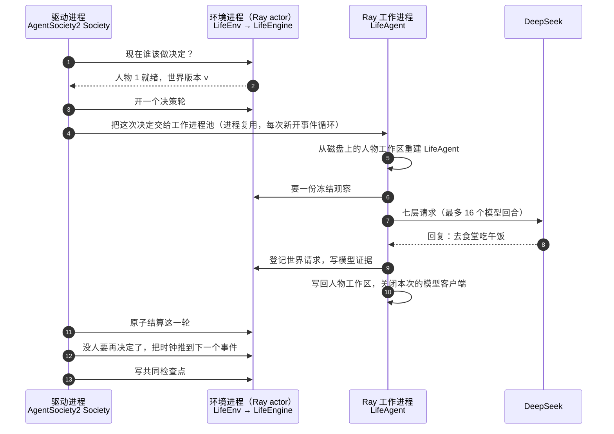
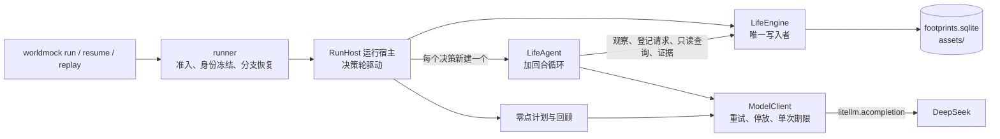

# 去掉 AgentSociety2：决策循环与模型调用改由 WorldMock 自己承担

> 状态：已裁定（负责人 2026-11-17，见[裁定记录](RULING-2026-11-17-owner.md)），实现按[开发规格](SPEC-agentsociety2-removal.md)。日期 2026-11-16。本文只提出改动，不改生产代码、测试、配置或 `docs/design/`。
> 代码基线：WorldMock `74f1b94908f1e77395ee1278093b29f8e5b299f2`（生产代码与 `cb802721` 相同）。AgentSociety2 是上游 `tsinghua-fib-lab/agentsociety` 的 `670c94ff`（2.8.7）加 `patches/agentsociety2/SERIES` 的五份补丁，源码摘要 `0a7b9b06…`。
> 你的原话：「我们的项目当前还有多少功能内容依赖于AS2进行工作？如果转为纯自研是否能让项目变得更干净？」，随后「写 PROPOSAL」。
> 评审：本文由八路只读梳理（每条结论带行号证据）、三份独立设计稿和一轮评判综合而成，又经一轮对代码的事实核对；核对指出的问题已复核改正。梳理、设计稿和核对结果存于 `.work/agentsociety2-removal/`，不入库。下文只在引用原文时写「AS2」，正文一律写 AgentSociety2。

## 一　结论

- **还在依赖 AgentSociety2 的有五块**：推进一次运行的决策轮、Ray 进程、人物思考循环的骨架、给 DeepSeek 发请求的客户端、人物工作区与记忆文件的存储格式。另有扫描注册、环境变量配置和补丁安装三样外壳。人物看到什么、能做什么、怎样结算，这些规则已经全部是 WorldMock 写的：一部分直接写在 WorldMock 代码里，一部分以补丁的形式写进了 AgentSociety2 的源码。
- **改成纯自研会明显更干净。** WorldMock 自己的代码量大致持平：估计新写约 1,170 行（决策轮驱动、人物回合循环、模型客户端和几个数据类型），删掉约 1,100 行为迁就框架而写的代码。真正去掉的是三样东西：每次运行加载的约 4 万行 AgentSociety2 源码，整个补丁目录（9 个文件，1,037,660 字节），以及 75 个依赖包（Windows 上约 191 MB）。
- **人物的一天不变。** 唯一不让步的验收判据：每一次发给 DeepSeek 的请求内容逐字节不变。证明方法是拿同一份真实运行的录音，在新旧两版上各重跑一遍，逐字节比较两边发出的请求。
- **会变的只是记录的写法，不涉及人物经历。** 具体是：人物工作区只剩两个文件，目录名去掉 `as2`；「记忆已更新」记录少三个恒定字段；模型请求的底稿少几个从来不发出去的参数；一个没人用的「向人物提问」入口删掉，提示指纹随之改变；故障运行写下的停机原因更短；随请求附带的请求头可能变。事件的条数和顺序都不变。
- **建议在正式 12 周运行之前做完，一条分支，一次合并。** 正式运行之后，还要从它的检查点续跑或做反事实重放，这些都要求代码与当时一模一样。如果跑完再换，要么一直保留旧环境，要么把正式运行重跑一遍。
- **动手之前，需要你裁定「待裁定」一节的事项。** 最要紧的三件：是否推翻 2026-09 定下的「不重写框架」原则；是否接受记录格式的变更清单；用哪份录音做证明，取回 10-31 的两天试点录音，还是批准一次计费录制。

## 二　从人物的一个决定看现在的运行

拿工作日中午 12:00 人物决定去吃饭这一刻来说。她每做一个决定，背后依次发生这些事：

图里的三个进程和「从磁盘重建人物」是 AgentSociety2 的形状。「谁该做决定」这个问答不是：它是 decision-round 补丁为 WorldMock 加的接口，上游 Society 原本按固定步长推进；目标设计里保留这一步。

你在分层记忆提案里把这个循环理解成「这是自己写的 agent 循环」，当时差距表判为部分一致（`docs/dev/PROPOSAL_2026-10-29_LAYERED_MEMORY.md:62`）。这次梳理的结论是：人物看到什么、能做什么、怎样结算的规则几乎全部由 WorldMock 编写，只是其中一部分写在补丁里。剩下真正属于 AgentSociety2 的，是进程、扫描、配置这些外壳，加上 Router 外壳与并发阀，以及人物工作区与记忆文件的存储格式。

## 三　AgentSociety2 现在替 WorldMock 做的事

| 能力 | 现在由谁执行 | 规则实际归谁 | 去掉 AgentSociety2 以后 |
| --- | --- | --- | --- |
| 推进一次运行：问谁该决定、收齐决定后原子结算、没人要决定才推进时钟、每一步写一个共同检查点 | AgentSociety2 的 `Society`（`society.py` 509 行，`decision_round.py` 214 行） | WorldMock。这两份文件由 decision-round 补丁写入：`society.py` 被整体重写，`decision_round.py` 是新文件 | 搬回 WorldMock：运行宿主约 300 行，决策轮类型约 80 行 |
| 进程：环境单独放在一个 Ray actor 里，保证只有一个写入者；每个决定在 Ray 工作进程里执行 | Ray | 没有业务规则。正式运行只有一个人物，每轮最多一个 Ray 任务，没有任何并行 | 删除，改成单进程、单事件循环 |
| 人物的思考循环：最多 16 个模型回合、协议纠错、请求与响应证据的写入时机 | AgentSociety2 的 `agent_runtime.py`（1,414 行） | 大部分是 WorldMock。这个文件本身就是 failure-propagation 补丁新建的；LifeAgent 又覆写了决定请求内容的全部钩子 | 与 LifeAgent 合并成 WorldMock 自己的一个循环 |
| 给 DeepSeek 发请求：两类重试、断网与限流停放 12 小时、单次发送期限、失败发送记录 | AgentSociety2 的 `llm_dispatcher.py`（778 行） | WorldMock。这些行为全部来自 model-lifecycle 补丁。上游只剩 Router 外壳、并发阀、跨 Ray 序列化和用量统计，单人物运行都用不上 | WorldMock 自己的模型客户端，约 260 行；litellm 继续当普通库用 |
| 人物工作区与记忆文件：`AGENT.json`、`config.json`、`MEMORY.md`、`memory/episodes.jsonl`、`memory/state.json` | AgentSociety2 的文件格式与读写，加上 WorldMock 的合并与渲染规则 | 混合。记忆文件不进入任何模型请求：记忆层和 `search_memory` 只读足迹库里的事件。`AGENT.json` 例外：每次决策都从它读回人物卡片、名字和模型身份，人设层和请求参数取自这里 | 见「目标设计」中的「人物状态与记忆文件」，以及「待裁定」 |
| 找到 LifeAgent 和 LifeEnv：按文件扫描 `custom/` | AgentSociety2 的注册表 | 没有业务规则 | 删除，改成普通导入 |
| 读配置：端点、凭据、模型名从 `AGENTSOCIETY_*` 环境变量读 | AgentSociety2 的 `Config`，一导入就读 | 没有业务规则 | 删除，直接用 `config.toml` 的值 |
| 安装：解压上游归档，打五份补丁，核对摘要 | `scripts/bootstrap.py` | 没有业务规则 | 删除这一步 |

几个数字：

- AgentSociety2 当前源码 228 个文件，其中 Python 213 个，共 68,837 行。
- 一次运行实际加载约 107 个模块、约 4 万行，分三步加载：驱动进程导入运行装配所需的模块后，是 58 个模块、24,359 行；扫描 `custom/` 时再导入 7 个，到 65 个、25,823 行；环境进程和 Ray 工作进程按名字取类时，注册表又顺带导入 `contrib` 下全部内置的智能体和环境（41 个模块、14,428 行），总计 107 个模块、40,284 行。
- 加载的代码里，约 4,800 行是 WorldMock 从不使用的六个路由器（代码生成、计划执行、两层 ReAct 等），被环境包顺带导入；社会包顺带导入的 `helper.py` 和 `questionnaire.py` 还有约 1,300 行，同样不用。
- 五份补丁共 8,575 行，改动 21 个文件，约加 3,800 行、删 3,850 行。WorldMock 用到的那部分 AgentSociety2 核心，已经被它自己重写过一遍。
- WorldMock 自己的生产代码：`src/worldmock` 32,108 行，`custom/` 两个文件 1,204 行。
- 测试里 69 个文件提到 `agentsociety2`，其中 61 个有导入语句。

## 四　为了迁就 AgentSociety2 而存在的代码

下面这些写法存在的唯一理由，是 AgentSociety2 的接口或进程形状。去掉 AgentSociety2 后，这些绕路的写法都可以删除。其中有两项背后的逻辑仍要保留：恢复时的零点补跑改由运行宿主显式调用，两个只读查询改由引擎方法承担，详见「目标设计」。

| 现在的做法 | 为什么会这样 | 证据 |
| --- | --- | --- |
| 一次决定里有两条开始动作（主活动加副活动）时，两条都结算落库，但只把第一条结果交还给框架 | AgentSociety2 的决策轮要求每个人物恰好返回一条结果 | `src/worldmock/simulation_engine/decisions/decision_coordinator.py:147-151`；`docs/design/10-runtime.md:83-84` |
| 普通恢复时，零点的回顾和日计划只能塞进 `LifeEnv.init` 里补跑，并由它自己登记故障 | AgentSociety2 在恢复模式下不建初始检查点，故障登记要等环境初始化返回后才开始 | `custom/envs/life_env.py:81-121` |
| 回看任务和检索记忆这两个只读查询，靠两个子类伸进 AgentSociety2 的三个私有成员才能到达环境 | AgentSociety2 的直接路由只转发固定的 11 个方法，不含只读查询 | `src/worldmock/runtime/framework/read_query.py:1-47` |
| 人物侧记忆运行时必须交给 AgentSociety2 一个「调用模型」的入口，于是传一个只会报错的函数 | AgentSociety2 记忆运行时的构造要求这个参数；WorldMock 早已取消人物侧的记忆巩固 | `src/worldmock/agents/memory/life_memory.py:23-44` |
| 协议纠错只能当字符串在循环里传，于是做了一个「带结构的字符串」`HostFeedback`，写证据时再拆开 | AgentSociety2 的循环把协议错误当字符串传递 | `src/worldmock/agents/protocol/life_feedback.py:17-27`；`custom/agents/life_agent.py:143-157` |
| 同秒续接断链时，要就地改写 AgentSociety2 传进来的那个消息列表对象 | 只有改同一个列表对象，后续回合才看得到改动 | `src/worldmock/agents/protocol/life_continuation.py:102-108` |
| 每个决定都从磁盘重建人物；`AGENT.json` 被反复写出，里面带墙钟时间和本机绝对路径；运行比对工具和完整日基线专门屏蔽或打桩这两项 | AgentSociety2 的工作区约定 | `scripts/compare_runs.py:56-58`；`tests/dayrun_baseline.py:30,41` |
| 三个错误类写了 `__reduce__`；`status.json` 要解开 Ray 的任务错误、去掉终端颜色序列 | 异常要穿过 Ray 的进程边界，否则会变成 `UnserializableException` | `src/worldmock/foundation/errors.py:28-30,58-60`；`src/worldmock/resource_engine/registration/errors.py:59-61`；`src/worldmock/runtime/monitoring/status.py:60-68` |
| 启动时必须赶在导入 AgentSociety2 之前写好环境变量，其中 8 个是 `AGENTSOCIETY_*`（含把请求超时从 60 秒改成 300 秒）；另有守卫检查导入顺序 | AgentSociety2 的 `Config` 一导入就读环境变量 | `src/worldmock/runtime/framework/setup.py:38-78` |
| 为一个从不被调用的 `coder` 角色也建一个模型客户端 | AgentSociety2 的环境路由构造时要求它 | `src/worldmock/runtime/lifecycle/runner.py:526-531` |
| `custom/` 不能是 Python 包，类必须直接写在文件里；覆盖率、风格门禁、导入图、变异工具都为它单独开例外；生产中实际运行的 LifeAgent 是扫描器用合成模块名另行加载的一份类对象 | AgentSociety2 按文件路径扫描注册 | `pyproject.toml:64-66`；`tests/mutation_runner.py:7-8` |
| 在 Ray 工作进程里执行的代码统计不到覆盖率，也不受源码变异检查，于是另写了一组在进程内直接驱动 LifeEnv 的测试 | 覆盖率和变异只看主进程 | `tests/integration/runtime/test_env_lifecycle_coverage.py:1-8` |
| 23 个测试文件为了能导入 AgentSociety2 而预设假凭据 | AgentSociety2 的 `Config` 导入时缺凭据就报错 | `tests/conftest.py:22-25` |
| Windows 上也安装 Ray；依赖锁里有 75 个包只因 AgentSociety2（或早已删除的评估模块）而存在 | WorldMock 自己在 `pyproject.toml` 里固定了 `ray==2.55.1`；AgentSociety2 上游在 Windows 上本来不要 Ray | `pyproject.toml:15`；`uv.lock` |

另有一处潜在隐患：AgentSociety2 的 `step_agent_batch` 是没有设重试参数的 Ray 远程函数，按 Ray 的默认值，工作进程崩溃时任务会被重跑三次。重跑会重发模型请求、重复写证据，与「故障停止运行、不重试」相冲突。迄今的运行没有观察到这种情况；去掉 Ray 后，这个隐患随之消失。

## 五　成熟产品怎样做

AGENTS.md 要求架构选择先看成熟产品的做法，没有明确理由不重写现成能力。对照如下：

| 产品 | 进程形状 | 回合上限 | 状态、恢复与分叉 |
| --- | --- | --- | --- |
| OpenAI Agents SDK | 应用进程内，asyncio | 默认 10 回合，超出抛 `MaxTurnsExceeded` | 暂停的运行可序列化后在另一进程恢复 |
| Claude Agent SDK | 启动随包附带的 Claude Code 子进程，循环、工具执行和会话写盘都在子进程里，应用进程经消息流驱动它 | 可设上限，超出返回 `error_max_turns` | 凭会话号恢复或分叉 |
| LangGraph | 应用进程内；按超步执行：先计划，再并行执行，最后统一更新 | `recursion_limit` | 每个超步存一次检查点，可从任一检查点重放或分叉 |
| Google Concordia（社会仿真） | 单进程，线程池让实体并行行动，由主持人统一结算 | 默认最多 100 步 | 每步写检查点，明说不保证模型确定性 |
| Stanford Generative Agents | 单进程，逐个人物顺序推进 | 无 | 复制整个模拟目录来分叉；模型失败时返回兜底回答，WorldMock 禁止这种做法 |
| AgentSociety（AgentSociety2 的上游） | Ray 多进程，每批默认 256 个人物 | 有 | 面向一万人以上的规模；上游依赖声明本身在 Windows 上排除 Ray |

WorldMock 的决策轮（问谁就绪、固定世界版本、让就绪人物决定、原子结算、存共同检查点），与 LangGraph 的超步、Concordia 的「主持人结算」是同一种结构。除了 AgentSociety 自己，没有一个成熟产品为单个或少量人物起多个工作进程。

模型调用一侧，现成能力是 litellm（锁定 1.89.2）。它已经提供请求发送、按异常类型的重试策略、超时、客户端缓存和 `token_counter`，WorldMock 继续用它发请求、计 token。但它有四处满足不了 `docs/design/08-configuration.md` 的规定：重试只采纳 60 秒以内的 `Retry-After`，退避封顶 8 秒且带随机抖动；没有停放，也不区分传输计数和普通计数；`timeout` 是逐次读写的超时，不是整次期限；客户端缓存一小时过期，过期的客户端不关闭。这几项规定今天由 WorldMock 的补丁实现，所以重试与停放仍需 WorldMock 自己写，约 150 行，而且现在就已经是 WorldMock 写的代码。

本机实测（Windows 11、Ray 2.55.1、CPython 3.12.13）：`ray.init` 约 11.4 秒。在运行实际使用的 `LITELLM_LOCAL_MODEL_COST_MAP=True` 下，单独一次 `import litellm` 约 4.6 秒，每个 Ray 工作进程首次导入都要再付一次。不设这个变量时约 10 秒，多出来的时间是联网拉取价目表。

## 六　目标设计

去掉 AgentSociety2 以后，一次运行只有一个进程、一个事件循环：

还是中午 12:00 那个决定：运行宿主问引擎谁就绪，开决策轮，新建一个 LifeAgent；LifeAgent 取冻结观察，经模型客户端请求 DeepSeek，登记「去食堂吃午饭」；宿主让引擎原子结算，没人要再决定了就推进时钟，写共同检查点。步骤和今天一一对应，只是不再跨进程，也不再从磁盘重建人物。

### 一个进程，一个事件循环

- 驱动整次运行的就是 CLI 现在已有的 `asyncio.run`。LifeEngine、LifeAgent、模型客户端都是同一进程里的普通对象。
- 单一写入者靠程序结构保证，不靠锁，也不靠 actor：
  - 引擎的方法全部同步执行；
  - 运行宿主逐个 await；
  - 零点计划和回顾只在没有决策进行时，由宿主调用。
- 一轮里有几个人物就绪，就按引擎给出的就绪顺序逐个决定。v1.0 只有一个人物，这和今天完全等价。将来有多个人物时，顺序执行能保证事件序号可复现；并发执行则会让各人物的观察和模型证据按网络时延交错落库。真有并发需要时，要先设计「按决策缓冲证据、提交时按序落库」，另立提案。
- 今天环境与人物之间每次传参都经 pickle 复制。改到同一进程后，`observe` 和只读查询的返回值做深拷贝，保持人物拿到的是副本。
- 保留 asyncio、不改成同步代码，原因有两个：单次发送期限依赖 `asyncio.timeout` 取消发送；litellm 的异步路径要原样保留，请求字节才能不变。

### 运行宿主：决策轮驱动

驱动类叫 `RunHost`，沿用 `docs/design/01-architecture.md` 里已有的「运行宿主」概念，放在 `src/worldmock/runtime/lifecycle/run_host.py`，约 300 行。

- **步序照搬今天**：
  - 取调度状态，形成决策上下文，开轮；
  - 逐个决定，原子提交；
  - 再取一次调度状态，没人就绪才推进时钟；
  - 步数加一，写共同检查点。

  提交后人物仍然就绪时，不推进时钟，直接写检查点，下一步在同一秒再开一轮。
- **三种启动顺序显式写出**，不再借环境初始化和检查点的钩子触发：
  - 新建：先建人物工作区目录 `run_dir/agents/agent_NNNN/`（此时可以为空），再建引擎，核对起始时刻，写初始检查点，然后跑回顾、日计划。
  - 普通恢复：打开引擎，在首次决策之前跑回顾、日计划，不写检查点。
  - 反事实：打开引擎；施加干预，核对收据摘要、世界版本恰好加一、时间不变；写干预检查点；再跑回顾、日计划。
- **零点任务的触发点与今天相同**：
  - 每个共同检查点提交之后，先补回顾、再补日计划；没有待办时，不建客户端；
  - 零点推进之后，补回顾、日计划，再判定作息。

  今天的触发点见 `custom/envs/life_env.py:113-121,202-213,233-242`。
- **类型名不变**：`DecisionContext`、`DirectToolCall`、`SchedulingState` 保留名称、字段顺序和全部构造校验，搬到 `src/worldmock/state/decisions/round.py`。测试里只改导入行：两个枢纽文件，另外 16 个直接导入这几个类型的测试文件，再加 6 个将移植或删除的 AgentSociety2 专属测试，共 27 条导入。经两个枢纽间接使用的 148 个和 109 个测试文件不用动。只为跨进程打包而存在的 `SocietyCheckpointRequest` 和两个批量请求类型删除。
- **身份格式不变**：`round_id`、`decision_id`、`action_id`、`call_id` 逐字保留。它们写在 `decision_started` 和所有决策事件里，评测还按 `:model:NNNN:` 统计回合数。检查点标签 `initial`、`advance:NNN`、`counterfactual:…` 从来不落库，随打包类型一起删除。
- **只有一个时钟**：宿主每次从引擎读当前时刻，不再维护第二份时钟再互相核对。
- **故障处理**：开轮之后、提交之前出错，宿主让引擎中止这一轮，不执行任何请求，写 `run_failed`。只在引擎的轮次仍然开着时才中止；其余情况登记 `fail_run`，再原样传播异常。

### 环境门面：去掉 LifeEnv

LifeEnv 存在，是为了满足 AgentSociety2 的环境基类与直接路由合同。去掉框架后，它剩下的事各归其位：

- 回看任务与检索记忆这两个只读查询，成为引擎方法，放在 `src/worldmock/simulation_engine/decisions/read_query.py`。白名单、开放轮核对、唯一冻结观察核对、业务拒绝的五字段形状，都原样保留。
- 写 `status.json` 阶段、编排零点任务、登记运行故障、关闭，都归运行宿主。
- 人物侧与环境侧工具集合的一致性，改由单元测试守住，因为两侧共用同一份 `REQUEST_MODELS`。
- 人物拿到的环境句柄就是引擎本身。人物模块用 `typing.Protocol` 只声明它要用的五个方法：观察、登记请求、只读查询、写模型证据、写记忆证据。人物模块不导入引擎。
- 提交时返回本轮全部结算结果，开始组的两条结果都返回。「每个决策只返回第一条」这条规则只为满足 AgentSociety2 的核对：提交时人物已经结束，返回值没有别的读者，而且提交路径从不返回失败状态，那条核对本来就不可达。随之变化的只有运维日志 `DECISION_ROUND_COMMITTED` 的动作数：开始组那一轮从 1 变成 2，也就是如实计数。

删不删 LifeEnv 是实施层面的取舍，不影响人物的一天，也不影响记录格式。本文直接删除它，理由是 AGENTS.md 的「不增加防御性抽象」。保留它的好处是测试、变异台账和文档改动少一些，代价是宿主和引擎之间多一层纯转发。

### 人物与回合循环

- LifeAgent 搬到 `src/worldmock/agents/life_agent.py`，类名不变。
- **每个决策新建一个 LifeAgent，决定完就丢弃。** 今天人物在决策之间不带任何内存状态，同秒续接完全由环境从证据重建；新建实例让这一点由结构保证。
  - 人物的冻结输入在运行开始时一次建好，作为构造参数传入：卡片与结构、名字、模型身份、同秒续接开关、回合上限。这些全部取自 `persona.toml` 和运行清单，不再从工作区里的副本读。
  - 名字今天取自 `AGENT.json`，而恢复校验没有核对名字。所以改从 `persona.toml` 取之后，要补一条两边相等的测试；最终还有录音逐字节比较兜底。
  - 模型客户端和记忆存储是整次运行共用的对象。
- **回合机制放进 `src/worldmock/agents/protocol/react_loop.py`**，约 300 行：
  - 显式持有消息历史，不再依赖 AgentSociety2 传进来的同一个列表对象；
  - 回合计数，16 回合用完是运行故障；
  - 生成 `call_id`；
  - 证据写入的先后：请求证据先于发送；响应证据在解析和校验之后，连同协议错误一起写；失败证据单独写；
  - 重建 assistant 消息，与环境侧的续接复原共用同一份实现；
  - 两种纠错消息：配对的 tool 消息和宿主的 user 消息，相同的纠错替换而不叠加；
  - 替换续接前缀。
- **删除的胶水**：
  - 带结构的字符串 `HostFeedback`；
  - 按对象身份配对容量预检结果；
  - 观察的包装与拆包；
  - 永远返回空的工具名校验；
  - 只为扫描注册存在的 `description`、`init_description`；
  - 照常执行却没有作用的 AgentSociety2 功能：首次初始化时取世界描述的 `_load_world_description`、技能、待办、决策自述前奏、追踪。
- **请求字典由 WorldMock 按最终键序直接构造**，不再先建 AgentSociety2 的骨架再覆盖。

### 模型客户端

`src/worldmock/configuration/model/model_client.py` 里的 `ModelClient`，约 260 行，人物回合、零点计划、回顾三条路径共用：

- **直接调用 `litellm.acompletion`，不经 Router。** 发出的请求内容由 litellm 的 OpenAI 兼容转换生成，与 Router 无关，保留同一版本的 litellm 就能保证内容不变。
- **整次运行持有一个 `AsyncOpenAI` 网络客户端**，作为 `client=` 传入，运行结束时关闭一次。每次调用都显式传 `max_retries=0` 和 `timeout=300`：litellm 会用调用参数覆盖客户端上的这两项，不传时分别变成 2 次和 600 秒。
  - 不再依赖 litellm 的私有客户端缓存。那份缓存一小时过期，过期的客户端不关闭，只等垃圾回收。单个事件循环连跑数周，会反复留下未关闭的连接和会话告警，释放时机也不受控。上一次 30 天运行出现过 5,065 条「Unclosed client session」，之后才加上按事件循环关闭（`docs/dev/long-run-cost/PROPOSAL-long-run-cost.md:299-300`）。
- **从补丁逐段搬过来的部分**：
  - 两类重试预算；
  - 停放：最长 12 小时，单次等待至多 120 秒，不短于 `Retry-After`；
  - 单次发送期限：120 秒，加每个 `max_tokens` 7.5 毫秒；
  - 失败发送记录 `transport_attempts`；
  - 错误链文本；
  - 最终失败的文本。最终失败的类名 `LLMDispatchError` 来自上游，文本由 WorldMock 补丁写成，二者都已写进零点计划、回顾的失败证据和 `status.json`，原样保留。它的 `rate_limit_like` 属性在生产中没有读者，删除。
- **限流只按异常类型判定。** 今天还有三条文本判断：两条只为 Router 存在，一条是 `try again in`，都删除。这会改动 `docs/design/08-configuration.md:140-141` 的计数内退避规则：「限流与其他过载」改为只认限流异常类型。这条规则只在普通重试次数大于 0 时起作用，正式配置的默认值是 0。
- **这个模块是 `src` 里唯一导入 litellm 的地方**，`prompt_capacity` 的 `token_counter` 改从它取。模块在导入 litellm 之前先设置 `LITELLM_LOCAL_MODEL_COST_MAP=True`，避免联网拉取价目表。
- **写成只依赖标准库与 litellm、openai、httpx 的独立模块**，以便在基线环境里按文件路径加载，与 AgentSociety2 的客户端并排比较（见「实施顺序与验收」）。
- **删除的部分**：Router、自适应并发阀、跨 Ray 序列化、用量统计、`default`/`coder`/`embedding` 三个角色，以及整条 `AGENTSOCIETY_*` 环境变量通道。

自持客户端有一个副作用：HTTP 传输层从 litellm 默认的「httpx 外壳包 aiohttp」，换成 OpenAI SDK 默认的 httpx。请求内容不变，但请求头的来源和连接复用方式可能不同。另一种做法见「待裁定」。

### 人物状态与记忆文件

现在人物工作区里有六个文件：

| 文件 | 写入方 | 内容 | 谁读它 |
| --- | --- | --- | --- |
| `AGENT.json` | AgentSociety2 | 人物卡片、名字、模型身份的副本，外加技能列表（含内置的 `built-in@daily-guidance`）、墙钟时间、本机绝对路径 | 每次决策都读入：人设层取名字和卡片，请求参数（`max_tokens`、两类重试次数、容量预检）取模型身份。恢复时核对卡片、模型身份、续接开关，不核对名字 |
| `config.json` | AgentSociety2 | 关掉 AgentSociety2 待办和技能的开关，回合上限 | 每次决策读回合上限，它决定剩余回合和最后一回合开放哪些工具；恢复时校验 |
| `MEMORY.md` | 首次写 AgentSociety2 的英文模板，之后由 WorldMock 渲染 | 身份、最多 5 条已核验经历、人物自述（恒为「暂无人物自述。」） | 查看器的「主观总结」、运行比对工具 |
| `memory/episodes.jsonl` | 合并规则由 WorldMock 定，记录格式是 AgentSociety2 的 | 人物结束活动时写下的主观记忆，24 小时内相似的合并 | 合并判定；条目快照写进 `memory_updated` |
| `memory/state.json` | AgentSociety2 | 巩固计数等 7 个键。WorldMock 改其中 `episode_counter`、`pending_episode_count` 两个计数，两者恒相等 | 步尾取条目计数和人物自述（恒为空串）；恢复时校验 |
| `life_prompt_snapshot.json` | WorldMock | 人设层和记忆层的快照 | 只读问答，生产中没有调用者 |

后四个文件不进入模型请求，记忆层和 `search_memory` 只读足迹库里的事件。前两个文件里进入请求的值（卡片、名字、模型身份、回合上限），都可以直接取自冻结的 `persona.toml` 和运行清单。所以无论怎样处理这些文件，模型请求都可以保持不变；各种做法的区别只在记录格式，以及能否证明等价。

推荐的做法：

- 目录改为 `run_dir/agents/agent_NNNN/`，只留两个文件：
  - `MEMORY.md` 由 WorldMock 渲染，统一用 LF 换行，内容不变就不写，首次也不再写英文模板。
  - `memory/episodes.jsonl` 统一用 LF，只保留有 WorldMock 含义的字段。去掉恒为 0 的 `tick`、`tick_duration_sec`，恒为空的 `refs`，以及来自 AgentSociety2 决策计数的 `step_index`、`step_count`。条目编号改为 `m_000001` 这样的连续序号，恢复时校验连续且唯一。
- `AGENT.json`、`config.json`、`memory/state.json`、`life_prompt_snapshot.json` 删除。
- 共同检查点里的人物快照（`agent:<id>`）、快照的 tar 格式、恢复时的一次严格校验，都保留。今天一次恢复要把同一个工作区校验三遍，以后只校验一遍。
- `memory_updated` 何时写不变：有新建或合并的条目，或者视图有变化时才写。所以事件的条数和顺序都不变，运行比对能逐条对齐。
- `memory_updated` 的数据：
  - 去掉三个键：恒为 `false` 的 `consolidated`、恒为 `null` 的 `reflection`，以及随 `state.json` 一起消失的 `state_sha256`。
  - 写入点 `trigger` 的取值闭集去掉 `reflection`。
  - 其余保留：`operation`、三个文件摘要、新建与合并的条目编号、四键条目快照、观察事件号、已核验事件号、`trigger`、`decision_id`。
  - 人物第一条 `memory_updated` 的 `memory_before_sha256` 变为 `null`，今天它是英文模板的摘要。

另外两种做法：

- **逐字节保留 AgentSociety2 的文件集。** 好处是记录除代码身份外没有差异。代价是由 WorldMock 永久代写一个已删框架的格式，包括技能列表、墙钟时间、本机绝对路径、巩固计数、英文模板，以及 Windows 上的 CRLF。
- **更彻底的做法：主观记忆完全从事件推导，取消人物快照。** 好处是记忆写入第一次落进同一个 SQLite 事务，终态最简。代价有三：`memory_updated` 的写出时机会变，事件序号整体移动；运行比对难以逐条对齐；存储、校验、导出、质量报告、行为指标和查看器都要改。它改变的是记忆的持久化方式，不是去掉 AgentSociety2 的必要部分，建议另立提案。

三种做法都要按双候选规程重冻两份完整日基线，因为基线绑定代码身份，任何生产改动都要重冻。

### 只读问答

LifeAgent 实现了一条「只读问答」路径，用途是向人物提外部问题：不推进世界，只让她凭人设和最近的记忆回答一个问题，类似采访或问卷（`docs/design/06-agent.md:106`）。它有自己的只读系统层，只开放 `finish` 工具，读 `life_prompt_snapshot.json`。

问题有三个：入口只在 AgentSociety2 的 `ask` 和 `query_agent_task` 里，WorldMock 的命令行和代码都不调用；`ask` 不绑定决策上下文，真走到生成调用身份那一步就会报错，所以在生产中用不了；可人物每做一个决定，都要为它往检查点里多存一份人设和记忆的副本。

推荐删除整条路径。生活决策的请求字节和工具指纹都不变；清单里的 `prompt_sha256` 会变，因为它原先也绑定了只读系统层。

### 模型请求的底稿

足迹为每次发给 DeepSeek 的请求留一份底稿，就是 `model_request` 事件里的请求字典。人物回合的底稿带着 `stream`、`max_retries`、`transport_max_retries` 三个参数；零点计划和回顾的底稿带着 `stream` 和恒为 0 的 `max_retries` 两个参数。这些参数从不发给 DeepSeek，只因 AgentSociety2 客户端的 `call(**request)` 签名要读它们，才被塞进请求字典，又随之进了底稿。

零点计划和回顾的底稿上写着 `max_retries: 0`，可实际发送时用的是模型身份里的次数（`src/worldmock/simulation_engine/scheduling/plans/day_planning.py:88-90`、`src/worldmock/configuration/model/model_metadata.py:148-158`），底稿与事实不符。

推荐删除这些参数：底稿只记真正交给客户端的六个键，两类重试次数只来自冻结的模型身份，在构造客户端时校验一次。发出去的请求内容不变；录音重跑只比较模型可见的字段，所以旧录音照样能用来检验新代码。

### 故障文本

- 人物做决定时出错，今天会被包成 `Agent decision failed: [...]` 的字符串再抛出。这层包装来自 AgentSociety2 工作进程把异常转成字典的做法。以后原始异常直接传到宿主，中止原因写原异常的 `repr`。
- 修掉一个怪癖。人物在同一秒里连续做决定，有次数上限；次数用完时，引擎先提交了这一轮再抛错，框架却以为没提交，又去中止。结果 `status.json` 里除了真正的原因，还多一条并不存在的「决策轮没有开着」错误。修掉后不改任何事件，`status.json` 只记一条 `ProtocolError`。
- 三个错误类的 `__reduce__`、`status.json` 对 Ray 任务错误的解包和去颜色，都删除；异常组用「 | 」拼接的规则保留。
- LifeAgent 带调用位置的 `TOOL_SERVICE_FAILED`、`EVIDENCE_WRITE_FAILED`、`MODEL_SERVICE_FAILED` 分级，是 WorldMock 自己的诊断，保留。回合用完时的文本，去掉已经不存在的 `finish` 概念。

以下文本会变：失败路径上的 `decision_round_aborted`、失败的 `action_result`、`run_failed` 三类事件；`status.json`；运维日志 `DECISION_ROUND_ABORTED`、`RUN_FAILED`、`RUN_CRASHED` 的说明。新旧文本的对照表在实施时写出，每类故障各有一条测试。

### 安装、代码身份与依赖

- **删除的部分**：
  - `patches/agentsociety2/` 整个目录；
  - 引导里的 AgentSociety2 重建步骤；
  - `scripts/bootstrap_sources.py`，其中的 `file_sha256` 挪进 `bootstrap_environment.py`，`scripts/freeze_rrs_baseline.py` 的导入随之改指；
  - AgentSociety2 源码锁定摘要；
  - 11 个进程环境变量（第 12 个 `LITELLM_LOCAL_MODEL_COST_MAP` 保留，改由模型客户端在导入 litellm 之前设置）；
  - 给 Ray 工作进程用的 `PYTHONPATH` 注入，以及导入顺序守卫；
  - 凭据脱敏表里两个 `AGENTSOCIETY_*` 名字（`src/worldmock/recording_engine/events/model_evidence.py:7`）；
  - 行为分析里检查 `MEMORY.md` 是否混进 AgentSociety2 巩固示例身份的门禁、参数和测试（`tools/analysis/behavior/metrics.py:39-42`）。WorldMock 早已取消巩固。

  引导从此不需要 Git。
- **`custom/` 并入 `src/worldmock`。** 代码身份只哈希 `src/` 下的 `.py`、`pyproject.toml`、`uv.lock`，标签摘要算法不变；项目根由已导入的 `worldmock` 包位置推出，删除命令行的 `--project-root`。这两份文件今天已列在覆盖率和风格门禁里，并入后不再需要单独列目录、单独登记扫描根；原先在 Ray 工作进程里执行、由扫描器另行加载的那份代码，也第一次进入覆盖率和源码变异检查。
- **删除 `agentsociety2` 和 75 个第三方包**，其中有 `ray`、`mcp`、`mem0ai`、`pandas`，以及与 AgentSociety2 无关、使用者早在 `3de9b1f2` 就已删除的 `numpy`、`scipy`、`matplotlib`、`krippendorff`。`uv.lock` 从 135 项降到 59 项，`requirements/lock.txt` 从 133 条降到 58 条。
- **保留包的精确版本与哈希一律不变**：litellm 1.89.2、openai 2.54.0、httpx 0.28.1、tiktoken 0.14.0、tokenizers 0.23.2、pydantic 2.12.5 等。请求的序列化和 token 计数都依赖它们。
  - 重算锁文件时不加 `--upgrade`，并用脚本核对：差异只有删除行，以及 `tomlkit` 进入开发依赖组新增的几行。
  - `tomlkit` 过去只是经 hatchling 间接装上，有 9 个测试文件导入它，所以改为显式的开发依赖。
- **许可**：移植进来的代码里，有一部分原本就是上游代码，例如 assistant 消息与工具调用的序列化、人物工作区的建立与重建、记忆条目的归一化与严格读回。上游 `LICENSE` 原文放到 `LICENSES/AgentSociety2-Apache-2.0.txt`；含上游衍生代码的模块，在模块文档串里用一句话注明来源和许可。合并前对照上游归档做一次来源核对。

### 文档

规则先写进 `docs/design/`，再改代码：

- `10-runtime.md` 文件名不变，免得改设计构建脚本；章名改为「运行装配与决策循环」，新写决策循环：三种启动顺序、步序、同秒再决策、每步一个共同检查点、推进与结束判定、顺序执行、中止与停止、零点任务触发点、单进程、客户端寿命。章名改动后，同步 `docs/INDEX.md:32`、`01-architecture.md:126,195`、`09-io-formats.md:120` 的链接标签。
- `06-agent.md`「宿主模型协议」新写回合协议，内容见上文「人物与回合循环」。
- `07-evaluation.md:147`「截断重试是同一回合」改成与现行 `call_id` 一致：今天每次调用都分配新的回合号，截断重试也不例外。`07-evaluation.md:135` 的 `custom` 换成新模块名。
- `05-recording-engine.md`、`09-io-formats.md` 写人物工作区文件集、`memory_updated` 与检查点格式。`09-io-formats.md:75-76` 另改代码身份的覆盖范围，去掉 `custom/` 和 AgentSociety2 包。
- `08-configuration.md` 改客户端与环境进程的措辞，并把计数内退避里的「限流与其他过载」改为只按限流异常类型判定。
- 删除只读问答时，一并删去 `06-agent.md:61,76,106,372,406` 与 `09-io-formats.md:87` 的相关条文。
- `00`、`01`、`README.md`、`docs/INDEX.md`、`docs/manual/runtime.md` 里的 AgentSociety2 条文全部改写。现行文档有 43 行直接点名 AgentSociety2、Ray 等，另有约 25 行间接依赖它们；它们承载的设计陈述里，约 30 条在去掉 AgentSociety2 后会变成假话。

决策循环和回合协议的规则，今天在现行设计文档里并没有成文，只写在冻结的 `docs/dev/SPEC-as2-integration.md` 和补丁里。这次要第一次把它们写成 WorldMock 自己的现行规则。

## 七　哪些不变，哪些会变

| 对象 | 变不变 | 说明 |
| --- | --- | --- |
| 人物的一天：看到什么、能做什么、怎样结算 | 不变 | 环境、提示、工具和结算规则一行不改 |
| 发给 DeepSeek 的请求内容（HTTP 正文） | 逐字节不变 | 唯一不让步的判据，用录音重跑证明 |
| 发给 DeepSeek 的请求头 | 可能变 | 传输层换成 OpenAI SDK 默认的 httpx；正文不受影响 |
| 工具指纹 `tool_schema_sha256` | 不变 | |
| 提示指纹 `prompt_sha256` | 变 | 只读系统层随只读问答一起删除 |
| 代码身份 `code_sha256` | 变 | 不再包含 AgentSociety2；旧运行因此不能续跑或重放，这本来就是任何生产改动的结果 |
| 事件的条数与顺序 | 不变 | `memory_updated` 何时写不变 |
| 模型请求的底稿 `model_request` | 变 | 人物回合去掉三个参数，零点计划与回顾去掉两个，请求摘要随之变 |
| 「记忆已更新」`memory_updated` | 变 | 去掉三个恒值或随文件消失的键，写入点闭集去掉 `reflection`；条目编号改为连续序号；人物第一条的 `memory_before_sha256` 变为 `null` |
| 共同检查点里的人物快照 | 变 | 快照内容变成两个文件；快照格式与参与者不变 |
| 运行目录 | 变 | `as2/agents/agent_NNNN` 改为 `agents/agent_NNNN`；不再生成空目录 `env/LifeEnv` |
| 命令行 | 一处变 | 删除 `--project-root`，项目根由已导入的 `worldmock` 包推出 |
| `status.json` 与失败路径事件的文本 | 部分变 | 见「目标设计」中的「故障文本」 |
| 运维日志 | 部分变 | 成功路径只有开始组那一轮 `DECISION_ROUND_COMMITTED` 的动作数从 1 变为 2；失败路径上 `DECISION_ROUND_ABORTED`、`RUN_FAILED`、`RUN_CRASHED` 的说明随故障文本一起变 |
| 结算、活动、订单、导出的其余部分 | 不变 | 用运行比对在声明规则之外逐项比较 |

## 八　改动面

| 范围 | 内容 |
| --- | --- |
| 新写生产代码，约 1,170 行 | 运行宿主约 300 行、模型客户端约 260 行、回合循环约 300 行、决策轮类型约 80 行、证据类型约 60 行、人物工作区约 60 行、引擎只读查询约 60 行，记忆存储吸收上游子集后净增约 50 行 |
| 删除生产代码，约 1,100 行 | runner 里的 Ray 与装配约 350 行、setup 约 100 行、LifeEnv 315 行（约 130 行逻辑移进宿主和引擎）、`read_query.py` 47 行、LifeAgent 的覆写胶水约 150 行、记忆运行时约 60 行，以及错误类、状态、引擎里的框架核对约 65 行 |
| 原样搬迁，约 1,000 行 | LifeAgent 约 800 行；零点计划与回顾约 190 行，从 runner 搬到 `runtime/lifecycle/midnight.py`，顺带打断 LifeEnv 与 runner 之间的循环导入 |
| 整目录删除 | `patches/agentsociety2/`（9 个文件，五份补丁 8,575 行）、`scripts/bootstrap_sources.py`、`custom/` |
| 测试，约 115–130 个文件 | 约 33 个文件改 `custom.*` 导入，共 48 条语句；连同路径与字符串引用，约 45 个文件。决策轮类型改 27 条导入。31 个经 `person()`/`decide()` 夹具驱动 LifeAgent 的文件随夹具改写。23 个文件删掉假凭据。14 个只测 AgentSociety2 的文件（3,565 行）在合同测试移植后删除，其中 4 个调度器文件（1,307 行）的用例移植到新客户端；另有 4 个调度器相关测试文件（551 行）改测新客户端。工作区夹具改一处，覆盖约 20 个下游。变异台账改指 5 个符号、约 10 个唯一杀手。两份完整日基线重冻。查看器请求样例 `viewer-context.json` 离线重录 |
| 工具与脚本 | 录音重跑 `scripts/recorded_response_run.py`：去掉对 AgentSociety2 源码位置的检查；调用命令行时不再传 `--project-root`（`:668`、`:672`、`:799`、`:1010`），否则它会拒绝没有 AgentSociety2 的检出，或者因未知参数启动失败。基线一侧的命令行有缺省项目根，不传也照常运行，所以同一份新工具可以同时重跑基线和新分支。掩码完整日比较 `scripts/compare_complete_days.py`：去掉对 AgentSociety2 源码位置的检查；改为两侧各用自己引导出来的虚拟环境录制，不再要求两侧依赖锁逐字节相同（`:37`、`:58-62`、`:78`）。运行比对 `scripts/compare_runs.py`：在 `ALLOWED_RULE_TARGETS` 里加入本次声明的格式规则。查看器改读 `memory_updated` 概要：它今天读 `consolidated`（`tools/run-viewer.html:554-556`），这个键删掉后，查看器和它的测试一起改 |
| 引导与 CI | `scripts/bootstrap.py` 去掉 AgentSociety2 重建；`scripts/fresh_check.py` 去掉 `tests/integration/as2` 快速层和两个 `AGENTSOCIETY_*` 变量，并按新签名调用代码身份函数；两个工作流删掉中文图表字体的安装，它已经没有使用者 |
| 跨仓库 | 合并后要交给数据集一侧同步改。`WorldMock-Dataset/tools/native_day.py` 有五处：`:383` 从 `agentsociety2.society` 导入 `DecisionContext`、`DirectToolCall`，类型同名同签名，只改导入路径；`:212` 写 `AGENT.json` 与 `config.json`，按新工作区格式改；`:147-157` 把引擎检出的 `custom/` 登记为命名空间，`custom/` 删除后去掉；`:246` 从 runner 导入 `settle_pending_day_plans`，改从 `midnight.py` 导入；`:435-445` 调用 `creation_inputs` 和 `runtime_code_sha256(root)`，人物配置不再含 `config.json` 那组开关，身份函数按新签名调用。另外 `:25-29` 的 `AGENTSOCIETY_*` 占位一并删除，`tools/execute.py:54` 也要按新签名调用代码身份函数 |

## 九　实施顺序与验收

### 实施之前

- 你对「待裁定」各项的决定，写进本目录的裁定记录。
- 建基线工作树 `.work/wt/as2-base`，分离在 `74f1b949`，重新引导，核对 AgentSociety2 摘要为 `0a7b9b06…`。基础检出里的 `vendor/agentsociety2` 是旧的（摘要 `bf716c7b…`，4 个文件与锁定源码不同），不能当基线。
- 取得一份 `cb802721` 谱系的真实录音，先在基线上重跑，确认零偏差。
- 在基线环境里做一次线路探针：同一批请求字典，分别经 AgentSociety2 的客户端（Router）和 `litellm.acompletion(client=AsyncOpenAI(...), max_retries=0, timeout=300)` 发到本机服务。逐字节比较正文；确认每次发送恰好一个 HTTP 请求、超时为 300 秒；比较响应序列化后的字节。比较得到的正文冻结成新客户端的固定样例测试。

### 一条分支，一次合并

分支 `refactor/agentsociety2-removal`，工作树 `.work/wt/as2-removal`，按可运行的提交排列：

- **改设计文档**：「目标设计」中「文档」一节所列各处。
- **新写自有模块**：决策轮类型、证据类型、模型客户端、回合循环、人物工作区、记忆存储、引擎只读查询、运行宿主、零点任务模块。同时把调度器、决策轮、回合校验、记忆边界这几类只在 AgentSociety2 目录里有测试的行为，移植成针对新模块的测试。
  - 模型客户端写完后，在基线环境里按文件路径加载它，与 AgentSociety2 的客户端一起注入以下故障：400、401、429（`Retry-After` 分别给秒数和 HTTP 日期）、500、502、503、连接拒绝、超过单次期限的慢响应。比较两边的发送次数、等待序列和错误链文本。
- **切换**：runner 改为装配运行宿主；LifeAgent 搬进 `src`；删除 LifeEnv 和 `custom/`；引擎换用自有类型；工作区与证据落到最终格式；删除只读问答；改写测试枢纽和导入。
- **删除**：Ray、只读查询转发、环境变量通道与导入顺序守卫、`__reduce__` 与 Ray 错误解包、补丁目录与重建步骤、AgentSociety2 身份锁、门禁里的 `custom/` 特例与 21 条延迟导入登记、已移植的 AgentSociety2 专属测试；同时按「改动面」改好三个比较工具。
- **依赖与锁**：`pyproject.toml`、`uv.lock`、两份 `requirements` 锁、引导和 CI。从这一提交起，工作树改用自己引导出来的虚拟环境，不共用基础检出的 `.venv`，免得仍能导入 AgentSociety2、掩盖遗漏。
- **收尾**：许可文件与模块注明；两份完整日基线按双候选规程重冻；离线重录 `viewer-context.json`；变异台账改指，并为吸收进来的行为补变异。

不写只为模仿 AgentSociety2 格式而存在、之后还要删掉的过渡代码。万一重跑出现偏差，在切换提交和依赖提交前后二分定位。

### 验收证据

这里的「录音」指一次真实运行里 DeepSeek 的全部回答。「录音重跑」是由本机的假服务照录音原样作答，让新旧两版代码重跑同一段日子。「计划内重启」指录制时在某个检查点停下、再续跑；重跑时，在同一位置重现这次停下与续跑。

| 证据 | 证明什么 |
| --- | --- |
| 同一份录音分别在基线和新分支上重跑（`scripts/recorded_response_run.py`），两边都零偏差；录音带续跑段时，续跑之后也必须零偏差，否则验证记录写明「续跑路径未经录音证明」 | 录音走过的每一次请求，模型可见字段逐值相同 |
| 上面两次重跑发出的原始正文用 `raw-order` 比较，结论为 equal | 发出去的请求内容连键序在内逐字节相同。这项比较以前只做过「一次重跑和它自己」，从未在新旧两版之间做过 |
| 运行比对 `scripts/compare_runs.py` 比较两次重跑的运行目录，只允许以下按路径声明的规则：人物工作区成员与两个保留文件的内容（LF、去掉的字段、连续条目编号）；`memory_updated` 的键集合、条目编号、首条 `memory_before_sha256` 为 `null`、`episodes_sha256`；`model_request` 去掉的参数；`prompt_sha256`；代码身份及其派生的检查点素材摘要 | 其余事件、结算和导出逐项相同 |
| 掩码完整日比较 `scripts/compare_complete_days.py`，在基线与新分支上各录活动日和回调日，带本次声明的记录形式规则，结论为「在规则下相等」，报告附在 PR 里（`docs/design/01-architecture.md:280`；2026-10-15 裁定也要求声明行为不变的 PR 附这份报告，见 `docs/dev/long-run-cost/RULING-2026-10-15-owner.md:9`） | 引擎直接驱动的两个完整日，在声明规则之外逐项相同 |
| 线路探针得到的固定样例，以及故障注入测试 | 录音覆盖不到的发送参数、重试、停放、期限路径，与旧客户端一致 |
| 新分支的虚拟环境里找不到 `agentsociety2`、`ray`、`mem0`、`mcp`；`src`、`tests`、`tools`、`scripts` 里没有相关导入 | 真的去掉了 |
| 锁文件差异只有删除行，以及 `tomlkit` 进入开发依赖组的几行 | 保留包没有被顺带升级 |
| 分片全量测试（约一小时）、覆盖率门禁（分支覆盖率不低于 85%、未覆盖公共接口为零）、风格门禁、导入图、文档门禁、设计构建、源码变异台账，以及在干净提交的隔离工作树里做的独立源码变异复核 | 离线各层全部通过 |

离线证明不了的有：

- 真实网络下的停放、慢流和 `Retry-After`；
- httpx 传输在真实服务上的表现；
- 单个事件循环连跑数周的资源行为；
- Linux 平台上代码身份是否一致：GitHub Actions 目前每次都是 `startup_failure`，拿不到；
- 录音没走到的路径，例如月回顾、年回顾，以及取回的录音里没有的续跑。

验证记录如实写明证据层为「离线加录音重跑」。合并后如获你批准，可以跑一次短的计费试跑，检查退出时没有未关闭连接的告警，`transport_attempts` 和 `status.json` 正常。项目整体仍按三项真实验收标为 NOT-COMPLETE。

### 合并之后

- 合并由你执行 `gh pr merge`。
- 合并后才在基础检出里删除 `vendor/agentsociety2` 并重新引导。这沿用 2026-10-15 裁定的做法：那条裁定针对长跑成本工作，要求基础检出的 AgentSociety2 副本在合并之后重建，不在工作树里做（`docs/dev/long-run-cost/RULING-2026-10-15-owner.md:10`）。旧 `.venv` 移到 `.work/legacy`，留给旧提交使用。
- 向数据集一侧交接「改动面」列出的跨仓库改动。
- 本地被 git 忽略的根 `CLAUDE.md` 同步改写；它本来就有多处过时。

## 十　风险

| 风险 | 应对 |
| --- | --- |
| 搬回合循环时请求字节悄悄漂移。易错处：断链时对消息列表的改写；证据写入顺序（`decision_started` 随第一条行动请求一起落库）；assistant 消息的键序和 `arguments` 缺省 `"{}"`；纠错正文的默认分隔符 | 逐段搬，现有协议测试的断言主体不改；最终由 `raw-order` 和运行比对兜底 |
| 自持客户端漏传参数。漏传 `max_retries=0`：litellm 会把 SDK 的重试改回 2 次，这些重发不进 `transport_attempts`。漏传 `timeout=300`：litellm 每次调用会把自己解析出的超时（不传时为 600 秒）交给 SDK，实际读超时与旧客户端不一致 | 单元测试断言 `litellm.acompletion` 每次都收到这两个参数；故障注入比较发送次数 |
| 人设层的名字改从 `persona.toml` 取，而今天的名字取自 `AGENT.json`，恢复时不核对 | 补一条两边相等的测试；录音逐字节比较兜底 |
| 本机没有 `cb802721` 谱系的录音：10-31 的四次两天运行目录不在这台机器上，而且都没有续跑段 | 见「待裁定」；拿到录音之前不合并 |
| 基线用错 AgentSociety2：基础检出的 `vendor` 已过期 | 每个基线作业先核对锁定摘要，并把摘要写进回执 |
| 零点任务的触发点变了，事件序列随之变化 | 宿主原样保留今天的触发点，包括每个检查点之后那次多半为空的补跑 |
| 去掉 pickle 边界后出现别名写回：观察、查询结果、请求字典改成按引用传递 | 出口处深拷贝；加测试断言，调用之后再改这些对象，不影响落库字节 |
| 重算锁文件时顺带升级了保留包 | 不加 `--upgrade`；脚本要求差异只有删除行，以及 `tomlkit` 开发依赖的几行 |
| `LITELLM_LOCAL_MODEL_COST_MAP` 没赶在第一次导入 litellm 之前设置，运行时去联网 | 模型客户端是唯一导入 litellm 的模块，用导入图守卫和断网的干净进程测试钉住 |
| 覆盖率与变异第一次能看到原先在 Ray 进程里执行的代码，可能暴露未覆盖的公共函数 | 计入工作量，合并前补齐 |
| 改动面大：约 120 个测试文件，一次合并 | 先改枢纽夹具，下游尽量不动；按可运行的提交排列，出错可二分 |
| 数据集一侧的工具在合并后失效 | 合并同时交接「改动面」列出的五处改动 |

## 十一　要推翻的既往决定

冻结的开发记录不回写，所以这里写明要推翻什么、为什么，请你裁定：

- `docs/dev/SPEC-as2-integration.md:40-55` 的复用边界，以及 `:378-391` 的改动管理原则：禁止复制整个 AgentSociety2 调度器、禁止保持两套人物决策循环、禁止为接入而重写 Agent 框架。
- `docs/dev/research/as2-feasibility.md`（2026-09-15）的结论：不需要另写人物循环，也不需要更换 AgentSociety2。
- `docs/design/00-overview.md:148,166,172,194` 的框架选型、「复用 AgentSociety 2 的 Ray 多进程机制」这一人物并发方案，以及以 AgentSociety2 私有成员为前提的设计假设。

按 AGENTS.md「没有明确理由不重写现成能力」，理由如下：

- **当初选 AgentSociety2 的理由，已经基本不成立。** 当初选它，是为了复用它的人物决策、模型调用、记忆与工作区管理，以及多人物调度与 Ray 并发（`docs/dev/SPEC-as2-integration.md:42`、`docs/design/00-overview.md:148`）。前一类大多已被补丁改写成 WorldMock 的代码：`society.py` 被整体重写；`decision_round.py`、`direct_env_actor.py`、`router_direct.py`、`agent_runtime.py` 都是补丁新建的文件；模型客户端的重试、停放、期限和证据收集来自 model-lifecycle 补丁。剩下的工作区与记忆格式按「目标设计」移植。后一类在单人物的 v1.0 里用不上。
- **去掉它主要是把自家代码搬出别人的源码树**，不是重写别人的能力。真正属于上游、又在 WorldMock 路径上执行的，是 Router 外壳、从不起作用的自适应并发阀、扫描注册、Ray actor，以及人物工作区的建立、重建与写回和记忆存储的文件格式与条目归一化。后两样按「目标设计」移植，并注明来源与许可。
- **留着它的代价都能量出来**：「为了迁就 AgentSociety2 而存在的代码」那张表；75 个依赖包；在 Windows 上仍是 beta 的 Ray（`ray.init` 约 11 秒）；三处私有成员耦合；Ray 进程里的代码不进覆盖率和变异检查；补丁重建链和 `vendor` 漂移。
- **现成能力继续复用**：litellm 发请求、计 token，pydantic、jsonschema、SQLite 照旧。
- **旧原则防的是「两套决策循环」**；去掉 AgentSociety2 之后，恰好只剩一套。
- **成熟产品不为单个或少量人物起多个工作进程**，见「成熟产品怎样做」。
- **你自己的心智模型本来就是「这是自己写的 agent 循环」。**

## 十二　待裁定

每行给出现在的情况、选项和推荐，请在「回复」一栏写你的决定。三种工作区做法都要重冻两份完整日基线，这一项不算作某一选项的代价。

| 序号 | 事项 | 现在 | 选项（好处 / 代价） | 推荐 | 回复 |
| --- | --- | --- | --- | --- | --- |
| 1 | 去不去掉 AgentSociety2，什么时候做 | 运行依赖 AgentSociety2 和五份补丁 | **正式 12 周运行之前做**：一次换完，正式运行就用新版本 / 正式运行要等这次改动合并。**跑完再做**：不耽误正式运行 / 正式运行之后的续跑和反事实重放都要求代码与当时一致，要么一直保留旧环境，要么换完重跑。**不做**：没有工作量 / 「为了迁就 AgentSociety2 而存在的代码」那张表列的代价一直留着 | 正式运行之前做 | 正式 12 周运行之前做（见[裁定记录](RULING-2026-11-17-owner.md)） |
| 2 | 推翻「要推翻的既往决定」一节列出的旧规定 | 冻结规格禁止重写框架，可行性审查的结论是不必换 | **推翻**：这次改动才能做，旧规格和可行性结论由新裁定取代 / 冻结的旧记录里留着与现行做法相反的话，读历史时要对照裁定记录。**不推翻**：旧原则继续有效 / 这次改动不能做 | 推翻 | 推翻（见[裁定记录](RULING-2026-11-17-owner.md)） |
| 3 | 人物工作区文件夹。人物结束一项活动时写下的主观记忆（比如「这家面馆偏咸」），今天既写进事件，也写进工作区里的文件；模型只从事件里读 | 6 个文件，其中 4 个是 AgentSociety2 的格式，含墙钟时间和本机路径 | **缩成 WorldMock 自己的两个文件**（`MEMORY.md` 和条目文件）：去掉全部框架残留，事件条数与顺序不变 / 工作区和检查点素材的格式变，运行比对要声明对应规则。**逐字节保留**：记录除代码身份外没有差异 / 永久代写已删框架的格式。**完全从事件推导、取消人物快照**：终态最简 / 事件序号会移动，新旧对比变弱，改动面大，建议另立提案 | 缩成两个文件；「从事件推导」另立提案 | 缩成 WorldMock 自己的两个文件（`MEMORY.md` 与 `memory/episodes.jsonl`）（见[裁定记录](RULING-2026-11-17-owner.md)） |
| 4 | 「记忆已更新」记录里三个永远不变的字段。人物每次写下或合并主观记忆，足迹里多一条「记忆已更新」 | 「是否做过记忆巩固」恒为否，「反思」恒为空，还有一个是框架状态文件的摘要。现行文档说留着它们，是为了让很早以前的运行还能按同一格式通过导出核验 | **随这次一起删**：记录里只剩真实发生的内容 / 质量报告和查看器的记忆页要改读法。**全部保留**：这条记录的字节不变 / 违反「不做向后兼容」，而且状态文件删掉以后，那个摘要没有文件可算 | 随这次一起删 | 随这次一起删（见[裁定记录](RULING-2026-11-17-owner.md)） |
| 5 | 运行目录名 | 人物文件夹在 `run_dir/as2/agents/agent_NNNN` | **改为 `run_dir/agents/agent_NNNN`**：目录名归 WorldMock / 设计文档、手册和约 7 处测试路径要改。**保留**：不用改 / 已删框架的名字永久留在运行目录里 | 改名 | 改为 `run_dir/agents/agent_NNNN`（见[裁定记录](RULING-2026-11-17-owner.md)） |
| 6 | 模型请求底稿里多出来的参数。足迹为每次发给 DeepSeek 的请求留一份底稿 | 人物回合的底稿带「是否流式」「普通重试次数」「断网重试次数」三个参数，零点计划和回顾的底稿带前两个。它们只是旧框架的客户端要读，从不发给 DeepSeek；零点那几次的底稿上，重试次数写的是 0，实际用的是配置里的次数 | **删除**：底稿只记真正交给客户端的内容 / 每条底稿的字节和摘要都会变，查看器里的请求样例要重录。**保留**：底稿字节不变 / 继续带着只为已删框架存在的参数，零点那几次的底稿继续与实际不符 | 删除 | 删除（见[裁定记录](RULING-2026-11-17-owner.md)） |
| 7 | 向人物提外部问题的入口（不推进世界，只让她凭人设和最近的记忆回答一个问题，类似采访或问卷） | WorldMock 的命令行和代码都不调用它，真走到这条路还会报错；但人物每做一个决定，都要为它往检查点里多存一份人设和记忆的副本 | **删除**：少一条走不通的路，每个决定少存一份副本 / 提示指纹 `prompt_sha256` 改变。**保留，并补一个 WorldMock 自己的入口**：留住这项能力 / 要新增命令行入口和调用身份，目前没有这个需要 | 删除 | 删除（见[裁定记录](RULING-2026-11-17-owner.md)） |
| 8 | 运行出故障停下时写下的原因 | 人物做决定时出错，停机原因会被套一层「Agent decision failed: [...]」，这层包装来自旧框架跨进程传递错误的方式。人物在同一秒里连续做决定的次数用完而停机时，`status.json` 除了真正的原因，还会多记一条并不存在的「决策轮没有开着」错误 | **原始错误直接上报，并去掉这条假错误**：停机原因更短、更准 / 故障运行里三类停机记录和 `status.json` 的文字会变，3 处测试断言要改。**逐字保留**：故障运行的文字不变 / 要为已经不存在的进程边界伪造一层包装，假错误也留着 | 原始错误直接上报，去掉假错误 | 原始错误直接上报，并去掉「决策轮没有开着」这条假错误（见[裁定记录](RULING-2026-11-17-owner.md)） |
| 9 | 随请求附带的请求头（客户端名称、版本、连接方式等，不含人物看到的任何内容） | 网络连接由 litellm 自己建、自己缓存；缓存一小时过期时不关旧连接，单个进程连跑几周会反复留下未关闭的连接 | **WorldMock 自己持有一个网络客户端**，整次运行共用，结束时关一次：不再留下未关闭的连接，也不依赖 litellm 的内部结构 / 请求头和连接复用方式可能与今天不同，请求内容不变，人物的一天不受影响。**沿用 litellm 的缓存，每做完一个决定就手动关掉**：请求头也和今天一样 / 要一直伸手进 litellm 的私有缓存，升级 litellm 时可能失效 | 自持客户端 | WorldMock 自持一个网络客户端，整次运行共用，结束时关一次（见[裁定记录](RULING-2026-11-17-owner.md)） |
| 10 | 证明请求不变用的录音。录音是一次真实运行里 DeepSeek 的全部回答；重跑时由本机的假服务照原样作答，让新旧两版代码重跑同一段日子 | 10-31 在 `cb802721` 上跑过四次两天运行（`20261031T094322Z-lm-2day-*`），与当前 main 的提示完全相同，但运行目录不在这台机器上；而且四次都是一口气跑完的，中途没有从检查点停下再续跑 | **取回其中任意一份**：零费用 / 只能证明不续跑时请求不变，证明不了「从检查点停下再续跑」之后请求仍然不变。**再批准在基线工作树上计费录一份中途续跑一次的两天运行**：续跑这条路也能证明 / 产生费用，10-31 的一次两天试点约 0.19 美元（非峰时段，`docs/dev/layered-memory/PILOT-2026-10-31-2.md:57`）。**都不做**：只能用脚本化的离线录音部分证明 / 覆盖面窄 | 取回一份，再批准一次中途续跑的计费录制 | 取回一份，再批准一次带计划内重启的计费录制（见[裁定记录](RULING-2026-11-17-owner.md)） |
| 11 | 合并后的计费试跑 | 无 | **跑一次短的**：拿到真实网络下传输层的证据 / 产生费用，而且模型输出不确定，证明不了等价。**不跑**：不花钱 / 证据停在「离线加录音重跑」 | 跑一次短的 | 跑一次短的（见[裁定记录](RULING-2026-11-17-owner.md)） |
| 12 | 对外的说法 | 文档写「由 AgentSociety 2 驱动」「复用成熟的 Agent 框架」 | **改成「WorldMock 自有的决策循环」**：与代码一致 / 如果论文或汇报以「基于 AgentSociety 2」为卖点，需要相应改写。**保留旧说法**：不用改 / 与代码不符 | 改写 | 改成「WorldMock 自有的决策循环」（见[裁定记录](RULING-2026-11-17-owner.md)） |

## 附录：证据来源

- 梳理结果（八个领域，每条结论带行号）：`.work/agentsociety2-removal/map/*.json`，可读版在 `.work/agentsociety2-removal/digest/*.md`。
- 设计稿与评判：`.work/agentsociety2-removal/design/`，包括 `equivalence-first.md`、`clean-end-state.md`、`verification-first.md` 和 `judge.md`。事实核对结果：`.work/agentsociety2-removal/verify.md`。
- 当前锁定的 AgentSociety2 源码由 `patches/agentsociety2/SERIES` 重建在 `.work/as2-current/`，摘要核对为 `0a7b9b06…`。
- 运行时加载统计：以 `.work/as2-current` 为 AgentSociety2 来源，依次导入运行装配所需的模块、调用 `scan_and_register_custom_modules`、按名字取 `LifeEnv` 类，每步之后统计 `sys.modules` 里的 `agentsociety2.*`，分别是 58、65、107 个模块，24,359、25,823、40,284 行。
- 生产代码等同性：`git diff cb802721 74f1b949 -- src custom pyproject.toml uv.lock patches` 为空。
