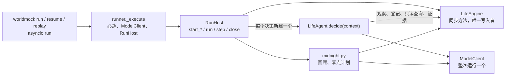
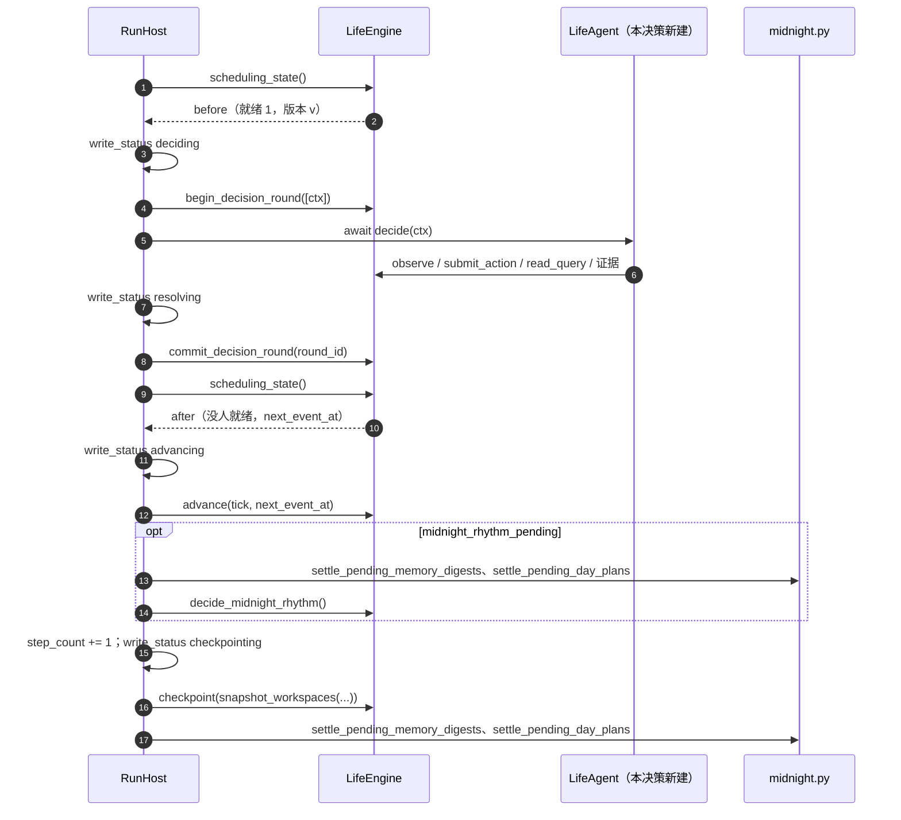
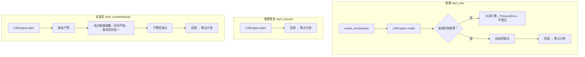

# 运行宿主与决策轮

> 本章属于[去掉 AgentSociety2：开发规格](../SPEC-agentsociety2-removal.md)，读法和叫法见那一页。

## 目标与依据

本章规定一次运行怎样被推进。WorldMock 自己的运行宿主 `RunHost` 在一个进程、一个事件循环里依次取调度状态、开决策轮、让就绪人物逐个决定、原子提交、没人就绪才推进时钟、写共同检查点，并在今天的同样位置跑零点的回顾与日计划；新建、普通恢复、反事实三种启动顺序由三个方法显式写出。runner 不再起 Ray、不再装配 AgentSociety2 的 `Society`，改为装配唯一的模型客户端与运行宿主；零点任务从 runner 搬到 `midnight.py`；决策轮的三个数据类型搬到 `src/worldmock/state/decisions/round.py`。

今天这些事分散在六处：AgentSociety2 的 `Society`（vendor/agentsociety2/packages/agentsociety2/agentsociety2/society/society.py，下文简写为 `as2/society/society.py`）、`as2/society/decision_round.py`、环境 Ray actor（`as2/env/direct_env_actor.py`）、直接路由（`as2/env/router_direct.py`）、工作进程任务（`as2/agent/runner.py`），以及 WorldMock 的 `custom/envs/life_env.py`。其中 Society、决策轮类型、环境 actor 与直接路由由 decision-round 补丁写进 fork，规则本来就是 WorldMock 的；搬回来以后步序、身份格式与零点触发点一字不改，去掉的只是进程边界和为它存在的核对。

实现的提案章节：

| 提案位置 | 本章落实 |
| --- | --- |
| 第六章「一个进程，一个事件循环」全部四点 | 【H1】–【H4】；深拷贝的出口规则引用 02 章 |
| 第六章「运行宿主：决策轮驱动」全部七点 | 步序【H5】–【H12】，三种启动顺序【H25】–【H29】，零点触发点【H20】–【H24】，类型【H40】【H41】，身份【H13】–【H17】，单时钟【H11】，故障【H30】–【H32】 |
| 第四章「普通恢复时，零点的回顾和日计划只能塞进 `LifeEnv.init`」一行 | 【H22】【H28】：普通恢复的零点任务由运行宿主显式调用 |
| 第四章「为一个从不被调用的 `coder` 角色也建一个模型客户端」一行 | 【H19】：整次运行只建一个模型客户端，没有角色 |
| 第四章「Windows 上也安装 Ray」一行与第四章末段 Ray 默认重跑三次的隐患 | 【H1】【H4】：没有 Ray，决策从不重跑；依赖删除归 07 章 |
| 第七章「运行目录」「运维日志」两行 | 不再生成 `env/LifeEnv`（工作区目录名归 05 章）；【H39】 |
| 第八章「删除生产代码」「原样搬迁」两行中的 runner 部分 | runner 的改写见「接口与文件」；零点任务原样搬到 `midnight.py`，打断 LifeEnv 与 runner 之间的循环导入 |
| 第十章「零点任务的触发点变了」「去掉 pickle 边界后出现别名写回」两行 | 【H20】–【H22】保留今天每个检查点之后那次多半为空的补跑；别名写回由 02 章的出口深拷贝承担，宿主不复制、不改写引擎返回的对象 |

适用的裁定（RULING-2026-11-17-owner.md）：

| 裁定 | 本章的落实 |
| --- | --- |
| 1、2 正式运行之前做；推翻「不重写框架」 | 决策循环第一次成为 WorldMock 自己的代码，位置 `src/worldmock/runtime/lifecycle/run_host.py` |
| 5 运行目录改名 | 宿主只经 05 章的 `create_workspaces`、`snapshot_workspaces`、`memory_stores` 碰人物工作区，不拼路径 |
| 8 原始错误直接上报、去掉假错误 | 【H30】–【H32】：只在引擎的轮次仍开着时中止；人物异常不包装（文本归 06 章） |
| 9 自持一个网络客户端，结束时关一次 | 【H19】【H34】：runner 构造唯一的 `ModelClient`，运行宿主关闭时恰好关它一次 |

本章引用而不重述的事实：

| 事实 | 所属章 |
| --- | --- |
| `LifeEngine` 是门面；`observe` 与只读查询返回深拷贝；`commit_decision_round` 返回全部结果；`decisions` 是公开属性，`decisions.round` 在开轮后、提交或中止前不是 `None`；只有 `run_host` 导入引擎门面；引擎各文件里三个类型的导入行改写 | [「去掉 LifeEnv：引擎门面、只读查询与提交结果」](./02-engine-facade.md) |
| `LifeAgent(inputs, engine, model_client, memory)` 的构造、`decide(context)`、人物冻结输入 `PersonInputs` 与构造函数 `person_inputs(persona, stage_identity)`（都在 `src/worldmock/agents/life_agent.py`）、`action_id` 与 `call_id` 的生成 | [「人物、回合循环与只读问答的删除」](./03-agent-loop.md) |
| `ModelClient` 的构造参数与 `close()`、`IndependentModelClient`、`collect_transport_attempts` | [「模型客户端与模型请求底稿」](./04-model-client.md) |
| 工作区路径、`create_workspaces`、`snapshot_workspaces`、`restore_workspaces`、`memory_stores`，`_PreparedRun.memory_records` 的来源 | [「人物工作区、记忆文件与「记忆已更新」」](./05-workspace-memory.md) |
| `RunHost._abort_round`、`RunHost._record_failure` 的全文，中止原因与运行级登记的文本 | [「故障文本」](./06-failure-text.md) |
| `project_root` 删除、`credential_value` 在 `_prepare_resume` 的位置、`_run_identity` 与 `_require_runtime_identity` 的新签名、`runner.py:32-37` 的孤立注释 | [「安装、代码身份、依赖与许可」](./07-install-identity.md) |

一次运行在进程里的样子：



## 行为

条款编号【H1】至【H42】供「测试」一节引用。

### 进程与执行顺序

【H1】一次 `worldmock run`、`resume`、`replay` 只有一个进程、一个事件循环：CLI 现有的 `asyncio.run`（`src/worldmock/cli.py:98`、`:102`、`:121`）驱动 `run_world`、`resume_world`、`replay_world`；`LifeEngine`、每个 `LifeAgent`、`ModelClient` 与零点任务都在这个事件循环里执行。不启动 Ray，不建 actor、工作进程、进程池、线程池或嵌套的事件循环。进程里唯一的后台线程是现有的驱动心跳 `DriverHeartbeat`（`src/worldmock/runtime/monitoring/status.py:71-105`）。`RunHost` 的 `start_new`、`start_resume`、`start_counterfactual`、`run`、`step`、`close` 与两个零点任务都是协程，人物决策 `LifeAgent.decide` 由宿主 `await`；代码保留 asyncio，不改写成同步代码（单次发送期限靠 `asyncio.timeout` 取消发送，litellm 的异步路径原样保留，04 章）。

【H2】单一写入者靠程序结构保证，不加锁：引擎的公开方法全部是同步方法；`RunHost` 逐个 `await`；零点任务只在引擎没有开着的决策轮（`engine.decisions.round is None`）时由 `RunHost` 调用。

【H3】一轮里有几个人物就绪，就按 `SchedulingState.ready_agent_ids` 的次序逐个决定：前一个人物的 `decide` 返回之后才构造下一个人物；不用 `asyncio.gather`、`TaskGroup` 或任何并发写法。v1.0 只有一个人物，与今天每轮一个 Ray 任务逐字节等价；顺序执行让多个人物时的事件序号也可复现。真要并发，要先设计「按决策缓冲证据、提交时按序落库」，另立提案。

【H4】决策从不重跑：每个决策上下文的 `decide` 恰好调用一次；它抛出时按【H30】处理，宿主不再调用它。今天 `step_agent_batch` 是没有设重试参数的 Ray 远程函数，工作进程崩溃时按 Ray 默认会重跑三次（提案第四章末段），这个隐患随 Ray 一起消失。

人物拿到的观察与只读查询结果都是引擎出口处的深拷贝（02 章【E10】【E11】）；宿主自己只把冻结的 `DecisionContext` 交给人物，不复制、不改写引擎返回的任何对象。

### 步序

【H5】`RunHost.step()` 依次执行：

| 序 | 动作 |
| --- | --- |
| 1 | `before = engine.scheduling_state()` |
| 2 | `before.ready_agent_ids` 非空时执行一个决策轮（【H6】） |
| 3 | `after = engine.scheduling_state()` |
| 4 | `after.ready_agent_ids` 为空且 `after.next_event_at` 不是 `None` 时推进到 `after.next_event_at`（【H9】） |
| 5 | `step_count += 1` |
| 6 | 写一个共同检查点（【H20】），之后跑零点任务（【H21】） |

【H6】一个决策轮依次：由 `before` 形成决策上下文（【H13】【H14】）；写状态阶段 `deciding`；`engine.begin_decision_round(list(contexts))`；按上下文次序为每个人物新建 `LifeAgent` 并 `await agent.decide(context)`（【H18】）；写状态阶段 `resolving`；`engine.commit_decision_round(round_id)`。提交的返回值不读、不核对。两次状态写入、开轮、全部人物决策与提交包在同一个 `try` 里（【H30】）。

【H7】同秒再决策：提交之后 `after` 仍有就绪人物时不推进，直接写检查点；下一次 `step` 在同一秒开新轮。新轮的世界版本已加一，所以 `round_id` 与上一轮不同。

【H8】每次 `step` 恰好写一个共同检查点，只推进不决策的 `step` 也写；新建运行另有一个初始检查点（【H26】），反事实分支另有一个干预检查点（【H29】），普通恢复启动时不写（【H28】）。

【H9】推进到 `target`：写状态阶段 `advancing`；`engine.advance(int(target.timestamp()) - engine.context.state.current_time, target)`；之后 `engine.midnight_rhythm_pending` 为真时，依次 `await settle_pending_memory_digests(engine, client)`、`await settle_pending_day_plans(engine, client)`、`engine.decide_midnight_rhythm()`。

【H10】结束判定：`RunHost.run()` 在 `engine.context.state.current_time < engine.context.state.end_time` 时反复调用 `step()`，到达结束时刻即返回。宿主不核对引擎给出的边界是否越过结束时刻、是否为正整秒、推进后引擎是否确认目标时刻，也不在结束后另核「恰好停在结束时刻」：边界只来自引擎，引擎的 `advance` 自己核对有没有人物到期与 tick、下一边界（`src/worldmock/simulation_engine/scheduling/clock/time_advance.py:105-109`），`_next_epoch` 的候选里本来就有 `end_time`（`time_advance.py:430-432`）。

【H11】只有一个时钟：`RunHost` 不保存当前时刻。`RunHost.current_time` 每次读引擎，`_datetime(engine.context.state.current_time, engine.context.config.timezone)`（`src/worldmock/foundation/time/readable.py:115-117`），与 `SchedulingState.current_time` 同一写法。`RunResult.current_time`、运维日志 `RUN_ENDED` 与 `RUN_CRASHED` 的模拟时刻都取它；`result.json` 里经 `str()` 写出的 `current_time` 与今天逐字相同（今天 `Society._t` 推进后就是引擎给出的 `next_event_at`，`as2/society/society.py:385-387`）。

【H12】`RunHost.step_count` 是这个宿主完成 `step()` 加一的次数，从 0 起；`RunResult.step_count` 与 `RUN_ENDED` 的 `steps` 取它。启动方法不加它。

一次有决策的 `step`：



### 身份

【H13】决策轮身份与决策身份的格式逐字保留，由 `RunHost._decision_contexts` 生成：

| 身份 | 格式 | 取值 | 今天的生成处 |
| --- | --- | --- | --- |
| `round_id` | `f"{run_id}:round:{epoch}:{world_state_version}"` | `run_id` 是 `engine.context.state.run_id`（恢复分支的状态在 `restore_branch` 里已改成子运行身份，`src/worldmock/recording_engine/storage/checkpoint.py:172`，与今天 Society 用的 `prepared.run_id` 相等）；下列 `state` 都是这一步的调度状态 `SchedulingState`：`epoch` 是 `int(state.current_time.timestamp())`，`world_state_version` 是 `state.world_state_version` | `as2/society/society.py:275-276` |
| `decision_id` | `f"{round_id}:agent:{agent_id}:order:{order}"` | `order` 是人物在 `state.ready_agent_ids` 里的下标，从 0 起 | `as2/society/society.py:281` |
| `action_id` | `f"{decision_id}:action:{n:04d}"` | `n` 是这次决策里已登记世界请求的序号，从 1 起（今天的计数器每个决策归零，`custom/agents/life_agent.py:337`） | `custom/agents/life_agent.py:522-523`，以后由 03 章生成 |
| `call_id` | `f"{decision_id}:model:{seq:04d}:attempt:1"` | `seq` 每个决策从 1 起、每次模型调用加一（截断重试与纠错回合也加一）；ReAct 路径的 attempt 恒为 1 | `as2/agent/base/agent_runtime.py:739`、`:965-975`，以后由 03 章生成 |

`round_id` 与 `round_order` 写在 `decision_started` 里（`src/worldmock/simulation_engine/decisions/decision_start.py:24-28`），`decision_id` 写在所有决策事件里，评测按 `call_id` 的 `:model:NNNN:` 数回合（`tools/analysis/memory_pilot.py:86`）。

【H14】每个决策上下文是 `DecisionContext(run_id, round_id, decision_id, agent_id, state.current_time, state.world_state_version)`，`observed_at` 就是调度状态的当前时刻（场景时区），六个字段按位置传入。

【H15】`state.ready_agent_ids` 里有宿主没有冻结输入的人物时，在开轮之前先写 `logger.error`，再抛 `RuntimeError(f"Environment returned unknown ready agents: {sorted(unknown)}")`，文本与类同今天（`as2/society/society.py:272-274`）；它在决策轮的 `try` 之外，按【H31】登记运行失败。

【H16】`action_id` 与 `call_id` 的格式与生成规则见【H13】的表，由 03 章在 `LifeAgent` 与 `react_loop.py` 里生成；宿主不生成、不改写它们。

【H17】检查点标签 `initial`、`advance:{step_count:012d}`、`counterfactual:{sha}`（`as2/society/society.py:168`、`:195`、`:231`）随 `SocietyCheckpointRequest` 一起消失：它们从不落库（今天 `custom/envs/life_env.py:215-231` 只读请求的 `run_id`、`current_time` 与 `agent_workspaces`），共同检查点只由人物快照与引擎状态组成。

### 人物与模型客户端

【H18】每个决策新建一个 `LifeAgent(self._agents[agent_id], self.engine, self._client, self._memories[agent_id])`，`await decide(context)` 返回后丢弃。人物拿到的环境句柄就是引擎对象本身；跨决策共享的只有引擎、`ModelClient`、每个人物的记忆存储和冻结输入。今天每个决策在工作进程里从磁盘重建人物（`as2/agent/runner.py:126-132`），人物跨决策不带内存状态；新建实例让这一点由结构保证。

【H19】整次运行恰有一个 `ModelClient`：`runner._execute` 在运行的事件循环里、驱动心跳之内调用 `runner._model_client(prepared)` 构造它，参数取 `_PreparedRun.stage_identity` 的 `base_url`、`max_retries`、`transport_max_retries` 与 `credential_value(prepared.inputs.config.model)`；`_model_client` 是运行装配里构造模型客户端的唯一一处。构造好的实例交给 `RunHost`，人物的每个模型回合、零点计划与回顾都经它发送；`RunHost.close()` 恰好 `await` 它的 `close()` 一次（【H34】）。没有 `default`、`coder`、`embedding` 角色，不建第二个客户端。`RunHost.__init__` 只绑定属性并经 05 章 `memory_stores` 建存储对象（不读文件、不碰网络），所以客户端构造之后、宿主绑定它之前没有会失败的步骤。

### 共同检查点与零点任务

【H20】写共同检查点：写状态阶段 `checkpointing`；`snapshots = snapshot_workspaces(run_dir, sorted(agents), engine.context.store.assets)`；`engine.checkpoint(snapshots)`。人物集合由引擎核对（`src/worldmock/simulation_engine/engine.py:175-177`），宿主不另核。

【H21】每个共同检查点提交之后，依次 `await settle_pending_memory_digests(engine, client)`、`await settle_pending_day_plans(engine, client)`：新建运行的初始检查点、反事实分支的干预检查点和每一次 `step` 的检查点都这样（今天 `custom/envs/life_env.py:202-213`）。新登记的回顾与计划由下一个共同检查点封存。

【H22】普通恢复启动时、首次决策之前，依次跑回顾与零点计划，不写检查点（今天 `custom/envs/life_env.py:110-121`）。

【H23】没有待办（运行已到终点、没有待生成的期次、无人缺当日计划）时，零点任务不构造业务客户端、不调用模型客户端、不写请求证据与调用运维日志，返回 `[]`。判断与今天相同（`src/worldmock/runtime/lifecycle/runner.py:631-633`、`:731-739`）。

【H24】零点任务原样搬进 `src/worldmock/runtime/lifecycle/midnight.py`，签名为 `settle_pending_memory_digests(engine: Any, client: ModelClient) -> list[dict]` 与 `settle_pending_day_plans(engine: Any, client: ModelClient) -> list[dict]`，`client` 必填；业务客户端 `MemoryDigestClient`、`PlanDayClient` 仍在发现第一项待办之后才用 `client` 与运行清单的 `stage_model_identity` 构造。`client` 是模型层的客户端，不是业务客户端：宿主传的是整次运行唯一的 `ModelClient`，测试与数据集一侧传有 `async call(request: dict)` 的替身；业务客户端只由这两个函数自己构造，调用方不再传 `PlanDayClient` 或 `MemoryDigestClient`（今天 `client` 参数直接当业务调用方用，`runner.py:634`、`:734`，这一用法删除）。数据集一侧 `settle_pending_day_plans(self.engine, client=self.plan_client)`（WorldMock-Dataset/tools/native_day.py:248）的 `EmptyPlanClient` 只有 `model_name` 与 `async call(request) -> dict`（native_day.py:183-194），经 `PlanDayClient` 包装照常可用，所以那一侧只改导入路径（:246）。runner 不再定义、不再导入、不再重新绑定这十个名字（见「接口与文件」）。

零点任务的触发点：

| 时机 | 次序 | 今天 | 条款 |
| --- | --- | --- | --- |
| 每个共同检查点提交之后 | 回顾 → 零点计划 | `custom/envs/life_env.py:202-213` | 【H21】 |
| 零点推进之后（`midnight_rhythm_pending` 为真） | 回顾 → 零点计划 → 节律判定 | `custom/envs/life_env.py:233-242` | 【H9】 |
| 普通恢复启动时 | 回顾 → 零点计划，不写检查点 | `custom/envs/life_env.py:110-121` | 【H22】 |
| 决策轮开着时 | 从不 | — | 【H2】 |

### 三种启动顺序

【H25】`runner._start(host, prepared)` 选择启动方法：`prepared.run_identity` 不是 `None` 时 `await host.start_new(prepared.run_identity, prepared.stage_identity, _creation_options(prepared))`；否则 `prepared.intervention` 是 `None` 时 `await host.start_resume()`；否则先查 `prepared.intervention_sha256`，为 `None` 时写 `logger.error` 并抛 `RuntimeError("Counterfactual intervention identity is unavailable")`（文本同今天 `runner.py:464-465`），不为 `None` 时 `await host.start_counterfactual(prepared.intervention, prepared.intervention_sha256)`。

【H26】新建 `start_new(identity, stage_identity, create_options)` 依次：`create_workspaces(run_dir, identity.agent_ids)`（05 章【W2】，此时目录为空，已存在即失败）；`LifeEngine.create(inputs, run_dir, identity, stage_identity, create_options)`；核对起始时刻（【H27】）；写初始检查点（【H20】），随后零点任务（【H21】）。

【H27】起始时刻核对：`int(inputs.config.start_time.timestamp())` 不等于 `engine.context.state.current_time` 时，先 `engine.close()`、把 `self.engine` 置为 `None`，写 `logger.error`，再抛 `ProtocolError("Run host start time disagrees with the engine")`；不登记运行失败（与今天 `custom/envs/life_env.py:104-107` 同一范围，那时 `Society` 的登记尚未开始）。

【H28】普通恢复 `start_resume()` 依次：`LifeEngine.open(inputs, run_dir)`；零点任务（【H22】）。不写检查点，不核对起始时刻（提案只给新建运行列了这一步；恢复与重放的 `prepared.start_time` 本来就由恢复出的同一份状态算出，`runner.py:258`，今天 `LifeEnv.init` 对它的核对恒成立）。

【H29】反事实 `start_counterfactual(intervention, intervention_sha256)` 依次：`LifeEngine.open(inputs, run_dir)`；`before = engine.scheduling_state()`；`receipt = engine.apply_counterfactual(intervention)`；`receipt.intervention_sha256` 不等于 `intervention_sha256` 时抛 `RuntimeError("Environment confirmed a different counterfactual identity")`；`after = engine.scheduling_state()`；`after.current_time` 不等于 `before.current_time` 时抛 `RuntimeError("Counterfactual intervention changed simulation time")`；`after.world_state_version` 不等于 `before.world_state_version + 1` 时抛 `RuntimeError("Counterfactual intervention did not advance one world version")`；写干预检查点（【H20】），随后零点任务（【H21】）；返回 `receipt`。三条文本与类同今天（`as2/society/society.py:188-194`），抛出之前各以同一文本写 `logger.error`。



`create_options` 不再由环境初始化读取，`runner._creation_options` 算好后直接交给 `start_new`（【H37】）。今天 `LifeEnv.init` 从环境根重读一遍环境（新建时再读一次模型服务元数据）再建引擎（`custom/envs/life_env.py:94-103`）；以后宿主用 runner 已加载的那份 `EnvironmentInputs`（【H38】）。

### 故障

【H30】决策轮的 `try`（【H6】）里抛出任何 `Exception` 时，宿主 `self._abort_round(round_id, error)`，然后原样 `raise`。`_abort_round` 只在 `engine.decisions.round is not None` 时中止，中止原因、双重故障与日志见 06 章【F5】–【F10】。提交之后才抛出的故障（同秒决策次数用完，`src/worldmock/simulation_engine/decisions/decision_coordinator.py:178-187`）与开轮之前就失败的故障都不中止。

【H31】运行级登记 `self._record_failure(error)`（06 章【F11】【F12】）覆盖的范围恰为下表；各处都是 `except Exception as error:` 里先登记、再原样 `raise`：

| 位置 | 覆盖 | 不覆盖 |
| --- | --- | --- |
| `start_new` | 起始时刻核对通过之后的初始检查点与零点任务 | 建工作区、`LifeEngine.create`、起始时刻核对 |
| `start_resume` | `LifeEngine.open` 返回之后的零点任务 | `LifeEngine.open` |
| `start_counterfactual` | `LifeEngine.open` 返回之后的取调度状态、施加干预、三项核对、干预检查点与零点任务 | `LifeEngine.open` |
| `run` | 整个步进循环，含【H15】与提交之后抛出的故障 | — |
| `_close_engine` | `engine.close()` 抛出时 | 模型客户端的关闭 |

引擎尚未建立或已经关闭时不登记，因为没有足迹库可写。今天普通恢复的零点任务失败在 `LifeEnv.init` 里直接 `engine.fail_run(repr(error))`（`custom/envs/life_env.py:113-121`），登记本身失败时只得到链式异常；以后经同一个 `_record_failure`，两项都进 `Run and failure recording both failed` 异常组。

【H32】宿主 `await` 人物决策时不用 `try` 改写、包装或记录人物异常（06 章【F1】）；只捕获 `Exception`，`KeyboardInterrupt`、`asyncio.CancelledError` 等其余 `BaseException` 不中止、不登记、原样传出（06 章【F13】）。

### 状态阶段

【H33】`RunHost` 用 `write_status(run_dir, "running", <阶段>)`（`src/worldmock/runtime/monitoring/status.py:49-57`，不改）写四个阶段，位置与今天 LifeEnv 的四处一一对应：

| 阶段 | 写在 | 今天 |
| --- | --- | --- |
| `deciding` | 决策轮里开轮之前 | `custom/envs/life_env.py:145` |
| `resolving` | 决策轮里提交之前 | `custom/envs/life_env.py:182` |
| `checkpointing` | 每次写共同检查点、取快照之前（含初始与干预检查点） | `custom/envs/life_env.py:209` |
| `advancing` | 每次推进之前 | `custom/envs/life_env.py:236` |

零点任务不另写阶段：检查点之后的零点任务时状态是 `checkpointing`，零点推进之后的是 `advancing`，普通恢复启动时的零点任务不写任何阶段（与今天 `LifeEnv.init` 相同）。`completed`、`failed`、`interrupted` 仍由 CLI 写（`src/worldmock/cli.py:106`、`:108-111`，不改）。

### 关闭与清理

【H34】`RunHost.close()`：引擎不是 `None` 时调用 `_close_engine()`——`engine.close()` 抛出时先 `logger.exception("Engine close failed")`，再 `self._record_failure(error)`，再原样抛出，引擎属性保持不变；成功时把 `self.engine` 置为 `None`。然后 `await self._client.close()`，抛出时 `logger.exception("Model client close failed")`。两步各自的 `Exception` 都收集：恰一项时抛它；两项时抛 `ExceptionGroup("Run host close failed", [<引擎一项>, <客户端一项>])`。模型客户端无论引擎是否建立都关闭，且每次 `close()` 只关一次。

【H35】`runner._execute` 的清理只剩 `RunHost.close()` 一项：宿主已构造时，在 `finally` 里 `await host.close()`；关闭抛出 `BaseException` 时先 `logger.exception("Run host close failed")`，运行本身已经失败则抛 `BaseExceptionGroup("WorldMock run and cleanup failed", [<运行故障>, <关闭故障>])`（文本同今天 `runner.py:483`），否则原样抛出关闭故障。`ray.kill`、`ray.shutdown`、构造失败时回滚 actor（今天 `runner.py:489-512`、`:598-609`）与 `WorldMock cleanup failed` 异常组都不再存在。`ModelClient` 构造失败时宿主尚未构造，没有要关的东西。

### runner 的装配

【H36】`_prepare_new_run` 与 `_prepare_resume` 在准备阶段就算好宿主要的全部冻结输入，放进 `_PreparedRun`：`stage_identity` 新建时是 `stage_model_identity(inputs.config.model, inputs.model_metadata, request.same_second_continuation)`（同一个值也写进 `RUN_STARTED`），恢复与重放时是父清单复制来的 `manifest["stage_model_identity"]`；`agents` 是「人物编号 → 03 章 `PersonInputs`」，恰为 `{inputs.persona.agent_id: person_inputs(inputs.persona, stage_identity)}`（v1.0 只有一个人设表；新建时运行身份的 `agent_ids` 就是 `(inputs.persona.agent_id,)`，`runner.py:221`，恢复时清单的人物集合由 `require_environment_identity` 对 `persona_sha256` 的核对绑定到同一张人设表）；`run_identity` 只在新建时给出；`memory_records` 的取值归 05 章。准备阶段不建 `ModelClient`、不写工作区。

【H37】新建运行的 `create_options` 由 `runner._creation_options(prepared)` 在 `_start` 里、`start_new` 之前算出，取代今天的 `_society_specs`（`runner.py:547-566`）：`specs, warnings = run_setup.creation_inputs(inputs, prepared.same_second_continuation)`；每条警告照今天的写法写一条 `runtime` 组件、`warn` 级的运维日志（键依次 `code`、`detail`、`agent_id`、`message`、`details`，`detail` 恒为 `Input warning frozen into the run manifest`）；返回 `{"same_second_continuation": prepared.same_second_continuation, "input_warnings": warnings, "persona_habit_responses": habit_responses(specs)}`，三个键、键序与值都同今天（今天先放 `same_second_continuation`，再 `update` 另两个键，`runner.py:202`、`:556-557`）。`habit_responses`（`runner.py:584-589`）原样保留在 runner，仍读 `creation_inputs` 给出的 `spec["profile"]["persona_card_struct"]`（05 章只从 `creation_inputs` 删去 `config`）。运维日志的先后同今天：`RUN_STARTED`、各条输入警告，然后才是引擎建运行写下的记录。

【H38】宿主用 runner 已加载的 `prepared.inputs` 调 `LifeEngine.create` 与 `LifeEngine.open`（两者本来就接受 `EnvironmentInputs`，`src/worldmock/simulation_engine/world/world_setup.py:120`、`:163-165`）。所以新建运行只在准入时向模型服务读一次元数据（今天驱动与环境 actor 各读一次，`docs/design/08-configuration.md:166`）；恢复与重放仍只读父清单冻结的那一份，打开时照旧核对环境身份（`world_setup.py:165`）。

【H39】运维日志的写入方：

| 记录码 | 以后的写入方 | 变不变 |
| --- | --- | --- |
| `RUN_STARTED`、`RUN_RESUMED` | `runner._prepare_new_run`、`runner._prepare_resume`，不变 | 键与次序不变（`code`、`detail`、`run_id`、`code_sha256`、`persona_sha256`、`config_sha256`、`stage_model_identity`；`code`、`detail`、`run_id`、`code_sha256`、`checkpoint_id`） |
| 输入警告各码 | `runner._creation_options`（原 `_society_specs`） | 不变 |
| `RUN_ENDED` | `runner._execute` | 键 `code`、`detail`、`run_id`、`steps` 不变；模拟时刻与 `steps` 取自宿主（【H11】【H12】） |
| `RUN_CRASHED` | `runner._ops_crash_log(prepared, host, error)` | 键与模板不变；宿主已建且引擎打开时模拟时刻取 `host.current_time`，否则取 `prepared.start_time` |
| `DECISION_ROUND_BEGAN`、`DECISION_ROUND_COMMITTED`、`DECISION_ROUND_ABORTED`、`RUN_FAILED`、`CHECKPOINT_COMMITTED` | 引擎，不变 | `DECISION_ROUND_COMMITTED` 的计数归 02 章，`DECISION_ROUND_ABORTED` 与 `RUN_FAILED` 的说明文本归 06 章 |
| `PLAN_DAY_CALL`、`MEMORY_DIGEST_CALL` 与其后的 `MODEL_TRANSPORT_WAIT` | `midnight.py`（原 runner） | 记录逐字不变（组件 `agent_runtime`） |

`RunHost` 不写运维日志。Python 日志：`Decision round abort failed`、`Run failure recording failed` 从 logger `agentsociety2.society.society` 换到 `worldmock.runtime.lifecycle.run_host`（06 章）；`Society close failed`、`Direct environment actor termination failed`、`Owned Ray shutdown failed`、`Direct environment actor rollback failed` 删除；新增 `Engine close failed`、`Model client close failed`（【H34】）、`Run host close failed`（【H35】）、`Run host start time disagrees with the engine`（【H27】）以及【H15】【H25】【H29】抛出之前的同文日志。零点任务的四条错误日志文本不变，logger 名从 `worldmock.runtime.lifecycle.runner` 换成 `worldmock.runtime.lifecycle.midnight`。

### 决策轮类型

【H40】`src/worldmock/state/decisions/round.py` 定义 `DecisionContext`、`DirectToolCall`、`SchedulingState` 三个 `@dataclass(frozen=True, slots=True)`，名称、字段名、字段次序、类型注解、`__post_init__` 的全部校验与 `ValueError` 文本都与 `as2/society/decision_round.py:21-128` 逐字相同：

| 类型 | 字段（按次序） | 校验与原文 |
| --- | --- | --- |
| `DecisionContext` | `run_id: str`、`round_id: str`、`decision_id: str`、`agent_id: int`、`observed_at: datetime`、`world_state_version: int` | 三个身份文本非空：`{field_name} must be a non-empty string`；`agent_id` 是整数且不是布尔：`agent_id must be an integer`；`observed_at` 带时区：`observed_at must be timezone-aware`；版本是非负整数：`world_state_version must be a non-negative integer` |
| `DirectToolCall` | `context: DecisionContext`、`action_id: str`、`tool_name: str`、`request: BaseModel` | `context must be a DecisionContext`；`action_id`、`tool_name` 非空同上；`request must be a validated Pydantic model` |
| `SchedulingState` | `current_time: datetime`、`ready_agent_ids: tuple[int, ...]`、`next_event_at: datetime \| None`、`world_state_version: int` | 静态方法 `_validate_time(value, field_name)`：`{field_name} must be a datetime`、`{field_name} must be timezone-aware`；`next_event_at must be later than current_time`；`ready_agent_ids must be unique`；`ready_agent_ids must contain integers`；版本同上 |

模块私有函数 `_require_text(value, field_name)` 同原文（`decision_round.py:21-29`）。`__all__ = ["DecisionContext", "DirectToolCall", "SchedulingState"]`。模块以 `from __future__ import annotations` 开头（同原文第 3 行），只导入 `dataclasses.dataclass`、`datetime.datetime`、`typing.Any` 与 `pydantic.BaseModel`。

【H41】`SocietyCheckpointRequest`、`AgentStepBatchRequest`、`AgentCreateBatchRequest` 在 `src/` 里不存在：前者的四个字段由宿主直接交给 `snapshot_workspaces` 与 `engine.checkpoint`，后两者只为 Ray 任务打包而存在。`src/` 里这三个保留类型只在 `round.py` 定义，生产代码只从 `worldmock.state.decisions.round` 导入它们（引擎各文件的导入行归 02 章，人物一侧归 03 章）。

### 模块边界

【H42】`run_host.py` 与 `midnight.py` 只用模块级导入，不登记任何延迟导入；`midnight.py` 以 `Any` 接收引擎，不导入 `worldmock.simulation_engine.engine`（只有 `run_host` 导入它，02 章【E4】）。runner 保持纯加载边界：`import worldmock.runtime.lifecycle.runner` 之后，`worldmock.runtime.lifecycle.run_host`、`worldmock.configuration.model.model_client`、`worldmock.simulation_engine.engine`、`worldmock.simulation_engine.world.context` 都不在 `sys.modules` 里（现有守卫 `tests/system/cli/test_cli.py:62-70`，禁止集合由 09 章【T45】更新），`worldmock.agents.life_agent` 也不在（它经 `prompt_capacity` 导入模型客户端，04 章【M17】）。所以 runner 对这三个新模块一律在函数内导入：`_execute` 导入 `RunHost`，`_model_client` 导入 `ModelClient`，`_prepare_new_run` 与 `_prepare_resume` 导入 `person_inputs`；类型注解里的 `RunHost`、`ModelClient`、`PersonInputs` 只在 `if TYPE_CHECKING:` 下导入。runner 里随零点任务搬走的延迟导入登记删除；新增六条登记（`tests/unit/engineering/test_import_graph.py` 的 `DELAYED_IMPORTS`，理由文字沿用「按原调用时机延迟加载，保持输入纯加载边界」）：`_creation_options` 照 runner 的写法延迟导入的 `worldmock.runtime.framework.setup` 与 `worldmock.recording_engine.storage.opslog` 两条，以及 `('worldmock.runtime.lifecycle.runner', '_execute', 'worldmock.runtime.lifecycle.run_host')`、`('worldmock.runtime.lifecycle.runner', '_model_client', 'worldmock.configuration.model.model_client')`、`('worldmock.runtime.lifecycle.runner', '_prepare_new_run', 'worldmock.agents.life_agent')`、`('worldmock.runtime.lifecycle.runner', '_prepare_resume', 'worldmock.agents.life_agent')` 四条。runner 模块的顶层不定义、不导入、不赋值 `PlanDayClient`、`MemoryDigestClient`、`settle_pending_day_plans`、`settle_pending_memory_digests`、`_generate_day_plan`、`_call_plan_day`、`_log_plan_day_call`、`_generate_memory_digest`、`_call_memory_digest`、`_log_memory_digest_call` 这十个名字，不留转发。

### 逐字不变的与会变的

| 对象 | 变不变 |
| --- | --- |
| 步序、同秒再决策、每步一个共同检查点、三种启动顺序里各步的先后 | 不变 |
| `round_id`、`decision_id`、`action_id`、`call_id` 的格式 | 逐字不变 |
| 三个类型的名称、字段次序、校验与文本 | 逐字不变 |
| 零点任务的触发点与次序，`midnight.py` 里的请求、证据、登记与运维日志 | 逐字不变（logger 名除外） |
| `status.json` 的阶段名与写入时机 | 不变 |
| `RUN_STARTED`、`RUN_RESUMED`、`RUN_ENDED`、`RUN_CRASHED` 与输入警告的记录形状 | 不变 |
| `result.json` 的 `current_time`、`step_count` | 不变 |
| 新建运行的 `create_options` | 不变 |
| `Environment returned unknown ready agents`、反事实三条、`Counterfactual intervention identity is unavailable`、`Decision round and abort both failed`、`Run and failure recording both failed`、`WorldMock run and cleanup failed` | 逐字不变 |
| 运行目录 | 不再有 `env/LifeEnv` 与 `as2/`（工作区目录归 05 章） |
| 起始时刻核对文本 | `LifeEnv start time disagrees with the environment` → `Run host start time disagrees with the engine` |
| 关闭故障 | `LifeEnv close and failure recording both failed` 删除（06 章）；新增 `Run host close failed` 异常组；`WorldMock cleanup failed`、`Society construction and actor rollback failed` 删除 |
| 新建运行读模型服务元数据的次数 | 两次 → 一次 |
| 同秒决策次数用完时 `status.json` 的假错误 | 去掉（文本归 06 章） |

随 Society 与 runner 的框架装配一起消失的英文文本（都不再出现在 `src/` 里；LifeEnv 自己的文本归 02 章，人物结果包装 `Agent decision failed: ` 归 06 章）：

| 文本 | 今天的位置 |
| --- | --- |
| `Society run and agent class identities are required`、`end_time must be later than start_time`、`agent_specs must contain unique agents`、`batch_size must be positive`、`{name} must be timezone-aware`（`AgentSocietyConfig`） | `as2/society/society.py:58-80` |
| `Society is already initialized`、`Society is not active` | `as2/society/society.py:154`、`:227` |
| `Society must be active before a counterfactual intervention`、`Counterfactual intervention requires a fresh restored branch` | `as2/society/society.py:183`、`:185` |
| `Agent workspace already exists: {root}`（工作区根）、`Restored agent workspace is incomplete: {workspace}` | `as2/society/society.py:204`、`:222`；新建的逐人物文本归 05 章【W2】 |
| `Environment confirmed a different round_id` | `as2/society/society.py:254` |
| `Agent batch results do not match decision contexts` | `as2/society/society.py:330` |
| `Environment commit results do not cover the decision round`、`Environment commit results contain different agents`、`Environment committed a fatal agent result: {failures}` | `as2/society/society.py:345`、`:349`、`:352` |
| `Environment omitted next boundary before end_time`、`Environment next boundary exceeds end_time`、`Environment next boundary must use positive whole seconds`、`Environment did not confirm the advanced time` | `as2/society/society.py:377`、`:381`、`:384`、`:392` |
| `Environment must return SchedulingState`、`Society and environment clocks disagree` | `as2/society/society.py:401`、`:403` |
| `Society did not stop at the exact end_time` | `as2/society/society.py:452` |
| `LifeAgent or LifeEnv custom module registration failed` | `runner.py:817` |

### AgentSociety2 与 LifeEnv 的职责去向

`as2/society/society.py`：

| 行 | 职责 | 去向 |
| --- | --- | --- |
| 29-70 | `AgentSocietyConfig`：运行身份、人物记录、类名、路由、服务代理、起止时刻、目录、`custom` 根、工作区模式、批大小，以及五项校验 | 删除；宿主构造参数见「接口与文件」，起止时刻与人物集合已由运行身份与配置校验 |
| 73-110 | `_require_aware`、`_chunks`、`_result_field`、`_result_status` | 删除 |
| 116-149 | 构造、`current_time`、`step_count`、`agent_ids`、`token_stats` | `RunHost.__init__`、`current_time`（【H11】）、`step_count`（【H12】）；`agent_ids` 与 `token_stats` 删除（`result.json` 的用量由已落盘响应计算，`src/worldmock/cli.py:103-104`） |
| 151-172 | `init`：起 Ray、建或核对工作区、环境初始化、时钟同步、初始检查点、故障登记 | `start_new`、`start_resume`（【H26】【H28】）；起 Ray、工作区存在性核对、时钟同步删除 |
| 174-199 | `apply_counterfactual` | `start_counterfactual`（【H29】）；「必须已初始化」「必须是全新恢复分支」两条状态核对删除，因为这一步只能作为启动方法被调用一次 |
| 201-222 | `_create_agent_workspaces`、`_verify_restored_workspaces` | `create_workspaces`（05 章）；恢复时的唯一一次校验在 05 章的 `restore_workspaces` |
| 224-240 | `step` | `RunHost.step`（【H5】） |
| 242-264 | `_execute_decision_round` | `RunHost._decision_round`（【H6】【H30】）；`Environment confirmed a different round_id` 删除（引擎的 `begin_decision_round` 不回显轮次身份） |
| 266-287 | `_decision_contexts` | `RunHost._decision_contexts`（【H13】–【H15】），`run_id` 改取引擎状态 |
| 289-313 | `_run_agent_batches` | 删除；宿主逐个新建 `LifeAgent`（【H3】【H18】） |
| 315-352 | `_require_successful_results`、`_require_committed_results` | 删除：人物不返回结果；提交返回值没有读者（02 章【E14】） |
| 354-367 | `_abort_round` | `RunHost._abort_round`（06 章） |
| 369-392 | `_advance` | `RunHost._advance`（【H9】）；五条边界核对删除（【H10】） |
| 394-404 | `_require_schedule` | 删除（【H11】） |
| 406-429 | `_checkpoint`、`_workspace_for` | `RunHost._checkpoint`（【H20】）；路径归 05 章 |
| 431-442 | `_merge_token_stats` | 删除 |
| 444-455 | `run` | `RunHost.run`（【H10】【H31】）；末尾的结束时刻核对删除 |
| 457-471 | `_report_run_failure` | `RunHost._record_failure`（06 章） |
| 473-486 | `close` | `RunHost.close`（【H34】）；`shutdown_dispatchers` 删除 |
| 488-509 | `__aenter__`、`__aexit__`、`_await_ref` | 删除 |

`as2/society/decision_round.py`：

| 行 | 内容 | 去向 |
| --- | --- | --- |
| 21-128 | `_require_text`、`DecisionContext`、`DirectToolCall`、`SchedulingState` | `src/worldmock/state/decisions/round.py`（【H40】） |
| 131-187 | `AgentStepBatchRequest`、`AgentCreateBatchRequest` | 删除（【H41】） |
| 190-214 | `SocietyCheckpointRequest` | 删除（【H17】【H41】） |

环境 actor、路由与工作进程：

| 位置 | 职责 | 去向 |
| --- | --- | --- |
| `as2/env/direct_env_actor.py:14-32`、`:35-192` | `DirectEnvActorSpec`、`DirectEnvActor`：扫描 `custom/`、按类名构造 LifeEnv、建直接路由、`bind_env_workspaces` 建出空目录 `run_dir/env/LifeEnv`（`:68-72`）、逐个转发方法 | 删除；宿主直接持有引擎 |
| `as2/env/direct_env_actor.py:195-208` | `max_concurrency=1` 把环境调用串行化 | 由结构保证（【H2】） |
| `as2/env/router_direct.py:12-24`、`:27-167` | 十一个直接方法的闭集、取唯一合同环境、`init` 只转发、拒绝文本路由与工作区搬运；`step`、`set_current_time`、`close` 继承 RouterBase | 删除；引擎方法直接调用；生产中从未执行的 `LifeEnv.set_current_time` 随之消失 |
| `as2/env/env_router_proxy.py`、`src/worldmock/runtime/framework/read_query.py` | 远程代理与只读查询的两个子类 | 删除（02 章） |
| `as2/agent/runner.py:116-208`、`:348-380` | 每批扫描 `custom/`、从工作区重建人物、绑定上下文、`step(tick=0)`、写回工作区、关闭，把异常转成字典；按事件循环关闭 litellm 缓存客户端 | 宿主每个决策新建 `LifeAgent`（【H18】）；异常不转换（【H32】）；客户端整次运行关一次（【H34】） |
| `as2/agent/service_proxy.py` | 打包环境代理与 `default`/`coder` 客户端交给工作进程 | 删除；宿主把引擎与 `ModelClient` 直接交给 `LifeAgent` |

`custom/envs/life_env.py` 里归宿主的部分（其余各行的去向见 02 章「LifeEnv 的职责去向」）：

| 行 | 职责 | 去向 |
| --- | --- | --- |
| 81-111 | 建或打开引擎、起始时刻核对、普通恢复补零点任务 | `start_new`、`start_resume`、`start_counterfactual`（【H26】–【H29】） |
| 113-121 | 普通恢复的零点任务与故障登记 | `start_resume`（【H22】【H31】） |
| 142-147、179-184 | 状态阶段 `deciding`、`resolving` | `_decision_round`（【H33】） |
| 202-231 | 状态阶段 `checkpointing`、快照、`engine.checkpoint`、零点任务 | `_checkpoint`（【H20】【H21】【H33】） |
| 233-242 | 状态阶段 `advancing`、推进、零点任务与节律判定 | `_advance`（【H9】【H33】） |
| 251-257 | `fail_run`、`apply_counterfactual` 的转发 | 宿主直接调用 |
| 287-309 | 关闭 litellm 缓存客户端、关闭引擎、关闭失败的登记 | `RunHost.close`、`_close_engine`（【H34】）；缓存客户端的关闭改为关闭唯一的 `ModelClient` |

## 接口与文件

### 文件

| 路径 | 动作 | 内容 |
| --- | --- | --- |
| `src/worldmock/runtime/lifecycle/run_host.py` | 新建 | `RunHost`，见下 |
| `src/worldmock/runtime/lifecycle/midnight.py` | 新建 | 由 `runner.py:612-805` 搬来，见下 |
| `src/worldmock/state/decisions/round.py` | 新建 | 三个类型（【H40】），函数体与文档串从 `as2/society/decision_round.py:1-128` 搬来（含第 3 行 `from __future__ import annotations`），模块文档串改为 `"""@brief 决策轮的三个数据类型：决策上下文、宿主补齐身份的工具调用与调度状态（docs/design/10-runtime.md「决策循环」）。"""` |
| `src/worldmock/runtime/lifecycle/runner.py` | 修改 | 执行部分改写，见下；与 05、07 章同改此文件，那两章的改动以各自章节为准 |
| `src/worldmock/simulation_engine/evidence/memory_digest.py` | 修改 | 只改第 3 行模块文档串里的 `worldmock.runtime.lifecycle.runner.settle_pending_memory_digests` 为 `worldmock.runtime.lifecycle.midnight.settle_pending_memory_digests` |
| `src/worldmock/simulation_engine/scheduling/plans/day_planning.py` | 修改 | 只改第 3 行模块文档串里的 `worldmock.runtime.settle_pending_day_plans` 为 `worldmock.runtime.lifecycle.midnight.settle_pending_day_plans` |
| `tests/engine_fixture.py`、`tests/conftest.py` | 修改 | 新夹具 `host_factory`，见「测试」 |

`custom/envs/life_env.py` 与 `src/worldmock/runtime/framework/read_query.py` 的删除归 02 章；引擎各文件里三个类型的导入行归 02 章；`src/worldmock/cli.py` 的改动（描述、`--project-root`、`_run_command` 文档串）归 07 章；CLI 仍以 `asyncio.run` 调用 runner 的三个入口。

### `src/worldmock/runtime/lifecycle/run_host.py`（新建）

模块文档串 `"""@brief 运行宿主 RunHost：一个进程、一个事件循环里驱动决策轮、推进、共同检查点与零点任务（docs/design/10-runtime.md「决策循环」）。"""`。

模块级导入恰为：`logging`；`collections.abc` 的 `Mapping`、`Sequence`；`datetime.datetime`；`pathlib.Path`；`typing` 的 `Any`、`NoReturn`；`worldmock.agents.life_agent` 的 `LifeAgent`、`PersonInputs`（03 章）；`worldmock.agents.memory.workspace` 的 `create_workspaces`、`memory_stores`、`snapshot_workspaces`（05 章）；`worldmock.configuration.inputs.environment.EnvironmentInputs`；`worldmock.configuration.model.model_client.ModelClient`（04 章）；`worldmock.foundation.errors.ProtocolError`；`worldmock.foundation.time.readable._datetime`；`worldmock.runtime.lifecycle.midnight` 的 `settle_pending_day_plans`、`settle_pending_memory_digests`；`worldmock.runtime.monitoring.status.write_status`；`worldmock.simulation_engine.engine.LifeEngine`；`worldmock.state.decisions.results` 的 `CounterfactualIntervention`、`CounterfactualReceipt`；`worldmock.state.decisions.round` 的 `DecisionContext`、`SchedulingState`；`worldmock.state.identity.RunIdentity`。`logger = logging.getLogger(__name__)`。

```python
def _stop(message: str) -> NoReturn:
    """@brief 宿主核对失败：先写同文错误日志，再抛 RuntimeError（文本沿用今天的 Society 核对）。"""
    logger.error("%s", message)
    raise RuntimeError(message)


class RunHost:
    """@brief 运行宿主：在一个事件循环里驱动决策轮、推进、共同检查点与零点任务；引擎是唯一写入者，宿主不另存世界或时钟。"""

    def __init__(self, run_dir: Path, inputs: EnvironmentInputs, client: ModelClient,
                 agents: Mapping[int, PersonInputs],
                 memory_records: Mapping[int, Sequence[Mapping[str, Any]]]) -> None:
        """@brief 绑定运行目录、已加载的冻结输入、整次运行唯一的模型客户端、每个人物的冻结输入与记忆存储；引擎由启动方法建立。"""
        self.run_dir = Path(run_dir)
        self.engine: LifeEngine | None = None
        self.step_count = 0
        self._inputs = inputs
        self._client = client
        self._agents = dict(agents)
        self._memories = memory_stores(self.run_dir, memory_records)

    @property
    def current_time(self) -> datetime:
        """@brief 引擎当前时刻（场景时区）；宿主不保存第二份时钟。"""
        return _datetime(self.engine.context.state.current_time, self.engine.context.config.timezone)

    async def start_new(self, identity: RunIdentity, stage_identity: dict[str, Any],
                        create_options: dict[str, Any]) -> None:
        """@brief 新建：建人物工作区，建引擎，核对起始时刻，写初始检查点并补零点任务。"""
        create_workspaces(self.run_dir, identity.agent_ids)
        self.engine = LifeEngine.create(self._inputs, self.run_dir, identity, stage_identity, create_options)
        self._require_start_time()
        try:
            await self._checkpoint()
        except Exception as error:
            self._record_failure(error)
            raise

    async def start_resume(self) -> None:
        """@brief 普通恢复：打开引擎，在首次决策之前补回顾与零点计划，不写检查点。"""
        self.engine = LifeEngine.open(self._inputs, self.run_dir)
        try:
            await self._settle_midnight_tasks()
        except Exception as error:
            self._record_failure(error)
            raise

    async def start_counterfactual(self, intervention: CounterfactualIntervention,
                                   intervention_sha256: str) -> CounterfactualReceipt:
        """@brief 反事实：打开引擎，施加并核对干预，写干预检查点并补零点任务。"""
        self.engine = LifeEngine.open(self._inputs, self.run_dir)
        try:
            receipt = self._apply_counterfactual(intervention, intervention_sha256)
            await self._checkpoint()
        except Exception as error:
            self._record_failure(error)
            raise
        return receipt

    async def run(self) -> None:
        """@brief 反复 step 直到引擎时钟到达结束时刻；循环里的故障登记后原样传播。"""
        try:
            while self.engine.context.state.current_time < self.engine.context.state.end_time:
                await self.step()
        except Exception as error:
            self._record_failure(error)
            raise

    async def step(self) -> None:
        """@brief 一步：有人就绪就开一轮，提交后没人就绪才推进，步数加一，写一个共同检查点。"""
        before = self.engine.scheduling_state()
        if before.ready_agent_ids:
            await self._decision_round(before)
        after = self.engine.scheduling_state()
        if not after.ready_agent_ids and after.next_event_at is not None:
            await self._advance(after.next_event_at)
        self.step_count += 1
        await self._checkpoint()

    async def close(self) -> None:
        """@brief 关闭引擎（失败时登记），再关闭唯一的模型客户端；两步的故障都保留。"""
        errors: list[Exception] = []
        if self.engine is not None:
            try:
                self._close_engine()
            except Exception as error:
                errors.append(error)
        try:
            await self._client.close()
        except Exception as error:
            logger.exception("Model client close failed")
            errors.append(error)
        if len(errors) == 1:
            raise errors[0]
        if errors:
            raise ExceptionGroup("Run host close failed", errors)
```

私有方法（每个都带 `@brief` 中文文档串）：

| 方法 | 函数体 |
| --- | --- |
| `_require_start_time(self) -> None` | 【H27】：不等时 `self.engine.close()`，`self.engine = None`，`logger.error("Run host start time disagrees with the engine")`，`raise ProtocolError("Run host start time disagrees with the engine")` |
| `_apply_counterfactual(self, intervention: CounterfactualIntervention, intervention_sha256: str) -> CounterfactualReceipt` | 【H29】中从 `before` 到三项核对的部分，失败经 `_stop(...)`；返回 `receipt` |
| `async _decision_round(self, state: SchedulingState) -> None` | `contexts = self._decision_contexts(state)`；`round_id = contexts[0].round_id`；`try:` 依次 `write_status(self.run_dir, "running", "deciding")`、`self.engine.begin_decision_round(list(contexts))`、对每个 `context`：`agent_id = context.agent_id`、`agent = LifeAgent(self._agents[agent_id], self.engine, self._client, self._memories[agent_id])`、`await agent.decide(context)`，然后 `write_status(self.run_dir, "running", "resolving")`、`self.engine.commit_decision_round(round_id)`；`except Exception as error: self._abort_round(round_id, error); raise` |
| `_decision_contexts(self, state: SchedulingState) -> tuple[DecisionContext, ...]` | `unknown = set(state.ready_agent_ids) - set(self._agents)`，非空时 `_stop(f"Environment returned unknown ready agents: {sorted(unknown)}")`；`run_id = self.engine.context.state.run_id`；`round_id = f"{run_id}:round:{int(state.current_time.timestamp())}:{state.world_state_version}"`；返回 `tuple(DecisionContext(run_id, round_id, f"{round_id}:agent:{agent_id}:order:{order}", agent_id, state.current_time, state.world_state_version) for order, agent_id in enumerate(state.ready_agent_ids))` |
| `async _advance(self, target: datetime) -> None` | 【H9】 |
| `async _checkpoint(self) -> None` | `write_status(self.run_dir, "running", "checkpointing")`；`self.engine.checkpoint(snapshot_workspaces(self.run_dir, sorted(self._agents), self.engine.context.store.assets))`；`await self._settle_midnight_tasks()` |
| `async _settle_midnight_tasks(self) -> None` | `await settle_pending_memory_digests(self.engine, self._client)`；`await settle_pending_day_plans(self.engine, self._client)` |
| `_abort_round(self, round_id: str, error: Exception) -> None` | 全文见 06 章「`RunHost` 的两个故障方法」（读写本章的公开属性 `self.engine`） |
| `_record_failure(self, error: Exception) -> None` | 同上 |
| `_close_engine(self) -> None` | `try: self.engine.close()`；`except Exception as error:` 里 `logger.exception("Engine close failed")`、`self._record_failure(error)`、`raise`；成功后 `self.engine = None` |

公开成员只有 `run_dir`、`engine`、`step_count` 三个属性，`current_time` 特性与 `start_new`、`start_resume`、`start_counterfactual`、`run`、`step`、`close` 六个方法。`src/` 里除 `_abort_round` 与 `_record_failure` 之外没有别处调用 `abort_decision_round` 或 `fail_run`（06 章）。

### `src/worldmock/runtime/lifecycle/midnight.py`（新建）

模块文档串 `"""@brief 零点的两个后台任务：日、月、年回顾与零点计划；运行宿主在每个共同检查点之后、零点推进之后与普通恢复启动时调用（docs/design/10-runtime.md「决策循环」）。"""`。

模块级导入恰为：`logging`、`time`；`collections.abc.Mapping`；`typing.Any`；`worldmock.configuration.model.model_client` 的 `ModelClient`、`collect_transport_attempts`（04 章）；`worldmock.configuration.model.model_metadata.IndependentModelClient`；`worldmock.foundation.errors.ProtocolError`；`worldmock.recording_engine.storage.opslog.transport_wait_record`；`worldmock.simulation_engine.evidence.memory_digest`；`worldmock.simulation_engine.scheduling.plans.day_planning`；`worldmock.simulation_engine.scheduling.plans.day_plan_inputs.plan_inputs`；`worldmock.state.model.memory.MEMORY_DIGEST_TIERS`。`logger = logging.getLogger(__name__)`。

| 声明 | 来源 | 与来源的差异 |
| --- | --- | --- |
| `class PlanDayClient(IndependentModelClient)` | `runner.py:612-617` | `__init__(self, model_client: ModelClient, model_identity: Mapping[str, Any])`，函数体 `super().__init__(model_client, model_identity, "Plan day")`，文档串「包装整次运行唯一的模型客户端，用途与冻结身份取自运行清单。」（04 章） |
| `async def settle_pending_day_plans(engine: Any, client: ModelClient) -> list[dict]` | `runner.py:620-638` | `client` 必填、没有缺省；`caller = client if client is not None else PlanDayClient(...)` 改为 `caller = PlanDayClient(client, engine.context.store.manifest["stage_model_identity"])`；删去函数内导入；文档串里「LifeEnv 在零点的回顾任务之后、启动检查点之后与普通恢复的 init 中 await 它」改为「运行宿主在每个共同检查点之后、零点的回顾任务之后与普通恢复启动时 await 它」，「在构造客户端之前返回」改为「在构造业务客户端之前返回」 |
| `async def _generate_day_plan(engine: Any, caller: Any, agent_id: int) -> dict` | `runner.py:641-673` | 只删去两行函数内导入 |
| `async def _call_plan_day(engine: Any, caller: Any, request: dict, context: tuple[list, tuple, int]) -> tuple[dict, tuple[dict, ...]]` | `runner.py:676-695` | 只删去两行函数内导入（`collect_transport_attempts` 改由模块顶部从 model_client 导入） |
| `def _log_plan_day_call(...)` | `runner.py:698-709` | 只删去函数内导入 |
| `class MemoryDigestClient(IndependentModelClient)` | `runner.py:712-717` | 同 `PlanDayClient`，用途 `"Memory digest"` |
| `async def settle_pending_memory_digests(engine: Any, client: ModelClient) -> list[dict]` | `runner.py:720-741` | `client` 必填；`caller, registered = client, []` 改为 `caller, registered = None, []`；`MemoryDigestClient(engine.context.store.manifest["stage_model_identity"])` 改为 `MemoryDigestClient(client, engine.context.store.manifest["stage_model_identity"])`；删去函数内导入；文档串里「LifeEnv 在零点推进之后、零点计划之前，启动检查点之后与普通恢复的 init 中 await 它」改为「运行宿主在零点推进之后、零点计划之前，每个共同检查点之后与普通恢复启动时 await 它」，「运行已到终点时在构造客户端之前返回」改为「运行已到终点时在构造业务客户端之前返回」，「第一次需要调用时才构造客户端」改为「第一次需要调用时才构造业务客户端」 |
| `async def _generate_memory_digest(...)`、`async def _call_memory_digest(...)`、`def _log_memory_digest_call(...)` | `runner.py:744-805` | 只删去函数内导入 |

其余每一行（请求、证据、登记、运维日志、错误日志与异常文本）逐字搬来。

### `src/worldmock/runtime/lifecycle/runner.py`（修改）

本章的改动；`project_root`、凭据、代码身份与孤立注释归 07 章，工作区恢复与 `memory_records` 归 05 章，由持有此文件的实施代理一并落下。

| 位置（基线） | 之后 |
| --- | --- |
| `:1` 模块文档串 | `"""@brief 运行入口：准入、身份冻结与分支恢复，再在一个事件循环里装配唯一的模型客户端与运行宿主，运行到结束（docs/design/10-runtime.md）。"""` |
| `:5`、`:12`、`:13-17`、`:21`、`:23-28` 导入 | 删去 `IndependentModelClient`、`time`、`MEMORY_DIGEST_TIERS`；加模块级 `from collections.abc import Mapping`；`if TYPE_CHECKING:` 块加 `from worldmock.agents.life_agent import PersonInputs`、`from worldmock.configuration.model.model_client import ModelClient`、`from worldmock.runtime.lifecycle.run_host import RunHost`（三者在运行时都只在函数内导入，【H42】） |
| `:99-112` `RunResult` | 字段不变；`step_count` 的 `:param` 改为「本进程运行宿主完成的步数。」 |
| `:115-129` `_PreparedRun` | 字段恰为（次序如下）：`run_dir: Path`、`run_id: str`、`inputs: EnvironmentInputs`、`start_time: datetime`、`stage_identity: dict[str, Any]`、`agents: dict[int, PersonInputs]`、`memory_records: Mapping[int, tuple[dict[str, Any], ...]]`（类型与取值归 05 章）、`run_identity: RunIdentity \| None = None`、`intervention: CounterfactualIntervention \| None = None`、`intervention_sha256: str \| None = None`、`same_second_continuation: bool = True`。删去 `environment_root`、`env_kwargs`、`workspace_mode`（`project_root` 归 07 章） |
| `:199-210` `_prepare_new_run` 末段 | 函数内加 `from worldmock.agents.life_agent import person_inputs`；删去 `kwargs`；`stage = run_setup.stage_model_identity(inputs.config.model, inputs.model_metadata, request.same_second_continuation)` 只算一次，`RUN_STARTED` 的 `stage_model_identity` 取它；`agents = {inputs.persona.agent_id: person_inputs(inputs.persona, stage)}`；返回 `_PreparedRun(run_dir, request.run_id, inputs, inputs.config.start_time, stage, agents, <05 章的 memory_records>, run_identity=identity, same_second_continuation=request.same_second_continuation)` |
| `:257-264` `_prepare_resume` 末段 | 函数内加 `from worldmock.agents.life_agent import person_inputs`；`continuation = continuation_enabled(manifest)` 之后 `stage = manifest["stage_model_identity"]`、`agents = {inputs.persona.agent_id: person_inputs(inputs.persona, stage)}`；删去 `kwargs`；返回 `_PreparedRun(destination, manifest["run_id"], inputs, start, stage, agents, <05 章的 memory_records>, intervention=intervention, intervention_sha256=digest, same_second_continuation=continuation)` |
| `:306-314` `_ops_crash_log` | 签名 `_ops_crash_log(prepared: _PreparedRun, host: RunHost \| None, error: BaseException) -> None`；`sim_time = host.current_time if host is not None and host.engine is not None else prepared.start_time`；其余不变 |
| `:448-486` `_execute` | 改写如下 |
| `:489-512` `_cleanup_runtime`、`:515-544` `_build_society`、`:598-609` `_terminate_failed_actor`、`:808-817` `_require_custom_modules` | 删除 |
| `:547-566` `_society_specs` | 删除，由 `_creation_options` 取代 |
| `:569-581` `_restored_specs` | 删除（05 章） |
| `:612-805` 零点任务 | 搬到 `midnight.py`，runner 里不留 |

```python
async def _execute(prepared: _PreparedRun) -> RunResult:
    """@brief 在驱动心跳内装配唯一的模型客户端与运行宿主，按启动种类启动并运行到结束；关闭失败与运行失败一并保留。"""
    from worldmock.runtime.lifecycle.run_host import RunHost

    with DriverHeartbeat(prepared.run_dir):
        host: RunHost | None = None
        failure: BaseException | None = None
        try:
            host = RunHost(prepared.run_dir, prepared.inputs, _model_client(prepared), prepared.agents,
                           prepared.memory_records)
            await _start(host, prepared)
            await host.run()
            _ops_log(prepared.run_dir, prepared.inputs.config.timezone, host.current_time,
                     {"code": "RUN_ENDED", "detail": "Run finished", "run_id": prepared.run_id,
                      "steps": host.step_count})
            return RunResult(prepared.run_id, prepared.run_dir, host.current_time, host.step_count)
        except BaseException as error:
            failure = error
            _ops_crash_log(prepared, host, error)
            raise
        finally:
            if host is not None:
                await _close_host(host, failure)
```

新增的私有函数（都带 `@brief` 中文文档串）：

| 函数 | 函数体 |
| --- | --- |
| `_model_client(prepared: _PreparedRun) -> ModelClient` | 函数内 `from worldmock.configuration.model.model_client import ModelClient`；`identity = prepared.stage_identity`；`return ModelClient(base_url=identity["base_url"], api_key=credential_value(prepared.inputs.config.model), max_retries=identity["max_retries"], transport_max_retries=identity["transport_max_retries"])`；`credential_value` 是 07 章加进 `:5` 的模块级导入。测试要换掉整次运行的模型客户端时替换这个函数（`monkeypatch.setattr(runner, "_model_client", ...)`） |
| `async _start(host: RunHost, prepared: _PreparedRun) -> None` | 【H25】 |
| `_creation_options(prepared: _PreparedRun) -> dict[str, Any]` | 【H37】；函数内导入 `from worldmock.runtime.framework import setup as run_setup` 与 `from worldmock.recording_engine.storage.opslog import OpsLogger`；写警告的循环与 `writer.close()` 的 `try/finally` 逐字取自 `runner.py:558-565` |
| `async _close_host(host: RunHost, failure: BaseException \| None) -> None` | 【H35】：`try: await host.close()`；`except BaseException as error:` 里 `logger.exception("Run host close failed")`；`failure` 不是 `None` 时 `raise BaseExceptionGroup("WorldMock run and cleanup failed", [failure, error])`，否则 `raise` |

保持不变：`RunRequest`、`ResumeRequest`、`CounterfactualRequest`（除 07 章删去的字段）、`run_world`、`resume_world`、`replay_world`、`_intervention_sha256`、`_ops_log`、`_require_run_shell`、`_transfer_status_shell`、`habit_responses`。

## 设计文档

全文由[「设计文档与手册」](./08-design-docs.md)写成；下表列出各处之后必须陈述的事实。

| 位置（基线） | 之后必须写明的事实 |
| --- | --- |
| `docs/design/10-runtime.md` 新写的「决策循环」一节（章名改为「运行装配与决策循环」由 08 章定） | 一个进程、一个事件循环，CLI 的 `asyncio.run` 驱动整次运行，唯一的后台线程是心跳（【H1】）；单写入靠同步引擎方法、宿主逐个 `await`、零点任务只在没有决策轮时运行（【H2】）；就绪人物按引擎给出的顺序逐个决定，顺序执行保证事件序号可复现，并发须先设计按决策缓冲证据、另立提案（【H3】）；决策不重跑（【H4】）；三种启动顺序（【H25】–【H29】）；步序与同秒再决策（【H5】–【H7】）；每步一个共同检查点，新建另有初始检查点、反事实另有干预检查点、普通恢复启动不写（【H8】）；推进与结束判定、只有一个时钟（【H9】–【H11】）；`round_id` 与 `decision_id` 的格式（【H13】）；零点任务触发点表（【H20】–【H24】）；中止与停止（【H30】–【H32】，文本归 06 章）；状态阶段（【H33】）；关闭与模型客户端寿命：runner 构造唯一的 `ModelClient`，运行宿主结束时关它一次（【H19】【H34】【H35】） |
| `docs/design/10-runtime.md:3-26`「实际框架边界」 | 不再写原生 Society、LifeEnv、worker 与 actor；`:22` 改为生成请求、零点计划与回顾共用整次运行唯一的模型客户端；删去 `:24-25`（worker 任务与环境 actor 各自关闭 LiteLLM 缓存客户端）；新运行只在准入时读一次模型元数据（【H38】）；`:10-18` 的流程图改为「完整环境纯加载 → 人物冻结输入 → 运行宿主 → LifeAgent / LifeEngine」 |
| `docs/design/10-runtime.md:30` | run 先建人物工作区目录（此时为空），再建引擎、核对起始时刻、写初始检查点，然后补回顾与日计划（【H26】） |
| `docs/design/10-runtime.md:42-45` | 状态阶段由运行宿主写（【H33】）；其余文本归 06 章 |
| `docs/design/10-runtime.md:82-84` | 删去「AgentSociety2 的决策轮核对要求环境对每个人物恰好返回一条结果」与「原生 Society 的当前时钟接口」两句；宿主不读提交返回值（返回内容归 02 章） |
| `docs/design/01-architecture.md:48-49` | 运行宿主 `RunHost` 驱动决策轮、推进与共同检查点；`LifeAgent` 承载数字人；`LifeEngine` 是模拟引擎的门面；不再写 AgentSociety 2 提供调度 |
| `docs/design/01-architecture.md:71` | 「LifeEnv 与活动属于模拟引擎的执行职责」改为引擎门面与活动 |
| `docs/design/01-architecture.md:87` | 运行宿主是 `src/worldmock/runtime/lifecycle/run_host.py` 的 `RunHost`，组织调用，不另建世界状态副本，不持有第二份时钟 |
| `docs/design/01-architecture.md:175` | 模拟引擎一行去掉 LifeEnv 的链接；运行装配一行链接到 `runtime/lifecycle`（含 `run_host.py` 与 `midnight.py`） |
| `docs/design/04-simulation-engine.md:750-751`、`docs/design/06-agent.md:223-224`、`:732` | 「新建运行与反事实分支开始的检查点之后、普通恢复的初始化里」改为「运行宿主每次提交共同检查点之后（新建运行的初始检查点、反事实分支的干预检查点与每一步的检查点），以及普通恢复启动时、首次决策之前」（【H21】【H22】） |
| `docs/design/05-recording-engine.md:24` | 运行库只有运行进程里的引擎一个写入者；单写入由同步引擎方法与运行宿主逐个调用保证（【H2】） |
| `docs/design/05-recording-engine.md:615` | 运行宿主的每一步之后写一个共同检查点，含只推进不决策的步（【H8】） |
| `docs/design/08-configuration.md:166-167` | 新运行只在运行进程准入时读一次元数据；恢复与重放由运行进程读父运行清单冻结的 `model_metadata`（【H38】） |
| `docs/design/00-overview.md:172` | 人物并发一行改为：就绪人物在同一个事件循环里按引擎给出的顺序逐个决定，不用多进程（【H3】） |
| `docs/design/00-overview.md:166`、`:194` | 决策循环、检查点与故障传播由 WorldMock 自己的运行宿主承担，不再写「保留任务生命周期、故障传播与检查点恢复」（`:166`）与「AS2 的模型调用、决策循环、任务生命周期与检查点机制可复用」（`:194`）（【H5】–【H8】【H30】【H31】） |
| `docs/design/01-architecture.md:232` | 「复用 AgentSociety、Pydantic、JSON Schema 与 SQLite」一行不再写复用其调度：调度（决策轮）由运行宿主承担（【H5】） |

## 测试

全部离线，不跳过、不标 xfail，不发计费请求。引擎一侧的条款走真实入口：`RunHost` 的启动方法在临时目录上用真实冻结输入建或开真实引擎，或经新夹具 `host_factory` 挂在 `engine_factory` 建出的真实引擎上；状态、事件与检查点都读真实 SQLite。

### 测试装配

`tests/engine_fixture.py` 新增夹具 `host_factory`（`tests/conftest.py` 的导入行改为 `from tests.engine_fixture import engine_factory, host_factory  # noqa: F401`）：返回 `attach(engine, client) -> RunHost`。`attach` 取 `run_dir = engine.context.store.run_dir`、`manifest = engine.context.store.manifest`、`agent_ids = tuple(manifest["agent_ids"])`，调用 `create_workspaces(run_dir, agent_ids)`，以 `{engine.context.inputs.persona.agent_id: person_inputs(engine.context.inputs.persona, manifest["stage_model_identity"])}` 为冻结输入（回合上限因此是这台引擎冻结的 `max_react_turns`），构造 `RunHost(run_dir, engine.context.inputs, client, agents, {agent_id: () for agent_id in agent_ids})`，再令 `host.engine = engine`。引擎仍由 `engine_factory` 在用例结束时关闭（`sqlite3` 连接重复关闭无害，`src/worldmock/recording_engine/storage/store.py:618-620`）；用例不调用这类宿主的 `close()`，除非用例自己的对象就是关闭。06 章的 `test_run_host_failures.py` 用的就是它。

本章新文件 `tests/integration/runtime/test_run_host.py` 直接导入 `worldmock.runtime.lifecycle.run_host` 与 `worldmock.runtime.lifecycle.midnight`。它的本地辅助：

- `_ScriptedAgent`：构造参数同 `LifeAgent`（冻结输入、引擎、客户端、记忆存储），记下自己；`async decide(context)` 先 `engine.observe(context)`，再按 `tests/life/environment_runtime.py:50-63` `settle_decision` 的选法（有待收尾的活动就收尾，有进行中的活动就播报，否则在家睡、不在家就步行回家）选出工具与请求，只登记一条 `DirectToolCall(context, f"{context.decision_id}:action:0001", tool, request)`，不开轮、不提交（`settle_decision` 自己经 `act` 开轮提交，不能直接调用）；用例用 `monkeypatch.setattr(run_host, "LifeAgent", _ScriptedAgent)` 换上，回合循环本身不是这些用例的对象。
- `_MidnightClient`：整次运行唯一模型客户端的替身，同时服务回顾与零点计划。它持有 `digest = StubMemoryDigestClient(identity)` 与 `plan = StubPlanDayClient(identity)`（`tests/life/conftest.py`，`identity` 是运行清单的 `stage_model_identity`）；`async call(request)` 按 `request["tools"][0]["function"]["name"]` 分派：`submit_memory_digest` 交给 `digest.call`，`submit_day_plan` 交给 `plan.call`，别的名字抛 `AssertionError`；每次调用在共用的 `order` 列表末尾记 `"memory_digest"` 或 `"plan_day"`；关键字构造参数 `digest_raises`、`plan_raises` 给出时，分别交给两个桩的 `raises`，让那一路抛出；`async close()` 记次数。两条零点任务经真实 `MemoryDigestClient`、`PlanDayClient` 包装它（【H24】）。下文「回顾替身」「计划替身」指它的这两路，「客户端替身」指它本身。
- `_fresh(tmp_path, mutate=None)`：复制夹具环境（`tests.engine_fixture._mutated_environment` 的写法），`load_environment(..., metadata_loader=fixture_metadata)`，`current_run_identity`，`stage_model_identity`，返回装配新建宿主所需的全部值（运行目录、冻结输入、运行身份、阶段身份、`{1: person_inputs(...)}`、`{1: ()}` 与一份三键 `create_options`）。
- `_late_environment(tmp_path)`：沿用 `tests/integration/runtime/test_env_lifecycle_coverage.py:132-143`（2026-01-05 23:00 开始，01-08 08:00 截止）。

需要真实 `LifeAgent` 的用例（身份格式）用 `host_factory` 加 09 章改写后的脚本化模型客户端 `tests/integration/runtime/native_runtime_fixtures.py::CurrentDecisionModel`。多人物次序真实引擎给不出（v1.0 的引擎只有一个人物），由 `tests/unit/runtime/test_run_host_order.py` 用一个只实现宿主所调方法的记录型假引擎验证。

### 条款到用例

| 条款 | 用例 | 新/改 |
| --- | --- | --- |
| H1、H2 | `tests/integration/runtime/test_run_host.py::test_decisions_and_midnight_tasks_run_in_the_callers_event_loop`（`_late_environment` 上 `start_new`，再 `step()` 直到时钟过了第一个本地零点；`_ScriptedAgent.decide` 与 `_MidnightClient.call` 每次都记下 `asyncio.get_running_loop()`、`threading.current_thread()` 与 `engine.decisions.round`：循环全部是用例自己的循环，线程全部是 `threading.main_thread()`，零点调用时轮次恒为 `None`，决策时轮次不是 `None`；用例前后 `threading.enumerate()` 的集合相同；回顾与计划两路都至少被调用一次） | 新 |
| H3、H13 | `tests/unit/runtime/test_run_host_order.py::test_two_ready_agents_decide_in_engine_order_one_after_another`（假引擎的调度状态给 `ready_agent_ids=(2, 1)`；`begin_decision_round` 收到的上下文依次为人物 2、1，`decision_id` 以 `:order:0`、`:order:1` 结尾；第二个人物的 `decide` 开始时第一个的已经返回；两人都决定完才提交） | 新 |
| H4 | `test_run_host.py::test_a_failed_decision_is_never_called_again`（`_ScriptedAgent` 抛 `RuntimeError("scripted")`：`run()` 抛出同一对象，`decide` 恰被调用一次） | 新 |
| H5、H6 | `test_run_host.py::test_step_follows_the_round_order_then_advances_and_checkpoints`（包住真实引擎的 `scheduling_state`、`begin_decision_round`、`commit_decision_round`、`advance`、`checkpoint` 记下次序，`_ScriptedAgent` 记下 `decide`；一次有决策且提交后没人就绪的 `step` 得到 `scheduling_state, begin, decide, commit, scheduling_state, advance, checkpoint`；提交的返回值未被宿主读取由替换为返回 `None` 的包装照常通过证明） | 新 |
| H7 | `test_run_host.py::test_same_second_redecision_checkpoints_without_advancing`（让人物在同一秒再就绪：第一次 `step` 之后时钟不变、没有 `advance`、多了一个检查点；第二次 `step` 的 `round_id` 与第一次的只差世界版本） | 新 |
| H8 | `test_run_host.py::test_every_step_writes_exactly_one_checkpoint`（与下面 H10 同样的一小时新建运行跑完：检查点数等于 `step_count + 1`，其中包括只推进不决策的步） | 新 |
| H9 | `test_run_host.py::test_midnight_advance_runs_digests_then_day_plans_then_the_rhythm`（`_late_environment`，人物 23:00 睡 480 分钟；经 `step` 过零点：回顾替身的调用早于计划替身，事件序号上 `memory_digest_generated` < `day_plan_generated` ≤ 节律那次提交，之后 `midnight_rhythm_pending` 为假；由 `test_env_lifecycle_coverage.py:529-553` 改写） | 新 |
| H10、H11、H12 | `test_run_host.py::test_run_stops_exactly_at_the_end_time_on_the_engine_clock`（`_fresh` 的 `mutate` 把 `stop_time` 改成 `2026-01-05T09:00:00+08:00`（夹具环境本身是 24 小时），`start_new` 后 `run()` 跑完一小时：`engine.context.state.current_time == end_time`；`host.current_time == _datetime(end_time, timezone)`，`str(host.current_time)` 等于 `str(inputs.config.stop_time)`；`step_count` 等于 `step()` 被调用的次数） | 新 |
| H13、H14、H16 | `test_run_host.py::test_round_and_decision_identities_keep_their_formats`（`engine_factory()` 的引擎先 `stage_day_plan(engine, submitted=True)`，免得检查点之后的零点计划去问这个模型；`host_factory` 加真实 `LifeAgent` 与 `CurrentDecisionModel` 跑一步：`decision_started.data.round_id == f"{run_id}:round:{epoch}:{version}"`、`round_order == 0`；`decision_id == f"{round_id}:agent:1:order:0"`；`action_requested.action_id == f"{decision_id}:action:0001"`；每条 `model_request` 的 `call_id` 匹配 `^{decision_id}:model:\d{4}:attempt:1$`、序号从 0001 连续；观察事件的 `observed_at` 等于提交前的当前时刻） | 新 |
| H15 | `test_run_host.py::test_unknown_ready_agent_stops_before_the_round_opens`（直接构造 `RunHost(run_dir, engine.context.inputs, _MidnightClient(identity), {2: person_inputs(engine.context.inputs.persona, identity)}, {1: ()})`，再令 `host.engine` 为 `engine_factory()` 的引擎：`run()` 抛 `RuntimeError`，文本恰为 `Environment returned unknown ready agents: [1]`；没有 `decision_started`；有 `run_failed`，`round_id` 为 `null`） | 新 |
| H17、H41 | `tests/unit/runtime/test_decision_round_types.py::test_round_module_exports_exactly_the_three_types`（`round.__all__ == ["DecisionContext", "DirectToolCall", "SchedulingState"]`；模块没有 `SocietyCheckpointRequest`、`AgentStepBatchRequest`、`AgentCreateBatchRequest` 属性） | 新 |
| H18 | `test_run_host.py::test_each_decision_builds_a_fresh_agent_on_the_shared_objects`（两次决策：`_ScriptedAgent` 被构造两次、是两个对象；每次收到的冻结输入是宿主的同一对象，引擎 `is host.engine`，客户端 `is` 宿主构造时给的那一个，记忆存储是同一对象） | 新 |
| H19 | `tests/integration/runtime/test_runtime.py::test_execute_builds_one_model_client_from_the_frozen_identity`（`monkeypatch.setattr(model_client, "ModelClient", <记录型替身>)`（`worldmock.configuration.model.model_client` 模块，`_model_client` 在函数内从它取类）与 `monkeypatch.setattr(run_host, "RunHost", <记录型替身>)`；`prepared` 是 `SimpleNamespace`，带 `stage_identity={"base_url": "https://example.invalid", "max_retries": 1, "transport_max_retries": 2}`、`inputs.config.model.api_key_env="WORLDMOCK_TEST_API_KEY"`（用例 `monkeypatch.setenv` 这个变量）与 `run_identity=None`、`intervention=None`：`_execute` 恰构造一次，关键字参数恰为 `base_url`、`api_key`（等于该变量的值）、`max_retries`、`transport_max_retries`，取值来自 `prepared.stage_identity`；宿主替身收到的第三个位置参数就是这一个对象） | 新 |
| H19、H34 | `test_run_host.py::test_close_keeps_engine_and_client_failures[none]`、`[engine]`、`[client]`、`[both]`（`none`：引擎关闭、`engine is None`、客户端 `close()` 恰一次；`engine`：抛引擎的错，库里有 `run_failed`，`engine` 仍不是 `None`，客户端仍关闭一次；`client`：抛客户端的错；`both`：抛 `ExceptionGroup`，`message == "Run host close failed"`，两项依次为引擎与客户端的错） | 新 |
| H34 | `test_run_host.py::test_engine_close_failure_records_run_failed_or_raises_a_group`（由 `test_env_lifecycle_coverage.py:501-526` 改写：关闭失败时库里有 `run_failed`，`data.error == repr(<关闭的错>)`；`fail_run` 也失败时抛 `ExceptionGroup("Run and failure recording both failed")`） | 新 |
| H20 | `test_run_host.py::test_checkpoint_snapshots_every_agent_workspace_in_agent_order`（包住 `run_host.snapshot_workspaces` 记下参数：`agent_ids == [1]`，资产库是引擎的；提交的检查点 `snapshots` 恰为 `agent:1` 与 `life`） | 新 |
| H21 | `test_run_host.py::test_new_run_settles_digests_then_day_plans_after_the_initial_checkpoint`（`start_new` 之后：初始检查点的末事件序号小于 `day_plan_generated` 的序号，计划替身恰被调用一次，还没有任何 `decision_started`） | 新 |
| H21 | `test_run_host.py::test_every_checkpoint_settles_digests_before_day_plans`（包住 `run_host.settle_pending_memory_digests` 与 `run_host.settle_pending_day_plans` 记下次序：每次 `_checkpoint` 之后恰为回顾、计划各一次；由 `test_env_lifecycle_coverage.py:556-573` 改写） | 新 |
| H22、H28、H31 | `test_run_host.py::test_plain_resume_settles_digests_then_day_plans_without_a_checkpoint`（父运行过零点只跑计划与节律、不跑回顾，再取检查点并 `restore_branch`；`start_resume()` 之后回顾先于计划，登记了 `2026-01-05` 的日回顾，检查点数不变；由 `test_env_lifecycle_coverage.py:576-623` 的 `[False]` 改写） | 新 |
| H22、H31 | `test_run_host.py::test_plain_resume_midnight_failure_records_run_failed_and_propagates`（同上，回顾替身抛 `ConnectionError("network is down")`：`start_resume()` 抛出同一对象，库里有 `run_failed`，计划替身没被调用；由同一用例的 `[True]` 改写） | 新 |
| H23 | `test_run_host.py::test_midnight_tasks_without_pending_work_build_no_business_client`（`monkeypatch` 把 `midnight.PlanDayClient`、`midnight.MemoryDigestClient` 换成被构造即失败的类；已登记计划、没有待生成回顾时两个任务都返回 `[]`，给的客户端替身一次都没被调用，事件序号不变） | 新 |
| H23 | `tests/integration/life/test_memory_digest_runtime.py::test_day_without_entries_calls_no_model_and_is_remembered`、`::test_run_end_generates_no_digest`、`::test_checkpoint_after_registration_builds_no_entries`（`_Built` 改为替换 `worldmock.runtime.lifecycle.midnight.MemoryDigestClient`，`Recorded.__init__(self, model_client, model_identity)` 调 `super().__init__(model_identity)` 并记下自己；不带客户端的调用改为传 `StubMemoryDigestClient()`；`test_checkpoint_after_registration_builds_no_entries` 的 `LifeEnv()` 与 `SocietyCheckpointRequest`（`:679-697`）换成 `host = host_factory(engine, StubMemoryDigestClient())`，两次 `await host._checkpoint()`；断言主体不变） | 改 |
| H24 | `test_run_host.py::test_midnight_tasks_wrap_the_given_client_only_when_work_is_pending`（有待办时：`settle_pending_day_plans(engine, client=stub)` 以 `PlanDayClient(stub, manifest["stage_model_identity"])` 发送，`stub.calls[0]` 与底稿请求逐值相同、不是同一对象，登记一份计划；与数据集一侧的调用写法相同） | 新 |
| H24、H42 | `tests/unit/engineering/test_import_graph.py::test_moved_declarations_have_no_same_name_binding_at_old_modules[worldmock.runtime.lifecycle.runner]`（runner 的退役名集合加上【H42】的十个名字） | 改 |
| H25 | `tests/integration/runtime/test_runtime.py::test_execute_starts_each_run_kind_with_its_own_start[new]`、`[resume]`、`[counterfactual]`（`run_host.RunHost` 换成记录型宿主替身，`runner._model_client` 换成返回一个哨兵对象的函数；`[new]` 另把 `runner._creation_options` 换成返回哨兵字典的函数；三种 `prepared` 是 `SimpleNamespace`，分别只带 `run_identity`、两者皆空、`intervention` 与 `intervention_sha256`：宿主替身依次只收到 `start_new(prepared.run_identity, prepared.stage_identity, <哨兵字典>)`、`start_resume()`、`start_counterfactual(prepared.intervention, prepared.intervention_sha256)`，然后 `run()`、`close()`） | 新 |
| H25 | `tests/integration/runtime/test_runtime.py::test_execute_applies_counterfactual_before_running`、`::test_execute_never_runs_after_counterfactual_failure`（`_build_society` 与 `init_dispatchers` 的替换改为 `run_host.RunHost` 替身与 `runner._model_client` 替身，`prepared` 加 `run_identity=None`；次序断言改为 `["start_counterfactual", "run", "close"]` 与 `["start_counterfactual", "close"]`） | 改 |
| H25 | `tests/integration/runtime/test_host_branch_coverage.py::test_execute_requires_intervention_identity`（同样换成宿主替身与 `_model_client` 替身，`_prepared_stub` 加 `run_identity=None`；仍抛 `RuntimeError`，匹配 `identity is unavailable`，有 `RUN_CRASHED`，宿主替身没有收到任何 `start_*`，它的 `close()` 被调用一次） | 改 |
| H26 | `test_run_host.py::test_new_run_creates_workspaces_then_the_engine_then_the_initial_checkpoint`（包住 `run_host.create_workspaces` 与 `run_host.LifeEngine.create` 记下次序：先工作区后引擎；`start_new` 返回时人物工作区存在、`footprints.sqlite` 存在、恰有一个检查点、状态阶段最后一次是 `checkpointing`） | 新 |
| H26 | `test_run_host.py::test_existing_agent_workspace_stops_before_the_engine_is_created`（预先建好 `agents/agent_0001`：`start_new` 抛 `FileExistsError`，`footprints.sqlite` 不存在，`engine is None`） | 新 |
| H27 | `test_run_host.py::test_start_time_disagreement_closes_the_engine_without_recording_a_failure`（包住 `run_host.LifeEngine.create`：调用真实方法之后，把返回引擎的 `context.state` 换成 `current_time` 加 3600 的 `model_copy`：抛 `ProtocolError`，文本恰为 `Run host start time disagrees with the engine`；`engine is None`；用只读连接查库，没有 `run_failed`；由 `test_env_lifecycle_coverage.py:177-201` 的起始时刻部分改写） | 新 |
| H29 | `test_run_host.py::test_counterfactual_start_checks_identity_time_and_version_before_its_checkpoint`（父运行取检查点、按反事实元数据 `restore_branch`；`start_counterfactual` 返回的收据摘要等于给的摘要，`after_balance_fen` 等于干预给的余额，世界版本恰好加一、时刻不变，干预检查点在首轮之前，随后补了零点任务；之后直接再调一次 `host.engine.apply_counterfactual(intervention)` 抛 `ProtocolError`；由 `test_env_lifecycle_coverage.py:417-455` 改写） | 新 |
| H29、H31 | `test_run_host.py::test_counterfactual_check_failures_record_run_failed[identity]`、`[time]`、`[version]`（分别给错摘要、包住 `scheduling_state` 让第二次返回加一秒的时刻、让第二次返回的版本加二：抛 `RuntimeError`，文本恰为三条之一；库里有 `run_failed`，`data.error == repr(<那个错>)`；没有干预检查点） | 新 |
| H30、H32 | `tests/integration/runtime/test_run_host_failures.py::test_agent_failure_aborts_the_round_with_the_original_repr`、`::test_budget_exhaustion_after_commit_stops_with_one_protocol_error`、`::test_begin_failure_is_registered_without_an_abort`、`::test_base_exception_is_neither_aborted_nor_registered`（06 章） | 新 |
| H31 | `test_run_host.py::test_new_run_failure_after_the_engine_starts_records_run_failed`（计划替身抛 `ConnectionError`：`start_new` 抛出同一对象，库里有 `run_failed`，`data.error == repr(<它>)`、`round_id` 为 `null`）；`test_run_host_failures.py::test_midnight_failure_outside_a_round_records_the_original_repr`（06 章） | 新 |
| H31 | `test_run_host.py::test_checkpoint_failure_records_run_failed[initial]`、`[step]`（把 `run_host.snapshot_workspaces` 换成抛 `OSError("checkpoint failed")` 的替身：`[initial]` 在 `start_new` 之前换，`start_new` 抛出同一对象；`[step]` 在 `start_new` 返回之后换，`run()` 抛出同一对象；两者库里都有 `run_failed`，`data.error == repr(<它>)`，没有多出的 `checkpoint_created`；由 `tests/unit/as2/test_society_decision_round.py` 的 `test_society_init_checkpoint_failure_records_run_failure` 与 `test_society_records_checkpoint_failure_as_run_failure` 改写） | 新 |
| H33 | `test_run_host.py::test_status_phases_follow_the_round_advance_and_checkpoint`（`monkeypatch` 把 `run_host.write_status` 换成记录型包装：`start_new` 得 `checkpointing`；一次有决策并推进的 `step` 得 `deciding, resolving, advancing, checkpointing`；一次同秒再决策的 `step` 得 `deciding, resolving, checkpointing`；每次的 `status` 都是 `running`） | 新 |
| H35 | `tests/integration/runtime/test_runtime.py::test_execute_preserves_run_and_cleanup_failures`（`run_host.RunHost` 换成宿主替身、`runner._model_client` 换成返回哨兵的函数，`prepared` 加 `run_identity=None`；宿主替身 `run` 抛 `ValueError("run failed")`、`close` 抛 `OSError("close failed")`：`BaseExceptionGroup` 的消息是 `WorldMock run and cleanup failed`，两项依次为二者） | 改 |
| H35 | `tests/integration/runtime/test_host_branch_coverage.py::test_execute_cleanup_failures_surface_without_run_failure`（同样的两处替换；只留单项：运行成功、`close` 抛 `OSError` 时原样抛出它；删去 Ray 的两种翻转与 `ray.is_initialized`、`ray.shutdown` 的替换） | 改 |
| H36 | `tests/integration/runtime/test_runtime_inputs_contract.py::test_prepared_runs_carry_the_frozen_agent_inputs_and_the_stage_identity`（新建：`prepared.stage_identity` 等于 `RUN_STARTED` 的 `stage_model_identity`，`prepared.agents` 的键恰为 `(1,)`，值等于 `person_inputs(inputs.persona, prepared.stage_identity)`，`run_identity` 是冻结的身份；恢复：`stage_identity` 等于父清单的值，`agents[1]` 等于 `person_inputs(inputs.persona, 父清单的值)`，`run_identity is None`） | 新 |
| H37 | `tests/integration/runtime/test_input_warnings.py::test_new_run_writes_each_input_warning_to_the_manifest_options_and_the_operations_log`（`_society_specs` 换成 `_creation_options`：返回值三个键依次为 `same_second_continuation`、`input_warnings`、`persona_habit_responses`，其余断言不变） | 改 |
| H38 | `tests/integration/runtime/test_frozen_metadata_resume.py::test_fresh_run_reads_the_service_metadata_once`（`native_runtime` 跑完一次新建运行：`requests.get` 的元数据请求恰一次） | 新 |
| H39 | `tests/integration/runtime/test_runtime.py::test_execute_logs_run_ended_with_the_host_clock_and_steps`（`run_host.RunHost` 与 `runner._model_client` 照上替换，宿主替身给出 `current_time` 与 `step_count`：`RUN_ENDED` 的模拟时刻与 `steps` 取它们，键依次 `code`、`detail`、`run_id`、`steps`）；`tests/integration/runtime/test_host_branch_coverage.py::test_ops_crash_log_records_and_never_masks_original_error`（第二参数改为宿主替身：`engine` 为 `None` 时取 `prepared.start_time`，否则取 `host.current_time`）；`tests/integration/runtime/test_network_ops_records.py`（`_call_plan_day`、`_call_memory_digest` 改从 `midnight` 导入，断言不变） | 新、改、改 |
| H40 | `tests/unit/runtime/test_decision_round_types.py::test_decision_context_is_immutable_and_complete`、`::test_decision_context_rejects_empty_identity`（三参数）、`::test_decision_context_requires_aware_time`、`::test_decision_context_rejects_negative_world_version`、`::test_direct_tool_call_requires_validated_request`、`::test_scheduling_state_requires_future_boundary`、`::test_scheduling_state_rejects_duplicate_agents`（由 `tests/unit/as2/test_decision_round.py` 搬来，只改导入行） | 新 |
| H40 | `tests/unit/runtime/test_decision_round_types.py::test_round_types_reject_each_invalid_field_with_its_text`（参数化覆盖【H40】表里每一条 `ValueError` 原文，含布尔 `agent_id`、非 `DecisionContext` 的 `context`、空 `tool_name`、非整数 `ready_agent_ids`、非 `datetime` 的 `current_time`、无时区的 `next_event_at`） | 新 |
| H42 | `tests/unit/engineering/test_import_graph.py::test_production_import_graph_obeys_all_boundaries`（`DELAYED_IMPORTS` 删去基线 `:72`、`:74`、`:78`、`:79`、`:80`、`:82`、`:83`、`:103`、`:104`、`:109`、`:110` 十一条（`:70` 由 02 章删，`:66`–`:69`、`:71`、`:73`、`:75`–`:77`、`:93`、`:105` 由 07 章【I15】删），加【H42】列出的六条；同一文件其余改动归 02、04、05、07、09 章，由一个实施代理统一修改） | 改 |
| H42 | `tests/system/cli/test_cli.py::test_pure_cli_and_runtime_imports_do_not_load_engine_or_model_client`（09 章【T45】改名并把 `worldmock.runtime.lifecycle.run_host`、`worldmock.configuration.model.model_client` 加进禁止集合；`worldmock.agents.life_agent` 经 `prompt_capacity` 导入模型客户端（04 章【M17】），所以同一断言也守住它） | 改（09 章） |

### 随本章改动的现有测试

| 文件 | 改动 |
| --- | --- |
| `tests/life/conftest.py:277`、`tests/integration/life/test_memory_digest_runtime.py:49`、`tests/integration/life/test_day_attribution.py`、`tests/integration/life/test_planning_and_errand_evidence.py`、`tests/integration/evaluation/test_memory_pilot_export.py`、`tests/integration/runtime/test_model_exchange_attempts.py:17`、`tests/integration/runtime/test_public_runtime_boundaries.py:24-31`、`tests/unit/engineering/test_shared_model_clients.py:17` | 零点任务与业务客户端改从 `worldmock.runtime.lifecycle.midnight` 导入；业务客户端的构造参数按 04 章；断言主体不变 |
| `tests/integration/runtime/test_env_lifecycle_coverage.py` | 整个文件删除（02 章）；归宿主的用例改写进 `test_run_host.py`，对照见下表 |
| `tests/unit/as2/test_society_decision_round.py` | 整个文件删除，对照见下表 |
| `tests/unit/as2/test_decision_round.py` | 整个文件删除，七个用例同名搬进 `tests/unit/runtime/test_decision_round_types.py` |
| `tests/unit/as2/test_direct_router.py`、`tests/unit/as2/test_direct_runner_failures.py` | 整个文件删除：直接路由与工作进程任务都不存在；`test_runner_preserves_step_and_close_failures` 测的是工作进程里人物决策与人物关闭的双重故障，人物没有关闭步骤（03 章），没有后继 |
| `tests/integration/runtime/test_host_branch_coverage.py` | 删去 `test_cleanup_runtime_releases_actor_and_owned_ray`、`test_terminate_failed_actor_preserves_double_fault`、`test_require_custom_modules_accepts_registered_life_modules` 与它们用到的 `_Society`、`_no_dispatchers` 辅助 |

`test_run_host.py` 里的用例名以本章为准。三个旧文件里与宿主有关的用例，后继如下：

| 旧用例 | 后继 |
| --- | --- |
| `test_society_decision_round.py::test_society_uses_environment_order_then_commits` | `test_run_host_order.py::test_two_ready_agents_decide_in_engine_order_one_after_another` 与 `test_run_host.py::test_step_follows_the_round_order_then_advances_and_checkpoints` |
| `test_society_decision_round.py::test_society_redecides_before_advancing_when_agent_remains_ready` | `test_run_host.py::test_same_second_redecision_checkpoints_without_advancing` |
| `test_society_decision_round.py::test_society_aborts_before_commit_on_agent_failure` | 06 章 `test_run_host_failures.py::test_agent_failure_aborts_the_round_with_the_original_repr` |
| `test_society_decision_round.py::test_society_stops_after_committed_fatal_agent_result` | 没有后继：提交结果的核对已删除（【H6】，02 章【E14】） |
| `test_society_decision_round.py::test_society_records_checkpoint_failure_as_run_failure` | `test_run_host.py::test_checkpoint_failure_records_run_failed[step]` |
| `test_society_decision_round.py::test_society_init_checkpoint_failure_records_run_failure` | `test_run_host.py::test_checkpoint_failure_records_run_failed[initial]` |
| `test_society_decision_round.py::test_society_checkpoints_counterfactual_before_first_decision` | `test_run_host.py::test_counterfactual_start_checks_identity_time_and_version_before_its_checkpoint` |
| `test_society_decision_round.py::test_society_stops_when_counterfactual_identity_disagrees` | `test_run_host.py::test_counterfactual_check_failures_record_run_failed[identity]` |
| `test_env_lifecycle_coverage.py::test_init_requires_paths_identity_and_fresh_state` | 起始时刻部分：`test_run_host.py::test_start_time_disagreement_closes_the_engine_without_recording_a_failure`；重复初始化与缺路径、缺身份的部分没有后继（宿主的启动方法只被 runner 调用一次，参数是必填的位置参数，那三条文本随 LifeEnv 删除，02 章） |
| `test_env_lifecycle_coverage.py::test_open_existing_restores_prior_run` | `test_run_host.py::test_plain_resume_settles_digests_then_day_plans_without_a_checkpoint`（`start_resume` 打开已有运行，状态的 `run_id` 等于分支清单的） |
| `test_env_lifecycle_coverage.py::test_full_round_drives_engine_interfaces` | `test_run_host.py::test_step_follows_the_round_order_then_advances_and_checkpoints` |
| `test_env_lifecycle_coverage.py::test_fail_run_persists_the_failure_evidence` | `test_run_host.py::test_new_run_failure_after_the_engine_starts_records_run_failed` |
| `test_env_lifecycle_coverage.py::test_counterfactual_applies_once_on_fresh_branch` | `test_run_host.py::test_counterfactual_start_checks_identity_time_and_version_before_its_checkpoint`（含「同一分支再施加一次干预，引擎抛 `ProtocolError`」） |
| `test_env_lifecycle_coverage.py::test_close_failure_records_run_failure_or_raises_group` | `test_run_host.py::test_engine_close_failure_records_run_failed_or_raises_a_group` |
| `test_env_lifecycle_coverage.py::test_midnight_step_runs_digests_then_plans_then_rhythm` | `test_run_host.py::test_midnight_advance_runs_digests_then_day_plans_then_the_rhythm` |
| `test_env_lifecycle_coverage.py::test_checkpoint_runs_digests_before_day_plans` | `test_run_host.py::test_every_checkpoint_settles_digests_before_day_plans` |
| `test_env_lifecycle_coverage.py::test_resume_init_runs_digests_before_day_plans_and_records_failures` | `test_run_host.py::test_plain_resume_settles_digests_then_day_plans_without_a_checkpoint`（`[False]`）与 `::test_plain_resume_midnight_failure_records_run_failed_and_propagates`（`[True]`） |

同一文件的 `test_registered_tool_surface_fails_closed`、`test_life_interfaces_require_initialized_engine`、`test_checkpoint_identity_is_validated`、`test_workspace_binding_and_restore_round_trip` 的去向归 02 章。

`tests/integration/runtime/native_runtime_fixtures.py` 改为在进程内经 `run_world` 驱动真实 `RunHost`（把 `runner._model_client` 换成返回脚本化客户端的函数，不再替换 `society_module` 与 `init_dispatchers`；零点任务的业务客户端替换点是 `worldmock.runtime.lifecycle.midnight` 的 `PlanDayClient`、`MemoryDigestClient`），由 09 章写。

### 本章新增的源码变异

登记在 `tests/dataset_acceptance.py`；锚点由实施者从实现后的真实源码里取，在所属符号内唯一。

| 名称 | 符号 | 替换造成的破坏 | 杀手 |
| --- | --- | --- | --- |
| `checkpoint_skips_midnight_tasks` | `worldmock.runtime.lifecycle.run_host::RunHost._checkpoint` | 去掉检查点之后那次零点任务调用：新建运行的初始检查点之后、每一步的检查点之后都不再补回顾与日计划 | `tests/integration/runtime/test_run_host.py::test_new_run_settles_digests_then_day_plans_after_the_initial_checkpoint`、`::test_every_checkpoint_settles_digests_before_day_plans` |
| `resume_skips_midnight_tasks` | `worldmock.runtime.lifecycle.run_host::RunHost.start_resume` | 去掉普通恢复启动时的零点任务调用：从缺回顾或缺计划的检查点恢复时，首次决策看不到它们 | `tests/integration/runtime/test_run_host.py::test_plain_resume_settles_digests_then_day_plans_without_a_checkpoint` |
| `clock_advances_while_an_agent_is_ready` | `worldmock.runtime.lifecycle.run_host::RunHost.step` | 推进条件去掉「没人就绪」一半：提交后人物仍就绪时宿主也去推进，引擎以 `World time cannot advance while an agent decision is due` 拒绝，同秒再决策断掉 | `tests/integration/runtime/test_run_host.py::test_same_second_redecision_checkpoints_without_advancing` |

杀手文件直接导入 `worldmock.runtime.lifecycle.run_host`。

### 改指的现有变异

| 变异 | 改动 |
| --- | --- |
| `plan_day_correction_attempts_dropped`、`plan_day_response_attempts_dropped`（基线 `tests/dataset_acceptance.py:1268-1277`） | 符号改为 `worldmock.runtime.lifecycle.midnight::_generate_day_plan`；原文、替换文与杀手不变 |
| `memory_digest_response_attempts_dropped`（`:1278-1283`） | 符号改为 `worldmock.runtime.lifecycle.midnight::_generate_memory_digest`；其余不变 |

`process_configured_after_the_model_identity` 的删除归 07 章；`env_close_leaves_cached_clients`（基线 `:1284`）由 09 章【T47】改名为 `model_client_close_leaves_the_network_client_open`、改指 `worldmock.configuration.model.model_client::ModelClient.close`（[「实施、验收证据与完成判据」](./10-implementation.md)「跨章裁定」）；`abort_after_the_round_closed` 与 `abort_reason_wrapped_again` 归 06 章。

## 不在本章

| 内容 | 所属章 |
| --- | --- |
| `LifeAgent` 的搬迁、构造参数、`decide(context)` 的内部、人物冻结输入的字段、`action_id` 与 `call_id` 的生成代码、名字取自 `persona.toml` 的等值测试 | 03 章 |
| 引擎的只读查询、出口深拷贝、提交返回全部结果与 `DECISION_ROUND_COMMITTED` 的计数、引擎里三个类型的导入与错误文本、导入图的门面规则 | 02 章 |
| `ModelClient` 的发送、重试、停放、期限、`close()` 与 `IndependentModelClient` 的内部 | 04 章 |
| 工作区的路径、成员、快照格式、恢复时的唯一一次校验、`memory_records` | 05 章 |
| 中止原因、运行级登记与 `status.json` 的文本，`_abort_round` 与 `_record_failure` 的全文 | 06 章 |
| `project_root`、凭据在恢复准备里的读取、代码身份、Ray 依赖的删除 | 07 章 |
| 设计文档全文 | 08 章 |
| `native_runtime` 夹具与其余测试枢纽的改写、AgentSociety2 专属测试的整体迁移清单 | 09 章 |
| 实施编排、录音重跑与完成判据；向数据集一侧交接 `settle_pending_day_plans` 的新导入路径 | 10 章 |

## 规格阶段的决定

| 事项 | 决定 | 理由 |
| --- | --- | --- |
| 三种启动顺序写成一个方法还是三个 | 三个公开方法 `start_new`、`start_resume`、`start_counterfactual`，runner 的 `_start` 按 `_PreparedRun` 选一个 | 提案「三种启动顺序显式写出，不再借环境初始化和检查点的钩子触发」；每个方法只写自己那条顺序 |
| 引擎由谁建立、用哪份输入 | 由宿主的启动方法建立或打开，参数是 runner 已加载的 `EnvironmentInputs` | 今天 LifeEnv 重读环境只因它在另一个进程里；同一进程里重读只多一次元数据网络请求，`LifeEngine.create/open` 本来就收 `EnvironmentInputs` |
| （问题）模型客户端由 runner 还是宿主构造 | `runner._execute` 经 `_model_client(prepared)` 构造并交给 `RunHost`，`RunHost.close()` 关闭它 | 04 章「其他章节文件里属于本章的约定」把位置留给本章（「run_host.py 或 runner.py」）；构造参数注入让 06 章的测试装配与本章的用例直接给替身，不必替换宿主内部；关闭只有一处；凭据与阶段身份都在 `_PreparedRun` 里，runner 手里本来就有 |
| （问题）模型客户端的凭据从哪里来 | `_model_client` 构造客户端时调用 `credential_value(prepared.inputs.config.model)` | 07 章删去了进程配置那次读取（它今天就是给客户端用的），准备阶段新建路径不另读；凭据只在需要它的地方读，不存进 `_PreparedRun` |
| 零点任务的 `client` 与「没有待办时，不建客户端」 | `client` 是模型层客户端（整次运行唯一的 `ModelClient` 或有 `async call(request)` 的替身），必填；业务客户端 `PlanDayClient`、`MemoryDigestClient` 只由这两个函数在发现第一项待办之后构造，调用方不再传业务客户端 | 04 章约定业务客户端按需构造、构造参数为 `(model_client, model_identity)`；宿主只有一个模型客户端，按需构造的只能是业务包装；数据集一侧的 `EmptyPlanClient` 有 `async call(request) -> dict`，`client=` 的调用只改导入路径，与提案第八章一致 |
| Society 的时钟与边界核对 | 不移植 `_require_schedule`、`_advance` 的五条核对、`run` 末尾的结束时刻核对和 `Environment confirmed a different round_id` | 提案「只有一个时钟，不再维护第二份时钟再互相核对」；边界只来自引擎，引擎 `advance` 自己核对 |
| 保留的 Society 核对 | `Environment returned unknown ready agents` 与反事实三条，类 `RuntimeError` 与文本逐字保留，抛出前加同文错误日志 | 提案「步序照搬」；这几条文本会进 `run_failed`，提案第七章没有把它们列进会变的记录；AGENTS.md 要求异常分支有错误日志 |
| `Counterfactual intervention identity is unavailable` | 留在 runner 的 `_start`，类与文本不变 | 它是 runner 自己的核对，提案没有要求删除 |
| 判断引擎的轮次是否仍开着 | 读 `engine.decisions.round`，不新增引擎成员 | 02 章与 06 章的同一决定 |
| 宿主持有引擎的属性名 | 公开属性 `engine`（启动前与关闭成功后为 `None`）；06 章的两个故障方法与它的两条变异锚点都写 `self.engine` | runner 的崩溃日志要知道引擎是否打开；测试装配要把 `engine_factory` 的引擎交给宿主 |
| 起始时刻核对的文本 | `ProtocolError("Run host start time disagrees with the engine")`，先关闭引擎、不登记 | LifeEnv 删除，原文点名了它；类与范围同今天 |
| 记忆存储何时建 | 在 `RunHost.__init__` 里经 05 章 `memory_stores` 建好，整次运行共用 | 05 章约定建存储不读文件；构造时就有，测试装配不需要额外步骤 |
| 人物冻结输入在哪里建 | 在 `_prepare_new_run`、`_prepare_resume` 里用 03 章的 `person_inputs(inputs.persona, stage)` 建，放进 `_PreparedRun.agents`，键是 `inputs.persona.agent_id` | 构造是纯计算；`_execute` 只剩装配，测试可以直接给；类型名与构造函数以 03 章为准（`PersonInputs`、`person_inputs`），续接开关与回合上限随模型身份传入（03 章【A7】），不另传参数 |
| 清单 `persona_habit_responses` 的来源 | 仍由 `habit_responses(specs)` 读 `creation_inputs` 的 `profile.persona_card_struct`，不改读 `PersonInputs.persona_card_struct` | `creation_inputs` 继续存在（提案第八章：数据集工具调用它；05 章只删 `config`）；两处取的是同一个 `persona_card_struct(persona_card(persona))`，清单字节不变；不需要改的代码不动 |
| `_society_specs` 的去处 | 改名 `_creation_options`，只返回三个键的选项并写警告日志，在 `_start` 里 `start_new` 之前调用 | 「society」是已删框架的名字；运维日志的先后与今天相同 |
| 测试替换模型客户端的接缝 | 替换 `runner._model_client`（返回客户端的函数）；核对构造参数的用例替换 `worldmock.configuration.model.model_client.ModelClient`；替换宿主时替换 `worldmock.runtime.lifecycle.run_host.RunHost` | runner 在函数内导入这两个类（【H42】），替换 runner 模块属性不起作用；`_model_client` 是构造客户端的唯一一处，一个接缝就够 |
| `_PreparedRun.memory_records` 的类型 | `Mapping[int, tuple[dict[str, Any], ...]]`，runner 模块级导入 `collections.abc.Mapping` | 与 05 章给出的字段类型一致；字段在类里的位置由本章定 |
| 推进条件 | 「没人就绪且 `next_event_at` 不是 `None`」 | `run` 从不在结束时刻调用 `step`，但 `step` 是公开方法，结束时刻直接调用不应去推进 |
| 关闭的次序与故障 | 先关引擎、后关客户端，两项都收集；两项都失败时抛 `ExceptionGroup("Run host close failed", ...)`；runner 的清理只剩宿主一项，`WorldMock cleanup failed` 不再需要 | 两项资源独立，任一失败不能挡住另一项；提案「双重故障两项都保留」 |
| `run_host.py` 与 `midnight.py` 的导入方式 | 全部模块级导入 | 没有循环导入（`simulation_engine` 不导入 `runtime`）；不新增延迟导入登记；循环导入原本来自 LifeEnv 与 runner 互相导入，`midnight.py` 正是为打断它 |
| runner 怎样导入 `RunHost`、`ModelClient`、`person_inputs` | 在用到它们的函数里导入（`_execute`、`_model_client`、`_prepare_new_run`、`_prepare_resume`），注解只在 `TYPE_CHECKING` 下导入，`DELAYED_IMPORTS` 加四条 | 现有守卫要求导入 runner 不加载引擎（`tests/system/cli/test_cli.py:62-70`），09 章【T45】又把运行宿主与模型客户端加进禁止集合；runner 现有的写法本来就是按调用时机延迟导入 |
| （问题）多人物的就绪顺序与 `:order:` 是否保留通用写法 | 保留，不缩成单人物 | 提案「一轮里有几个人物就绪，就按引擎给出的就绪顺序逐个决定」；身份格式要逐字不变 |
| 多人物次序怎样测 | `tests/unit/runtime/test_run_host_order.py` 用只实现宿主所调方法的假引擎 | v1.0 的真实引擎只有一个人物，给不出两个就绪人物；单人物的全部路径用真实引擎测 |
| （问题）两次状态写入放在决策轮的 `try` 之内还是之外 | 之内 | 今天它们在 LifeEnv 的 `begin_decision_round` 与 `commit_decision_round` 里，处在 Society 的同一个 `try` 中；`resolving` 写失败时本轮仍开着，照样中止 |
| （问题）宿主自己是否写运维日志 | 不写；Society 的两条 Python 日志随 06 章搬进宿主 | 提案第七章只列了运维日志的两处变化，宿主不增加新的记录码 |
| （问题）宿主用例里换不换 `LifeAgent` | 不以回合循环为对象的用例换成 `_ScriptedAgent`；身份格式与 06 章的故障用例用真实 `LifeAgent` 加脚本化模型客户端 | 宿主的步序与触发点不依赖回合循环；真实 `LifeAgent` 路径另有覆盖 |
| 快照的人物集合 | `sorted(self._agents)` | 与今天 Society 按编号排好的工作区表相同；人物集合由引擎核对 |
| 宿主用例里的模型客户端替身 | 一个替身 `_MidnightClient` 同时服务回顾与零点计划，按请求里唯一工具的名字分派给两个现有桩，并记关闭次数 | 宿主只持有一个模型客户端，两条零点任务经它发送；分派让两个现有桩的作答规则原样可用 |
| `test_run_host.py` 用例名的权威 | 以本章「条款到用例」与旧用例后继表为准 | 规则与它的测试写在同一章；09 章的迁移表引用本章，不另起名字 |
| `RunHost` 的公开面 | 三个属性、一个特性、六个方法 | runner 读 `engine`、`step_count`、`current_time`；覆盖率门禁要求公开函数体全部执行，核对放在私有方法里 |
| 来源注明 | `round.py`、`run_host.py`、`midnight.py` 不写上游许可注明 | 它们的内容来自 decision-round 补丁与 WorldMock 自己的 runner、LifeEnv，不是上游代码 |
| 普通恢复的起始时刻核对 | 不做 | 提案只给新建运行列了这一步；`prepared.start_time` 由恢复出的同一份状态算出，今天的核对恒成立（【H28】） |
