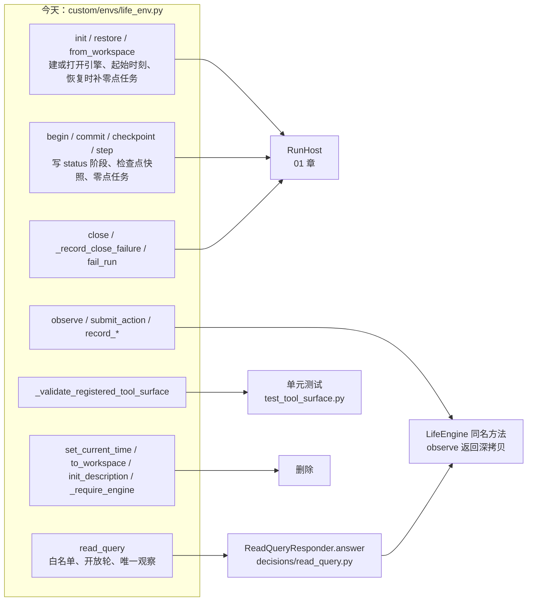

# 去掉 LifeEnv：引擎门面、只读查询与提交结果

> 本章属于[去掉 AgentSociety2：开发规格](../SPEC-agentsociety2-removal.md)，读法和叫法见那一页。

## 目标与依据

LifeEnv 存在，只是为了满足 AgentSociety2 的环境基类 `EnvBase` 与直接路由合同。去掉框架以后它只剩转发，本章把它删掉，让 `LifeEngine` 本身成为运行宿主与人物共用的引擎门面：只读查询成为引擎方法，提交时如实返回本轮全部结算结果，引擎里为框架留下的类型痕迹换成 WorldMock 自己的决策轮类型，原先由 pickle 边界附带的值语义改由引擎出口的深拷贝保证。

实现的提案条文（`docs/dev/agentsociety2-removal/PROPOSAL-agentsociety2-removal.md`，下称提案）：

| 提案位置 | 本章落实的内容 |
| --- | --- |
| 第六章「环境门面：去掉 LifeEnv」全部五点与末段 | LifeEnv 各项职责归位；只读查询成为引擎方法；工具面一致性改由单元测试守住；人物拿到的句柄就是引擎；提交返回全部结果；直接删除 LifeEnv |
| 第六章「一个进程，一个事件循环」第四点 | `observe` 与只读查询的返回值做深拷贝 |
| 第四章表格第一行 | 删除「开始组只把第一条结果交还给框架」（`src/worldmock/simulation_engine/decisions/decision_coordinator.py:147-152,165`；`docs/design/10-runtime.md:83-84`） |
| 第四章表格第三行 | 删除伸进 AgentSociety2 三个私有成员的只读查询转发（`src/worldmock/runtime/framework/read_query.py:1-47`） |
| 第七章「运维日志」一行 | 开始组那一轮 `DECISION_ROUND_COMMITTED` 的动作数从 1 变为 2 |
| 第十章「去掉 pickle 边界后出现别名写回」一行 | 出口处深拷贝；测试断言调用之后再改这些对象不影响落库字节 |
| 第八章「删除生产代码」一行中的 `read_query.py` 47 行、LifeEnv 315 行、引擎里的框架核对 | 见「接口与文件」 |

本章以裁定第 1 行（正式运行之前做）与第 2 行（推翻「不重写框架」的旧规定）为前提，不依赖其余各行的选择。提案第六章末段写明删除 LifeEnv 是实施层面的取舍，本章按提案直接删除。

本章引用而不重述的事实：

| 事实 | 所属章 |
| --- | --- |
| `DecisionContext`、`DirectToolCall`、`SchedulingState` 在 `src/worldmock/state/decisions/round.py` 的定义；`RunHost` 的步序、三种启动顺序、status 阶段、零点任务触发点、起始时刻核对、故障处理与关闭 | [「运行宿主与决策轮」](./01-run-host.md) |
| 人物模块里声明五个方法的 `typing.Protocol`（`EngineHandle`）、`LifeAgent` 怎样调用它们、模型证据 `ModelCallEvidence`（`src/worldmock/state/model/exchange.py`）、`life_action_tool_names`/`life_query_tool_names` 随 `LifeAgent` 搬迁 | [「人物、回合循环与只读问答的删除」](./03-agent-loop.md) |
| 模型客户端的寿命与关闭（取代 `LifeEnv.close` 里关闭 litellm 缓存客户端那一步）：runner 构造唯一的 `ModelClient`，运行宿主关闭它一次（【H19】【H34】）；`close()` 本身（【M2】） | [「运行宿主与决策轮」](./01-run-host.md)、[「模型客户端与模型请求底稿」](./04-model-client.md) |
| 记忆证据 `MemoryUpdateEvidence` 的定义（`src/worldmock/recording_engine/events/memory_evidence.py`）、`memory_updated` 的键集合与 `record_memory_update` 里的核对内容 | [「人物工作区、记忆文件与「记忆已更新」」](./05-workspace-memory.md) |
| 中止原因、`run_failed` 与 `status.json` 的文本 | [「故障文本」](./06-failure-text.md) |
| `pyproject.toml` 的标记说明、覆盖率源目录与覆盖率门禁的生产根 | [「安装、代码身份、依赖与许可」](./07-install-identity.md) |
| 设计文档的成文 | [「设计文档与手册」](./08-design-docs.md) |
| 测试枢纽与其余测试文件的迁移 | [「比较工具、查看器与测试迁移」](./09-tools-tests.md) |

## 行为

条款编号【E1】…【E22】供「测试」一节引用。

### 门面与人物句柄

【E1】`custom/envs/life_env.py` 与 `src/worldmock/runtime/framework/read_query.py` 不存在；`src/`、`tests/`、`scripts/`、`tools/`、`docs/design/`、`docs/manual/`、`README.md`、`docs/INDEX.md`、`pyproject.toml` 里没有以 `LifeEnv` 开头的标识符（含 `LifeEnvActor`、`LifeEnvProxy`），也没有 `life_env_actor_class`、`custom.envs`、`custom/envs`、`runtime.framework.read_query`、`runtime/framework/read_query` 五个串。冻结的 `docs/dev/` 不在此列。

【E2】LifeEnv 的每一项职责恰按「接口与文件」中「LifeEnv 的完整清单」一表归位：归引擎的只有只读查询；归运行宿主的是 status 阶段、零点任务编排、检查点快照、起始时刻核对、启动时建或打开引擎、反事实入口、故障登记与关闭时的双重故障；归单元测试的是工具面一致性；其余删除。任何一项都不在别处留一个同名转发。`src/` 里不再出现「删除的框架核对」一表列出的英文错误文本。

【E3】人物拿到的环境句柄就是 `LifeEngine` 实例本身。人物调用的引擎方法恰为 `observe`、`submit_action`、`read_query`、`record_model_exchange`、`record_memory_update` 五个，签名见「人物使用的五个引擎方法」一表；五个方法都是普通同步方法，调用直接返回结果，不返回协程。

【E4】`src/worldmock` 里只有 `worldmock.runtime.lifecycle.run_host` 导入 `worldmock.simulation_engine.engine`；`worldmock.agents` 下的任何模块都不导入它。

### 只读查询

【E5】`LifeEngine.read_query(context, tool, request)` 把核对与回答交给 `src/worldmock/simulation_engine/decisions/read_query.py` 的 `ReadQueryResponder.answer`，按下面的次序核对，哪一步不过就抛出，不写事件、不改世界：先 `DecisionCoordinator.validate_context(context)`（类型不对的文本见【E17】，其余四条原文见 `decision_coordinator.py:259-264`，不变）；再 `DecisionCoordinator.require_round(context.round_id)`，轮次没开或不是这一轮时抛 `ProtocolError("Decision round is not open")`（`decision_coordinator.py:297-301`）；再核对白名单（【E6】）；最后核对唯一冻结观察（【E7】）。

【E6】白名单恰为 `{"recall_task_summary": RecallTaskSummaryRequest, "search_memory": SearchMemoryRequest}`，按 `type(request) is not _READ_QUERY_MODELS.get(tool)` 精确比较类型，子类与别的请求类型都不算。不符时先 `logging.error("Read query tool and request type do not match: %s", tool)`，再抛 `ProtocolError("Read query tool and request type do not match")`。工具名写已删除的 `query_world`、`memory_recent`，或工具名对而请求类型不对，都得到这一条。

【E7】冻结观察取 `store.read_decision_observations(context.agent_id, context.decision_id, int(context.observed_at.timestamp()))`（`src/worldmock/recording_engine/storage/store.py:510-520`）；结果不是恰好一条时，先 `logging.error("Read query requires one frozen decision observation, found %d", len(rows))`，再抛 `ProtocolError("Read query requires one frozen decision observation")`。

【E8】回答：`recall_task_summary` 调用 `ActionHandlers.read_task_summary(context.agent_id, request, rows[0].data)`；`search_memory` 调用 `search.search_memory(engine_context, context.agent_id, request, rows[0])`。两者抛 `BusinessRuleError` 时返回 `query_rejection(error)`（`src/worldmock/simulation_engine/observation/wording/guidance.py:206-211`）：键恰为 `error_code`、`reason`、`fix`、`items`、`unmet`，依此次序，`json.dumps(..., ensure_ascii=False)` 的结果与今天经 LifeEnv 得到的逐字节相同。其余异常原样传播。

【E9】只读查询不写事件、不改世界状态：调用前后 `store.last_event_seq` 相同，`state.model_dump_json()` 逐字节相同。

### 值语义：出口深拷贝

【E10】`LifeEngine.observe` 返回 `copy.deepcopy(data)`，`data` 是今天返回的那个字典（已含 `observation_event_id` 与 `continuation` 两个只给宿主的键）。返回值与深拷贝之前逐值相等、键序相同，与引擎内部构造的字典不共享任何 `dict` 或 `list` 对象。

【E11】`LifeEngine.read_query` 返回 `copy.deepcopy(answer)`，`answer` 是 `ReadQueryResponder.answer` 的返回值。返回值与它逐值相等、键序相同，不共享任何 `dict` 或 `list` 对象。

【E12】人物改动 `observe` 或 `read_query` 的返回值之后：世界状态逐字节不变，已落库的观察事件逐字节不变，之后再问同一个只读查询得到的回答与改动之前相同，这次决策照常登记与结算。

【E13】人物改动已经交给引擎的对象之后，已落库事件的字节与之后的结算都不变：`DirectToolCall.request` 在 `submit_action` 之内转成 `model_dump(mode="json")` 的副本（`decision_coordinator.py:122,140`），`record_model_exchange` 的 `request` 与 `response` 在调用之内写进 SQLite，引擎只另存请求的 sha256（`src/worldmock/simulation_engine/evidence/model.py:69-71,96-97`）。所以响应证据带来调用前保存的请求副本时照常登记，`caused_by` 指向那条请求事件。

### 提交结果

【E14】`commit_decision_round(round_id)` 返回本轮全部结算结果：组按人物的冻结次序，组内按登记次序（`decision_coordinator.py:566-571`）；开始组的两条结果都返回。返回列表的长度等于本轮登记的动作数，每一项的 `model_dump(mode="json")` 与落库的那条 `action_result` 事件重建的结果相同。同刻预算用完的那一轮照旧在提交之后抛 `ProtocolError("decision_budget_exhausted")`（`decision_coordinator.py:185-187`），不返回列表。

【E15】提交写下的事件条数、次序与内容不变，世界状态的结算不变；只有返回值和【E16】那条运维日志的计数变。

【E16】运维日志 `DECISION_ROUND_COMMITTED` 的 `detail` 模板 `Decision round committed {n} actions` 不变（`decision_coordinator.py:191-202`），`n` 是本轮登记的动作数：开始组那一轮写 `Decision round committed 2 actions`，只登记一条动作的一轮写 `Decision round committed 1 actions`。

### 引擎里的框架痕迹

【E17】`DecisionCoordinator.validate_context` 只接受 `worldmock.state.decisions.round.DecisionContext`；收到别的类型时抛 `ProtocolError("Context must use the DecisionContext type")`（今天的原文是 `Context must use the AgentSociety2 DecisionContext type`）。

【E18】`DecisionCoordinator._validate_call` 只接受 `worldmock.state.decisions.round.DirectToolCall`；收到别的类型或没有开放轮时，原文 `Direct tool call requires an open decision round` 不变。只读查询工具名经 `submit_action` 登记时，原文 `Read-only queries must use the immediate query channel` 不变，即时通道指 `LifeEngine.read_query`。

【E19】`LifeEngine.scheduling_state()` 返回 `worldmock.state.decisions.round.SchedulingState`，按位置构造的四个值与今天相同（`src/worldmock/simulation_engine/scheduling/clock/time_advance.py:88-94`）。

【E20】`src/worldmock/simulation_engine` 下没有任何 `agentsociety2` 或 `ray` 的导入，包括 `TYPE_CHECKING` 块里与函数里的延迟导入。

【E21】「删除的框架核对」一表列出的 LifeEnv 核对都删除，不搬进引擎；引擎自己的完整性核对原样保留，包括 `LifeEngine.checkpoint` 的 `IntegrityError("Checkpoint agent snapshot set is incomplete")`（`src/worldmock/simulation_engine/engine.py:175-177`）、`begin_decision_round` 的 `Decision round contexts must match the scheduled agent order`（`decision_coordinator.py:71-73`）、`advance(tick, target)` 的边界核对 `World advance must match the next scheduling boundary`（`time_advance.py:107-109`）。

### 工具面一致性

【E22】运行时不再核对工具面；单元测试核对：`frozenset(REQUEST_MODELS)` 恰为 `start_main_activity`、`start_side_activity`、`recall_task_summary`、`report_status`、`pause_activity`、`conclude_activity`、`revise_day_plan` 七个；人物侧 `life_action_tool_names()` 等于 `frozenset(REQUEST_MODELS)`；人物侧 `life_query_tool_names()` 等于 `frozenset(_READ_QUERY_MODELS)`，为 `{"recall_task_summary", "search_memory"}`；`_READ_QUERY_MODELS` 等于 `{"recall_task_summary": REQUEST_MODELS["recall_task_summary"], **QUERY_MODELS}`，即两侧用的是同一对请求类型。

## 接口与文件

### 职责归位总览



### LifeEnv 的完整清单（`custom/envs/life_env.py`，基线 315 行）

| 行 | 成员 | 今天做什么 | 去向 |
| --- | --- | --- | --- |
| 1 | 模块文档串 | | 随文件删除 |
| 3-25 | 导入 | 含 `runner` 的两个零点任务函数、`setup.stage_model_identity`、`load_environment`、`custom.agents.life_agent` 的两个工具名函数、AgentSociety2 的 `close_cached_async_clients`、`EnvBase`、`SocietyCheckpointRequest` | 随文件删除；`life_env → runner` 的回绕导入随之消失 |
| 27-39 | `_STABLE_TOOL_SURFACE` | 七个请求工具名 | 七个名字写进单元测试（【E22】），生产代码不留这个常量 |
| 41-43 | `_READ_QUERY_MODELS` | 只读查询白名单 | 原样搬进 `src/worldmock/simulation_engine/decisions/read_query.py`，名字与内容不变（【E6】） |
| 46-47 | `class LifeEnv(EnvBase)` | | 删除 |
| 49-70 | `__init__` | 收 `environment_root`、`run_dir`、`run_identity`、`open_existing`、`create_options`；为扫描注册允许无参构造 | 删除；这些输入由 RunHost 的启动入口接收（01 章） |
| 72-79 | `init_description` | AgentSociety2 注册表要的说明 | 删除 |
| 81-111 | `init` | 路径与重复初始化核对；新建时 `load_environment`、`stage_model_identity`、`LifeEngine.create`，打开时 `LifeEngine.open`；起始时刻与引擎时刻核对；工具面核对；`_workspace_root`；普通恢复补零点任务 | 建或打开引擎、起始时刻核对、普通恢复补零点任务归 RunHost（01 章）；工具面核对归单元测试；路径、重复初始化核对与 `_workspace_root` 删除 |
| 113-121 | `_settle_midnight_tasks_on_resume` | 普通恢复时先回顾后日计划，异常先 `fail_run` 再抛出 | RunHost（01 章） |
| 123-140 | `_validate_registered_tool_surface` | 三项工具面核对 | 单元测试（【E22】） |
| 142-147 | `begin_decision_round` | 写 status `running`/`deciding`；调用引擎；返回 `contexts[0].round_id` | status 归 RunHost；RunHost 直接调用 `LifeEngine.begin_decision_round`；返回轮次身份这一步删除 |
| 149-151 | `observe` | 转发 | 人物直接调用 `LifeEngine.observe`，返回深拷贝（【E10】） |
| 153-156 | `submit_action` | 转发 | 人物直接调用 `LifeEngine.submit_action` |
| 158-177 | `read_query` | 上下文、开放轮、白名单、唯一冻结观察、两种回答、五字段拒绝 | `ReadQueryResponder.answer`，经 `LifeEngine.read_query` 返回深拷贝（【E5】–【E9】、【E11】） |
| 179-184 | `commit_decision_round` | 写 status `running`/`resolving`；调用引擎 | status 归 RunHost；RunHost 直接调用引擎，不读返回值（01 章）；引擎返回全部结果（【E14】） |
| 186-188 | `abort_decision_round` | 转发 | RunHost 直接调用 |
| 190-192 | `scheduling_state` | 转发 | RunHost 直接调用 |
| 194-196 | `record_model_exchange` | 转发 | 人物直接调用 |
| 198-200 | `record_memory_update` | 转发 | 人物直接调用 |
| 202-213 | `checkpoint` | 写 status `running`/`checkpointing`；快照并提交检查点；之后先补回顾再补日计划 | RunHost（01 章） |
| 215-231 | `_checkpoint` | 核对 `SocietyCheckpointRequest` 的类型、身份、时刻与人物集合；每个人物工作区 `snapshot_directory`；`engine.checkpoint(snapshots)` | 快照与 `engine.checkpoint` 调用归 RunHost（01 章）；三项请求核对删除（【E21】） |
| 233-242 | `step` | 写 status `running`/`advancing`；`engine.advance`；零点时先回顾、再日计划、再 `decide_midnight_rhythm`；`self.t = t` | RunHost（01 章）；`self.t` 删除 |
| 244-249 | `set_current_time` | 时钟核对，生产中从未执行（AgentSociety2 的 `RouterBase.set_current_time` 只给 `env_module.t` 赋值，不调用这个方法） | 删除 |
| 251-253 | `fail_run` | 转发 | RunHost 直接调用 `LifeEngine.fail_run` |
| 255-257 | `apply_counterfactual` | 转发 | RunHost 直接调用 |
| 259-265 | `to_workspace` | `EnvBase` 钩子 | 删除 |
| 267-278 | `restore` | `EnvBase` 钩子 | 删除 |
| 280-285 | `from_workspace` | `EnvBase` 钩子 | 删除 |
| 287-300 | `close` | 关闭本循环的 litellm 缓存客户端，再 `engine.close()` | `engine.close()` 归 RunHost（01 章）；关闭 litellm 缓存客户端删除，模型客户端整次运行关一次（04 章） |
| 302-309 | `_record_close_failure` | 关闭失败先登记 `run_failed`；登记也失败时 `ExceptionGroup("LifeEnv close and failure recording both failed", ...)` | RunHost 的 `_close_engine`（01 章【H34】）：关闭失败经 `RunHost._record_failure` 以 `repr` 登记，登记也失败时的异常组是 `Run and failure recording both failed`（06 章【F12】），不含 `LifeEnv`（【E1】） |
| 311-315 | `_require_engine` | 初始化前调用即拒绝 | 删除 |

`src/worldmock/runtime/framework/read_query.py`（47 行）整份删除：`LifeEnvActor.read_query`（:20-29）、`LifeEnvProxy.read_query`（:32-40）与 `life_env_actor_class`（:43-47）都只是跨 Ray 的转发，人物改为直接调用 `LifeEngine.read_query`。它在 `src/worldmock/runtime/lifecycle/runner.py:515-545` 的唯一使用者随 Ray 装配一起删除（01 章）。

### 删除的框架核对

| 位置（基线） | 英文原文 | 去向 |
| --- | --- | --- |
| `custom/envs/life_env.py:89-90` | `LifeEnv init requires environment_root and run_dir` | 删除：RunHost 的入参都是必填 |
| `custom/envs/life_env.py:91-92` | `LifeEnv was already initialized` | 删除 |
| `custom/envs/life_env.py:96-97` | `New LifeEnv run requires explicit run_identity` | 删除 |
| `custom/envs/life_env.py:104-107` | `LifeEnv start time disagrees with the environment` | 起始时刻核对归 RunHost，文本由 01 章给出 |
| `custom/envs/life_env.py:133-140` | `LifeEnv registered tool surface disagrees with the stable tool surface: …`、`LifeEnv tool surface disagrees with the LifeAgent action tool set`、`LifeEnv read query surface disagrees with the LifeAgent query tool set` | 删除；改由单元测试核对（【E22】） |
| `custom/envs/life_env.py:217-218` | `Checkpoint request must use SocietyCheckpointRequest` | 删除：`SocietyCheckpointRequest` 删除（01 章） |
| `custom/envs/life_env.py:219-223` | `Checkpoint request identity or time is stale` | 删除：RunHost 从引擎读运行身份与当前时刻，只有一个时钟 |
| `custom/envs/life_env.py:224-226` | `Checkpoint request agent set is incomplete` | 删除；引擎 `checkpoint` 自己的人物快照集合核对保留（【E21】） |
| `custom/envs/life_env.py:247-248` | `Society current time disagrees with the environment` | 删除 |
| `custom/envs/life_env.py:263-264` | `LifeEnv workspace must be its footprint run directory` | 删除 |
| `custom/envs/life_env.py:269-270` | `LifeEnv restore requires environment_root` | 删除 |
| `custom/envs/life_env.py:313-314` | `LifeEnv is not initialized` | 删除 |
| `decision_coordinator.py:147-152,165` | 「每个决策只返回它第一条动作的结果」 | 返回全部结果（【E14】） |
| `decision_coordinator.py:255-258` | 函数内导入 AgentSociety2 的 `DecisionContext`；`Context must use the AgentSociety2 DecisionContext type` | 模块顶部导入 `round.DecisionContext`；新原文见【E17】 |
| `decision_coordinator.py:268` | 函数内导入 AgentSociety2 的 `DirectToolCall` | 模块顶部导入 `round.DirectToolCall` |
| `time_advance.py:86` | 函数内导入 AgentSociety2 的 `SchedulingState` | 模块顶部导入 `round.SchedulingState` |

### 人物使用的五个引擎方法

| 人物侧的用途 | 引擎方法（`src/worldmock/simulation_engine/engine.py`） | 返回 | 基线位置 | 本章的改动 |
| --- | --- | --- | --- | --- |
| 观察 | `observe(self, context: DecisionContext) -> dict` | 观察字典的深拷贝 | :74-92 | 末行改为 `return copy.deepcopy(data)`；文档串见下 |
| 登记请求 | `submit_action(self, call: DirectToolCall) -> ActionReceipt` | `ActionReceipt`（冻结模型，字段全是字符串） | :98-100 | 无 |
| 只读查询 | `read_query(self, context: DecisionContext, tool: str, request: FrozenModel) -> dict` | 回答的深拷贝 | 新 | 新方法 |
| 写模型证据 | `record_model_exchange(self, exchange: Any) -> None` | `None` | :115-117 | 无 |
| 写记忆证据 | `record_memory_update(self, evidence: Any) -> None` | `None` | :119-121 | 签名无改动（核对内容归 05 章） |

人物模块声明的 `typing.Protocol`（03 章）逐一用这五个名字与参数名，全部是同步方法。其余返回值不复制：`scheduling_state` 的 `SchedulingState` 是冻结数据类、字段都是不可变值；`commit_decision_round` 的结果列表只给 RunHost，RunHost 不读它；`checkpoint` 的 `Checkpoint` 只给 RunHost。

运行宿主调用的引擎成员都已存在，本章不改它们：`begin_decision_round`、`commit_decision_round`（返回值变，见【E14】）、`abort_decision_round`、`scheduling_state`、`advance`、`midnight_rhythm_pending`、`decide_midnight_rhythm`、`checkpoint`、`fail_run`、`apply_counterfactual`、`close`，以及 `context.store`、`context.state` 与公开属性 `decisions`。判断轮次是否仍开着读 `engine.decisions.round is not None`（`engine.py:52`、`decision_coordinator.py:57`），引擎不为它新增方法。

### 文件

| 路径 | 动作 | 内容 |
| --- | --- | --- |
| `custom/envs/life_env.py` | 删除 | 见「LifeEnv 的完整清单」 |
| `src/worldmock/runtime/framework/read_query.py` | 删除 | 整份删除 |
| `src/worldmock/simulation_engine/decisions/read_query.py` | 新建 | `_READ_QUERY_MODELS` 与 `ReadQueryResponder`，见下 |
| `src/worldmock/simulation_engine/engine.py` | 修改 | 见下 |
| `src/worldmock/simulation_engine/decisions/decision_coordinator.py` | 修改 | 见下 |
| `src/worldmock/simulation_engine/scheduling/clock/time_advance.py` | 修改 | 第 5 行 `from typing import TYPE_CHECKING` 与第 7-8 行的 `TYPE_CHECKING` 块换成模块顶部 `from worldmock.state.decisions.round import SchedulingState`；删除第 86 行的函数内导入与其后空行；第 85 行文档串改为 `"""@brief 返回运行宿主使用的带时区当前时刻、就绪人物和下一边界。"""` |
| `src/worldmock/simulation_engine/evidence/model.py` | 修改 | 只改第 8 行：`TYPE_CHECKING` 块里的 `from agentsociety2.society import DecisionContext` 换成 `from worldmock.state.decisions.round import DecisionContext`。第 138-188 行的记忆证据核对归 05 章，本章不动 |
| `src/worldmock/simulation_engine/world/world_updates.py` | 修改 | 删除第 19 行没有使用者的 `from agentsociety2.society import DecisionContext, DirectToolCall, SchedulingState`；同一 `TYPE_CHECKING` 块的第 18、20 行不动 |
| `src/worldmock/simulation_engine/__init__.py` | 修改 | 第 1 行改为 `"""@brief 生活引擎 LifeEngine 的有类型生活领域实现。"""` |
| `src/worldmock/state/interaction/requests.py` | 修改 | 第 615 行注释改为 `#: 只读查询的工具模型：不进 REQUEST_MODELS，也不进 ActionRequest，由 LifeEngine.read_query 回答`，第 616 行不变 |
| `src/worldmock/agents/life_agent.py` | 修改（文件由 03 章从 `custom/agents/life_agent.py` 搬来，本章只定两个文档串） | `life_action_tool_names`（基线 `custom/agents/life_agent.py:122-124`）文档串改为 `"""@brief 返回 LifeAgent 实际开放的全部生活动作工具名（工具面单元测试核对用）。"""`；`life_query_tool_names`（基线 :127-129）文档串改为 `"""@brief 返回 LifeAgent 开放的全部只读查询工具名（工具面单元测试与只读查询白名单核对用）。"""`；两个函数体不变 |

`src/worldmock/simulation_engine/decisions/read_query.py`（新建）：

- 模块文档串：`"""@brief 引擎的只读查询：在本次决策的冻结观察上回答回看任务与检索记忆，不写事件、不改世界（docs/design/06-agent.md「提示与工具」）。"""`
- 导入：`from __future__ import annotations`；`logging`；`TYPE_CHECKING`（`typing`）；`BusinessRuleError`、`ProtocolError`（`worldmock.foundation.errors`）；`ActionHandlers`（`worldmock.simulation_engine.actions.dispatcher`）；`DecisionCoordinator`（`worldmock.simulation_engine.decisions.decision_coordinator`）；`search`（`worldmock.simulation_engine.observation.memory`）；`query_rejection`（`worldmock.simulation_engine.observation.wording.guidance`）；`EngineContext`（`worldmock.simulation_engine.world.context`）；`RecallTaskSummaryRequest`、`SearchMemoryRequest`（`worldmock.state.interaction.requests`）；`TYPE_CHECKING` 块里 `FrozenModel`（`worldmock.foundation.models`）与 `DecisionContext`（`worldmock.state.decisions.round`）。不导入 `worldmock.simulation_engine.engine`，没有函数内导入。
- 常量：`_READ_QUERY_MODELS = {"recall_task_summary": RecallTaskSummaryRequest, "search_memory": SearchMemoryRequest}`，注释两行：`#: 只读查询的白名单：工具名 → 请求类型（docs/design/06-agent.md「提示与工具」）；` 与 `#: 由引擎一侧显式写出，与人物侧只读查询工具集的一致由单元测试核对。`
- `class ReadQueryResponder`，文档串 `"""@brief 只读查询的核对与回答；只读本次决策的冻结观察、它之前的事件与冻结输入。"""`
  - `__init__(self, context: EngineContext, decisions: DecisionCoordinator, actions: ActionHandlers)`：文档串 `"""@brief 绑定引擎上下文、决策协调与动作处理。"""`；函数体 `self.context, self.decisions, self.actions = context, decisions, actions`。
  - `answer(self, context: DecisionContext, tool: str, request: FrozenModel) -> dict`：文档串 `"""@brief 依次核对决策上下文、开放轮、白名单与唯一冻结观察，再回答回看任务或检索记忆；不写事件、不改世界，` 换行 `业务拒绝以五字段形状返回，其余异常原样传播。"""`。函数体是 `custom/envs/life_env.py:162-177` 原样搬来，只把 `engine.decisions` 换成 `self.decisions`，`engine.context.store` 换成 `self.context.store`，`engine.read_task_summary(...)` 换成 `self.actions.read_task_summary(...)`，`engine.search_memory(context.agent_id, request, rows[0])` 换成 `search.search_memory(self.context, context.agent_id, request, rows[0])`。两条日志与两条 `ProtocolError` 的英文原文逐字不变（【E6】、【E7】）。

`src/worldmock/simulation_engine/engine.py`（修改）：

- 第 1 行：`"""@brief 运行宿主与人物使用的生活运行门面，职责与状态由显式对象承担。"""`
- 导入：加 `import copy`；加 `from worldmock.simulation_engine.decisions.read_query import ReadQueryResponder`；`TYPE_CHECKING` 块第 39 行换成 `from worldmock.state.decisions.round import DecisionContext, DirectToolCall, SchedulingState`，并在同一块里加 `from worldmock.foundation.models import FrozenModel`。
- `__init__`：在 `self.counterfactual = CounterfactualRuntime(self.context)`（:55）之后加 `self.queries = ReadQueryResponder(self.context, self.decisions, self.actions)`。
- `observe`（:74-92）：文档串改为 `"""@brief 提交一次真实观察并附当前同秒续接；返回深拷贝，与存储层解码后的观察（去掉只给宿主的键）逐字节相同。"""`，末行 `return data` 改为 `return copy.deepcopy(data)`。
- 新方法，放在 `search_memory`（:150-152）之后：

  ```python
  def read_query(self, context: "DecisionContext", tool: str, request: "FrozenModel") -> dict:
      """@brief 人物的只读查询（回看任务与检索记忆）：在本次决策的冻结观察上即时回答，不写事件、不改世界；
      白名单以外的工具名或与工具名不符的请求类型是协议错误，业务拒绝以五字段形状返回；返回深拷贝。"""
      return copy.deepcopy(self.queries.answer(context, tool, request))
  ```

- `read_task_summary`（:146-148）与 `search_memory`（:150-152）不变。

`src/worldmock/simulation_engine/decisions/decision_coordinator.py`（修改）：

- 第 4 行 `from typing import TYPE_CHECKING` 与第 6-7 行的 `TYPE_CHECKING` 块删除，换成模块顶部 `from worldmock.state.decisions.round import DecisionContext, DirectToolCall`。函数注解里的引号写法 `"DecisionContext"`、`"DirectToolCall"` 保持不动。
- `commit_decision_round` 文档串（:148-152）改为：

  ```text
  """@brief 完整轮次按冻结顺序结算，一次提交当前世界与结果；返回本轮全部动作的结果，组按人物的冻结次序、组内按登记次序。

  一个决策可以登记两条开始动作：两条结果都落库，也都返回。
  提交之前比较提交前后的世界一次：导航在不在前台、购买里截断的前台区间和停留进出事件都由此得出。
  """
  ```

- 第 165 行 `results.append(settled[0])` 改为 `results.extend(settled)`；`_ops_committed`（:191-202）不改，它的 `len(results)` 随之如实计数。
- `validate_context`：删除第 255 行与其后空行；第 258 行原文改为 `ProtocolError("Context must use the DecisionContext type")`。
- `_validate_call`：删除第 268 行与其后空行。

逐字节不变的部分：`ReadQueryResponder.answer` 里的核对、日志与回答（与 `custom/envs/life_env.py:162-177` 等价）；`query_rejection` 的五字段；`observe` 落库的观察事件与它返回的内容；提交写下的事件与世界状态；`DECISION_ROUND_COMMITTED` 之外的全部运维日志。

### 测试里 LifeEnv 调用的替换

供 09 章迁移测试时套用；本章自己的测试也按此写。

| 今天 | 之后 |
| --- | --- |
| `environment = LifeEnv(); environment.engine = engine` | 直接使用 `engine` |
| `await environment.observe(context)` | `engine.observe(context)` |
| `await environment.submit_action(call)` | `engine.submit_action(call)` |
| `await environment.read_query(context, tool, request)` | `engine.read_query(context, tool, request)` |
| `await environment.record_model_exchange(evidence)` | `engine.record_model_exchange(evidence)` |
| `await environment.record_memory_update(evidence)` | `engine.record_memory_update(evidence)` |
| `await environment.begin_decision_round((context,))`（返回轮次身份） | `engine.begin_decision_round([context])`（返回 `None`；要轮次身份时用 `context.round_id`） |
| `await environment.commit_decision_round(round_id)` | `engine.commit_decision_round(round_id)`；开始组得到两条结果 |
| `await environment.abort_decision_round(...)`、`scheduling_state()`、`fail_run(...)`、`apply_counterfactual(...)` | 同名引擎方法，去掉 `await` |
| `init`、`checkpoint`、`step`、`close` | 经 RunHost，替换写法见 01 章 |
| `set_current_time`、`to_workspace`、`restore`、`from_workspace`、`init_description` | 没有后继，只测它们的用例删除 |

提交返回值按单条解包的写法（如 `[result] = ...`、`(result,) = ...`）只在该轮登记一条动作时成立。基线上登记开始组又解包提交返回值的，只有「要改的现有测试」一表列出的 `test_start_group.py`、`test_dayrun_parallel_agent.py` 两个文件与 `act_group`；其余解包单条的用例（`decide` 夹具的各使用者）每轮只登记一条世界请求，写法不变。

## 设计文档

下列位置承载本章规则，成文由 08 章完成；这里给出改后必须写明的事实。【E1】要求 `docs/design/` 里不再出现 `LifeEnv` 等名字，所以下表覆盖基线上点名它们的全部 12 行。

| 位置（基线） | 改后必须写明的事实 |
| --- | --- |
| `docs/design/10-runtime.md:5` | 不再写 LifeEnv；运行宿主驱动的引擎门面是 `LifeEngine`（句子其余部分归 01、08 章） |
| `docs/design/10-runtime.md:16` | 流程图里的 `LifeEnv 原生工具接口` 节点换成引擎门面 `LifeEngine` |
| `docs/design/10-runtime.md:24-25` | 删去「环境 actor 在 LifeEnv 关闭时」关闭 litellm 缓存客户端的句子；客户端寿命按 04 章 |
| `docs/design/10-runtime.md:82-85` | 引擎（`LifeEngine`）再次核验请求、人物身份、已提交版本和观察时刻；一个决策至多两条开始动作，两条结果都落库，提交按结算次序返回本轮全部结果，开始组返回两条。删去「AgentSociety2 的决策轮核对要求……只向框架返回该决策第一条动作的结果，AS2 补丁不改」与「原生 Society 的当前时钟接口与生活绝对时钟一致」（只有一个时钟，见 01 章）；保留「只读查询不代替模型活动、不消耗世界随机流」 |
| `docs/design/10-runtime.md:87` | 只读查询是引擎方法 `LifeEngine.read_query`，人物直接调用；只接受 `recall_task_summary`、`search_memory` 两个工具名与各自的请求类型，其余组合是协议错误；核对次序是决策上下文、开放轮、白名单、唯一冻结观察；业务拒绝以 `error_code`、`reason`、`fix`、`items`、`unmet` 五字段返回；回答只读本次决策冻结观察所在事件序号及以前的事件，不写事件、不改世界；人物侧与引擎侧工具面的一致由单元测试核对，运行时不核对。删去环境代理、actor 子类、「AS2 补丁不改」与「LifeEnv 在 init 时核对」 |
| `docs/design/10-runtime.md` 新写的单进程一节（位置由 08 章定） | 人物拿到的环境句柄就是 `LifeEngine`，只用 `observe`、`submit_action`、`read_query`、`record_model_exchange`、`record_memory_update` 五个同步方法；人物模块不导入引擎；`observe` 与 `read_query` 返回深拷贝，人物改动返回值不影响引擎；引擎在调用之内把交给它的对象转成副本或写进 SQLite，之后不持有引用 |
| `docs/design/06-agent.md:75` | 「recall_task_summary 与 search_memory 是只读查询，由 `LifeEngine.read_query` 当场回答」 |
| `docs/design/06-agent.md:878` | 「检索由 `LifeEngine.read_query` 交给生活引擎的 `search_memory`」，其余不变 |
| `docs/design/01-architecture.md:49` | `LifeEngine` 是模拟引擎的门面：运行宿主经它编排决策轮，人物只经五个方法接触世界；不再写 LifeEnv 与「接入 AgentSociety 2 的环境入口」 |
| `docs/design/01-architecture.md:71` | 「LifeEngine 与活动属于模拟引擎的执行职责」 |
| `docs/design/01-architecture.md:175` | 源码链接 `[LifeEnv](../../custom/envs/life_env.py)` 换成 `[LifeEngine](../../src/worldmock/simulation_engine/engine.py)` |
| `docs/design/00-overview.md:92` | 「组织数字人与生活引擎（`LifeEngine`）的交互」 |
| `docs/design/00-overview.md:194` | 删去只读查询经 `LifeEnvActor`、`LifeEnvProxy` 转发与对三个私有成员的依赖；只读查询是引擎方法 `LifeEngine.read_query`（这一行其余关于 AgentSociety2 的内容按 08 章改写） |

`DECISION_ROUND_COMMITTED` 的字段没有写在现行设计文档里（`docs/design/` 中没有这个代码），计数的变化不需要改文档。

## 测试

全部测试离线、不跳过、不标记预期失败；新测试都有中文文档字符串。引擎一侧的条款经 `tests/engine_fixture.py` 的 `engine_factory` 建的真实引擎、真实请求与 SQLite 验证。下表「新」为新增，「改」为改写现有用例。

### 条款与测试

| 条款 | 测试 |
| --- | --- |
| E1 | `tests/unit/engineering/test_engine_facade_boundary.py::test_life_env_and_its_forwarders_are_gone` |
| E2 | 同上（删除的框架核对文本不在 `src/`）；职责的新归属由 01 章 RunHost 测试与本章其余测试覆盖 |
| E3 | `tests/unit/engineering/test_engine_facade_boundary.py::test_person_facing_engine_methods_are_synchronous`、`tests/integration/runtime/test_read_query_runtime.py::test_host_tool_message_is_the_environment_recall_result`、`tests/integration/life/test_committed_world_guard.py::test_guard_wraps_every_public_engine_method` |
| E4 | `tests/unit/engineering/test_import_graph.py::test_production_import_graph_obeys_all_boundaries`、`tests/unit/engineering/test_import_graph.py::test_only_run_host_can_import_facade` |
| E5 | `tests/integration/runtime/test_read_query_runtime.py::test_read_query_requires_a_valid_context_and_the_open_round`、`::test_read_query_requires_exactly_one_frozen_observation` |
| E6 | `tests/integration/runtime/test_read_query_runtime.py::test_read_query_answers_task_recall_and_memory_search_only` |
| E7 | `tests/integration/runtime/test_read_query_runtime.py::test_read_query_requires_exactly_one_frozen_observation` |
| E8 | `tests/integration/runtime/test_read_query_runtime.py::test_read_query_business_rejection_keeps_the_five_field_shape`、`::test_read_query_answers_task_recall_and_memory_search_only` |
| E9 | `tests/integration/runtime/test_read_query_runtime.py::test_read_query_answers_task_recall_and_memory_search_only` |
| E10 | `tests/integration/life/test_engine_facade.py::test_observe_returns_a_deep_copy` |
| E11 | `tests/integration/life/test_engine_facade.py::test_read_query_returns_a_deep_copy` |
| E12 | `tests/integration/life/test_engine_facade.py::test_mutating_the_returned_observation_changes_nothing_persisted`、`::test_read_query_answers_repeat_after_the_caller_mutates_them` |
| E13 | `tests/integration/life/test_engine_facade.py::test_mutating_submitted_requests_changes_nothing_persisted` |
| E14 | `tests/integration/life/test_engine_facade.py::test_commit_returns_both_results_of_a_start_group_and_counts_two_actions`、`tests/integration/start_interfaces/test_start_group.py::test_commit_returns_every_result_and_persists_both`、`tests/integration/runtime/test_dayrun_parallel_agent.py` 的两个用例 |
| E15 | `tests/integration/start_interfaces/test_start_group.py::test_commit_returns_every_result_and_persists_both` 与 `test_start_group.py` 其余用例（事件断言不变） |
| E16 | `tests/integration/life/test_engine_facade.py::test_commit_returns_both_results_of_a_start_group_and_counts_two_actions` |
| E17 | `tests/integration/life/test_engine_facade.py::test_engine_uses_the_worldmock_round_types`、`tests/integration/runtime/test_read_query_runtime.py::test_read_query_requires_a_valid_context_and_the_open_round` |
| E18 | `tests/integration/life/test_engine_facade.py::test_engine_uses_the_worldmock_round_types`、`tests/unit/life/test_current_lifecycle_coverage.py::test_removed_query_world_cannot_be_registered_as_a_world_action` |
| E19 | `tests/integration/life/test_engine_facade.py::test_engine_uses_the_worldmock_round_types` |
| E20 | `tests/unit/engineering/test_engine_facade_boundary.py::test_simulation_engine_imports_no_framework` |
| E21 | `tests/integration/life/test_engine_facade.py::test_checkpoint_rejects_an_incomplete_agent_snapshot_set`；现有 `tests/integration/life/test_sleep_runtime.py`（`must match the scheduled agent order`）与 `tests/integration/life/test_time_boundary_refusals.py`（`must match the next scheduling boundary`）不变 |
| E22 | `tests/unit/agent_protocol/test_tool_surface.py::test_agent_and_engine_share_one_tool_surface` |

### 新增 `tests/integration/life/test_engine_facade.py`

文件顶部导入 `copy`、`json`、`from dataclasses import replace`、`from types import SimpleNamespace`、`pytest`；`from worldmock.foundation.errors import IntegrityError, ProtocolError`；`from worldmock.simulation_engine.engine import LifeEngine`（辅助函数的注解用）；`from worldmock.simulation_engine.observation.layers.observe import ObservationBuilder`；`from worldmock.state.decisions.round import DecisionContext, DirectToolCall, SchedulingState`；`from worldmock.state.interaction.requests import RecallTaskSummaryRequest, ReviseDayPlanRequest, SearchMemoryRequest`；`from worldmock.state.planning.schedule import PlanGoal`；`from worldmock.state.model.exchange import ModelCallEvidence`（03 章）；`tests.life.conftest` 的 `context`、`stage_day_plan`、`do_at`、`use_app`、`action_identity`、`MAIN_TOOL`、`SIDE_TOOL`；`tests.life.environment_runtime` 的 `action_result`、`events`；`tests.integration.life.test_opslog` 的 `_records`。本地辅助：`_containers(tree)` 返回树里每个 `dict` 与 `list` 的 `id()` 集合（含根）；`_scramble(tree)` 先递归、再清空树里每个 `dict` 与 `list`；`_goal(engine)` 调 `stage_day_plan(engine, goals=(PlanGoal(intent_kind="休息", goal="歇一歇", registered_at=engine.context.state.current_time),))`。模型证据一律按关键字构造：`ModelCallEvidence(context=..., call_id=..., phase=..., attempt=1, request=..., response=None, error=None, transport_attempts=())`。

| 用例 | 断言 | 条款 | 新/改 |
| --- | --- | --- | --- |
| `test_observe_returns_a_deep_copy` | 用 monkeypatch 包住 `ObservationBuilder._observation_data`，记下它返回的字典；开轮后 `engine.observe(decision)` 的返回值等于记下的字典、`list(returned) == list(captured)`，`_containers(returned)` 与 `_containers(captured)` 不相交 | E10 | 新 |
| `test_mutating_the_returned_observation_changes_nothing_persisted` | `_goal(engine)` 后开轮观察，存下 `pristine = copy.deepcopy(observed)`、`store.read_event(observed["observation_event_id"]).model_dump_json()` 与 `state.model_dump_json()`；`_scramble(observed)` 之后后两者不变；用 `pristine["goal_bindings"][0]["task_name"]` 做 `recall_task_summary`，`engine.read_query` 的回答等于 `engine.read_task_summary(1, request, pristine)`；再登记 `do_at("家", "测试休息")` 并提交，返回的唯一结果 `error_code is None`，观察事件的 `model_dump_json()` 仍不变 | E12 | 新 |
| `test_read_query_returns_a_deep_copy` | `_goal(engine)` 后开轮观察；用 monkeypatch 在 `engine.actions` 实例上包住 `read_task_summary`，记下它的返回值；`engine.read_query(decision, "recall_task_summary", request)` 的返回值等于它、键序相同、`_containers` 不相交 | E11 | 新 |
| `test_read_query_answers_repeat_after_the_caller_mutates_them` | `_goal(engine)` 后开轮观察；`search_memory`（`category="饮食"`、`time="今天"`、`keyword=None`）与 `recall_task_summary` 各问一次，存 `copy.deepcopy` 副本、`_scramble` 返回值，再问一次，回答等于副本 | E12 | 新 |
| `test_mutating_submitted_requests_changes_nothing_persisted` | `stage_day_plan(engine)` 后开轮观察；登记请求阶段的模型证据，`request = {"model": "test-model", "messages": [{"role": "user", "content": "看一下现在。"}]}`，登记前存 `copy.deepcopy(request)`；登记后向 `request["messages"]` 追加一条、改第一条的 `content`、改 `model`，那条 `model_request` 事件的 `model_dump_json()` 与改动之前存下的相同；`replace(call, phase="response", request=存下的副本, response={"choices": [{"message": {"role": "assistant", "content": "好。"}}]})` 登记成功，`model_response` 事件的 `caused_by` 恰为那条请求事件的身份。再登记 `revise_day_plan`，请求 `ReviseDayPlanRequest.model_validate({"goals": [{"intent_kind": "休息", "goal": "下午喝杯咖啡", "remind_time": None, "around_time": None}]})`，登记前存 `request.model_dump(mode="json")`；登记后 `request.goals.clear()`，`action_requested` 事件的 `model_dump_json()` 不变，`engine.decisions.round.pending_actions[-1].request` 等于存下的字典；提交后 `[goal.goal for goal in engine.context.state.agents[1].day_plan.goals]` 含 `下午喝杯咖啡` | E13 | 新 |
| `test_commit_returns_both_results_of_a_start_group_and_counts_two_actions` | 同一决策先登记 `use_app("哔哩哔哩")`（`SIDE_TOOL`）、再登记 `do_at("家", "测试闲聊")`（`MAIN_TOOL`），动作身份 `action_identity(label, 1)`、`action_identity(label, 2)`；提交返回两条，动作身份依次是这两条，每条的 `model_dump(mode="json")` 等于 `action_result(engine, action_id).model_dump(mode="json")`；这一轮的 `DECISION_ROUND_COMMITTED` 记录（`_records` 里 `round_id` 等于本轮的那条）`detail` 恰为 `Decision round committed 2 actions`；另一个引擎只登记 `do_at("家", "测试休息")` 一条动作的一轮恰为 `Decision round committed 1 actions` | E14、E16 | 新 |
| `test_engine_uses_the_worldmock_round_types` | `type(engine.scheduling_state()) is SchedulingState`；`engine.observe(SimpleNamespace(round_id="r"))` 抛 `ProtocolError`，原文匹配 `^Context must use the DecisionContext type$`；`engine.submit_action(SimpleNamespace(tool_name=MAIN_TOOL))` 原文匹配 `^Direct tool call requires an open decision round$` | E17、E18、E19 | 新 |
| `test_checkpoint_rejects_an_incomplete_agent_snapshot_set` | `engine.checkpoint({})` 抛 `IntegrityError`，原文匹配 `^Checkpoint agent snapshot set is incomplete$`；调用前后 `store.last_event_seq` 相同 | E21 | 新 |

### `tests/integration/runtime/test_read_query_runtime.py`（改写）

模块文档串改为 `"""@brief 引擎只读查询 LifeEngine.read_query 的证据：白名单、核对次序、唯一冻结观察、五字段业务拒绝、不写事件不改世界，以及人物 tool 消息就是引擎的回答（docs/design/10-runtime.md）。"""`，放在文件第一行。删除只被删除用例使用的全部导入、常量与辅助：第 1 行的 `current_profile`、第 12-14 行的 `ARTIFICIAL_ENVIRONMENT_ROOT`/`ENVIRONMENT_ROOT`、`published_environment`、`frozen_inputs`，`inspect`、`os`、`Path`、`ray`，两条 `os.environ.setdefault`，`DirectEnvActorSpec`、`LifeEnv`、`LifeEngine`、`LifeEnvActor`、`LifeEnvProxy`、`life_env_actor_class`，`ROOT`、`SCENARIO`、`_RECALL_SCENARIO`、`_RAYLET_START_WAIT_SECONDS`，`_staged_recall`、`_actor_spec`、`_assert_world_untouched`。保留 `_ERROR_KEYS`、`pytest`、`SimpleNamespace`、`ProtocolError`、三个请求类型、`PlanGoal` 与第 29 行的 `engine_factory`；第 30 行改为 `from tests.life.conftest import context, do_at, stage_day_plan`。加 `json`、`from worldmock.simulation_engine.decisions import read_query as read_query_module`、`from worldmock.simulation_engine.observation.wording.guidance import query_rejection`、`from worldmock.foundation.errors import BusinessRuleError`。除 `test_host_tool_message_is_the_environment_recall_result` 仍驱动异步的人物循环外，其余用例都是去掉 `@pytest.mark.asyncio` 的同步函数。

| 用例 | 断言 | 条款 | 新/改 |
| --- | --- | --- | --- |
| `test_read_query_answers_task_recall_and_memory_search_only` | 加 `caplog` 参数；断言主体不变，`await environment.read_query` 换成 `engine.read_query`；另断言 `read_query_module._READ_QUERY_MODELS == {"recall_task_summary": RecallTaskSummaryRequest, "search_memory": SearchMemoryRequest}`，`caplog` 里有 ERROR 记录 `Read query tool and request type do not match: query_world`；全程 `last_event_seq` 与世界状态 JSON 不变 | E6、E8、E9 | 改 |
| `test_read_query_requires_a_valid_context_and_the_open_round` | 没开轮时：`SimpleNamespace` 上下文抛 `Context must use the DecisionContext type`（上下文核对在开放轮核对之前），有效上下文抛 `Decision round is not open`；开轮、观察、登记 `do_at("家", "测试休息")` 并提交之后，用原上下文抛 `Decision context world version is stale`；三次都不写事件 | E5、E17 | 新 |
| `test_read_query_requires_exactly_one_frozen_observation` | 开轮而不观察：`("query_world", RecallTaskSummaryRequest(task_name="歇一歇"))` 抛 `Read query tool and request type do not match`（白名单核对在观察核对之前）；合法组合抛 `ProtocolError("Read query requires one frozen decision observation")`，`caplog` 里有 ERROR 记录 `Read query requires one frozen decision observation, found 0`；都不写事件 | E5、E7 | 新 |
| `test_read_query_business_rejection_keeps_the_five_field_shape` | 开轮观察后回看 `并不存在的任务`：回答 `list(answer) == ["error_code", "reason", "fix", "items", "unmet"]`，`error_code` 为 `TASK_NOT_FOUND`，`items[0]["written"] == "并不存在的任务"`、`unmet == []`；`json.dumps(answer, ensure_ascii=False)` 等于 `engine.read_task_summary` 同一请求抛出的 `BusinessRuleError` 经 `query_rejection` 后的同一序列化 | E8 | 新 |
| `test_host_tool_message_is_the_environment_recall_result` | 人物经 03 章的测试入口跑完一次决策（回看两次、再改计划）；两条 tool 消息分别等于 `engine.read_query` 对同一冻结观察的回答；`type(person).__module__ == "worldmock.agents.life_agent"`；事件序列断言不变 | E3、E8 | 改 |

删除同一文件里的 `test_task_recall_crosses_real_ray_without_world_mutation`、`test_unwrapped_actor_read_query_equals_direct_environment_call`、`test_life_env_actor_class_fixes_single_concurrency_without_parameters`、`test_runtime_assembly_builds_life_actor_and_a_proxy_with_read_query`：它们测的 Ray 转发与 actor 并发度已经不存在，只读查询的行为由上表覆盖。

### 新增 `tests/unit/agent_protocol/test_tool_surface.py`

| 用例 | 断言 | 条款 | 新/改 |
| --- | --- | --- | --- |
| `test_agent_and_engine_share_one_tool_surface` | 【E22】的四项相等，七个工具名写成字面量；导入 `worldmock.agents.life_agent` 的 `life_action_tool_names`、`life_query_tool_names`，`worldmock.state.interaction.requests` 的 `REQUEST_MODELS`、`QUERY_MODELS`，`worldmock.simulation_engine.decisions.read_query` 的 `_READ_QUERY_MODELS` | E22 | 新 |

### 新增 `tests/unit/engineering/test_engine_facade_boundary.py`

| 用例 | 断言 | 条款 | 新/改 |
| --- | --- | --- | --- |
| `test_life_env_and_its_forwarders_are_gone` | 两个文件不存在；【E1】列出的目录里后缀为 `.py`、`.md`、`.toml`、`.json`、`.jsonl`、`.html`、`.js`、`.txt`、`.yml`、`.yaml` 的文件（跳过 `__pycache__`）与三个单独列出的文件，按 UTF-8 读文本，正则 `\bLifeEnv` 与五个固定串都不出现（模式由片段拼成，本文件自身不含它们）；`src/` 里不出现「删除的框架核对」一表的 `Society current time disagrees with the environment`、`Checkpoint request must use SocietyCheckpointRequest`、`Checkpoint request identity or time is stale`、`Checkpoint request agent set is incomplete`、`tool surface disagrees`、`query surface disagrees`、`AgentSociety2 DecisionContext` | E1、E2、E21 | 新 |
| `test_simulation_engine_imports_no_framework` | 用 `ast` 解析 `src/worldmock/simulation_engine` 下每个 `.py`，所有 `Import`/`ImportFrom` 节点（含 `TYPE_CHECKING` 块与函数体内）的模块名首段都不是 `agentsociety2` 或 `ray` | E20 | 新 |
| `test_person_facing_engine_methods_are_synchronous` | 对五个方法 `inspect.iscoroutinefunction(inspect.unwrap(getattr(LifeEngine, name)))` 为假（`unwrap` 去掉自动启用的已提交世界守卫）；`inspect.signature(inspect.unwrap(...))` 的参数名依次为 `self, context`、`self, call`、`self, context, tool, request`、`self, exchange`、`self, evidence` | E3 | 新 |

### 要改的现有测试

| 用例 | 改动 | 条款 | 新/改 |
| --- | --- | --- | --- |
| `tests/integration/start_interfaces/test_start_group.py::test_commit_returns_every_result_and_persists_both`（原名 `test_commit_returns_one_result_per_decision_and_persists_both`，:125-144） | 文档串（:126）改为「提交返回该决策两条动作的结果，两条结果都已落库。」；第 138 行断言改为 `[side_id, main_id]`；其余断言不变 | E14、E15 | 改 |
| `tests/integration/runtime/test_dayrun_parallel_agent.py::test_native_parallel_walk_and_app_interaction_use_both_actual_slots` | 文档串第 20 行「环境只向框架返回第一条登记动作的结果」改为「提交返回两条结果」；第 24 行解包改为 `[result, second]`，加断言 `second.action_id == records[1].action_id` 与 `second.model_dump(mode="json") == action_result(engine, records[1].action_id).model_dump(mode="json")` | E14 | 改 |
| `tests/integration/runtime/test_dayrun_parallel_agent.py::test_conflicting_parallel_request_registers_once_then_changes_no_activities` | 第 52 行解包改为 `[result, second]`，加断言 `second == result.model_copy(update={"action_id": records[1].action_id})` | E14 | 改 |
| `tests/life/environment_runtime.py` 的 `act_group`（:19-33，测试枢纽） | 文档串第 22 行去掉「环境向框架只返回第一条动作的结果」；第 31 行断言改为 `== identities` | E14 | 改 |
| `tests/integration/life/test_committed_world_guard.py::test_guard_wraps_every_public_engine_method` | `expected` 集合（:118-121）加 `"read_query"` | E3 | 改 |
| `tests/unit/life/test_current_lifecycle_coverage.py::test_removed_query_world_cannot_be_registered_as_a_world_action` | 断言主体不变（`recall_task_summary` 经 `submit_action` 得到 `^Read-only queries must use the immediate query channel$`）；导入行随 01 章（`DirectToolCall`，`worldmock.state.decisions.round`）、03 章（`ModelCallEvidence`，`worldmock.state.model.exchange`）与 05 章（`MemoryUpdateEvidence`，`worldmock.recording_engine.events.memory_evidence`，构造参数按 05 章去掉两个键）改 | E18 | 改 |
| `tests/unit/engineering/test_import_graph.py::test_production_import_graph_obeys_all_boundaries` | 第 437 行门面规则的放行源从 `"custom.envs.life_env"` 改为 `"worldmock.runtime.lifecycle.run_host"`；`DELAYED_IMPORTS` 删除五条：第 55 行 `('worldmock.runtime.framework.read_query', 'life_env_actor_class', 'ray')`、第 70 行 `('worldmock.runtime.lifecycle.runner', '_build_society', 'worldmock.runtime.framework.read_query')`、第 118 行 `('worldmock.simulation_engine.decisions.decision_coordinator', 'DecisionCoordinator._validate_call', 'agentsociety2.society')`、第 120 行 `('worldmock.simulation_engine.decisions.decision_coordinator', 'DecisionCoordinator.validate_context', 'agentsociety2.society')`、第 133 行 `('worldmock.simulation_engine.scheduling.clock.time_advance', 'TimeAdvanceCoordinator.scheduling_state', 'agentsociety2.society')`。这个文件的其余改动归 09 章，同一文件由一个实施代理统一修改 | E4、E20 | 改 |
| `tests/unit/engineering/test_import_graph.py::test_only_run_host_can_import_facade`（原名 `test_only_environment_can_import_facade`，:523-525） | 合成包里 `worldmock.agents.life_agent` 导入引擎得到 `Facade consumer`；`worldmock.runtime.lifecycle.run_host` 导入引擎不得到 | E4 | 改 |

### 删除的现有测试

| 用例 | 理由 |
| --- | --- |
| `tests/integration/runtime/test_read_query_runtime.py` 的四个 Ray 用例 | 见上 |
| `tests/integration/runtime/test_env_lifecycle_coverage.py` 整个文件 | 它逐个驱动 LifeEnv 的方法。只属于 LifeEnv 的三个用例没有后继：`test_registered_tool_surface_fails_closed`（由 `test_agent_and_engine_share_one_tool_surface` 取代）、`test_life_interfaces_require_initialized_engine`、`test_workspace_binding_and_restore_round_trip`。`test_checkpoint_identity_is_validated` 只有人物集合部分有后继，由本章 `test_checkpoint_rejects_an_incomplete_agent_snapshot_set` 直接驱动引擎（RunHost 总按清单建全套快照，经它到不了这条核对）。其余用例（`test_init_requires_paths_identity_and_fresh_state` 的起始时刻部分、`test_open_existing_restores_prior_run`、`test_full_round_drives_engine_interfaces`、`test_fail_run_persists_the_failure_evidence`、`test_counterfactual_applies_once_on_fresh_branch`、`test_close_failure_records_run_failure_or_raises_group`、`test_midnight_step_runs_digests_then_plans_then_rhythm`、`test_checkpoint_runs_digests_before_day_plans`、`test_resume_init_runs_digests_before_day_plans_and_records_failures`）由 01 章改成驱动 RunHost 的用例 |
| `tests/integration/runtime/test_public_runtime_boundaries.py::test_environment_confirmed_clock_cannot_advance_world_time` | `set_current_time` 删除；只有一个时钟的规则由 01 章测试 |

### 变异台账（`tests/dataset_acceptance.py`）

新增三条（锚点文字由实施者从实现后的源码里选，须在符号内唯一）。杀手用例都在主进程里经模块名导入被变异的模块（`engine.py` 在模块顶部导入 `decision_coordinator`），变异照常生效。

| 变异名 | 符号（实施后位置） | 替换造成的破坏 | 杀手用例 |
| --- | --- | --- | --- |
| `observe_returns_the_engine_observation` | `worldmock.simulation_engine.engine::LifeEngine.observe` | `return copy.deepcopy(data)` 换成 `return data`，人物与引擎共享可变容器（【E10】） | `tests/integration/life/test_engine_facade.py::test_observe_returns_a_deep_copy` |
| `read_query_returns_the_responder_answer` | `worldmock.simulation_engine.engine::LifeEngine.read_query` | 去掉深拷贝，直接返回 `self.queries.answer(context, tool, request)`（【E11】） | `tests/integration/life/test_engine_facade.py::test_read_query_returns_a_deep_copy` |
| `commit_returns_one_result_per_decision` | `worldmock.simulation_engine.decisions.decision_coordinator::DecisionCoordinator.commit_decision_round` | `results.extend(settled)` 换回 `results.append(settled[0])`：开始组只返回一条，`DECISION_ROUND_COMMITTED` 计 1（【E14】、【E16】） | `tests/integration/life/test_engine_facade.py::test_commit_returns_both_results_of_a_start_group_and_counts_two_actions`、`tests/integration/start_interfaces/test_start_group.py::test_commit_returns_every_result_and_persists_both` |

改指与删除：

| 现有变异 | 改动 |
| --- | --- |
| `read_query_channel_ignores_the_tool_name`（:605-609） | 符号改为 `worldmock.simulation_engine.decisions.read_query::ReadQueryResponder.answer`；锚点 `if type(request) is not _READ_QUERY_MODELS.get(tool):` 与替换 `if type(request) not in _READ_QUERY_MODELS.values():` 不变；杀手仍是 `tests/integration/runtime/test_read_query_runtime.py::test_read_query_answers_task_recall_and_memory_search_only` |
| `env_close_leaves_cached_clients`（:1284-1287） | 不在本章删除：符号 `LifeEnv.close` 随 LifeEnv 消失，关闭网络客户端的行为改由 `ModelClient.close` 承担；这一条由 09 章【T47】改名为 `model_client_close_leaves_the_network_client_open`、改指 `worldmock.configuration.model.model_client::ModelClient.close`，杀手 `tests/unit/runtime/test_model_client.py::test_close_closes_the_network_client_once`（[「实施、验收证据与完成判据」](./10-implementation.md)「跨章裁定」） |

## 不在本章

| 事项 | 归属 |
| --- | --- |
| `round.py` 三个类型的定义与校验；`SocietyCheckpointRequest` 与两个批量请求类型的删除；RunHost 的构造、启动顺序、status 阶段、零点任务、检查点快照、起始时刻核对、中止与故障登记、关闭与双重故障的新文本；它不读提交返回值；`runner.py` 里点名 LifeEnv 的文档串与 `_build_society`、注册核对（:1,516-534,623,723,809-817） | 01 章 |
| 人物模块里五个方法的 `Protocol`、`LifeAgent` 去掉 `await` 调用引擎、`ModelCallEvidence` 的定义与模块位置、`life_agent.py` 的搬迁；`src/worldmock/simulation_engine/decisions/continuation.py:34,138,148,161` 里以「AS2」描述消息键序的注释（续接复原与回合循环共用 assistant 消息重建） | 03 章 |
| `LifeEnv.close` 里关闭 litellm 缓存客户端那一步的后继：模型客户端整次运行关一次（01 章【H34】，`close()` 见 04 章【M2】）；台账 `env_close_leaves_cached_clients` 的改名改指（09 章【T47】） | 01、04、09 章 |
| `MemoryUpdateEvidence` 的定义与模块位置、`record_memory_update` 的核对内容、`memory_updated` 的键集合（`evidence/model.py:138-188`、`memory_evidence.py`） | 05 章 |
| 中止原因写原异常的 `repr`、`status.json` 与失败路径事件的文本、「决策轮没有开着」假错误的去除 | 06 章 |
| `pyproject.toml:55` 标记说明里的 `LifeEnv`、`pyproject.toml:65-66` 覆盖率 `source` 与注释里的 `custom/envs`、`scripts/coverage_gate.py:25` 的 `PRODUCTION_ROOTS` 里的 `custom/envs` | 07 章 |
| 设计文档的全文改写 | 08 章 |
| 其余引用 LifeEnv 的测试文件按「测试里 LifeEnv 调用的替换」迁移（含 `tests/life/conftest.py:56,317` 的文档串）；`tests/integration/as2/` 的删除；`test_import_graph.py` 其余登记的清理 | 09 章 |
| `LifeEngine.advance(tick, target)` 的签名与核对 | 不变 |

## 规格阶段的决定

| 事项 | 决定 | 理由 |
| --- | --- | --- |
| 只读查询的代码形状 | `read_query.py` 里一个类 `ReadQueryResponder(context, decisions, actions)`，方法 `answer`；引擎持有 `self.queries` 并由 `LifeEngine.read_query` 调用 | 与 `DecisionCoordinator`、`ModelEvidenceRecorder` 同一写法；`read_query.py` 不导入 `engine.py`，不形成循环，也不成为门面消费者 |
| 白名单放在哪里 | `_READ_QUERY_MODELS` 原名原样搬进 `read_query.py`，不并进 `state/interaction/requests.py` | 提案要求白名单原样保留；引擎一侧显式写出才有东西让单元测试与人物侧比较；保留名字使现有变异锚点不变 |
| 七个工具名的稳定面 | `_STABLE_TOOL_SURFACE` 不留在生产代码，七个名字写进单元测试的字面量 | 运行时不再核对，生产里没有读者 |
| （问题）人物侧 `life_action_tool_names`、`life_query_tool_names` 只剩测试读者，删还是留 | 留在 `src/worldmock/agents/life_agent.py`，函数体不变，两个文档串按「文件」一表改写 | 它们是人物侧工具集合的唯一声明处，三个现有测试文件（`test_conclude_memories.py`、`test_life_agent_protocol.py`、`test_memory_search_tool.py`）已在读；删掉要让单元测试读私有字典 |
| 深拷贝放在哪里 | 只在 `LifeEngine.observe` 与 `LifeEngine.read_query` 的 `return` 处用 `copy.deepcopy`；`ObservationBuilder`、`ReadQueryResponder`、`read_task_summary`、`search_memory` 不复制 | 一条规则一处；值语义是门面对人物的承诺，与内部构造无关 |
| 其余返回值复制不复制 | 不复制 | 提案只要求观察与只读查询；`ActionReceipt` 与 `SchedulingState` 不可变，提交结果与检查点只给 RunHost |
| 交给引擎的对象要不要在入口复制 | 不在入口复制；用测试钉住「引擎在调用之内转成副本或写进 SQLite、之后不持有引用」 | 今天就是这样实现的（`decision_coordinator.py:122,140`、`evidence/model.py:69-97`）；提案的应对是出口深拷贝加测试 |
| 引擎方法同步还是异步 | 同步；人物模块的 `Protocol` 按同步方法声明 | 提案「引擎的方法全部同步执行」 |
| 两个证据方法的参数注解 | 保留 `Any` 与按属性核验 | 证据类型的定义归 03 章（`ModelCallEvidence`）与 05 章（`MemoryUpdateEvidence`），引擎只按属性读；不让引擎依赖证据类型的位置 |
| 「轮次是否仍开着」的查询 | 引擎不新增方法，读现有公开属性 `engine.decisions.round` | 最简；属性已公开，今天 `advance` 与 `apply_counterfactual` 也读它 |
| 谁可以导入引擎门面 | 只有 `worldmock.runtime.lifecycle.run_host` | 今天只有 LifeEnv 导入它（runner 不导入）；RunHost 是删除 LifeEnv 之后唯一的编排者；人物经 `Protocol` 拿到实例，不导入模块 |
| `read_task_summary` 与 `search_memory` 两个引擎方法 | 保留不变 | 它们是现有引擎入口，五个测试文件直接调用；`read_query` 是它们之上加核对的人物入口 |
| 删除测试守卫扫哪些地方 | `src/`、`tests/`、`scripts/`、`tools/`、`docs/design/`、`docs/manual/`、`README.md`、`docs/INDEX.md`、`pyproject.toml`，只读「新增 `test_engine_facade_boundary.py`」一表列出的文本后缀；不扫冻结的 `docs/dev/` | 现行代码与现行文档里都不留旧名字；冻结记录不回写；按后缀取文本文件，不读 SQLite、tar 等二进制夹具 |
| `validate_context` 新原文 | `Context must use the DecisionContext type` | 只去掉已删框架的名字，类型名不变 |
| `DECISION_ROUND_COMMITTED` 的计数变化写不写进设计文档 | 不写 | 现行设计文档没有登记这条日志的字段 |
| `test_env_lifecycle_coverage.py` 的处理 | 整个文件删除；LifeEnv 专属的三个用例没有后继，检查点人物集合部分改为本章直接驱动引擎的用例，其余由 01 章改成驱动 RunHost | 文件的对象是 LifeEnv；按职责拆到新归属方 |
| 引擎检查点人物集合核对的测试 | 本章新增 `test_checkpoint_rejects_an_incomplete_agent_snapshot_set`，直接调用 `engine.checkpoint({})` | 今天这条核对被 LifeEnv 的同类核对挡在前面，没有测试；去掉 LifeEnv 后它是唯一一道，且 RunHost 总按清单建全套快照，只能直接驱动引擎才走得到 |
| 结果逐值比较的写法 | 提交返回的结果与落库事件重建的结果比较 `model_dump(mode="json")` | 事件里存的是 JSON 形式，比较 JSON 形式不受容器类型（元组与列表）影响 |
| `advance(tick, target)` 里由框架带来的 `tick` 参数 | 签名与核对不变 | 提案没有列它；它是引擎自己的边界核对，RunHost 从同一调度状态算出两个值 |
| 去除守卫读哪些文件 | 固定的后缀集合，跳过 `__pycache__` | 守卫扫的是源码与文档文本；编译缓存不是源码（【E1】） |
| `life_action_tool_names`、`life_query_tool_names` 与 `read_query.py` 的文档串 | 用本章文件表给出的原文 | 文档串不再提框架，写法在一处定下，人物轨道照抄 |
