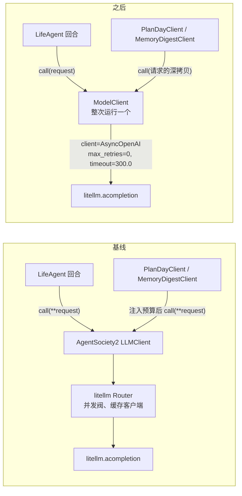
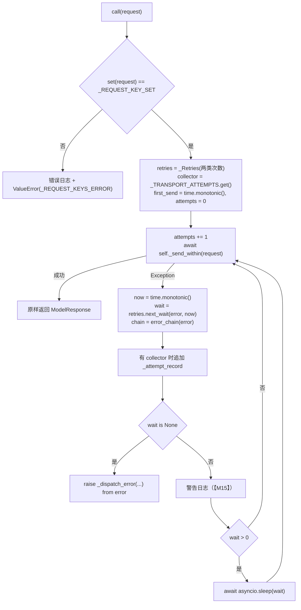

# 模型客户端与模型请求底稿

> 本章属于[去掉 AgentSociety2：开发规格](../SPEC-agentsociety2-removal.md)，读法和叫法见那一页。

## 目标与依据

本章把给 DeepSeek 发请求的客户端从 AgentSociety2 的 `llm_dispatcher.py` 搬成 WorldMock 自己的 `ModelClient`（`src/worldmock/configuration/model/model_client.py`），并把足迹里 `model_request` 的请求字典（底稿）缩成真正交给客户端的六个键。人物回合、零点计划、日月年回顾三条路径共用这一个客户端。发出去的 HTTP 正文逐字节不变；重试、停放、单次发送期限、失败发送记录、错误链与最终失败文字都照搬 model-lifecycle 补丁写下的行为。

依据：

| 来源 | 本章落实的内容 |
| --- | --- |
| 提案第五章末两段（PROPOSAL-agentsociety2-removal.md:107-109） | litellm 继续当普通库用来发请求、计 token；litellm 自带的重试、超时与客户端缓存满足不了 `docs/design/08-configuration.md` 的四处规定，所以重试与停放仍由 WorldMock 自己写；`LITELLM_LOCAL_MODEL_COST_MAP=True` 避免联网拉取价目表 |
| 提案第六章「模型客户端」（:203-222） | 直接调用 `litellm.acompletion`、不经 Router；整次运行一个 `AsyncOpenAI` 作为 `client=` 传入、结束时关一次；每次显式传 `max_retries=0`、`timeout=300`；逐段搬过来的六项；限流只按异常类型判定；唯一导入 litellm、先设价目表变量、转出 `token_counter`；只依赖标准库与 litellm、openai、httpx；删除 Router、并发阀、跨 Ray 序列化、用量统计、三个角色和 `AGENTSOCIETY_*` 通道 |
| 提案第六章「模型请求的底稿」（:268-274） | 底稿只记交给客户端的六个键；两类重试次数只来自冻结的模型身份、在构造客户端时校验一次 |
| 提案第七章两行（:325、:330） | 请求头可能变；`model_request` 人物回合去掉三个参数、零点计划与回顾去掉两个，请求摘要随之变 |
| 提案第九章（:359、:367）与验收证据表（:385） | 基线环境里的线路探针、故障注入比较，以及由探针正文冻结成的固定样例测试 |
| 提案第十章两行（:412、:419） | 漏传 `max_retries=0` 或 `timeout=300` 的风险由单元测试与故障注入钉住；价目表变量由导入守卫和断网的干净进程测试钉住 |
| 裁定记录第 6 行 | 底稿里多出来的参数删除 |
| 裁定记录第 9 行 | WorldMock 自持一个网络客户端，整次运行共用，结束时关一次 |
| 裁定记录第 10 行 | 探针语料里的零点计划与回顾请求取自基线工作树上那份带一次计划内重启的计费两天录音 |

基线事实（代码基线 `74f1b949`，生产代码同 `cb802721`）：

| 事实 | 位置 |
| --- | --- |
| 人物回合经 AgentSociety2 `_complete_react_once` 发送：先写请求证据，再在 `collect_transport_attempts()` 里 `await self._dispatcher.call(**request)`；上游的失败证据写 `repr(exc)`，LifeAgent 的覆写把它改成 `MODEL_SERVICE_FAILED` 阶段文字、`response` 只带 `protocol_feedback`（落库的是覆写后的形状） | vendor/agentsociety2/packages/agentsociety2/agentsociety2/agent/base/agent_runtime.py:931-963；custom/agents/life_agent.py:145-150 |
| 人物回合底稿的骨架是 `{model, messages, stream: False, tools, tool_choice: "required", max_retries: 0, extra_body}`，LifeAgent 再改 `tool_choice`、`extra_body` 的值并追加 `max_tokens`、`transport_max_retries`，实际键序为 model、messages、stream、tools、tool_choice、max_retries、extra_body、max_tokens、transport_max_retries（tests/fixtures/viewer-context.json 的两条请求正是这个键序） | agent_runtime.py:988-996；custom/agents/life_agent.py:272-279 |
| 零点计划与回顾的底稿是 `{model, messages, stream: False, tools, tool_choice: "required", max_tokens, max_retries: 0, extra_body}` | src/worldmock/simulation_engine/scheduling/plans/day_planning.py:88-90；src/worldmock/simulation_engine/evidence/memory_digest.py:353-355 |
| 零点计划与回顾的业务客户端 `IndependentModelClient` 在底稿写完之后才注入身份里的两类重试次数，并把 `max_tokens` 截到服务输出上限；底稿上的 `max_retries: 0` 与实际发送不符 | src/worldmock/configuration/model/model_metadata.py:131-167（深拷贝在 :152，注入在 :153-154，截断在 :155-157） |
| 两个构造器早已把 `max_tokens` 截到服务输出上限，业务客户端的截断从不改变取值 | day_planning.py:103；memory_digest.py:354 |
| 容量预检只读请求的 `model`、`messages`、`tools`、`max_tokens`，删去 `stream` 与 `max_retries` 不改变计数，也不改变 `fit_plan_day` 裁掉的经历句子 | src/worldmock/agents/prompt/prompt_capacity.py:61-77 |
| 业务客户端借 `build_client_for_role("default")` 取 AgentSociety2 客户端，再反查模型名与端点是否等于运行清单 | model_metadata.py:134-146 |
| 发送层：单一 deployment 的 `Router(model_list, cache_responses=False, num_retries=0)`，deployment 带 `max_retries: 0`；发送 `router.acompletion(model, messages, stream=False, timeout=_LLM_REQUEST_TIMEOUT, **kwargs)`；超时从 `AGENTSOCIETY_LLM_REQUEST_TIMEOUT` 读，WorldMock 写成 `"300"` | llm_dispatcher.py:76、:442-448、:700-712；src/worldmock/runtime/framework/setup.py:48 |
| 补丁写下的行为：三个异常类型元组、四个数值常量与收集器变量（:78-92），`error_chain`（:127-140），收集器与失败发送记录（:143-160），Retry-After（:163-182），退避（:185-198），单次期限（:201-205），两类计数与停放（:493-522），调用循环与预算校验（:636-668），最终失败（:670-677），期限包装（:700-712） | llm_dispatcher.py（锁定源码，摘要 `0a7b9b06…`）；patches/agentsociety2/model-lifecycle.patch:315 起 |
| 上游部件：`LLMDispatchError` 带 `rate_limit_like`（:103-108），文字限流判断 `is_rate_limit_like_error`（:111-124，退避在 :191 用它，并发阀在 :694 用它），按循环关闭 litellm 缓存（:208-234），自适应并发阀（:242-434），用量统计（:451-466、:614-634），角色（:469-485），跨 Ray 序列化（:555-571），流式拒绝（:640-644），Ray 初始化（:720-778） | llm_dispatcher.py |
| 基线 `call(**request)` 把 `max_retries`、`transport_max_retries` 当具名参数取走、弹掉 `stream`，其余键（人物回合 tools、tool_choice、extra_body、max_tokens，零点计划与回顾 tools、tool_choice、max_tokens、extra_body）原序交给 Router | llm_dispatcher.py:636-656、:706-707 |
| 生产代码直接导入 litellm 的只有 `prompt_capacity.py` 一处（`token_counter`） | src/worldmock/agents/prompt/prompt_capacity.py:21 |
| `LITELLM_LOCAL_MODEL_COST_MAP` 今天由 `_configure_process` 写入；litellm 导入时就读它（`get_model_cost_map` 在 `litellm/__init__.py:517` 调用，变量判断在 `litellm/litellm_core_utils/get_model_cost_map.py:258`） | setup.py:47 |
| 零点计划与回顾在环境 actor 里经 `LifeEnv.close` 关闭 litellm 缓存的客户端 | custom/envs/life_env.py:14、:287-300 |
| 事件按规范 JSON（`sort_keys=True`）落库，请求字典在内存里的键序不进入库里的字节 | src/worldmock/foundation/serialization.py:13-16；src/worldmock/recording_engine/storage/store.py:298 |

litellm 1.89.2 的相关行为（本机 `.venv/Lib/site-packages/litellm/`）：

| 行为 | 位置 |
| --- | --- |
| 调用方给了 `client=` 时，litellm 直接用它，只把调用参数里的 `max_retries` 写到这个客户端上 | llms/openai/openai.py:343-352、:414-420 |
| 调用参数里没有 `max_retries` 时取 2 | llms/openai/openai.py:683 |
| 超时按「调用参数 `timeout`（含合并后的 litellm_params）→ `request_timeout` → 全局默认」解析，全局默认是包内缺省 6000 时退回 600 秒，非 httpx 超时一律转成 float；解析出的超时作为每次请求的 `timeout=` 交给 `chat.completions.with_raw_response.create`，覆盖客户端上的超时 | litellm_core_utils/completion_timeout.py:39-83；constants.py:443-450；llms/openai/openai.py:437-440 |
| 自建客户端缓存一小时，过期不关闭 | constants.py:228 |
| 请求正文是 `{"model", "messages", **optional_params}`，再由 OpenAI SDK 按具名参数生成，`extra_body` 的键并入正文顶层 | llms/openai/chat/gpt_transformation.py:429-456 |

规格阶段在本机做过一次只读实验（脚本在会话临时目录，不入库）：同一请求分别经与 `_build_router` 相同构造的 Router 和 `litellm.acompletion(client=AsyncOpenAI(max_retries=0, timeout=300.0), max_retries=0, timeout=300.0, stream=False)` 发到本机服务。结果：HTTP 正文逐字节相同；每次发送恰好一个 HTTP 请求；请求头的值与次序相同，只有八个 `X-Stainless-*` 名字的大小写不同（Router 一侧走 litellm 的 aiohttp 传输，全小写），`x-stainless-read-timeout` 两边都是 `300.0`、`x-stainless-retry-count` 都是 `0`；400、401、429、500、502、503 的错误链两边相同；超过单次期限的错误链两边都是 `Timeout <- TimeoutError <- CancelledError`；连接被拒时链头相同、尾部不同（Router 一侧 `InternalServerError <- OpenAIError <- APIConnectionError <- ConnectError <- ClientConnectorError <- ConnectionRefusedError`，新路径 `InternalServerError <- OpenAIError <- APIConnectionError <- ConnectError <- ConnectError`）；响应的 `model_dump(mode="json")` 两次调用逐字节稳定。规格评审时用【M3】的十二个关键字参数对本机 `ThreadingHTTPServer` 复核了其中几项：429 带 `Retry-After: 30` 时异常的 `litellm_response_headers` 里 `retry-after` 为 `30`，错误链 `RateLimitError <- OpenAIError <- RateLimitError`；502 的错误链 `BadGatewayError <- OpenAIError <- InternalServerError`；请求头 `x-stainless-read-timeout: 300.0`、`x-stainless-retry-count: 0`；`AsyncOpenAI.close()` 之后 `is_closed()` 为真。litellm 的 `BadGatewayError` 只继承 `openai.APIStatusError`，不是任何传输或致命类型的子类，所以按普通失败计。正式结论以本章「线路探针」与「故障注入比较」的回执为准。

本章引用而不重述的事实：

| 事实 | 所属章 |
| --- | --- |
| runner 在运行的事件循环里构造唯一的模型客户端（【H19】），运行宿主把它交给每个 LifeAgent 与零点任务（【H18】【H24】），运行宿主关闭时恰好关它一次，运行故障与关闭故障一起保留（【H34】【H35】） | [「运行宿主与决策轮」](./01-run-host.md) |
| 零点计划与回顾搬到 `src/worldmock/runtime/lifecycle/midnight.py`（含 `settle_pending_day_plans`） | [「运行宿主与决策轮」](./01-run-host.md) |
| 人物回合循环怎样构造请求值、写请求与响应证据、序列化响应 | [「人物、回合循环与只读问答的删除」](./03-agent-loop.md) |
| 人物决策故障、`status.json` 与三类停机记录的文字 | [「故障文本」](./06-failure-text.md) |
| `_configure_process` 的环境变量通道、AgentSociety2 源码锁、依赖锁与许可文件 | [「安装、代码身份、依赖与许可」](./07-install-identity.md) |
| 设计文档的完整新文字 | [「设计文档与手册」](./08-design-docs.md) |
| 运行级夹具、录音重跑与运行比对工具；AgentSociety2 专属测试的移植表与 `tests/unit/runtime/model_client_fixtures.py` 这个文件 | [「比较工具、查看器与测试迁移」](./09-tools-tests.md) |
| 含上游衍生代码的模块写哪一句来源与许可 | [「安装、代码身份、依赖与许可」](./07-install-identity.md)【I24】 |
| 计费录音、探针与全量测试的先后 | [「实施、验收证据与完成判据」](./10-implementation.md) |



## 行为

规则编号前缀为 M。

### 客户端的构成与寿命

【M1】一个 `ModelClient` 实例供任意多次 `call` 共用，人物回合、零点计划、日月年回顾三种请求经同一个实例发送时，用的是同一个网络客户端（跨调用不留状态见【M16】）。整次运行只有这一个实例：它由 runner 用运行清单 `stage_model_identity` 的 `base_url`、`max_retries`、`transport_max_retries` 与 `credential_value(config.model)` 读到的凭据构造，运行宿主结束时关闭一次，这两条寿命规则只写在第一章（【H19】【H34】），本章不重述。

【M2】`ModelClient` 构造时建且只建一个 `openai.AsyncOpenAI(api_key=api_key, base_url=base_url, max_retries=0, timeout=300.0)`，凭据原样交给它，不去空白、不改写；每次发送都把它作为 `client=` 交给 `litellm.acompletion`。不构造 `litellm.Router`，不读、不写、不清理 litellm 的客户端缓存。`close()` 就是 `await` 这个网络客户端的 `close()` 一次：关闭之后它的 `is_closed()` 为真，没有含 `Unclosed` 的告警或日志记录。

【M3】每次发送调用 `litellm.acompletion` 的关键字参数恰为这十二个：`model="openai/" + request["model"]`、`messages`、`tools`、`tool_choice`、`max_tokens`、`extra_body`（这五个取请求里的原值）、`api_base`（构造时的 `base_url`）、`api_key`、`client`（【M2】的网络客户端）、`max_retries=0`、`timeout=300.0`、`stream=False`。没有 `num_retries`、`fallbacks`、`caching`、`metadata` 或其他参数。`max_retries` 与 `timeout` 每次都要显式传：litellm 用调用参数覆盖客户端上的这两项，不传时 `max_retries` 取 2（OpenAI SDK 会悄悄重发，这些重发不进 `transport_attempts`），超时退回 600 秒。`300.0` 与今天 `AGENTSOCIETY_LLM_REQUEST_TIMEOUT=300` 解析出的值相同，请求头 `x-stainless-read-timeout` 仍为 `300.0`。

【M4】两类重试次数只在构造时给出并校验一次：`max_retries` 与 `transport_max_retries` 都必须满足 `type(x) is int` 且 `0 <= x <= 10`，否则写错误日志 `Model retry budgets must be integers in [0, 10]` 并抛同文 `ValueError`，不建网络客户端。`call` 不接受任何重试参数。

【M5】`call(request)` 收一个位置参数（映射），只接受键集合恰为 `model`、`messages`、`tools`、`tool_choice`、`max_tokens`、`extra_body` 的请求，不核对键序；多一个键（例如 `stream`、`max_retries`、`transport_max_retries`）或少一个键，都写错误日志并抛 `ValueError("Model request keys must be exactly model, messages, tools, tool_choice, max_tokens, extra_body")`，不发送，收集器里不登记。

【M6】`call` 不修改、不复制请求；同一次调用里每次重发传给 `litellm.acompletion` 的参数逐值相同，所以重发的 HTTP 正文与首发逐字节相同。

### 失败分类、重试与停放

【M7】按 litellm 异常类型分类，每次失败只消耗一类预算：传输类 `APIConnectionError`、`Timeout`、`InternalServerError`、`ServiceUnavailableError` 消耗 `transport_max_retries`；致命类 `AuthenticationError`、`BadRequestError`、`NotFoundError`、`PermissionDeniedError`、`UnprocessableEntityError` 第一次失败即结束调用，不消耗预算；其余 `Exception`（含 `RateLimitError`、`BadGatewayError`、非 litellm 异常、不是单次期限触发的 `TimeoutError`）消耗 `max_retries`。`asyncio.CancelledError` 不被捕获、不登记、不重发。

【M8】计数内（这一类的失败序号 n 小于它的预算，n 从 0 起，指数至多取 16）的等待：传输类 2·2ⁿ 秒；`RateLimitError` 2ⁿ 秒、至多 60 秒，且不短于 Retry-After；其余普通失败 0 秒，不睡眠，立即重发。限流只看 `isinstance(error, RateLimitError)`：错误文字（含 `try again in`、`RouterRateLimitError`、`No deployments available for selected model`）不参与任何判定。计数内任何一次等待长于 43,200 秒时这次调用立即失败。

【M9】停放：一类预算用尽后，传输类与 `RateLimitError` 不失败，而是原样重发同一请求；等待按同一指数（`RateLimitError` 不再封顶 60 秒）、至多 120 秒，`RateLimitError` 不短于 Retry-After。停放起点是第一次停放的那次失败的时刻，`此刻 + 等待 − 起点 > 43,200` 秒时失败。其余类别预算用尽即失败。43,200、120、60 与单次期限的两个数都是模块常量，不在配置里，随代码身份冻结。

【M10】Retry-After 只对 `RateLimitError` 读，只从异常的 `litellm_response_headers` 的 `retry-after` 读（`error.response` 是 litellm 另造的不带服务响应头的替身）：全是数字时为秒数；否则按 HTTP 日期解析（`email.utils.parsedate_to_datetime`，不带时区按 UTC），减去此刻（UTC），不小于 0；解析不了时写警告 `Ignoring unparsable Retry-After header: %r` 并忽略这个头。

【M11】每次发送套 `asyncio.timeout(120 + 0.0075 × max_tokens)`，`max_tokens` 只在 `type(...) is int` 且大于 0 时计入，否则按 0：16,000 时 240 秒，8,000 时 180 秒。期限触发时改抛 `litellm.exceptions.Timeout(message=f"Model call exceeded its {deadline:.1f} s deadline", model=request["model"], llm_provider="openai")`，以原 `TimeoutError` 为显式原因，按传输类重发。不是这个期限触发的 `TimeoutError` 原样抛出，再由【M7】归入普通类。

### 失败发送记录与失败文字

【M12】`collect_transport_attempts()` 是上下文管理器：用 `ContextVar` 给当前 asyncio 任务装一个新列表并交给调用方，退出时恢复外层收集器；并发的任务各有各的。有收集器时，每次失败发送追加一项，键序为 `attempt`（从 1 连续编号）、`error`（【M13】的错误链）、`failed_after_ms`（距这次调用第一次发送的毫秒数，`int(秒 × 1000)`）、`wait_ms`（到下一次发送的毫秒数，`int(秒 × 1000)`；结束调用的那次为 `None`）。没有收集器时不登记。成功的发送不登记，响应不加任何字段。

【M13】`error_chain(error)` 返回异常及其原因链的类型名，自外向内以 ` <- ` 连接：有 `__cause__` 时取它，否则在未设 `__suppress_context__` 时取 `__context__`；至多 16 层，遇到已出现过的对象即停；不含异常文字。

【M14】最终失败抛 `LLMDispatchError(f"Failed to get valid response after {attempts} attempts in {elapsed:.1f} s. Last error type: {type(error).__name__}. Error chain: {chain}")`，以最后一次的异常为显式原因；`elapsed` 是单调时钟上距第一次发送的秒数。抛出前写错误日志 `Model request failed after %d attempts in %.1f s: %s`（发送次数、秒数、错误链）。`LLMDispatchError` 是 `RuntimeError` 的子类，只带这一条文字，没有 `rate_limit_like`；它的 `repr` 与基线逐字相同，所以零点计划与回顾失败证据里的 `repr(error)`、人物回合失败时运行宿主写下的中止原因（「故障文本」一章【F7】）与 `status.json` 里这部分文字不变。人物回合的失败证据本来就不含 `repr(error)`（第三章【A17】）。

【M15】每次准备重发写一条警告 `Request failed for '%s' (attempt %d%s). Backoff %.1fs. Error: %s`，依次是请求的 `model`、发送序号、停放中时的 `, parked {秒数:.0f}s`（未停放时为空串）、等待秒数、错误链。日志器是 `logging.getLogger(__name__)`。日志与异常文字都不含服务返回的正文。

【M16】成功时原样返回 litellm 的 `ModelResponse`。客户端不累计用量，不保留跨调用的状态：两类计数与停放起点只存在于一次 `call` 之内，构造之后实例属性不再增减或改值。

### 模块边界

【M17】`src` 下只有 `src/worldmock/configuration/model/model_client.py` 导入 litellm（`import litellm`、`from litellm… import …`，函数内导入也算）。`prompt_capacity.py` 的 `token_counter` 改从这个模块导入；它就是 `litellm.token_counter` 这个函数对象本身，计数逐值不变。

【M18】`model_client.py` 在导入 litellm 之前执行 `os.environ["LITELLM_LOCAL_MODEL_COST_MAP"] = "True"`。一个环境里没有这个变量、禁止一切网络访问的新进程依次导入 `worldmock.cli` 与 `worldmock.agents.prompt.prompt_capacity` 之后：litellm 已加载，这个变量为 `"True"`，没有任何名字解析或连接尝试。

【M19】`model_client.py` 顶层导入的模块只有标准库与 `litellm`、`openai`、`httpx`，不导入 `worldmock` 或别的第三方包；可以用 `importlib.util.spec_from_file_location` 以任意模块名按文件路径加载并构造 `ModelClient`。

【M20】模块里没有这些 AgentSociety2 部件：`Router` 与 `_build_router`、自适应并发阀、跨进程序列化（`__getstate__`/`__setstate__`）、用量统计、角色（`default`/`coder`/`embedding` 与 `build_client_for_role`）、`AGENTSOCIETY_*` 环境变量（含请求超时变量）、按事件循环清理 litellm 客户端缓存、`is_rate_limit_like_error` 与 `rate_limit_like`、流式拒绝分支、Ray 初始化。

### 模型请求的底稿

【M21】人物回合、零点计划、日月年回顾三条路径的底稿（`model_request.data.request`）就是交给 `ModelClient.call` 的那个请求，键集合恰为六个键 `model`、`messages`、`tools`、`tool_choice`、`max_tokens`、`extra_body`，没有 `stream`、`max_retries`、`transport_max_retries`。三条路径都按 `REQUEST_KEYS = ("model", "messages", "tools", "tool_choice", "max_tokens", "extra_body")` 的次序直接构造（人物回合由第三章【A14】构造；第十章「跨章裁定」）。人物回合今天交给客户端的次序里 `extra_body` 在 `max_tokens` 之前，这一相对次序不进入任何字节：落库是规范 JSON；`ModelClient` 按名字取值传给 litellm，HTTP 正文由 OpenAI SDK 按具名参数生成。

【M22】零点计划的请求是 `{"model": 冻结身份的 requested_model, "messages": [系统模板, JSON 输入], "tools": [submit_day_plan 严格工具], "tool_choice": "required", "max_tokens": min(8000, max_output_tokens), "extra_body": {"thinking": {"type": "disabled"}}}`；回顾的请求同形，工具为 `submit_memory_digest`、用户消息是紧凑不排序的 JSON。纠正请求在原始请求的消息后接一条纠正消息，六个键与其余值不变。消息、工具、`tool_choice`、`max_tokens`、`extra_body` 的值与基线逐值相同。

【M23】两类重试次数的唯一来源是运行清单 `stage_model_identity` 的 `max_retries` 与 `transport_max_retries`，经 runner 构造（第一章【H19】）与【M4】的构造校验交给 `ModelClient`。零点计划与回顾的业务客户端不再往请求里注入重试次数、不再截断 `max_tokens`、不再核对客户端身份；交给 `ModelClient.call` 的请求与底稿逐值相同。基线里零点计划与回顾的底稿写 `max_retries: 0`、实际发送却用身份里的次数，这一不符随之消失。

【M24】`IndependentModelClient(model_client, model_identity, purpose)` 是零点计划与回顾的业务入口：`model_name` 是 `model_identity["requested_model"]`；`call(request)` 把请求深拷贝一份交给 `model_client.call`，响应有 `model_dump` 时取 `model_dump(mode="json")`、是字典时取 `dict(response)`，否则抛 `ProtocolError(f"{purpose} model response is not serializable")`，结果不是字典时抛 `ProtocolError(f"{purpose} model response is not a serialized object")`；调用方的请求对象不被改动。

### 线路探针、故障注入与固定样例

【M25】新客户端发出的 HTTP 正文与基线 Router 路径逐字节相同；固定样例 `tests/fixtures/model-client-wire.json` 的每个用例经真实 `ModelClient` 发到本机服务时：恰好一个 HTTP 请求，正文字节等于样例记下的正文，`x-stainless-read-timeout` 为 `300.0`、`x-stainless-retry-count` 为 `0`，响应 `model_dump(mode="json")` 的规范 JSON 等于样例记下的序列化结果。

【M26】线路探针在基线环境里运行，按「接口与文件」的「线路探针」一节比较五个用例；判定为通过当且仅当每个用例两边都恰好一个 HTTP 请求、方法与路径相同、正文逐字节相同、`x-stainless-read-timeout` 两边都是 `300.0`、`x-stainless-retry-count` 两边都是 `0`、响应规范 JSON 相同。请求头的其余差异写进回执，不影响判定。探针通过后写出【M25】的固定样例。

【M27】故障注入比较在基线环境里运行，按「接口与文件」的「故障注入比较」一节逐个场景比较两边：服务端收到的 HTTP 请求数、等待序列、`transport_attempts` 全部四个字段、调用结局（成功时响应规范 JSON，失败时异常类名与文字）。判定为通过当且仅当这些全部相同，唯一允许的差异是连接被拒场景里错误链在 `InternalServerError <- OpenAIError <- APIConnectionError <- ConnectError` 之后的尾部（及随之出现在最终失败文字里的同一尾部）。不通过时不合并。仓库里的故障场景测试按「测试」一节的期望值表钉住新客户端的结果。

## 接口与文件

### 生产文件

| 路径 | 动作 | 内容 |
| --- | --- | --- |
| `src/worldmock/configuration/model/model_client.py` | 新建 | 见下一节，约 260 行 |
| `src/worldmock/configuration/model/model_metadata.py` | 修改 | `IndependentModelClient` 改为包装 `ModelClient`（【M24】）；删去 `from agentsociety2.config import build_client_for_role`、身份反查、预算注入与 `max_tokens` 截断；其余函数不动 |
| `src/worldmock/agents/prompt/prompt_capacity.py` | 修改 | :21 `from litellm import token_counter` 改为 `from worldmock.configuration.model.model_client import token_counter`；其余不动 |
| `src/worldmock/simulation_engine/scheduling/plans/day_planning.py` | 修改 | `prepare_plan_day`（:81-90）返回六键字典（【M22】）；文档串「思考关闭、无内部重试且给出 max_tokens」改为「思考关闭且给出 max_tokens；只含交给模型客户端的六个键」 |
| `src/worldmock/simulation_engine/evidence/memory_digest.py` | 修改 | `prepare_digest_request`（:346-360）的字典去掉 `"stream": False` 与 `"max_retries": 0`，键序为 `REQUEST_KEYS`；文档串「思考关闭、底层不重试」改为「思考关闭；只含交给模型客户端的六个键」 |
| `src/worldmock/runtime/lifecycle/midnight.py` | 由第一章新建，本章约定其中两处 | `PlanDayClient`、`MemoryDigestClient` 的构造与 `collect_transport_attempts` 的导入，见「其他章节文件里属于本章的约定」 |
| `src/worldmock/runtime/lifecycle/runner.py` | 由第一章修改，本章约定一处 | `_model_client(prepared)` 构造 `ModelClient` 的参数，见「其他章节文件里属于本章的约定」 |
| `vendor/agentsociety2/…/config/llm_dispatcher.py`、`config/config.py` | 随 vendor 删除（第七章） | 本章不移植的部分见「不移植的 AgentSociety2 部件」 |

### `src/worldmock/configuration/model/model_client.py`（新建）

模块文档串（中文；最后一段单独一行，是第七章【I24】规定的来源与许可句，一字不差，本章不另写来源句）：

```text
@brief WorldMock 唯一的模型客户端：经 litellm.acompletion 发送生成请求，承担两类重试预算、停放、单次发送整次期限、
失败发送记录与错误链（docs/design/08-configuration.md「模型配置与凭据」）。

本模块只依赖标准库与 litellm、openai、httpx，可以在别的环境里按文件路径加载；它是 src 里唯一导入 litellm 的模块，
导入之前设置 LITELLM_LOCAL_MODEL_COST_MAP。最终失败的类名 LLMDispatchError 与发送循环的骨架沿用上游的模型调度器。

来源：本模块部分代码改写自 AgentSociety2 2.8.7（上游提交 670c94ff），按 Apache-2.0 使用，许可全文见 LICENSES/AgentSociety2-Apache-2.0.txt。
```

导入次序：`from __future__ import annotations`；标准库 `asyncio`、`email.utils`、`logging`、`os`、`time`、`collections.abc`（`Iterator`、`Mapping`）、`contextlib.contextmanager`、`contextvars.ContextVar`、`dataclasses.dataclass`、`datetime`（`datetime`、`timezone`）、`typing.Any`；然后一行 `os.environ["LITELLM_LOCAL_MODEL_COST_MAP"] = "True"`；然后 `import litellm`、`from litellm import token_counter`、`from litellm.exceptions import (...)`（下表十个类型）、`from litellm.types.utils import ModelResponse`、`from openai import AsyncOpenAI`。

测试接缝（实现必须保持）：发送一律写成 `litellm.acompletion(...)`（按属性查找，不写 `from litellm import acompletion`）；等待写成 `asyncio.sleep(...)`、期限写成 `asyncio.timeout(...)`、时钟写成 `time.monotonic()`、Retry-After 的此刻写成 `datetime.now(timezone.utc)`、网络客户端写成 `AsyncOpenAI(...)`，都经模块全局名查找。测试据此替换模块属性 `litellm.acompletion`、`asyncio`、`time`、`datetime`、`AsyncOpenAI` 与下表的常量。

模块常量（名称与取值固定）：

| 名称 | 取值 | 来源 |
| --- | --- | --- |
| `__all__` | `["LLMDispatchError", "ModelClient", "REQUEST_KEYS", "collect_transport_attempts", "error_chain", "token_counter"]` | 新 |
| `REQUEST_KEYS` | `("model", "messages", "tools", "tool_choice", "max_tokens", "extra_body")`；这个次序是错误文字与三条路径底稿的构造次序，`call` 只比集合 | 新（【M5】【M21】） |
| `_REQUEST_KEY_SET` | `frozenset(REQUEST_KEYS)` | 新 |
| `_REQUEST_KEYS_ERROR` | `"Model request keys must be exactly model, messages, tools, tool_choice, max_tokens, extra_body"` | 新 |
| `_RETRY_BUDGET_ERROR` | `"Model retry budgets must be integers in [0, 10]"` | llm_dispatcher.py:647-648 的文字 |
| `_REQUEST_TIMEOUT_SECONDS` | `300.0` | 取代 llm_dispatcher.py:76 与 setup.py:48 |
| `_TRANSPORT_ERRORS` | `(APIConnectionError, Timeout, InternalServerError, ServiceUnavailableError)` | :78 |
| `_FATAL_ERRORS` | `(AuthenticationError, BadRequestError, NotFoundError, PermissionDeniedError, UnprocessableEntityError)` | :80-81 |
| `_PARKED_ERRORS` | `(*_TRANSPORT_ERRORS, RateLimitError)` | :83 |
| `_PARK_BUDGET_SECONDS` | `12 * 60 * 60` | :85 |
| `_PARK_MAX_WAIT_SECONDS` | `120.0` | :87 |
| `_DEADLINE_BASE_SECONDS` | `120.0` | :89 |
| `_DEADLINE_SECONDS_PER_TOKEN` | `0.0075` | :90 |
| `_TRANSPORT_ATTEMPTS` | `ContextVar("transport_attempts", default=None)`，类型 `ContextVar[list[dict[str, Any]] \| None]` | :92 |
| `_LOGGER` | `logging.getLogger(__name__)` | 取代 :69 的 `get_logger()` |

类与函数（「照搬」指函数体逐行同锁定源码，只改所列之处）：

| 名称与签名 | 内容 | 对应基线 |
| --- | --- | --- |
| `class LLMDispatchError(RuntimeError)` | 只有文档串「@brief 重试或停放之后仍失败的模型请求；文字含发送次数、耗时、最后的错误类型与根因异常链。」，不覆写 `__init__`（【M14】） | :103-108，去掉 `rate_limit_like` |
| `def error_chain(error: BaseException) -> str` | 照搬（【M13】） | :127-140 |
| `@contextmanager def collect_transport_attempts() -> Iterator[list[dict[str, Any]]]` | 照搬（【M12】） | :143-154 |
| `def _attempt_record(attempt: int, chain: str, elapsed: float, wait: float \| None) -> dict[str, Any]` | 照搬，键序 `attempt`、`error`、`failed_after_ms`、`wait_ms` | :157-160 |
| `def _retry_after_seconds(error: Exception) -> float \| None` | 照搬，`logger` 换成 `_LOGGER`（【M10】） | :163-182 |
| `def _backoff(error: Exception, index: int, counted: bool) -> float` | 照搬，唯一改动：`elif is_rate_limit_like_error(error):` 改为 `elif isinstance(error, RateLimitError):`；文档串里「限流与其他过载」改为「限流 429（只按 RateLimitError 类型）」（【M8】【M9】） | :185-198 |
| `def _attempt_deadline(request: Mapping[str, Any]) -> float` | 照搬，只把形参 `kwargs: dict[str, Any]` 改为 `request: Mapping[str, Any]`，函数体仍是 `request.get("max_tokens")` 加类型判断（【M11】） | :201-205 |
| `def _dispatch_error(error: Exception, attempts: int, elapsed: float) -> LLMDispatchError` | 由方法改为模块函数；写【M14】的错误日志，返回 `LLMDispatchError(...)`（不传 `rate_limit_like`） | :670-677 |
| `@dataclass class _Retries` 与 `next_wait(self, error: Exception, now: float) -> float \| None` | 照搬（【M7】【M8】【M9】） | :493-522 |
| `class ModelClient` | 见下 | :525-712 中保留的部分 |

`ModelClient`：

| 成员 | 内容 |
| --- | --- |
| `__init__(self, *, base_url: str, api_key: str, max_retries: int, transport_max_retries: int) -> None` | 先按【M4】校验两类次数（不合格时 `_LOGGER.error("%s", _RETRY_BUDGET_ERROR)` 后抛 `ValueError(_RETRY_BUDGET_ERROR)`）；再设 `self.base_url = base_url`、`self.max_retries`、`self.transport_max_retries`、`self._api_key = api_key`、`self._client = AsyncOpenAI(api_key=api_key, base_url=base_url, max_retries=0, timeout=_REQUEST_TIMEOUT_SECONDS)`；此后实例属性不再增减或改值 |
| `async def call(self, request: Mapping[str, Any]) -> ModelResponse` | 见下面的流程；键集合不对时 `_LOGGER.error("%s", _REQUEST_KEYS_ERROR)` 后抛 `ValueError(_REQUEST_KEYS_ERROR)` |
| `async def _send_within(self, request: Mapping[str, Any]) -> ModelResponse` | `deadline = _attempt_deadline(request)`；`scope = asyncio.timeout(deadline)`；在 `async with scope:` 里 `return await litellm.acompletion(model=f"openai/{request['model']}", messages=request["messages"], tools=request["tools"], tool_choice=request["tool_choice"], max_tokens=request["max_tokens"], extra_body=request["extra_body"], api_base=self.base_url, api_key=self._api_key, client=self._client, max_retries=0, timeout=_REQUEST_TIMEOUT_SECONDS, stream=False)`；`except TimeoutError as error:` 时 `scope.expired()` 为假就原样 `raise`，否则 `raise Timeout(message=f"Model call exceeded its {deadline:.1f} s deadline", model=request["model"], llm_provider="openai") from error`（【M3】【M11】） |
| `async def close(self) -> None` | `await self._client.close()`；不另外捕获异常（【M2】） |

`call` 的流程（函数体不超过 50 行）：



不移植的 AgentSociety2 部件（随 vendor 删除，新模块里不出现，【M20】）：

| 部件 | 锁定源码位置 |
| --- | --- |
| `_LLM_REQUEST_TIMEOUT` 读 `AGENTSOCIETY_LLM_REQUEST_TIMEOUT` | :76 |
| `RAY_ENABLE_UV_RUN_RUNTIME_ENV` 的 `setdefault` | :94-95 |
| `RouterRateLimitError` 导入与 `is_rate_limit_like_error` | :51-54、:111-124 |
| `close_cached_async_clients` | :208-234 |
| `_AdjustableSemaphore`、`AdaptiveSemaphore` | :242-434 |
| `_build_router`、`merge_token_stats`、`build_client_for_role` | :442-485 |
| `LLMClient` 的 `model_type`、`__getstate__`/`__setstate__`、`close`（`router.discard()`）、`_ensure_runtime`、用量三方法、流式拒绝、`_complete_once` | :525-634、:640-644、:679-698 |
| `_build_ray_job_config`、`init_dispatchers`、`shutdown_dispatchers` | :720-778 |
| `Config` 与全部 `AGENTSOCIETY_*` 读取 | config/config.py |

### `src/worldmock/configuration/model/model_metadata.py`（修改）

`IndependentModelClient`（:131-167）改为：

| 成员 | 内容 |
| --- | --- |
| 类文档串 | 「@brief 零点计划与回顾的业务入口：经整次运行共用的模型客户端发送；请求隔离，响应序列化为可持久化字典。」 |
| `__init__(self, model_client: ModelClient, model_identity: Mapping[str, Any], purpose: str)` | `self.client = model_client`、`self.model_name = model_identity["requested_model"]`、`self.purpose = purpose`；不核对身份，不保存身份 |
| `async def call(self, request: dict) -> dict` | `response = await self.client.call(copy.deepcopy(request))`；序列化分支与两条 `ProtocolError` 文字保留原样（基线 :159-167） |

`model_metadata.py:11` 改为 `from typing import TYPE_CHECKING, Any`，其后加 `if TYPE_CHECKING:` 分支导入 `from worldmock.configuration.model.model_client import ModelClient`；`model_metadata.py` 在运行时不导入 litellm。`Mapping` 沿用 `:10` 已有的 `from collections.abc import Callable, Mapping`。`IndependentModelClient.__init__` 里 :136-137 的两条函数内导入随身份核对一起删去；`call` 里 :150 的 `ProtocolError` 函数内导入保留。

### `src/worldmock/agents/prompt/prompt_capacity.py`（修改）

只改 :21 的导入（【M17】）；`prompt_token_count`（:61-68）与 `_log_capacity_failure` 里的 `token_counter` 调用不动。

### `day_planning.py` 与 `memory_digest.py`（修改）

| 函数 | 基线字典 | 之后 |
| --- | --- | --- |
| `prepare_plan_day`（day_planning.py:88-90） | model、messages、stream、tools、tool_choice、max_tokens、max_retries、extra_body | `{"model": model_name, "messages": messages, "tools": [tool], "tool_choice": "required", "max_tokens": PLAN_DAY_MAX_TOKENS, "extra_body": {"thinking": {"type": "disabled"}}}`；`fit_plan_day`（:103）照旧原位改写 `max_tokens` |
| `prepare_digest_request`（memory_digest.py:353-355） | 同上八键 | `{"model": model_name, "messages": messages, "tools": [memory_digest_tool()], "tool_choice": "required", "max_tokens": min(MEMORY_DIGEST_MAX_TOKENS, metadata.max_output_tokens), "extra_body": {"thinking": {"type": "disabled"}}}` |

`prepare_plan_day_correction` 与 `prepare_digest_correction` 不改：它们深拷贝原始请求、只换 `messages`。

### 其他章节文件里属于本章的约定

| 文件（所属章） | 约定 |
| --- | --- |
| `src/worldmock/runtime/lifecycle/runner.py`（[「运行宿主与决策轮」](./01-run-host.md)【H19】） | `_model_client(prepared)` 恰为 `ModelClient(base_url=identity["base_url"], api_key=credential_value(prepared.inputs.config.model), max_retries=identity["max_retries"], transport_max_retries=identity["transport_max_retries"])`，`identity = prepared.stage_identity`（新建时由 `stage_model_identity(...)` 算出、同值写进清单，恢复与重放时取父清单的 `stage_model_identity`） |
| `src/worldmock/runtime/lifecycle/midnight.py`（[「运行宿主与决策轮」](./01-run-host.md)【H24】【H42】） | `PlanDayClient(IndependentModelClient)` 的构造为 `__init__(self, model_client: ModelClient, model_identity: Mapping[str, Any])`，调用 `super().__init__(model_client, model_identity, "Plan day")`；`MemoryDigestClient` 同形，用途 `"Memory digest"`；两者照旧只在发现第一项待办之后才构造（基线 runner.py:634、:739）；`ModelClient` 与 `collect_transport_attempts` 在模块顶层 `from worldmock.configuration.model.model_client import ...`，`_call_plan_day`、`_call_memory_digest` 里不再有函数内导入（基线 runner.py:680、:776） |
| `src/worldmock/agents/protocol/react_loop.py` 与 `src/worldmock/agents/life_agent.py`（[「人物、回合循环与只读问答的删除」](./03-agent-loop.md)【A14】【A16】【A17】） | 人物回合请求按第三章【A14】直接构造，六个键，次序为 `REQUEST_KEYS`，各值同基线；在 `collect_transport_attempts()` 里 `await model_client.call(request)`，请求作为唯一的位置参数传入；失败证据按第三章【A17】：`error` 是 `MODEL_SERVICE_FAILED` 阶段文字、`response` 只带 `protocol_feedback`，与基线 LifeAgent 覆写后的形状逐字节相同；请求里没有重试次数 |

### 会变的英文文字

| 位置 | 基线 | 之后 |
| --- | --- | --- |
| 重发警告 | `Request failed for '%s' via LLMClient(%s) (attempt %d%s). Backoff %.1fs. Error: %s`（llm_dispatcher.py:665） | `Request failed for '%s' (attempt %d%s). Backoff %.1fs. Error: %s` |
| 日志器名 | `agentsociety`（自带 stderr 处理器、不向上传播） | `worldmock.configuration.model.model_client`（向根日志器传播） |
| 请求键不对 | 无 | `Model request keys must be exactly model, messages, tools, tool_choice, max_tokens, extra_body`（错误日志与 `ValueError` 同文） |
| 预算不合格 | 每次 `call` 发送前抛 | 同一文字 `Model retry budgets must be integers in [0, 10]`，改在构造时抛 |
| 流式拒绝 | `Streaming completion is not supported` 与 `streaming is not supported; callers must use stream=False`（`NotImplementedError`） | 删除；带 `stream` 键的请求由【M5】拒绝 |
| 业务客户端身份不符 | `{purpose} client identity disagrees with the run manifest` | 删除 |
| 不移植的上游日志 | `Failed to discard LiteLLM router`、`Failed to close cached LiteLLM client %s`、`[AdaptiveSem] …`、`LLM dispatchers ready (per-process, no central pool)` | 删除 |
| 连接被拒的错误链（数据，不是代码里的字面量） | `… <- ConnectError <- ClientConnectorError <- ConnectionRefusedError` | `… <- ConnectError <- ConnectError`（【M27】） |

### 逐字节不变的部分

| 对象 | 怎样证明 |
| --- | --- |
| 发给 DeepSeek 的 HTTP 正文（含键序） | 录音重跑的 `raw-order`（第十章）；线路探针与固定样例（【M25】【M26】） |
| 请求头的值与次序 | 线路探针回执（只有八个 `X-Stainless-*` 名字的大小写会变） |
| 失败发送记录的四个键、语义与文字（连接被拒的链尾除外） | 【M12】【M13】【M27】 |
| `LLMDispatchError` 的类名、文字与 `repr` | 【M14】 |
| 退避、停放、期限的全部数字与等待序列 | 【M8】【M9】【M11】，故障注入比较 |
| Retry-After 的解析与警告文字 `Ignoring unparsable Retry-After header: %r` | 【M10】 |
| 最终失败日志 `Model request failed after %d attempts in %.1f s: %s` | 【M14】 |
| 单次期限超时文字 `Model call exceeded its {deadline:.1f} s deadline` | 【M11】 |
| token 计数 | 【M17】 |
| 响应对象与它的 `model_dump(mode="json")` | 线路探针 |
| 业务客户端的两条 `ProtocolError` 文字 | 【M24】 |
| 运维日志 `MODEL_TRANSPORT_WAIT`、`MODEL_EXCHANGE`、`PLAN_DAY_CALL`、`MEMORY_DIGEST_CALL` 的字段与级别 | `transport_wait_record`（src/worldmock/recording_engine/storage/opslog.py:19-25）与 `MODEL_EXCHANGE`（src/worldmock/simulation_engine/evidence/model.py:125）不动；`PLAN_DAY_CALL`、`MEMORY_DIGEST_CALL`（基线 runner.py:698-709、:794-805）随第一章原样搬进 `midnight.py` |
| 零点计划与回顾的容量预检与经历裁剪 | prompt_capacity.py:61-77 只读 `model`、`messages`、`tools`、`max_tokens` |

### 验收工具（不入库）

探针与故障注入比较要导入 `agentsociety2`，而合并后仓库里不得有相关导入（提案验收证据表），所以这两个脚本放在被 git 忽略的 `.work/agentsociety2-removal/probe/`，只有它们产出的固定样例入库。

| 路径 | 内容 |
| --- | --- |
| `.work/agentsociety2-removal/probe/probe_server.py` | 共用的本机服务：`http.server.ThreadingHTTPServer` 绑 `127.0.0.1` 临时端口，在自己的线程里运行（不受被替换的 `asyncio.sleep` 影响）；按场景脚本逐次回答状态码、响应头与正文，可以对某次请求先睡若干秒再回答（客户端已断开时写回失败不打印，`handle_error` 覆写为空）；记录每个请求的方法、路径、按到达次序的请求头列表与原始正文字节 |
| `.work/agentsociety2-removal/probe/wire_probe.py` | 线路探针，命令行 `--recording <基线计费录音运行目录> --model-client <本分支 model_client.py 的路径> --fixture-out <本分支 tests/fixtures/model-client-wire.json> --receipt .work/agentsociety2-removal/probe/wire-receipt.json` |
| `.work/agentsociety2-removal/probe/fault_probe.py` | 故障注入比较，命令行 `--model-client <路径> --receipt .work/agentsociety2-removal/probe/fault-receipt.json` |
| `.work/agentsociety2-removal/probe/wire-receipt.json`、`fault-receipt.json` | 回执，进验证记录 |

两个脚本的共同前提：用基线工作树 `.work/wt/as2-base` 自己引导出来的解释器、在它的根目录运行；先在导入 `agentsociety2` 之前设好 `AGENTSOCIETY_LLM_API_KEY=probe-key`、`AGENTSOCIETY_LLM_API_BASE=http://127.0.0.1:9/v1`、`AGENTSOCIETY_LLM_REQUEST_TIMEOUT=300`、`LITELLM_LOCAL_MODEL_COST_MAP=True`；调用基线检出的 `worldmock.runtime.framework.setup.require_locked_as2()` 核对已导入的 AgentSociety2 源码摘要为 `0a7b9b06fe5bbf70836fefe407eceb830b2bc6acaa8c81db98176ee3c99709ba`（不符即停）并写进回执；用 `importlib.util.spec_from_file_location("worldmock_model_client_probe", 路径)` 加载新模块。基线一侧每个用例新建 `LLMClient(model_name=request["model"], base_url=url, api_key="probe-key")`，用完 `await close_cached_async_clients()` 再 `client.close()`；新一侧每个用例新建 `ModelClient(base_url=url, api_key="probe-key", max_retries=…, transport_max_retries=…)`，用完 `await close()`。

**线路探针**的语料是五个用例，次序固定：

| 名称 | 基线一侧的请求（`LLMClient.call(**它)`） | 新一侧的请求（`ModelClient.call(它)`） |
| --- | --- | --- |
| `action` | 基线检出的 `tests/fixtures/viewer-context.json` 的 `action`（九键） | 它的六个键，按 `REQUEST_KEYS` 次序 |
| `continuation` | 同一文件的 `continuation` | 同上 |
| `truncation_retry` | `action` 把 `tool_choice` 换成 `"required"`、`extra_body` 换成 `{"thinking": {"type": "disabled"}}`（基线截断重试的两处改动） | 同上 |
| `plan_day` | 计费录音 `footprints.sqlite` 里 `data.purpose == "plan_day"` 的第一条 `model_request` 的 `data.request`，加上录音运行清单 `stage_model_identity` 的 `max_retries`、`transport_max_retries`（与基线业务客户端注入的相同） | 录音请求去掉 `stream`、`max_retries` 后的六个键 |
| `memory_digest` | 同上，`data.purpose == "memory_digest"` 的第一条 | 同上 |

两边的预算取录音运行清单的值。本机服务对每个用例一律回答 200 与同一份响应：`{"id": "probe-1", "object": "chat.completion", "created": 1767225600, "model": 请求的 model, "choices": [{"index": 0, "message": {"role": "assistant", "content": null, "reasoning_content": "先看一眼现在的安排。", "tool_calls": [{"id": "call_probe_1", "type": "function", "function": {"name": 请求第一个工具的名字, "arguments": "{}"}}]}, "finish_reason": "tool_calls"}], "usage": {"prompt_tokens": 100, "completion_tokens": 20, "total_tokens": 120}}`。比较项与判定见【M26】；规范 JSON 是 `json.dumps(值, ensure_ascii=False, sort_keys=True, separators=(",", ":"))`，与 `worldmock.foundation.serialization.canonical_json` 同一算法。

回执 `wire-receipt.json` 的键序：`as2_source_sha256`、`base_commit`、`model_client_sha256`、`versions`（`litellm`、`openai`、`httpx`）、`cases`、`verdict`（`"equal"` 或 `"different"`）。`cases` 每项键序：`name`、`base`、`new`、`body_equal`、`serialized_equal`、`header_case_differences`、`header_value_differences`；`base` 与 `new` 各为 `{"requests": 收到的请求数, "method": …, "path": …, "body_sha256": …, "headers": [[名, 值], …], "read_timeout": …, "retry_count": …, "serialized_sha256": …}`。

判定为 `equal` 时脚本写固定样例 `tests/fixtures/model-client-wire.json`：UTF-8、LF、`json.dumps(…, ensure_ascii=False, indent=1)` 加末尾换行；顶层恰为 `{"cases": [...]}`，每项键序 `name`、`request`（新一侧六键请求）、`response`（服务回答的 JSON）、`body`（新一侧原始正文按 UTF-8 解码的字符串）、`serialized`（新一侧响应规范 JSON 字符串）。

**故障注入比较**的请求两边相同：`{"model": "probe-model", "messages": [{"role": "user", "content": "probe"}], "tools": [{"type": "function", "function": {"name": "submit_probe", "strict": true, "description": "Probe tool.", "parameters": {"type": "object", "properties": {}, "required": [], "additionalProperties": false}}}], "tool_choice": "required", "max_tokens": 8000, "extra_body": {"thinking": {"type": "disabled"}}}`；基线一侧 `call(**请求, max_retries=2, transport_max_retries=1)`，新一侧构造时给 `max_retries=2, transport_max_retries=1`。两边同样替换：`time` 换成读假时钟的 `monotonic`（从 0 起），`asyncio` 换成复制了 `asyncio` 全部属性、只把 `sleep` 换成「非零等待记下秒数并把假时钟加上它，零秒等待照常让出」的副本，`datetime` 换成 `now()` 恒为 `2026-01-01T00:00:00+00:00` 的子类，`_PARK_BUDGET_SECONDS` 改为 `600`；`slow` 场景另把 `_DEADLINE_BASE_SECONDS` 改为 `0.5`、`_DEADLINE_SECONDS_PER_TOKEN` 改为 `0.0`；`connection-refused` 场景的端点是 `http://127.0.0.1:9/v1`（没有监听），其余场景的端点是本机服务。每个场景都包在 `collect_transport_attempts()` 里。场景与期望结局见「测试」一节的期望值表，两边都要与表一致（连接被拒场景的链尾按【M27】）。

回执 `fault-receipt.json` 的键序：`as2_source_sha256`、`model_client_sha256`、`budgets`、`scenarios`、`verdict`；`scenarios` 每项键序 `name`、`base`、`new`、`differences`；`base` 与 `new` 各为 `{"server_requests", "waits", "attempts", "outcome"}`，`outcome` 为 `{"kind": "response", "serialized": …}` 或 `{"kind": "error", "type": …, "message": …}`。

## 设计文档

第八章写全文；下表是这些位置之后必须陈述的事实（行号指基线）。

| 位置 | 之后必须写明 |
| --- | --- |
| `docs/design/08-configuration.md:140-141` | 两类服务重试由模型客户端的同一个发送循环计数（不再说 dispatcher），每次失败只消耗一类预算；计数内退避：传输失败第 n 次（从 0 起）等 2·2ⁿ 秒；限流 429 只按 litellm 的 `RateLimitError` 类型判定，等 2ⁿ 秒、至多 60 秒，不短于服务给出的 `Retry-After`；其他普通失败计数内立即重发；错误文字不参与判定（原文「限流与其他过载」删去） |
| `docs/design/08-configuration.md:150` | 鉴权与参数错误立即失败；底层隐式重试关闭：每次发送显式传 SDK 重试 0 次与请求超时 300 秒，二者是引擎常量；不传时 litellm 会分别用 2 次与 600 秒 |
| `docs/design/08-configuration.md`「模型配置与凭据」节末新增一段「模型客户端」 | 整次运行一个模型客户端，人物回合、零点计划与回顾共用；直接调用 `litellm.acompletion`，不经 Router；持有一个 OpenAI SDK 异步网络客户端作为 `client=` 传入，不用 litellm 的客户端缓存；两类重试次数取自运行清单冻结的模型身份，构造时校验一次（`Model retry budgets must be integers in [0, 10]`），请求里不带重试次数；只接受六个键的请求（`Model request keys must be exactly model, messages, tools, tool_choice, max_tokens, extra_body`）；最终失败的类名 `LLMDispatchError` 与文字格式；`src` 里只有它导入 litellm，导入前设 `LITELLM_LOCAL_MODEL_COST_MAP=True` |
| `docs/design/08-configuration.md:161` | token 计数用 litellm 的 `token_counter`，经模型客户端模块取得 |
| `docs/design/06-agent.md:882` | 生成模型调用由 WorldMock 的模型客户端承载（链到 08「模型客户端」），删去「原生 AgentSociety2 客户端」 |
| `docs/design/06-agent.md:892` | 协议纠错与输出截断纠正与模型客户端的服务重试分别计数（删去 dispatcher） |
| `docs/design/05-recording-engine.md:157` | `model_request` 的 `data.request` 是交给模型客户端的请求，人物回合、零点计划、回顾都恰为 `model`、`messages`、`tools`、`tool_choice`、`max_tokens`、`extra_body` 六个键；HTTP 正文由 litellm 从它生成，`extra_body` 的键并入正文顶层；两类重试次数不在请求里，记在运行清单的 `stage_model_identity` |
| `docs/design/10-runtime.md:22` | 生成请求与零点计划、回顾共用同一个模型客户端与冻结身份 |
| `docs/design/10-runtime.md:24-25` | 删去 worker 任务与 LifeEnv 关闭 litellm 缓存客户端的两句；客户端寿命为：runner 在运行的事件循环里建一个模型客户端，运行结束（正常、故障或中断）时运行宿主在同一事件循环里关闭它一次（这段的全文归第一章的决策循环一节，【H19】【H34】） |

## 测试

全部离线，不跳过、不标 xfail。模型发送的唯一接缝是替换 `worldmock.configuration.model.model_client.litellm.acompletion`；时钟、等待与「此刻」的接缝是该模块的 `time`、`asyncio`、`datetime` 属性；网络客户端构造的接缝是 `AsyncOpenAI` 属性。真实网络路径的用例用「本章用例要求的测试夹具」里的本机服务。引擎相关条款经 `engine_factory`（tests/engine_fixture.py）与真实的零点任务入口、真实 SQLite 验证；人物回合条款经第九章改写后的人物夹具（`decide`、`person`）。

AgentSociety2 专属测试文件的逐条移植表归第九章，下表的移植用例名与那张表一致；本章另写由本章规则决定的断言改动（「移植时随本章规则改动的断言」）。测试文件里凡要出现第九章【T27】禁用的子串（例如 `AGENTSOCIETY_`），一律由字符串片段拼出。

### 测试文件

| 路径 | 动作 | 内容 |
| --- | --- | --- |
| `tests/unit/runtime/test_model_client.py` | 新建（第九章同时放入移植用例） | 【M1】–【M16】【M20】的单元用例与移植用例 |
| `tests/unit/runtime/model_client_fixtures.py` | 新建（第九章【T31】） | 「本章用例要求的测试夹具」 |
| `tests/integration/runtime/test_model_client_wire.py` | 新建 | `test_request_bodies_match_the_frozen_probe_bodies`、`test_each_send_is_exactly_one_http_request`、`test_fault_scenarios_match_the_baseline_client`；读 `tests/fixtures/model-client-wire.json`，文件缺失时用例失败 |
| `tests/unit/engineering/test_model_client_boundary.py` | 新建 | 【M17】–【M19】 |
| `tests/fixtures/model-client-wire.json` | 新建，由线路探针写出 | 「验收工具」一节的格式 |
| 「条款与测试」与「移植时随本章规则改动的断言」里标「改」的文件 | 修改 | 按那两张表 |
| 「删除与不移植」里的五个文件 | 删除 | 按那张表与第九章移植表 |

### 条款与测试

| 条款 | 测试 | 新/改 |
| --- | --- | --- |
| 【M1】 | `tests/unit/runtime/test_model_client.py::test_one_client_serves_every_call_over_one_network_client`（新：`model_client.AsyncOpenAI` 换成记录构造参数与 `close` 次数的子类；一个 `ModelClient` 依次发人物回合形状、零点计划形状、回顾形状三个请求（都按 `REQUEST_KEYS` 次序），脚本都作答：子类恰构造一次，参数为 `api_key="test-key"`、`base_url="https://example.invalid"`、`max_retries=0`、`timeout=300.0`，三次 `litellm.acompletion` 收到的 `client` 都是这一个对象）。寿命部分由第一章的用例承担：`tests/integration/runtime/test_runtime.py::test_execute_builds_one_model_client_from_the_frozen_identity`（【H19】）、`tests/integration/runtime/test_run_host.py::test_each_decision_builds_a_fresh_agent_on_the_shared_objects`（【H18】）、`tests/integration/runtime/test_run_host.py::test_midnight_tasks_wrap_the_given_client_only_when_work_is_pending`（【H24】） | 新 |
| 【M2】 | `tests/unit/runtime/test_model_client.py::test_every_send_passes_zero_retries_and_the_three_hundred_second_timeout`（见【M3】一行）；`::test_client_sends_the_declared_credential_as_given`（第九章移植表的改名用例：凭据 `"literal,credential"` 原样出现在 `AsyncOpenAI` 的构造参数与每次 `litellm.acompletion` 的 `api_key` 里）；`::test_close_closes_the_network_client_once`（`await close()` 之后记录型子类的 `close` 恰被调用一次，网络客户端 `is_closed()` 为真）；`::test_a_closed_client_leaves_no_unclosed_session_records`（真实 `ModelClient` 对本机服务完成五次调用后关闭，`gc.collect()` 之后，`warnings.catch_warnings(record=True)`（`simplefilter("always")`）与 `asyncio`、`litellm` 两个日志器在 DEBUG 级别都没有含 `Unclosed` 的记录） | 新 |
| 【M3】 | `tests/unit/runtime/test_model_client.py::test_every_send_passes_zero_retries_and_the_three_hundred_second_timeout`（一次 `APIConnectionError` 再成功：两次 `litellm.acompletion` 调用的关键字集合都恰为【M3】的十二个，`model == "openai/offline-model"`，五个请求值与请求逐值相同，`api_base == "https://example.invalid"`、`api_key == "test-key"`，`client` 是构造时的网络客户端，`max_retries == 0`、`timeout == 300.0`、`stream is False`）；`::test_client_sends_through_the_openai_compatible_route_with_the_configured_base`（第九章移植表的改名用例：以 `base_url="https://api.deepseek.com/beta"` 构造，脚本收到的 `model` 以 `openai/` 开头、`api_base` 原样等于它）；`tests/integration/runtime/test_model_client_wire.py::test_each_send_is_exactly_one_http_request`（真实 `ModelClient` 对本机服务、假时钟：一律 400 时服务收到 1 个请求；一律 500、停放预算改为 600 时服务收到的请求数等于 `transport_attempts` 的条数 10） | 新 |
| 【M4】 | `tests/unit/runtime/test_model_client.py::test_invalid_retry_budgets_are_refused_when_the_client_is_built`（第九章移植表的改名用例；参数为字段 `max_retries`、`transport_max_retries` 各配取值 `True`、`-1`、`11`、`1.5`、`"3"`：`ValueError` 文字逐字为 `Model retry budgets must be integers in [0, 10]`，同文错误日志一条，`AsyncOpenAI` 未被构造） | 新 |
| 【M5】 | `tests/unit/runtime/test_model_client.py::test_request_keys_must_be_exactly_the_six_draft_keys[stream]`、`[max_retries]`、`[transport_max_retries]`、`[missing-tools]`（`ValueError` 文字，`litellm.acompletion` 没被调用，收集器为空） | 新 |
| 【M6】 | `tests/unit/runtime/test_model_client.py::test_spent_transport_count_parks_and_resends_the_identical_request` | 移植 |
| 【M7】 | `tests/unit/runtime/test_model_client.py::test_typed_transient_failure_recovers_with_zero_ordinary_retries`、`::test_non_transport_provider_errors_do_not_use_transport_budget`、`::test_payload_and_business_errors_do_not_gain_transport_retries`、`::test_mixed_failures_spend_separate_budgets`、`::test_exhausted_ordinary_budget_does_not_borrow_transport_retries`、`::test_exhausted_transport_budget_does_not_borrow_ordinary_retries`、`::test_cancellation_is_not_retried`、`::test_zero_retries_makes_exactly_one_external_attempt`、`::test_authentication_and_parameters_fail_with_unspent_retry_budgets`、`::test_configured_transport_budget_controls_actual_attempts` | 移植 |
| 【M8】 | `tests/unit/runtime/test_model_client.py::test_rate_limit_uses_fixed_one_second_backoff_with_sixty_second_cap`（移植）；`::test_fatal_and_ordinary_failures_never_park`（移植，第二段按「移植时随本章规则改动的断言」改）；`::test_rate_limit_wording_on_other_errors_does_not_change_the_wait`（新：`max_retries=3`、`clock=[0.0]`，三个文字分别为 `try again in 20s`、`RouterRateLimitError`、`No deployments available for selected model` 的 `BadGatewayError` 之后成功：等待列表为空，三条失败发送的 `wait_ms` 依次为 0、0、0） | 移植、新 |
| 【M9】 | `tests/unit/runtime/test_model_client.py::test_persistent_transport_failure_ends_when_the_park_budget_is_spent`、`::test_park_gives_up_after_twelve_hours_with_the_root_cause`、`::test_rate_limit_parks_after_the_ordinary_count_and_honours_retry_after`、`::test_retry_after_beyond_the_budget_fails_at_once`、`::test_fatal_and_ordinary_failures_never_park`、`::test_parked_resends_keep_reaching_the_local_server` | 移植 |
| 【M10】 | `tests/unit/runtime/test_model_client.py::test_unparsable_retry_after_is_ignored_with_a_warning`、`::test_counted_rate_limit_waits_honour_a_longer_retry_after`、`::test_waits_exactly_the_providers_retry_after[parked]`、`[counted]`、`::test_retry_after_beyond_the_park_budget_ends_the_call[parked]`、`[counted]`（移植）；`tests/integration/runtime/test_model_client_wire.py::test_fault_scenarios_match_the_baseline_client[429-seconds]`、`[429-date]`（新） | 移植、新 |
| 【M11】 | `tests/unit/runtime/test_model_client.py::test_deadline_expiry_resends_the_same_request_as_a_transport_retry`、`::test_deadline_scales_with_max_tokens`、`::test_foreign_timeout_error_is_not_relabelled`（移植）；`tests/integration/runtime/test_model_client_wire.py::test_fault_scenarios_match_the_baseline_client[slow]`（新） | 移植、新 |
| 【M12】 | `tests/unit/runtime/test_model_client.py::test_collector_records_each_failed_send_outside_the_request`、`::test_failed_call_records_its_final_send_with_a_null_wait`、`::test_collectors_are_isolated_between_concurrent_tasks`、`::test_without_a_collector_nothing_is_recorded`（移植）；`tests/integration/runtime/test_model_exchange_attempts.py::test_plan_day_evidence_carries_attempts`、`::test_memory_digest_evidence_carries_attempts`、`::test_later_prompts_are_byte_identical_with_and_without_attempts`，`tests/integration/runtime/test_network_ops_records.py::test_plan_day_call_records_attempts_and_outcome`、`::test_memory_digest_call_records_attempts_and_outcome`，`tests/integration/life/test_memory_digest_runtime.py::test_digest_ops_records_and_transport_waits`（改，写法见「移植时随本章规则改动的断言」；断言主体不变） | 移植、改 |
| 【M13】 | `tests/unit/runtime/test_model_client.py::test_error_chain_follows_cause_then_unsuppressed_context` | 移植 |
| 【M14】 | `tests/unit/runtime/test_model_client.py::test_final_failure_class_and_text_are_unchanged`（新：`clock=[0.0]`，`BadRequestError` 一次即失败：`repr(error) == "LLMDispatchError('Failed to get valid response after 1 attempts in 0.0 s. Last error type: BadRequestError. Error chain: BadRequestError')"`，`type(error).__mro__[1] is RuntimeError`，`error.__cause__` 是那个异常，`error.args` 只有一项，没有 `rate_limit_like` 属性，错误日志逐字为 `Model request failed after 1 attempts in 0.0 s: BadRequestError`）；`::test_park_gives_up_after_twelve_hours_with_the_root_cause`（移植） | 新、移植 |
| 【M15】 | `tests/unit/runtime/test_model_client.py::test_dispatcher_does_not_log_provider_error_body`（同名移植；日志替身换成替换 `model_client._LOGGER`，另断言第一条警告逐字为 `Request failed for 'offline-model' (attempt 1). Backoff 2.0s. Error: APIConnectionError`，第四条含 `(attempt 4, parked 0s)`） | 移植并改 |
| 【M16】 | `tests/unit/runtime/test_model_client.py::test_success_returns_the_response_unchanged`（新：返回值 `is` 脚本给出的对象；两次成功调用前后 `vars(client)` 的键与取值都不变） | 新 |
| 【M17】 | `tests/unit/engineering/test_model_client_boundary.py::test_only_the_model_client_imports_litellm`（用 `ast` 扫描 `src` 全部 `.py` 的 `Import` 与 `ImportFrom`，含函数体内） | 新 |
| 【M18】 | `tests/unit/engineering/test_model_client_boundary.py::test_fresh_process_sets_the_local_cost_map_before_litellm_and_opens_no_connection`（`subprocess.run([sys.executable, "-c", 脚本])`，环境是 `os.environ` 去掉这个变量的副本；脚本先把 `socket.getaddrinfo`、`socket.socket.connect`、`socket.socket.connect_ex` 换成记一次并抛 `OSError` 的函数，再依次导入两个模块，打印 `os.environ.get("LITELLM_LOCAL_MODEL_COST_MAP")`、记下的次数与 `"litellm" in sys.modules`；子进程退出码 0，输出恰为 `True 0 True`） | 新 |
| 【M19】 | `tests/unit/engineering/test_model_client_boundary.py::test_model_client_imports_only_the_standard_library_litellm_openai_and_httpx`（`ast` 取顶层导入的首段名，均属 `sys.stdlib_module_names` 或 `{"litellm", "openai", "httpx"}`）；`::test_model_client_loads_by_file_path`（按文件路径以 `model_client_by_path` 为名加载，构造并关闭一个 `ModelClient`） | 新 |
| 【M20】 | `tests/unit/runtime/test_model_client.py::test_module_defines_none_of_the_removed_dispatcher_parts`（模块没有 `LLMClient`、`AdaptiveSemaphore`、`close_cached_async_clients`、`is_rate_limit_like_error`、`merge_token_stats`、`build_client_for_role`、`init_dispatchers`、`shutdown_dispatchers`、`_build_router` 属性；源码文字不含 `AGENTSOCIETY_`、`Router(`、`rate_limit_like`、`stream=True`、`__getstate__`、`in_memory_llm_clients_cache`；被禁子串由片段拼出） | 新 |
| 【M21】 | `tests/unit/life/test_memory_digest_output.py::test_request_caps_output_and_disables_thinking`（改：`tuple(request) == REQUEST_KEYS`，值逐一断言，没有 `stream`、`max_retries`）；`tests/unit/life/test_planning_and_errand_boundaries.py::test_plan_day_request_has_exactly_the_six_draft_keys`（新：`fit_plan_day` 与 `prepare_plan_day_correction` 的结果都满足 `tuple(request) == REQUEST_KEYS`）；`tests/integration/runtime/test_model_exchange_attempts.py::test_midnight_drafts_carry_exactly_the_six_keys_and_sends_use_the_frozen_budgets`（新，见【M23】）；人物回合一侧的下列用例只核对键集合，与 `ModelClient.call` 的核对一致（键序由第三章【A14】的 `tests/integration/runtime/test_react_loop.py::test_turn_request_has_the_six_client_keys_in_order` 钉住）：`tests/integration/runtime/test_current_runtime_contract.py::test_real_agent_registers_current_action_and_persists_complete_wire`（改：:23 换成 `sorted(request) == sorted(REQUEST_KEYS)`）；`tests/integration/runtime/test_seven_layer_request.py::test_current_host_request_has_one_system_layer_and_six_user_layers`（改：:39 同上）；`tests/integration/runtime/test_native_dataset_lifecycle.py::test_native_dataset_run_resume_and_replay_finish_with_real_frozen_workspaces`（改：:55 换成脚本模型收到的每个请求都满足 `sorted(request) == sorted(REQUEST_KEYS)`，与第九章【T43】同一断言）；辅助函数 `_is_retry`（tests/integration/runtime/test_output_truncation.py:116-122）与 `_assert_action_wire`（tests/integration/runtime/test_life_agent_protocol.py:655-662）把 `request["max_retries"] == 0` 换成 `sorted(request) == sorted(REQUEST_KEYS)`（改） | 改、新 |
| 【M22】 | `tests/unit/life/test_planning_and_errand_boundaries.py::test_plan_day_request_has_exactly_the_six_draft_keys`；`tests/unit/life/test_memory_digest_output.py::test_request_caps_output_and_disables_thinking` | 新、改 |
| 【M23】 | `tests/integration/runtime/test_model_exchange_attempts.py::test_midnight_drafts_carry_exactly_the_six_keys_and_sends_use_the_frozen_budgets[1]`、`[0]`（`engine_factory(mutate=lambda persona, config: config["model"].__setitem__("max_retries", n))`，`n` 为 1 或 0；`identity = engine.context.store.manifest["stage_model_identity"]`，客户端是 `scripted_client(monkeypatch, [provider_error(BadGatewayError), plan_day_response(model=identity["requested_model"])], clock=[0.0], max_retries=identity["max_retries"], transport_max_retries=identity["transport_max_retries"])` 的那个真实 `ModelClient`；经真实 `settle_pending_day_plans(engine, client)`：1 时两次发送、计划登记、响应证据 `transport_attempts == [{"attempt": 1, "error": "BadGatewayError", "failed_after_ms": 0, "wait_ms": 0}]`；0 时以 `after 1 attempts` 失败、库里有失败证据；两种情形库里每条 `plan_day` 底稿 `tuple(request) == REQUEST_KEYS`，且 `litellm.acompletion` 收到的五个请求值与底稿逐值相同）；`tests/integration/runtime/test_public_runtime_boundaries.py::test_business_clients_send_the_draft_unchanged`（由 `test_day_plan_client_caps_output_using_actual_frozen_metadata` 改名改写：`PlanDayClient` 与 `MemoryDigestClient` 交给模型客户端的请求逐值等于传入的请求，`max_tokens` 不被截断、没有重试键，调用方的请求不变） | 新、改 |
| 【M24】 | `tests/unit/engineering/test_shared_model_clients.py::test_original_clients_share_single_call_serialization_and_request_isolation`、`::test_original_clients_reject_unserializable_responses`（改：`FakeClient.call(self, request)` 单参数，`_client` 改为 `cls(FakeClient(response), dict(IDENTITY))`、不再打桩 `build_client_for_role`，断言收到的请求逐值等于原请求、不再多 `max_retries`、`transport_max_retries`；`_call(client, {'messages': [], 'max_retries': 0})` 里的 `max_retries` 键删去）；删除 `::test_original_clients_reject_identity_and_retry_drift`（身份反查与预算注入已删）；`tests/integration/environment/test_validation_execution.py::test_environment_validation_checks_the_whole_persona_table_without_any_model_client` 不改（它替换 `IndependentModelClient.__init__`，新构造函数同样适用） | 改 |
| 【M25】 | `tests/integration/runtime/test_model_client_wire.py::test_request_bodies_match_the_frozen_probe_bodies[action]`、`[continuation]`、`[truncation_retry]`、`[plan_day]`、`[memory_digest]` | 新 |
| 【M26】 | 线路探针回执 `wire-receipt.json` 的 `verdict == "equal"`（验证记录）；固定样例由它写出，并由上一行的测试读取 | 验收证据 |
| 【M27】 | 故障注入回执 `fault-receipt.json` 的 `verdict == "equal"`（验证记录）；`tests/integration/runtime/test_model_client_wire.py::test_fault_scenarios_match_the_baseline_client[400]`、`[401]`、`[429-seconds]`、`[429-date]`、`[500]`、`[502]`、`[503]`、`[connection-refused]`、`[slow]` | 验收证据、新 |

### 本章用例要求的测试夹具

`tests/unit/runtime/model_client_fixtures.py` 由第九章新建（【T31】）；本章的用例要求它恰好提供下列名字，`tests/unit/runtime/test_model_client.py`、`tests/integration/runtime/test_model_client_wire.py` 与「移植时随本章规则改动的断言」里的文件都从这里导入：

| 名称 | 内容 |
| --- | --- |
| `OFFLINE_MODEL`、`OFFLINE_BASE`、`OFFLINE_KEY` | `"offline-model"`、`"https://example.invalid"`、`"test-key"` |
| `draft_request(messages=(), max_tokens=8000) -> dict` | `{"model": OFFLINE_MODEL, "messages": list(messages), "tools": [], "tool_choice": "required", "max_tokens": max_tokens, "extra_body": {"thinking": {"type": "disabled"}}}`，键序同 `REQUEST_KEYS` |
| `provider_error(kind)` | `kind(message="busy", llm_provider="openai", model=OFFLINE_MODEL)`（原 `_error`） |
| `scripted_client(monkeypatch, script, clock=None, max_retries=0, transport_max_retries=3) -> tuple[ModelClient, list[float], list[dict]]` | 构造真实 `ModelClient(base_url=OFFLINE_BASE, api_key=OFFLINE_KEY, max_retries=max_retries, transport_max_retries=transport_max_retries)`；把 `model_client.litellm.acompletion` 换成协程：记下关键字参数的浅拷贝（`client` 是原对象），按顺序取脚本的下一项，是 `BaseException` 就抛出，否则返回它；把 `model_client.asyncio` 换成 `SimpleNamespace(sleep=<记下秒数的协程>, timeout=asyncio.timeout)`；给了 `clock` 时等待把秒数加到 `clock[0]`，并把 `model_client.time` 换成 `SimpleNamespace(monotonic=lambda: clock[0])`。返回（客户端，等待秒数列表，关键字参数列表）。两类次数的缺省值就是原来 `call` 的缺省值 0 与 3，也是 `ModelConfig` 的缺省值 |
| `_local_server(answers)` | 上下文管理器：`ThreadingHTTPServer(("127.0.0.1", 0), …)` 在守护线程里运行，`handle_error` 覆写为空；第 n 个 POST 按 `answers[min(n, len(answers) - 1)]` 回答，每项是 `(状态, 响应头字典, 先等待的秒数, 正文)`，正文为 `None` 时 200 回原文件的 `_COMPLETION`、其余状态回 `{"error": {"message": "busy", "type": "rate_limit"}}`；记下每个请求的 `(方法, 路径, 按到达次序的 [名, 值] 列表, 原始正文字节)`；进入时给出 `(f"http://127.0.0.1:{端口}/v1", 记录列表)`，退出时 `shutdown()` 再 `server_close()` |
| `_rate_limit(headers=None)` | 在 `_local_server([(429, headers or {}, 0, None)])` 上用一个真实 `ModelClient` 执行一次 `await client._send_within(draft_request())`，返回捕获的 `RateLimitError`，最后 `await client.close()`；与原 `_rate_limit` 一样，必须在 `scripted_client` 换掉 `litellm.acompletion` 之前构造 |
| `_fake_time(monkeypatch)` | 把 `model_client.time` 换成读假时钟的 `monotonic`，把 `model_client.asyncio` 换成 `SimpleNamespace(sleep=…, timeout=asyncio.timeout)`：非零等待记下秒数并推进时钟，零秒等待照常 `await asyncio.sleep(0)`；返回（时钟，等待秒数列表） |

### 移植时随本章规则改动的断言

第九章【T30】要求移植用例断言主体不变；下表是本章规则使断言必须改动的全部地方，表外不改。

| 用例或文件 | 改动 | 依据 |
| --- | --- | --- |
| 全部移植用例 | `client.call(messages=…, max_retries=…, transport_max_retries=…, max_tokens=…)` 改为在 `scripted_client(…, max_retries=…, transport_max_retries=…)` 给次数、`await client.call(draft_request(messages, max_tokens))`；`client._router.requests` 改为 `scripted_client` 返回的关键字参数列表；`llm_dispatcher.<名字>` 改为 `model_client.<名字>`，`logger` 改为 `_LOGGER` | 【M4】【M5】 |
| `test_typed_transient_failure_recovers_with_zero_ordinary_retries` | 删去 `snapshot_token_stats()` 与 `_sem.releases` 两条断言；模型断言改为 `requests[0]["model"] == "openai/offline-model"` | 【M3】【M16】【M20】 |
| `test_persistent_transport_failure_ends_when_the_park_budget_is_spent`、`test_non_transport_provider_errors_do_not_use_transport_budget` | 删去 `rate_limit_like` 断言；前者另删 `_sem.releases` 与用量断言 | 【M14】【M20】 |
| `test_cancellation_is_not_retried`（原 `test_cancellation_is_not_retried_and_releases_semaphore`） | 删去许可释放断言 | 【M20】 |
| `test_configured_transport_budget_controls_actual_attempts`、`test_spent_transport_count_parks_and_resends_the_identical_request`、`test_collector_records_each_failed_send_outside_the_request` | 「请求里没有 `transport_max_retries`／`transport_attempts`」改为「每次的关键字集合恰为【M3】的十二个」 | 【M3】 |
| `test_fatal_and_ordinary_failures_never_park` | 第二段 `ValueError("try again in 3s")`、`max_retries=1`：仍在第 2 次发送后失败（`after 2 attempts`），等待列表由 `[1]` 改为 `[]` | 【M8】 |
| `test_dispatcher_does_not_log_provider_error_body` | 日志替身改为替换 `model_client._LOGGER`；加【M15】一行的两条逐字断言 | 【M15】 |
| `test_deadline_expiry_resends_the_same_request_as_a_transport_retry` | `_StallingRouter` 改为第一次调用挂起在永不设置的事件上的脚本协程；期限常量改为替换 `model_client._DEADLINE_BASE_SECONDS = 0.05` 与 `_DEADLINE_SECONDS_PER_TOKEN = 0` | 【M11】 |
| `test_collectors_are_isolated_between_concurrent_tasks` | `_PerMessageRouter` 改为按 `kwargs["messages"][0]["content"]` 计数的脚本协程 | 【M12】 |
| `test_zero_retries_makes_exactly_one_external_attempt` | `_FailingRouter` 改为每次抛 `BadRequestError` 的脚本协程 | 【M7】 |
| `test_parked_resends_keep_reaching_the_local_server`、`test_waits_exactly_the_providers_retry_after`、`test_retry_after_beyond_the_park_budget_ends_the_call`（第九章的改名） | `LLMClient("test-model", url, "test-only")` 改为 `ModelClient(base_url=url, api_key="test-only", max_retries=…, transport_max_retries=…)`；`_closing_real_client` 改为 `await client.close()`；本机服务改用上表的 `_local_server` | 【M2】【M9】【M10】 |
| `test_deadline_scales_with_max_tokens` | 不改：`_attempt_deadline` 照搬 `.get("max_tokens")`，`{}` 与 `{"max_tokens": True}` 仍得 120 秒 | 【M11】 |
| `tests/integration/runtime/test_model_exchange_attempts.py` | `_plan_day_caller(monkeypatch, identity, script)` 返回 `PlanDayClient(scripted_client(monkeypatch, script, clock=[0.0], max_retries=identity["max_retries"], transport_max_retries=identity["transport_max_retries"])[0], identity)`，不再打桩 `build_client_for_role`；`_same_second_run` 用 `client, _, sent = scripted_client(monkeypatch, script, clock=[0.0])`，不再设 `client.model_name`，`sent[-1]` 取代 `client._router.requests[-1]`；`LLMDispatchError` 从 model_client 导入 | 【M12】【M24】 |
| `tests/integration/runtime/test_network_ops_records.py` 两个用例 | `client, _, _ = scripted_client(monkeypatch, [provider_error(kind), raw], clock=[0.0])`；包装协程改为 `return await client.call(request)`；请求由 `{"messages": [...]}` 改为 `draft_request([{"role": "user", "content": "plan"}])`（回顾那个用 `"digest"`） | 【M5】 |
| `tests/integration/life/test_memory_digest_runtime.py` | `:41` 改为 `from tests.unit.runtime.model_client_fixtures import provider_error, scripted_client`，`_error` 改名 `provider_error`；`_digest_caller(monkeypatch, identity, script)` 返回 `MemoryDigestClient(scripted_client(monkeypatch, script, clock=[0.0], max_retries=identity["max_retries"], transport_max_retries=identity["transport_max_retries"])[0], identity)`，不再打桩 `build_client_for_role` | 【M12】【M24】 |
| `tests/integration/runtime/test_transport_park_run.py` | 时钟与等待的替换改为 `model_client.time` 与 `model_client.asyncio`；删去「许可已释放」断言；线路请求取脚本 `litellm.acompletion` 收到的关键字参数（运行夹具按第九章【T39】） | 【M9】【M12】 |
| `tests/integration/runtime/test_public_runtime_boundaries.py` | `test_day_plan_client_caps_output_using_actual_frozen_metadata` 按【M23】一行改名改写 | 【M23】 |

### 故障场景的期望值

预算 `max_retries=2`、`transport_max_retries=1`，`_PARK_BUDGET_SECONDS=600`，假时钟从 0 起，「此刻」固定为 `2026-01-01T00:00:00+00:00`，请求同「故障注入比较」。仓库测试只跑新一侧并断言本表；探针两边都要等于本表（连接被拒的链尾见【M27】）。

| 场景 | 本机服务 | 收到的请求数 | 等待序列（秒） | 结局 |
| --- | --- | --- | --- | --- |
| `400` | 一律 400 | 1 | `[]` | `LLMDispatchError`：`Failed to get valid response after 1 attempts in 0.0 s. Last error type: BadRequestError. Error chain: BadRequestError <- OpenAIError <- BadRequestError` |
| `401` | 一律 401 | 1 | `[]` | 同上，类型与链为 `AuthenticationError`、`AuthenticationError <- OpenAIError <- AuthenticationError` |
| `429-seconds` | 前三次 429 带 `Retry-After: 30`，之后 200 | 4 | `[30, 30, 30]` | 成功；三条记录的 `error` 都是 `RateLimitError <- OpenAIError <- RateLimitError`，`wait_ms` 都是 30000 |
| `429-date` | 前三次 429 带 `Retry-After: Thu, 01 Jan 2026 00:00:45 GMT`，之后 200 | 4 | `[45, 45, 45]` | 成功 |
| `500` | 一律 500 | 10 | `[2, 4, 8, 16, 32, 64, 120, 120, 120]` | `LLMDispatchError`：`… after 10 attempts in 486.0 s. Last error type: InternalServerError. Error chain: InternalServerError <- OpenAIError <- InternalServerError` |
| `502` | 一律 502 | 3 | `[]`（两次 0 秒等待不睡眠） | `LLMDispatchError`：`… after 3 attempts in 0.0 s. Last error type: BadGatewayError. Error chain: BadGatewayError <- OpenAIError <- InternalServerError`；`wait_ms` 依次为 0、0、`None` |
| `503` | 前两次 503，之后 200 | 3 | `[2, 4]` | 成功 |
| `connection-refused` | 端点 `http://127.0.0.1:9/v1`，没有监听 | 0 | `[2, 4, 8, 16, 32, 64, 120, 120, 120]` | `LLMDispatchError`：`… after 10 attempts in 486.0 s. Last error type: InternalServerError. Error chain: InternalServerError <- OpenAIError <- APIConnectionError <- ConnectError <- ConnectError` |
| `slow` | 第一次请求 2 秒后才回答，之后立即回答 | 2 | `[2]` | 成功；那条记录的 `error` 为 `Timeout <- TimeoutError <- CancelledError` |

### 删除与不移植

| 文件或用例 | 处理 |
| --- | --- |
| `tests/unit/as2/test_llm_dispatcher_transport.py`（779 行）、`tests/unit/as2/test_llm_dispatcher_no_retry.py`（48 行）、`tests/integration/as2/test_llm_callback_lifecycle.py`（439 行）、`tests/integration/runtime/test_llm_dispatcher_multikey.py`（41 行）、`tests/integration/runtime/test_llm_client_close.py`（41 行） | 删除；每个用例的去向按第九章移植表，替身由 `_Router`、`_Semaphore`、`LLMClient` 改为 `scripted_client`，请求一律是六个键 |
| 其中因本章规则不再成立而不移植的 | `test_explicit_non_streaming_request_reaches_router`、`test_streaming_is_rejected_before_any_external_request`：请求里不再有 `stream`，由【M5】的 `[stream]` 用例与【M3】的 `stream is False` 断言取代；`test_real_router_has_no_fallback_models`、`test_single_key_builds_single_deployment`：不再构造 Router，【M3】断言调用参数里没有 `fallbacks`、`num_retries` 之类的参数；`test_life_env_close_closes_cached_clients_in_its_own_loop`：由 `test_close_closes_the_network_client_once` 取代 |
| `tests/unit/engineering/test_import_graph.py` 的 `DELAYED_IMPORTS` | 删去基线 :44、:45（新的 `IndependentModelClient.__init__` 没有函数内导入）与 :71、:73（`_call_plan_day`、`_call_memory_digest` 搬进 `midnight.py` 后，`collect_transport_attempts` 从模块顶层导入）；`model_client.py`、`model_metadata.py`、`prompt_capacity.py` 不新增登记（`model_metadata.py` 的 `ModelClient` 只在 `if TYPE_CHECKING:` 下导入，图检查跳过这一分支）。同一文件其余登记归第一、二、九章，由一个实施代理统一修改 |

### 源码变异

在 `tests/dataset_acceptance.py` 登记三条 `SourceMutation`；锚定文字由实现者从真实源码里选（在所属符号里唯一）。`ModelClient.close` 的变异不在这三条里：它是第九章把台账 :1284 的 `env_close_leaves_cached_clients` 改名改指的 `model_client_close_leaves_the_network_client_open`，杀手 `tests/unit/runtime/test_model_client.py::test_close_closes_the_network_client_once`。

| 名称 | 符号 | 替换后破坏什么 | 杀手用例 |
| --- | --- | --- | --- |
| `model_client_sdk_retries_restored` | `worldmock.configuration.model.model_client::ModelClient._send_within` | 把交给 `litellm.acompletion` 的 `max_retries=0` 改成 `max_retries=2`：OpenAI SDK 恢复隐式重发，这些重发不进 `transport_attempts` | `tests/unit/runtime/test_model_client.py::test_every_send_passes_zero_retries_and_the_three_hundred_second_timeout` |
| `rate_limit_wording_restored` | `worldmock.configuration.model.model_client::_backoff` | 限流判断恢复文字启发（例如条件里再或上 `"try again in" in str(error).lower()`）：文字里有这句的普通失败计数内改等 2ⁿ 秒 | `tests/unit/runtime/test_model_client.py::test_rate_limit_wording_on_other_errors_does_not_change_the_wait` |
| `draft_keys_not_enforced` | `worldmock.configuration.model.model_client::ModelClient.call` | 键集合核对放宽为「至少包含六个键」：多出的键（如 `stream`）被默默忽略，底稿与实际交给 litellm 的内容不一致 | `tests/unit/runtime/test_model_client.py::test_request_keys_must_be_exactly_the_six_draft_keys[stream]` |

## 不在本章

| 内容 | 所属 |
| --- | --- |
| 模型客户端的寿命：runner 构造唯一实例、交给人物与零点任务、运行宿主关闭一次，运行故障与关闭故障一起保留（【H18】【H19】【H24】【H34】【H35】及其用例） | [「运行宿主与决策轮」](./01-run-host.md) |
| `PlanDayClient`、`MemoryDigestClient`、`settle_pending_*` 从 runner 搬到 `midnight.py`，以及它们的函数签名（本章只约定业务客户端的构造参数与 `collect_transport_attempts` 的来源） | [「运行宿主与决策轮」](./01-run-host.md) |
| 人物回合请求各值的构造与键序、请求与响应证据的写入次序、响应序列化、回合计数 | [「人物、回合循环与只读问答的删除」](./03-agent-loop.md) |
| `model_client.py` 模块文档串末行的来源与许可句 | [「安装、代码身份、依赖与许可」](./07-install-identity.md)【I24】 |
| `status.json` 与三类停机记录里人物决策故障的文字（`LLMDispatchError` 的文字本身不变） | [「故障文本」](./06-failure-text.md) |
| 删除 `_configure_process` 的环境变量通道（含 setup.py:47 的价目表变量与 :48 的超时变量）、`AS2_LOCKED_SOURCE_SHA256`、依赖与锁文件（litellm 1.89.2、openai 2.54.0、httpx 0.28.1 版本与哈希不变）、`LICENSES/AgentSociety2-Apache-2.0.txt` | [「安装、代码身份、依赖与许可」](./07-install-identity.md) |
| `docs/design/08-configuration.md:166-167` 里「驱动与环境 actor 各读一次元数据」的进程措辞 | [「运行宿主与决策轮」](./01-run-host.md)、[「设计文档与手册」](./08-design-docs.md) |
| 运行级夹具（`native_runtime`、`decide`、`person`）与桩模型改成 `call(request)` 单参数；`tests/life/conftest.py` 的 `StubPlanDayClient`、`StubMemoryDigestClient` 在运行夹具里替换 `midnight.PlanDayClient`、`midnight.MemoryDigestClient` 时要接受新的构造参数 `(model_client, model_identity)`；`tests/unit/runtime/model_client_fixtures.py` 这个文件与 AgentSociety2 专属测试的逐条移植表；`tests/conftest.py` 删去两个 `AGENTSOCIETY_*` 占位、保留 `LITELLM_LOCAL_MODEL_COST_MAP` 那一行（测试直接导入 litellm 的异常类型，早于 model_client）；其余引用 `llm_dispatcher` 的测试文件（`test_host_branch_coverage.py`、`test_read_query_runtime.py`、`test_runtime.py`）的接缝替换；`viewer-context.json` 离线重录 | [「比较工具、查看器与测试迁移」](./09-tools-tests.md) |
| 计费录音、线路探针与故障注入比较的执行次序（探针要在本章代码写完、计费录音拿到之后、全量测试之前跑，固定样例缺失时测试失败而不是跳过），回执写进验证记录，合并后的短计费试跑 | [「实施、验收证据与完成判据」](./10-implementation.md) |
| 模型元数据读取（`load_model_metadata`）及其重试 | 不变，不在本次改动内 |

## 规格阶段的决定

| 事项 | 决定 | 理由 |
| --- | --- | --- |
| `ModelClient` 的构造参数 | 只收 `base_url`、`api_key`、`max_retries`、`transport_max_retries`，全部仅限关键字 | 底稿只记交给客户端的内容，模型名已在请求的 `model` 键里；模型名唯一的来源是冻结身份，三个请求构造器都从它取；四个参数也让基线环境按文件路径构造它时不依赖 WorldMock 的类型 |
| `call` 的形参 | `call(request)` 收一个映射，返回 litellm 的 `ModelResponse` 原对象 | 底稿就是这个字典，按字典传递最直接；人物回合今天按属性读响应，业务客户端今天自己序列化，原样返回两边都不用改 |
| 请求键集合的核对 | `call` 要求键集合恰为六个键，否则 `ValueError`；不核对键序 | 把「底稿只记真正交给客户端的六个键」落在一处：多一个键会被默默忽略、底稿与发送不一致；同时取代被删的流式拒绝分支 |
| 三条路径的键序 | 三条路径都按 `REQUEST_KEYS`（model、messages、tools、tool_choice、max_tokens、extra_body）直接构造；人物回合的构造归第三章【A14】 | 第十章「跨章裁定」：人物请求的所属章是第三章，第九章【T51】也按 `list(REQUEST_KEYS)` 断言；键序不进入库里的字节，`ModelClient` 按名字取值，HTTP 正文由 SDK 按具名参数生成，也不受影响；只核对集合的用例照样成立 |
| 寿命规则写在哪一章 | 构造一次、交给人物与零点任务、关闭一次只写在第一章【H19】【H34】，本章【M1】只规定实例可共用、所有发送共用一个网络客户端 | AGENTS.md「一条规则只写一处」；第一章已有 runner 构造与宿主关闭的用例，本章不再另建一小时运行的寿命用例 |
| 移植用例的名字与位置 | 照第九章移植表：真实本机服务的三个移植用例与「没有未关闭会话」的用例都在 `tests/unit/runtime/test_model_client.py`；本章的新用例也写在那里，只有线路固定样例与故障场景放 `tests/integration/runtime/test_model_client_wire.py`，模块边界放 `tests/unit/engineering/test_model_client_boundary.py` | 第九章负责移植表，用例名只定一处；固定样例与故障场景要读入库的探针样例，边界用例扫描整个 `src`，按现有目录分层放置 |
| `_attempt_deadline` 的写法 | 照搬 `.get("max_tokens")`，只改形参名与类型 | 提案要求逐段搬；`call` 已保证六个键，`.get` 不改变任何结果，移植的期限用例不用改 |
| `model_client.py` 的来源与许可 | 模块文档串最后一行写第七章【I24】的那一句，本章不另写来源句 | 第七章规定那一句是全规格唯一的写法 |
| 请求超时的写法 | 模块常量 `_REQUEST_TIMEOUT_SECONDS = 300.0`，不由单次期限推导 | 与今天 `AGENTSOCIETY_LLM_REQUEST_TIMEOUT=300` 解析出的值相同，请求头 `x-stainless-read-timeout` 不变；litellm 把超时转成 float，直接写 float |
| `AsyncOpenAI` 自身的设置 | 构造时也给 `max_retries=0`、`timeout=300.0` | litellm 每次都会用调用参数覆盖这两项；客户端对象本身也不带 SDK 的默认值 2 次与 600 秒，两处用同一组常量 |
| 是否仍向 `litellm.acompletion` 传 `api_base`、`api_key` | 传 | 与 Router 路径经 deployment 传入的相同；避免 litellm 去读 `OPENAI_*` 环境变量填日志字段；规格阶段实验里正文与请求头的值都与 Router 路径相同 |
| `stream=False` | 显式传 | Router 路径就是显式传的，保持 litellm 内部走同一分支 |
| 零点计划与回顾的业务客户端 | `IndependentModelClient` 留在 `model_metadata.py`，改为包装 `ModelClient`：保留请求隔离、序列化与两条 `ProtocolError` 文字；删除身份反查、预算注入与 `max_tokens` 截断 | 提案保留「没有待办时，不建客户端」，按需构造的就是这个业务客户端；客户端直接由冻结身份构造，反查不再有意义；两个构造器早已截到服务输出上限，截断从不改值，留着会让底稿与发送可能不一致 |
| 模型名是否与客户端核对 | 不核对 | 三个构造器都取冻结身份的 `requested_model`，客户端不再有第二份配置可比；按 AGENTS.md 不加防御性核对 |
| 失败发送的收集方式 | 照搬 `ContextVar` 收集器，不改成由 `call` 返回 | 提案要求从补丁逐段搬；零点任务与人物回合今天都按上下文管理器的方式取用 |
| `close()` 的异常处理 | `close()` 不自行捕获；运行故障与关闭故障一起保留由运行宿主负责 | 与今天清理阶段的做法一致，归第一章，规则只写一处 |
| 日志器 | `logging.getLogger(__name__)`，警告文字去掉 `via LLMClient(%s)` | 没有角色概念后 `LLMClient(default)` 不再有意义；日志不进足迹，不影响任何记录 |
| 探针与故障注入脚本放在哪里 | `.work/agentsociety2-removal/probe/`，不入库；只把固定样例写进 `tests/fixtures/model-client-wire.json` | 脚本要导入 `agentsociety2`，合并后 `src`、`tests`、`tools`、`scripts` 里不得有相关导入（提案验收证据表） |
| 探针语料 | `viewer-context.json` 的两条、由它派生的截断重试一条、计费录音的第一条零点计划与第一条回顾 | 覆盖提案要证明的五类请求形状；前三条来自已有的基线文件，后两条来自裁定 10 批准的同一份录音，不另造请求 |
| 本机服务的形式 | 独立线程里的 `http.server.ThreadingHTTPServer` | 两边都要替换 `asyncio.sleep`，服务放在另一线程不受影响；慢响应场景需要服务真的等待；只用标准库 |
| 故障注入的预算与常量 | `max_retries=2`、`transport_max_retries=1`，停放预算改为 600 秒，慢响应场景的期限改为 0.5 秒 | 同一组场景里既走到计数内又走到停放；600 秒让停放在十次发送内结束；不必真的等 120 秒以上 |
| 仓库里的「故障注入测试」 | `test_fault_scenarios_match_the_baseline_client` 只跑新客户端，断言由基线行为推出、经探针两边核实的期望值表 | 仓库里不能再导入 AgentSociety2；把两边一致的结果钉成期望值，以后改动新客户端时仍受同一组场景约束 |
| 价目表变量的干净进程测试 | 子进程去掉变量，替换 `socket.getaddrinfo`、`socket.socket.connect` 与 `connect_ex` 后导入 `worldmock.cli` 与 `prompt_capacity`，要求零次名字解析与连接 | litellm 不设变量时会在导入时联网取价目表；断网的机器上名字解析先于连接失败，只替换连接看不出尝试，连名字解析一起记下才在任何机器上都能看出来 |
| （问题）连接被拒时错误链的尾部变化是否接受 | 接受：`transport_attempts.error` 与最终失败文字里，`ConnectError` 之后的尾部由 `ClientConnectorError <- ConnectionRefusedError` 变为 `ConnectError`；其余场景错误链必须逐字相同；差异写进验证记录 | 这是裁定 9 选择自持 httpx 网络客户端的直接后果（传输层从 litellm 的 aiohttp 换成 OpenAI SDK 默认的 httpx）；失败的分类、发送次数与等待序列都不变；只出现在故障路径，录音重跑走不到 |
| （问题）请求头只差八个 `X-Stainless-*` 名字的大小写是否接受 | 接受，写进探针回执，不作为判定条件 | 裁定 9 已预见请求头可能变；值与次序都相同，HTTP 头名不区分大小写 |
