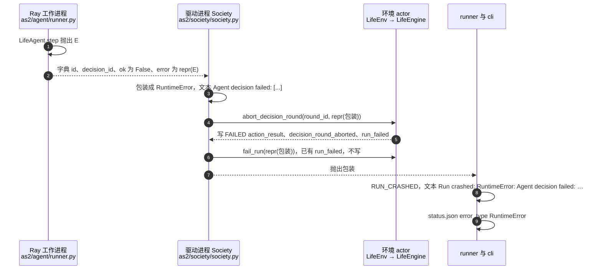
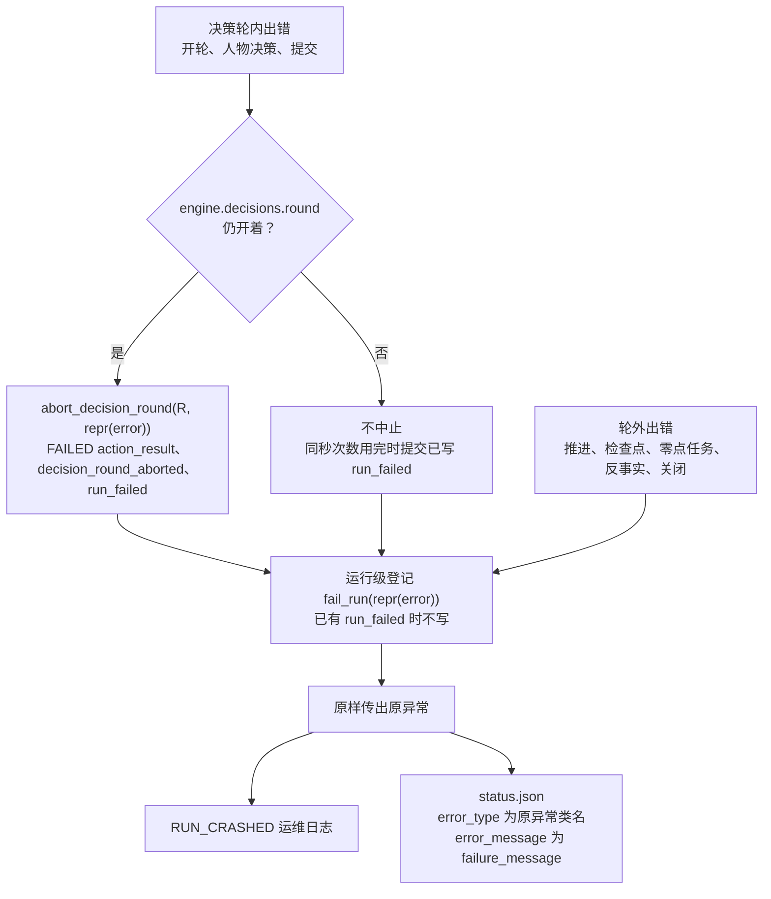

# 故障文本

> 本章属于[去掉 AgentSociety2：开发规格](../SPEC-agentsociety2-removal.md)，读法和叫法见那一页。

## 目标与依据

今天一次运行出故障停下时，写下的原因带着 AgentSociety2 与 Ray 的进程形状：人物做决定时出的错，先在 Ray 工作进程里被转成字典 `{"id", "decision_id", "ok", "error"}`，再由 Society 包成 `RuntimeError("Agent decision failed: [...]")`，中止原因写的是这层包装的 `repr`；环境进程里抛出的错，以 Ray 的任务错误到达驱动进程，`run_failed` 里写的是 `RayTaskError(<类>)(...)`，`status.json` 要解开它、去掉终端颜色序列才可读；同秒决策次数用完时，引擎已经提交并关闭了这一轮，Society 却以为没有提交又去中止，`status.json` 里多出一条并不存在的「决策轮没有开着」错误。为了让异常穿过 Ray 的进程边界，三个错误类还写了 `__reduce__`。

去掉 AgentSociety2 和 Ray 之后只剩一个进程。本章规定：原始异常直接到达运行宿主，中止原因与运行故障原因都写原异常的 `repr`；只在引擎的决策轮仍开着时才中止，修掉假错误而不改任何事件；删除三个 `__reduce__` 与 `status.json` 对 Ray 任务错误的解包和去色；保留异常组以「 | 」拼接、LifeAgent 带调用位置的三种阶段码；回合用完的文本去掉已经不存在的 `finish`。

实现的提案条文（`docs/dev/agentsociety2-removal/PROPOSAL-agentsociety2-removal.md`，下称提案）与裁定（`docs/dev/agentsociety2-removal/RULING-2026-11-17-owner.md`）：

| 出处 | 本章落实的内容 |
| --- | --- |
| 提案第六章「故障文本」第一点 | 原始异常直接传到宿主，中止原因写原异常的 `repr`，不再有 `Agent decision failed: [...]`（【F1】、【F7】） |
| 提案第六章「故障文本」第二点 | 同秒决策次数用完时不中止，不改任何事件，`status.json` 只记一条 `ProtocolError`（【F6】、【F8】） |
| 提案第六章「故障文本」第三点 | 删除三个 `__reduce__`、`status.json` 对 Ray 任务错误的解包和去色，保留异常组以「 \| 」拼接（【F14】、【F17】） |
| 提案第六章「故障文本」第四点 | 保留 `TOOL_SERVICE_FAILED`、`EVIDENCE_WRITE_FAILED`、`MODEL_SERVICE_FAILED` 分级；回合用完的文本去掉 `finish`（【F2】、【F4】） |
| 提案第六章「故障文本」末段 | 失败路径上 `decision_round_aborted`、失败的 `action_result`、`run_failed`、`status.json` 与运维日志 `DECISION_ROUND_ABORTED`、`RUN_FAILED`、`RUN_CRASHED` 的新旧文本对照表，每类故障一条测试（「新旧文本对照」与「测试」） |
| 提案第六章「运行宿主：决策轮驱动」中「故障处理」一点 | 开轮之后、提交之前出错，引擎的轮次仍开着才中止；其余情况登记 `fail_run`，再原样传播（【F5】、【F6】、【F11】） |
| 提案第四章表格「三个错误类写了 `__reduce__`」一行 | 删除 `src/worldmock/foundation/errors.py:28-30`、`:58-60` 与 `src/worldmock/resource_engine/registration/errors.py:59-61`；删去 `src/worldmock/runtime/monitoring/status.py:60-68` 里的解包与去色（【F14】、【F17】） |
| 提案第七章「`status.json` 与失败路径事件的文本」「运维日志」两行 | 部分变：只在失败路径上变；成功路径的 `DECISION_ROUND_COMMITTED` 计数变化归[「去掉 LifeEnv：引擎门面、只读查询与提交结果」](./02-engine-facade.md) |
| 裁定第 8 行 | 原始错误直接上报，并去掉「决策轮没有开着」这条假错误 |

### 今天的故障路径（基线 `74f1b949`）

锁定的 AgentSociety2 源码在工作树 `vendor/agentsociety2/packages/agentsociety2/agentsociety2/` 下（摘要 `0a7b9b06…`），下文简写为 `as2/`。



| 环节 | 现行代码 |
| --- | --- |
| 工作进程把人物异常转成字典，并写 `Agent %s decision %s failed: %s` | `as2/agent/runner.py:127-151` |
| Society 核对批次结果，有失败即抛 `RuntimeError(f"Agent decision failed: {failures}")` | `as2/society/society.py:315-332` |
| 开轮到提交之间出错且「没提交」就中止，中止原因是 `repr(cause)`；中止也失败时抛异常组 `Decision round and abort both failed`。这里的「没提交」是 Society 自己的标志 `committed`，提交调用抛出时它仍是 `False`，即使引擎已经提交并关闭了本轮 | `as2/society/society.py:250-264`、`:354-367` |
| 运行级登记 `fail_run(repr(cause))`；登记也失败时抛异常组 `Run and failure recording both failed`；只捕获 `Exception`，环境启动之前不登记 | `as2/society/society.py:444-471` |
| 引擎中止：每条已登记动作写 `action_result`（`failed`、`DECISION_ROUND_ABORTED`、`message=str(error)`），写 `decision_round_aborted`（`error=str(error)`）与 `run_failed`，运维日志 `DECISION_ROUND_ABORTED` | `src/worldmock/simulation_engine/decisions/decision_coordinator.py:216-251` |
| `run_failed` 的形成：参数是字符串时 `error_type` 恒为 `"RuntimeError"` | `src/worldmock/simulation_engine/world/world_updates.py:98-107` |
| 引擎 `fail_run`：已有 `run_failed` 即返回；否则写 `run_failed` 与运维日志 `RUN_FAILED`「`Run failed: {error}`」 | `src/worldmock/simulation_engine/engine.py:162-170` |
| 同秒决策次数用完：提交里写 `decision_budget_exhausted` 与 `run_failed`，关闭本轮，再抛 `ProtocolError("decision_budget_exhausted")` | `src/worldmock/simulation_engine/decisions/decision_coordinator.py:178-187` |
| 轮次没开时 `require_round` 抛 `ProtocolError("Decision round is not open")` | `src/worldmock/simulation_engine/decisions/decision_coordinator.py:297-301` |
| 普通恢复启动时零点任务失败，在环境进程里 `engine.fail_run(repr(error))` | `custom/envs/life_env.py:113-121` |
| 关闭失败：`fail_run(f"{type(close_error).__name__}: {close_error}")`；登记也失败时抛 `LifeEnv close and failure recording both failed`；之后 Society 的关闭再以 `repr` 登记一次，因已有 `run_failed` 不写 | `custom/envs/life_env.py:287-309`、`as2/society/society.py:473-481` |
| LifeAgent 的三种阶段码与决策失败日志；工作进程里新建人物（`from_workspace`）的失败也落进同一个 `except` | `custom/agents/life_agent.py:143-157`、`:232-238`、`:463-471`、`:558-563`；阶段码的原因与修正在 `src/worldmock/state/interaction/errors.py:37-42`；`as2/agent/runner.py:130-131` |
| 回合用完 `RuntimeError("ReAct decision budget exhausted without a valid finish")` | `as2/agent/base/agent_runtime.py:536-540` |
| 运维日志 `RUN_CRASHED`「`Run crashed: {type(error).__name__}: {error}`」 | `src/worldmock/runtime/lifecycle/runner.py:306-314`，调用点 `:475-478` |
| `status.json` 的失败写入：`write_status(output, state, "stopped", type(error).__name__, failure_message(error))` | `src/worldmock/cli.py:108-112` |
| `failure_message`：异常组以「 \| 」连接；带 `cause` 属性且其值是另一异常的取它；去掉终端颜色序列；连续空白折成一个空格 | `src/worldmock/runtime/monitoring/status.py:27-28`、`:60-68` |
| 三个 `__reduce__` | `src/worldmock/foundation/errors.py:28-30`、`:58-60`；`src/worldmock/resource_engine/registration/errors.py:59-61` |

本章引用而不重述的事实：

| 事实 | 所属章 |
| --- | --- |
| `RunHost` 的构造、步序、三种启动顺序、status 阶段写入、运行级登记覆盖的范围、关闭与清理、`RUN_CRASHED` 写在哪里、它的模拟时刻取自哪里 | [「运行宿主与决策轮」](./01-run-host.md) |
| 引擎不为「轮次是否仍开着」新增方法，宿主读 `engine.decisions.round`；引擎中止、提交、`fail_run` 的签名不变 | [「去掉 LifeEnv：引擎门面、只读查询与提交结果」](./02-engine-facade.md) |
| `LifeAgent` 的搬迁、每个决策新建一个实例、决策入口 `LifeAgent.decide`、回合循环 `react_loop.py` 的结构与回合用完时常量、日志的写入位置（【A11】，文本按本章【F4】）、三种阶段码的抛出方式与日志（【A17】【A19】【A24】）、`HostFeedback` 换成 `ProtocolFeedback` | [「人物、回合循环与只读问答的删除」](./03-agent-loop.md) |
| 记忆存储不再核对「返回空列表」（`Memory store did not persist finish memories` 随 `WorldMockMemoryRuntime._append_subjective` 删除） | [「人物工作区、记忆文件与「记忆已更新」」](./05-workspace-memory.md) |
| `LLMDispatchError` 的类与消息格式、`transport_attempts`、零点计划与回顾的失败证据 | [「模型客户端与模型请求底稿」](./04-model-client.md) |
| 删除 `ray` 依赖与「找不到 `ray` 导入」的守卫 | [「安装、代码身份、依赖与许可」](./07-install-identity.md) |
| 设计文档的成文 | [「设计文档与手册」](./08-design-docs.md) |
| 运行比对规则的实现、测试枢纽与 AgentSociety2 专属测试的迁移 | [「比较工具、查看器与测试迁移」](./09-tools-tests.md) |

## 行为

条款编号【F1】…【F18】供「测试」一节引用。

### 读法

| 记号 | 含义 |
| --- | --- |
| `error` | 运行宿主捕获的那个异常对象 |
| `R` | 出错那一轮的 `round_id`，格式 `{run_id}:round:{epoch}:{world_state_version}`，不变 |
| `n` | 出错那一轮已登记的动作数 |
| `W` | 基线的包装 `RuntimeError(f"Agent decision failed: {failures}")`，`failures` 是 `[{"id": <agent_id>, "decision_id": <decision_id>, "ok": False, "error": repr(<人物异常>)}]`，键依此次序（`as2/agent/runner.py:146-151`、`as2/society/society.py:328-332`） |
| `Ray(T, e)` | 基线环境 actor 里抛出的异常 `e`（类 `T`）经 Ray 到达驱动进程的双重类型实例：类名 `RayTaskError(T)`，`repr` 为 `RayTaskError(T)(<repr(e)>)`，`str` 为带颜色序列的远端进程标题、`pid`、`ip` 与远端回溯，带 `cause` 属性指向 `e` |
| 运行级登记 | 宿主经 `RunHost._record_failure(error)` 调用 `engine.fail_run(repr(error))` |

以后的故障处理：



### 故障到达宿主

【F1】人物决策抛出的异常原样到达运行宿主：宿主 `await` 一次人物决策（新建这次决策的 `LifeAgent` 与 `LifeAgent.decide(context)`）时捕获的就是人物一侧最后抛出的那个对象（同一对象、同一类型），中间没有把异常转成字典、字符串或另一个异常的环节。带冒号的包装文本 `Agent decision failed: ` 不出现在 `src/`、事件、运维日志与 `status.json` 里（不带冒号的 `Agent decision failed` 是日志 `LifeAgent decision failed for agent %s` 的一段，照常存在）。

【F2】人物一侧带调用位置的三种阶段码保留。抛出方式、阶段报告与日志由[「人物、回合循环与只读问答的删除」](./03-agent-loop.md)【A17】【A19】【A24】规定；本章依赖、也由本章测试核对的是到达宿主的异常：
- 工具分发（登记世界请求或只读查询）抛出任何 `Exception` 时，人物先写 `logging.exception("LifeAgent tool dispatch failed: %s", <工具名>)`，再抛 `RuntimeError`，`str` 恰为 `TOOL_SERVICE_FAILED: The tool service failed before a result was available.`，`__cause__` 是原异常（基线 `custom/agents/life_agent.py:463-471`）；
- 模型证据写入抛出任何 `Exception` 时，抛 `RuntimeError`，`str` 恰为 `EVIDENCE_WRITE_FAILED: Model evidence could not be persisted.`，`__cause__` 是原异常（基线 `:151-155`）；
- 模型调用失败时，失败证据（`model_response`，`phase` 为 `failure`）的 `error` 是 `MODEL_SERVICE_FAILED: The model service failed before a response was available.`，`protocol_feedback` 的明细路径 `["tool_calls"]`（基线 `:145-150`）；失败证据写完之后，人物上抛的是模型客户端抛出的原异常。

三段文本与基线逐字节相同（`src/worldmock/state/interaction/errors.py:37-42`），所以三种情形下 `repr(error)` 与基线 `W` 里 `"error"` 一项的值相同。

【F3】`LifeAgent.decide` 捕获任何 `Exception` 时，以 `logging.exception("LifeAgent decision failed for agent %s", <agent_id>)` 写恰好一条日志，再原样上抛同一对象（基线 `custom/agents/life_agent.py:232-238`，新位置见 03 章【A5】）。基线工作进程的 `Agent %s decision %s failed: %s`（`as2/agent/runner.py:140-145`）不再存在；宿主不为人物故障另写日志。

【F4】一次决策的回合上限个模型回合（`max_react_turns`，正式配置 16）都结束而没有登记世界请求时，回合循环先写错误日志 `LifeAgent %s used all %d model turns without a world request`（人物编号、回合上限），再抛 `RuntimeError("ReAct decision budget exhausted without a world request")`（文本即 `react_loop.py` 的模块常量 `TURNS_EXHAUSTED`，与 03 章【A11】同一条）。原文 `ReAct decision budget exhausted without a valid finish` 不再出现在 `src/` 里。

### 中止

【F5】开轮调用本身、每一次人物决策（新建 `LifeAgent` 与 `decide`）、提交调用，三者中任何一处抛出 `Exception`，宿主调用 `RunHost._abort_round(R, error)`，之后原样上抛 `error`（`_abort_round` 自己抛出时上抛它抛出的异常组，【F10】）。

【F6】`_abort_round` 只在 `engine.decisions.round is not None` 时中止；为 `None` 时什么都不做、不写日志、不写事件。

【F7】中止时宿主调用 `engine.abort_decision_round(R, repr(error))`，中止原因恰为 `repr(error)`：
- 中止提交里每条已登记动作的 `action_result`（`status` 为 `failed`、`error_code` 为 `DECISION_ROUND_ABORTED`）的 `data.message` 等于 `repr(error)`；
- `environment_event` 的 `data` 等于 `{"kind": "decision_round_aborted", "round_id": R, "error": repr(error)}`；
- `run_failed` 的 `data` 等于 `{"error_type": "RuntimeError", "error": repr(error), "round_id": R}`，键集合与 `error_type` 的值不变（字符串参数的现行写法，`world_updates.py:100`）；
- 运维日志 `DECISION_ROUND_ABORTED` 的 `detail` 等于 `f"Decision round aborted after {n} actions: {repr(error)}"`。

【F8】同秒决策次数用完时，提交在同一事务里写下 `decision_budget_exhausted` 与 `run_failed`（`data` 为 `{"error_type": "RuntimeError", "error": "decision_budget_exhausted", "round_id": R}`）并把本轮置空，再抛 `ProtocolError("decision_budget_exhausted")`。宿主据【F6】不中止，不产生 `Decision round is not open` 这条错误；运行级登记见已有 `run_failed` 不写；这个 `ProtocolError` 原样传出。事件不变：这次提交之后库里不再多出任何事件（没有 `decision_round_aborted`、没有中止的 `action_result`、没有第二条 `run_failed`），提交写下的那条 `run_failed` 是库里最后一条事件，与基线相同（基线的中止在 `require_round` 处失败，同样没写事件）。

【F9】开轮调用在打开本轮之前抛出时（`engine.decisions.round` 仍为 `None`），宿主同样不中止；异常经运行级登记后原样传出，`run_failed.data.round_id` 为 `null`。

【F10】`engine.abort_decision_round` 抛出 `abort_error` 时，宿主先写 `logger.exception("Decision round abort failed")`，再抛 `ExceptionGroup("Decision round and abort both failed", [error, abort_error])`，其 `__cause__` 是 `error`。

### 运行级登记

【F11】宿主登记运行故障只经 `RunHost._record_failure(error)`，它调用 `engine.fail_run(repr(error))`；引擎已有 `run_failed` 时不写事件、不写运维日志（`engine.py:166-167`）。所以：
- 中止已经写下 `run_failed` 时，运行级登记什么都不写，也没有 `RUN_FAILED` 运维日志；
- 轮外故障（推进、共同检查点、零点回顾与日计划、反事实干预、取调度状态、开轮之前的失败、关闭引擎）写 `run_failed`，`data` 等于 `{"error_type": "RuntimeError", "error": repr(error), "round_id": None}`，运维日志 `RUN_FAILED` 的 `detail` 等于 `f"Run failed: {repr(error)}"`；
- 文本里不再出现 `RayTaskError(`。

【F12】`engine.fail_run` 抛出 `record_error` 时，宿主先写 `logger.exception("Run failure recording failed")`，再抛 `ExceptionGroup("Run and failure recording both failed", [error, record_error])`，其 `__cause__` 是 `error`。关闭引擎失败的登记也经这条路径，`LifeEnv close and failure recording both failed` 不再出现。

【F13】不是 `Exception` 的 `BaseException`（`KeyboardInterrupt`、`asyncio.CancelledError` 及其他）不中止、不登记、原样传出，与基线 Society 只捕获 `Exception` 相同（`as2/society/society.py:260`、`:453`）。

### status.json 与 RUN_CRASHED

【F14】`failure_message(error)`：`error` 是 `BaseExceptionGroup`（含 `ExceptionGroup`）时，逐项递归求值，以 `" | "` 连接；其余返回 `" ".join(f"{type(error).__name__}: {error}".split())`，即连续空白（含换行、制表）折成一个空格、首尾空白去掉，不截断。不读异常的 `cause` 属性，不删除任何字符：终端颜色序列原样保留。

【F15】`status.json` 的键与写法不变（四个键、规范 JSON，`src/worldmock/runtime/monitoring/status.py:49-57`；`cli.py:108-112` 不改）：`error_type` 是传到命令行的异常的类名，原异常直接传出，不再出现 `RayTaskError(<类>)` 这样的类名；`error_message` 是【F14】的结果。

【F16】运维日志 `RUN_CRASHED` 的 `detail` 模板 `f"Run crashed: {type(error).__name__}: {error}"`、键（`code`、`detail`、`run_id`）与级别 `error`、组件 `runtime` 都不变；它取传出的原异常，因而不含 `Agent decision failed: `、`RayTaskError`、颜色序列或远端回溯。

### 进程边界的遗留

【F17】`src/worldmock` 下没有任何类定义 `__reduce__`、`__reduce_ex__`、`__getstate__` 或 `__setstate__`。`EnvironmentInputError`、`PreconditionError`、`RegistrationError` 的 `__reduce__` 删除；三个类的构造参数、实例属性和构造时写的 `WorldMock failure: …` 错误日志（`errors.py:10-13`）不变。

### 不变的文本

【F18】下列文本与代码逐字节不变：引擎中止与提交里的模板（`decision_coordinator.py:178-187`、`:216-251`）；`run_failed` 的形成（`world_updates.py:98-107`）；`fail_run` 与 `RUN_FAILED` 模板（`engine.py:162-170`）；零点计划与回顾的失败证据；`LLMDispatchError` 的消息格式 `Failed to get valid response after {N} attempts in {s:.1f} s. Last error type: {T}. Error chain: {chain}`（由[「模型客户端与模型请求底稿」](./04-model-client.md)保留）；普通恢复启动时零点任务失败写下的 `run_failed` 文本（基线在环境进程里已写 `repr(原异常)`，`life_env.py:119-121`）；成功路径上的全部记录。读 `run_failed.data.error` 的质量报告规则（`src/worldmock/recording_engine/reports/quality.py:610-614` 按 `memory`、`memories`、`views` 判记忆故障；被删的包装与 `decision_id` 里都没有这三个词，判定结果不变）与 lineage 的 `end_error`（`src/worldmock/recording_engine/storage/checkpoint.py:191-196`）不改代码，取值随 `run_failed.data.error` 变。

### 新旧文本对照

各表「以后」一列由【F1】–【F16】推出；「基线」一列由上一节「今天的故障路径」的代码推出。表里 `\|` 是竖线本身。

#### 人物决策故障（开轮之后、提交之前，人物一侧抛出）

| 记录 | 基线 | 以后 |
| --- | --- | --- |
| 每条已登记动作的 `action_result`：`data.message` | `repr(W)` | `repr(error)` |
| 同上：`status`、`error_code`、其余字段 | `failed`、`DECISION_ROUND_ABORTED` | 不变 |
| `decision_round_aborted`：`data` | `{"kind": "decision_round_aborted", "round_id": R, "error": repr(W)}` | `{"kind": "decision_round_aborted", "round_id": R, "error": repr(error)}` |
| `run_failed`：`data` | `{"error_type": "RuntimeError", "error": repr(W), "round_id": R}` | `{"error_type": "RuntimeError", "error": repr(error), "round_id": R}` |
| 运维日志 `DECISION_ROUND_ABORTED`：`detail` | `f"Decision round aborted after {n} actions: {repr(W)}"` | `f"Decision round aborted after {n} actions: {repr(error)}"` |
| 运维日志 `RUN_FAILED` | 无（已有 `run_failed`） | 无 |
| 运维日志 `RUN_CRASHED`：`detail` | `f"Run crashed: RuntimeError: {W}"` | `f"Run crashed: {type(error).__name__}: {error}"` |
| `status.json`：`error_type` | `"RuntimeError"` | `type(error).__name__` |
| `status.json`：`error_message` | `failure_message(W)`，以 `RuntimeError: Agent decision failed: [` 开头 | `failure_message(error)` |
| Python 日志 | `Agent %s decision %s failed: %s`（logger `agentsociety2.agent.runner`）与 `LifeAgent decision failed for agent %s` | 只有 `LifeAgent decision failed for agent %s` |

`error` 的 `repr` 按人物异常的来源（「基线」一栏是它在 `W` 里 `"error"` 一项的值）：

| 人物异常的来源 | 基线（`W` 里的 `"error"`） | 以后（`repr(error)`） |
| --- | --- | --- |
| 模型调用最终失败 | `LLMDispatchError('Failed to get valid response after {N} attempts in {s:.1f} s. Last error type: {T}. Error chain: {chain}')` | 相同 |
| 工具分发失败 | `RuntimeError('TOOL_SERVICE_FAILED: The tool service failed before a result was available.')` | 相同（`__cause__` 由 `Ray(T, e)` 变成 `e`） |
| 模型证据写入失败 | `RuntimeError('EVIDENCE_WRITE_FAILED: Model evidence could not be persisted.')` | 相同 |
| 回合用完 | `RuntimeError('ReAct decision budget exhausted without a valid finish')` | `RuntimeError('ReAct decision budget exhausted without a world request')` |
| 引擎在观察或记忆证据登记时抛出 `e`（类 `T`，不经阶段码改写） | `RayTaskError(T)(<repr(e)>)` | `repr(e)` |
| 步尾记忆落盘抛出 `e`（基线在工作进程内，以后在同一进程内） | `repr(e)` | 相同 |

一次模型调用最终失败的完整例子：`error` 是 `LLMDispatchError("Failed to get valid response after 3 attempts in 12.0 s. Last error type: InternalServerError. Error chain: InternalServerError <- ConnectError")`，`R` 是 `r1:round:1767571200:7`，决策身份 `r1:round:1767571200:7:agent:1:order:0`，没有已登记动作。

基线的 `decision_round_aborted.data.error` 与 `run_failed.data.error`：

```text
RuntimeError('Agent decision failed: [{\'id\': 1, \'decision_id\': \'r1:round:1767571200:7:agent:1:order:0\', \'ok\': False, \'error\': "LLMDispatchError(\'Failed to get valid response after 3 attempts in 12.0 s. Last error type: InternalServerError. Error chain: InternalServerError <- ConnectError\')"}]')
```

基线的 `status.json` `error_message`（`RUN_CRASHED` 的 `detail` 是 `Run crashed: ` 加同一行）：

```text
RuntimeError: Agent decision failed: [{'id': 1, 'decision_id': 'r1:round:1767571200:7:agent:1:order:0', 'ok': False, 'error': "LLMDispatchError('Failed to get valid response after 3 attempts in 12.0 s. Last error type: InternalServerError. Error chain: InternalServerError <- ConnectError')"}]
```

以后的 `decision_round_aborted.data.error` 与 `run_failed.data.error`；运维日志 `DECISION_ROUND_ABORTED` 的 `detail` 是 `Decision round aborted after 0 actions: ` 加同一行：

```text
LLMDispatchError('Failed to get valid response after 3 attempts in 12.0 s. Last error type: InternalServerError. Error chain: InternalServerError <- ConnectError')
```

以后的 `status.json` `error_type` 是 `LLMDispatchError`，`error_message` 如下，`RUN_CRASHED` 的 `detail` 是 `Run crashed: ` 加同一行：

```text
LLMDispatchError: Failed to get valid response after 3 attempts in 12.0 s. Last error type: InternalServerError. Error chain: InternalServerError <- ConnectError
```

#### 提交关闭本轮之后才抛出（同秒决策次数用完）

| 记录 | 基线 | 以后 |
| --- | --- | --- |
| 提交写下的事件（`action_requested`、`action_result`、`decision_budget_exhausted`、`run_failed` 等）与运维日志 `DECISION_ROUND_COMMITTED` | 见 `decision_coordinator.py:147-188` | 事件逐字节不变；`DECISION_ROUND_COMMITTED` 只在最后一轮是开始组时按 02 章如实计 2 条动作，其余不变 |
| `decision_round_aborted`、中止的 `action_result` | 无（中止在 `require_round` 处失败，没写事件） | 无 |
| 运维日志 `RUN_FAILED`、`DECISION_ROUND_ABORTED` | 无 | 无 |
| 运维日志 `RUN_CRASHED`：`detail` | `Run crashed: ExceptionGroup: Decision round and abort both failed (2 sub-exceptions)` | `Run crashed: ProtocolError: decision_budget_exhausted` |
| `status.json`：`error_type` | `ExceptionGroup` | `ProtocolError` |
| `status.json`：`error_message` | `ProtocolError: decision_budget_exhausted \| ProtocolError: Decision round is not open` | `ProtocolError: decision_budget_exhausted` |
| Python 日志 | `Decision budget exhausted`、`WorldMock failure: decision_budget_exhausted`、`WorldMock failure: Decision round is not open`、`Decision round abort failed`（带回溯） | 只有前两条 |

#### 开轮调用在打开本轮之前抛出 `e`（类 `T`）

| 记录 | 基线 | 以后 |
| --- | --- | --- |
| `run_failed`：`data` | `{"error_type": "RuntimeError", "error": "ExceptionGroup('Decision round and abort both failed', [RayTaskError(T)(<repr(e)>), RayTaskError(ProtocolError)(ProtocolError('Decision round is not open'))])", "round_id": None}` | `{"error_type": "RuntimeError", "error": repr(e), "round_id": None}` |
| 运维日志 `RUN_FAILED`：`detail` | `Run failed: ` 加上一行基线的 `error` | `f"Run failed: {repr(e)}"` |
| 运维日志 `RUN_CRASHED`：`detail` | `Run crashed: ExceptionGroup: Decision round and abort both failed (2 sub-exceptions)` | `f"Run crashed: {T}: {e}"` |
| `status.json`：`error_type` | `ExceptionGroup` | `T` |
| `status.json`：`error_message` | `failure_message(e)` 加 ` \| ProtocolError: Decision round is not open` | `failure_message(e)` |

#### 轮外故障：推进、共同检查点、零点任务、反事实干预、取调度状态在引擎一侧抛出 `e`（类 `T`）

| 记录 | 基线 | 以后 |
| --- | --- | --- |
| `run_failed`：`data` | `{"error_type": "RuntimeError", "error": "RayTaskError(T)(<repr(e)>)", "round_id": None}` | `{"error_type": "RuntimeError", "error": repr(e), "round_id": None}` |
| 运维日志 `RUN_FAILED`：`detail` | `Run failed: RayTaskError(T)(<repr(e)>)` | `f"Run failed: {repr(e)}"` |
| 运维日志 `RUN_CRASHED`：`detail` | `Run crashed: RayTaskError(T): ` 加 `Ray(T, e)` 的 `str`（颜色序列、远端进程标题、`pid`、`ip`、换行与远端回溯） | `f"Run crashed: {T}: {e}"` |
| `status.json`：`error_type` | `RayTaskError(T)` | `T` |
| `status.json`：`error_message` | `failure_message(e)`（解开 `cause` 后的值） | `failure_message(e)`，值相同 |

普通恢复启动时的零点任务失败是这一类的例外：基线在环境进程里已写 `fail_run(repr(e))`（`life_env.py:119-121`），所以 `run_failed` 与运维日志 `RUN_FAILED` 都不变；只有 `status.json` 的 `error_type`、`error_message` 的来源与 `RUN_CRASHED` 照上表从 `RayTaskError(T)` 变成 `T`。

#### 双重故障

| 情形 | 基线 | 以后 |
| --- | --- | --- |
| 中止本身也失败 | `ExceptionGroup("Decision round and abort both failed", [cause, abort_error])`，环境一侧的成员是 `Ray(T, e)` | 同一异常组文本，成员是原异常 |
| 运行级登记也失败 | `ExceptionGroup("Run and failure recording both failed", [cause, record_error])`，成员同上 | 同一异常组文本，成员是原异常 |
| 中止也失败之后的运行级登记 | `fail_run(repr(<上面的异常组>))`，成员的 `repr` 带 `RayTaskError(...)` | `fail_run(repr(<上面的异常组>))`，成员的 `repr` 是原异常的 |
| `status.json`：`error_message` | 成员逐项「 \| 」（`Ray` 成员解开 `cause`） | 成员逐项「 \| 」 |

#### 关闭引擎失败（异常 `c`，类 `C`）

| 记录 | 基线 | 以后 |
| --- | --- | --- |
| `run_failed`：`data.error` | `f"{C}: {c}"`（`life_env.py:305`） | `repr(c)` |
| 运维日志 `RUN_FAILED`：`detail` | `f"Run failed: {C}: {c}"` | `f"Run failed: {repr(c)}"` |
| 登记也失败时的异常组 | `LifeEnv close and failure recording both failed` | `Run and failure recording both failed` |
| `status.json`：`error_type`（运行本身没有失败、清理只有这一项故障时） | `RayTaskError(C)` | `C` |

### 删除与保留的故障文本

| 文本 | 基线位置 | 以后 | 由哪一章删改代码 |
| --- | --- | --- | --- |
| `Agent decision failed: {failures}` | `as2/society/society.py:332` | 不再存在 | 本章（随 AgentSociety2 删除） |
| 日志 `Agent %s decision %s failed: %s` | `as2/agent/runner.py:140-145` | 不再存在 | 本章 |
| `Agent decision and close both failed` | `as2/agent/runner.py:177-180` | 不再存在：人物没有关闭步骤 | 本章，前提见[「人物、回合循环与只读问答的删除」](./03-agent-loop.md) |
| `ReAct decision budget exhausted without a valid finish` | `as2/agent/base/agent_runtime.py:540` | 改为 `ReAct decision budget exhausted without a world request`，抛出前写 `LifeAgent %s used all %d model turns without a world request` | 03 章【A11】写在 `react_loop.py`，与本章同一条 |
| `LifeEnv close and failure recording both failed` | `custom/envs/life_env.py:307-309` | 改用 `Run and failure recording both failed` | 本章 |
| 运行登记 `f"{type(close_error).__name__}: {close_error}"` | `custom/envs/life_env.py:305` | 改为 `repr(close_error)` | 本章 |
| `#: Ray 等写进异常文本的终端颜色序列。` 与 `_ANSI_ESCAPE` | `status.py:27-28` | 删除 | 本章 |
| 日志 `Decision round abort failed`、异常组 `Decision round and abort both failed` | `as2/society/society.py:363-367` | 逐字保留，写在 `RunHost._abort_round` | 本章 |
| 日志 `Run failure recording failed`、异常组 `Run and failure recording both failed` | `as2/society/society.py:467-471` | 逐字保留，写在 `RunHost._record_failure` | 本章 |
| `Memory store did not persist finish memories` | `src/worldmock/agents/memory/life_memory.py:146-147` | 不再存在：记忆存储返回本次新建与合并的条目，没有「静默零写入」 | 05 章 |
| `Run crashed: {type(error).__name__}: {error}` 与日志 `Run crash operations log failed` | `runner.py:311`、`:314` | 逐字保留 | 01 章决定所在位置 |
| `WorldMock run and cleanup failed`、`WorldMock cleanup failed` | `runner.py:483`、`:486` | 逐字保留 | 01 章 |
| `Agent batch results do not match decision contexts`、`Environment confirmed a different round_id`、`Environment commit results do not cover the decision round`、`Environment commit results contain different agents`、`Environment committed a fatal agent result: {failures}` | `as2/society/society.py:254`、`:330`、`:345-352` | 不再存在：没有批次结果，宿主不读提交返回值 | 01 章、02 章 |
| `Agent task and LiteLLM client close both failed` | `as2/agent/runner.py:364` | 不再存在 | 04 章 |
| `Society construction and actor rollback failed` | `runner.py:606-609` | 不再存在 | 01 章 |

## 接口与文件

### 文件

| 路径 | 动作 | 内容 |
| --- | --- | --- |
| `src/worldmock/foundation/errors.py` | 修改 | 删除 :27-30（空行与 `EnvironmentInputError.__reduce__`）与 :57-60（空行与 `PreconditionError.__reduce__`）；删后 `super().__init__(reason)` 与 `class ProtocolError`、`self.public_reason = public_reason` 与 `def reject_value` 之间各剩两个空行；其余逐字节不变 |
| `src/worldmock/resource_engine/registration/errors.py` | 修改 | 删除 :58-61（空行与 `RegistrationError.__reduce__`）；文件以 :57 `super().__init__(...)` 那一行加一个换行结束 |
| `src/worldmock/runtime/monitoring/status.py` | 修改 | 删除 `import re`（:8，模块里没有别的使用者）、`#: Ray 等写进异常文本的终端颜色序列。` 与 `_ANSI_ESCAPE`（:27-28）；`failure_message`（:60-68）改为下文全文；`write_status` 的文档串（:51）改为 `"""@brief 在明确的运行边界写单份状态，生活阶段由运行宿主调用此入口更新；失败时另写一行可读原因 error_message。"""` |
| `src/worldmock/runtime/lifecycle/run_host.py` | 新建（文件归 01 章） | 本章规定其中 `RunHost._abort_round`、`RunHost._record_failure` 两个方法的全文、模块级 `logger = logging.getLogger(__name__)`，以及调用它们的约束（见下） |
| `src/worldmock/agents/protocol/react_loop.py` | 新建（文件归 03 章） | 回合用完时按【F4】写日志并抛出；异常文本是模块常量 `TURNS_EXHAUSTED = "ReAct decision budget exhausted without a world request"`（03 章【A11】与接口一节） |
| `src/worldmock/agents/life_agent.py` | 移动（归 03 章） | 【F2】的三段阶段文本、`LifeAgent tool dispatch failed: %s` 与【F3】的 `LifeAgent decision failed for agent %s` 逐字节保留；`decide` 原样重抛 |
| `src/worldmock/simulation_engine/decisions/decision_coordinator.py`、`src/worldmock/simulation_engine/world/world_updates.py`、`src/worldmock/simulation_engine/engine.py` 的 `abort_decision_round` 与 `fail_run`、`src/worldmock/cli.py` 的 `_run_command` 的失败写入 | 本章不改 | 【F18】 |
| `tests/unit/runtime/test_error_pickling.py` | 删除 | 见「测试」 |
| `tests/unit/runtime/test_error_classes.py` | 新建 | 见「测试」 |
| `tests/unit/footprints/test_status_liveness.py` | 修改 | 见「测试」 |
| `tests/integration/runtime/test_run_host_failures.py` | 新建 | 见「测试」 |
| `tests/system/lifecycle/test_recorded_response_run.py` | 修改 | 加一个用例，见「测试」 |
| `tests/integration/runtime/test_conclude_memories.py`、`tests/integration/runtime/test_life_agent_protocol.py` | 修改（文件迁移归 09 章） | 本章只规定其中两处故障断言的新期望，见「测试」 |
| `tests/dataset_acceptance.py` | 修改 | 删 4 条、加 3 条变异，见「测试」 |
| `scripts/compare_runs.py` | 本章不改 | 运行比对不为故障原因文本加规则，见「规格阶段的决定」 |

### `RunHost` 的两个故障方法

`src/worldmock/runtime/lifecycle/run_host.py` 模块顶部 `import logging`，`logger = logging.getLogger(__name__)`。`RunHost` 持有引擎的属性是 01 章定的公开属性 `engine`，下文写作 `self.engine`（两条变异锚点同样，第 10 章「跨章裁定」）。

```python
    def _abort_round(self, round_id: str, error: Exception) -> None:
        """@brief 决策轮在开轮之后、提交返回之前出错：只在引擎的轮次仍开着时中止这一轮，中止原因是原异常的 repr；
        提交已经关闭本轮（同秒决策次数用完）或开轮之前就失败时不中止。中止本身失败时两项异常都保留。

        @param round_id 出错那一轮的身份
        @param error 宿主捕获的原异常
        @exception ExceptionGroup 中止也失败（Decision round and abort both failed）
        """
        if self.engine.decisions.round is None:
            return
        try:
            self.engine.abort_decision_round(round_id, repr(error))
        except Exception as abort_error:
            logger.exception("Decision round abort failed")
            raise ExceptionGroup("Decision round and abort both failed", [error, abort_error]) from error

    def _record_failure(self, error: Exception) -> None:
        """@brief 登记运行故障：把原异常的 repr 交给引擎，引擎已有 run_failed 时不写；登记本身失败时两项异常都保留。

        @param error 宿主捕获的原异常
        @exception ExceptionGroup 登记也失败（Run and failure recording both failed）
        """
        try:
            self.engine.fail_run(repr(error))
        except Exception as record_error:
            logger.exception("Run failure recording failed")
            raise ExceptionGroup("Run and failure recording both failed", [error, record_error]) from error
```

调用约束（01 章写 `RunHost` 时照此安排）：

| 约束 | 内容 |
| --- | --- |
| 决策轮 | 开轮调用、逐个人物决策（新建这次决策的 `LifeAgent` 与 `await agent.decide(context)`）、提交调用三者包在同一个 `try` 里；`except Exception as error:` 里先 `self._abort_round(round_id, error)`，再 `raise` |
| 运行级 | 启动顺序（新建、普通恢复、反事实）与步进循环的外层各有 `except Exception as error:`，先 `self._record_failure(error)`，再 `raise`；引擎尚未建好或打开时不调用（没有足迹库可写），覆盖范围由 01 章给出 |
| 关闭 | 关闭引擎抛出 `Exception` 时同样先 `self._record_failure(error)` 再抛出 |
| 唯一入口 | `src/` 里除这两个方法之外，没有别处调用 `LifeEngine.abort_decision_round` 或 `LifeEngine.fail_run`；引擎内部 `LifeEngine.abort_decision_round` 转给 `DecisionCoordinator.abort_decision_round`（`engine.py:109`）照旧 |
| 不捕获的异常 | 只捕获 `Exception`；`BaseException` 直接穿过（【F13】） |
| 人物故障 | 宿主 `await` 人物决策，不用 `try` 把人物异常改写、包装或记日志（【F1】、【F3】） |

### `failure_message`

`src/worldmock/runtime/monitoring/status.py` 的 `failure_message` 全文：

```python
def failure_message(error: BaseException) -> str:
    """@brief status.json 的 error_message：一行可读失败原因。异常组逐项以「 | 」连接；其余为「类型名: 文本」，
    连续空白折成一个空格，不截断。"""
    if isinstance(error, BaseExceptionGroup):
        return " | ".join(failure_message(item) for item in error.exceptions)
    return " ".join(f"{type(error).__name__}: {error}".split())
```

### 本章依赖的他章接口

| 接口 | 提供方 |
| --- | --- |
| `RunHost` 按上表的调用约束调用 `_abort_round` 与 `_record_failure`；持有引擎的属性；`RUN_CRASHED` 照原模板写 | [「运行宿主与决策轮」](./01-run-host.md) |
| `RunHost` 的测试装配：01 章夹具 `host_factory`，`host = host_factory(engine, client)` 把真实 `RunHost` 挂在 `engine_factory` 建出的真实引擎上，`client` 是按脚本作答（或抛出给定异常）的模型客户端替身；宿主每个决策新建真实 `LifeAgent`，回合上限取这台引擎冻结的 `max_react_turns`；零点计划与回顾经同一个替身；不走新建或恢复的启动顺序。步进循环入口是 `host.run()`（循环外层有运行级登记） | [「运行宿主与决策轮」](./01-run-host.md) |
| `LifeEngine.decisions` 是公开属性，`decisions.round` 在开轮后、提交或中止前不是 `None`；`abort_decision_round(round_id, error: Exception \| str)`、`fail_run(error: str)` 签名与文本不变；引擎方法在同一进程里同步执行，异常原样到达宿主 | [「去掉 LifeEnv：引擎门面、只读查询与提交结果」](./02-engine-facade.md) |
| `LifeAgent.decide` 按【F3】写一条日志后原样上抛；工具分发、证据写入、模型失败证据按【F2】；回合循环按【F4】（`TURNS_EXHAUSTED` 与日志文本）；人物没有关闭步骤 | [「人物、回合循环与只读问答的删除」](./03-agent-loop.md) |
| `worldmock.configuration.model.model_client.LLMDispatchError`：`RuntimeError` 的子类，不覆写 `__init__`，以一个消息参数构造，`repr` 为 `LLMDispatchError('<消息>')`，消息格式不变（04 章【M14】） | [「模型客户端与模型请求底稿」](./04-model-client.md) |

## 设计文档

全文由[「设计文档与手册」](./08-design-docs.md)写成；下表列出各处之后必须陈述的事实。

| 位置（基线） | 之后必须写明的事实 |
| --- | --- |
| `docs/design/10-runtime.md:42-45`「失败诊断」 | `status.json` 恰含 `status`、`phase`、`error_type`、`error_message`，是规范 JSON；`error_type` 是使运行停下的原异常的类名；`error_message` 是一行可读的失败原因：异常组逐项以「 \| 」连接，其余为「类型名: 文本」，连续空白折成一个空格，不截断；运行宿主写阶段与成功结束时为 null。删去「Ray 任务错误取其原始异常」「去掉终端颜色序列」两处与 :44-45 关于穿过 Ray、`UnserializableException` 的整句 |
| `docs/design/10-runtime.md` 新写的决策循环中「中止与停止」 | 人物一侧的异常（含新建人物时的异常）原样到达宿主；开轮之后、提交返回之前出错，只在引擎的决策轮仍开着时中止，中止原因是原异常的 `repr`，写进中止产生的 `action_result` 的 `message`、`decision_round_aborted` 的 `error` 与 `run_failed` 的 `error`；开轮之前就失败、或提交关闭本轮之后才抛出（同秒决策次数用完）时不中止，后者的事件只有提交写下的那些，运行以那个 `ProtocolError` 停下；其余故障登记 `run_failed`（原因同为 `repr`，已有 `run_failed` 时不再写），再原样传播；中止或登记本身失败时两项异常都保留在 `Decision round and abort both failed` 或 `Run and failure recording both failed` 异常组里；`KeyboardInterrupt` 与取消不中止、不登记 |
| `docs/design/06-agent.md:880-893`「宿主模型协议」（按 03 章重写） | 回合上限个模型回合都没有登记世界请求是运行故障，文本 `ReAct decision budget exhausted without a world request`；工具服务失败、模型证据写入失败、模型服务失败分别记 `TOOL_SERVICE_FAILED`、`EVIDENCE_WRITE_FAILED`、`MODEL_SERVICE_FAILED`，指向实际调用位置，不声称失败的调用已执行；模型服务失败时原异常原样上抛；人物决策失败写一条带回溯的日志后原样上抛，不包装 |
| `docs/design/04-simulation-engine.md:804`、`:827` | 不改：「中止的决策轮不执行请求」「耗尽同秒拒绝预算停止运行」在新行为下照样成立 |
| `docs/manual/runtime.md:23` | 不改：「运行失败时 `runtime.error_message` 写着失败的根因」在新行为下照样成立 |

## 测试

全部测试离线、不跳过、不标记预期失败，不发计费请求。运行宿主一侧的条款经 `tests/engine_fixture.py:47-50` 的 `engine_factory` 建的真实引擎、真实 SQLite、真实 `RunHost` 与真实 `LifeAgent` 验证，只把模型客户端换成按脚本作答的替身；替身的每个回复都带 `reasoning_content`（同秒续接要求本决策的 assistant 回合都有思考，03 章 `send_check`）。下表「新」为新增，「改」为改写现有用例（括号里是由哪一章改），「留」为断言主体不改、只随 09 章改导入与装配。表里 `\|` 是竖线本身。

### 条款到用例

| 条款 | 用例 | 新/改/留 |
| --- | --- | --- |
| F1 | `tests/integration/runtime/test_run_host_failures.py::test_agent_failure_aborts_the_round_with_the_original_repr` | 新 |
| F1、F7、F15、F16 | `tests/system/lifecycle/test_recorded_response_run.py::test_planned_restart_failure_records_the_original_model_error` | 新 |
| F2 | `tests/integration/runtime/test_run_host_failures.py::test_registered_start_is_aborted_with_the_tool_stage_repr` | 新 |
| F2 | `tests/integration/runtime/test_host_failure_stages.py::test_tool_service_failure_on_the_real_engine_is_logged_and_raised_with_its_stage`、`::test_model_service_failure_on_the_real_engine_is_logged_once_and_reraised_unchanged`、`::test_evidence_write_failure_of_the_footprint_store_is_raised_with_its_stage` | 改（03 章：`HostFeedback` 删除后改读结构化报告的写法；本章核对的异常类、`str`、`__cause__` 与日志断言不变） |
| F3 | `tests/integration/runtime/test_life_agent_protocol.py::test_decision_failure_is_logged_once_and_reraised_unchanged` | 改（03 章：改调 `decide`；同一对象、同一类型、一条日志的断言不变） |
| F4 | `tests/integration/runtime/test_run_host_failures.py::test_turn_exhaustion_aborts_with_the_text_without_finish` | 新 |
| F4 | `tests/integration/runtime/test_conclude_memories.py::test_budget_exhausted_without_a_registered_world_request_fails_the_run` | 改 |
| F5、F6、F7 | `test_run_host_failures.py::test_agent_failure_aborts_the_round_with_the_original_repr`、`::test_registered_start_is_aborted_with_the_tool_stage_repr` | 新 |
| F1、F7 | `tests/integration/runtime/test_life_agent_protocol.py::test_memory_persistence_failure_aborts_society_before_commit` | 改 |
| F6、F8 | `test_run_host_failures.py::test_budget_exhaustion_after_commit_stops_with_one_protocol_error` | 新 |
| F9 | `test_run_host_failures.py::test_begin_failure_is_registered_without_an_abort` | 新 |
| F10 | `test_run_host_failures.py::test_abort_failure_keeps_both_errors_in_one_group` | 新 |
| F11 | `test_run_host_failures.py::test_midnight_failure_outside_a_round_records_the_original_repr` | 新 |
| F12 | `test_run_host_failures.py::test_failure_recording_failure_keeps_both_errors_in_one_group` | 新 |
| F13 | `test_run_host_failures.py::test_base_exception_is_neither_aborted_nor_registered` | 新 |
| F14 | `tests/unit/footprints/test_status_liveness.py::test_failure_message_joins_groups_and_keeps_other_text` | 改 |
| F15 | `tests/unit/footprints/test_status_liveness.py::test_cli_failure_writes_the_root_cause_into_status` | 改 |
| F17 | `tests/unit/runtime/test_error_classes.py::test_production_code_defines_no_pickling_hooks` | 新 |
| F17 | `tests/unit/runtime/test_error_classes.py::test_fault_classes_still_log_when_constructed` | 改（自 `test_error_pickling.py` 搬来） |
| F18 | `tests/integration/life/test_environment_runtime.py::test_same_second_six_rejections_stop_without_advancing_clock`、`::test_abort_and_stale_context_never_execute_the_uncommitted_action` | 留（09 章只改 `DirectToolCall` 的导入） |
| F18 | `test_run_host_failures.py::test_budget_exhaustion_after_commit_stops_with_one_protocol_error`（提交写下的文本）、`::test_agent_failure_aborts_the_round_with_the_original_repr`（`DECISION_ROUND_ABORTED` 模板）、`::test_begin_failure_is_registered_without_an_abort`（`RUN_FAILED` 模板）、`::test_midnight_failure_outside_a_round_records_the_original_repr`（零点调用的失败证据照常写下） | 新 |

### 新增 `tests/integration/runtime/test_run_host_failures.py`

文件导入标准库 `json`、`logging`、`sqlite3`，`pytest`，直接导入 `worldmock.runtime.lifecycle.run_host`（`RunHost`）、`worldmock.runtime.monitoring.status`（`failure_message`）、`worldmock.foundation.errors`（`ProtocolError`）与 `worldmock.configuration.model.model_client`（`LLMDispatchError`），以及 `tests.engine_fixture` 的 `engine_factory`、`tests.life.conftest` 的 `stage_day_plan`、`main_arguments`、`side_arguments`、`MAIN_TOOL`、`SIDE_TOOL`、`tests.integration.host_run_fixtures` 的 `_evening`。日志断言用 `caplog.at_level(logging.ERROR)`。本地辅助 `_ops(engine)` 照 `tests/integration/life/test_opslog.py:30-34` 的写法读 `run_dir / "logs"` 下全部 `ops-*.jsonl` 记录，`_events(engine, event_type)` 读库里该类型的全部事件。宿主是 01 章夹具 `host_factory` 给出的 `host = host_factory(engine, client)`，`client` 是本文件的模型客户端替身；下文的 `host.run()` 是它的步进循环入口。文件的用例参数里加 `host_factory`（`tests/conftest.py` 已导入它）。凡不另说明，引擎是 `engine_factory()`（夹具环境，2026-01-05 周一 08:00 在家），先 `stage_day_plan(engine, submitted=True)`，零点计划不在开头触发。下文「这一轮」指替身模型应答（或失败）的那一轮，`R` 是它的 `round_id`。本地常量 `MODEL_FAILURE = LLMDispatchError("Failed to get valid response after 3 attempts in 12.0 s. Last error type: InternalServerError. Error chain: InternalServerError <- ConnectError")`。

| 用例 | 装配与断言 | 条款 | 新/改 |
| --- | --- | --- | --- |
| `test_agent_failure_aborts_the_round_with_the_original_repr` | 替身在第一次决策请求时抛 `MODEL_FAILURE`。`host.run()` 抛出的对象 `is MODEL_FAILURE`；这一轮没有 `action_result`；恰一条 `decision_round_aborted`，`data == {"kind": "decision_round_aborted", "round_id": R, "error": repr(MODEL_FAILURE)}`；恰一条 `run_failed`，`data == {"error_type": "RuntimeError", "error": repr(MODEL_FAILURE), "round_id": R}`；这一轮的失败证据 `data.error == "MODEL_SERVICE_FAILED: The model service failed before a response was available."`；运维日志恰一条 `DECISION_ROUND_ABORTED`，`detail == f"Decision round aborted after 0 actions: {repr(MODEL_FAILURE)}"`，没有 `RUN_FAILED`；`caplog` 里恰一条 `LifeAgent decision failed for agent 1` 的 ERROR 记录，没有 `Decision round abort failed`；`failure_message(MODEL_FAILURE) == "LLMDispatchError: Failed to get valid response after 3 attempts in 12.0 s. Last error type: InternalServerError. Error chain: InternalServerError <- ConnectError"`；库里每条事件正文的 JSON 文本与每条运维日志都不含 `Agent decision failed: ` | F1、F2、F3、F5、F6、F7、F11、F14 | 新 |
| `test_registered_start_is_aborted_with_the_tool_stage_repr` | 替身第一次决策请求答一个开始组：`MAIN_TOOL` 带 `main_arguments("interact", "家", "测试休息")`，`SIDE_TOOL` 带 `side_arguments("interact", "哔哩哔哩")`（两项都是夹具环境里真实引擎受理过的写法，`tests/integration/footprints/test_query_export.py:82`、`tests/footprints/recording.py:31`）；`monkeypatch` 包住引擎实例的 `submit_action`：第一次原样交给真实方法，第二次抛 `sqlite3.OperationalError("database is locked")`。`host.run()` 抛出的 `type(...) is RuntimeError`，`str` 恰为 `TOOL_SERVICE_FAILED: The tool service failed before a result was available.`，`__cause__` 是注入的异常；`caplog` 有一条 `LifeAgent tool dispatch failed: start_side_activity` 的 ERROR 记录；第一条已登记动作恰有一条 `action_result`：`status == "failed"`、`error_code == "DECISION_ROUND_ABORTED"`、`data.message == "RuntimeError('TOOL_SERVICE_FAILED: The tool service failed before a result was available.')"`；`decision_round_aborted.data.error` 与 `run_failed.data.error` 都等于这一串；`DECISION_ROUND_ABORTED` 的 `detail` 等于 `"Decision round aborted after 1 actions: "` 加这一串 | F2、F5、F7 | 新 |
| `test_turn_exhaustion_aborts_with_the_text_without_finish` | 引擎 `engine_factory(mutate=_two_turns)`，本地函数 `_two_turns(persona, config)` 只做 `config["model"]["max_react_turns"] = 2`；替身两次决策请求都答带思考、正文「我再想想。」、没有工具调用的回复。`host.run()` 抛出 `RuntimeError`，`str` 恰为 `ReAct decision budget exhausted without a world request`；`caplog` 有一条 `LifeAgent 1 used all 2 model turns without a world request` 的 ERROR 记录；替身恰收到两次决策请求；`decision_round_aborted.data.error` 与 `run_failed.data.error` 都等于 `"RuntimeError('ReAct decision budget exhausted without a world request')"`；`failure_message(error)` 等于 `RuntimeError: ReAct decision budget exhausted without a world request`，不含 `finish` | F4、F7 | 新 |
| `test_budget_exhaustion_after_commit_stops_with_one_protocol_error` | 替身连续六次决策请求都答 `revise_day_plan`，参数 `{"goals": []}`（人物一侧不为它核对名称，`custom/agents/life_agent.py:714-721`）。前三轮是开放轮，后三轮的请求类是 other，被引擎判为 `SAME_MOMENT_ACTION_RESTRICTED`；六轮都计入同刻轮数且没有进行中的活动，宿主每轮之后不推进、写检查点、同一秒再开一轮；第六次提交写下 `decision_budget_exhausted` 与 `run_failed` 后抛出。断言：`host.run()` 抛出的异常 `type(...) is ProtocolError`、`str == "decision_budget_exhausted"`；库里恰一条 `run_failed`，`data == {"error_type": "RuntimeError", "error": "decision_budget_exhausted", "round_id": R}`，且它是库里序号最大的事件；没有 `decision_round_aborted`；运维日志没有 `DECISION_ROUND_ABORTED`、没有 `RUN_FAILED`；`caplog` 里没有 `Decision round is not open`，也没有 `Decision round abort failed`；`failure_message(error) == "ProtocolError: decision_budget_exhausted"`，`type(error).__name__ == "ProtocolError"`（`cli.py:111` 写进 `status.json` 的正是这两项） | F6、F8、F15、F18 | 新 |
| `test_begin_failure_is_registered_without_an_abort` | `monkeypatch` 让 `engine.begin_decision_round` 抛 `ProtocolError("Decision round contexts must match the scheduled agent order")`（不打开本轮）。`host.run()` 抛出的 `is` 这个异常；没有 `decision_round_aborted`；恰一条 `run_failed`，`data == {"error_type": "RuntimeError", "error": "ProtocolError('Decision round contexts must match the scheduled agent order')", "round_id": None}`；运维日志恰一条 `RUN_FAILED`，`detail == "Run failed: ProtocolError('Decision round contexts must match the scheduled agent order')"`；`caplog` 里没有 `Decision round is not open` | F9、F11 | 新 |
| `test_abort_failure_keeps_both_errors_in_one_group` | 同 `test_agent_failure_aborts_the_round_with_the_original_repr`，另 `monkeypatch` 让 `engine.abort_decision_round` 抛 `sqlite3.OperationalError("database is locked")`。`host.run()` 抛出 `ExceptionGroup`，`message == "Decision round and abort both failed"`，`exceptions` 依次 `is MODEL_FAILURE` 与注入的异常，`__cause__ is MODEL_FAILURE`；`caplog` 恰一条 `Decision round abort failed` 的 ERROR 记录且带回溯；没有 `decision_round_aborted`；恰一条 `run_failed`，`data.error == repr(<这个异常组>)`，`data.round_id is None`；`failure_message(<异常组>) == failure_message(MODEL_FAILURE) + " \| OperationalError: database is locked"` | F10、F11、F14 | 新 |
| `test_failure_recording_failure_keeps_both_errors_in_one_group` | 同 `test_begin_failure_is_registered_without_an_abort` 的开轮失败，另 `monkeypatch` 让 `engine.fail_run` 抛 `sqlite3.OperationalError("database is locked")`。`host.run()` 抛出 `ExceptionGroup`，`message == "Run and failure recording both failed"`，`exceptions` 依次是开轮的异常与注入的异常，`__cause__` 是开轮的异常；`caplog` 恰一条 `Run failure recording failed` 的 ERROR 记录；库里没有 `run_failed` | F12 | 新 |
| `test_midnight_failure_outside_a_round_records_the_original_repr` | 引擎 `engine_factory(mutate=_evening)`（`tests/integration/host_run_fixtures.py:139-142`，周一 20:00 开始），`stage_day_plan(engine, submitted=True)`；替身第一次决策请求答 `MAIN_TOOL` 带 `main_arguments("sleep", "480")`，收到第一条非决策请求（`tools` 里没有 `start_main_activity` 的请求，即零点回顾或日计划）时抛 `LLMDispatchError("Failed to get valid response after 1 attempts in 0.0 s. Last error type: AuthenticationError. Error chain: AuthenticationError")`。`host.run()` 抛出的 `is` 这个异常；库里恰一条 `run_failed`，`data == {"error_type": "RuntimeError", "error": repr(<这个异常>), "round_id": None}`；运维日志恰一条 `RUN_FAILED`，`detail == f"Run failed: {repr(<这个异常>)}"`；没有 `decision_round_aborted`；这次零点调用有 `phase` 为 `failure` 的失败证据；任何文本都不含 `RayTaskError` | F11、F18 | 新 |
| `test_base_exception_is_neither_aborted_nor_registered` | 本地 `class _Stop(BaseException)`；替身在第一次决策请求时抛 `_Stop()`。`host.run()` 抛出的 `is` 它；库里没有 `decision_round_aborted`、没有 `run_failed`，运维日志没有 `DECISION_ROUND_ABORTED`、`RUN_FAILED` | F13 | 新 |

### 新增 `tests/unit/runtime/test_error_classes.py`

| 用例 | 断言 | 条款 | 新/改 |
| --- | --- | --- | --- |
| `test_production_code_defines_no_pickling_hooks` | 用 `ast` 解析 `src/worldmock` 下每个 `.py` 文件，没有任何 `ClassDef` 的直接成员是名为 `__reduce__`、`__reduce_ex__`、`__getstate__` 或 `__setstate__` 的函数定义；另断言 `"__reduce__" not in vars(cls)` 对 `EnvironmentInputError`、`PreconditionError`、`RegistrationError` 成立 | F17 | 新 |
| `test_fault_classes_still_log_when_constructed` | 原样搬自 `tests/unit/runtime/test_error_pickling.py:110-121`（参数化的四个构造、恰一条 ERROR 日志 `WorldMock failure: …`），导入只保留 `logging`、`pytest` 与 `worldmock.foundation.errors`、`worldmock.resource_engine.registration.errors` 里用到的类 | F17 | 改 |

### 改 `tests/unit/footprints/test_status_liveness.py`

| 用例 | 断言 | 条款 | 新/改 |
| --- | --- | --- | --- |
| `test_failure_message_joins_groups_and_keeps_other_text`（由 `test_failure_message_unwraps_groups_and_ray_causes` 改名改写；删除 `_RemoteFailure` 类） | `failure_message(BaseExceptionGroup("both", [ValueError("x"), KeyError("y")])) == "ValueError: x \| KeyError: 'y'"`；嵌套的 `BaseExceptionGroup("outer", [ExceptionGroup("inner", [ValueError("a")]), OSError("b")])` 得 `"ValueError: a \| OSError: b"`；本地 `class _CarriesCause(Exception)` 构造时消息为 `"outer text"`、`self.cause = OSError("disk full")`，得 `"_CarriesCause: outer text"`；`RuntimeError("\x1b[31mred\x1b[0m")` 得 `"RuntimeError: \x1b[31mred\x1b[0m"`；`RuntimeError(f"line one\n  line\ttwo   {'a' * 5000}")` 得 `f"RuntimeError: line one line two {'a' * 5000}"` | F14 | 改 |
| `test_cli_failure_writes_the_root_cause_into_status` | 文件加导入 `from worldmock.configuration.model.model_client import LLMDispatchError`；替换的 `run_world` 改为抛 `LLMDispatchError(message)`，`message = "Failed to get valid response after 366 attempts in 43206.0 s. Last error type: InternalServerError. Error chain: InternalServerError <- ConnectError"`；`status.json` 的 `error_type == "LLMDispatchError"`、`error_message == f"LLMDispatchError: {message}"`、`status == "failed"`、`phase == "stopped"` | F15 | 改 |

### 改 `tests/system/lifecycle/test_recorded_response_run.py`

加用例 `test_planned_restart_failure_records_the_original_model_error`，用同文件的模块级夹具 `source`：第一段在第二次决策请求被本机脚本模型以 400 拒绝后失败（`:68-70`、`:150-152`），这是经真实命令行、runner、`RunHost`、`LifeAgent`、模型客户端与 HTTP 的完整生产路径，不发计费请求。对 `source / "one"`：

| 断言 | 条款 |
| --- | --- |
| `status.json` 的 `status == "failed"`、`phase == "stopped"`、`error_type == "LLMDispatchError"`；`error_message` 匹配 `^LLMDispatchError: Failed to get valid response after 1 attempts in \d+\.\d s\. Last error type: BadRequestError\. Error chain: BadRequestError` | F1、F15 |
| 恰一条 `run_failed` 与一条 `decision_round_aborted`；`run_failed.data.error_type == "RuntimeError"`；两者的 `error` 相等，且匹配 `^LLMDispatchError\('Failed to get valid response after 1 attempts in \d+\.\d s\. Last error type: BadRequestError\. Error chain: BadRequestError.*'\)$`；`run_failed.data.round_id == decision_round_aborted.data.round_id` | F7 |
| `logs/ops-*.jsonl` 里恰一条 `DECISION_ROUND_ABORTED`，`detail == "Decision round aborted after 0 actions: " + <上面的 error>`；恰一条 `RUN_CRASHED`，`detail == "Run crashed: " + <status.json 的 error_message>`；没有 `RUN_FAILED` | F7、F16 |
| `status.json`、每一行运维日志与每条事件正文的文本都不含 `Agent decision failed: `，也不含 `RayTaskError` | F1、F16 |

### 要改的现有测试（文件迁移归 09 章，本章只规定故障断言）

| 用例 | 改成 | 条款 |
| --- | --- | --- |
| `tests/integration/runtime/test_conclude_memories.py::test_budget_exhausted_without_a_registered_world_request_fails_the_run`（基线 `:763-784`） | `pytest.raises(RuntimeError, match="^ReAct decision budget exhausted without a world request$")`；中止原因与运行级登记收到的文本都恰为 `"RuntimeError('ReAct decision budget exhausted without a world request')"`；不再匹配 `Agent decision failed` | F4、F7 |
| `tests/integration/runtime/test_life_agent_protocol.py::test_memory_persistence_failure_aborts_society_before_commit`（基线 `:1503-1579`） | 参数化只剩 `failure_mode == "exception"`：`"empty"`（存储返回空列表）随 05 章删除「静默零写入」的核对一起删去。`pytest.raises(OSError, match="^injected append failure$")`，抛出的是注入的同一对象；中止原因与运行级登记收到的文本都恰为 `"OSError('injected append failure')"`；其余断言不变 | F1、F7 |

`tests/integration/footprints/test_branch_lineage.py:166` 的 `"RuntimeError('Agent decision failed')"` 是质量报告 lineage 计算用的手写清单值，不经故障路径产生，不改（见「规格阶段的决定」）。

### 删除的现有测试

| 用例 | 理由 |
| --- | --- |
| `tests/unit/runtime/test_error_pickling.py` 整个文件：`test_every_worldmock_error_survives_pickle_and_ray_transport`、`test_actor_error_reaches_the_driver_as_its_own_type`，连同只为它们存在的 `SAMPLES`、`_subclasses`、`_declared_error_classes`（:46-62，含扫描 `custom` 的目录元组 :49）、`_same`、`_round_trip` | 测的是穿过 pickle 与 Ray 的往返，进程边界已不存在；文件顶部导入 `ray`。其中与 Ray 无关的 `test_fault_classes_still_log_when_constructed` 搬进 `tests/unit/runtime/test_error_classes.py` |

### 变异台账（`tests/dataset_acceptance.py`）

删除的四条（基线 `:1231-1243`），符号与被测行为都已删除：`environment_input_error_unpicklable`、`precondition_error_unpicklable`、`registration_error_unpicklable`、`failure_message_ignores_ray_cause`。

新增的三条，每个中心决定一条；锚点由实施者从实现后的真实源码里取，在符号里唯一：

| 名称 | 符号 | 替换（建议的锚点与替换文） | 打坏了什么 | 杀手 |
| --- | --- | --- | --- | --- |
| `abort_after_the_round_closed` | `worldmock.runtime.lifecycle.run_host::RunHost._abort_round` | `if self.engine.decisions.round is None:` 换成 `if False:` | 提交已关闭本轮或开轮之前就失败时仍去中止，得到 `Decision round is not open` 与异常组 | `tests/integration/runtime/test_run_host_failures.py::test_budget_exhaustion_after_commit_stops_with_one_protocol_error`、`::test_begin_failure_is_registered_without_an_abort` |
| `abort_reason_wrapped_again` | `worldmock.runtime.lifecycle.run_host::RunHost._abort_round` | `self.engine.abort_decision_round(round_id, repr(error))` 换成 `self.engine.abort_decision_round(round_id, f"Agent decision failed: {[repr(error)]}")` | 中止原因又被包一层，三类事件与 `DECISION_ROUND_ABORTED` 不再是原异常的 `repr` | `tests/integration/runtime/test_run_host_failures.py::test_agent_failure_aborts_the_round_with_the_original_repr`、`::test_registered_start_is_aborted_with_the_tool_stage_repr` |
| `failure_message_unwraps_a_cause_attribute` | `worldmock.runtime.monitoring.status::failure_message` | `return " ".join(f"{type(error).__name__}: {error}".split())` 换成 `return failure_message(error.cause) if isinstance(getattr(error, "cause", None), BaseException) else " ".join(f"{type(error).__name__}: {error}".split())` | `status.json` 又按 Ray 任务错误的形状解开 `cause` 属性 | `tests/unit/footprints/test_status_liveness.py::test_failure_message_joins_groups_and_keeps_other_text` |

## 不在本章

| 内容 | 所属章 |
| --- | --- |
| `RunHost` 的构造、步序、三种启动顺序、status 阶段写入、运行级登记从何时开始覆盖、关闭与清理的次序、`RUN_CRASHED` 的写入位置与模拟时刻 | 01 章 |
| 只读查询、提交返回全部结果、`DECISION_ROUND_COMMITTED` 的计数、引擎里框架类型的错误文本（如 `Context must use the DecisionContext type`） | 02 章 |
| `LifeAgent` 的搬迁、回合循环的结构、`TURNS_EXHAUSTED` 与回合用完日志的写入位置、阶段码的结构化报告（`ProtocolFeedback`）、剩余回合守卫 `ReAct decision requires 1 model turn but only {remaining} remain` 的去留 | 03 章 |
| `LLMDispatchError` 的定义、重试与停放、`transport_attempts`、零点计划与回顾的失败证据 | 04 章 |
| 人物工作区与记忆存储，含删除 `Memory store did not persist finish memories` 那条核对 | 05 章 |
| 删除 `ray` 依赖、`tests/unit/runtime/test_error_pickling.py` 之外的 Ray 测试 | 07 章、09 章 |
| 设计文档全文 | 08 章 |
| 测试枢纽与 AgentSociety2 专属测试的迁移，`test_host_failure_stages.py`、`test_conclude_memories.py`、`test_life_agent_protocol.py` 的导入与装配改写 | 09 章 |
| 录音重跑、独立变异复核与完成判据 | 10 章 |
| 两类故障的划分（`BusinessRuleError` 与 `IntegrityError`、`ProtocolError`）、引擎中止与运行失败的模板、`run_failed.data.error_type` 的写法、心跳与 `status` 的活性判断 | 不改 |

## 规格阶段的决定

| 事项 | 决定 | 理由 |
| --- | --- | --- |
| 宿主怎样判断引擎的轮次是否仍开着 | 读 `engine.decisions.round is None`，不新增引擎方法 | 与 02 章「判断轮次是否仍开着读 `engine.decisions.round is not None`，引擎不为它新增方法」一致；轮次状态只由引擎持有，宿主不另记一份 |
| 中止原因交给引擎的形式 | 宿主传字符串 `repr(error)`，引擎 `abort_decision_round`、`fail_run` 的签名与模板不改 | 提案只改原因文本；引擎一处不动，事件键集合不变 |
| （问题）`run_failed.data.error_type` 是否改成原异常的类名 | 不改，字符串参数下仍恒为 `"RuntimeError"` | 提案没有把它列进会变的记录；`error` 里的 `repr` 已经写明原异常的类；改它要动引擎的 `run_failed` 形成与全部失败路径事件 |
| 开轮之前就失败（`decisions.round` 仍为 `None`）怎么处理 | 与同秒决策次数用完同一条规则：不中止，运行级登记后传播 | 同一个判断；基线在这里同样会产生假的 `Decision round is not open` 异常组 |
| 宿主登记运行故障的文本 | 一律 `repr(error)`，含关闭引擎失败（基线 LifeEnv 写 `类型名: 文本`） | 一条规则只在一处：`RunHost._record_failure` 是唯一入口；与中止原因、基线 Society 的 `fail_run(repr(cause))` 同一写法 |
| （问题）关闭失败而登记也失败时用哪个异常组文本 | `Run and failure recording both failed`，不保留 `LifeEnv close and failure recording both failed` | LifeEnv 删除；关闭的登记与其余登记走同一个方法，不另造一句 |
| 双重故障的两条日志与两个异常组文本 | 逐字搬进 `RunHost`，logger 为 `worldmock.runtime.lifecycle.run_host` | 这是 decision-round 补丁写下的 WorldMock 诊断；提案要求双重故障两项都保留 |
| 人物故障是否由宿主再写一条日志 | 不写；删除工作进程的 `Agent %s decision %s failed: %s` | `LifeAgent decision failed for agent %s` 已带完整回溯写过一次 |
| `failure_message` 是否保留连续空白折叠 | 保留 | `docs/design/10-runtime.md:42-44` 要求 `error_message` 是一行可读原因；提案只删除解包与去色 |
| 回合用完的新文本与异常类 | `RuntimeError("ReAct decision budget exhausted without a world request")`，即 `react_loop.py` 的模块常量 `TURNS_EXHAUSTED`；抛出前写错误日志 `LifeAgent %s used all %d model turns without a world request`（人物编号、回合上限）；03 章【A11】照写同一常量与日志 | 回合在世界请求登记后结束（`custom/agents/life_agent.py:441-461`），只把「a valid finish」换成这个结束条件；提案只改文本，不改类；`AGENTS.md` 要求异常分支有错误日志；03 章【A11】写明回合用完的文本归本章，第 10 章「跨章裁定」按本章定下，一条规则只在一处 |
| 新建这次决策的 `LifeAgent` 抛出时算不算人物决策故障 | 算：它与 `decide` 在同一个 `try` 里，按【F5】中止 | 基线工作进程里重建人物（`from_workspace`）的失败落进同一个 `except`（`as2/agent/runner.py:130-131`），同样以中止收场；保持这一点 |
| `test_memory_persistence_failure_aborts_society_before_commit` 的 `"empty"` 参数 | 删去，只留 `"exception"` | 05 章删除 `WorldMockMemoryRuntime._append_subjective`，`Memory store did not persist finish memories` 这条核对不再存在，「存储返回空列表」不再是故障 |
| `test_error_pickling.py` 里与 Ray 无关的日志用例 | 搬进新文件 `tests/unit/runtime/test_error_classes.py`，与 `__reduce__` 删除的守卫放在一起；`test_error_pickling.py` 整个删除 | 「构造故障写一条 `WorldMock failure:` 日志」仍是现行规则；原文件导入 `ray`，文件名说的是已删除的 pickle 往返 |
| 怎样用测试守住「`__reduce__` 已删除」 | 结构守卫：`src/worldmock` 里没有任何类定义四种 pickle 钩子 | 进程边界已不存在，没有可观察的行为能证明它；与 `tests/unit/engineering` 的结构守卫同一做法 |
| `tests/integration/footprints/test_branch_lineage.py:166` 的旧文本 | 不改 | 那是质量报告计算用的手写清单值，任何字符串都成立，不经故障路径产生 |
| 端到端故障证据从哪里来 | 复用 `test_recorded_response_run.py` 的 `source` 夹具第一段 | 它已经经真实命令行与本机 HTTP 模型在 400 拒绝处失败，不需要新的运行，也不发计费请求 |
| （问题）运行比对是否为故障原因文本加规则 | 不加；`scripts/compare_runs.py` 本章不改 | 提案「验收证据」只允许它列出的那几条规则。计划内重启在重跑里以 400 拒绝复现（`scripts/recorded_response_run.py:458-463`），第一段的故障文本两边必然不同，但它们落在被丢弃的尾段里：运行比对的事件取自最后一段的导出与最后一段的库（`scripts/compare_runs.py:288-290`、`:373-381`、`:1011-1019`），而分支库只复制父运行检查点之前的前缀（`src/worldmock/recording_engine/storage/checkpoint.py:170`）；lineage 的 `end_error` 在清单与质量报告里都已屏蔽（`scripts/compare_runs.py:54`、`:68`）；`status.json` 与运维日志不在比对范围里 |
| 本章的三条变异 | 「只在轮次开着时中止」「中止原因是原异常的 `repr`」「`status.json` 不解开 `cause`」各一条 | 对应裁定第 8 行的两半与提案第六章「故障文本」第三点；其余规则由行为测试守住 |
| 禁用的包装文字 | `'Agent decision failed: '`（带冒号） | 保留的日志 `LifeAgent decision failed for agent %s` 里含不带冒号的短语，守卫只拦带冒号的包装 |
