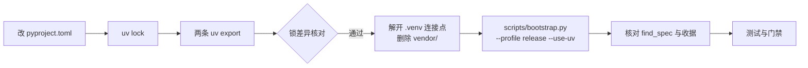

# 安装、代码身份、依赖与许可

> 本章属于[去掉 AgentSociety2：开发规格](../SPEC-agentsociety2-removal.md)，读法和叫法见那一页。

## 目标与依据

本章实现提案（`docs/dev/agentsociety2-removal/PROPOSAL-agentsociety2-removal.md`）以下各处的终态：

| 提案位置 | 本章落实的内容 |
| --- | --- |
| 第六章「安装、代码身份与依赖」全部四点 | 删除补丁目录、引导里的重建步骤、`scripts/bootstrap_sources.py`、源码锁定摘要、11 个进程环境变量、`PYTHONPATH` 注入与导入顺序守卫、凭据脱敏表里的两个名字、`MEMORY.md` 身份残留门禁；`custom/` 并入 `src` 后代码身份与门禁的写法；删除的包、锁文件的重算与核对；许可文件、模块来源注明与合并前的来源核对 |
| 第四章「为了迁就 AgentSociety2 而存在的代码」中的四行 | 环境变量与导入顺序守卫（`src/worldmock/runtime/framework/setup.py:38-78`）；`custom/` 不是包及其门禁例外（`pyproject.toml:64-66`、`tests/mutation_runner.py:7-8`）；Ray 进程里的代码不进覆盖率与变异检查；Windows 上装 Ray 与 75 个只为框架存在的包（`pyproject.toml:15`、`uv.lock`） |
| 第八章「改动面」的「引导与 CI」一行 | `scripts/bootstrap.py`、`scripts/fresh_check.py` 与两个 GitHub 工作流 |
| 第七章「代码身份 `code_sha256`」与「命令行」两行 | 代码身份不再含 AgentSociety2、旧运行不能续跑或重放；删除 `--project-root` |
| 第九章「验收证据」的两行 | 新虚拟环境里找不到 `agentsociety2`、`ray`、`mem0`、`mcp`，源码里没有相关导入；锁文件差异只有删除行与 `tomlkit` 的几行 |
| 第九章「依赖与锁」一段 | 工作树改用自己引导出来的虚拟环境 |

适用的裁定（`docs/dev/agentsociety2-removal/RULING-2026-11-17-owner.md`）：第 1 条（正式运行之前一次换完）、第 2 条（推翻「不重写框架」原则）、第 12 条（对外说法改成 WorldMock 自有的决策循环，落到 `pyproject.toml` 与命令行的描述文字）。其余各条与本章无关。

代码基线是 `74f1b949`（生产代码与 `cb802721` 相同）；下文的「现在」和行号都指这个提交。

## 行为

### 删除的安装与进程配置

【I1】`patches/agentsociety2/` 整个目录删除：受跟踪的 9 个文件（`README.md`、`SERIES`、`baseline.tar.gz`、五份补丁、`evidence/original.patch.gz`），共 1,037,660 字节。`.gitattributes:9` 的 `patches/** -text -whitespace` 删除，同一位置加一行 `LICENSES/** -text`；`.gitignore:3` 的 `.ray/` 与 `.gitignore:18` 的 `vendor/agentsociety2/` 删除。

【I2】`scripts/bootstrap_sources.py` 删除。其中的 `file_sha256(path: Path) -> str`（`scripts/bootstrap_sources.py:14-17`）连同文档串一字不改地移进 `scripts/bootstrap_environment.py`，放在 `environment_python` 之前；`scripts/bootstrap_environment.py:14` 的导入删除，模块加 `import hashlib`。`scripts/freeze_rrs_baseline.py:16-17` 合成一行 `from scripts.bootstrap_environment import file_sha256, require_python_identity, required_python_version`。`source_sha256`、`require_hash`、`read_series`、`extract_archive`、`_require_as2`、`restore_as2` 随文件删除，在别处不再出现。

【I3】`scripts/bootstrap.py` 的 `bootstrap(root, profile, wheelhouse=None, use_uv=False)` 依次且只做四步：`create_environment(root / ".venv", use_uv)`、`install_requirements(python, root / "requirements/lock.txt", wheelhouse, use_uv)`、`install_source(python, root, use_uv)`、`write_receipt(root, profile)`，返回收据。没有核对或重建 AgentSociety2 的步骤，也不再可编辑安装第二个源码目录；四步都不调用 `git`，所以引导不需要 Git。命令行（`--profile`、`--wheelhouse`、`--use-uv`）、失败处理与退出码不变。

【I4】`scripts/bootstrap_environment.py` 的收据函数改为 `write_receipt(root: Path, profile: str) -> dict`，删去第三个参数 `sources`。写出的 `.work/environment-receipt.json` 恰有十个键，键序为 `schema_version`、`profile`、`python_version`、`python_implementation`、`python_version_file_sha256`、`dependency_locks`、`node_version`、`node_sqlite_available`、`missing_components`、`passed`；`schema_version` 仍是 `"environment-1"`，不再有 `as2_source_sha256`。

【I5】`src/worldmock/runtime/framework/setup.py` 删除 `_configure_process`（`:30-54`）、`_prepend_pythonpath`（`:57-67`）、`_require_loaded_config`（`:70-78`）、`require_locked_as2`（`:120-133`）、`_as2_source_files`（`:136-155`）与三个模块级名字 `_AS2_PACKAGE`、`AS2_LOCKED_SOURCE_SHA256`、`_AS2_IDENTITY_ERROR`（`:24-27`）。从此：

- 新建、恢复、重放都不写任何进程环境变量。下列 11 个名字在 `src/`、`scripts/`、`tools/`、`tests/` 的 `.py` 文件、`.github/` 的工作流与 `pyproject.toml` 里都不出现：`WORKSPACE_PATH`、`AGENTSOCIETY_LLM_API_KEY`、`AGENTSOCIETY_LLM_API_BASE`、`AGENTSOCIETY_LLM_MODEL`、`AGENTSOCIETY_CODER_LLM_API_KEY`、`AGENTSOCIETY_CODER_LLM_API_BASE`、`AGENTSOCIETY_CODER_LLM_MODEL`、`AGENTSOCIETY_EMBEDDING_MODEL`、`AGENTSOCIETY_LLM_REQUEST_TIMEOUT`、`MEM0_TELEMETRY`、`ANONYMIZED_TELEMETRY`。
- 不改 `PYTHONPATH`，不往 `sys.path` 插任何目录，不检查导入顺序。
- 命令可以在任何目录启动，进程里除 `config.toml` 的 `model.api_key_env` 指的那个变量之外不需要预设任何变量。
- 第 12 个变量 `LITELLM_LOCAL_MODEL_COST_MAP` 不由运行装配写，改由模型客户端在导入 litellm 之前设置（规则与测试归[「模型客户端与模型请求底稿」](./04-model-client.md)）；`scripts/fresh_check.py`、`tests/mutation_runner.py` 给子进程的环境与 `tests/conftest.py:25` 的缺省值（写法归[「比较工具、查看器与测试迁移」](./09-tools-tests.md)【T29】）照旧带它，因为测试模块可以先于模型客户端导入 litellm 的异常类型。

现在因此消失的英文文本：`WorldMock project root is incomplete`（日志与 `FileNotFoundError`）、`AgentSociety2 was imported before the required model configuration`（日志与 `RuntimeError`）、`AS2 runtime identity differs from the locked source`（`IntegrityError`，以及引导里同文的 `RuntimeError`）、`Locked artifact hash differs: <文件名>`、`Locked source files are missing`、`Locked source contains an unsafe file`、`Source archive contains an unsafe path`、`Source archive contains a non-regular member`。没有新增的错误文本。

【I6】凭据只经 `credential_value(config)`（`src/worldmock/configuration/model/model_metadata.py:26-32`，不改）读取。新建运行的准备路径不另读凭据：`load_environment` 读取实际模型元数据时已经读过（`model_metadata.py:41`），缺失时在那里照旧以 `EnvironmentInputError("config.toml", "RUN_CONFIG_INVALID", "model context metadata is unavailable")` 拒绝，不建运行目录。恢复与重放在 `_prepare_resume` 里、校验检查点世界并按父清单冻结的元数据加载环境之后，核对运行身份与复制任何文件之前，调用 `credential_value(inputs.config.model)`；变量缺失或为空时照旧写错误日志 `Model credential environment variable is missing or empty: <变量名>`，抛 `ValueError("Model credential environment variable is missing or empty")`，分支目录不建。这一步替换现在 `runner.py:251` 的 `run_setup._configure_process(...)`，位置不变。

【I7】`src/worldmock/recording_engine/events/model_evidence.py:7` 改为 `SECRET_ENVIRONMENTS = ("DEEPSEEK_NODE_KEYS",)`。`redact_evidence` 与 `_redact` 不变；`AGENTSOCIETY_LLM_API_KEY` 的值不再被替换成 `[REDACTED]`。

### 代码身份

【I8】`src/worldmock/runtime/framework/setup.py` 新增公开函数 `project_root() -> Path`，返回 `Path(worldmock.__file__).resolve().parents[2]`，即已导入的 `worldmock` 包目录 `src/worldmock` 往上两级。它不读命令行、当前目录或环境变量。两种引导 profile 都以可编辑方式安装 WorldMock，所以它就是正在执行的这份检出的根；包不是从检出导入时，根下没有 `pyproject.toml`，代码身份按【I9】拒绝。

【I9】`runtime_code_sha256() -> str`（不再有参数）对 `project_root()` 下这些文件求标签摘要：`src/` 下全部 `.py`（标签是相对项目根的 POSIX 路径，如 `src/worldmock/cli.py`），以及根目录的 `pyproject.toml` 与 `uv.lock`（标签就是文件名）。`src/` 下其他类型的文件、`tests/`、`scripts/`、`tools/` 与任何别的目录都不进代码身份。标签摘要算法 `_labeled_sha256`（`setup.py:158-170`）一字不改：按标签排序，每个文件依次写入 8 字节大端的标签长度、标签、8 字节大端的内容长度、内容；文件缺失、不是普通文件或是符号链接时抛 `IntegrityError("Runtime identity source is missing or unsafe")`。

【I10】新建运行的 Git 状态从项目根读：`_run_identity` 取 `root = run_setup.project_root()`，`git_commit, git_dirty = run_setup._git_state(root)`，`code_sha256 = run_setup.runtime_code_sha256()`。`_git_state` 与 `_git_output` 的行为不变（`setup.py:173-195`），只把参数名 `project_root` 改为 `root`，免得遮住新函数名。

【I11】恢复与重放的代码身份核对照旧：`_require_runtime_identity(manifest, inputs)` 拿父清单的 `code_sha256` 与 `run_setup.runtime_code_sha256()` 比较，不等时写错误日志并抛 `IntegrityError("Checkpoint code identity differs from the current runtime")`，原文不变（`runner.py:289-291`）。基线代码写下的运行，清单里的代码身份含 `custom/` 与 AgentSociety2 的字节，在新代码上恢复或重放一律被这条拒绝，不留分支目录。清单字段名 `code_sha256`、运维日志 `RUN_STARTED` 与 `RUN_RESUMED` 携带它的方式、质量报告与目标指标按它分组的方式都不变。

【I12】命令行删除全局参数 `--project-root`（`src/worldmock/cli.py:23`）；带它的命令以 argparse 的退出码 2 拒绝。`RunRequest` 与 `ResumeRequest` 删去第一个字段 `project_root`，`_PreparedRun` 删去同名字段：`RunRequest(environment_root, run_dir, run_id, source_group_id, same_second_continuation=True)`，`ResumeRequest(environment_root, parent_run_dir, checkpoint_id, run_dir)`，其余字段的次序、类型与校验不变。命令行描述改为 `Auditable life simulation`（`cli.py:22`），`pyproject.toml:8` 的项目描述改为 `Auditable life simulation and digital footprint production`。

### `custom/` 并入以后

【I13】仓库里没有 `custom/` 目录：LifeAgent 搬到 `src/worldmock/agents/life_agent.py`（[「人物、回合循环与只读问答的删除」](./03-agent-loop.md)），LifeEnv 删除（[「去掉 LifeEnv」](./02-engine-facade.md)）。`src/`、`tests/`、`tools/`、`scripts/` 的 Python 源码里没有任何 `import` 或 `from … import` 指向顶层模块 `custom`、`agentsociety2`、`ray`、`mem0`、`mcp`。同一进程里 LifeAgent 只有 `worldmock.agents.life_agent` 一份类对象。`setup.py` 里三处函数内导入（`_model_identity`、`stage_model_identity`、`validate_stage_model_identity`，现在 `:83`、`:95`、`:239`）改为从 `worldmock.agents.life_agent` 导入同样的名字，仍留在函数内。`tools/analysis/memory_pilot.py` 模块文档串 `:6-7` 的「不加载 worldmock.simulation_engine、worldmock.agents、worldmock.runtime 与 custom 下的任何模块」改为「不加载 worldmock.simulation_engine、worldmock.agents 与 worldmock.runtime 下的任何模块」，其余字不改；它的纯加载用例同时删去 `'custom'` 前缀（[「比较工具、查看器与测试迁移」](./09-tools-tests.md)【T45】）。

【I14】门禁的扫描根统一为 `src/worldmock` 与 `tools/analysis`，任何门禁都不再为 `custom` 单列目录或模块前缀：

| 位置 | 之后 |
| --- | --- |
| `pyproject.toml:61-71` | `source = ["src/worldmock", "tools/analysis"]`；`omit` 只剩 `"*/tests/*"`、`"*/scripts/*"`；删去 `:64-65` 的注释 |
| `scripts/coverage_gate.py:25` | `PRODUCTION_ROOTS = ("src/worldmock", "tools/analysis")` |
| `tests/unit/engineering/test_style_gate.py:17` | `SCAN_ROOTS = ("src/worldmock", "tools/analysis")`；模块文档串 `:3` 的检查范围写成「src/worldmock 与 tools/analysis」 |
| `tests/unit/engineering/test_single_source.py:115` | 扫描根 `('src/worldmock', 'tools/analysis')`；合成样例 `custom/b.py`、`custom/wrong.py`（`:165`、`:171`、`:198`、`:205`、`:213`）改放 `tools/analysis/b.py`、`tools/analysis/wrong.py` |
| `tests/unit/engineering/test_import_graph.py:162` | `modules()` 只枚举 `("src/worldmock", "worldmock")` 与 `("tools/analysis", "tools.analysis")` |
| `tests/unit/engineering/test_import_graph.py:409` | 引擎边界只看来源前缀 `"worldmock."` |
| `tests/unit/engineering/test_import_graph.py:437` | 唯一允许导入 `worldmock.simulation_engine.engine` 的生产模块是 `worldmock.runtime.lifecycle.run_host`（运行宿主，见[「运行宿主与决策轮」](./01-run-host.md)） |
| `tests/unit/engineering/test_coverage_gate.py:131-139`、`:156-160` | 合成文件改为 `src/worldmock/synthetic_agent.py`、`src/worldmock/synthetic_env.py`，根参数 `("src/worldmock",)` |

原先在 Ray 工作进程里执行、由扫描器另行加载的 LifeAgent 代码，从此按主进程如实计入覆盖率与源码变异；覆盖率门禁的两项判据（分支覆盖率不低于 85%、未覆盖公共接口为零）照旧对全部生产根成立，暴露出的未覆盖公共函数在合并前补齐测试。

【I15】`tests/unit/engineering/test_import_graph.py` 的 `DELAYED_IMPORTS` 删除下列 21 条（键按现在的行号），并为 `setup.py` 的三处函数内导入新增三条，理由文字沿用「按原调用时机延迟加载，保持输入纯加载边界」：

| 现在行号 | 删除的键 |
| --- | --- |
| `:44` | `('worldmock.configuration.model.model_metadata', 'IndependentModelClient.__init__', 'agentsociety2.config')` |
| `:55` | `('worldmock.runtime.framework.read_query', 'life_env_actor_class', 'ray')` |
| `:56` | `('worldmock.runtime.framework.setup', '_model_identity', 'custom.agents.life_agent')` |
| `:58` | `('worldmock.runtime.framework.setup', '_require_loaded_config', 'agentsociety2.config.config')` |
| `:61` | `('worldmock.runtime.framework.setup', 'stage_model_identity', 'custom.agents.life_agent')` |
| `:62` | `('worldmock.runtime.framework.setup', 'validate_stage_model_identity', 'custom.agents.life_agent')` |
| `:66`–`:69` | `('worldmock.runtime.lifecycle.runner', '_build_society', …)` 指向 `agentsociety2.agent.service_proxy`、`agentsociety2.config.llm_dispatcher`、`agentsociety2.env.direct_env_actor`、`agentsociety2.society` 的四条 |
| `:71` | `('worldmock.runtime.lifecycle.runner', '_call_plan_day', 'agentsociety2.config.llm_dispatcher')` |
| `:73` | `('worldmock.runtime.lifecycle.runner', '_call_memory_digest', 'agentsociety2.config.llm_dispatcher')` |
| `:75` | `('worldmock.runtime.lifecycle.runner', '_cleanup_runtime', 'ray')` |
| `:76` | `('worldmock.runtime.lifecycle.runner', '_execute', 'agentsociety2.config.llm_dispatcher')` |
| `:77` | `('worldmock.runtime.lifecycle.runner', '_execute', 'ray')` |
| `:93` | `('worldmock.runtime.lifecycle.runner', '_require_custom_modules', 'agentsociety2.registry')` |
| `:105` | `('worldmock.runtime.lifecycle.runner', '_terminate_failed_actor', 'ray')` |
| `:106` | `('worldmock.runtime.lifecycle.runner', '_validate_agent_workspace', 'agentsociety2.agent.memory')` |
| `:118` | `('worldmock.simulation_engine.decisions.decision_coordinator', 'DecisionCoordinator._validate_call', 'agentsociety2.society')` |
| `:120` | `('worldmock.simulation_engine.decisions.decision_coordinator', 'DecisionCoordinator.validate_context', 'agentsociety2.society')` |
| `:133` | `('worldmock.simulation_engine.scheduling.clock.time_advance', 'TimeAdvanceCoordinator.scheduling_state', 'agentsociety2.society')` |

新增的三条：`('worldmock.runtime.framework.setup', '_model_identity', 'worldmock.agents.life_agent')`、`('worldmock.runtime.framework.setup', 'stage_model_identity', 'worldmock.agents.life_agent')`、`('worldmock.runtime.framework.setup', 'validate_stage_model_identity', 'worldmock.agents.life_agent')`。别章删改函数带来的其余登记变化（如 `_build_society` 指向 `worldmock.runtime.framework.read_query` 的 `:70`）随那些代码一起改；登记表最终与代码里的函数内导入一条不多、一条不少，由现有守卫保证。

【I16】`tests/mutation_runner.py`：

- `source_location`（`:58-63`）只接受 `worldmock.`、`scripts.`、`tools.analysis.` 三个前缀，`custom.` 开头的符号以 `Mutation module is outside production roots: <模块>` 拒绝。
- 模块文档串 `:7-8` 的 `@note` 改为两行：`@note     变异经 sys.meta_path 按模块名注入，只对主进程里以该模块名导入的生产代码生效；子进程里执行的代码不受影响，` 与 `          针对它的变异须由在本进程直接导入该模块的用例杀死。`，其后的「文件名不以 test_ 开头……」一句不变。
- `run_behavior` 给子进程的环境（`:160-162`）恰为 `{**os.environ, "LITELLM_LOCAL_MODEL_COST_MAP": "True", "PYTHONUTF8": "1"}`。

【I17】`tests/dataset_acceptance.py:450-456` 的源码变异 `process_configured_after_the_model_identity` 删除：它改的那一步（进程配置）已不存在，锚点在新源码里找不到。

### 依赖与锁

【I18】`pyproject.toml` 的依赖声明恰为下面的样子（`[build-system]`、`[project.scripts]`、`[tool.setuptools.packages.find]`、`[tool.pytest.ini_options]` 的其余键与 `[tool.coverage.report]` 不变）：

```toml
[project]
name = "worldmock"
version = "0.2.0"
description = "Auditable life simulation and digital footprint production"
requires-python = ">=3.12,<3.13"
dependencies = [
  "pydantic==2.12.5",
  "litellm==1.89.2",
  "networkx==3.6.1",
  "jsonschema==4.26.0",
  "requests==2.32.5",
]

[dependency-groups]
dev = [
    "coverage==7.15.4",
    "pytest==9.1.1",
    "pytest-asyncio==1.4.0",
    "tomlkit==0.15.1",
]

build = [
    "setuptools==84.0.0",
]
```

`[tool.uv.sources]`（`:44-45`）整节删除。pytest 标记 `engine` 的说明（`:55`）改为 `engine: tests with engine factory or direct LifeEngine imports`，其余三个标记不变。`python-dotenv` 不再直接声明（WorldMock 不导入它），仍经 litellm 以 1.2.1 留在锁里。`tomlkit` 过去只经 hatchling 间接装上，有 9 个测试文件导入它，所以进开发依赖组。

【I19】锁文件用本机的 uv 0.12.19 按下面三条命令重算，按顺序执行：

| 文件 | 命令 | 结果 |
| --- | --- | --- |
| `uv.lock` | `uv lock`（不加 `--upgrade`） | 59 个 `[[package]]`：58 个注册表包加 `worldmock` |
| `requirements/lock.txt` | `uv export --frozen --format requirements-txt --no-emit-project --all-groups --no-header --no-annotate -o requirements/lock.txt` | 58 条带哈希的包 |
| `requirements/build-lock.txt` | `uv export --frozen --format requirements-txt --no-emit-project --only-group build --no-header --no-annotate -o requirements/build-lock.txt` | 只有 `setuptools==84.0.0` 一条 |

这三条命令的写法已在基线上核对：基线锁加上 `--no-emit-package agentsociety2` 时，两条 `uv export` 分别逐字节重现现在的 `requirements/lock.txt`（133 条）与 `requirements/build-lock.txt`（8 条）。保留的 58 个包，版本、来源、`sdist` 与全部 `wheels` 条目（含哈希）与基线逐字节相同，例如 litellm 1.89.2、openai 2.54.0、httpx 0.28.1、tiktoken 0.14.0、tokenizers 0.23.2、pydantic 2.12.5、jsonschema 4.26.0、networkx 3.6.1、requests 2.32.5、aiohttp 3.14.3、tomlkit 0.15.1、setuptools 84.0.0。重算之后跑一次锁差异核对（见「锁差异核对」），通过才进入引导。

【I20】删除的包是 `agentsociety2` 加下列 75 个第三方包（按名字排序，由 `uv.lock` 的依赖图算出：保留集是五个运行依赖、四个开发依赖与 `setuptools` 的传递闭包）：

`aiosqlite`、`annotated-doc`、`backoff`、`black`、`cffi`、`cloudpickle`、`contourpy`、`cryptography`、`cycler`、`duckdb`、`editables`、`elemental-xenon`、`faiss-cpu`、`fastapi`、`fonttools`、`geojson`、`greenlet`、`grpcio`、`h2`、`hatchling`、`hpack`、`httpx-sse`、`hyperframe`、`joblib`、`json-repair`、`kiwisolver`、`krippendorff`、`markdown-it-py`、`matplotlib`、`mcp`、`mdurl`、`mem0ai`、`msgpack`、`mypy-extensions`、`narwhals`、`numpy`、`pandas`、`pathspec`、`pillow`、`platformdirs`、`plotly`、`portalocker`、`posthog`、`protobuf`、`pycityproto`、`pycparser`、`pydantic-settings`、`pyjwt`、`pyparsing`、`pyproj`、`python-dateutil`、`python-multipart`、`pytokens`、`pytz`、`pywin32`、`qdrant-client`、`ray`、`rich`、`scikit-learn`、`scipy`、`shapely`、`shellingham`、`six`、`sqlalchemy`、`sqlmodel`、`sse-starlette`、`starlette`、`stringcase`、`threadpoolctl`、`trove-classifiers`、`typer`、`types-protobuf`、`tzdata`、`uvicorn`、`wsproto`。

保留的 58 个：`aiohappyeyeballs`、`aiohttp`、`aiosignal`、`annotated-types`、`anyio`、`attrs`、`certifi`、`charset-normalizer`、`click`、`colorama`、`coverage`、`distro`、`fastuuid`、`filelock`、`frozenlist`、`fsspec`、`h11`、`hf-xet`、`httpcore`、`httpx`、`huggingface-hub`、`idna`、`importlib-metadata`、`iniconfig`、`jinja2`、`jiter`、`jsonschema`、`jsonschema-specifications`、`litellm`、`markupsafe`、`multidict`、`networkx`、`openai`、`packaging`、`pluggy`、`propcache`、`pydantic`、`pydantic-core`、`pygments`、`pytest`、`pytest-asyncio`、`python-dotenv`、`pyyaml`、`referencing`、`regex`、`requests`、`rpds-py`、`setuptools`、`sniffio`、`tiktoken`、`tokenizers`、`tomlkit`、`tqdm`、`typing-extensions`、`typing-inspection`、`urllib3`、`yarl`、`zipp`。

用工作树自己引导出来的虚拟环境，`importlib.util.find_spec` 对 `agentsociety2`、`ray`、`mem0`、`mcp` 都返回 `None`。

### 引导、新检出核验与 CI

【I21】`scripts/fresh_check.py`：

- `QUICK_TESTS = ("tests/unit/engineering", "tests/integration/environment")`，去掉 `tests/integration/as2`。
- `check_environment` 在 `os.environ` 的副本上恰好更新五个键：`GIT_SSH_COMMAND="false"`、`PIP_NO_CACHE_DIR="1"`、`PIP_DISABLE_PIP_VERSION_CHECK="1"`、`PIP_CONFIG_FILE=os.devnull`、`LITELLM_LOCAL_MODEL_COST_MAP="True"`；不再写 `AGENTSOCIETY_LLM_API_KEY` 与 `AGENTSOCIETY_LLM_API_BASE`。文档串改为「新机器检查明确禁用 SSH 与 pip 缓存，不使用 uv；快速测试离线执行。」（原文里「真实模型调用」靠这两个假变量禁用，变量删除后这半句不再成立）。
- `quick_check` 读身份的子进程源码改为 `from worldmock.runtime.framework.setup import runtime_code_sha256; print(runtime_code_sha256())`，仍以检出根为工作目录、用检出自己的 `.venv` 解释器；文档串改为「执行引导后的快速测试，并读取实际导入源码的运行身份。」。`fresh_check`、`compare_identities`、`main` 不变：Ubuntu 与 Windows 两侧的 `code_sha256` 仍必须相同。

【I22】两个工作流不再安装中文图表字体，它已经没有使用者；Node 原生库 `libatomic1` 照装：

- `.github/workflows/rebuildable-environment.yml:29` 的步骤名改为 `Prepare Linux Node native library`，`:33` 改为 `sudo apt-get install --yes --no-install-recommends libatomic1`。
- `.github/workflows/tests.yml:65` 改为 `sudo apt-get install --yes --no-install-recommends libatomic1`。

两个文件的其余内容不变；两个工作流的 `scripts/bootstrap.py --profile release` 调用照旧，它从此不再重建 AgentSociety2。

### 许可与来源

【I23】新建 `LICENSES/AgentSociety2-Apache-2.0.txt`，内容是上游归档 `baseline.tar.gz` 里的 `LICENSE` 原文，逐字节照抄：11,362 字节，LF 换行，SHA-256 为 `b65b784ed7e4318dc1c3e8944046d867edcc272c7f237ea99dcf0c0ce3a1e75d`（与 `patches/agentsociety2/SERIES` 的 `install_files.LICENSE` 相同）。取法：用 Python 读 `git show 74f1b949:patches/agentsociety2/baseline.tar.gz` 的输出字节，以 `tarfile` 取出归档根下的 `LICENSE` 成员，`Path.write_bytes` 原样写出；不经文本编辑工具，也不用 `write_text`。上游归档（286 个成员）里没有 `NOTICE` 文件，没有别的声明要随附。`.gitattributes` 的 `LICENSES/** -text`（【I1】）保证 Windows 上 `core.autocrlf=true` 的检出也得到同样的字节。

【I24】含上游衍生代码的模块，在模块文档串的最后一段写这一句，单独占一行，一字不差（109 个字符）；`ast.get_docstring(tree)` 的最后一行恰为这一句。这是全规格唯一的来源与许可写法，别章的模块不另写来源句：

`来源：本模块部分代码改写自 AgentSociety2 2.8.7（上游提交 670c94ff），按 Apache-2.0 使用，许可全文见 LICENSES/AgentSociety2-Apache-2.0.txt。`

写这一句的模块集合是两部分的并集。第一部分是别章已经指定的五个模块：

| 模块 | 上游衍生的内容 | 指定它的章 |
| --- | --- | --- |
| `src/worldmock/agents/protocol/react_loop.py` | 回合循环骨架、调用身份、配对纠错 | [「人物、回合循环与只读问答的删除」](./03-agent-loop.md)【A30】 |
| `src/worldmock/state/model/exchange.py` | assistant 消息与工具调用的序列化 | [「人物、回合循环与只读问答的删除」](./03-agent-loop.md)【A30】 |
| `src/worldmock/configuration/model/model_client.py` | 最终失败的类名 `LLMDispatchError` 与发送循环骨架 | [「模型客户端与模型请求底稿」](./04-model-client.md) |
| `src/worldmock/agents/memory/workspace.py` | 人物工作区的建立与重建 | [「人物工作区、记忆文件与「记忆已更新」」](./05-workspace-memory.md) |
| `src/worldmock/agents/memory/life_memory_store.py` | 记忆条目的归一化与严格读回 | [「人物工作区、记忆文件与「记忆已更新」」](./05-workspace-memory.md) |

第二部分是「来源核对」判定含上游衍生代码的其余模块。集合以外的模块不写这一句。

【I25】合并之前，对照上游归档做一次来源核对，结果写进基础检出的 `.work/agentsociety2-removal/provenance.json`（梳理证据所在的目录，工作树删除后仍在；下文「一次性脚本」都放这里），验证记录引用它（[「实施、验收证据与完成判据」](./10-implementation.md)）。核对的对象是分支头的 `src/worldmock` 下全部 `.py`，比对的是未打补丁的上游源码，所以 WorldMock 自己在补丁里写的代码不算衍生。算法见「来源核对」。

【I26】`src/worldmock` 与 `tools/analysis` 的 Python 源码里，「AgentSociety」「agentsociety」与前后不紧接字母或数字的「AS2」只出现在【I24】那一句里；注释、文档串、日志与错误文本都不再点名这个框架。

### 行为分析

【I27】`tools/analysis/behavior/metrics.py` 删除检查 `MEMORY.md` 示例身份残留的门禁、它的参数与测试：

- `behavior_metrics_report(events, *, timezone="Asia/Shanghai", locations=None, workday=None)`：删去关键字参数 `memory_md_texts`（`:68`）与它的文档行（`:76`）；以这个关键字调用抛 Python 的 `TypeError`。
- `_group_report(events, timezone, locations, workday)`：删去同名参数（`:102`）；`gates` 只剩 `observation_repetition`、`silent_boundary_ratio`、`memory_repetition_ratio` 三项，再并入目标指标的门禁；删去 `memory_md_identity_residue`（`:111`）。
- `_memory_residue_gate`（`:671-686`）删除，它的说明「MEMORY.md 文本未提供，身份残留无法检查」随之不再出现。
- `MEMORY_IDENTITY_MARKERS`（`:40-42`）保留，因为回顾报告 `digest_identity_residue`（`:627-640`）与 `tools/analysis/memory_pilot.py` 仍用它；`:39` 的注释改为 `#: 回顾正文里不该出现的示例身份标记（一套外部提示样例里的示例人物与示例编号），命中即在 memory_digest_identity_residue 报告。`
- 报告结构标识 `behavior-metrics-4` 不变；其余门禁、报告项与说明逐字节不变。

### 工作树的虚拟环境

【I28】依赖文件改完、锁重算并通过核对之后，任何测试运行之前，工作树 `.work/wt/as2-removal` 换成自己引导出来的虚拟环境，不再共用基础检出的 `.venv`，免得仍能导入 AgentSociety2、掩盖遗漏。之后工作树里的测试、门禁与证据作业一律用 `.work/wt/as2-removal/.venv/Scripts/python.exe`，不用 `.work/tools/envrev/py.sh`，也不用写死基础检出解释器的 `.work/tools` 脚本。



在 Git Bash 里依次执行（`$WT` 是工作树根）：

| 步骤 | 命令 | 说明 |
| --- | --- | --- |
| 解开连接点 | `cmd //c rmdir "$(cygpath -w "$WT/.venv")"` | `$WT/.venv` 现在是指向基础检出 `.venv` 的连接点；`rmdir` 只解开连接点，不动目标 |
| 删除旧源码 | `rm -rf "$WT/vendor"` | `vendor/` 只有 `prepare_wt.sh` 恢复的 AgentSociety2；`.gitignore` 不再忽略它，留着会被误提交 |
| 引导 | `cd "$WT" && export PATH="/c/Program Files/nodejs:$PATH" PYTHONUTF8=1 && UV_OFFLINE=1 "$HOME/AppData/Roaming/uv/python/cpython-3.12.13-windows-x86_64-none/python.exe" scripts/bootstrap.py --profile release --use-uv` | 用 uv 管理的 CPython 3.12.13 执行，`python_command` 因此直接取当前解释器；先离线，只用 uv 缓存 |
| 联网重试 | 同一条命令去掉 `UV_OFFLINE=1` | 只在离线一步因缓存缺包失败时执行；装的仍是 `requirements/lock.txt` 里带哈希的同一批文件 |
| 核对 | `.venv/Scripts/python.exe -c "import importlib.util as u; assert all(u.find_spec(n) is None for n in ('agentsociety2', 'ray', 'mem0', 'mcp'))"`，并确认 `.work/environment-receipt.json` 的 `passed` 为 `true` | 失败即停，查明原因再继续 |

### 锁差异核对

一次性脚本 `.work/agentsociety2-removal/lock_check.py`（基础检出下，不入库），只用标准库（`tomllib`、`difflib`、`subprocess`、`json`），在工作树根用 uv 管理的 CPython 3.12.13（`$HOME/AppData/Roaming/uv/python/cpython-3.12.13-windows-x86_64-none/python.exe`）执行：这时工作树还没有自己的虚拟环境。结论写进 `.work/agentsociety2-removal/lock-check.json`，键为 `passed`、`added_lines`、`changed_packages`、`removed_packages`、`counts`。基线文件取自 `git show 74f1b949:<路径>`。判据全部成立才算通过：

| 判据 | 做法 |
| --- | --- |
| 只有删除行 | 对 `uv.lock`、`requirements/lock.txt`、`requirements/build-lock.txt` 分别用 `difflib.SequenceMatcher(None, 基线行, 新行, autojunk=False)` 取操作码，收集所有 `insert` 与 `replace` 在新侧的行：`uv.lock` 恰为两行，各一次：`    { name = "tomlkit" },`（`worldmock` 的 `[package.dev-dependencies]` 的 `dev`）与 `    { name = "tomlkit", specifier = "==0.15.1" },`（`[package.metadata.requires-dev]` 的 `dev`）；两份 requirements 没有新增行 |
| 保留包不变 | 用 `tomllib` 解析两份 `uv.lock`，新锁里除 `worldmock` 以外的每个包，`version`、`source`、`sdist`、`wheels` 与基线同名包相等 |
| 删掉的正好是那些 | 基线有而新锁没有的包名集合，等于【I20】的 76 个名字 |
| 数目 | `uv.lock` 59 个 `[[package]]`；`requirements/lock.txt` 58 行含 `==`；`requirements/build-lock.txt` 1 行含 `==` |

### 来源核对

一次性脚本 `.work/agentsociety2-removal/provenance_check.py`（基础检出下，不入库），只用标准库，在工作树根用工作树自己的 `.venv/Scripts/python.exe` 执行，各步如下：

| 步骤 | 做法 |
| --- | --- |
| 取上游归档 | 把 `git show 74f1b949:patches/agentsociety2/baseline.tar.gz` 写到 `.work/agentsociety2-removal/upstream/baseline.tar.gz`，核对 SHA-256 为 `5adf4d1054397cd48c4174c526ee5adff2742b442f5b3832b99ab61119b05aad`，用 `tarfile` 的 `extractall(filter="data")` 解到同目录 |
| 有效行 | 每个 `.py` 文件取去掉首尾空白后长度不小于 20、且不以 `#` 开头的行，保持原次序，记下原行号 |
| 比对 | 上游全部 `.py` 的每四个相邻有效行组成元组放进一个表；分支头 `src/worldmock` 下每个 `.py` 的每四个相邻有效行查表，命中记一条 `{"line", "upstream", "upstream_line"}` |
| 输出 | `{"upstream_sha256": …, "matches": {模块路径: [命中, …]}}`，模块路径按字符串排序，同一模块的命中按 `line` 升序 |
| 复核 | 逐个人工复核命中：只由导入、日志器建立这类样板组成的命中不算衍生；其余命中所在的模块进入【I24】的集合。复核结论写进验证记录；最终集合（【I24】表里的五个模块加复核新增的模块）就是测试常量 `UPSTREAM_DERIVED_MODULES` |

## 接口与文件

### 生产与配置文件

| 路径 | 动作 | 内容 |
| --- | --- | --- |
| `patches/agentsociety2/`（9 个文件） | 删除 | 【I1】 |
| `scripts/bootstrap_sources.py` | 删除 | 【I2】 |
| `LICENSES/AgentSociety2-Apache-2.0.txt` | 新建 | 【I23】 |
| `.gitattributes` | 修改 | `:9` 换成 `LICENSES/** -text`（【I1】） |
| `.gitignore` | 修改 | 删 `:3` `.ray/`、`:18` `vendor/agentsociety2/`（【I1】） |
| `pyproject.toml` | 修改 | 【I18】依赖与描述；【I14】覆盖率配置；删 `[tool.uv.sources]` |
| `uv.lock`、`requirements/lock.txt`、`requirements/build-lock.txt` | 修改（重算） | 【I19】 |
| `scripts/bootstrap.py` | 修改 | 删 `:18` 的导入；`bootstrap` 改为【I3】的四步，文档串「按唯一哈希锁建环境，再以可编辑方式安装 WorldMock，最后写环境收据。」 |
| `scripts/bootstrap_environment.py` | 修改 | 收下 `file_sha256` 并加 `import hashlib`（【I2】）；`write_receipt(root, profile)`（【I4】） |
| `scripts/freeze_rrs_baseline.py` | 修改 | `:16-17` 合成一行导入（【I2】） |
| `scripts/fresh_check.py` | 修改 | 【I21】 |
| `scripts/coverage_gate.py` | 修改 | `:25`（【I14】） |
| `.github/workflows/rebuildable-environment.yml` | 修改 | `:29`、`:33`（【I22】） |
| `.github/workflows/tests.yml` | 修改 | `:65`（【I22】） |
| `src/worldmock/runtime/framework/setup.py` | 修改 | 见下文「`setup.py` 之后」 |
| `src/worldmock/runtime/lifecycle/runner.py` | 修改 | 见下文「`runner.py` 里本章的改动」 |
| `src/worldmock/cli.py` | 修改 | 【I12】：删 `:23`；`:22` 描述；`_run_command`（`:84-112`）不再取 `arguments.project_root`，`output = arguments.output.resolve()`，`RunRequest(environment, output, identity, identity, arguments.same_second_continuation == "on")`，`ResumeRequest(environment, arguments.parent.resolve(), arguments.checkpoint, output)`；`:85-86` 文档串改为「新建或恢复都走真实运行入口，只在完整返回后标记完成；回执的 token_stats 由运行库里已落盘的模型响应累计（此时运行已经结束）。」 |
| `src/worldmock/recording_engine/events/model_evidence.py` | 修改 | `:7`（【I7】） |
| `tools/analysis/behavior/metrics.py` | 修改 | 【I27】 |
| `tools/analysis/memory_pilot.py` | 修改 | 模块文档串 `:6-7` 删去「与 custom」（【I13】） |
| `tests/mutation_runner.py` | 修改 | 【I16】 |
| `tests/dataset_acceptance.py` | 修改 | 删 `:450-456`（【I17】）；登记本章三条新变异（见「测试」） |
| `tests/unit/engineering/test_framework_removal.py` | 新建 | 本章十条守卫与常量 `REMOVED_PROCESS_VARIABLES`、`UPSTREAM_DERIVED_MODULES`（见「测试」） |

### `setup.py` 之后

模块文档串改为「冻结运行身份与准备人物输入的唯一职责。」。模块级导入恰为：`hashlib`、`logging`、`os`、`subprocess`、`collections.abc.Mapping`、`pathlib.Path`、`typing.Any`、`worldmock`，以及现在 `:14-18` 的五行 WorldMock 导入（`EnvironmentInputs`、`IntegrityError`、`ModelConfig`/`ModelMetadata`、两个警告函数、`ModelIdentity`）。删去 `importlib.util`、`json`（现在就没有用到）、`sys` 与 `credential_value` 的导入。

| 名字 | 签名 | 说明 |
| --- | --- | --- |
| `project_root` | `() -> Path` | 新增，【I8】；文档串「由已导入的 worldmock 包位置推出项目根：包目录 src/worldmock 往上两级；不读命令行、当前目录或环境变量。」 |
| `runtime_code_sha256` | `() -> str` | 【I9】；文档串「哈希项目根 src 下全部 Python 源码与根目录的 pyproject.toml、uv.lock（docs/design/09-io-formats.md「输入与模型身份」）；src 下其他类型的文件不进代码身份。」 |
| `_labeled_sha256` | `(files: list[tuple[str, Path]]) -> str` | 不变 |
| `_git_state` | `(root: Path) -> tuple[str \| None, bool \| None]` | 只改参数名（【I10】） |
| `_git_output` | `(root: Path, *arguments: str) -> bytes \| None` | 只改参数名 |
| `_model_identity`、`stage_model_identity`、`validate_stage_model_identity` | 不变 | 函数内导入改指 `worldmock.agents.life_agent`（【I13】） |
| `creation_inputs`、`input_warnings`、`validate_manifest_stage_identity`、`RETIRED_STAGE_IDENTITY_KEY`、`_identity_error` | 不变 | `creation_inputs` 返回值里人物配置的改动归[「人物工作区、记忆文件与「记忆已更新」」](./05-workspace-memory.md) |

`runtime_code_sha256` 的函数体（文档串之后）恰为四句：

```python
    root = project_root()
    files = [(path.relative_to(root).as_posix(), path) for path in (root / "src").rglob("*.py")]
    files.extend((name, root / name) for name in ("pyproject.toml", "uv.lock"))
    return _labeled_sha256(files)
```

`project_root` 的函数体是 `return Path(worldmock.__file__).resolve().parents[2]`；`runtime_code_sha256` 经模块全局名调用它，测试可以用 `monkeypatch.setattr(run_setup, "project_root", …)` 把它指到临时工程根。

### `runner.py` 里本章的改动

[「运行宿主与决策轮」](./01-run-host.md)重写 `runner.py` 的执行部分；下列改动属于本章，由持有这个文件的代理一并落下：

| 位置（现在） | 之后 |
| --- | --- |
| `:5` | 从 `worldmock.configuration.model.model_metadata` 的模块级导入加上 `credential_value` |
| `:32-37` | 删除这六行没有对应声明的孤立注释（其中 `:36-37` 说的是已经挪走的 AS2 包名常量） |
| `:42`、`:51`、`:63`、`:70`、`:119` | `RunRequest`、`ResumeRequest`、`_PreparedRun` 删去 `project_root` 字段及其 `:param`（【I12】） |
| `:183-187` | `_prepare_new_run` 文档串整段改为「完整环境纯准入后冻结运行身份，形成唯一人物与新世界参数；失败时不留下运行目录（docs/design/10-runtime.md）。」 |
| `:198` | 删除 `run_setup._configure_process(...)`，新建路径不另读凭据（【I6】） |
| `:208`、`:263` | 构造 `_PreparedRun` 时不再传项目根 |
| `:218-219`、`:224` | 【I10】 |
| `:229-232` | `_prepare_resume` 文档串里三处替换：`:230` 的「配置进程、核对身份」改为「读取凭据、核对身份」，「不配置进程」改为「不读取凭据」；`:232` 的「配置失败时不建分支目录（docs/design/10-runtime.md「实际框架边界」）」改为「凭据缺失时不建分支目录（docs/design/10-runtime.md）」。同一文档串里关于人物卡片来源的半句归[「人物工作区、记忆文件与「记忆已更新」」](./05-workspace-memory.md) |
| `:251` | 换成 `credential_value(inputs.config.model)`（【I6】） |
| `:252`、`:278`、`:289` | `_require_runtime_identity(manifest: dict[str, Any], inputs: EnvironmentInputs) -> None`，比较 `run_setup.runtime_code_sha256()`（【I11】） |

### 一次性脚本（不入库）

| 路径 | 用途 |
| --- | --- |
| `.work/agentsociety2-removal/lock_check.py` → `lock-check.json` | 「锁差异核对」，【I19】 |
| `.work/agentsociety2-removal/provenance_check.py` → `provenance.json` | 「来源核对」，【I25】 |

### 保持不变的部分

逐字节不变：`_labeled_sha256`、`_git_state` 与 `_git_output` 的函数体、`stage_model_identity` 与 `validate_stage_model_identity` 的校验逻辑、`file_sha256` 的函数体；`scripts/bootstrap_environment.py` 的 `environment_python`、`required_python_version`、`require_python_identity`、`python_identity`、`python_command`、`create_environment`、`install_requirements`、`install_source`、`_node_status`、`component_status`、`require_profile`；`scripts/fresh_check.py` 的 `fresh_check`、`compare_identities`、`main`；两个工作流除【I22】那三行以外的内容；`.python-version`；锁里保留包的全部条目；`redact_evidence` 与 `_redact`；`behavior_metrics_report` 除【I27】以外的计算。

## 设计文档

下列位置承载本章的规则；全文由[「设计文档与手册」](./08-design-docs.md)写，这里只列之后必须写明的事实。

| 位置（基线） | 之后必须写明 | 规则 |
| --- | --- | --- |
| `docs/design/09-io-formats.md:75-76` | `code_sha256` 覆盖 `src/` 下全部 Python 源码与根目录的 `pyproject.toml`、`uv.lock`；项目根由已导入的 `worldmock` 包推出（包目录往上两级）；`src/` 下其他类型的文件不进代码身份；不再提 `custom/` 与 AgentSociety2 包 | 【I8】【I9】 |
| `docs/design/10-runtime.md:7-8` | `:7` 的「进程配置使用 config.toml 声明的服务与模型」改为模型客户端使用这些值（端点与模型不能换，凭据从声明的环境变量读取）；`:8` 删去「配置进程」整句：不写进程环境变量，不改导入路径；命令可以在任何目录启动，只需要 `model.api_key_env` 指的变量；恢复先打开父运行、取检查点并校验检查点世界，再加载环境、读取凭据，凭据缺失时不建分支目录；父运行不对时不访问网络、不建分支目录照旧；`validate` 不配置进程这半句删去 | 【I5】【I6】 |
| `docs/design/10-runtime.md:21` | 「框架源码身份」改为「代码身份」 | 【I9】 |
| `docs/design/10-runtime.md:93` | 「使用仓库锁定 Python 与依赖」，去掉 AS2 补丁 | 【I1】 |
| `docs/design/01-architecture.md:172`、`:175` | 源码链接不再指向 `custom/`（LifeAgent 指 `../../src/worldmock/agents/life_agent.py`，LifeEnv 链接随类删除）；文档门禁要求链接存在 | 【I13】 |
| `docs/design/01-architecture.md:225` | 风格、覆盖与变异检查覆盖 `src/worldmock` 与 `tools/analysis`，没有别的生产根 | 【I14】 |
| `docs/design/07-evaluation.md:34` | 协议门禁是观察重复、清醒共同身体边界的静默比例与主观记忆重复，没有示例身份残留门禁 | 【I27】 |
| `docs/design/07-evaluation.md:135` | 去掉 `custom`（LifeAgent 已在列出的 `worldmock.agents` 之下） | 【I13】 |
| `docs/design/00-overview.md:186` | 依赖一栏不再列 AgentSociety 2 | 【I20】 |
| `docs/manual/evaluation.md:25-30` | `behavior_metrics_report` 没有 `memory_md_texts` 参数；「缺少地点、记忆文本或工作输入」去掉「记忆文本」；「函数参数……保持原样」一句不再成立，改写 | 【I27】 |
| `docs/manual/runtime.md:3` | 正式环境包括查看器需要的 Node.js SQLite 能力，不再要求中文图表字体 | 【I22】 |
| `docs/manual/runtime.md:26` | 这些命令可以在任何目录执行，只需要 `model.api_key_env` 指的那个变量，不再点名 `AGENTSOCIETY_*` 与 `PYTHONPATH` | 【I5】 |
| `README.md:31`、`:39`、`:44`、`:49` | 目录树里 `custom/` 那一行换成 `src/worldmock/`（它下面列的九个子目录本来就是 `src/worldmock` 的包），`runtime/` 的说明不再写「实际框架装配」；去掉 `patches/`，加 `LICENSES/`（AgentSociety2 的 Apache-2.0 许可原文）；删去「`custom/` 的两个类……按文件扫描注册」一句 | 【I1】【I13】【I23】 |
| `README.md:55-56`、`:63` | 安装前提是 `.python-version` 固定的 CPython 3.12.13 与具有 SQLite 能力的 Node；引导不需要 Git，不准备中文字体；引导按哈希锁安装依赖，再以可编辑方式安装 WorldMock；`release` 要求 Node 齐全 | 【I3】【I22】 |

## 测试

全部离线，不跳过，不 xfail。

本章新建或改动的测试文件，文本里都不出现[「比较工具、查看器与测试迁移」](./09-tools-tests.md)【T27】禁止的子串与整词（`agentsociety2`、`AGENTSOCIETY_`、`AgentSociety`、`--project-root`、`custom/agents`、`custom/envs`、`custom.agents`、`custom.envs`、整词 `LifeEnv`、`Ray`、`ray`、不分大小写的整词 `as2`）。用例要用到这些文字时一律由字符串片段在运行时拼出，例如 `"AGENT" + "SOCIETY_"`、`"r" + "ay"`、`"--project" + "-root"`；这样新守卫文件 `tests/unit/engineering/test_framework_removal.py` 扫描 `tests/` 时也不会命中自己。11 个进程变量名只在这个守卫文件里拼一次，存为模块常量 `REMOVED_PROCESS_VARIABLES`（元组，按【I5】的次序）；别的用例需要这些名字时从 `tests.unit.engineering.test_framework_removal` 导入它，不另写。

| 规则 | 用例 | 新/改 | 断言要点 |
| --- | --- | --- | --- |
| 【I1】【I2】 | `tests/unit/engineering/test_framework_removal.py::test_removed_framework_paths_are_gone` | 新 | 仓库根下 `custom`、`patches`、`scripts/bootstrap_sources.py` 都不存在；`.gitattributes` 有一行 `LICENSES/** -text`、没有以 `patches/` 开头的行；`.gitignore` 没有以 `vendor/` 开头的行，也没有 `.ray/` 那一行（文字由片段拼出）。`tests/integration/as2_fixtures.py` 不存在由 09 章【T28】的用例守住 |
| 【I2】 | `tests/unit/engineering/test_freeze_rrs_baseline.py`（整个文件） | 照旧 | 测试文件只导入 `scripts.freeze_rrs_baseline`，不用改；`file_sha256` 改从 `bootstrap_environment` 导入后整份照旧通过 |
| 【I3】 | `tests/unit/engineering/test_bootstrap.py::test_bootstrap_installs_one_environment_from_the_lock_and_the_project` | 改（由 `test_bootstrap_checks_source_before_installs_and_uses_one_environment` 改名改写） | 四个步骤都换成记录调用的替身（`write_receipt` 的替身记 `("receipt", (root, profile))` 并返回一个哨兵对象）；调用序列恰为 `tmp_path / ".venv"`、`("requirements", (venv, tmp_path / "requirements/lock.txt", None, False))`、`("source", (venv, tmp_path, False))`、`("receipt", (tmp_path, "release"))`；返回值就是那个哨兵 |
| 【I4】 | `tests/unit/engineering/test_environment_profiles.py::test_dev_environment_receipt_records_missing_without_absolute_paths` | 改 | 用 `write_receipt(tmp_path, "dev")`；组件状态替身返回 `{"node_version": None, "node_sqlite_available": False, "missing_components": ["Node"]}`（三个键齐全，收据才有十个键）；`list(result)` 等于【I4】的十个键 |
| 【I4】 | `tests/unit/engineering/test_bootstrap.py::test_node_printable_version_cannot_pass_without_working_sqlite` | 改 | 两处 `write_receipt(root, "release"/"dev")` 去掉第三个参数 |
| 【I5】 | `tests/system/cli/test_cli_clean_process.py::test_run_starts_from_any_directory_without_preset_variables` | 改（由 `…without_agentsociety_variables` 改名） | 干净子进程的环境删去 `REMOVED_PROCESS_VARIABLES` 的 11 个名字与 `LITELLM_LOCAL_MODEL_COST_MAP`，`PYTHONPATH` 只给 `str(ROOT / "src")`，工作目录是临时目录；替身换掉 `worldmock.runtime.lifecycle.runner._execute`，替身源码里的名字表在测试运行时由 `repr(REMOVED_PROCESS_VARIABLES)` 填入；替身向标准错误打一行证据，恰为 `{"written": sorted(name for name in 名字表 if name in os.environ), "root_on_path": sys.path.count(str(project_root())), "pythonpath": os.environ.get("PYTHONPATH"), "project_root": str(project_root())}`（`project_root` 取自 `worldmock.runtime.framework.setup`），值依次等于 `[]`、`0`、`str(ROOT / "src")`、`str(ROOT)`；标准错误里没有 `No module named` 与 `OUTPUT_TRUNCATED` 两种启动故障；新建模式下替身建好世界再关闭的写法归[「比较工具、查看器与测试迁移」](./09-tools-tests.md) |
| 【I5】 | `tests/system/cli/test_cli_clean_process.py::test_resume_starts_from_any_directory_without_preset_variables` | 改（同上改名） | 同一组证据；父运行与检查点的建法按[「比较工具、查看器与测试迁移」](./09-tools-tests.md)改写 |
| 【I5】 | `tests/unit/engineering/test_framework_removal.py::test_source_never_names_the_removed_process_variables` | 新 | `src/`、`scripts/`、`tools/`、`tests/` 的全部 `.py`，`.github/workflows/*.yml` 与 `pyproject.toml` 的文本里不出现 `REMOVED_PROCESS_VARIABLES` 中的任何一个名字 |
| 【I6】 | `tests/integration/runtime/test_runtime_inputs_contract.py::test_resume_reads_the_credential_before_the_runtime_identity_and_the_branch` | 新（取代 `test_resume_configures_the_process_after_the_checkpoint_and_before_the_runtime_identity`） | 用真实父运行与检查点；`monkeypatch.delenv` 删去夹具 `config.toml` 的 `model.api_key_env` 指的变量（`WORLDMOCK_TEST_API_KEY`），并用 `monkeypatch.setattr(run_setup, "project_root", …)` 把项目根指到 `write_project` 写的另一个工程根（代码身份因此会不符）：`_prepare_resume` 抛 `ValueError`，原文匹配 `^Model credential environment variable is missing or empty$`，不是代码身份的 `IntegrityError`；错误日志含 `Model credential environment variable is missing or empty: WORLDMOCK_TEST_API_KEY`；分支目录不存在 |
| 【I6】 | `tests/integration/runtime/test_runtime_inputs_contract.py::test_resume_without_a_parent_database_fails_before_reading_the_credential` | 改（由 `…before_configuring_the_process` 改名） | 删去凭据变量，并用 `_record` 记录 `worldmock.runtime.lifecycle.runner.credential_value` 的调用：仍先报 `Footprint database does not exist`，记录为空，不建分支目录 |
| 【I6】 | `tests/integration/runtime/test_runtime_inputs_contract.py::test_new_run_with_a_refused_environment_does_not_read_the_model_identity` | 改（由 `…neither_configures_nor_reads_the_model_identity` 改名） | 只记录 `_model_identity`，调用为空；拒绝原因仍是 `("persona.toml", "PERSONA_INVALID")`；不留运行目录 |
| 【I6】 | `tests/integration/runtime/test_frozen_metadata_resume.py::test_bad_checkpoint_id_fails_before_environment_load_or_copy` | 改 | 把 `worldmock.runtime.lifecycle.runner.credential_value` 换成被调用即失败的替身，取代 `_configure_process` 的替身 |
| 【I7】 | `tests/unit/footprints/test_branch_coverage.py::test_redact_evidence_passes_scalars_and_replaces_env_secrets` | 改 | 加一条 `evidence.SECRET_ENVIRONMENTS == ("DEEPSEEK_NODE_KEYS",)`；其余断言不变 |
| 【I8】 | `tests/integration/runtime/test_runtime.py::test_project_root_is_derived_from_the_imported_worldmock_package` | 新 | 先在仓库根（`ROOT`）算出 `runtime_code_sha256()`；`monkeypatch.chdir` 到空的临时目录后，`project_root()` 仍等于 `Path(worldmock.__file__).resolve().parents[2]`，也等于 `ROOT`，`runtime_code_sha256()` 与切换之前相同 |
| 【I8】【I9】 | `tests/unit/engineering/test_bootstrap.py::test_same_committed_source_identity_survives_autocrlf_checkouts` | 改 | 种子只复制 `src`、`.gitattributes`、`pyproject.toml`、`uv.lock`；两份克隆各起一个子进程（`PYTHONPATH` 是克隆的 `src`，工作目录是临时目录）打印 `project_root()` 与 `runtime_code_sha256()`：根等于各自的克隆，两份身份相等 |
| 【I9】 | `tests/integration/runtime/test_runtime.py::test_code_identity_covers_production_python_and_the_two_dependency_files_only` | 改 | `project_root` 指到 `write_project` 写的临时根；改 `src/worldmock/probe.py`、`pyproject.toml`、`uv.lock`、新增 `src/worldmock/life/added.py` 都改变身份；写 `src/worldmock/data/rules.toml`、`src/worldmock/data/tables/extra.json`、`src/worldmock/notes.md`、`custom/probe.py`、`tests/test_probe.py`、`scripts/probe.py`、`tools/analysis/probe.py` 都不改变 |
| 【I9】 | `tests/integration/runtime/test_runtime.py::test_runtime_code_identity_is_deterministic` | 改 | 去掉临时 AS2 包；同一临时根算两次相等，64 位十六进制 |
| 【I9】 | `tests/integration/runtime/test_host_branch_coverage.py::test_runtime_code_sha256_requires_complete_sources` | 改 | 空根抛 `missing or unsafe`；`write_project` 之后得到 64 位身份；删去 AS2 那一半 |
| 【I9】 | `tests/integration/runtime/test_grounded_evidence.py::test_runtime_code_identity_includes_life_agent_content` | 改 | 临时根写 `src/worldmock/agents/life_agent.py`，只改它的字节就改变身份 |
| 【I10】 | `tests/integration/runtime/test_runtime.py::test_git_state_records_head_and_dirty_flag_of_the_checkout`、`::test_git_state_is_null_when_git_is_unavailable_or_status_fails` | 改 | 只删 AS2 名字的导入，断言不变 |
| 【I10】【I11】 | `tests/integration/runtime/test_runtime.py::test_run_manifest_records_git_commit_and_dirty_flag` | 改 | 每个工程根用 `project_root` 替身指定；Git 检出记 HEAD 与未提交标志，非 Git 检出二者为 null，两份清单 `code_sha256` 相等 |
| 【I11】 | `tests/integration/life/test_creation_model_identity.py::test_resume_rejects_a_different_code_identity_without_writing` | 改 | 在 `monkeypatch.context()` 里把 `project_root` 指到另一个工程根：拒绝原文与日志不变、不留目录；退出上下文后用真实根恢复成功 |
| 【I12】 | `tests/unit/cli/test_parser.py::test_removed_commands_and_incomplete_inputs_are_rejected` | 改 | 参数表加 `["--project" + "-root", ".", "run", "--environment", "env", "--output", "run"]`，退出码 2 |
| 【I13】 | `tests/unit/engineering/test_framework_removal.py::test_production_source_never_imports_the_removed_framework_or_custom` | 新 | 用 `ast` 扫 `src/` 下全部 `.py`：`Import` 的每个名字与 `level == 0` 的 `ImportFrom` 的模块，顶层段都不是 `custom`、`agentsociety2`、`ray`、`mem0`、`mcp` |
| 【I13】 | `tests/unit/engineering/test_framework_removed_from_tests.py::test_no_test_script_or_tool_module_imports_the_removed_framework` | 新（09 章【T26】，用例名由第 10 章「跨章裁定」定下） | `tests/`、`scripts/`、`tools/` 一侧的同一条规则由 09 章的守卫负责，本章不重复扫描 |
| 【I13】 | `tests/unit/evaluation/test_memory_pilot.py::test_memory_pilot_imports_no_runtime_code` | 改（09 章【T45】） | 前缀元组没有 `'custom'`；导入试点模块后仍不加载三个运行时前缀下的模块，与改后的文档串一致 |
| 【I14】 | `tests/unit/engineering/test_framework_removal.py::test_gates_scan_the_same_production_roots` | 新 | `pyproject.toml` 的覆盖率 `source`、`scripts.coverage_gate.PRODUCTION_ROOTS`、`tests.unit.engineering.test_style_gate.SCAN_ROOTS` 三者都是 `src/worldmock` 与 `tools/analysis`；覆盖率 `omit` 没有 `vendor`；`test_import_graph.modules(ROOT)` 没有以 `custom.` 开头的键 |
| 【I14】【I15】 | `tests/unit/engineering/test_import_graph.py::test_production_import_graph_obeys_all_boundaries` | 改 | 登记表按【I15】改；门面例外改为 `worldmock.runtime.lifecycle.run_host` |
| 【I14】 | `tests/unit/engineering/test_import_graph.py::test_only_run_host_can_import_facade` | 改（由 `test_only_environment_can_import_facade` 改名，写法归[「去掉 LifeEnv」](./02-engine-facade.md)【E4】） | 合成包里非运行宿主模块导入引擎即报 `Facade consumer`，`worldmock.runtime.lifecycle.run_host` 导入引擎不报 |
| 【I14】 | `tests/unit/engineering/test_style_gate.py::test_style_gate_admits_no_new_violations` | 改 | 扫描根按【I14】 |
| 【I14】 | `tests/unit/engineering/test_coverage_gate.py::test_uncovered_public_interface_detection`、`::test_private_and_dunder_functions_not_counted` | 改 | 合成路径按【I14】，结论不变 |
| 【I14】 | `tests/unit/engineering/test_single_source.py` 的 `test_new_function_clone_fails_even_with_different_name_and_docstring`、`test_copied_rule_table_fails_even_after_renaming`、`test_wrong_shared_rule_owner_fails`、`test_import_logger_type_and_thin_protocol_hooks_are_not_business_clones`、`test_protocol_hook_with_business_branch_is_scanned` | 改 | 合成样例按【I14】放进 `tools/analysis/`，结论不变 |
| 【I16】 | `tests/unit/engineering/test_mutation_runner.py::test_symbol_rejects_nonproduction_or_malformed_location` | 改 | 参数表里的 `"custom.x::a..b"` 换成 `"tests.x::a..b"`，其余参数不变，都抛 `ValueError` |
| 【I16】 | `tests/unit/engineering/test_mutation_runner.py::test_source_mutation_has_only_current_symbol_fields` | 改 | 第二句（`:97-98`）改为：以 `custom.` 开头的符号（`"cus" + "tom.agents.life_agent::LifeAgent"`）抛 `ValueError`，原文匹配 `^Mutation module is outside production roots: ` |
| 【I16】 | `tests/unit/engineering/test_mutation_runner.py::test_source_mutation_resolves_actual_python_production_roots` | 改 | `:105` 那一行换成 `("tools.analysis.behavior.metrics::behavior_metrics_report", "tools/analysis/behavior/metrics.py")`；三条样例分属 `worldmock.`、`tools.analysis.`、`scripts.` 三个生产根，文档串「三个实际 Python 生产根」不变 |
| 【I17】 | `tests/system/mutations/test_source_mutations.py::test_source_mutations_have_unique_compilable_anchors_and_existing_killers` | 照旧 | 台账里每条变异的锚点在当前源码里唯一；删掉的那条不再出现 |
| 【I18】【I20】 | `tests/unit/engineering/test_framework_removal.py::test_dependency_declarations_and_locks_exclude_the_removed_framework` | 新 | `project.dependencies` 等于【I18】的五项（次序相同）；`dev` 恰为【I18】的四项；`build` 恰为 `["setuptools==84.0.0"]`；没有 `tool.uv.sources`；`uv.lock` 的包名集合与 `requirements/` 两份锁的包名集合都与【I20】的 76 个名字不相交（名字表里 `agentsociety2` 与 `ray` 由片段拼出） |
| 【I19】 | `tests/unit/engineering/test_bootstrap.py::test_exported_dependency_versions_and_all_hashes_match_original_lock` | 改 | `:144` 换成两句：`assert ("tomlkit", "0.15.1") in originals` 与 `assert not {"hatchling", "editables"} & {package["name"] for package in packages}` |
| 【I19】 | `tests/unit/engineering/test_bootstrap.py::test_recursive_backend_locks_do_not_conflict_with_application_dependencies` | 改 | 起点改为 `lock.txt` 与 `build-lock.txt` 两份；断言 `setuptools` 为 `{"84.0.0"}`、`packaging` 为 `{"26.3"}`，`hatchling` 与 `editables` 不在 `versions` 里 |
| 【I19】 | `tests/unit/engineering/test_bootstrap.py::test_locked_setuptools_backend_installs_real_editable_source_offline` | 改（由 `test_locked_hatchling_backend_installs_real_editable_source_offline` 改名改写） | `build-lock.txt` 的包名集合恰为 `{"setuptools"}`；探针工程用 `requires = ["setuptools==84.0.0"]`、`build-backend = "setuptools.build_meta"`、`[tool.setuptools] packages = ["locked_editable_probe"]`，保留 `dependencies = ["worldmock-unavailable-editable-dependency==0"]`（证明安装不解析依赖）；`PIP_NO_INDEX`、`PIP_CONFIG_FILE`、`PIP_NO_CACHE_DIR` 照旧；离线可编辑安装后改源码立即生效 |
| 【I20】【I28】 | `tests/unit/engineering/test_framework_removal.py::test_locked_environment_cannot_import_the_removed_framework` | 新 | 当前解释器里 `find_spec` 对 `agentsociety2`、`ray`、`mem0`、`mcp` 都是 `None` |
| 【I21】 | `tests/unit/engineering/test_fresh_check.py::test_quick_check_runs_static_directories_and_actual_identity` | 改 | `calls[0][7:] == ["tests/unit/engineering", "tests/integration/environment"]`；`check_output` 的替身记下命令与关键字参数：命令恰为 `[str(fresh.environment_python(tmp_path / ".venv")), "-c", "from worldmock.runtime.framework.setup import runtime_code_sha256; print(runtime_code_sha256())"]`，`cwd` 为 `tmp_path` |
| 【I21】 | `tests/unit/engineering/test_fresh_check.py::test_fresh_checkout_disables_submodules_ssh_and_pip_cache` | 改 | 加断言：`check_environment()` 的结果与 `os.environ` 相比，值不同或新增的键恰为【I21】的五个、取规定的值；其余键与值和 `os.environ` 相同（不点名任何旧变量） |
| 【I22】 | `tests/unit/engineering/test_framework_removal.py::test_workflows_install_no_chart_fonts` | 新 | 两个工作流文本里没有 `fonts-noto-cjk`，都有 `libatomic1` |
| 【I23】 | `tests/unit/engineering/test_framework_removal.py::test_upstream_license_is_kept_verbatim` | 新 | 文件按字节读出恰 11,362 字节，SHA-256 为【I23】的值（文件路径由片段拼出） |
| 【I24】【I25】 | `tests/unit/engineering/test_framework_removal.py::test_upstream_derived_modules_name_their_source_and_license` | 新 | 常量 `UPSTREAM_DERIVED_MODULES` 是仓库相对路径的 `frozenset`，取值是【I24】表里的五个模块加来源核对复核新增的模块；`src/worldmock` 下源码文本含【I24】那一句的模块集合恰等于它；其中每个模块的 `ast.get_docstring(tree)` 最后一行恰为那一句（句子由片段拼出） |
| 【I26】 | `tests/unit/engineering/test_framework_removal.py::test_production_code_names_the_framework_only_in_provenance_notes` | 新 | `src/worldmock` 与 `tools/analysis` 的 `.py` 里，匹配 `AgentSociety\|agentsociety\|(?<![A-Za-z0-9])AS2(?![A-Za-z0-9])`（由片段拼出）的行去掉首尾空白后都恰为【I24】那一句（不用 `\b`：中文字符算词字符，「锁定的AS2」里没有词边界） |
| 【I27】 | `tests/unit/evaluation/test_behavior_metrics.py::test_memory_md_identity_residue_gate` | 删 | 门禁不存在 |
| 【I27】 | `tests/unit/evaluation/test_behavior_metrics.py::test_missing_metric_evidence_is_reported_unknown_and_gates_fail_closed` | 改 | `list(report["gates"])` 恰为 `["observation_repetition", "silent_boundary_ratio", "memory_repetition_ratio", "external_constraint_block_count"]`；循环里去掉 `memory_md_identity_residue`；说明关键字去掉 `MEMORY.md`；以 `memory_md_texts=` 关键字调用 `behavior_metrics_report` 抛 `TypeError` |
| 【I27】 | `tests/unit/evaluation/test_behavior_metrics.py::test_same_input_produces_byte_identical_report` | 改 | 两次调用去掉 `memory_md_texts` |
| 【I27】 | `tests/unit/evaluation/test_behavior_metrics.py::test_digest_identity_residue_counts_example_markers` | 照旧 | 回顾报告仍用 `MEMORY_IDENTITY_MARKERS` |

随之删除的用例与夹具（只因被删的代码而存在）：

| 路径 | 删除的部分 |
| --- | --- |
| `tests/unit/engineering/test_shared_rules_spec.py` | 整个文件 |
| `tests/integration/as2_fixtures.py` | 整个文件；`write_project` 改放 `tests/integration/runtime_fixtures.py`，只写 `pyproject.toml`、`uv.lock`、`src/worldmock/probe.py` 三个文件，不再写 `custom/` |
| `tests/integration/runtime_fixtures.py` | 不删，只改：收下 `write_project`；`current_run_identity`（`:47`）改为 `code_sha256=runtime_code_sha256()` |
| `tests/unit/engineering/test_bootstrap.py` | `ORIGINAL_AS2_DIGEST`、`_source_repository`、`bootstrap_sources` 的导入（`:21`），以及 `test_series_rebuilds_the_real_package_and_refuses_source_corruption`、`test_original_full_patch_rebuilds_the_original_locked_identity`、`test_shrunk_source_keeps_framework_integrity_and_generic_scanner`、`test_rebuild_refuses_corrupt_artifacts_before_publishing`、`test_source_archive_rejects_unsafe_entries`、`test_source_archive_rechecks_the_path_left_after_stripping_the_prefix`；只为它们存在的 `gzip`、`io`、`tarfile` 与 `SimpleNamespace` 四个导入随之删除。`test_component_probe_keeps_production_font_import_outside_parent_process` 的禁止集合按 09 章【T45】改，不在本章 |
| `tests/integration/runtime/test_runtime.py` | `as2_fixtures` 的导入、`_AS2_REFUSAL`、`_break_as2`，以及 `test_imported_as2_matches_rebuildable_locked_source`、`test_code_identity_covers_every_imported_as2_file_except_pycache`、`test_as2_identity_is_independent_of_install_location`、`test_unlocked_as2_refuses_current_runtime_identity`、`test_as2_lookup_failures_are_identity_refusals`、`test_as2_file_read_failure_is_an_identity_refusal` |
| `tests/integration/runtime/test_host_branch_coverage.py` | 自动夹具 `_locked_fake_as2`、`test_prepend_pythonpath_is_idempotent`、`_prepend_pythonpath` 的导入 |
| `tests/integration/runtime/test_runtime_inputs_contract.py` | `REFUSED`、`_refuse_configuration`、`test_new_run_configures_the_process_after_the_environment_and_before_the_model_identity`、`test_new_run_whose_process_configuration_fails_leaves_no_run_directory` |
| `tests/integration/runtime/test_native_dataset_lifecycle.py` | `test_native_dataset_run_resume_and_replay_finish_with_real_frozen_workspaces` 里对 `_configure_process` 的计数：`:22` 的 `run_setup` 导入、`:25-31` 的计数替身，以及 `:34` 与 `:64` 两处 `assert len(configured) == …`；`:106`、`:126` 调用 `main` 时去掉 `"--project-root", str(ROOT)` 两项 |

### 源码变异

本章登记三条，每个定下的事项一条，登记在 `tests/dataset_acceptance.py`。锚点由实施者从实现后的源码里取，在符号内只出现一次。杀手都在主进程里直接导入并执行被改的模块。

| 定下的事项 | 符号 | 原句 → 替换 | 改坏什么 | 杀手 | 层 |
| --- | --- | --- | --- | --- | --- |
| 项目根由已导入的包推出（`code_identity_root_from_working_directory`） | `worldmock.runtime.framework.setup::project_root` | `return Path(worldmock.__file__).resolve().parents[2]` → `return Path.cwd()` | 身份随启动目录漂移，可能哈希一个与执行代码不同的检出 | `tests/integration/runtime/test_runtime.py::test_project_root_is_derived_from_the_imported_worldmock_package` | integration |
| 代码身份恰含 `src` 的 Python 与两份依赖文件（`code_identity_skips_the_uv_lock`） | `worldmock.runtime.framework.setup::runtime_code_sha256` | `files.extend((name, root / name) for name in ("pyproject.toml", "uv.lock"))` → `files.extend((name, root / name) for name in ("pyproject.toml",))` | 依赖锁变了代码身份不变，旧运行可以在另一套依赖上续跑 | `tests/integration/runtime/test_runtime.py::test_code_identity_covers_production_python_and_the_two_dependency_files_only` | integration |
| 恢复先读凭据再核身份、复制文件（`resume_skips_the_credential_check`） | `worldmock.runtime.lifecycle.runner::_prepare_resume` | `credential_value(inputs.config.model)` → `None` | 缺凭据的恢复建出分支目录，或报成代码身份不符 | `tests/integration/runtime/test_runtime_inputs_contract.py::test_resume_reads_the_credential_before_the_runtime_identity_and_the_branch` | integration |

## 不在本章

| 事项 | 归属 |
| --- | --- |
| `runner.py` 里 Ray、AgentSociety2 装配、`_require_custom_modules` 的删除，`_execute` 与运行宿主的装配；`test_env_lifecycle_coverage.py` 改测运行宿主 | [「运行宿主与决策轮」](./01-run-host.md) |
| 只读查询的去处、`decision_coordinator.py` 等处对 AgentSociety2 类型的核对与错误文本 | [「去掉 LifeEnv」](./02-engine-facade.md) |
| LifeAgent 的搬迁与 `ACTION_*` 常量的去处，assistant 消息序列化模块 | [「人物、回合循环与只读问答的删除」](./03-agent-loop.md) |
| 模型客户端、`LITELLM_LOCAL_MODEL_COST_MAP` 的设置、litellm 只由一个模块导入的守卫、`IndependentModelClient` | [「模型客户端与模型请求底稿」](./04-model-client.md) |
| `creation_inputs` 返回的人物配置、人物工作区与记忆存储模块 | [「人物工作区、记忆文件与「记忆已更新」」](./05-workspace-memory.md) |
| `__reduce__`、`status.json` 的 Ray 解包与 `test_error_pickling.py` | [「故障文本」](./06-failure-text.md) |
| 设计文档与手册的全文 | [「设计文档与手册」](./08-design-docs.md) |
| 其余测试文件的 `AGENTSOCIETY_*` 占位与 `aligned_process` 的删除、`RunRequest`/`ResumeRequest` 少一个位置参数带来的测试改写、`tests/unit/as2` 与 `tests/integration/as2` 的移植与删除、录音应答与掩码完整日比较工具不再传 `--project-root`、查看器里的来源标签 | [「比较工具、查看器与测试迁移」](./09-tools-tests.md) |
| `tests/conftest.py` 删去两个 `AGENTSOCIETY_*` 缺省值后的写法与注释、`test_component_probe_keeps_production_font_import_outside_parent_process` 等纯加载边界用例的禁止模块集合、`tests/`、`scripts/`、`tools/` 一侧的导入与点名守卫（【T26】【T27】【T28】） | [「比较工具、查看器与测试迁移」](./09-tools-tests.md) |
| 编排、验收台账登记、锁差异与来源核对结论进验证记录、分片测试用哪个解释器 | [「实施、验收证据与完成判据」](./10-implementation.md) |
| 合并后在基础检出删除 `vendor/agentsociety2` 并重新引导、旧 `.venv` 移到 `.work/legacy`（提案第九章「合并之后」） | [「实施、验收证据与完成判据」](./10-implementation.md) |

## 规格阶段的决定

| 事项 | 决定 | 理由 |
| --- | --- | --- |
| 项目根从哪里来 | `setup.project_root()` 返回 `Path(worldmock.__file__).resolve().parents[2]` | 提案要求由已导入的包推出；两种 profile 都可编辑安装，所以它就是执行中的检出；包不在检出里时根下没有 `pyproject.toml`，身份按现有文案拒绝，不需要另写检查 |
| 代码身份函数的新签名 | `runtime_code_sha256() -> str`，内部调用 `project_root()` | 提案说「按新签名调用代码身份函数」；参数只剩一个合法取值，留着反而允许哈希别的检出 |
| `_git_state` 的参数名 | 改为 `root` | 原名 `project_root` 会遮住同模块的新函数 |
| （问题）删了进程配置后，恢复缺凭据在哪里拒绝 | 在 `_prepare_resume` 原来调用 `_configure_process` 的位置调用 `credential_value`；新建路径不加 | 保住「凭据不对时不建分支目录」；新建运行读元数据时已经读过凭据，用的是同一个函数 |
| `write_receipt` 的第三个参数 | 删除；收据结构号仍为 `environment-1` | 唯一的额外来源随 AgentSociety2 消失；收据只少一个键，读者（`freeze_rrs_baseline`、`fresh_check`）不读它 |
| （问题）`requirements/build-lock.txt` 删除还是只留 setuptools | 只留 setuptools，由 `uv export --only-group build` 生成 | 提案写「两份 requirements 锁」；WorldMock 自己的构建后端就是 setuptools |
| 锁文件的生成命令 | 【I19】三条命令 | 已核对：同样的参数在基线上逐字节重现现有两份 requirements 锁 |
| （问题）重算 `uv.lock` 要联网读包索引 | 允许，只读索引与元数据；不加 `--upgrade`，由锁差异核对把关 | 2026-11-17 在基线副本上试 `uv lock --offline`，报 `litellm was not found in the cache`，离线做不成 |
| （问题）引导时 uv 缓存缺包能否联网下载 | 先离线；离线失败才联网，装的仍是哈希锁定的同一批文件 | 哈希锁保证下载内容与锁一致；基础检出的环境就是用 uv 装的，缓存多半够用 |
| 锁差异核对与来源核对放哪里 | 基础检出 `.work/agentsociety2-removal/` 下的一次性脚本，结论进验证记录，不入库 | AGENTS.md：执行回执写到 `.work/`，当前测试不解析历史；两项都只对这一次迁移有意义；放在梳理证据的同一目录，工作树删除后仍可查 |
| 锁差异核对用哪个解释器 | uv 管理的 CPython 3.12.13，只用标准库 | 核对发生在工作树引导自己的虚拟环境之前，那时工作树的 `.venv` 还是指向基础检出的连接点 |
| 测试文本与 09 章【T27】的关系 | 本章新建或改动的测试文件都不含【T27】禁止的文字，需要时由片段拼出；11 个进程变量名只在守卫文件的 `REMOVED_PROCESS_VARIABLES` 里拼一次，干净进程用例导入它；脱敏用例与 `fresh_check` 用例不再点名旧变量，改用「只有新值」与「与 `os.environ` 相比只多五个键」的断言 | 两章的守卫同时成立；名字只在一处拼出，符合「一条规则一处」 |
| 导入守卫的分工 | 本章守卫只扫 `src/`；`tests/`、`scripts/`、`tools/` 由 09 章【T26】的守卫扫 | 同一条规则不在两个守卫文件里重复扫描；`src/` 一侧导入图测试对外部模块直接放行，必须另有守卫 |
| 来源注明句由谁定 | 【I24】一句为全规格唯一写法；已知集合是 03、04、05 三章指定的五个模块，来源核对可以再加 | 提案要求「一句话注明来源和许可」，一句统一的写法才能逐字测试，也才能让【I26】的点名守卫成立 |
| `test_mutation_runner.py` 三处样例 | `:86` 换成 `"tests.x::a..b"`；`:97-98` 断言 `custom.` 前缀被拒（文字由片段拼出）；`:105` 换成 `tools.analysis` 的样例 | 与 09 章同一文件的写法一致，并让「三个实际 Python 生产根」各有一条样例 |
| 锁差异核对的判据 | 行级只许删除和两行 `tomlkit`；保留包的四个字段相等；删除集合与【I20】一致；数目 59、58、1 | 把提案「差异只有删除行与 tomlkit 几行」和「保留包版本与哈希不变」写成可判定的规则 |
| `python-dotenv` 的直接声明 | 删除；包仍经 litellm 以 1.2.1 留在锁里 | WorldMock 不导入它（导入在 `8e7cdd60` 删除）；不改变 59 与 58 两个数目 |
| （问题）删掉一项门禁要不要把 `behavior-metrics-4` 升号 | 不升 | 提案第七章没有列这项变化；生产代码不落这份报告，只有测试与手册里的调用方 |
| （问题）`MEMORY_IDENTITY_MARKERS` 是否随门禁删除 | 保留，改写注释 | 回顾报告 `memory_digest_identity_residue` 与试点工具仍用它；提案只删 `MEMORY.md` 那道门禁 |
| 来源注明句的写法与位置 | 【I24】那一句，模块文档串最后一段，单独一行 | 一句话写明来源、版本、提交与许可文件；109 个字符，在行宽之内，测试可以逐字比较 |
| 来源核对的算法 | 四个相邻有效行（去空白后不少于 20 字符、不是注释）比对未打补丁的上游归档，命中再人工复核 | 提案只说「对照上游归档核对一次」；这样能判定、能复现，又不把 WorldMock 在补丁里写的代码算成衍生 |
| `.gitattributes` 怎样保护许可原文 | 加 `LICENSES/** -text` | GitHub 的 Windows 机器默认 `core.autocrlf=true`；许可文件要与上游逐字节相同，测试按摘要核对 |
| `.gitignore` 的 `.ray/` 与 `vendor/agentsociety2/` | 删除 | 再没有生成它们的东西；按「过时即删」 |
| `setup.py` 对 LifeAgent 常量的导入 | 仍在三个函数内，改指 `worldmock.agents.life_agent`，导入图登记三条新键 | `fresh_check` 的身份子进程与运行准备只需代码身份，不该为此加载整套人物与模型客户端 |
| 导入图的门面例外 | 改为 `worldmock.runtime.lifecycle.run_host` | 提案让宿主直接持有引擎；评判稿 D03 定下「只有运行宿主模块导入 engine」 |
| 门禁测试里的合成路径 | 从 `custom/` 挪到 `src/worldmock/` 或 `tools/analysis/` | 这些用例要的是「任意被扫描的根」，不该保留一个已删目录的名字 |
| （问题）未使用的 pytest 标记 `engine`、`mutation`、`external` 删不删 | 不删，只把 `engine` 说明里的 `LifeEnv` 去掉 | 删标记超出提案；说明里点名已删的类是假话，必须改 |
| `fresh_check`、变异子进程与 `tests/conftest.py` 里的 `LITELLM_LOCAL_MODEL_COST_MAP` | 保留 | 提案只要求删两个 `AGENTSOCIETY_*`；测试进程可能先于模型客户端导入 litellm |
| 变异 `process_configured_after_the_model_identity` | 删除，不另补替代 | 它守的步骤已不存在；剩下的次序规则由本章第三条新变异守住 |
| 工作流步骤名 | `Prepare Linux Node native library` | 步骤只剩安装 Node 原生库 |
| 命令行与项目描述的英文 | `Auditable life simulation`；`Auditable life simulation and digital footprint production` | 裁定第 12 条：不再以 AgentSociety2 自称 |
| `runner.py:32-37` 的孤立注释 | 删除 | 没有对应的声明，其中两行说的是已删的 AS2 包名常量 |
| `tools/analysis/memory_pilot.py` 文档串里的 `custom` | 删去「与 custom」，只列三个仍存在的运行时前缀 | `custom/` 不再存在，文档串照旧说「不加载 custom 下的模块」就指向不存在的目录；09 章【T45】同时从它的用例里删去这个前缀 |
| 删除后的守卫 | 新文件 `tests/unit/engineering/test_framework_removal.py` 的十条用例 | 负责人要求用测试保证没有遗留的待办；仓库已有同类的「退役名字」守卫（`test_moved_declarations_have_no_same_name_binding_at_old_modules`） |
| 工作树切换虚拟环境的时机与做法 | 依赖文件改完、锁核对通过之后，第一次测试之前；解开连接点、删 `vendor/`、用 uv 管理的 3.12.13 跑 `--profile release --use-uv` | 提案要求从依赖改动起用自己的环境；`release` 要求 Node，测试的缺省 profile 也是 `release` |
