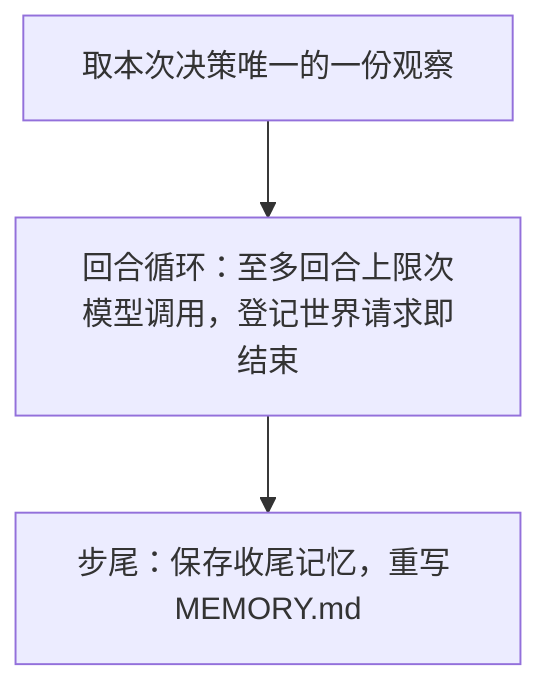

# 设计文档与手册

> 本章属于[去掉 AgentSociety2：开发规格](../SPEC-agentsociety2-removal.md)，读法和叫法见那一页。

## 目标与依据

设计正文是每条规则唯一的家（AGENTS.md「文档维护」：接口和行为先改所属模块正文，再改实现；每条规则只维护一处）。本章给出这次改动在现行文档里的完整改动清单：改哪个文件的哪一行、删还是改、改成什么字。做完以后，现行文档把运行写成 WorldMock 自有的决策循环（裁定 12 的说法），第一次把决策循环与人物回合协议写成 WorldMock 自己的现行规则（提案第六章「文档」末段：这两组规则今天只写在冻结的 `docs/dev/SPEC-as2-integration.md` 与补丁里），并删去所有点名或依赖 AgentSociety2、Ray、`custom/`、补丁重建、人物工作区旧文件、只读问答的条文。

实现的提案条文与裁定：

| 来源 | 本章落实 |
| --- | --- |
| 提案第六章「文档」全部条目 | 【D5】【D6】（10-runtime 章名与决策循环），【D7】（回合协议），【D15】（07-evaluation:135、:147），【D10】（05、09 的工作区与记录格式），【D11】（09:75-76），【D9】（08 的客户端措辞与限流规则），【D8】（只读问答条文），【D12】【D13】（00、01、README、INDEX、手册里的 AgentSociety2 条文） |
| 提案第十一章「要推翻的既往决定」关于 `docs/design/00-overview.md:148,166,172,194` 的一条：框架选型、人物并发方案与设计假设 | 【D12】；裁定 2「推翻」 |
| 裁定 12「改成 WorldMock 自有的决策循环」 | 【D4】 |
| 裁定 2「冻结的旧记录不回写」 | 【D1】：`docs/dev/` 下的历史记录一个字不改 |
| 各章「设计文档」一节列出的事实 | 「接口与文件」逐行给出的改后全文；各行的「依据」一栏写明出自哪一章哪一条 |

清单是这样得到的：在基线 `74f1b949` 上，对 `docs/design/*.md`、`docs/manual/*.md`、`README.md`、`docs/INDEX.md`、`AGENTS.md` 检索 `agentsociety`、`AS2`、`Ray`、`custom`、`patches`、`AGENT.json`、`config.json`、`state.json`、`as2/`、`consolidated`、`reflection`、`state_sha256`、`只读问答`、`AGENTSOCIETY_`、`project-root`、`PersonAgent`、`Society`、`dispatcher`、`actor`、`工作进程`、`LifeEnv`、`sleep_boundary`、`记忆运行时`、`框架`、`LiteLLM`、`驱动进程`、`工作区`、`重建` 与零点任务触发点的说法，再并入 01–07、09 章「设计文档」一节点名的全部行。下表核对提案引用的计数（梳理证据 `.work/agentsociety2-removal/digest/docs-history.md` 的「facts」）：

| 梳理计数 | 行 | 本章处理 |
| --- | --- | --- |
| 直接点名 43 行 | `README.md:4,44,56,59`；`docs/INDEX.md:32`；`00-overview.md:31,89,107,148,166,172,186,194,204`；`01-architecture.md:48,49,172,232`；`05-recording-engine.md:440,615`；`06-agent.md:381,882,892,908,909`；`08-configuration.md:140,161`；`09-io-formats.md:76`；`10-runtime.md:5,8,14,15,22,24,25,43,45,83,84,87,93`；`docs/manual/runtime.md:6,26` | 40 行改写或删除；`README.md:59` 与 `docs/manual/runtime.md:6`（引导命令 `python scripts/bootstrap.py --profile release` 不变）、`06-agent.md:381`（「不用 litellm 或任何 token 计数器」照样成立）三行核对后不改 |
| 间接依赖约 25 行 | `README.md:39,49,67`；`00-overview.md:187`；`01-architecture.md:126,175,195`；`05-recording-engine.md:24,763,766`；`07-evaluation.md:135`；`08-configuration.md:166,167`；`09-io-formats.md:77-78,120`；`10-runtime.md:1,3,12,16,21,30,44,77`；`docs/manual/runtime.md:78` | 全部改写，除了 `10-runtime.md:77` 的节名「原生模型与工具」保留（见「规格阶段的决定」）与 `docs/manual/runtime.md:78`（「人物的 MEMORY.md 总结要同时拖入运行目录」照样成立，05 章） |
| 本章另外找到的行 | `00-overview.md:92`；`01-architecture.md:71,87,225,276,277`；`04-simulation-engine.md:749-752`；`05-recording-engine.md:104-124,157,159,627,768`；`06-agent.md:34-39,61-62,75,76,106,222-224,372,406,729-733,748,878,884,893,895-910`；`07-evaluation.md:34,147`；`08-configuration.md:150,179-180`；`09-io-formats.md:87,93,98`；`docs/manual/evaluation.md:27,30`；`docs/manual/runtime.md:3`；`README.md:31,55,63` | 全部改写或删除，见「接口与文件」 |

基线现行文档里没有一行写决策循环（取调度状态、开轮、收齐、原子提交、没人就绪才推进、每步一个共同检查点），也没有一行写人物回合协议（回合计数、调用身份、证据先后、两种纠错、assistant 的形状）：grep 只在 `10-runtime.md:83` 找到「决策轮核对」一句，它属于要删的框架约束。本章把它们第一次写进 `docs/design/10-runtime.md`「决策循环」与 `docs/design/06-agent.md`「宿主模型协议」的「回合协议」，内容逐条取自[「运行宿主与决策轮」](./01-run-host.md)与[「人物、回合循环与只读问答的删除」](./03-agent-loop.md)，不另加规则。

文档改动不承载行为，所以本章的测试只有文档链接检查、设计汇编和 02 章已有的名字守卫；改动由一个代理在实现工作流里一次写完，与代码同一次合并（分工见[「实施、验收证据与完成判据」](./10-implementation.md)）。

规格阶段已把「接口与文件」的全部改后文字逐处套用到基线文档的副本上核对过（副本里补上 01、03 章要新建的四个源码文件作为链接目标）：每处「替换」的原文在所在行里恰好出现一次，`scripts/documentation_gate.py` 报 `PASSED: 0 problems`，`scripts/build_design_doc.py` 汇编成功，【D3】的命令恰好输出那三行。

## 行为

条款编号【D1】至【D16】供「测试」一节引用。「现行文档」指 `docs/design/*.md`、`docs/manual/*.md`、`README.md`、`docs/INDEX.md`、`AGENTS.md`。

【D1】**改动范围。** 现行文档里恰好「接口与文件」文件表列出的 13 个文件被改动，每个文件只改该表与各文件小节点名的行；`docs/design/02-exchange-engine.md`、`docs/design/03-resource-engine.md`、`AGENTS.md`、`docs/manual/README.md`、`docs/manual/personas.md`、`docs/manual/resources.md`、`docs/manual/rules.md` 一个字节不改。`docs/dev/` 下除本规格目录 `docs/dev/agentsociety2-removal/` 之外一个字节不改（裁定 2：冻结的旧记录不回写）。

【D2】**删掉的名字不留在现行文档里。** `docs/design/`、`docs/manual/`、`README.md`、`docs/INDEX.md` 里没有以 `LifeEnv` 开头的标识符（含 `LifeEnvActor`、`LifeEnvProxy`），也没有 `life_env_actor_class`、`custom.envs`、`custom/envs`、`runtime.framework.read_query`、`runtime/framework/read_query` 五个串（02 章【E1】的文档部分；基线上点名它们的 12 行全部在本章清单里）。

【D3】**残留检查。** 在仓库根执行下面这条命令，输出恰为三行，依次是：`docs/design/03-resource-engine.md` 里「重算文件表和框架化摘要」那一行（「框架化摘要」是目录清单的摘要算法，与 AgentSociety2 无关）、`docs/design/05-recording-engine.md`「运行比对」里新加的「唯一的例外是去掉 AgentSociety2 那次变更声明的四条规则……」那一行、`README.md` 目录树里 `LICENSES/` 那一行。

```sh
grep -n -i -E "agentsociety|\bAS2\b|\bray\b|custom|patches|AGENT\.json|config\.json|state\.json|as2/|consolidated|state_sha256|只读问答|只读系统层|project-root|PersonAgent|Society|\bdispatcher\b|actor|工作进程|LifeEnv|sleep_boundary|记忆运行时|框架" docs/design/*.md docs/manual/*.md README.md docs/INDEX.md AGENTS.md
```

`dispatcher` 两侧带 `\b`：忽略大小写时 `LLMDispatchError` 里的 `DispatchEr` 也是这串字母，而 `LLMDispatchError` 是现行的类名，`08-configuration.md`「模型客户端」一节写它。

【D4】**对外的说法。** `README.md` 的首段与 `docs/design/00-overview.md`「解决方案」的第一条都含「WorldMock 自有的决策循环」这几个字；现行文档不再写「由 AgentSociety 2 驱动」「复用成熟的 Agent 框架」（裁定 12）。

【D5】**第 10 章的章名。** `docs/design/10-runtime.md` 文件名不变（`scripts/build_design_doc.py:20-24` 的 `CHAPTERS` 不改），一级标题恰为 `# WorldMock 产品设计说明书 — 运行装配与决策循环`；指向它的五处链接标签（`docs/INDEX.md:32`、`docs/design/00-overview.md:187`、`docs/design/01-architecture.md:126`、`:195`、`docs/design/09-io-formats.md:120`）都是「运行装配与决策循环」；现行文档里不再出现「运行与框架集成」。

【D6】**决策循环只写在一处。** `docs/design/10-runtime.md` 的二级标题恰为依次「运行装配」「决策循环」「运行与恢复」「原生模型与工具」「安装与工程放行」；「决策循环」下的三级标题恰为依次「一个进程，一个事件循环」「三种启动顺序」「步序与同秒再决策」「共同检查点」「推进与结束」「身份」「零点任务的触发点」「中止与停止」「状态阶段」「关闭与模型客户端的寿命」，正文与「接口与文件」给出的全文逐字相同。决策轮身份 `round_id`、`decision_id` 的格式只写在这里；`04-simulation-engine.md`、`05-recording-engine.md`、`06-agent.md` 讲到零点任务触发点或每步一个共同检查点的句子都指向这一节（【D14】）。

【D7】**回合协议只写在一处。** `docs/design/06-agent.md`「宿主模型协议」末尾有三级标题「回合协议」，前面是显式标识 `<a name="agent-回合协议"></a>`，正文与「接口与文件」给出的全文逐字相同；模型调用身份 `call_id` 的格式只写在这里。`06-agent.md:87` 的动作身份句不动，它仍是 `action_id` 格式的唯一出处。

【D8】**只读问答的条文全部删去。** `06-agent.md:61-62`、`:76` 后半句、`:106`、`:372` 末句、`:406` 的分句、`:884` 的「只读问答与」，`09-io-formats.md:87` 的分句与 `:93`、`:98` 两处「只读空记忆层」都按「接口与文件」删改；`06-agent.md:106` 的位置改写一句提示指纹的组成（03 章【A28】）。

【D9】**模型客户端与限流规则。** `docs/design/08-configuration.md`「模型配置与凭据」节末有三级标题「模型客户端」，前面是显式标识 `<a name="configuration-模型客户端"></a>`；`:140-141` 的计数内退避写成限流只按 litellm 的 `RateLimitError` 类型判定，现行文档里不再出现「限流与其他过载」；`:150` 写明每次发送显式传 SDK 重试 0 次与请求超时 300 秒；`:161`、`:166-167` 不再写 LiteLLM 能力、驱动与环境 actor（04 章【M1】–【M8】【M17】【M18】，01 章【H38】）。

【D10】**人物工作区与记录格式。** `09-io-formats.md` 末尾有二级标题「人物工作区」，写路径、两个成员、`MEMORY.md` 模板与 4000 字上限、条目文件的十个键、编号、合并与严格读回；`05-recording-engine.md` 写 `memory_updated` 的十一个键与要求、恢复时的一次校验、查看器路径 `agents/agent_<编号>/MEMORY.md`、运行比对去掉 `AGENT.json` 两项屏蔽并加上四条规则的例外句（05 章【W1】–【W20】，09 章【T11】–【T22】）。

【D11】**代码身份的范围。** `09-io-formats.md:75-76` 写成 `code_sha256` 覆盖 `src/` 下全部 Python 源码与根目录的 `pyproject.toml`、`uv.lock`，项目根由已导入的 `worldmock` 包推出（07 章【I8】【I9】）。

【D12】**推翻的既往决定。** `00-overview.md:148`（背书表）、`:166`（设计决策「基础框架」）、`:172`（人物并发）、`:194`（设计假设）按「接口与文件」改写，`:107`（缩写 AS2）与 `:204`（参考文献）删除；改后没有一行把 AgentSociety 2 写成框架、并发方案或可复用的决策循环（提案第十一章关于 `00-overview.md` 的一条，裁定 2）。

【D13】**安装、手册与入口。** `README.md` 不再写 `custom/`、`patches/`、补丁重建、Git 前提与中文字体，目录树写 `src/worldmock/` 与 `LICENSES/`；`docs/manual/runtime.md` 不再写中文图表字体与 `AGENTSOCIETY_*`、`PYTHONPATH`；`docs/manual/evaluation.md` 不再写 `memory_md_texts` 能传入的记忆文本；`docs/INDEX.md:32` 的说明是「运行装配、决策循环、生命周期、命令行、安装和恢复」（07 章【I1】【I3】【I5】【I13】【I22】【I23】【I27】）。

【D14】**零点任务触发点的说法一致。** `04-simulation-engine.md:749-752`、`06-agent.md:222-224`、`:729-733` 里补做回顾与计划的时机都写成「运行宿主每次提交共同检查点之后（新建运行的初始检查点、反事实分支的干预检查点与每一步的检查点），以及普通恢复启动时、首次决策之前」，并指向「决策循环」；现行文档里不再出现「普通恢复的初始化里」「普通恢复在初始化时」（01 章【H21】【H22】）。

【D15】**行为评估。** `07-evaluation.md:34` 的协议门禁没有示例身份残留一项；`:135` 不再点名 `custom`；`:147` 写成每次模型调用都分配新的 NNNN（03 章【A12】，07 章【I13】【I27】）。

【D16】**门禁通过。** 在工作树里用工作树自己的解释器（07 章【I28】，`.work/wt/as2-removal/.venv/Scripts/python.exe`）执行 `python scripts/documentation_gate.py`，打印 `[documentation] PASSED: 0 problems`、退出码 0；执行 `python scripts/build_design_doc.py`，退出码 0 并打印 `[design-doc] wrote …`。这个脚本只有 `--output` 与 `--pdf` 两个参数（`scripts/build_design_doc.py:475-479`），没有 `--check`；根目录 `CLAUDE.md` 里的 `--check` 写法是过时的。

## 接口与文件

本章不新增、不改动任何代码接口。下表是全部被改动的文件；之后每个文件一节，先列位置、动作与依据，再在代码块里逐处给出改后全文。行号都指基线 `74f1b949`。「改为」给出整行或整段的改后全文；「替换」给出一段原文与它的新文字，其余字不动；原文分几行写的段落，改后可在句号处断行，断在哪里不影响含义，也不进入任何检查。

| 路径 | 动作 | 内容 |
| --- | --- | --- |
| `docs/design/10-runtime.md` | 改写全文 | 章名、五个二级标题、新写「决策循环」，见下文全文 |
| `docs/design/06-agent.md` | 修改 | `:34-39`、`:61-62`、`:75`、`:76`、`:106`、`:222-224`、`:372`、`:406`、`:729-733`、`:748`、`:878`，`:880-910` 整节改写（含新写「回合协议」） |
| `docs/design/05-recording-engine.md` | 修改 | `:24`、`:104-124`、`:157`、`:159`、`:440`、`:615`、`:627`、`:763`、`:766`，`:768` 之后插入一行 |
| `docs/design/09-io-formats.md` | 修改 | `:75-78`、`:87`、`:93`、`:98`、`:120`，文末新加「人物工作区」一节 |
| `docs/design/08-configuration.md` | 修改 | `:140-141`、`:150`，`:153` 之后新加「模型客户端」一节，`:161`、`:166-167`、`:179-180` |
| `docs/design/00-overview.md` | 修改 | `:31`、`:89`、`:92`、`:148`、`:166`、`:172`、`:186`、`:187`、`:194`，删 `:107`、`:204` |
| `docs/design/01-architecture.md` | 修改 | `:48-49`、`:71`、`:87`、`:126`、`:172`、`:175`、`:195`、`:225`、`:232`、`:276`、`:277` |
| `docs/design/04-simulation-engine.md` | 修改 | `:749-752` |
| `docs/design/07-evaluation.md` | 修改 | `:34`、`:135`、`:147` |
| `docs/manual/runtime.md` | 修改 | `:3`、`:26` |
| `docs/manual/evaluation.md` | 修改 | `:27`、`:30` |
| `README.md` | 修改 | `:4`、`:31`、`:39`、`:44`、`:55-56`、`:63`、`:67`，删 `:49` |
| `docs/INDEX.md` | 修改 | `:32` |
| `docs/dev/agentsociety2-removal/spec/08-design-docs.md` | 新建 | 本章 |

### docs/design/10-runtime.md

整份文件换成下面的全文（96 行换成新文本）。「运行与恢复」「原生模型与工具」「安装与工程放行」三节里没有提到的行与基线逐字相同，已一并写进全文。

| 基线位置 | 动作 | 依据 |
| --- | --- | --- |
| `:1` | 章名改为「运行装配与决策循环」 | 提案第六章「文档」；【D5】 |
| `:3-26`「实际框架边界」 | 节名改为「运行装配」；`:5` 改写为 WorldMock 自有的决策循环；`:7-8` 删去进程配置与工作进程导入路径，写凭据读取次序；流程图改为纯加载、人物冻结输入、运行宿主、LifeAgent 与 LifeEngine；`:21` 「框架源码身份」改为「代码身份」；`:22` 改为唯一的模型客户端；删 `:24-25`；`:23`、`:26` 合成一句 | 01 章【H1】【H38】，02 章「设计文档」`:5`、`:16`、`:24-25`，04 章 `:22`、`:24-25`，07 章【I5】【I6】【I9】 |
| 新加「决策循环」 | 十个三级小节 | 01 章【H1】–【H35】，02 章【E3】【E4】【E10】–【E14】，06 章【F1】【F5】–【F13】 |
| `:30` | 改为按「决策循环」的新建顺序启动 | 01 章【H26】，只引用不重述 |
| `:34` | 「含环境一侧的零点日计划」改为「含零点的日计划与回顾」 | 零点任务归运行宿主（01 章【H24】） |
| `:42-45` | 删去 Ray 任务错误、颜色序列与穿过 Ray 的整句，阶段写入方改为运行宿主 | 06 章【F14】【F15】，01 章【H33】 |
| `:82-85` | 「LifeEnv」改为 `LifeEngine`；删去决策轮核对只返回第一条与原生 Society 时钟两句；写提交返回本轮全部结果 | 02 章【E14】，01 章【H11】 |
| `:87` | 改写为引擎方法 `LifeEngine.read_query` 与核对次序；删去环境代理、actor 子类、补丁与 init 核对 | 02 章【E5】–【E8】【E22】 |
| `:93` | 删去「及 AS2 补丁」 | 07 章【I1】 |

````markdown
# WorldMock 产品设计说明书 — 运行装配与决策循环

## 运行装配

WorldMock 自有的决策循环驱动整次运行：runner 负责准入、身份冻结与分支恢复，运行宿主 `RunHost` 驱动决策轮，每个决策新建的 `LifeAgent` 经模型客户端请求模型，`LifeEngine` 是唯一写入者。
完整环境纯加载先核对人设、运行配置、目录与模型元数据（新运行读实际服务，恢复与重放读父运行清单冻结的那一份）；运行资产只能在这些核验通过后创建。
模型客户端使用 config.toml 声明的服务与模型，凭据从声明的环境变量读取，不能换到另一个模型或端点。
运行装配不写进程环境变量，也不改导入路径。命令可以在任何目录启动，只需要 `model.api_key_env` 指的那个变量；恢复先打开父运行、取到检查点并校验检查点世界，然后才加载环境、读取凭据和复制任何文件，凭据缺失时不建分支目录；父运行的数据库、清单或检查点不对时不访问网络、不建分支目录。
运行宿主建立或打开引擎时，用 runner 已加载的那份完整环境，不再读第二遍。


模型服务的 metadata_url 必须与实际 base_url 属于同一服务，模型唯一匹配且容量满足声明。
模型、预算、实际元数据、阶段参数与代码身份共同冻结；恢复逐项核对，不用静态容量估计。
生成请求与零点的日计划、回顾共用整次运行唯一的模型客户端和冻结身份，输出纠错是独立逻辑请求。
模型客户端、停放与单次发送整次期限的规则，以及两种服务失败预算的详细合同，归[配置](08-configuration.md)。

## 决策循环

### 一个进程，一个事件循环

一次 `worldmock run`、`resume` 或 `replay` 只有一个进程、一个事件循环：命令行的 `asyncio.run` 驱动整次运行，`LifeEngine`、每个 `LifeAgent`、模型客户端与零点任务都在这个事件循环里执行。
运行不另起子进程、进程池、线程池或嵌套的事件循环；进程里唯一的后台线程是驱动心跳。
运行宿主是 `src/worldmock/runtime/lifecycle/run_host.py` 的 `RunHost`，三种启动、步进、整次运行与关闭都是它的协程。

唯一写入者由程序结构保证，不加锁：引擎的公开方法全部同步执行；运行宿主逐个等待；零点任务只在引擎没有开着的决策轮时由运行宿主调用。
一轮里有几个人物就绪，就按引擎给出的就绪顺序逐个决定：前一个人物决定完，才新建下一个人物，所以事件序号可复现。v1.0 只有一个人物。
需要多人物并发时，要先设计按决策缓冲证据、提交时按序落库，再改这一节。
每个决策恰好执行一次，出错不重跑。

运行宿主为每个决策新建一个 `LifeAgent`，决定完就丢弃；跨决策共享的只有引擎、模型客户端、每个人物的记忆存储和运行开始时建好的人物冻结输入，见[人物](06-agent.md#agent-回合协议)「回合协议」。
人物拿到的环境句柄就是 `LifeEngine` 本身，只用 `observe`、`submit_action`、`read_query`、`record_model_exchange`、`record_memory_update` 五个同步方法；人物模块不导入引擎，`src/worldmock` 里只有运行宿主导入引擎门面。
`observe` 与 `read_query` 返回深拷贝，人物改动返回值不影响引擎；引擎在调用之内把交给它的对象转成副本或写进 SQLite，之后不持有它们的引用。

### 三种启动顺序

| 启动 | 依次 |
| --- | --- |
| 新建（run） | 建每个人物的工作区目录，此时为空，已存在即失败（见[状态与序列化](09-io-formats.md)「人物工作区」）；建引擎；核对配置的起始时刻与引擎时钟相同，不同时先关闭引擎，再以 `ProtocolError("Run host start time disagrees with the engine")` 停止，不登记运行故障；写初始检查点；补回顾、零点计划 |
| 普通恢复（resume） | 打开引擎；在首次决策之前补回顾、零点计划；不写检查点 |
| 反事实（replay） | 打开引擎；施加干预；核对收据的干预摘要与干预文件的摘要相同、模拟时间不变、世界版本恰好加一，不成立时分别以 `RuntimeError("Environment confirmed a different counterfactual identity")`、`RuntimeError("Counterfactual intervention changed simulation time")`、`RuntimeError("Counterfactual intervention did not advance one world version")` 停止；写干预检查点；补回顾、零点计划 |

### 步序与同秒再决策

运行宿主的一步依次：

| 序 | 动作 |
| --- | --- |
| 1 | 取调度状态 |
| 2 | 有人物就绪时执行一个决策轮：由调度状态形成决策上下文，开轮，按就绪顺序逐个新建人物并等它决定，原子提交；提交返回本轮全部结算结果，运行宿主不读 |
| 3 | 再取一次调度状态 |
| 4 | 没有人物就绪、且引擎给出了下一个事件边界时，把时钟推进到这个边界 |
| 5 | 步数加一 |
| 6 | 写一个共同检查点，随后补回顾、零点计划 |

决策不耗模拟时间。提交之后仍有人物就绪时不推进，直接写检查点，下一步在同一秒再开一轮；新一轮的世界版本已加一，决策轮身份与上一轮不同。
调度状态里有运行宿主没有冻结输入的人物时，在开轮之前以 `RuntimeError("Environment returned unknown ready agents: [<人物编号>, …]")` 停止。

### 共同检查点

每一步恰好写一个共同检查点，只推进不决策的步也写；新建运行另有初始检查点，反事实分支另有干预检查点，普通恢复启动时不写。
写检查点时取每个人物工作区的快照，连同引擎状态交给引擎提交；人物集合由引擎核对。快照与检查点的格式归[记录引擎](05-recording-engine.md)「冻结输入、检查点与分支」。

### 推进与结束

推进的目标只取引擎给出的下一个事件边界，推进量是它与当前时刻之差；边界与推进量由引擎核对。
运行宿主只有一个时钟：它不保存当前时刻，每次从引擎读；`result.json` 的 `current_time` 与运维日志 `RUN_ENDED` 的模拟时刻取引擎时钟，`RUN_CRASHED` 在引擎打开时也取它、引擎没有打开时取准备阶段定下的起始时刻（新建是配置的开始时刻，恢复与重放是检查点的时刻）；`step_count` 是这个进程里运行宿主完成的步数，启动不计。
引擎时钟到达结束时刻时运行结束；结束时刻本来就在引擎的边界候选里，运行宿主不另核边界是否越过它。

### 身份

决策轮身份与决策身份由运行宿主形成：

| 身份 | 格式 |
| --- | --- |
| `round_id` | `{run_id}:round:{epoch}:{world_state_version}`：`run_id` 是本运行的身份（恢复与重放分支是子运行的身份），`epoch` 是调度状态当前时刻的 UTC 秒，`world_state_version` 是调度状态的世界版本 |
| `decision_id` | `{round_id}:agent:{agent_id}:order:{order}`，`order` 是人物在就绪顺序里的下标，从 0 起 |

`round_id` 与人物在轮内的次序写在 `decision_started` 里，`decision_id` 写在全部决策事件里。决策上下文的观察时刻就是调度状态的当前时刻（场景时区）。
动作身份与模型调用身份由人物一侧形成，见[人物](06-agent.md)「提示与工具」与[人物](06-agent.md#agent-回合协议)「回合协议」。

### 零点任务的触发点

| 时机 | 依次 |
| --- | --- |
| 每个共同检查点提交之后：新建运行的初始检查点、反事实分支的干预检查点与每一步的检查点 | 日、月、年回顾，零点计划 |
| 零点边界的推进提交之后 | 日、月、年回顾，零点计划，再判定这一秒的唤醒 |
| 普通恢复启动时、首次决策之前 | 日、月、年回顾，零点计划；不写检查点 |
| 决策轮开着时 | 从不 |

没有待办（运行已到终点、没有待生成的期次、没有缺当日计划的人物）时，零点任务不调用模型客户端，不写请求证据与调用运维日志。
新登记的回顾与计划由下一个共同检查点封存。回顾与计划的内容归[人物](06-agent.md)「日、月、年回顾」与「零点计划」。

### 中止与停止

人物一侧的异常（含新建人物时抛出的）原样到达运行宿主，不包装、不改类型。
开轮、人物决策与提交三处任一抛出时，运行宿主只在引擎的决策轮仍开着时中止这一轮：中止的决策轮不执行请求，中止原因是原异常的 `repr`，写进中止产生的每条 `action_result` 的 `message`、`decision_round_aborted` 的 `error` 与 `run_failed` 的 `error`。
开轮之前就失败，或提交已经关闭本轮之后才抛出时，不中止。后者只发生在同秒决策次数用完时：提交在同一事务里写下 `decision_budget_exhausted` 与 `run_failed`，再抛 `ProtocolError("decision_budget_exhausted")`；之后不再写任何事件，运行以这个 `ProtocolError` 停下。
其余故障（取调度状态、推进、共同检查点、零点任务、反事实干预、开轮之前的失败、关闭引擎）登记 `run_failed`，原因同为原异常的 `repr`，库里已有 `run_failed` 时不再写；登记之后把原异常原样传出。引擎尚未建立或已经关闭时不登记。
中止或登记本身失败时，两项异常都保留：`ExceptionGroup("Decision round and abort both failed", …)` 或 `ExceptionGroup("Run and failure recording both failed", …)`。
`KeyboardInterrupt` 与取消不中止、不登记，原样传出。

### 状态阶段

运行宿主用 `status.json` 的 `phase` 写四个阶段：开轮之前写 `deciding`，提交之前写 `resolving`，每次写共同检查点之前（含初始与干预检查点）写 `checkpointing`，每次推进之前写 `advancing`。
零点任务不另写阶段；普通恢复启动时的零点任务不写任何阶段。`completed`、`failed`、`interrupted` 由命令行写。

### 关闭与模型客户端的寿命

整次运行恰有一个模型客户端：runner 在运行的事件循环里、驱动心跳之内，用运行清单冻结的 `stage_model_identity` 与读到的凭据构造它，交给运行宿主；人物的每个模型回合、零点计划与回顾都经它发送，没有按角色另建的客户端。
运行结束时（正常、故障或中断），运行宿主在同一个事件循环里先关闭引擎，再关闭模型客户端，各一次；引擎没有建立时也关闭模型客户端。关闭引擎失败时先登记运行故障。
两步都失败时两项异常保留在 `ExceptionGroup("Run host close failed", …)` 里；运行本身已经失败而关闭又失败时，两者保留在 `WorldMock run and cleanup failed` 异常组里。

## 运行与恢复

run 创建单人世界与人物工作区，按「决策循环」的新建顺序启动，再由运行宿主推进实际决策边界。
人物卡片由 persona.toml 直接构造，新建运行不为它发任何模型请求。
resume 从父共同检查点恢复到新分支，复制完整人物快照及冻结环境，保留活动选择、进度、订单和回调幂等标记。
replay 从同一认证检查点构造干预分支，沿用冻结模型与输入身份；只读历史查询不访问生成服务。
run、resume、replay 成功后写 `result.json`，其中 `token_stats` 是数组，每个模型一行 `{model, responses, responses_with_usage, input_tokens, output_tokens, total_tokens}`，由已落盘的模型响应累计，与 `worldmock status` 的 `observed_model_usage` 是同一个函数的结果，含零点的日计划与回顾；恢复与重放的数字覆盖分支库的整段历史，含继承自父运行的响应。

运行中可以执行 `worldmock status`、`scripts/inspect_run.py` 与 `scripts/render_day.py`：它们不开长读事务（各类事件条数
走类型表达式索引，墙钟时间取第一条与最后一条事件，`inspect_run.py` 按事件序号窗口分页），最长的一条语句是 `status`
的模型用量合计，只读经类型索引找到的模型响应。引擎的足迹库连接遇到读者持锁时最多等 120 秒再提交，而不是 5 秒后失败；
日志模式仍是回滚日志，运行结束后运行库是一个自足的文件。
恢复与重放怎样复制父库见[记录引擎](05-recording-engine.md)「冻结输入、检查点与分支」。

失败诊断：运行目录的 `status.json` 恰含 `status`、`phase`、`error_type` 与 `error_message`，是规范 JSON。`error_type` 是使运行停下、原样传到命令行的异常的类名；
`error_message` 是一行可读的失败原因：异常组逐项以「 | 」连接，其余为「类型名: 文本」，连续空白折成一个空格，不截断。运行宿主写阶段时与成功结束时这两项为 null。

心跳：驱动进程在 run、resume、replay 运行期间先写一次、之后每 60 秒原子重写 `heartbeat.json`，是规范 JSON，恰含
`heartbeat_at`、`pid`、`started_at`（UTC 的 ISO 8601 文本）。写失败记 `Driver heartbeat write failed` 并继续；运行结束
文件保留。

`worldmock status` 另报告：
- `heartbeat`：心跳文件三项加距今秒数 `age_seconds`，没有文件为 null；内容不是 JSON 对象或 `heartbeat_at` 不带时区时报
  `Run heartbeat is invalid`；
- `liveness`：没有 `status.json` 为 null；不是 running 为 `stopped`；running 而心跳缺失或超过 180 秒为 `stale`，表示驱动
  进程已不在，不表示世界停在哪里；最后一条事件是模型请求为 `waiting_for_model`，即停放或长思考；其余为 `running`；
- `waiting_for_model_since`：最后一条事件是模型请求时它的落盘时刻，否则为 null；
- `wall_time.last_event_age_seconds`：最后一条事件距今秒数。

墙钟在 `running` 与 `waiting_for_model` 时止于此刻，失联时止于最后一次心跳，其余止于最后一条事件。首末事件按主键读取。
心跳新鲜而最后一条事件很旧，表示驱动还在、环境或模型调用很慢；零点计划与回顾的请求与响应一起落盘，它们的停放显示为 running。
判断只看心跳的新旧，`pid` 只作参考：Windows 上探测进程会结束它。

写文件：原子写在 Windows 上遇到拒绝访问（同步或杀毒软件短暂占用目标）按 0.05 秒起倍增的八个间隔重试，共约 13 秒，
第九次仍被拒绝才失败（issue #7）；其他平台与其他错误立即失败。状态、心跳、检查点素材、工作区快照与导出都经它写。

运维日志：`logs/ops-*.jsonl` 只用于定位长运行问题，不参与审计：模型往来记录 `MODEL_EXCHANGE` 带证据写入耗时 `commit_ms`；
另有传输等待 `MODEL_TRANSPORT_WAIT`（失败发送数、累计等待毫秒数与最后的错误链）、协议拒绝 `MODEL_PROTOCOL_REJECTED`（响应
阶段带协议纠错时的错误码）与零点计划调用耗时 `PLAN_DAY_CALL`、回顾调用耗时 `MEMORY_DIGEST_CALL`。

用户通过 `--environment` 显式指定完整环境根，删除 `--scenario` 生活运行输入和地图生成命令。
环境验证、导出和状态查询使用原有公开入口；独立行为分析由仓库工具读取事实。
命令是 `validate`、`run`、`resume`、`replay`、`status`、`export`，没有 `profile` 子命令：
人物卡片没有编译、一致性检查或覆盖率检查这几步，`worldmock validate` 检查 persona.toml 的每个字段，
也检查由它构造的卡片文本不超过 600 汉字，见[人物](06-agent.md)；通过 `validate` 的人设表不会在 run 构造卡片时被拒绝。
失败记录英文诊断，实际存在的输出目录才写失败状态；输入拒绝不能留下假的运行资产或成功回执。

## 原生模型与工具

八个原生工具的清单、批次形状、七层提示、最后回合只读查询控制、原生 tool_calls 纠错和截断纠正归[人物](06-agent.md)，
两个开始工具 start_main_activity、start_side_activity 的参数与受理归[模拟引擎](04-simulation-engine.md)。
工具定义指纹覆盖全部八个原生工具。
`LifeEngine` 再次核验请求、人物身份、已提交版本和观察时刻。环境为每条开始调用登记一条动作，一个决策至多两条，
两条结果都落库；提交按结算次序返回本轮全部结果，开始组的两条都返回。
只读查询不代替模型活动、不消耗世界随机流。

只读查询是引擎方法 `LifeEngine.read_query`，人物直接调用。它只接受回看任务（`recall_task_summary`）与检索记忆（`search_memory`）两个工具名与各自的请求类型，别的组合是协议错误；依次核对决策上下文、本轮仍开着、工具名与请求类型、本次决策恰有一份冻结观察，哪一步不过就以协议错误停止；业务拒绝以 `error_code`、`reason`、`fix`、`items`、`unmet` 五个字段返回。回答只读本次决策冻结观察所在事件序号及以前的事件，不写事件、不改世界。人物侧与引擎侧的工具集合用同一份 `REQUEST_MODELS`，二者一致由单元测试核对，运行时不核对。

模型服务也可以是开发工具在本机起的录音应答服务（`scripts/recorded_response_run.py`）。它从运行冻结的输入素材复原一份输入，只把 config.toml 的 `base_url` 与 `metadata_url` 改到 127.0.0.1，凭据变量给占位值，真实密钥不进入子进程；运行代码不为它留任何入口或开关。

## 安装与工程放行

使用仓库锁定 Python 与依赖，先核对已有库实际能力，再决定新增组件。
`python -m pytest tests` 是统一完整放行入口，不允许用 skip 或 xfail 满足验收。
验证保持模块边界、生产代码风格、当前文档链接、分支覆盖率及有效源码变异检查。
测试与覆盖率执行报告、安装回执和设计 HTML 放在 .work；当前测试只消费 tests 中的输入、期望和必要基线。
````

### docs/design/06-agent.md

| 基线位置 | 动作 | 依据 |
| --- | --- | --- |
| `:34-39` | 改为下文全文（六行换六行） | 03 章「设计文档」`:34-39`，05 章「设计文档」`:34-39`，05 章【W14】 |
| `:61-62` | 删除这两行（一句） | 03 章【A27】 |
| `:75` | 替换 | 02 章「设计文档」`:75` |
| `:76` | 删去末句 | 03 章【A27】 |
| `:106` | 改为一句提示指纹（前后空行保留） | 03 章【A27】【A28】 |
| `:222-224` | 改为下文全文 | 01 章【H21】【H22】，【D14】 |
| `:372` | 删去末句 | 03 章「设计文档」`:372` |
| `:406` | 删去一个分句 | 03 章「设计文档」`:406` |
| `:729-733` | 改为下文全文 | 05 章「设计文档」`:729`，01 章【H21】【H22】 |
| `:748` | 替换一段 | 03 章与 05 章「设计文档」`:748` |
| `:878` | 替换 | 02 章「设计文档」`:878` |
| `:880-910` | 整节改为下文全文，含新写「回合协议」 | 03 章【A3】–【A25】，04 章「设计文档」`:882`、`:892`，05 章【W15】【W16】，06 章【F1】–【F4】 |

````text
:34-39 改为
卡片的两份派生物在每次运行开始时（新建、普通恢复、反事实）由冻结的 persona.toml 构造：结构化卡片 `persona_card_struct`（去掉当前处境）供人设层使用，
卡片文本 `persona_card` 去掉首尾空白后是 `MEMORY.md` 的「身份」段；日回顾的「人物卡片」输入由环境一侧从 persona.toml 构造（`render_card(persona_card(persona))`），与卡片文本逐字相同（见「进度、待办与记忆」的「日、月、年回顾」）。卡片文本是确定性中文渲染，最多 600 汉字，不截断：
加载 persona.toml 时就用整张表构造一次卡片文本，超出的人设表以 `PERSONA_INVALID` 拒绝，
所以 `worldmock validate` 通过的人设表在运行开始时一定写得出卡片；人设层用的字段都在卡片文本里，汉字数不会比它多。
两份派生物连同 persona.toml 的 `name` 与运行清单的 `stage_model_identity` 组成 LifeAgent 的冻结输入，不写进人物工作区。
恢复和重放不比对工作区里的卡片：persona.toml 与父运行的一致由运行清单的 `persona_sha256` 核对，不一致时以 `IntegrityError("Runtime environment identity mismatch")` 停止。

:61-62 删除
（两行原文「只读问答的 user 是人设层与记忆层两层……（形状见[状态与序列化](09-io-formats.md)「提示层的机器形状」）。」整句删去；:60 之后直接接 :63）

:75 替换
「由 `LifeEnv.read_query` 当场回答」→「由 `LifeEngine.read_query` 当场回答」

:76 改为
search_memory 是人物唯一的记忆工具，见「进度、待办与记忆」的「检索记忆」。

:106 改为
提示指纹 `prompt_sha256`（运行清单 `model_identity` 的一项）是生活系统层原文与七层 Schema（`LAYER_SCHEMAS`）的摘要；系统层只有生活决策这一份。

:222-224 改为
零点计划是运行时为缺当日计划的人物做的一次独立模型调用，不经人物，不是决策：零点推进之后先做日、月、年回顾（见「进度、待办与记忆」的
[日、月、年回顾](#agent-日月年回顾)），再做零点计划，最后判定这一秒的唤醒；运行宿主每次提交共同检查点之后（新建运行的初始检查点、反事实分支的干预检查点与每一步的检查点），
以及普通恢复启动时、首次决策之前，也先补回顾、再做计划，触发点见[运行装配与决策循环](10-runtime.md)「决策循环」。

:372 改为
恢复与重放分支里都相同，因为分支从同一环境加载运行配置并核对配置摘要。

:406 改为
  它在同秒链里时断链、改用新快照，链的规则见「提示与工具」的同秒续接段落。条目全文不受兜底影响。

:729-733 改为
回顾是运行时在零点为每个人物做的独立模型调用，不经人物，不是决策，不读写人物工作区与记忆存储，不写观察、决策开始或记忆更新。
三级各自成期：日回顾的期是一个本地日，月回顾是一个日历月，年回顾是一个日历年。零点边界（不是运行终点）的推进提交之后依次做
日回顾、月回顾、年回顾、零点计划，最后判定这一秒的唤醒；月初零点的月回顾读的是刚登记的上个月最后一天的日回顾，年初零点的年回顾读的是
刚登记的十二月月回顾。运行宿主每次提交共同检查点之后（新建运行的初始检查点、反事实分支的干预检查点与每一步的检查点），以及普通恢复启动时、首次决策之前，按同一次序补做（触发点见[运行装配与决策循环](10-runtime.md)「决策循环」）；运行到终点时都不做，所以运行的最后一天
没有日回顾，终点恰在零点时那个零点不生成任何一级回顾。决策轮进行中从不做回顾。

:748 替换
「与新建运行写进工作区 profile 的 `persona_card` 逐字相同」→「与运行开始时交给 LifeAgent 的卡片文本逐字相同」

:878 替换
「检索由 `LifeEnv.read_query` 交给生活引擎的 `search_memory`」→「检索由 `LifeEngine.read_query` 交给生活引擎的 `search_memory`」
````

`:880-910` 换成下面的全文（`:910` 的最后一句保留在步尾一段之后）：

````markdown
## 宿主模型协议

生成模型调用由 WorldMock 的模型客户端承载，见[配置](08-configuration.md#configuration-模型客户端)「模型客户端」。实际服务元数据提供总上下文容量和输出上限；
发送前上下文适配及输出上限均使用冻结实际元数据，没有静态模型容量表。
人物一次决策每个模型回合的输出上限是引擎固定的 16,000 与实际服务输出上限中较小的一个，思考与回答共用；截断后的那次重试用同一个数，零点计划与回顾各用自己的 8,000。这个数是引擎固定值，不在 `config.toml` 里。
普通失败和传输失败只消耗对应的一种预算；计数用尽后传输失败与限流停放重发同一请求，规则见[配置](08-configuration.md)「模型配置与凭据」；身份或参数错误立即失败。
每次模型往来的响应与失败证据在信封 `data` 顶层带 `transport_attempts`：这次调用在结果之前失败的每一次发送，按顺序各一项
`{attempt, error, failed_after_ms, wait_ms}`，依次是发送序号、根因异常链（只有类型名）、距第一次发送的毫秒数、到下一次
发送的等待毫秒数（结束调用的那次为 null）。一次就成功时是空数组；请求证据不带它，带了以
`Model request evidence must not carry transport attempts` 拒绝，字段或序号不对以 `Model exchange transport attempts are invalid` 拒绝。
它不进 `response`，所以后续提示从已保存响应重建的内容（同秒续接、自述、进度层的被拒记录）与没有断网时逐字相同。零点计划的
响应与失败证据同样带它。
协议纠错与输出截断纠正均与模型客户端的服务重试分别计数。截断的错误日志只在真实出现截断回合时写。
模型身份、两类重试预算与回合上限冻结在运行清单的 `stage_model_identity`；卡片与名字在每次运行开始时由冻结的 persona.toml 构造，不在人物工作区里；恢复与重放读同一份清单和同一份 persona.toml，逐项一致。

人物的一次决策按观察、回合、步尾三段进行，一次决策恰有一份冻结观察。
冻结观察是存储层解码后的已提交观察（见[记录引擎](05-recording-engine.md)「事件与来源」的观察分件）。
它与 `observe` 交给宿主的观察，去掉只给宿主的 `progress_layer`、`progress_meta`，以及 `observe` 之后附上的
`observation_event_id` 与同秒续接 `continuation` 之后，规范 JSON 逐字节相同。宿主只用内存里的观察生成提示。



步尾在回合循环登记了世界请求之后、这一轮提交之前进行：先取写入前 `MEMORY.md` 的摘要（文件还不存在时为 null），再渲染新视图（「身份」段是卡片文本去掉首尾空白，「已核验经历」是本决策观察里的已核验经历），然后写入本决策收尾写下的主观条目，最后写 `MEMORY.md`。
有新建或合并的条目、或 `MEMORY.md` 的摘要变了时，经引擎登记一条 `memory_updated`（见[记录引擎](05-recording-engine.md)「事件与来源」）；两个文件的格式、视图上限与合并规则见[状态与序列化](09-io-formats.md)「人物工作区」。回合循环出错时不做步尾。
人物一侧的记忆不调用模型：没有按条数或重要度触发的记忆巩固，也没有睡醒时的就寝反思，主观摘要从不更新，`MEMORY.md` 的「人物自述（未经核验）」一段恒为「暂无人物自述。」。
往日的整理由环境在零点生成的回顾承担（见「进度、待办与记忆」的「日、月、年回顾」）。

<a name="agent-回合协议"></a>
### 回合协议

LifeAgent（`src/worldmock/agents/life_agent.py`）是数字人的代码实现，回合循环在 `src/worldmock/agents/protocol/react_loop.py`。运行宿主为每个决策新建一个实例，决定完就丢弃：人物在决策之间没有任何内存状态，同秒续接只经观察里的续接链进来。
实例的冻结输入见「人物身份与画像」：回合上限是 `stage_model_identity` 的 `max_react_turns`，请求的 `model` 与 `max_tokens` 取它的 `requested_model` 与行动阶段的 `max_tokens`，容量预检用它的实际元数据；人设层的 `identity.name` 等于 persona.toml 里 `name` 的原字符串，不去空白、不改写。
人物只经 `LifeEngine` 的 `observe`、`submit_action`、`read_query`、`record_model_exchange`、`record_memory_update` 五个同步方法接触世界，见[运行装配与决策循环](10-runtime.md)「决策循环」。

一次决策先调用一次 `observe`，在它之前不发任何模型请求。回合号从 1 数到回合上限，每个回合恰好一次模型调用，协议纠错回合与截断后的重试各占一个回合。
某一回合的回复通过校验并登记了至少一条世界请求，回合循环在这一回合结束；回合全部用完而没有登记世界请求是运行故障：先写错误日志，再抛 `RuntimeError("ReAct decision budget exhausted without a world request")`，之后不再发模型请求。
第 t 回合的模型调用身份 `call_id` 是 `{decision_id}:model:{t:04d}:attempt:1`：每次调用加一，截断重试与纠错回合也不例外，三份证据的 `attempt` 恒为 1。
上一回合是截断回合（`finish_reason` 为 `length`、正文为空且没有工具调用）、并且那一回合的请求开启了思考时，本回合是截断重试。

每个回合依次：

| 序 | 动作 |
| --- | --- |
| 1 | 定工具面：剩余回合数（含本回合）为 1，或本回合是截断重试时，只开放六个世界请求，按 `REQUEST_MODELS` 的次序；其余回合在它们后面接 `recall_task_summary` 与 `search_memory`，共八个 |
| 2 | 从当前历史复制本回合消息，按续接预算核对；构造请求字典，恰为 `model`、`messages`、`tools`、`tool_choice`、`max_tokens`、`extra_body` 六个键，依此次序：平时 `tool_choice` 为 `"auto"`、`extra_body` 为 `{"thinking": {"type": "enabled"}}`，截断重试为 `"required"` 与 `{"thinking": {"type": "disabled"}}`；请求里没有 `temperature`、`top_p`、`stream` 或重试次数 |
| 3 | 容量预检：发出并留证的是预检后的请求，容量浓缩只出现在发出的请求里，不写回历史；预检结束了续接时，本回合消息的续接前缀换成新快照，预算改为不带续接 |
| 4 | 写请求证据，再经模型客户端发送；客户端收到的就是写进请求证据的同一个请求 |
| 5 | 发送失败时写失败证据：`error` 是 `MODEL_SERVICE_FAILED: The model service failed before a response was available.`，`response` 只带 `protocol_feedback`，并带这次调用收集到的失败发送；再把原异常原样上抛，原异常的 `repr` 不进证据。发送被取消时不写失败证据 |
| 6 | 发送成功时先解析、校验回复，再写响应证据；带协议纠错时证据的 `response` 末尾追加 `protocol_feedback`，`error` 是纠错文字 |
| 7 | 回复通过校验时，历史接上一条 assistant 消息，按回复中的先后执行每个调用：世界请求登记后不追加消息；只读查询追加一条 tool 消息，正文是回答的紧凑 JSON（不转义中文） |
| 8 | 回复带协议纠错时，按下文两种写法把纠错接进历史 |

assistant 消息的键依次是 `role`（`"assistant"`）、`content`（回复原值，`null` 或空串不改写）、`tool_calls`、`reasoning_content`（回复带非空推理时才有，放在最后）；每个工具调用的键依次是 `id`、`type`（`"function"`）、`function`（`name` 与 `arguments`，`arguments` 缺省为 `"{}"`）。引擎从证据复原同秒续接链时用同一份写法。tool 消息的键依次是 `role`、`tool_call_id`、`content`。

纠错正文是错误报告的五个字段加 `instruction` 的 JSON，不转义中文，分隔符用缺省的「, 」与「: 」。本回合请求开启了思考、且回复的工具调用结构完整（非空的调用表，每个调用的 `type` 是 `"function"`，`id` 与 `function.name` 去空白后非空，`function.arguments` 是字符串，`id` 互不相同）时，纠错与调用配对：历史接上按上面形状构造的 assistant 消息，每个调用再接一条 tool 消息，正文都是纠错正文。其余情况（没有工具调用、截断回合、截断重试回合、调用结构不完整）纠错是接在末尾的一条 user 消息，本次决策里已有的相同 user 纠错先去掉，替换而不叠加；续接链前缀逐字节不动。

观察带续接链且能组装时，起始历史是组装出的链，否则是新快照的 system 与 user 两条消息；续接前缀被换掉之后，本决策的每一回合都从新快照续写。交给引擎或模型客户端的请求字典、消息列表与其中每条消息，交出之后都不再被原地改动。

人物一侧的三个失败阶段码指向实际调用位置，不声称失败的调用已经执行：工具服务失败是 `TOOL_SERVICE_FAILED`，明细路径 `["tool_calls", 调用位置]`，同一回复里先执行的调用已经生效，不回退；模型证据写入失败是 `EVIDENCE_WRITE_FAILED`；模型服务失败是 `MODEL_SERVICE_FAILED`，明细路径 `["tool_calls"]`。前两种以 `RuntimeError` 抛出，文字是阶段码加英文说明，原异常作为原因；模型服务失败在写完失败证据后原样上抛模型客户端的异常。人物决策失败先写一条带回溯的日志，再把同一个异常原样上抛，不包装。
````

### docs/design/05-recording-engine.md

| 基线位置 | 动作 | 依据 |
| --- | --- | --- |
| `:24` | 改为下文全文 | 01 章「设计文档」`:24`，【H2】 |
| `:104-124` | 改为下文全文（`:104-106` 的键、`:108-114` 的表、`:116`、`:118-124` 的历史重新认证一段） | 05 章【W17】【W18】【W19】 |
| `:157` | 改为下文全文 | 04 章【M21】，「设计文档」`:157` |
| `:159` | 替换括注 | 去掉进程边界之后不再有跨进程传送（02 章【E13】） |
| `:440` | 替换路径 | 05 章【W1】 |
| `:615` | 改为下文全文 | 01 章【H8】 |
| `:627` | 改为下文全文 | 05 章【W13】【W14】 |
| `:763` | 删去一项 | 05 章「设计文档」`:763`，09 章【T11】 |
| `:766` | 改为下文全文 | 05 章「设计文档」`:766`，09 章【T11】 |
| `:768` 之后 | 插入一行（`:769` 之前，缩进两个空格，作为同一项的续行） | 09 章【T12】–【T22】，「设计文档」`:768` |

````text
:24 改为
运行库只有一个写入者，就是运行进程里的生活引擎：引擎的方法同步执行，运行宿主逐个调用（见[运行装配与决策循环](10-runtime.md)「决策循环」）。写入分两种，每次都是一个 SQLite 事务。

:104-124 改为
`memory_updated` 登记人物工作区已落盘的记忆，所有登记用同一组键，恰为十一个：`operation`、`created_episode_ids`、`merged_episode_ids`、
`episodes`、`memory_before_sha256`、`memory_sha256`、`episodes_sha256`、`observation_event_id`、`verified_event_ids`、`trigger` 与 `decision_id`。
环境只接受步尾登记，要求如下：

| 键 | 要求 |
| --- | --- |
| `operation` | `append_episodes` 时至少有一个新建或合并的编号；`refresh_summary` 时没有编号，且写入前后的 `MEMORY.md` 摘要不同 |
| `memory_before_sha256` | `null` 或六十四位小写十六进制摘要：人物在整条运行谱系里的第一条为 `null`，此后等于本人上一条的 `memory_sha256`（由步尾保存的写法保证，环境不另核） |
| `memory_sha256`、`episodes_sha256` | 写入后 `MEMORY.md` 与 `memory/episodes.jsonl` 字节的六十四位小写十六进制摘要 |
| `episodes` | 新建在前、合并在后，每条恰为 `{id, type, text, epistemic_status}` 四个键，与两组编号一一对应 |
| `observation_event_id` | 非空字符串，是本决策的冻结观察 |
| `trigger` | 环境推导：`[]` 或 `["activity_conclusion"]`；写入点的闭集只有 `activity_conclusion` |
| 其余 | 新建与合并的编号合起来不重复，已核验事件身份不重复；观察属于本决策，事实窗口与观察里的 `verified_experiences` 一致 |

任一条不满足先记英文错误日志，再以 `ProtocolError("Memory update evidence is invalid")` 作为运行故障拒绝。每一步至多一条 `memory_updated`。
质量报告对每条记忆更新只凭事件独立核对：键集合不是上面十一个、`memory_before_sha256` 既不是 `null` 也不是摘要、或其余形状不符时记 `invalid_memory_update`；
每条更新都核对观察与事实窗口；收尾写入点没有同一决策的 `conclude_activity`，或写入了条目却没有写入点时，记 `memory_update_without_source`。

:157 改为
  - 请求事件 `model_request` 的 `data.request` 是交给模型客户端的完整请求：人物回合、零点计划与回顾都恰为 `model`、`messages`、`tools`、`tool_choice`、`max_tokens`、`extra_body` 六个键，消息与工具原样；HTTP 正文由 litellm 从这六个键生成，`extra_body` 的键并入正文顶层。两类重试次数不在请求里，记在运行清单的 `stage_model_identity`。

:159 替换
「（例如跨进程传送后键的插入次序不同）」→「（例如键的插入次序不同）」

:440 替换
「（`as2/agents/agent_<编号>/MEMORY.md`）」→「（`agents/agent_<编号>/MEMORY.md`）」

:615 改为
运行宿主的每一步之后写一个共同检查点，只推进不决策的步也写（见[运行装配与决策循环](10-runtime.md)「决策循环」）；检查点不更新、不删除，每一步都能恢复，恢复从失败的那一秒继续。

:627 改为
人物工作区恢复只校验一次：每个人物的快照展开后，工作区里的普通文件恰为空集，或恰为 `MEMORY.md` 与 `memory/episodes.jsonl`，否则报 `Restored agent workspace members are invalid`；不为空时 `MEMORY.md` 去掉空白后不能为空，条目文件按[状态与序列化](09-io-formats.md)「人物工作区」逐行严格读回，任一不成立报 `Restored agent memory is invalid`；检查点缺某个人物的快照报 `Checkpoint is missing an agent workspace snapshot`。全部人物通过之后才发布子目录。人物卡片、名字与模型身份不在工作区里，恢复不另核它们：冻结的 persona.toml 与父运行的一致由运行清单的 `persona_sha256` 核对，模型身份与代码身份由运行清单核对。

:763 改为
- **壁钟**：只有事件顶层的 `recorded_at` 与 `wall_elapsed_ms`、运行清单 `lineage` 各项的 `last_recorded_at` 与 `branched_at`、质量报告 `acceleration` 下的实测墙钟项、按记录时刻定峰谷的估价项与峰时计数、`lineage` 节的停机秒数。data 里的模拟时刻是事实，照常比较，例如记忆层「今天」各条的「时刻」。

:766 改为
- **运行位置与代码身份**：运行清单里的模型服务地址（`base_url`、`metadata_url`），以及 `code_sha256`、`git_commit`、`git_dirty`。`config_sha256` 不屏蔽：去掉两项地址后按 config.toml 原文重算摘要，再比较。

:768 之后插入
  唯一的例外是去掉 AgentSociety2 那次变更声明的四条规则，只用于那次变更的基线与新代码两次运行的对比，只改写基一侧：`workspace-members` 把基一侧的人物工作区快照改写成两个保留文件的形式（不列新格式没有的成员、首次写入的英文模板与空的条目文件，条目去掉恒定的 `tick`、`tick_duration_sec`、`refs` 与 `step_index`、`step_count`，编号改成连续序号，行尾改成 LF）；`memory-updated-form` 对齐 `memory_updated` 删去的三个键、条目编号的写法与人物首条 `memory_before_sha256` 的模板摘要，两侧 `episodes_sha256` 按首次出现的次序成双射比较；`model-request-parameters` 只去掉基一侧 `model_request` 的 `data.request` 里从未发出的 `stream`、`max_retries`、`transport_max_retries`；`prompt-fingerprint` 是数值规则，两侧运行清单的提示指纹恰为声明的两个值时对齐。
````

### docs/design/09-io-formats.md

| 基线位置 | 动作 | 依据 |
| --- | --- | --- |
| `:75-76` | 改为下文全文 | 07 章【I8】【I9】 |
| `:77-78` | 改为下文全文 | 03 章「设计文档」`:77-78`，05 章「设计文档」`:77-78` |
| `:87` | 删去分句 | 03 章【A27】，「设计文档」`:87` |
| `:93` | 表格一行改为下文全文 | 03 章（`prompt_schemas.py:164` 的新注释，Schema 不变） |
| `:98` | 删去括注 | 03 章【A27】 |
| `:120` | 替换链接标签 | 【D5】 |
| `:124` 之后 | 文末新加二级标题「人物工作区」与下文全文 | 05 章【W1】–【W12】 |

````text
:75-76 改为
`code_sha256` 覆盖 `src/` 下的全部 Python 源码与根目录的 `pyproject.toml`、`uv.lock`；项目根由已导入的 `worldmock` 包位置推出（包目录 `src/worldmock` 往上两级）。
引擎包里没有 Python 源码以外的规则文件，`src/` 下其他类型的文件不进代码身份。

:77-78 改为
人物卡片的两份派生物（结构化卡片与卡片文本）在每次运行开始时由 `persona.toml` 直接构造，不写进人物工作区，也不另存副本；
没有单独的编译产物文件和结构号，见[人物](06-agent.md)。

:87 改为
记忆层的顶层恰为下表四个键，次序固定。

:93 改为
| `可查` | 对象，唯一的键 `最早日期`（`YYYY-MM-DD`）；还没有可查的日期时是空对象 |

:98 替换
「`近三天` 的键是启用的类别、按饮食、工作、生活的次序（只读空记忆层里为空对象），」→「`近三天` 的键是启用的类别、按饮食、工作、生活的次序，」

:120 替换
「字段见[运行与框架集成](10-runtime.md)「运行与恢复」」→「字段见[运行装配与决策循环](10-runtime.md)「运行与恢复」」
````

文末新加的一节：

````markdown
## 人物工作区

人物 N 的工作区是运行目录下的 `agents/agent_NNNN/`，NNNN 是补足四位的人物编号，例如 `agents/agent_0001/`。新建运行在建引擎之前建出这个空目录，目录已存在时以 `FileExistsError("Agent workspace already exists: <路径>")` 停止。
人物第一次决策的步尾保存之前工作区为空；此后恰有两个普通文件：`MEMORY.md` 与 `memory/episodes.jsonl`，没有别的文件。
两个文件都按 UTF-8 编码、LF 换行直接写字节；新内容的字节与现有文件相同时不写。人物第一次步尾保存时还没有条目，条目文件写成空文件。
工作区随每个共同检查点快照，快照格式与恢复时的校验见[记录引擎](05-recording-engine.md)「冻结输入、检查点与分支」。

`MEMORY.md` 是给人看的已核验视图，恰为下面的模板，不写任何英文模板：

```text
# Memory

## 身份
> 卡片文本去掉首尾空白后的每一行，各加前缀「> 」

## 已核验经历
每条已核验经历一行；没有时恰为「- 暂无已核验经历。」

## 人物自述（未经核验）
> 暂无人物自述。
```

整份视图按 Python `len` 至多 4000 字，超过时以 `ValueError("Verified memory view exceeds its character budget")` 停止；视图在写任何文件之前渲染，所以超过时两个文件都不写。已核验经历一行的写法见 [life_memory.py](../../src/worldmock/agents/memory/life_memory.py) 的 `render_memory_view`。

`memory/episodes.jsonl` 每行一条人物收尾时写下的主观记忆，按编号顺序，每行是 `json.dumps(条目, ensure_ascii=False)`（缺省分隔符）加 `\n`。条目恰为十个键，次序固定：

| 键 | 取值 |
| --- | --- |
| `id` | 第 n 行恰为 `m_` 加六位的 n，从 `m_000001` 起连续；新条目的编号是当前条目数加一，合并不占编号 |
| `agent_id` | 人物编号，整数 |
| `time` | 新建或最近一次合并时那次决策的观察时刻，带偏移的 ISO 8601 文本 |
| `type` | 主观记忆类型，属于 `SUBJECTIVE_TYPES` |
| `importance` | 0 到 1 的数 |
| `keywords` | 字符串列表：每项去掉首尾空白，去掉空串，按首次出现去重 |
| `text` | 正文，连续空白折成一个空格 |
| `source` | 常量 `activity_conclusion` |
| `merge_count` | 至少为 1 的整数，新建为 1，每合并一次加一 |
| `epistemic_status` | 常量 `subjective` |

合并：每条新记忆按输入次序，从最新一条往前找类型相同、新时刻减去条目时刻落在 0 到 24 小时（含两端）、规范化正文相邻字符对的 Jaccard 不小于 0.6 的第一条；找到就把它的 `merge_count` 加一、`time` 改为本次观察时刻，找不到就新建。两个时刻无法相减时按窗口外处理；同一次保存里先新建的条目也参加后面记忆的判定。

恢复与重放严格读回条目文件：按 UTF-8 解码，以 `"\n"` 切行，最后一段为空时丢掉（文件为空或以换行结尾），不按 Unicode 的其他行分隔符切行；每行 `json.loads`，再按下表次序核对，第一条不成立的写英文错误日志并以同文 `ValueError` 拒绝（`{n}` 是从 1 起的行号）：

| 条件 | 错误文字 |
| --- | --- |
| 该行去掉空白后为空 | `Memory episode line {n} is blank` |
| 不是对象，或键集合不是上表十个键 | `Memory episode line {n} has an invalid schema` |
| `id` 不是本行的连续编号 | `Memory episode line {n} has a non-contiguous identity` |
| `agent_id` 不是整数，或不是本人 | `Memory episode line {n} has inconsistent identity` |
| `merge_count` 不是整数，或小于 1 | `Memory episode line {n} has invalid counters` |
| `type` 不是主观记忆类型 | `Memory episode line {n} has an invalid type` |
| `epistemic_status` 不是 `subjective` | `Memory episode line {n} has an invalid epistemic status` |
| `source` 不是 `activity_conclusion` | `Memory episode line {n} has an invalid source` |
| `importance` 是布尔、不是数，或不在 0 到 1 之间 | `Memory episode line {n} has invalid importance` |
| `time` 或 `text` 不是非空字符串 | `Memory episode line {n} has empty text fields` |
| `keywords` 不是列表，或有一项不是字符串 | `Memory episode line {n} has invalid string lists` |

不能按 UTF-8 解码与不是 JSON 的行照原异常拒绝。读回不修复、不补默认值、不跳过任何一行。
````

### docs/design/08-configuration.md

| 基线位置 | 动作 | 依据 |
| --- | --- | --- |
| `:140-141` | 改为下文全文 | 04 章【M7】【M8】，「设计文档」`:140-141`；提案第六章「模型客户端」 |
| `:150` | 改为下文全文 | 04 章【M3】，「设计文档」`:150` |
| `:153` 之后 | 插入空行、显式标识、三级标题「模型客户端」与下文全文（在 `:155` 的两个显式标识之前） | 04 章【M1】–【M5】【M14】【M17】【M18】，「设计文档」新增一段 |
| `:161` | 改为下文全文 | 04 章【M17】 |
| `:166-167` | 改为下文全文 | 01 章【H38】 |
| `:179-180` | 改为下文全文 | 05 章「设计文档」`:179-180`，【W14】 |

````text
:140-141 改为
凭据值不进入文件、清单、提示或日志。两类服务重试由模型客户端的同一个发送循环计数，每次失败只消耗一类预算，计数内的
退避：传输失败第 n 次（从 0 起）等 2·2ⁿ 秒；限流 429 只按 litellm 的 `RateLimitError` 类型判定，等 2ⁿ 秒、至多 60 秒，不短于服务给出的 `Retry-After`；其他普通失败计数内立即重发；错误文字不参与判定。

:150 改为
其他普通失败（含 HTTP 502 `BadGatewayError`）在 `max_retries` 用尽后失败；鉴权与参数错误立即失败；底层隐式重试关闭：每次发送显式传 SDK 重试 0 次与请求超时 300 秒，两者是引擎常量（不传时 litellm 会分别用 2 次与 600 秒）。

:153 之后插入

<a name="configuration-模型客户端"></a>
### 模型客户端

整次运行只有一个模型客户端，即 `src/worldmock/configuration/model/model_client.py` 的 `ModelClient`，人物回合、零点计划与日、月、年回顾共用；它的构造与关闭时机见[运行装配与决策循环](10-runtime.md)「决策循环」。
它直接调用 `litellm.acompletion`，不经 Router，也不用 litellm 的客户端缓存：构造时建一个 OpenAI SDK 异步网络客户端（SDK 重试 0 次、超时 300 秒），每次发送作为 `client=` 传入，关闭时关掉它。
两类重试次数取自运行清单冻结的 `stage_model_identity`，构造时校验一次，不是 `0–10` 的严格整数时以 `Model retry budgets must be integers in [0, 10]` 拒绝；请求里不带重试次数。
它只接受键集合恰为 `model`、`messages`、`tools`、`tool_choice`、`max_tokens`、`extra_body` 的请求，不合时以 `Model request keys must be exactly model, messages, tools, tool_choice, max_tokens, extra_body` 拒绝、不发送；同一请求的每次重发参数逐值相同。
最终失败抛 `LLMDispatchError`，文字为 `Failed to get valid response after {N} attempts in {s:.1f} s. Last error type: {T}. Error chain: {chain}`，错误链只有类型名。
`src` 里只有这个模块导入 litellm；它在导入 litellm 之前把 `LITELLM_LOCAL_MODEL_COST_MAP` 设为 `True`，不联网拉取价目表；token 计数用的 `token_counter` 也经这个模块取得。

:161 改为
接口位于 `model_endpoint`，token 计数用 litellm 的 `token_counter`，经模型客户端模块取得。

:166-167 改为
新运行只在运行进程准入时读一次，冻结核验值与来源。
恢复与重放不访问模型服务：运行进程读父运行清单冻结的 `model_metadata`，与每个提示侧读者本来就读的那一份相同；

:179-180 改为
新建运行在纯加载成功后由 `persona.toml` 直接构造人物卡片，不调用模型；恢复和重放在每次运行开始时同样由冻结的 `persona.toml` 构造卡片，不比对人物工作区，
`persona.toml` 与父运行的一致由运行清单的 `persona_sha256` 核对，见[人物](06-agent.md)「人物身份与画像」。命令行没有单独的人物卡片命令。
````

### docs/design/00-overview.md

| 基线位置 | 动作 | 依据 |
| --- | --- | --- |
| `:31` | 改为下文全文 | 裁定 12；【D4】 |
| `:89` | 改为下文全文 | 03 章「设计文档」`:89` |
| `:92` | 替换 | 02 章「设计文档」`:92` |
| `:107` | 删除整行（缩写 AS2） | 现行文档不再使用这个缩写（【D3】） |
| `:148` | 改为下文全文 | 提案第十一章关于 `00-overview.md` 的一条、第五章末段（与 LangGraph、Concordia 同一种结构）；裁定 2 |
| `:166` | 改为下文全文 | 提案第十一章关于 `00-overview.md` 的一条；01 章「设计文档」`:166` |
| `:172` | 改为下文全文 | 提案第十一章关于 `00-overview.md` 的一条；01 章【H3】 |
| `:186` | 改为下文全文 | 07 章「设计文档」`:186` |
| `:187` | 替换两处 | 07 章【I3】（引导不再重建框架）；【D5】 |
| `:194` | 改为下文全文 | 提案第十一章关于 `00-overview.md` 的一条、第六章「一个进程，一个事件循环」关于顺序执行的一条；02 章「设计文档」`:194` |
| `:204` | 删除整行（参考文献） | 设计不再以它为参考 |

````text
:31 改为
- **WorldMock 自有的决策循环**：数字人按自身需求与环境交互，决策轮、模型调用与共同检查点由 WorldMock 自己的代码承担

:89 改为
| **数字人（人物，`LifeAgent`）** | 被模拟的人，具有人格、需求、记忆与决策能力；`LifeAgent` 是其代码实现（`src/worldmock/agents/life_agent.py`），运行宿主为每个决策新建一个实例，决定完即丢弃 |

:92 替换
「组织数字人与生活环境（`LifeEnv`）的交互」→「组织数字人与生活引擎（`LifeEngine`）的交互」

:107 删除整行
| AS2 | AgentSociety 2 |

:148 改为
| 决策循环 | WorldMock 自有的决策循环：问谁就绪、固定世界版本、就绪人物逐个决定、原子结算、每步一个共同检查点 | 与 LangGraph 的超步（每超步一个检查点）、Google Concordia 的主持人统一结算是同一种结构 |

:166 改为
| 决策循环 | WorldMock 自有的决策循环：运行宿主驱动决策轮、推进与共同检查点，故障传播与检查点恢复由 WorldMock 自己的代码承担，见[运行装配与决策循环](10-runtime.md)「决策循环」 |

:172 改为
| 人物并发 | 不并发：就绪人物在同一个进程、同一个事件循环里按引擎给出的就绪顺序逐个决定，事件序号因此可复现 |

:186 改为
| **依赖** | Python 3.12，SQLite 3.35+ |

:187 替换
「Windows 必须完成跨平台核心与重建验收」→「Windows 必须完成跨平台核心与环境重建验收」；「平台边界以[运行与框架集成](10-runtime.md)为准」→「平台边界以[运行装配与决策循环](10-runtime.md)为准」

:194 改为
| 单进程、单事件循环里的顺序决策足以承载运行：v1.0 只有一个人物，引擎方法同步执行、运行宿主逐个等待即保证唯一写入者；同秒续接的消息由环境从已保存的模型证据重建，人物在决策之间不带内存状态；回看任务与检索记忆是引擎方法 `LifeEngine.read_query` | 需要多人物并发时，先设计按决策缓冲证据、提交时按序落库，再改决策循环 |

:204 删除整行
- AgentSociety 2 文档：https://github.com/OpenBMB/AgentSociety
````

### docs/design/01-architecture.md

| 基线位置 | 动作 | 依据 |
| --- | --- | --- |
| `:48-49` | 改为下文全文 | 01 章「设计文档」`:48-49`，02 章 `:49`，裁定 12 |
| `:71` | 替换 | 02 章「设计文档」`:71` |
| `:87` | 改为下文全文 | 01 章「设计文档」`:87`，【H11】 |
| `:126` | 替换 | 【D5】；「框架调用边界」不再存在 |
| `:172` | 改为下文全文 | 03 章「设计文档」`:172`，07 章【I13】；文档门禁要求链接存在 |
| `:175` | 改为下文全文 | 02 章「设计文档」`:175`，01 章 `:175` |
| `:195` | 替换链接标签 | 【D5】 |
| `:225` | 改为下文全文 | 07 章【I14】 |
| `:232` | 改为下文全文 | 提案第十一章「现成能力继续复用」；01 章「设计文档」`:232` |
| `:276` | 第二格改为下文全文，第一格与第三格不变 | 09 章【T7】–【T9】，「设计文档」`:276` |
| `:277` | 第二格改为下文全文，第一格与第三格不变 | 09 章【T2】【T3】【T5】，「设计文档」`:277` |

````text
:48-49 改为
图中的引擎表示职责边界。WorldMock 自有的决策循环由运行宿主 `RunHost` 承担：它驱动决策轮、推进与共同检查点；
LifeAgent 承载数字人，`LifeEngine` 是模拟引擎的门面：运行宿主经它编排决策轮，人物只经五个方法接触世界。

:71 替换
「LifeEnv 与活动属于模拟引擎的执行职责」→「LifeEngine 与活动属于模拟引擎的执行职责」

:87 改为
运行宿主（`src/worldmock/runtime/lifecycle/run_host.py` 的 `RunHost`）组织调用，不另建世界状态副本，也不持有第二份时钟。字段面见[状态与序列化](09-io-formats.md)，

:126 替换
「框架调用边界见[运行与框架集成](10-runtime.md)」→「决策循环与运行装配见[运行装配与决策循环](10-runtime.md)」

:172 改为
| 数字人 | [LifeAgent](../../src/worldmock/agents/life_agent.py)、[回合循环](../../src/worldmock/agents/protocol/react_loop.py)、[人物工作区与记忆存储](../../src/worldmock/agents/memory)、[日、月、年回顾](../../src/worldmock/simulation_engine/evidence/memory_digest.py)、[人物画像](../../src/worldmock/configuration/persona) | [人物](06-agent.md) |

:175 改为
| 模拟引擎 | [模拟职责](../../src/worldmock/simulation_engine)、[LifeEngine](../../src/worldmock/simulation_engine/engine.py)、[运行装配](../../src/worldmock/runtime)（[运行宿主](../../src/worldmock/runtime/lifecycle/run_host.py)、[零点任务](../../src/worldmock/runtime/lifecycle/midnight.py)） | [模拟引擎](04-simulation-engine.md) |

:195 替换
「[运行与框架集成](10-runtime.md)」→「[运行装配与决策循环](10-runtime.md)」

:225 改为
认证质量报告所需的统计保留在记录引擎，独立行为与工作分析放在 tools/analysis；风格、覆盖与变异检查的生产根恰为 src/worldmock 与 tools/analysis。

:232 改为
| 复用 litellm、Pydantic、JSON Schema 与 SQLite | 使用现有的模型调用、校验、结构与事务能力；决策轮由 WorldMock 自己的运行宿主承担，WorldMock 集中实现生活规则 |

:276 第二格改为
在基与头两个检出里各录活动日与回调日两份完整日：每一侧用自己根目录引导出来的虚拟环境录制，子进程只从这一侧的 `src` 与根目录导入，两侧依赖锁可以不同；比较行为签名：与绑定代码身份的签名相同，只把运行清单与导出清单的 `code_sha256`、`git_commit`、`git_dirty` 换成占位、检查点里的 `manifest_sha256` 按屏蔽后的清单重算、质量报告里以代码摘要为键的那一项改用占位键

:277 第二格改为
用一次真实运行自己录下的模型应答，在 127.0.0.1 上重跑新代码：每次请求的模型可见字段必须与录音逐值相等，任何偏差以 HTTP 400 拒绝并写偏差报告；在录音的检查点位置重现重启；各段沿用来源的运行身份，因为动作随机流以带运行身份的动作身份为键（[配置](08-configuration.md)「唯一种子与随机键」）；子进程用运行工具的解释器，只从被测检出的 `src` 与根目录导入，同一份工具可重放任一检出，重放基线时用基线工作树自己的解释器运行它
````

### docs/design/04-simulation-engine.md

| 基线位置 | 动作 | 依据 |
| --- | --- | --- |
| `:749-752` | 改为下文全文 | 01 章「设计文档」`:750-751`，【H21】【H22】；【D14】 |

````text
:749-752 改为
零点边界（不是运行终点）的推进提交之后依次执行：日回顾、月回顾（每月第一个零点）、年回顾（每年第一个零点）、零点计划，
最后判定这一秒的唤醒与下一次决策，所以这一秒的第一次决策看得到刚登记的回顾与计划；运行宿主每次提交共同检查点之后（新建运行的初始检查点、反事实分支的干预检查点与每一步的检查点），以及普通恢复启动时、首次决策之前，
按同一次序补做（触发点见[运行装配与决策循环](10-runtime.md)「决策循环」）；运行到终点时都不做。回顾与计划都不是决策、不经人物，规则见[人物](06-agent.md#agent-日月年回顾)
「日、月、年回顾」与[人物](06-agent.md#agent-零点计划)「零点计划」。
````

### docs/design/07-evaluation.md

| 基线位置 | 动作 | 依据 |
| --- | --- | --- |
| `:34` | 改为下文全文 | 07 章【I27】 |
| `:135` | 替换 | 07 章【I13】 |
| `:147` | 替换括注 | 03 章【A12】，「设计文档」`:147`；提案第六章「文档」 |

````text
:34 改为
保留观察重复、清醒共同身体边界的静默比例与主观记忆重复门禁。

:135 替换
「`worldmock.agents`、`worldmock.runtime` 与 `custom`」→「`worldmock.agents` 与 `worldmock.runtime`」

:147 替换
「（截断重试是同一回合）」→「（每次模型调用都分配新的 NNNN，截断重试与纠错回合也不例外）」
````

### docs/manual/runtime.md 与 docs/manual/evaluation.md

| 基线位置 | 动作 | 依据 |
| --- | --- | --- |
| `docs/manual/runtime.md:3` | 改为下文全文 | 07 章【I22】 |
| `docs/manual/runtime.md:26` | 改为下文全文 | 07 章【I5】 |
| `docs/manual/evaluation.md:27` | 改为下文全文 | 07 章【I27】 |
| `docs/manual/evaluation.md:30` | 改为下文全文 | 07 章【I27】 |

````text
docs/manual/runtime.md:3 改为
从仓库根使用锁定解释器与依赖，正式环境包括查看器需要的 Node.js SQLite 能力。

docs/manual/runtime.md:26 改为
这些命令可以在任何目录执行，只需要 model.api_key_env 指的那个变量。

docs/manual/evaluation.md:27 改为
`behavior_metrics_report` 的参数是事件与关键字参数 `timezone`、`locations`、`workday`，不接受 `MEMORY.md` 文本；返回字段与缺失说明保持原样，只是 `gates` 里没有 `memory_md_identity_residue`；`behavior-metrics-4` 标识不变。

docs/manual/evaluation.md:30 改为
缺少地点或工作输入时，相关指标仍按原合同返回未知值和说明，不能据此宣称行为真实或检查通过。
````

### README.md 与 docs/INDEX.md

| 基线位置 | 动作 | 依据 |
| --- | --- | --- |
| `README.md:4` | 改为下文全文（`:5` 不变） | 裁定 12；【D4】 |
| `README.md:31` | 改为下文全文 | 07 章「设计文档」`README.md:31` |
| `README.md:39` | 改为下文全文 | 07 章「设计文档」`README.md:39` |
| `README.md:44` | 改为下文全文（目录树里 `patches/` 一行换成 `LICENSES/`） | 07 章【I1】【I23】 |
| `README.md:49` | 删除整行 | 07 章【I13】 |
| `README.md:55-56` | 改为下文全文 | 07 章【I3】【I22】 |
| `README.md:63` | 改为下文全文 | 07 章【I22】；引导的缺失组件只有 Node（`scripts/bootstrap_environment.py:140-147`） |
| `README.md:67` | 改为下文全文 | 07 章【I3】 |
| `docs/INDEX.md:32` | 改为下文全文 | 提案第六章「文档」；【D5】 |

````text
README.md:4 改为
WorldMock 自有的决策循环借助配置的 OpenAI 兼容模型服务驱动数字人的日常生活，把观察、决策、行动、状态变化和结果写成

README.md:31 改为
├── src/worldmock/

README.md:39 改为
│   ├── runtime/                运行装配、决策循环与运行生命周期

README.md:44 改为
├── LICENSES/                   移植代码的上游许可原文（AgentSociety2，Apache-2.0）

README.md:49 删除整行
`custom/` 的两个类必须在文件内实际定义，框架按文件扫描注册；内部辅助代码由安装包管理。

README.md:55-56 改为
使用 `.python-version` 固定的 CPython 3.12.13 与具有 SQLite 能力的 Node。
引导按哈希锁 `requirements/lock.txt` 安装依赖，再以可编辑方式安装 WorldMock：

README.md:63 改为
`--use-uv` 显式选择 uv。`release` 要求 Node 齐全，`dev` 记录缺失且不能取得完整放行。

README.md:67 改为
每个平台按哈希锁重建环境与运行的能力须由对应实际回执证明。

docs/INDEX.md:32 改为
| [运行装配与决策循环](design/10-runtime.md) | 运行装配、决策循环、生命周期、命令行、安装和恢复 |
````

### 文档引用的代码与文本

文档改完以后引用下列路径与英文文本；它们由其余各章建出，合并前必须存在且逐字相同（链接目标由文档门禁核对，文本由评审核对）：

| 引用 | 出处章 |
| --- | --- |
| 链接目标 `src/worldmock/agents/life_agent.py`、`src/worldmock/agents/protocol/react_loop.py`、`src/worldmock/agents/memory/`、`src/worldmock/agents/memory/life_memory.py`（含 `render_memory_view`）、`src/worldmock/simulation_engine/engine.py`、`src/worldmock/runtime/lifecycle/run_host.py`、`src/worldmock/runtime/lifecycle/midnight.py` | 03、05、02、01 |
| `Run host start time disagrees with the engine`、`Environment returned unknown ready agents: …`、反事实三条、`Run host close failed`、`WorldMock run and cleanup failed` | 01 章【H15】【H27】【H29】【H34】【H35】 |
| `Decision round and abort both failed`、`Run and failure recording both failed`、`decision_budget_exhausted` | 06 章【F8】【F10】【F12】 |
| `ReAct decision budget exhausted without a world request` | 06 章【F4】 |
| `Model retry budgets must be integers in [0, 10]`、`Model request keys must be exactly model, messages, tools, tool_choice, max_tokens, extra_body`、`LLMDispatchError` 的文字格式 | 04 章【M4】【M5】【M14】 |
| `Agent workspace already exists: <路径>`、`Verified memory view exceeds its character budget`、条目读回的十一条错误文字、`Restored agent workspace members are invalid`、`Restored agent memory is invalid`、`Checkpoint is missing an agent workspace snapshot` | 05 章【W2】【W5】【W12】【W13】 |
| `Runtime environment identity mismatch` | 不改（`src/worldmock/simulation_engine/world/run_identity.py:22-23`） |
| 运行比对规则名 `workspace-members`、`memory-updated-form`、`model-request-parameters`、`prompt-fingerprint` | 09 章【T12】 |
| 文档里的节名「决策循环」（01 章新写的模块文档串引用它）、「运行与恢复」（`src/worldmock/recording_engine/storage/store.py:51` 引用）、「原生模型与工具」（`scripts/recorded_response_run.py:7` 引用）、「宿主模型协议」（多个模块文档串引用） | 本章保留或新建这些标题 |

## 设计文档

本章本身就是设计文档与手册的改动；各章「设计文档」一节列出的事实都由「接口与文件」逐行写成全文。对照如下（行号指基线）：

| 章 | 它列出的位置 | 本章写成全文的位置 |
| --- | --- | --- |
| 01 | `10-runtime.md` 决策循环一节、`:3-26`、`:30`、`:42-45`、`:82-84`；`01-architecture.md:48-49`、`:71`、`:87`、`:175`、`:232`；`04-simulation-engine.md:750-751`；`06-agent.md:223-224`、`:732`；`05-recording-engine.md:24`、`:615`；`08-configuration.md:166-167`；`00-overview.md:166`、`:172`、`:194` | 10-runtime 全文；01、04、05、06、08、00 各节对应行 |
| 02 | `10-runtime.md:5`、`:16`、`:24-25`、`:82-85`、`:87`、单进程一节；`06-agent.md:75`、`:878`；`01-architecture.md:49`、`:71`、`:175`；`00-overview.md:92`、`:194` | 10-runtime「运行装配」「一个进程，一个事件循环」第三段、「原生模型与工具」；06、01、00 各节对应行 |
| 03 | `00-overview.md:89`；`01-architecture.md:172`；`06-agent.md:34-39`、`:61-62`、`:76`、`:106`、`:372`、`:406`、`:748`、`:884`、`:892`、`:893`、「回合协议」、`:908-909`；`07-evaluation.md:147`；`09-io-formats.md:77-78`、`:87` | 06 各处与「宿主模型协议」全文；00、01、07、09 各节对应行 |
| 04 | `08-configuration.md:140-141`、`:150`、新增「模型客户端」、`:161`；`06-agent.md:882`、`:892`；`05-recording-engine.md:157`；`10-runtime.md:22`、`:24-25` | 08 各处；06「宿主模型协议」；05 `:157`；10-runtime「运行装配」与「关闭与模型客户端的寿命」 |
| 05 | `05-recording-engine.md:104-106`、`:108-114`、`:116`、`:118-124`、`:440`、`:625-627`、`:763`、`:766`；`09-io-formats.md:77-78` 与新节「人物工作区」；`06-agent.md:34-39`、`:729`、`:748`、`:893`、`:903-910`；`08-configuration.md:179-180`；`docs/manual/runtime.md:78`（不改） | 05、09、06、08 各节对应行 |
| 06 | `10-runtime.md:42-45` 与「中止与停止」；`06-agent.md:880-893`；`04-simulation-engine.md:804`、`:827`（不改）；`docs/manual/runtime.md:23`（不改） | 10-runtime「运行与恢复」失败诊断与「中止与停止」；06「宿主模型协议」 |
| 07 | `09-io-formats.md:75-76`；`10-runtime.md:7-8`、`:21`、`:93`；`01-architecture.md:172`、`:175`、`:225`；`07-evaluation.md:34`、`:135`；`00-overview.md:186`；`docs/manual/evaluation.md:25-30`；`docs/manual/runtime.md:3`、`:26`；`README.md:31`、`:39`、`:44`、`:49`、`:55-56`、`:63` | 09、10-runtime、01、07、00、两份手册与 README 各节对应行 |
| 09 | `01-architecture.md:276`、`:277`；`05-recording-engine.md:763`、`:766`、`:768`；`:757`、`01-architecture.md:262-269`、`docs/manual/runtime.md:76-79`（不改） | 01、05 各节对应行 |

核对过、不改的条文（检索命中或别章点名，改后照样成立）：

| 位置 | 为什么不改 |
| --- | --- |
| `00-overview.md:94` | 「反思」是 LabelKit-DataSet 的离线经历回顾，不是人物一侧的就寝反思 |
| `00-overview.md:168` | 「环境是唯一写入者」照样成立 |
| `01-architecture.md:122`、`:138`、`:145`、`:168`、`:208`、`:213`、`:220`、`:223`、`:262-269`、`:280-282` | 「宿主」「运行宿主」是 WorldMock 自己的概念；检查点含人物工作区照样成立；两份基线与查看器样例的重冻、重录规则不变（09 章） |
| `03-resource-engine.md:304` | 「框架化摘要」是目录清单的摘要算法 |
| `04-simulation-engine.md:8`、`:804`、`:808-809`、`:827` | 中止的决策轮不执行请求、动作身份的形式与环境核对、耗尽同秒拒绝预算停止运行，都照样成立（06 章） |
| `05-recording-engine.md:614`、`:620-626`、`:757`、`:769` | 快照格式、归档成员认证、`MEMORY.md` 来源事件的身份映射不变（05、09 章） |
| `05-recording-engine.md:671-672`、`07-evaluation.md:329` | 调用类 `consolidation`、`reflection` 按请求形状识别历史运行的调用，新运行恒为 0；质量报告的键与结构号不变（05 章【W19】） |
| `06-agent.md:60`、`:77-89`、`:176-188`、`:381` | 层序、批次形状、最后回合与截断纠正的工具面、同秒续接链、记忆层不用 token 计数器，都照样成立；回合协议引用它们而不重述 |
| `07-evaluation.md:52`、`:61`、`:113` | 回顾的示例身份标记只报告（`MEMORY_IDENTITY_MARKERS` 保留，07 章【I27】）；工作输入与工具不读人物工作区 |
| `08-configuration.md:132-136` | `reflection_validation_max_retries` 是日、月、年回顾的校验预算 |
| `10-runtime.md:47-61`、`docs/manual/runtime.md:21` | 「驱动进程」「驱动」指驱动整次运行的那个进程，单进程以后就是运行进程；日志 `Driver heartbeat write failed` 不变 |
| `docs/manual/runtime.md:6`、`:23`、`:76-79`、`:113`，`docs/manual/personas.md:105` | 引导命令不变；失败根因、查看器拖入运行目录、检查点冻结人物工作区、`MEMORY.md` 身份段读卡片文本，都照样成立 |
| `README.md:23`、`:42`、`:59` | 设计构建命令、`scripts/` 的说明与引导命令不变 |
| `AGENTS.md` | 不提 AgentSociety2、`custom/` 与补丁 |

## 测试

文档不承载行为（AGENTS.md：检查当前文档链接和设计构建即可，不让当前测试解析历史开发散文），本章不新增、不改动测试文件。规则与核对方式：

| 规则 | 测试或核对 |
| --- | --- |
| 【D2】 | 既有（02 章新建）`tests/unit/engineering/test_engine_facade_boundary.py::test_life_env_and_its_forwarders_are_gone`：它读 `docs/design/`、`docs/manual/`、`README.md`、`docs/INDEX.md`，本章的改后全文没有一处触发它 |
| 【D5】【D6】【D7】【D9】【D10】的链接与显式标识 | 既有 `tests/unit/engineering/test_documentation_gate.py::test_real_repository_current_links_resolve`（不改）：`06-agent.md#agent-回合协议`、`08-configuration.md#configuration-模型客户端` 与 `01-architecture.md:172`、`:175` 的源码链接都必须解析 |
| 【D5】【D6】【D7】的汇编 | 既有 `tests/unit/engineering/test_design_doc_build.py::test_all_current_modules_are_assembled_deterministically`（不改）：十一章照 `CHAPTERS` 汇编，同名标识与兄弟链接都能解析 |
| 【D16】 | 门禁步骤执行 `python scripts/documentation_gate.py` 与 `python scripts/build_design_doc.py`（工作树自己的解释器），结果写进验证记录 |
| 【D1】 | 评审核对：`git diff --stat 74f1b949 -- docs/design docs/manual README.md docs/INDEX.md AGENTS.md` 恰列出文件表里的 13 个文档文件；`git diff --stat 74f1b949 -- docs/dev` 只列出 `docs/dev/agentsociety2-removal/` 下的文件 |
| 【D3】 | 评审核对：执行【D3】的命令，输出恰为三行 |
| 【D4】 | 评审核对：`grep -c "WorldMock 自有的决策循环" README.md docs/design/00-overview.md` 两个文件都不为 0；`grep -rn "复用成熟的 Agent 框架" docs README.md` 没有输出 |
| 【D5】 | 评审核对：`grep -rn "运行与框架集成" docs/design docs/manual README.md docs/INDEX.md` 没有输出；`head -1 docs/design/10-runtime.md` 恰为【D5】的标题 |
| 【D6】【D7】 | 评审核对：`grep -n "^## \|^### " docs/design/10-runtime.md` 的标题序列与【D6】相同；`06-agent.md` 有【D7】的显式标识与三级标题；两段正文与本章全文逐字相同（`git diff` 对照） |
| 【D8】 | 评审核对：`grep -rn "只读问答\|只读系统层\|只读空记忆层\|finish 工具\|开放 finish" docs/design` 没有输出 |
| 【D9】 | 评审核对：`grep -rn "限流与其他过载\|dispatcher\|环境 actor" docs/design` 没有输出；`08-configuration.md` 有【D9】的显式标识 |
| 【D10】【D11】【D12】【D13】【D15】 | 评审核对：各文件按「接口与文件」的改后全文逐处对照 `git diff` |
| 【D14】 | 评审核对：`grep -rn "普通恢复的初始化里\|普通恢复在初始化时" docs/design` 没有输出 |

本章不登记源码变异：文档改动不改变任何可执行行为，没有可以被变异的符号。

## 不在本章

| 事项 | 所在 |
| --- | --- |
| 模块文档串里引用 `docs/design/10-runtime.md` 节名的代码：`runner.py:186`、`:232` 两处「实际框架边界」由 07 章改写为不带节名的引用；01 章新写的 `run_host.py`、`midnight.py` 文档串引用「决策循环」 | [「安装、代码身份、依赖与许可」](./07-install-identity.md)、[「运行宿主与决策轮」](./01-run-host.md) |
| `src/worldmock/state/interaction/requests.py:615` 等代码注释里的 `LifeEnv` | [「去掉 LifeEnv：引擎门面、只读查询与提交结果」](./02-engine-facade.md) |
| `tools/run-viewer-context.js` 里查看器显示的来源路径与 `memory_view` 说明 | [「比较工具、查看器与测试迁移」](./09-tools-tests.md) |
| 文档代理与其余代理的文件分工、文档与代码的合并次序、门禁步骤的执行与验证记录 | [「实施、验收证据与完成判据」](./10-implementation.md) |
| 本地被 git 忽略的根 `CLAUDE.md` 的同步改写（提案第九章「合并之后」） | [「实施、验收证据与完成判据」](./10-implementation.md) |
| 本规格入口页与各章在 `docs/INDEX.md` 的登记：INDEX 不列 `dev/` 下的主题（`docs/INDEX.md:51-59`），不登记 | — |

## 规格阶段的决定

| 事项 | 决定 | 理由 |
| --- | --- | --- |
| 第 10 章的节名 | 「实际框架边界」改名「运行装配」；新加「决策循环」；「运行与恢复」「原生模型与工具」「安装与工程放行」保留原名 | 01 章新写的模块文档串引用「决策循环」；`store.py:51` 与 `scripts/recorded_response_run.py:7` 引用后两个旧节名，保留可以不改代码；去掉框架以后「原生」只指 OpenAI 原生工具调用，与 `06-agent.md:68` 的「原生工具」同义 |
| 决策循环规则的家 | 只在 `10-runtime.md`「决策循环」；`04`、`05`、`06` 讲触发点与每步检查点的句子用 01 章给的说法并指向这一节 | AGENTS.md「每条规则只维护一处」；01 章「设计文档」要求这几处改成同一说法 |
| `10-runtime.md:30` 的新建顺序 | 只写「按「决策循环」的新建顺序启动」，不重述五个步骤 | 01 章给的事实已写进「三种启动顺序」一表，重述就是第二处 |
| 回合协议的家 | `06-agent.md`「宿主模型协议」末尾的三级标题「回合协议」，带显式标识 `agent-回合协议` | 03 章「设计文档」要求接在步序与流程图之后；10-runtime 要链接到它 |
| 各身份格式的家 | `round_id`、`decision_id` 在 10-runtime「身份」；`call_id` 在「回合协议」；`action_id` 仍只在 `06-agent.md:87` | 身份写在生成它的一方；`action_id` 已有出处，不写第二遍 |
| 模型客户端一节的形式 | `08-configuration.md`「模型配置与凭据」节末的三级标题，显式标识 `configuration-模型客户端`；寿命只写在 10-runtime，这里只链接 | 04 章要求 `06-agent.md:882` 链到这一段；04 章【M1】写明寿命规则只在 01 章 |
| 回合用完的文字 | 文档写 `RuntimeError("ReAct decision budget exhausted without a world request")` | 文字由 06 章【F4】规定，03 章【A11】的常量 `TURNS_EXHAUSTED` 是同一串（第 10 章「跨章裁定」） |
| 人物回合请求字典的键序 | 文档写三条路径都按 `model`、`messages`、`tools`、`tool_choice`、`max_tokens`、`extra_body` 的次序 | 03 章【A14】与 04 章【M21】都按 `REQUEST_KEYS` 构造（第 10 章「跨章裁定」）；键序不进任何落库或发出的字节 |
| `06-agent.md:748` 的写法 | 用「与运行开始时交给 LifeAgent 的卡片文本逐字相同」 | 03 章与 05 章「设计文档」一节的同一写法（第 10 章「跨章裁定」）；「与 `MEMORY.md`「身份」段所用的卡片文本逐字相同」在卡片文本有首尾空白时不成立：身份段用的是去掉首尾空白的文本 |
| （问题）`09-io-formats.md:93` 空的「可查」 | 写「还没有可查的日期时是空对象」，Schema 不改 | 03 章决定 Schema 不变，并把 `prompt_schemas.py:164` 的注释改成同一说法；文档跟代码注释一致 |
| （问题）「重建验收」「重建与运行能力」 | `00-overview.md:187` 写「环境重建验收」，`README.md:67` 写「按哈希锁重建环境与运行的能力」 | 引导不再重建框架，但按哈希锁重建虚拟环境（引导加 `scripts/fresh_check.py`）仍是要在各平台证明的能力 |
| `00-overview.md:148` 背书表 | 改成「决策循环」一行，背书写与 LangGraph 超步、Google Concordia 主持人结算同一种结构 | 提案第五章末段的原话；不引入提案以外的出处 |
| `00-overview.md:194` 的新假设 | 单进程、单事件循环的顺序决策足以承载运行；不成立时先设计按决策缓冲证据、提交时按序落库 | 提案第六章「一个进程，一个事件循环」关于顺序执行的一条就是这条假设与它不成立时的处理 |
| `00-overview.md:107`、`:204` | 删除缩写行与参考文献行 | 改后现行文档不再使用缩写 AS2，设计也不再以它为参考 |
| `00-overview.md:186` 依赖一栏 | 只删去 AgentSociety 2，不另列 litellm | 07 章只要求删去；不扩写别的依赖 |
| 现行文档点名 AgentSociety2 的地方 | 只有 `README.md` 的 `LICENSES/` 一行与 `05-recording-engine.md`「运行比对」的例外句 | 裁定 12；许可原文的来源是现行事实；例外句要说清它服务于哪一次变更 |
| 运行比对例外句的写法 | 不点名基一侧多出的文件名，写「新格式没有的成员」 | 那份清单由 09 章【T13】在比较工具里定义，文档不写第二份；残留检查也因此简单 |
| 「驱动进程」 | `10-runtime.md:47-61` 与 `docs/manual/runtime.md:21` 不改 | 驱动整次运行的就是运行进程，日志文字 `Driver heartbeat write failed` 不变；改名会让同一概念有两个名字 |
| 调用类 `consolidation`、`reflection` | `05-recording-engine.md:671-672` 与 `07-evaluation.md:329` 不改 | 它们按请求形状识别历史运行的调用，与 `memory_updated` 的键无关；05 章【W19】写明质量报告的结构不变 |
| `01-architecture.md:172` 的记忆模块链接 | 「AgentSociety 2 人物与记忆模块」换成 `src/worldmock/agents/memory` 的链接 | 同一职责的现行代码位置；人物工作区与记忆存储都在这个包里（05 章） |
| `01-architecture.md:175` 的链接 | `LifeEngine` 链到 `engine.py`；运行装配仍链到 `src/worldmock/runtime`，括注链到 `run_host.py` 与 `midnight.py` | 02 章与 01 章的要求；链接目标合并时都存在，由文档门禁核对 |
| `05-recording-engine.md:159` 的括注 | 「跨进程传送后」删去，留「键的插入次序不同」 | 同一进程以后不再有跨进程传送；按规范内容比较的规则不变（02 章【E13】） |
| `08-configuration.md:166-167` | 写「运行进程」 | 01 章【H38】：新运行只在准入时读一次元数据，没有环境 actor |
| 回合协议里与 `06-agent.md:77-89` 重复的内容 | 不重述批次形状与最后回合的去只读规则，只写剩余回合数、截断重试与八个工具的次序 | 每条规则只维护一处；`:88` 已写最后回合与截断纠正只开放世界请求 |
| 改后文字的断行 | 不规定；可在句号处断行 | 断行不进入任何检查，也不改变含义 |
| 文档的测试 | 只用文档门禁、设计汇编与 02 章的名字守卫，不新增测试 | AGENTS.md：检查当前文档链接和设计构建即可，不让当前测试解析散文 |
| 设计汇编的核对方式 | 执行 `python scripts/build_design_doc.py`，退出码 0 | 脚本只有 `--output` 与 `--pdf`，没有 `--check`；根 `CLAUDE.md` 的写法过时 |
| INDEX 登记 | 本规格不登记进 `docs/INDEX.md` | INDEX 只导航现行设计与手册，`dev/` 下的主题不逐个列出（`docs/INDEX.md:51-59`） |
