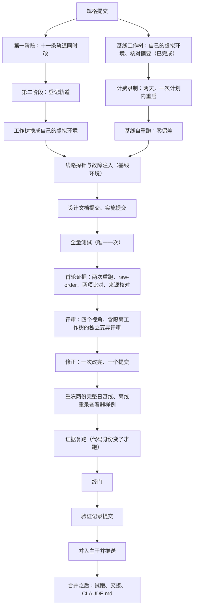

# 实施、验收证据与完成判据

> 本章属于[去掉 AgentSociety2：开发规格](../SPEC-agentsociety2-removal.md)，读法和叫法见那一页。

## 目标与依据

人物看不到实施的中间过程。今天她在 12:00 决定去吃饭，背后是 AgentSociety2 的 `Society`、一个 Ray 环境进程和一个 Ray 工作进程；合并之后同一个决定在一个进程、一个事件循环里由 `RunHost`、`LifeEngine`、`LifeAgent` 和 `ModelClient` 完成，发给 DeepSeek 的正文逐字节不变。本章规定第 01–09 章的全部改动怎样在一个工作树里一次改完、怎样一次跑全量测试、怎样做一轮评审与修正、凭什么证据合并，以及合并之后交出什么。

负责人的开发方式（裁定记录「负责人的原话」与「读法」第三条）取代提案第九章「一条分支，一次合并」里「按可运行的提交排列」的提交次序：

> apply all changes at once with multiple agents in workflow, then run test, then one pass review & fix; don't run tests here and there which would slow down task
>
> when finished, commit, merge, and push to main

本章落实的提案位置与裁定：

| 来源 | 本章的落实 |
| --- | --- |
| 提案第九章「实施之前」 | 【V2】基线工作树自己的虚拟环境、核对摘要；【V12】【V13】计费录制与基线自重跑（规格阶段已完成）；【V14】正式重跑；【V15】线路探针 |
| 提案第九章「一条分支，一次合并」 | 【V4】–【V11】轨道与环境；次序按负责人指示改写，见「总览」 |
| 提案第九章「验收证据」 | 【V24】–【V27】证据表、判据与证据层 |
| 提案第九章「合并之后」 | 【V33】–【V37】；合并与推送按负责人指示由集成者执行 |
| 提案第八章「跨仓库」一行 | 【V35】交给数据集一侧的说明 |
| 提案第十章「风险」 | 「风险」一节 |
| 裁定 9 | 证据表「线路探针」一行；请求头差异写进回执，不作判据 |
| 裁定 10 | 【V12】只用一份在基线工作树上录的、带一次计划内重启的两天计费录音 |
| 裁定 11 | 【V35】合并后跑一次短的计费试跑 |

今天的验收手段（基线 `74f1b949`，本章原样沿用，不新增门）：

| 手段 | 位置与事实 |
| --- | --- |
| release 档 | 预期失败在收集时被拒（`tests/conftest.py:87-91`），任何一次跳过让会话失败（`tests/conftest.py:102-112`） |
| 覆盖率门 | 分支覆盖率不低于 85.0、未覆盖的公共接口为零（`scripts/coverage_gate.py:24`、`:297`）；扫描根以后按 07 章【I14】是 `src/worldmock` 与 `tools/analysis` |
| 风格门 | `tests/unit/engineering/test_style_gate.py`，违规为零，没有豁免清单 |
| 源码变异台账 | `tests/dataset_acceptance.py:7-1346` 的 `MUTATIONS`，今天 298 条；静态检查 `tests/system/mutations/test_source_mutations.py:13`；执行 `tests/system/mutations/test_dataset_acceptance.py`，未变异一趟上限 480 秒（`:16`），每条变异上限 180 秒（`:24`） |
| 本机工具（不入库） | `.work/tools/envrev/py.sh`（锁定解释器入口，写死基础检出的 `.venv`）、`prepare_wt.sh`（把工作树的 `.venv` 连接到基础检出的 `.venv`，并恢复 AgentSociety2 源码）、`gate.py`（分片全量与门禁；`PYTHON` 常量写死基础检出的解释器，`gate.py:37-38`） |

两个工作树今天的状态（2026-11-17 核对）：

| 工作树 | 状态 | 后果 |
| --- | --- | --- |
| `.work/wt/as2-removal`（分支 `refactor/agentsociety2-removal`，头 `74f1b94908f1e77395ee1278093b29f8e5b299f2`） | `.venv` 是指向基础检出 `.venv` 的连接点；`vendor/agentsociety2` 是 `prepare_wt.sh` 恢复的锁定源码 | 07 章【I28】在测试之前换成自己的虚拟环境 |
| `.work/wt/as2-base`（分离在 `74f1b949`） | `.venv` 同样是连接点；连接到的环境里 `agentsociety2` 是可编辑安装，指向基础检出的 `vendor/agentsociety2`；实测导入的包摘要是 `bf716c7b982ea1aa057207b4ad06e1758b598bccef90834e18da2ca4253db3c6`，不是锁定的 `0a7b9b06fe5bbf70836fefe407eceb830b2bc6acaa8c81db98176ee3c99709ba` | 按今天的样子跑 `worldmock run` 会被 `require_locked_as2` 拒绝；【V2】已给它准备了自己的虚拟环境 |

## 行为

条款编号【V1】至【V37】供「测试」一节引用。

### 用词

| 词 | 含义 |
| --- | --- |
| 集成者 | 做准备、环境切换、录音、探针、提交、门禁、证据、合并与合并后各步的唯一一个代理；它不改任何轨道的文件，评审与修正里的修改也交给文件的所属轨道 |
| 轨道 | 一个代理独占的一组文件；同一工作树里同时改，见「轨道与文件归属」 |
| 第一阶段、第二阶段 | 十一条轨道同时改完是第一阶段；之后登记轨道单独改完是第二阶段 |
| 实施提交 | 第二阶段结束、探针写出固定样例之后的那个提交，全量测试、首轮证据与独立变异评审都在它上面 |
| 全量测试 | 实施提交上唯一一次分片全量测试（【V19】） |
| 评审与修正 | 全量测试与首轮证据之后唯一的一轮评审，以及随后一次改完的修正（【V20】–【V22】） |
| 终门 | 重冻、重录之后在干净的最终提交上跑的门禁（【V28】） |
| 回执 | 本章要求留下的输出，都在 `$R` 下，不入库 |

### 总览



- 整次改动只有一条分支、一个工作树，只并入主干一次；第一阶段的各轨道之间没有先后。
- 只跑两次全量：全量测试与终门。终门是最终提交的放行证据（覆盖率门要求整套测试在同一次覆盖率运行里），不是第二轮评审。除此之外，轨道与修正的代理都不跑测试；证据作业与独立变异评审只跑各自点名的命令与用例。
- 计费录制与基线自重跑在基线工作树上进行，和第一阶段同时开始，互不碰文件。
- 全部联网调用只有三处：【V12】的录制（裁定 10）、【V35】的试跑（裁定 11），以及录制前的 `worldmock validate`（只读模型元数据，不计 token）；前两处计费。其余全部离线。

### 目录与变量

【V1】各步的命令在 Git Bash 里执行，统一用下列变量；`$R` 与 `$ONE` 在基础检出的 `.work/` 下（被 git 忽略），由命令与脚本写入：

```sh
ROOT=C:/Users/56865/OneDrive/Documents/HoldThatThgt/WorldMock
WT=$ROOT/.work/wt/as2-removal
BASE=$ROOT/.work/wt/as2-base
R=$ROOT/.work/agentsociety2-removal-impl          # 本章的回执
ONE=$ROOT/.work/agentsociety2-removal             # 04、07、09 章的一次性脚本与它们的结果
DATASET=C:/Users/56865/OneDrive/Documents/HoldThatThgt/WorldMock-Dataset
UVPY=$HOME/AppData/Roaming/uv/python/cpython-3.12.13-windows-x86_64-none/python.exe
BPY=$BASE/.venv/Scripts/python.exe                # 【V2】之后才存在
HPY=$WT/.venv/Scripts/python.exe                  # 【V10】之后才存在
REC=$R/recording                                   # 【V12】的计费录音与它的回执
SEG1=$REC/runs/rec-2day                            # 录音第一段（计划内重启前）
SEG2=$REC/runs/rec-2day-r1                         # 录音续跑段
BASE_PROMPT=1947c112bf46fd262cc159d4163a3831a0aa55d42c70ad7645ffd3ba40524a05
HEAD_PROMPT=cd454d1b18c8a211d8eeb0bb25aaba7ff2ef4b0732c9a2bd7aaa4385a5f67842
RULES="--rule workspace-members --rule memory-updated-form --rule model-request-parameters --rule prompt-fingerprint=$BASE_PROMPT:$HEAD_PROMPT"
export PATH="/c/Program Files/nodejs:$PATH" PYTHONUTF8=1
```

04、07、09 章写的 `.work/agentsociety2-removal/…` 都指 `$ONE`。写这些目录的只有命令和脚本；脚本源码由所属轨道写成，宿主拒绝工具直接写基础检出时，脚本写在 `$WT/.work/agentsociety2-removal/` 的同一相对路径下并从那里运行，输出仍写进 `$ONE` 与 `$R`，验证记录写明实际路径。

### 基线工作树

【V2】基线工作树分离在 `74f1b949`，`vendor/agentsociety2` 是 `prepare_wt.sh` 恢复的锁定源码。离线引导因 uv 缓存缺包不可行，为不下载任何包，集成者在规格提交之前用 `$R/baseline/make_env.sh` 给它准备自己的虚拟环境：

| 步骤 | 做法 | 判据 |
| --- | --- | --- |
| 核对提交 | `git -C "$BASE" rev-parse HEAD`；`git -C "$BASE" status --porcelain --untracked-files=no` | 前者恰为 `74f1b94908f1e77395ee1278093b29f8e5b299f2`，后者无输出 |
| 解开连接点 | `cmd //c rmdir "$(cygpath -w "$BASE/.venv")"` | 只解开连接点，基础检出的 `.venv` 不动 |
| 复制环境 | `robocopy` 把基础检出的 `.venv` 整个复制到 `$BASE/.venv` | 退出码小于 8 |
| 改指可编辑安装 | `uv pip install --python "$BPY" --offline --no-deps --no-build-isolation -e "$BASE/vendor/agentsociety2/packages/agentsociety2"`，再对 `"$BASE"` 同样执行一次 | 两个 `__editable__`/`_editable_impl_` 路径文件指向基线工作树 |
| 核对实际导入 | `"$BPY" -c` 调 `require_locked_as2()`、`_labeled_sha256(...)` 与 `importlib.util.find_spec('agentsociety2')` | 摘要为 `0a7b9b06…`；包目录在 `$BASE/vendor/agentsociety2/packages/agentsociety2/agentsociety2` 下；`worldmock` 从 `$BASE/src` 导入 |

回执 `$R/baseline/receipt.json`，键依次为 `commit`、`as2_source_sha256`、`as2_package`、`worldmock`、`python_executable`。基础检出的 `vendor/agentsociety2`（摘要 `bf716c7b…`）从不当基线用。

【V3】之后凡是基线一侧的作业（基线重跑、探针、掩码完整日比较的基一侧）都用 `$BPY`，作业开始前重做【V2】「核对实际导入」一步，摘要写进该作业的回执。

### 规格提交

【V4】实施工作流的第一步是规格提交，在任何轨道开工之前：

- 提案第十二章表格的「回复」一栏逐行填写：取裁定记录同一序号一行的「决定」原文，后接 `（见[裁定记录](RULING-2026-11-17-owner.md)）`；第 3 行的状态改为「已裁定」并链到裁定记录与开发规格（仓内已裁定提案的写法）；提案的其余字节不改。
- 提交恰含 `docs/dev/agentsociety2-removal/` 下的提案、裁定记录、入口页与 `spec/` 的十章；标题 `docs(agentsociety2-removal): freeze the specification for removing AgentSociety2`。
- 提交之后工作树干净，十一条轨道从这个提交开工。

### 轨道

【V5】第一阶段十一条轨道、第二阶段一条登记轨道，按「轨道与文件归属」一表独占文件；表里每个文件恰属一条轨道。轨道对自己名下的每个文件，落下第 01–09 章里点名这个文件的全部条款、文件表行与测试行（不论出自哪一章），以及适用于它的通用迁移表：09 章「导入对照」、假凭据清单与 `custom.*` 清单，02 章「测试里 LifeEnv 调用的替换」，03 章「测试里旧入口的对应」，04 章「移植时随本章规则改动的断言」，09 章【T27】的文字守卫与 07 章【I5】【I26】的名字守卫。几章都改的文件由表里那一条轨道按所有相关章的条款一并改；表下「几章共改的文件」写明其中改动来自多章、最容易漏的那些，没有列在那里的文件同样按本条执行。轨道只改自己的文件，不碰别人的文件、不做 git 操作。别的轨道新建的模块、类、函数与夹具，按规格写定的名字与签名直接引用，不等对方写完；规格里没有写定的名字不引用。

【V6】轨道代理改文件时不跑任何测试、门禁、`pytest` 或录制。允许的检查只有：对自己的 `.py` 文件 `bash "$ROOT/.work/tools/envrev/py.sh" -m py_compile <文件>`，对自己的 `.js`、`.cjs` 文件 `node --check <文件>`，以及 `git diff --check -- <自己的文件>`。安装轨道另执行 07 章【I19】的 `uv lock` 与两条 `uv export`，再用 `$UVPY` 在 `$WT` 根运行 `$ONE/lock_check.py`（这时工作树还没有自己的虚拟环境），结论写进 `$ONE/lock-check.json`，`passed` 必须为 `true`（判据见 07 章「锁差异核对」）；不通过时由安装轨道改到通过。这些都不是测试。

【V7】从被删的旧文件移植用例时，读 `git show 74f1b949:<路径>`，不读工作树里的副本；被移植的旧文件由归属表里删除它的那条轨道删除，与移植是否完成无关。

【V8】第二阶段在十一条轨道都报完成之后开始：登记轨道读实现后的真实源码，一次写好 `tests/dataset_acceptance.py` 的全部登记（各章新增 24 条、改指与删除，见「测试」）、`test_import_graph.py` 的 `DELAYED_IMPORTS` 与门面规则、`test_single_source.py` 的 `OWNERS`、扫描根与合成样例、`test_style_gate.py` 与 `test_coverage_gate.py` 的扫描根与合成路径（07 章【I14】【I15】）。锚点原文从实现后的源码里取，在所属符号内恰好出现一次；`DELAYED_IMPORTS` 与源码里的函数内导入一条不多、一条不少。台账里其余既有变异也逐条对照实现后的源码复核：锚点所在的行被各章改写了的，按改后的源码重写锚点与替换文，替换破坏的仍是原来那条规则；杀手用例被各章改名的，换成改名后的节点；杀手所在的文件被删除、而所属章的后继表给出了后继用例的，换成后继用例。复核不增删条目，台账条数仍按「测试」一节的汇总（313）。

【V9】一个文件需要改、却不在归属表里时：属于 `tests/` 的，归测试树轨道；其余归迫使它改动的那条条款所在章的轨道（章到轨道见归属表「实施的章」一栏）。第一阶段结束时集成者执行下面的检查，命中的文件按这条规则交还所属轨道补改，再进第二阶段：

```sh
cd "$WT" && git grep -nE "agentsociety2|AGENTSOCIETY_|AgentSociety|custom\.agents|custom\.envs|custom/agents|custom/envs|LifeEnv|as2/agents|--project-root|aligned_process" -- src tests scripts tools pyproject.toml ':!tests/fixtures' > "$R/phase1-leftovers.txt"
```

除了 `src/worldmock` 里 07 章【I24】那一句来源注明，以及各守卫测试由片段拼出的模式，命中都要清零；结果文件留作回执。`tests/fixtures` 不在检索范围：其中 `dayrun_fidelity_inputs.json:2` 与 `tool_interaction_habits.json:7`、`:54` 的 `as2/agents/…` 是历史数据的来源记录，不改（「不在本章」最后一行），也不在【T27】与 02 章【E1】守卫的串里。

### 依赖、锁与工作树环境

【V10】第二阶段结束后、任何测试与探针之前，集成者按 07 章【I28】把 `$WT` 换成自己的虚拟环境，同样不下载包（与【V2】同一做法）：先删 `custom/`、`patches/`（连同其中可能残留的 `__pycache__`）里还在磁盘上的空目录，删 `$WT/vendor`；解开 `$WT/.venv` 连接点，把基础检出的 `.venv` 复制过来；对比基线 `requirements/lock.txt` 与新 `requirements/lock.txt` 的包名，把基线有、新锁没有的包连同 `agentsociety2` 一起 `uv pip uninstall --python "$HPY"`；再 `uv pip install --python "$HPY" --offline --require-hashes -r requirements/lock.txt` 与 `-r requirements/build-lock.txt`（缓存缺某个新锁里的包时，只去掉 `--offline` 重做这一条，下载的包名写进回执），`uv pip install --python "$HPY" --offline --no-deps --no-build-isolation -e "$WT"`；最后 `"$HPY" -c "from pathlib import Path; from scripts.bootstrap_environment import write_receipt; write_receipt(Path('.').resolve(), 'release')"` 写收据。核对 `find_spec` 对 `agentsociety2`、`ray`、`mem0`、`mcp` 都是 `None`、`uv pip list --python "$HPY"` 的包名集合等于新锁的包名集合加 `worldmock`、`$WT/.work/environment-receipt.json` 的 `passed` 为 `true`。脚本是 `$R/environment/make_head_env.sh`，核对输出写进 `$R/environment/head-receipt.txt`。从此 `$WT` 里的一切 Python 作业只用 `$HPY`。

【V11】分片作业用 `gate.py` 的一份副本 `$R/tools/gate.py`：从 `.work/tools/envrev/gate.py` 复制，只把 `PYTHON` 常量（`gate.py:38`）改成 `Path(r"C:\Users\56865\OneDrive\Documents\HoldThatThgt\WorldMock\.work\wt\as2-removal\.venv\Scripts\python.exe")`，并用 `$HPY` 运行它。`py.sh` 只在第一阶段的编译检查里用，原 `gate.py` 不再用。

### 计费录制与基线重跑

【V12】计费录制已在规格阶段完成（裁定 10；2026-11-17 16:20 UTC 起，非峰时段），实施阶段不再录制。它的事实与回执：

- 环境：数据集仓库白领包 `environment/0001-white-collar-lianqiu/package`（本机检出 `330b6065e196fab1ac299a8d7af20f71a419935f`，正是 10-31 两天试点交付清单记的执行工具）复制到 `$REC/input`，只把 `config.toml` 的窗口改成试点 `lm-2day-1008` 的两天：`start_time = 2026-10-08T00:00:00+08:00`、`stop_time = 2026-10-10T00:00:00+08:00`；种子 `21119545`，模型 `deepseek-flash`，同秒续接取缺省。
- 解释器：录制在【V2】的基线环境建好之前进行，用 `$REC/wm.sh`：基础检出 `.venv` 的解释器，`PYTHONPATH` 依次为基线工作树的 `src`、根目录与 `vendor/agentsociety2/packages/agentsociety2`，导入的因此是基线工作树的代码与锁定源码；`worldmock run` 与 `resume` 启动时都用 `require_locked_as2` 核对了摘要 `0a7b9b06…`。两段运行清单的 `code_sha256` 都是 `ba152374bf623c2e57da7e42a4606e6a6d92b85c73dc2d6a2ab231dc27914d44`。
- 第一段 `$SEG1`（`run_id` `1ecc8f7a495848229ba26144c3487ffe`）：模拟时间到 `2026-10-08T22:30:00+08:00` 时用 `$REC/kill_tree.ps1` 强行停下驱动进程树，这就是那一次计划内重启；库里 1,234 条事件、79 条 `model_request`、78 条 `model_response`；停下后的状态在 `$REC/status1.json`。
- 续跑段 `$SEG2`（`run_id` `02efad8c0de04e4bb558bba680ba1762`）：从最新的共同检查点 `dc1dcb9421a2446784986cf887dcb0f7`（事件序号 1231）`resume`，退出码 0，跑到 `2026-10-10T00:00:00+08:00`，`status.json` 为 `completed`；库里连同续接前的事件共 2,737 条事件、166 条 `model_response`。
- 停点在第一个零点之前：第一段只有开局的零点计划（`plan_day` 两条请求，一次计划、一次纠正）；第一个零点的回顾 `memory_digest` 与日计划在续跑段。续跑段的库连同续接前的事件保存了人物回合、零点计划、回顾三种请求，所以【V15】的探针读 `$SEG2`。
- 费用：166 次调用，非峰时段，不超过约 0.4 美元。
- 回执 `$REC/recording.json`，键依次为 `base_commit`、`as2_source_sha256`、`dataset_commit`、`window`、`stopped_after`、`restart_checkpoint_id`、`segments`（两项，键依次 `run_dir`、`run_id`、`status`；第一段被强行停下，状态停在 `running`）、`model_responses`（续跑段库里的 166 条，它已含第一段的 78 条）、`code_sha256`；日志 `$REC/run1.log`、`$REC/run2.log`。

【V13】录制完成后已用基线自己的工具在基线上重跑一次（提案「实施之前」）：

```sh
cd "$BASE" && env -u DEEPSEEK_NODE_KEYS python scripts/recorded_response_run.py run --project "$BASE" --source "$SEG1" "$SEG2" --work "$REC/replay-base-oldtool"
```

解释器与录制相同（`wm.sh` 的设置）。结果：退出码 0；`$REC/replay-base-oldtool/report.json` 的 `verdict` 为 `zero_divergence`、`calls_served` 为 166、`restarts_reproduced` 为 1、`divergences` 为空、`export.check` 为 `passed`；日志末行 `Recorded-response run: 166 calls served, 1 restarts reproduced, 0 divergences`（`$REC/replay-base-oldtool.log`）。这份录音因此可用。

【V14】基线一侧的正式重跑用新分支的工具（09 章【T5】）、基线的解释器，在【V10】之后执行；新分支一侧用新分支的工具与解释器：

```sh
cd "$BASE" && env -u DEEPSEEK_NODE_KEYS "$BPY" "$WT/scripts/recorded_response_run.py" run --project "$BASE" --source "$SEG1" "$SEG2" --work "$R/replay/base"
cd "$WT" && env -u DEEPSEEK_NODE_KEYS "$HPY" "$WT/scripts/recorded_response_run.py" run --project "$WT" --source "$SEG1" "$SEG2" --work "$R/replay/head"
```

两条命令的环境里都没有 `RAY_ADDRESS`（09 章【T4】不再特别处理它）。

### 线路探针、故障注入与来源核对

【V15】模型客户端轨道写成 `src/worldmock/configuration/model/model_client.py` 与 `$ONE/probe/` 下的三个脚本，【V10】已完成之后，集成者在基线工作树根用 `$BPY` 运行 04 章「验收工具」的两个脚本：

```sh
cd "$BASE" && "$BPY" "$ONE/probe/wire_probe.py" --recording "$SEG2" --model-client "$WT/src/worldmock/configuration/model/model_client.py" --fixture-out "$WT/tests/fixtures/model-client-wire.json" --receipt "$ONE/probe/wire-receipt.json"
cd "$BASE" && "$BPY" "$ONE/probe/fault_probe.py" --model-client "$WT/src/worldmock/configuration/model/model_client.py" --receipt "$ONE/probe/fault-receipt.json"
```

判据：两份回执的 `verdict` 都是 `"equal"`（判定规则见 04 章【M26】【M27】），`wire_probe.py` 写出了 `tests/fixtures/model-client-wire.json`。不是 `"equal"` 时由模型客户端轨道修正后重跑，直到通过才做实施提交。修正阶段改了 `model_client.py` 时（回执里的 `model_client_sha256` 与文件不再相等），终门之前重跑这两条命令，固定样例随之重写。

【V16】来源核对（07 章【I25】）在实施提交之后、全量测试的同时，用 `$HPY` 在 `$WT` 根运行 `$ONE/provenance_check.py`，结果写进 `$ONE/provenance.json`。复核结论进验证记录；复核新增的模块交评审与修正一并处理：所属轨道给这些模块加 07 章【I24】那一句，安装轨道把它们加进 `UPSTREAM_DERIVED_MODULES`。

### 提交

【V17】第二阶段结束、【V10】【V15】通过之后，集成者做两个提交：

| 提交 | 内容 | 标题 |
| --- | --- | --- |
| 设计文档提交 | 设计文档轨道的全部文件 | `docs(design): describe WorldMock's own decision loop, model client and person workspace` |
| 实施提交 | 其余全部改动（生产代码、测试、脚本、工具、锁、许可、删除，以及探针写出的 `tests/fixtures/model-client-wire.json`） | `refactor: remove AgentSociety2 and Ray so WorldMock owns its decision loop and model calls` |

设计文档提交在实施提交之前，历史上「规则先写进 docs/design/、再改代码」。每个提交消息以会话给定的署名行结尾。实施提交之后 `git status --porcelain` 无输出。

### 全量测试

【V18】实施提交上跑唯一一次全量测试；两份完整日基线与查看器样例此时还没重冻、重录，按 09 章【T52】只去掉两个与样例绑定的用例（`--deselect` 按前缀匹配参数化的全部变体），不加跳过标记：

```sh
cd "$WT" && PYTEST_ADDOPTS="--deselect tests/system/lifecycle/test_complete_day_baseline.py::test_complete_day_matches_frozen_current_inputs_and_complete_evidence --deselect tests/system/lifecycle/test_run_viewer_recording.py::test_viewer_fixture_is_recorded_from_the_current_host" "$HPY" "$R/tools/gate.py" "$WT" "$R/gates/full" --final --shards=8
```

`--final` 让查看器的 Node 用例经 `tests/system/viewer/test_run_viewer.py` 照常运行。结果（`gate-summary.json`、JUnit、覆盖率报告）全部交给评审。

【V19】全量测试结束后、评审之前，集成者跑首轮证据：【V14】的两次重跑、【V24】表里的 `raw-order`、运行比对、掩码完整日比较，并记下实施提交上的代码身份：`"$HPY" -c "from worldmock.runtime.framework.setup import runtime_code_sha256; print(runtime_code_sha256())" > "$R/evidence/code-sha256.txt"`。证据与全量测试分开跑，避免并行负载让带墙钟上限的用例超时。

### 评审与修正

【V20】评审只做一轮，四个视角各一个代理，同时进行，都只读：

| 视角 | 读什么 | 写出 |
| --- | --- | --- |
| 规格一致、不多做 | `git diff 74f1b949 <实施提交>` 的每一处生产与脚本改动，对照十章条款 | `$R/review/conformance.md`：每一处改动对到的条款号；对不到条款的改动列为「多做」，条款要求而没有落下的列为「缺」 |
| 正确性 | 全量测试的失败与覆盖率缺口、首轮证据的偏差与不同、`$ONE/provenance.json` | `$R/review/correctness.md`：每条失败的原因与所属轨道 |
| 不落下 | 十章「测试」表里每条规则的用例是否存在、是否经真实入口；各章的变异是否都已登记；有没有跳过、预期失败、只有 `pass` 或文档串的函数体 | `$R/review/no-deferral.md` |
| 独立变异评审 | 见【V21】 | `$R/review/mutation-probes.json` |

【V21】独立变异评审在隔离工作树里进行，对象是干净的实施提交：

```sh
git -C "$WT" worktree add --detach "$ROOT/.work/wt/as2-removal-review" <实施提交>
cmd //c mklink //J "$(cygpath -w "$ROOT/.work/wt/as2-removal-review/.venv")" "$(cygpath -w "$WT/.venv")"
cd "$ROOT/.work/wt/as2-removal-review" && PYTHONPATH="$(cygpath -w "$PWD/src");$(cygpath -w "$PWD")" "$HPY" -c "from pathlib import Path; from scripts.bootstrap_environment import write_receipt; write_receipt(Path('.').resolve(), 'release')"
```

- 评审代理没有实施过任何轨道。每个改了生产源码或脚本的章（01–07、09）至少三条探针：在台账之外手写一处源码变异（改一个条件、删一次调用、换一个常量），在隔离工作树里只跑该章「测试」表里那条规则的用例：`PYTHONPATH="<隔离工作树>/src;<隔离工作树>" "$HPY" -m pytest <用例> -q -p no:cacheprovider`，跑完 `git checkout -- .` 复原。
- 每条探针记一项，键依次 `chapter`、`symbol`、`original`、`replacement`、`tests`、`outcome`（`killed` 或 `survived`）、`log`。
- 做完后解开连接点（`cmd //c rmdir`）再 `git worktree remove --force` 拆掉隔离工作树。

【V22】修正一次改完：四份评审结果里的每一条，由所属轨道的代理改自己的文件（「多做」的删掉，「缺」的补上并补测试，存活的探针补一条能杀死它的行为测试），代理改的时候不跑测试；修正全部落下后做一个提交，标题 `fix(agentsociety2-removal): apply the review findings`。修正阶段之后再出现的、必须改生产代码的失败（证据复跑或终门不过），按所属轨道的条款修、做一个同样标题的提交，然后从【V23】起重做；这种情况写进验证记录，不算第二轮评审。

### 重冻与重录

【V23】修正提交之后（全部生产改动已经落下），集成者用 `$HPY` 按 09 章【T50】重冻两份完整日基线（每种两个独立进程各录一份候选，`scripts/freeze_rrs_baseline.py` 两份相等才写入，日志都是 `Complete-day baseline published`），按 09 章【T51】离线重录 `tests/fixtures/viewer-context.json`；候选与日志写进 `$R/freeze/`，重录的日志写进 `$R/viewer/`。之后一个提交，标题 `test: re-freeze complete-day baselines and re-record the viewer sample without AgentSociety2`。两份候选不相等时目标文件保留原字节，查明不确定的来源，不重试到相等为止。

### 验收证据

【V24】合并之前，下表每一项都成立；命令在最终提交上执行，「证据复跑」规则见【V25】：

| 证据 | 命令 | 判据 | 回执 |
| --- | --- | --- | --- |
| 同一份录音在基线与新分支上各重跑一遍，续跑之后也零偏差 | 【V14】两条 | 两份 `report.json` 的 `verdict` 都是 `zero_divergence`，`restarts_reproduced` 都是 1，`divergences` 都为空，导出核验 `export.check` 为 `passed` | `$R/replay/base/`、`$R/replay/head/` |
| 两次重跑发出的原始正文连键序逐字节相同 | `"$HPY" "$WT/scripts/recorded_response_run.py" raw-order --base "$R/replay/base" --head "$R/replay/head" --report "$R/evidence/raw-order.json"` | 退出码 0，`verdict` 为 `equal`，`mismatches` 为空 | `$R/evidence/raw-order.json` |
| 运行比对只在声明的规则下相等 | `"$HPY" "$WT/scripts/compare_runs.py" runs --base-run "$R/replay/base/segments/01" "$R/replay/base/segments/02" --base-export "$R/replay/base/export" --head-run "$R/replay/head/segments/01" "$R/replay/head/segments/02" --head-export "$R/replay/head/export" $RULES --every-checkpoint --report "$R/evidence/compare-runs.json"` | 退出码 0，`verdict` 为 `equal`；用到的规则只有这四条（代码身份及其派生的检查点素材摘要由既有屏蔽与清单摘要登记对齐，09 章【T21】）；两侧的段目录等于各自 `report.json` 的 `segments[].run_dir` | `$R/evidence/compare-runs.json` |
| 掩码完整日比较在规则下相等 | `"$HPY" "$WT/scripts/compare_complete_days.py" --base-root "$BASE" --head-root "$WT" --work "$R/evidence/complete-days" $RULES` | 退出码 0，`complete-day-behaviour.json` 的 `verdict` 为 `equal_under_rules`（两种完整日的签名都只在规则覆盖处不同时）或 `equal` | `$R/evidence/complete-days/` |
| 线路探针的固定样例与故障注入 | 【V15】两条；仓内 `tests/integration/runtime/test_model_client_wire.py` 在终门里通过 | 两份回执 `verdict` 为 `"equal"`；请求头只有字母大小写之差与值之差写进回执，不作判据（裁定 9） | `$ONE/probe/wire-receipt.json`、`fault-receipt.json` |
| 去掉的包找不到、没有导入 | `"$HPY" -c "import importlib.util as u; print({n: u.find_spec(n) is None for n in ('agentsociety2', 'ray', 'mem0', 'mcp')})"`；终门里【V30】列出的守卫用例 | 四个都是 `True`；守卫用例通过 | `$R/evidence/not-importable.txt` |
| 锁差异只有删除行与 `tomlkit` 两行 | 【V6】的 `lock_check.py` | `$ONE/lock-check.json` 的 `passed` 为 `true`，计数为 59、58、1 | `$ONE/lock-check.json` |
| 离线各层全部通过，独立变异评审做过 | 【V28】终门；【V21】 | 见【V28】；独立变异评审没有存活的探针，或存活的都已在修正里补测试 | `$R/gates/final/`、`$R/review/mutation-probes.json` |

【V25】证据复跑：最终提交上 `runtime_code_sha256()` 与 `$R/evidence/code-sha256.txt` 不同时（修正或重冻之后的阻断修正改了 `src/` 下的 Python、`pyproject.toml` 或 `uv.lock`），在终门之前把【V24】表前四行在最终提交上重跑一遍，工作目录改用 `$R/replay/base-2`、`$R/replay/head-2`、`$R/evidence/*-2.*`；相同时首轮证据就是最终提交的证据。`scripts/` 下的比较工具不进代码身份，修正改了它们时同样重跑前四行。

【V26】离线证明不了的，验证记录逐条写明：

- 真实网络下的停放、慢流与 `Retry-After`；
- httpx 传输在真实服务上的表现（试跑只给一次短运行的传输层证据）；
- 单个事件循环连跑数周的资源行为；
- Linux 平台上代码身份是否一致：GitHub Actions 每次都是 `startup_failure`，持续集成这一层「未取得」；
- 录音没走到的路径：月回顾、年回顾、传输失败、停放、多于一次的续跑与反事实重放。

【V27】验证记录写明证据层为「离线加录音重跑」；项目整体仍按三项真实验收（正式 12 周 DeepSeek 运行、三次隔离盲评、一次完整自然日的交付）标为 NOT-COMPLETE。

### 终门

【V28】重冻、重录与（需要时的）证据复跑之后，在干净的最终提交上跑终门，不带 `PYTEST_ADDOPTS`：

```sh
cd "$WT" && git status --porcelain && "$HPY" "$R/tools/gate.py" "$WT" "$R/gates/final" --final --shards=8
```

通过的判据：`$R/gates/final/gate-summary.json` 里 `final` 为真、`dirty_worktree` 为假、`documentation_gate`、`build_design_doc`、`tests`、`coverage_gate` 四项全真，JUnit 没有失败、错误与跳过，`still_failing` 为空，单独重跑才通过的只有带墙钟上限的用例；`coverage-report.json` 分支覆盖率不低于 85.0、未覆盖的公共接口为空。终门里包含风格门、导入图、单一归宿、变异静态检查与变异套件（`tests/system/mutations/`）。终门不过时按【V22】末句处理。

### 验证记录

【V29】集成者在终门通过后写 `docs/dev/agentsociety2-removal/VERIFICATION-agentsociety2-removal.md` 并单独提交，标题 `docs(agentsociety2-removal): record the verification at the offline-plus-recorded-replay tier`。它只含文字与表，不复制机器报告，各节依次：

| 节 | 内容 |
| --- | --- |
| 结论 | 证据层「离线加录音重跑」；NOT-COMPLETE 的理由（【V27】） |
| 基线与录音 | 基线回执的摘要；录音的窗口、两段的 `run_id`、重启检查点、停下时刻、调用数与费用（【V12】） |
| 证据 | 【V24】表每一行的结论与回执路径；`complete-day-behaviour.json` 的结论与 SHA-256；探针回执里的请求头差异与连接被拒场景的错误链尾差异（04 章的两条「（问题）」决定） |
| 门禁 | 全量测试与终门的计数、覆盖率、变异台账条数（313） |
| 评审 | 四个视角的结论，独立变异评审的探针数与存活数，修正提交 |
| 来源核对 | `provenance.json` 的复核结论与最终的 `UPSTREAM_DERIVED_MODULES` |
| 证明不了的 | 【V26】五条 |
| 实施阶段的问题与取舍 | 实施中按「取推荐做法」定下的每个问题，一行一条：问题、取的做法、理由 |

### 不落下、不多做

【V30】负责人要求「不允许 defer 任何待实现内容，并用测试保证」。六道保证一起用：

| 保证 | 做法 | 挡住什么 |
| --- | --- | --- |
| 每条规则一条经真实入口的行为测试 | 十章「测试」表里每条规则都有用例；引擎一侧的规则经 `tests/engine_fixture.py` 的 `engine_factory`、真实请求、引擎与 SQLite；只断言助手函数不算 | 规则没实现，或只在助手里成立 |
| 每个定下的中心事项一条登记的变异 | 各章变异表合计新增 24 条，台账从 298 条变成 313 条（见「测试」）；锚点取实现后的真实源码；杀手在 unit 或 integration 层、在主进程里经模块名导入被变异的模块 | 测试存在却不咬人 |
| release 档 | 缺省就是 release 档：预期失败在收集时被拒，任何一次跳过让会话失败；`--deselect` 只在全量测试里用于两个与样例绑定的用例 | 用跳过或预期失败挂起没做完的测试 |
| 覆盖率门 | 每个新增的公开函数，函数体每一行都被执行到；分支覆盖率不低于 85% | 写了接口没有接线；原先在 Ray 进程里执行、第一次进入覆盖率的代码 |
| 去除完整的守卫 | `tests/unit/engineering/test_framework_removal.py::test_removed_framework_paths_are_gone`（`custom/`、`patches/`、`scripts/bootstrap_sources.py` 不存在）、`::test_production_source_never_imports_the_removed_framework_or_custom`（`src/`）、`tests/unit/engineering/test_framework_removed_from_tests.py::test_no_test_script_or_tool_module_imports_the_removed_framework`（`tests/`、`scripts/`、`tools/`）、`::test_the_framework_only_test_files_are_gone`、`tests/unit/engineering/test_framework_removal.py::test_dependency_declarations_and_locks_exclude_the_removed_framework`（`pyproject.toml`、`uv.lock`、两份 requirements）、`::test_locked_environment_cannot_import_the_removed_framework`（当前解释器）、`tests/unit/engineering/test_engine_facade_boundary.py::test_life_env_and_its_forwarders_are_gone` | 去掉得不完整：残留导入、目录、依赖或可导入的包 |
| 删掉的名字与结构不回来 | `tests/unit/engineering/test_framework_removal.py::test_source_never_names_the_removed_process_variables`（07 章【I5】）、`::test_production_code_names_the_framework_only_in_provenance_notes`（【I26】）、`tests/unit/engineering/test_framework_removed_from_tests.py::test_no_test_script_or_tool_file_names_the_removed_framework`（09 章【T27】）、`tests/unit/agents/test_life_agent_shape.py::test_retired_person_glue_and_readonly_path_are_gone`（03 章）、`tests/unit/runtime/test_error_classes.py::test_production_code_defines_no_pickling_hooks`（06 章）、`tests/unit/engineering/test_model_client_boundary.py::test_only_the_model_client_imports_litellm`（04 章） | 旧进程变量、框架名字、只读问答与人物胶水、打包钩子、第二个 litellm 导入点在别处留下或重新出现 |

【V31】十章「测试」表里标「新」的用例都存在：集成者把它们的节点（参数化的保留参数）逐行写进 `$R/new-tests.txt`，在最终提交上执行 `"$HPY" -m pytest --collect-only -q $(cat "$R/new-tests.txt") > "$R/new-tests.log"`，收集到的节点数等于行数。

【V32】不做规格以外的东西：「规格一致、不多做」视角把每一处生产与脚本改动对到条款号，对不到的在修正里删掉，不补规格。

### 合并与推送

【V33】验证记录提交之后，集成者在 `$WT` 里并入主干并推送：

```sh
fetch_main() { for i in 1 2 3 4 5 6 7 8 9 10; do GIT_TERMINAL_PROMPT=0 timeout 170 \
  git -c http.lowSpeedLimit=200 -c http.lowSpeedTime=90 fetch origin main && return 0; sleep 5; done; return 1; }
cd "$WT" && fetch_main
git merge-base --is-ancestor origin/main refactor/agentsociety2-removal
git switch --detach origin/main
git merge --no-ff refactor/agentsociety2-removal -F "$R/merge-message.txt"
git diff --exit-code refactor/agentsociety2-removal HEAD
for i in 1 2 3 4 5 6 7 8 9 10; do GIT_TERMINAL_PROMPT=0 timeout 170 git push origin HEAD:main && break; sleep 5; done
git rev-parse HEAD > "$R/main-merge.txt" && git ls-remote origin main >> "$R/main-merge.txt"
git switch refactor/agentsociety2-removal
```

- `merge-message.txt` 的标题是 `merge: WorldMock's own decision loop without AgentSociety2 and Ray`；正文依次是：一句话说明；掩码完整日比较的结论（每种完整日一行：`activity: <verdict>`、`callback: <verdict>`）与 `complete-day-behaviour.json` 的 SHA-256；`raw-order: equal`；验证记录的路径；会话给定的署名行。这就是提案要求「附在 PR 里」的那份报告摘要，合并不经 PR，摘要随合并提交。
- `merge-base --is-ancestor` 不成立（主干在这期间多了提交）时，先在分支上 `git merge origin/main`（标题 `merge: origin/main into refactor/agentsociety2-removal`）；带来的提交改了 `src/`、`scripts/render_day.py`、`pyproject.toml`、`uv.lock` 或 `requirements/` 时，从【V23】起在新的头上重做；录音证据的基一侧仍是 `74f1b949`，若新的偏差来自主干自己的改动，停在这里，不合并，在最终报告里写明。
- 推送被权限拒绝时不换别的办法落地：把这一段命令原样写进最终报告，交给负责人执行，`main-merge.txt` 写明「未推送」。推送被拒是因为主干刚好又动了时，回到本条开头。

【V34】推送成功后，基础检出的本地 `main` 只在没有已跟踪文件的改动时快进：`git -C "$ROOT" status --porcelain --untracked-files=no` 无输出，才 `git -C "$ROOT" merge --ff-only origin/main`；否则不动，在最终报告里写明原因。

### 合并之后

【V35】合并之后集成者依次：

| 事项 | 做法 | 本任务做不做 |
| --- | --- | --- |
| 裁定 11 的短试跑 | 在 `$WT`（树与合并提交相同）用 `$HPY` 跑一次：`$R/trial/input` 复制自 `$REC/input`，只把窗口改成 `start_time = 2026-10-08T18:00:00+08:00`、`stop_time = 2026-10-09T06:00:00+08:00`（跨一个零点，三种请求——人物回合、回顾、零点计划——都会发生）；载入 `deepseek.env` 后 `"$HPY" -m worldmock.cli run --environment "$R/trial/input" --output "$R/trial/run" > "$R/trial/run.log" 2>&1`。判据：退出码 0；`status.json` 的 `status` 为 `completed`；`run.log` 里没有 `Unclosed`、`ResourceWarning`；运行库里每条 `model_response` 的 `data.transport_attempts` 都是列表、每项恰含 `attempt`、`error`、`failed_after_ms`、`wait_ms` 四个键；`data.purpose` 为 `plan_day` 与 `memory_digest` 的 `model_request` 各至少一条，不带 `purpose` 的（人物回合）也至少一条。结论写进 `$R/trial/receipt.json`，只作传输层证据，进最终报告 | 做 |
| 交给数据集一侧 | 把「交给数据集一侧的说明」一节的原文写进 `$R/handoff/worldmock-dataset.md`，把其中的 `<合并提交>` 换成 `main-merge.txt` 第一行；不改 WorldMock-Dataset 仓库 | 做 |
| 本地根 `CLAUDE.md` | 按「根 CLAUDE.md 的改写」一节写成 `$WT/CLAUDE.md`（被 git 忽略），在最终报告里给出安装命令 `cp "$WT/CLAUDE.md" "$ROOT/CLAUDE.md"`；基础检出的 `CLAUDE.md` 本任务不动 | 写成文件，不安装 |
| 基础检出删除 `vendor/agentsociety2`、重新引导、旧 `.venv` 移到 `.work/legacy` | 命令写进最终报告：`mkdir -p "$ROOT/.work/legacy" && mv "$ROOT/.venv" "$ROOT/.work/legacy/venv-as2-74f1b949" && rm -rf "$ROOT/vendor/agentsociety2" && cd "$ROOT" && "$UVPY" scripts/bootstrap.py --profile release --use-uv` | 不做 |

【V36】回执与工作树：两个工作树（`as2-removal`、`as2-base`）都保留，负责人没有要求清理，`as2-base` 里还有基线环境；隔离评审工作树在【V21】末尾已拆掉。`$R` 与 `$ONE` 已在基础检出的 `.work/` 下，不必搬。

【V37】最终报告（工作流的最后输出）依次写：合并提交与推送结果；证据层与 NOT-COMPLETE；【V24】表的结论；试跑结论；全部「规格阶段的决定」里标「（问题）」的行和验证记录「实施阶段的问题与取舍」的每一行；交给负责人的命令（未推送时的推送命令、基础检出的快进或重新引导命令、`CLAUDE.md` 的安装命令）；回执路径 `$R`、`$ONE`。

### 完成判据

下面每一项都成立才算完成，回执都在 `$R`（与 `$ONE`）下：

- [ ] 规格提交在分支上，提案「回复」一栏已填（【V4】）。
- [ ] `baseline/receipt.json`：提交 `74f1b949`，导入的 AgentSociety2 摘要 `0a7b9b06…`，`worldmock` 来自基线工作树（【V2】）。
- [ ] `recording/recording.json`：两段，续跑段 `completed`，重启检查点 `dc1dcb94…` 已记（【V12】，已完成）。
- [ ] `recording/replay-base-oldtool/report.json` 零偏差、重启重现 1 次（【V13】，已完成）。
- [ ] `phase1-leftovers.txt` 只剩来源注明与守卫的片段（【V9】）。
- [ ] `$ONE/lock-check.json` 通过；`environment/head-receipt.txt` 四个包都找不到、收据 `passed`（【V6】【V10】）。
- [ ] `$ONE/probe/wire-receipt.json`、`fault-receipt.json` 的 `verdict` 为 `"equal"`，固定样例在实施提交里（【V15】）。
- [ ] 设计文档提交在实施提交之前（【V17】）。
- [ ] `gates/full/` 存在（【V18】）；`review/` 下四份评审结果与 `mutation-probes.json`（【V20】【V21】）；修正提交（【V22】）。
- [ ] `freeze/` 四份候选，两份冻结日志都是 `Complete-day baseline published`；`viewer/` 重录日志；重冻提交（【V23】）。
- [ ] 【V24】表每一行的回执与判据成立；需要时有复跑的那一份（【V25】）。
- [ ] `gates/final/gate-summary.json` 满足【V28】。
- [ ] `new-tests.log` 一个不缺（【V31】）。
- [ ] 去除完整与名字、结构守卫：【V30】表最后两行的十三个用例在 `gates/final/` 的 JUnit 里各有一条通过记录，没有一条被去选、跳过或预期失败；`$R/environment/head-receipt.txt` 与 `evidence/not-importable.txt` 里四个包都找不到。
- [ ] 变异台账恰 313 条，全部被杀死（终门里的 `tests/system/mutations/test_dataset_acceptance.py`）。
- [ ] 没变的号仍是原值：`RUN_MANIFEST_SCHEMA_VERSION = 7`、`EXPORT_SCHEMA_VERSION = 8`、`WORLD_SCHEMA_VERSION = 15`、质量报告 `schema_version` 10、`RULES_VERSION = 6`、目录 `format_version` 6、`behavior-metrics-4`、`environment-1`；`life_tool_schema_sha256()` 仍是 `aa0ed7fa…`，`life_prompt_sha256()` 是 `cd454d1b…`；`AS2_LOCKED_SOURCE_SHA256` 在 `src/` 里不存在。结果写进 `versions.txt`。
- [ ] 验证记录已提交（【V29】）。
- [ ] `main-merge.txt` 的合并提交等于 `git ls-remote origin main`，或写明了未推送与交出的命令（【V33】）；本地 `main` 已快进或写明原因（【V34】）。
- [ ] `trial/receipt.json` 满足【V35】；`handoff/worldmock-dataset.md` 与 `$WT/CLAUDE.md` 已写成。
- [ ] 最终报告按【V37】写成。

### 风险

| 风险 | 怎么出事 | 怎么防 |
| --- | --- | --- |
| 基线用错 AgentSociety2 | 基线工作树的 `.venv` 今天连到基础检出的环境，导入的是摘要 `bf716c7b…` 的旧源码 | 【V2】给基线自己的环境；每个基线作业先核对实际导入的摘要（【V3】） |
| 十一条轨道同时改一个工作树 | 两个代理改同一个文件互相覆盖 | 归属表一文件一轨道；几章共改的文件只给一个轨道；不在表里的文件按【V9】交还 |
| 台账锚点与延迟导入登记对不上实现 | 锚点在实现前写，源码一改就找不到 | 登记放在第二阶段，读实现后的源码（【V8】） |
| 录音的停点不可复现 | 停在哪一刻取决于墙钟 | 停下后取最新的共同检查点续跑；重跑工具按记录的检查点位置重现重启，与停在哪一刻无关 |
| 录制计费 | 两天试点约 0.19 美元（非峰时段），峰时约 0.39 美元 | 只录了一次（【V12】）；费用进验证记录 |
| 并行负载下的墙钟上限 | 查看器 Node 用例 60 秒、变异子进程 180 秒与 480 秒会超时 | `gate.py` 把失败用例单独重跑一次，只有这类用例的单独重跑通过才算数；证据作业不与全量测试同时跑（【V19】） |
| 主干同时在变 | 合并前主干多了改基线的提交 | 【V33】先并入主干，必要时从重冻起重做 |
| GitHub 网络 | 取主干、推送在握手时失败 | 有界重试，每次限时 |
| 推送主干被权限拒绝 | 自动模式下直接推送到 `main` 可能被拒 | 不换办法落地，命令交给负责人（【V33】） |
| 写基础检出被宿主拒绝 | 工作树会话里直接写基础检出的文件可能被钩子拒绝 | 脚本源码改写在 `$WT/.work/` 的同一相对路径，输出照旧（【V1】） |

## 接口与文件

本章不新增、不修改任何生产符号；集成者入库的是下表前五行（提案的回复栏、验证记录、探针写出的固定样例、重冻与重录的三份样例），其余都在 `.work/` 下或被 git 忽略：

| 路径 | 动作 | 由谁 | 内容 |
| --- | --- | --- | --- |
| `docs/dev/agentsociety2-removal/PROPOSAL-agentsociety2-removal.md` | 修改 | 集成者 | 第十二章表格的「回复」一栏（【V4】） |
| `docs/dev/agentsociety2-removal/VERIFICATION-agentsociety2-removal.md` | 新建 | 集成者 | 【V29】 |
| `tests/fixtures/model-client-wire.json` | 新建 | `wire_probe.py` 写出，集成者提交 | 04 章「验收工具」的格式 |
| `tests/fixtures/dayrun-activity-baseline.json`、`tests/fixtures/dayrun-callback-baseline.json` | 重冻 | 集成者 | 【V23】 |
| `tests/fixtures/viewer-context.json` | 重录 | 集成者 | 【V23】 |
| `$R/tools/gate.py` | 不入库 | 集成者 | 【V11】 |
| `$WT/CLAUDE.md` | 不入库（被 git 忽略） | 集成者 | 「根 CLAUDE.md 的改写」 |
| `$R/handoff/worldmock-dataset.md` | 不入库 | 集成者 | 「交给数据集一侧的说明」 |

### 轨道与文件归属

「新」为新建，「删」为删除，其余为修改。路径相对 `$WT`。

| 序 | 轨道 | 实施的章与条款 | 生产与配置文件 | 测试与夹具 | 不入库的脚本 |
| --- | --- | --- | --- | --- | --- |
| 1 | 宿主轨道 | 01 章全部；06 章 `RunHost._abort_round`、`RunHost._record_failure` 与调用约束；05 章 runner 部分；07 章 runner 与 `cli.py` 部分 | 新 `src/worldmock/runtime/lifecycle/run_host.py`；新 `src/worldmock/runtime/lifecycle/midnight.py`；新 `src/worldmock/state/decisions/round.py`；`src/worldmock/runtime/lifecycle/runner.py`；`src/worldmock/cli.py` | 新 `tests/integration/runtime/test_run_host.py`；新 `tests/unit/runtime/test_run_host_order.py`；新 `tests/unit/runtime/test_decision_round_types.py`；`tests/engine_fixture.py`；`tests/integration/runtime/test_runtime.py`；`tests/integration/runtime/test_host_branch_coverage.py`；`tests/integration/runtime/test_runtime_inputs_contract.py`；`tests/integration/runtime/test_input_warnings.py`；`tests/integration/runtime/test_frozen_metadata_resume.py`；`tests/integration/life/test_creation_model_identity.py`；`tests/unit/cli/test_parser.py` | — |
| 2 | 门面轨道 | 02 章全部 | 删 `custom/envs/life_env.py`；删 `src/worldmock/runtime/framework/read_query.py`；新 `src/worldmock/simulation_engine/decisions/read_query.py`；`src/worldmock/simulation_engine/engine.py`；`src/worldmock/simulation_engine/decisions/decision_coordinator.py`；`src/worldmock/simulation_engine/scheduling/clock/time_advance.py`；`src/worldmock/simulation_engine/world/world_updates.py`；`src/worldmock/simulation_engine/__init__.py`；`src/worldmock/state/interaction/requests.py` | 新 `tests/integration/life/test_engine_facade.py`；新 `tests/unit/agent_protocol/test_tool_surface.py`；新 `tests/unit/engineering/test_engine_facade_boundary.py`；删 `tests/integration/runtime/test_env_lifecycle_coverage.py`；`tests/integration/runtime/test_read_query_runtime.py`；`tests/integration/start_interfaces/test_start_group.py`；`tests/integration/runtime/test_dayrun_parallel_agent.py`；`tests/integration/life/test_committed_world_guard.py`；`tests/unit/life/test_current_lifecycle_coverage.py`；`tests/life/environment_runtime.py` | — |
| 3 | 人物轨道 | 03 章全部；02 章两个工具名函数的文档串；05 章步尾调用；06 章【F2】–【F4】的文本；09 章移植表里落到 `test_react_loop.py` 的用例；「跨章裁定」里 `persona_layer` 的测试调用者 | 删 `custom/agents/life_agent.py`；新 `src/worldmock/agents/life_agent.py`；新 `src/worldmock/agents/protocol/react_loop.py`；新 `src/worldmock/agents/protocol/engine_handle.py`；`src/worldmock/agents/protocol/life_feedback.py`；`src/worldmock/agents/protocol/life_truncation.py`；`src/worldmock/agents/protocol/life_continuation.py`；`src/worldmock/agents/prompt/life_prompt.py`；`src/worldmock/agents/prompt/life_persona.py`；删 `src/worldmock/agents/prompt/life_context.py`；`src/worldmock/agents/prompt/prompt_schemas.py`；`src/worldmock/state/model/exchange.py`；`src/worldmock/simulation_engine/decisions/continuation.py`；`src/worldmock/recording_engine/storage/store.py` | 新 `tests/integration/runtime/test_react_loop.py`；新 `tests/unit/agents/test_life_agent_shape.py`；新 `tests/integration/runtime/test_life_agent_engine.py`；`tests/integration/runtime/test_host_failure_stages.py`；`tests/integration/runtime/test_host_feedback.py`；`tests/integration/runtime/test_agent_branch_coverage.py`；`tests/integration/runtime/test_memory_search_tool.py`；`tests/integration/runtime/test_persona_layer_card_only.py`；`tests/integration/runtime/test_persona_profile.py`；`tests/integration/runtime/test_seven_layer_request.py`；`tests/integration/runtime/test_existing_relationship_subject.py`；`tests/integration/runtime/test_decision_context_roundtrip.py`；`tests/integration/life/test_phone_records.py`；`tests/unit/agent_protocol/test_decision_context_protocol.py`；`tests/unit/agent_protocol/test_tool_description_references.py`；`tests/unit/agent_protocol/test_user_layer_order.py`；`tests/unit/agent_protocol/test_prompt_capacity_memory.py`；`tests/unit/agent_protocol/test_search_memory_request.py`；`tests/unit/agent_protocol/test_activity_schema.py`；`tests/unit/agent_protocol/test_grounded_targets.py`；`tests/unit/agents/test_truncation_feedback.py`；`tests/unit/life/test_memory_layer_schema.py`；`tests/unit/life/test_model_evidence_pairing.py`；`tests/unit/start_interfaces/test_persona_and_memory_schemas.py`；`tests/unit/start_interfaces/test_system_layer_text.py`；`tests/unit/start_interfaces/test_batch_shapes.py`；`tests/unit/profile/test_textgen.py` | — |
| 4 | 协议测试轨道 | 09 章【T37】【T38】【T53】【T54】【T56】；03、04、05、06 章落在这些文件里的断言 | — | `tests/integration/runtime/test_life_agent_protocol.py`；`tests/integration/runtime/test_same_second_continuation.py`；`tests/integration/runtime/test_output_truncation.py`；`tests/integration/runtime/test_conclude_memories.py`；`tests/integration/runtime/current_contract_fixtures.py`；`tests/integration/life_host_fixtures.py`；`tests/integration/host_run_fixtures.py`；`tests/integration/footprints/test_inspect_current_activity.py`；`tests/integration/runtime/test_errand_prompt_separation.py` | — |
| 5 | 模型客户端轨道 | 04 章全部；01 章 `memory_digest.py`、`day_planning.py` 第 3 行文档串，以及 01 章在下列测试文件里的零点任务导入改指 `midnight` 与客户端用法；09 章【T31】【T39】【T43】与移植表里落到 `test_model_client.py` 的用例 | 新 `src/worldmock/configuration/model/model_client.py`；`src/worldmock/configuration/model/model_metadata.py`；`src/worldmock/agents/prompt/prompt_capacity.py`；`src/worldmock/simulation_engine/scheduling/plans/day_planning.py`；`src/worldmock/simulation_engine/evidence/memory_digest.py` | 新 `tests/unit/runtime/test_model_client.py`；新 `tests/unit/runtime/model_client_fixtures.py`；新 `tests/integration/runtime/test_model_client_wire.py`；新 `tests/unit/engineering/test_model_client_boundary.py`；删 `tests/integration/runtime/test_llm_dispatcher_multikey.py`；删 `tests/integration/runtime/test_llm_client_close.py`；`tests/integration/runtime/test_model_exchange_attempts.py`；`tests/integration/runtime/test_network_ops_records.py`；`tests/integration/runtime/test_transport_park_run.py`；`tests/unit/engineering/test_shared_model_clients.py`；`tests/unit/life/test_memory_digest_output.py`；`tests/unit/life/test_planning_and_errand_boundaries.py`；`tests/integration/runtime/test_current_runtime_contract.py`；`tests/integration/runtime/test_native_dataset_lifecycle.py`；`tests/integration/runtime/native_runtime_fixtures.py`；`tests/integration/life/test_memory_digest_runtime.py`；`tests/integration/runtime/test_public_runtime_boundaries.py`；`tests/unit/runtime/test_model_identity.py`；`tests/integration/environment/test_validation_execution.py` | `$ONE/probe/probe_server.py`、`$ONE/probe/wire_probe.py`、`$ONE/probe/fault_probe.py` |
| 6 | 记忆轨道 | 05 章全部（runner 与 `setup.py` 部分除外）；02 章 `evidence/model.py` 第 8 行 | 新 `src/worldmock/agents/memory/workspace.py`；`src/worldmock/agents/memory/life_memory_store.py`；`src/worldmock/agents/memory/life_memory.py`；`src/worldmock/recording_engine/events/memory_evidence.py`；`src/worldmock/simulation_engine/evidence/model.py`；`src/worldmock/state/model/memory.py`；`src/worldmock/recording_engine/reports/quality.py` | 新 `tests/unit/agents/test_life_memory_store.py`；新 `tests/integration/runtime/test_agent_workspace.py`；`tests/unit/agents/test_life_memory.py`；`tests/integration/runtime/test_memory_retirement.py`；`tests/integration/runtime/test_verified_memory.py`；`tests/unit/footprints/test_quality.py`；`tests/unit/footprints/test_branch_coverage.py`；`tests/unit/engineering/test_shared_primitives.py`；`tests/integration/runtime_fixtures.py`；`tests/dayrun_baseline.py`；`tests/system/lifecycle/test_sleep_runs.py` | — |
| 7 | 故障轨道 | 06 章（`RunHost` 两个方法的源码除外） | `src/worldmock/foundation/errors.py`；`src/worldmock/resource_engine/registration/errors.py`；`src/worldmock/runtime/monitoring/status.py` | 新 `tests/unit/runtime/test_error_classes.py`；新 `tests/integration/runtime/test_run_host_failures.py`；删 `tests/unit/runtime/test_error_pickling.py`；`tests/unit/footprints/test_status_liveness.py`；`tests/system/lifecycle/test_recorded_response_run.py` | — |
| 8 | 安装轨道 | 07 章全部（runner 与 `cli.py` 部分除外）；03 章 `setup.py` 三处导入；05 章 `creation_inputs` 删 `config`；09 章【T29】【T45】里落在下列文件的部分 | 删 `patches/agentsociety2/`；删 `scripts/bootstrap_sources.py`；新 `LICENSES/AgentSociety2-Apache-2.0.txt`；`.gitattributes`；`.gitignore`；`pyproject.toml`；`uv.lock`；`requirements/lock.txt`；`requirements/build-lock.txt`；`scripts/bootstrap.py`；`scripts/bootstrap_environment.py`；`scripts/freeze_rrs_baseline.py`；`scripts/fresh_check.py`；`scripts/coverage_gate.py`；`.github/workflows/rebuildable-environment.yml`；`.github/workflows/tests.yml`；`src/worldmock/runtime/framework/setup.py`；`src/worldmock/recording_engine/events/model_evidence.py`；`tools/analysis/behavior/metrics.py`；`tools/analysis/memory_pilot.py`；`tests/mutation_runner.py` | 新 `tests/unit/engineering/test_framework_removal.py`；删 `tests/unit/engineering/test_shared_rules_spec.py`；删 `tests/integration/as2_fixtures.py`；`tests/conftest.py`；`tests/unit/engineering/test_bootstrap.py`；`tests/unit/engineering/test_environment_profiles.py`；`tests/unit/engineering/test_fresh_check.py`；`tests/unit/engineering/test_mutation_runner.py`；`tests/unit/evaluation/test_behavior_metrics.py`；`tests/integration/runtime/test_grounded_evidence.py`；`tests/system/cli/test_cli_clean_process.py` | `$ONE/lock_check.py`、`$ONE/provenance_check.py` |
| 9 | 比较工具轨道 | 09 章【T1】–【T25】【T49】–【T51】的脚本部分 | `scripts/recorded_response_run.py`；`scripts/recorded_response_child.py`；`scripts/compare_complete_days.py`；`scripts/compare_runs.py`；`tools/run-viewer.html`；`tools/run-viewer-context.js` | `tests/unit/engineering/test_recorded_response_run.py`；`tests/unit/engineering/test_compare_complete_days.py`；`tests/unit/engineering/test_compare_runs.py`；`tests/system/viewer/run_viewer.test.cjs`；`tests/system/viewer/run_viewer_files.test.cjs`；`tests/system/viewer/run_viewer_identity.test.cjs`；`tests/system/viewer/run_viewer_context.test.cjs`；`tests/system/lifecycle/test_run_viewer_recording.py` | `$ONE/freeze/record_candidate.py`；`$ONE/viewer/` 下的重录测试文件 |
| 10 | 测试树轨道 | 09 章【T26】–【T30】【T32】–【T36】【T40】–【T42】【T44】【T45】【T55】里落在下列文件的部分；01 章在 `tests/life/conftest.py`、`test_day_attribution.py`、`test_planning_and_errand_evidence.py`、`test_memory_pilot_export.py` 里的零点任务导入改指 `midnight`；【V9】的兜底 | — | 删 `tests/unit/as2/`（9 个文件）；删 `tests/integration/as2/`（6 个文件）；新 `tests/unit/engineering/test_framework_removed_from_tests.py`；`tests/life/conftest.py`；`tests/integration/environment/test_domain_dependencies.py`；`tests/system/cli/test_cli.py`；`tests/unit/evaluation/test_memory_pilot.py`；`tests/integration/life/test_state_serialization.py`；`tests/integration/evaluation/test_workload_metrics.py`；`tests/integration/evaluation/test_memory_pilot_export.py`；`tests/integration/life/test_action_identity.py`；`tests/integration/life/test_environment_runtime.py`；`tests/integration/life/test_opslog.py`；`tests/integration/life/test_sleep_runtime.py`；`tests/integration/life/test_today_entries.py`；`tests/integration/life/test_day_attribution.py`；`tests/integration/life/test_planning_and_errand_evidence.py`；`tests/integration/runtime/test_order_app_refusal.py`；`tests/integration/start_interfaces/test_purchase_prefer.py`；`tests/system/lifecycle/test_run_manifest.py`；以及【V9】交给它的其余测试文件 | — |
| 11 | 设计文档轨道 | 08 章全部 | 08 章「接口与文件」一表的十三个文件：`docs/design/00-overview.md`、`docs/design/01-architecture.md`、`docs/design/04-simulation-engine.md`、`docs/design/05-recording-engine.md`、`docs/design/06-agent.md`、`docs/design/07-evaluation.md`、`docs/design/08-configuration.md`、`docs/design/09-io-formats.md`、`docs/design/10-runtime.md`；`docs/manual/runtime.md`、`docs/manual/evaluation.md`；`README.md`；`docs/INDEX.md` | — | — |
| 12 | 登记轨道（第二阶段） | 各章变异表与台账改指；01、02、03、05、07 章的 `DELAYED_IMPORTS` 与门面规则；03、05、07 章的 `OWNERS`；07 章【I14】的扫描根与合成路径 | — | `tests/dataset_acceptance.py`；`tests/unit/engineering/test_import_graph.py`；`tests/unit/engineering/test_single_source.py`；`tests/unit/engineering/test_style_gate.py`；`tests/unit/engineering/test_coverage_gate.py` | — |

集成者另有：`custom/`、`patches/` 剩下的空目录与 `$WT/vendor` 的删除（【V10】），以及「接口与文件」开头表里的文件。

几章共改的文件（所属轨道按全部相关章的条款一并改）：

| 文件 | 所属轨道 | 涉及的章 |
| --- | --- | --- |
| `src/worldmock/runtime/lifecycle/runner.py` | 宿主轨道 | 01（执行部分）、05（工作区恢复与 `memory_records`）、07（项目根、凭据、代码身份、孤立注释） |
| `src/worldmock/cli.py` | 宿主轨道 | 07（`--project-root`、描述、文档串）、01（入口不变） |
| `src/worldmock/runtime/lifecycle/run_host.py` | 宿主轨道 | 01、05（三处工作区调用）、06（两个故障方法） |
| `src/worldmock/runtime/lifecycle/midnight.py` | 宿主轨道 | 01、04（业务客户端构造、`collect_transport_attempts` 的导入） |
| `src/worldmock/runtime/framework/setup.py` | 安装轨道 | 07、03（三处函数内导入改指 `worldmock.agents.life_agent`）、05（`creation_inputs` 删 `config`） |
| `src/worldmock/simulation_engine/evidence/model.py` | 记忆轨道 | 05、02（第 8 行导入） |
| `src/worldmock/simulation_engine/evidence/memory_digest.py`、`src/worldmock/simulation_engine/scheduling/plans/day_planning.py` | 模型客户端轨道 | 04、01（第 3 行文档串） |
| `src/worldmock/agents/life_agent.py` | 人物轨道 | 03、02（两个文档串）、05（步尾）、06（阶段文本） |
| `src/worldmock/agents/protocol/react_loop.py` | 人物轨道 | 03、06（`TURNS_EXHAUSTED`） |
| `tests/conftest.py` | 安装轨道 | 07、01（`host_factory` 的导入）、09（【T29】） |
| `tests/integration/runtime_fixtures.py` | 记忆轨道 | 05（`write_agent_workspace`）、07（`write_project`、`current_run_identity`）、09（【T55】的 `new_run` 与 `OfflineClient`） |
| `tests/integration/runtime/test_public_runtime_boundaries.py` | 模型客户端轨道 | 01、02、03、04、09 |
| `tests/integration/runtime/test_native_dataset_lifecycle.py` | 模型客户端轨道 | 04、05、07、09 |
| `tests/integration/runtime/test_conclude_memories.py`、`tests/integration/runtime/test_life_agent_protocol.py` | 协议测试轨道 | 03、05、06、09 |
| `tests/integration/runtime/test_same_second_continuation.py`、`tests/integration/runtime/test_output_truncation.py`、`tests/integration/runtime/test_errand_prompt_separation.py` | 协议测试轨道 | 03、04（【M21】的键断言）、09（【T54】） |
| `tests/integration/host_run_fixtures.py` | 协议测试轨道 | 03（新构造）、05（记忆存储与 `read_episodes`）、09（【T38】） |
| `tests/integration/runtime/test_persona_profile.py` | 人物轨道 | 03、05、09 |
| `tests/integration/runtime/test_seven_layer_request.py` | 人物轨道 | 03、04（`:39` 的键断言）、09 |
| `tests/integration/runtime/test_host_failure_stages.py` | 人物轨道 | 03（`stage_error` 的 `feedback` 属性）、06（停机原因文字）、09 |
| `tests/unit/agent_protocol/test_decision_context_protocol.py`、`tests/unit/start_interfaces/test_persona_and_memory_schemas.py`、`tests/unit/profile/test_textgen.py` | 人物轨道 | 03（含「跨章裁定」的 `persona_layer` 调用者）、09 |
| `tests/integration/life/test_memory_digest_runtime.py`、`tests/integration/runtime/test_model_exchange_attempts.py`、`tests/integration/runtime/test_network_ops_records.py`、`tests/unit/engineering/test_shared_model_clients.py` | 模型客户端轨道 | 01（零点任务改从 `midnight` 导入、`client` 必填、`SocietyCheckpointRequest` 一例按【H23】）、04、09（【T31】） |
| `tests/integration/runtime/test_current_runtime_contract.py` | 模型客户端轨道 | 04（键断言）、09（【T37】第三项断言） |
| `tests/integration/runtime/test_memory_retirement.py` | 记忆轨道 | 02（`LifeEnv` 与转发类的引用）、05、09（「其余受影响的测试文件」一行） |
| `tests/unit/life/test_current_lifecycle_coverage.py` | 门面轨道 | 01（`DirectToolCall` 导入）、02、03（证据类型导入）、05（`MemoryUpdateEvidence` 的字段） |
| `tests/integration/runtime/test_read_query_runtime.py` | 门面轨道 | 02、03（经人物一次决策的那一例）、09 |
| `tests/life/conftest.py`、`tests/integration/life/test_day_attribution.py`、`tests/integration/life/test_planning_and_errand_evidence.py`、`tests/integration/evaluation/test_memory_pilot_export.py` | 测试树轨道 | 01（零点任务改从 `midnight` 导入）、09（【T34】【T40】与【T27】的文档串） |
| `tests/engine_fixture.py` | 宿主轨道 | 01（`host_factory`）、06（`test_run_host_failures.py` 用的装配） |
| `tests/integration/runtime/test_runtime.py`、`test_runtime_inputs_contract.py`、`test_host_branch_coverage.py` | 宿主轨道 | 01、05、07、09 |
| `tests/system/cli/test_cli_clean_process.py` | 安装轨道 | 05、07、09 |
| `tests/unit/footprints/test_branch_coverage.py` | 记忆轨道 | 05、07 |
| `tests/unit/engineering/test_bootstrap.py` | 安装轨道 | 07、09（【T45】） |
| `tests/dataset_acceptance.py`、`tests/unit/engineering/test_import_graph.py`、`test_single_source.py`、`test_style_gate.py`、`test_coverage_gate.py` | 登记轨道 | 01–07、09 |

### 跨章裁定

写规格时几章之间留下的不一致，在这里一次定下；实施以本表为准：

| 事项 | 各章的说法 | 定下的做法 | 理由 |
| --- | --- | --- | --- |
| `MemoryUpdateEvidence` 的模块 | 03 章：`worldmock.state.model.exchange`；05 章：`worldmock.recording_engine.events.memory_evidence`；09 章导入对照随 03 章 | 定义在 `src/worldmock/recording_engine/events/memory_evidence.py`，与 `MEMORY_UPDATE_KEYS`、`_memory_evidence_data` 同处；`engine_handle.py` 与测试从那里导入；`ModelCallEvidence` 仍在 `state/model/exchange.py` | 字段与核对规则由 05 章定，一条规则一处；`worldmock.agents` 可以导入 `recording_engine`（`tests/unit/engineering/test_import_graph.py:398` 只禁止反向），人物仍不导入引擎 |
| 人物回合请求的键序 | 03 章【A14】：`REQUEST_KEYS` 次序；04 章【M21】：人物回合为 model、messages、tools、tool_choice、extra_body、max_tokens | 三条路径都按 `REQUEST_KEYS`（model、messages、tools、tool_choice、max_tokens、extra_body）构造；`ModelClient.call` 只核对键集合 | 03 章是人物请求的所属章，09 章【T51】也按 `list(REQUEST_KEYS)` 断言；落库是规范 JSON、正文由 SDK 按具名参数生成，键序不进任何字节；04 章比集合的用例照样成立 |
| 回合用完的文本与日志 | 03 章【A11】：`"ReAct decision budget exhausted without a registered world request"`、日志同文；06 章【F4】：`"ReAct decision budget exhausted without a world request"`、日志 `LifeAgent %s used all %d model turns without a world request` | 按 06 章：`TURNS_EXHAUSTED = "ReAct decision budget exhausted without a world request"`，先 `logging.error("LifeAgent %s used all %d model turns without a world request", agent_id, max_turns)` 再抛 `RuntimeError(TURNS_EXHAUSTED)` | 03 章【A11】自己写明文本归「故障文本」一章 |
| `env_close_leaves_cached_clients`（`tests/dataset_acceptance.py:1284`） | 01、02 章：删除；04、09 章：改名改指 | 按 09 章【T47】改名 `model_client_close_leaves_the_network_client_open`，符号 `worldmock.configuration.model.model_client::ModelClient.close`，杀手 `tests/unit/runtime/test_model_client.py::test_close_closes_the_network_client_once` | 关闭网络客户端仍是行为，04 章依赖这条登记，没有为它另登记 |
| 清单 `persona_habit_responses` 的来源 | 03 章「不在本章」：01 章改读 `PersonInputs.persona_card_struct`；01 章：仍由 `habit_responses(specs)` 计算 | 按 01 章，不改 | 两处是同一个值，清单字节不变；不需要改的代码不动 |
| 宿主持有引擎的属性 | 06 章写 `self._engine`；01 章定公开属性 `engine` | `self.engine`；06 章的两条变异锚点相应读作 `if self.engine.decisions.round is None:`、`self.engine.abort_decision_round(round_id, repr(error))` | 01 章是 `RunHost` 的所属章 |
| `tests/`、`scripts/`、`tools/` 的导入守卫 | 07 章表：由 09 章 `test_framework_removed_from_tests.py::test_no_test_script_or_tool_module_imports_the_removed_framework` 负责；09 章【T26】：由 07 章 `test_framework_removal.py::test_source_never_imports_the_removed_framework_or_custom` 负责 | 新写 `tests/unit/engineering/test_framework_removed_from_tests.py::test_no_test_script_or_tool_module_imports_the_removed_framework`：用 `ast` 扫 `tests/`、`scripts/`、`tools/` 下全部 `.py`，`Import` 的每个名字与 `level == 0` 的 `ImportFrom` 的模块，顶层段都不是 `custom`、`agentsociety2`、`ray`、`mem0`、`mcp`（名字由片段拼出）；`src/` 一侧是 07 章的 `test_production_source_never_imports_the_removed_framework_or_custom` | 两章互相指向，规则没有测试；【T27】的文字守卫管不到 `mem0`、`mcp` |
| `docs/design/06-agent.md:748` 的新句 | 03 章：「与运行开始时交给 LifeAgent 的卡片文本逐字相同」；05 章：「与 `MEMORY.md`「身份」段所用的卡片文本逐字相同」 | 按 03 章（交 08 章落笔） | `MEMORY.md` 用去首尾空白后的文本，日回顾用不去空白的卡片，05 章的说法在卡片带首尾空白时不成立 |
| 04、07、09 章一次性脚本的位置 | 07 章：基础检出的 `.work/agentsociety2-removal/`；04、09 章只写相对路径 | 都是 `$ONE`（基础检出），写入受阻时按【V1】 | 与梳理证据同处，工作树拆掉之后仍在 |
| `persona_layer` 改收结构化卡片之后的测试调用者 | 03 章列出 `test_persona_layer_card_only.py:51`、`test_persona_profile.py:68`、`:103`、`:406` 与 `test_public_runtime_boundaries.py` 一例；基线上另有 `tests/integration/runtime/test_persona_profile.py:456`、`tests/unit/agent_protocol/test_decision_context_protocol.py:195`、`tests/unit/start_interfaces/test_persona_and_memory_schemas.py:24`、`tests/unit/profile/test_textgen.py:156` 四处传工作区 profile 形状 | 这四处同样改为直接传结构化卡片：`test_persona_profile.py:456` 传 `profile["persona_card_struct"]`；`test_decision_context_protocol.py:195` 传人物的 `inputs.persona_card_struct`；`test_persona_and_memory_schemas.py:24` 与 `test_textgen.py:156` 传 `persona_card_struct(…)` 的结果本身；断言主体不变；文件归属见轨道表 | 03 章【A9】与它的文件表定下新签名，调用者一处不漏才能收集通过；这四处文件分属人物轨道 |
| `settle_pending_*` 收模型层客户端之后，测试传入的业务桩 | 01 章：`client` 是模型层客户端，业务客户端只在函数里包装；`tests/life/conftest.py` 的 `settle_midnight_tasks` 与 `test_memory_pilot_export.py`、`test_day_attribution.py` 直接传 `StubPlanDayClient`、`StubMemoryDigestClient`，`test_planning_and_errand_evidence.py` 传 `PlanningTransport` | 这些替身照旧作为 `client` 传入，不改写：它们的 `call(request)` 返回字典，经 `PlanDayClient`、`MemoryDigestClient` 包装后（深拷贝请求、字典原样作为载荷）结果不变；只有 `test_memory_digest_runtime.py` 的 `_digest_caller` 与 `test_model_exchange_attempts.py` 的调用者这类返回业务客户端的写法按 01、04 章改成传模型层客户端 | 04 章保留 `IndependentModelClient` 对字典响应的处理；桩只答立即完成的 `await`，`drive` 照常可用 |

### 交给数据集一侧的说明

`$R/handoff/worldmock-dataset.md` 的全文（`<合并提交>` 按【V35】替换）：

```markdown
# 交接：WorldMock 去掉 AgentSociety2 之后，WorldMock-Dataset 要同步的改动

WorldMock 主干的合并提交 <合并提交> 去掉了 AgentSociety2、Ray 与 `custom/`，决策循环与模型调用改由 WorldMock 自己承担（「WorldMock 自有的决策循环」）。数据集一侧（本说明对照 `330b6065`）下面几处在新引擎上会失败，请按此修改；本说明不改数据集仓库。

| 位置 | 今天 | 改成 |
| --- | --- | --- |
| `tools/native_day.py:25-29` | `OFFLINE_VARIABLES` 预设 `AGENTSOCIETY_LLM_API_KEY` | 只留 `LITELLM_LOCAL_MODEL_COST_MAP`，删掉另一项 |
| `tools/native_day.py:147-157` 与 `:434` | `register_host_modules` 把引擎检出的 `custom/` 登记为命名空间 | 删除这个函数和它的调用；`custom/` 已并入 `src/worldmock` |
| `tools/native_day.py:207-215` | `write_agent_workspace` 写 `AGENT.json` 与 `config.json` | 只建空目录，不写任何文件（新运行在第一次决策之前的人物工作区就是空目录）；引擎的 `creation_inputs` 给出的人物记录已不含 `config` |
| `tools/native_day.py:246` | `from worldmock.runtime.lifecycle.runner import settle_pending_day_plans` | `from worldmock.runtime.lifecycle.midnight import settle_pending_day_plans`；调用 `settle_pending_day_plans(self.engine, client=self.plan_client)` 不变，`EmptyPlanClient` 照常可用 |
| `tools/native_day.py:383` | `from agentsociety2.society import DecisionContext, DirectToolCall` | `from worldmock.state.decisions.round import DecisionContext, DirectToolCall`，同名同字段同校验 |
| `tools/native_day.py:435-450` | `creation_inputs(inputs, True)`；`runtime_code_sha256(root)` | `creation_inputs` 照旧调用；`runtime_code_sha256()` 不带参数，项目根由已导入的 `worldmock` 包推出 |
| `tools/execute.py:54`、`:71` | `runtime_code_sha256(engine_root())` | `runtime_code_sha256()` |

其余变化：命令行不再接受 `--project-root`；运行目录里人物工作区在 `agents/agent_NNNN/`，只有 `MEMORY.md` 与 `memory/episodes.jsonl`；「记忆已更新」少了 `consolidated`、`reflection`、`state_sha256` 三个键；旧运行不能用新引擎续跑或重放。
```

### 根 CLAUDE.md 的改写

`$WT/CLAUDE.md` 沿用今天的标题结构（What this is、Commands、Architecture、Docs are the contract、Rules enforced by tests、Working in this tree），用英文写，内容只陈述合并后的事实，取自 `AGENTS.md`、`docs/INDEX.md`、08 章改写后的 `docs/design/` 与代码。必须写明、且不得与之相反的事实：

| 节 | 事实 |
| --- | --- |
| What this is | WorldMock 让一个由模型驱动的人物过日子，记录可核验的数字足迹；决策循环、人物回合与模型调用都是 WorldMock 自己的代码（`RunHost`、`LifeEngine`、`LifeAgent`、`ModelClient`），一个进程、一个事件循环；环境数据包在 WorldMock-Dataset；注释与文档中文，代码、日志与报错英文；仓库规则在 `AGENTS.md`，文档入口 `docs/INDEX.md` |
| Commands | CPython 3.12.13；`python scripts/bootstrap.py --profile release --use-uv` 在仓库根建 `.venv`，不需要 Git 与子模块；`python -m pytest tests`（`unit`、`integration`、`system` 三层），release 档拒绝跳过与预期失败，查看器用例要求带 `node:sqlite` 的 Node；门禁：`tests/unit/engineering/test_style_gate.py`（违规为零）、`scripts/coverage_gate.py`（分支 85%、未覆盖公共接口为零）、`scripts/documentation_gate.py`、`scripts/build_design_doc.py`（写 `.work/docs/design/worldmock-design.html`）、`tests/dataset_acceptance.py` 与 `tests/system/mutations/`；命令行 `worldmock validate|run|resume|replay|status|export`，凭据只按 `config.toml` 的 `model.api_key_env` 读进程变量（本机在 `~/.config/worldmock/deepseek.env`），`validate`、`run`、`resume`、`replay` 会联网，后三个计费 |
| Architecture | `src/worldmock` 的九个包（foundation、state、resource_engine、exchange_engine、recording_engine、simulation_engine、agents、configuration、runtime）与 `tools/analysis`；决策轮：问引擎谁就绪、开轮、每个决策新建一个 LifeAgent、原子提交、没人就绪才推进、每步一个共同检查点、零点任务的三个触发点；只有 `run_host` 导入引擎门面；人物工作区 `run_dir/agents/agent_NNNN/` 的两个文件；代码身份哈希 `src/**/*.py`、`pyproject.toml`、`uv.lock` |
| Docs are the contract | `docs/design/` 是现行设计的唯一权威，先改设计再改代码；`docs/manual/` 是操作步骤；`docs/dev/` 是冻结的开发记录 |
| Rules enforced by tests | 每行 120 字符、每函数 50 行与 5 个入参、每文件 2000 行、Doxygen `@brief` 中文文档串；导入图与延迟导入登记；单一归宿；变异台账 |
| Working in this tree | `.work/` 是被忽略的草稿区；工作树在 `.work/wt/`；本机工具 `.work/tools/envrev/` 写死基础检出的 `.venv`；提交标题用英文约定前缀 |

不得出现：子模块、`vendor/`、`custom/`、`patches/`、AgentSociety2、Ray、`--project-root`、`AGENTSOCIETY_*`、LabelKit 交付、`docs/CONTRACTS.md` 等已不存在的文件与命令。

## 设计文档

本章不承载设计规则：实施编排、证据与完成判据属于这次开发记录，按 `AGENTS.md`「文档维护」不写进 `docs/design/`。设计文档的全部改动由[「设计文档与手册」](./08-design-docs.md)写成，由设计文档轨道落下、单独提交（【V17】）。

## 测试

本章的规则是实施与验收的步骤，大多数由回执核对，不由用例核对；凡能由用例守住的，都落在各章已经写下的用例上。

| 条款 | 核对 |
| --- | --- |
| 【V1】【V36】 | 回执目录 `$R`、`$ONE` 存在且含「完成判据」列的文件 |
| 【V2】【V3】 | `$R/baseline/receipt.json` 与各基线作业回执里的 `as2_source_sha256` 都是 `0a7b9b06…` |
| 【V4】 | `git log` 里规格提交先于设计文档提交；提案第十二章的「回复」一栏十二行都不为空 |
| 【V5】【V7】【V8】 | 终门里 `tests/unit/engineering/test_import_graph.py::test_production_import_graph_obeys_all_boundaries`（延迟导入一条不多、一条不少）、`tests/system/mutations/test_source_mutations.py::test_source_mutations_have_unique_compilable_anchors_and_existing_killers`（锚点唯一、杀手存在） |
| 【V6】 | `$ONE/lock-check.json`；`tests/unit/engineering/test_framework_removal.py::test_dependency_declarations_and_locks_exclude_the_removed_framework` |
| 【V9】 | `$R/phase1-leftovers.txt` |
| 【V10】 | `$R/environment/head-receipt.txt`；`tests/unit/engineering/test_framework_removal.py::test_locked_environment_cannot_import_the_removed_framework` |
| 【V11】【V18】【V28】 | `$R/gates/full/gate-summary.json`、`$R/gates/final/gate-summary.json` |
| 【V12】–【V14】 | `$R/recording/recording.json`；三份重跑的 `report.json` |
| 【V15】 | 两份探针回执；`tests/integration/runtime/test_model_client_wire.py::test_request_bodies_match_the_frozen_probe_bodies`、`::test_each_send_is_exactly_one_http_request`、`::test_fault_scenarios_match_the_baseline_client` |
| 【V16】 | `$ONE/provenance.json`；`tests/unit/engineering/test_framework_removal.py::test_upstream_derived_modules_name_their_source_and_license` |
| 【V17】【V22】【V23】【V29】 | `git log --oneline 74f1b949..HEAD` 的标题与次序 |
| 【V19】【V24】【V25】 | `$R/evidence/` 下的回执与【V24】表的判据 |
| 【V20】【V21】【V32】 | `$R/review/` 下四份结果 |
| 【V26】【V27】 | 验证记录的「证明不了的」与「结论」两节 |
| 【V30】 | 「不落下、不多做」表最后两行列出的十三个守卫用例；变异套件 `tests/system/mutations/test_dataset_acceptance.py::test_current_source_mutation_is_killed` 的 313 个参数全部通过 |
| 【V31】 | `$R/new-tests.log` |
| 【V33】【V34】 | `$R/main-merge.txt`；`git -C "$ROOT" log -1 main` |
| 【V35】【V37】 | `$R/trial/receipt.json`；`$R/handoff/worldmock-dataset.md`；`$WT/CLAUDE.md`；最终报告 |

跨章裁定里新定名的用例：

| 条款 | 用例 | 新/改 |
| --- | --- | --- |
| 跨章裁定「`tests/`、`scripts/`、`tools/` 的导入守卫」（07 章【I13】、09 章【T26】） | `tests/unit/engineering/test_framework_removed_from_tests.py::test_no_test_script_or_tool_module_imports_the_removed_framework` | 新（测试树轨道写） |

源码变异：本章不登记变异，因为它不新增、不修改任何生产符号。台账的条数变化汇总如下（逐条见各章）：

| 章 | 新增 | 删除 | 改指或改名 |
| --- | --- | --- | --- |
| 01 运行宿主与决策轮 | 3：`checkpoint_skips_midnight_tasks`、`resume_skips_midnight_tasks`、`clock_advances_while_an_agent_is_ready` | — | `plan_day_correction_attempts_dropped`、`plan_day_response_attempts_dropped`、`memory_digest_response_attempts_dropped` 改指 `midnight.py` |
| 02 引擎门面 | 3：`observe_returns_the_engine_observation`、`read_query_returns_the_responder_answer`、`commit_returns_one_result_per_decision` | — | `read_query_channel_ignores_the_tool_name` 改指 `ReadQueryResponder.answer` |
| 03 人物与回合循环 | 3：`continuation_end_keeps_the_chain_in_history`、`correction_paired_without_thinking`、`call_identity_counts_from_zero` | 2：`prompt_snapshot_takes_a_position`、`usage_estimate_of_another_request_accepted` | `action_output_budget_back_to_eight_thousand` 改指 `worldmock.agents.life_agent::ACTION_MAX_TOKENS` |
| 04 模型客户端 | 3：`model_client_sdk_retries_restored`、`rate_limit_wording_restored`、`draft_keys_not_enforced` | — | — |
| 05 人物工作区与记忆 | 3：`memory_entry_identity_not_contiguous`、`first_memory_view_digest_not_null`、`memory_update_keeps_a_retired_key` | 2：`restored_card_not_compared`、`step_end_copies_every_memory_again` | — |
| 06 故障文本 | 3：`abort_after_the_round_closed`、`abort_reason_wrapped_again`、`failure_message_unwraps_a_cause_attribute` | 4：`environment_input_error_unpicklable`、`precondition_error_unpicklable`、`registration_error_unpicklable`、`failure_message_ignores_ray_cause` | — |
| 07 安装与代码身份 | 3：`code_identity_root_from_working_directory`、`code_identity_skips_the_uv_lock`、`resume_skips_the_credential_check` | 1：`process_configured_after_the_model_identity` | — |
| 09 比较工具与测试迁移 | 3：`base_workspace_keeps_framework_members`、`memory_before_nulled_for_every_digest`、`side_records_with_the_tool_interpreter` | — | `env_close_leaves_cached_clients` 改名 `model_client_close_leaves_the_network_client_open` 并改指 `ModelClient.close` |
| 合计 | 24 | 9 | 298 − 9 + 24 = 313 条 |

## 不在本章

| 事项 | 所属 |
| --- | --- |
| 各轨道文件的具体改法 | 第 01–09 章 |
| 设计文档与手册的正文 | [「设计文档与手册」](./08-design-docs.md) |
| 探针、锁差异、来源核对、重冻与重录脚本的内容 | 04 章「验收工具」；07 章「锁差异核对」「来源核对」；09 章【T50】【T51】 |
| 主观记忆完全从事件推导、取消人物快照 | 裁定 3 定为另立提案 |
| 数据集仓库的修改与它的验证 | WorldMock-Dataset 自己的会话，按「交给数据集一侧的说明」 |
| 基础检出的环境重建与本地 `CLAUDE.md` 的安装 | 负责人，命令见【V35】 |
| 正式 12 周运行、三次盲评、完整自然日交付 | 项目的三项真实验收，不在这次改动内 |
| 测试数据里记着历史来源路径的字符串（例如 `tests/fixtures/tool_interaction_habits.json` 的 `as2/agents/…/AGENT.json` 来源说明） | 不改：它们是历史数据的来源记录，不是代码，不在任何守卫的扫描范围内 |

## 规格阶段的决定

| 事项 | 决定 | 理由 |
| --- | --- | --- |
| 提交次序以谁为准 | 负责人的指示取代提案第九章「按可运行的提交排列」：一次改完、一次全量测试、一轮评审与修正 | 裁定记录「读法」第三条明写取代 |
| 轨道数与划分 | 十一条第一阶段轨道加一条第二阶段登记轨道，按模块边界划分，一文件一轨道 | 负责人要求多个代理一次改完；按模块划分让一个代理读一组互相引用的文件，冲突只剩共改文件，由所属轨道一并改 |
| 台账、延迟导入登记与单一归宿放在哪一步 | 第二阶段由登记轨道一次写好 | 锚点与登记都要对照实现后的源码；09 章【T46】要求这几个门禁测试由一个代理统一改；02 章要求台账由一个代理改 |
| 轨道改文件时能做的检查 | 只有 `py_compile`、`node --check` 与 `git diff --check` | 负责人不许「这里跑一点那里跑一点」；编译检查不运行测试 |
| 基线工作树的环境 | 解开连接点，用 `scripts/bootstrap.py --profile release --use-uv` 在 `74f1b949` 上引导它自己的 `.venv`，核对实际导入的包摘要 | 实测今天的连接点让它导入摘要 `bf716c7b…` 的旧源码；提案要求「重新引导，核对摘要」 |
| 录音用的环境 | WorldMock-Dataset `330b6065` 的白领包，只改 `start_time`、`stop_time` 为 `2026-10-08T00:00:00+08:00`、`2026-10-10T00:00:00+08:00` | 10-31 试点的交付清单记的执行工具就是这个提交，`lm-2day-1008` 的窗口就是这两天；只改窗口两行，与试点输入的改法相同 |
| 录音用哪个入口 | WorldMock 命令行 `run` 与 `resume`，基线解释器 | 录音应答工具读的是 WorldMock 运行目录链；数据集的执行工具多一层冻结与检查，不需要 |
| （问题）计划内重启怎样停下 | 模拟时刻过了 `2026-10-09T12:00:00+08:00` 就用 `taskkill /T /F` 结束驱动进程，再从最新的共同检查点续跑 | 手册写明驱动进程被结束后从 `recent_checkpoints` 恢复；不多花一天的费用；重跑工具已处理第一段丢弃的尾段（`_pre_restart_expected`）；停点在第一个零点之后，探针要的两种零点请求都在第一段 |
| （问题）录制失败时 | 作废、按同一规程再录一次，最多两次，费用都进验证记录 | 裁定批准了一次计费录制，没有它就不能合并；只多一次以控制费用 |
| 基线自重跑用哪份工具 | 录完先用基线自己的工具重跑一次，正式比较时基线与新分支都用新分支的工具 | 前者是提案「先在基线上重跑，确认零偏差」，证明录音本身可用；后者是 09 章【T5】，让 `raw-order` 比较同一份工具的两次输出 |
| 全量测试时两个与样例绑定的用例 | 用 `PYTEST_ADDOPTS` 传两个 `--deselect`，`gate.py` 带 `--final` | 09 章【T52】只去掉这两个用例、查看器 Node 用例照常跑；`gate.py` 不带 `--final` 时会整份排除三个文件 |
| 分片工具用哪个解释器 | `gate.py` 的副本只改 `PYTHON` 常量为工作树自己的解释器 | 07 章【I28】要求工作树之后只用自己的环境；`gate.py:38` 写死基础检出的解释器 |
| 跑几次全量 | 两次：实施提交上的全量测试、最终提交上的终门 | 负责人只许一次测试再一轮评审；覆盖率门与「离线各层全部通过」要求最终提交上的整套运行，终门不是评审 |
| 证据在什么时候跑 | 全量测试之后、评审之前跑首轮；最终提交的代码身份或比较工具变了才复跑 | 评审要看到偏差才能在唯一一轮里修；证据绑定代码身份，身份不变首轮即有效 |
| 独立变异评审放在哪 | 评审视角之一，在隔离工作树的实施提交上，每个改了生产源码或脚本的章至少三条探针 | 提案验收证据表要求「在干净提交的隔离工作树里」；探针有下限才有意义；只做一轮 |
| 修正之后又有失败 | 按所属轨道的条款修，从重冻起重做，写进验证记录，不算第二轮评审 | 不落下任何定下的事项；一轮评审的约束针对评审本身 |
| 回执目录 | 基础检出的 `.work/agentsociety2-removal-impl/`（`$R`），一次性脚本在 `.work/agentsociety2-removal/`（`$ONE`） | 07 章已把一次性脚本放在基础检出；工作树拆掉之后仍在 |
| 验证记录 | `docs/dev/agentsociety2-removal/VERIFICATION-agentsociety2-removal.md`，只有文字与表，终门之后单独提交 | 提案与 04、07 章都要求验证记录；`AGENTS.md` 不让机器报告入库；开发记录不进文档门禁与代码身份，提交它不需要重跑门禁 |
| （问题）「附在 PR 里」的掩码完整日报告 | 合并不经 PR，报告的结论与 SHA-256 写进合并提交的正文，报告本身留在 `$R` | 负责人要求自己合并并推送；`AGENTS.md` 不让机器报告入库 |
| 合并的做法 | 在分离的 `origin/main` 上做 `--no-ff` 合并提交，树必须等于分支头，推送 `HEAD:main`，有界重试 | 与上次并入主干的做法相同；基础检出可能有未提交的改动，不在那里切分支 |
| 推送被拒 | 不换办法落地，命令交给负责人 | 自动模式下 `gh pr merge` 曾被拒，绕过权限判定不可取 |
| 本地 `main` | 只在基础检出没有已跟踪文件的改动时快进 | 未提交的东西归负责人处理 |
| （问题）基础检出删除 `vendor/agentsociety2` 并重新引导 | 本任务不做，命令写进最终报告 | 2026-10-15 裁定要求它在合并之后、不从工作树做；基础检出的 `.venv` 被别的工作树的连接点与 `.work/tools` 共用，移走会打断它们；负责人的指示止于推送 |
| （问题）裁定 11 的试跑窗口 | `2026-10-08T18:00:00+08:00` 到 `2026-10-09T06:00:00+08:00`，合并之后在工作树里用合并提交的树跑 | 跨一个零点，人物回合、回顾、零点计划三种请求都发生；夜里多是睡觉，调用少、费用低；裁定 11 只要传输层证据 |
| 交接说明写在哪 | 全文写在本章，实施时复制成 `$R/handoff/worldmock-dataset.md` | 说明随规格入库，数据集一侧的会话能在主干上读到；不改数据集仓库 |
| `CLAUDE.md` 的改写 | 写成 `$WT/CLAUDE.md`，给出 `cp` 安装命令，基础检出的那份不动 | 提案要求同步改写；它被 git 忽略，只在基础检出里，工作树会话不直接改基础检出 |
| 提案「回复」一栏 | 只填这一栏，取裁定记录的「决定」原文加指向裁定记录的链接，提案其余字节不改 | 冻结的提案记录当时的工作；裁定记录是决定的唯一出处 |
| 工作树的去留 | 两个工作树都保留，隔离评审工作树用完即拆 | 负责人没有要求清理；`as2-base` 里有基线环境与录音所用的代码 |
| `MemoryUpdateEvidence` 的模块等跨章不一致 | 按「跨章裁定」一表 | 实施只能有一种写法；每行取所属章的说法 |
| 轨道怎样知道自己名下文件的全部改动 | 【V5】：落下各章点名这个文件的全部条款、文件表行与测试行，加上各章的通用迁移表与名字守卫；「几章共改的文件」只列最容易漏的 | 共改文件远多于能逐个列出的数目；规则写成一条，归属表仍一文件一轨道 |
| 既有变异的锚点与杀手 | 登记轨道逐条对照实现后的源码复核，改写过的锚点按新源码重写、改名或删除的杀手换成后继，不增删条目 | 基线台账里有 93 条既有变异落在这次有改动的 23 个模块（含 `scripts/compare_runs.py` 的 20 条、`recording_engine/storage/store.py` 的 19 条）；台账的静态检查要求锚点唯一、杀手存在 |
| 阶段一结束的残留检索 | 不检索 `tests/fixtures` | 那里的 `as2/agents/…` 是历史数据的来源记录，「不在本章」定为不改 |
| 去除完整的测试 | 不另写第三份守卫，由 07 章 `test_framework_removal.py`、09 章 `test_framework_removed_from_tests.py` 与 02 章 `test_engine_facade_boundary.py` 的七个用例守住目录、导入、依赖锁与可导入性，其中 `tests/`、`scripts/`、`tools/` 的导入守卫由本章定名；另有 03、04、06、07、09 章的六个名字与结构守卫一起列进【V30】与完成判据 | 一条规则一处；这些都是这次新写的测试，各守一类遗留 |
| 台账条数 | 298 − 9 + 24 = 313 条，完成判据按这个数核对 | 各章变异表与 09 章【T47】的删除相加 |
| （问题）「记忆已更新」少三个键、人物工作区缩成两个文件，要不要升版本号 | 都不升：`RUN_MANIFEST_SCHEMA_VERSION` 7、`EXPORT_SCHEMA_VERSION` 8、`WORLD_SCHEMA_VERSION` 15、事件与检查点 `schema_version` 1、质量报告 10 不变 | 旧运行已因代码身份与提示指纹不能续跑或重放；读到旧格式 `memory_updated` 的质量报告按键集合不符明确报出（05 章【W19】）；提案第七章的变化表没有列版本变化，升号是规格以外的改动 |
| 基线工作树与新分支的虚拟环境怎样得到 | 复制基础检出的 `.venv`，再用 `uv pip` 离线改指可编辑安装；新分支另卸掉新锁没有的包 | 离线引导因 uv 缓存缺包不可行；复制加离线改指不下载任何包，导入的仍是各自检出的源码与锁定的包，【V2】的摘要核对与【V10】的包集合核对照样成立 |
| 录音的停点 | 停在 2026-10-08 22:30（第一个零点之前），探针读续跑段 `$SEG2` | 录制已经做完；续跑段的库连同续接前的事件保存了三种请求，探针要的语料都在里面，不必重录 |
| （问题）录制在基线环境建好之前用哪个解释器 | 基础检出 `.venv` 的解释器加 `PYTHONPATH` 指向基线工作树的 `src`、根目录与锁定源码；`run`、`resume` 自己核对摘要 `0a7b9b06…` | 导入的是基线工作树的代码与锁定源码，运行清单的 `code_sha256` 与基线重跑一致，录音可用 |
| 提案的状态行 | 改为「已裁定」并链到裁定记录与开发规格 | 仓内已裁定提案（`free-time-dead-ends`）的写法；待裁定的字样会误导读者 |
