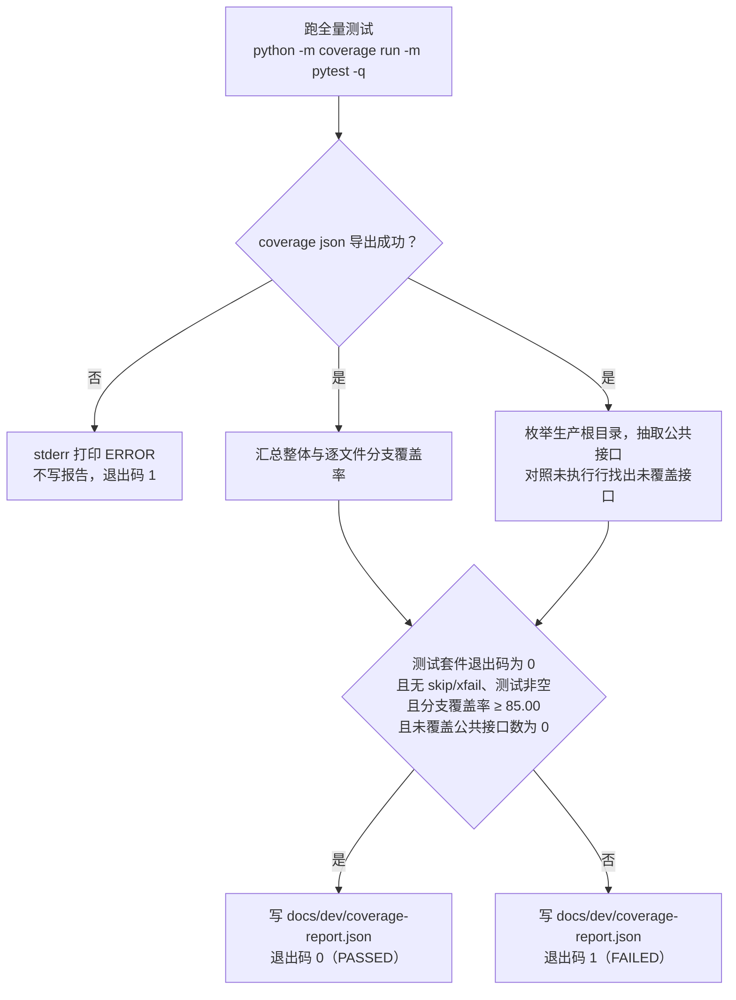

# 覆盖率门禁口径与基线

> 状态：个人事务与工作安排特性（实施阶段 1–4 与阶段 5 的补测）合入后的最终代码已通过离线工程门禁；此前各特性及主线数字保留历史身份，不与当前结果相加
> 日期：2026-10-04
> 范围：覆盖率门禁的判定口径、测量与排除范围、失败关闭约定、使用命令与基线记录；功能 spec 测试用例覆盖率矩阵的维护见 `docs/dev/ANALYSIS-spec-coverage.md`

门禁是 `scripts/coverage_gate.py` 一件事：跑全量测试，用 coverage 的分支数据与生产源码的公共接口清单做两项机器判定，把结果写进 `docs/dev/coverage-report.json`，用退出码 0 或 1 表态。本文描述该脚本当前的实际行为。

个人事务与工作安排特性的分支头 `964de503b71ed9931acbc34f4d853cfe6e4d0dc9`（含最终代码与测试提交 `a7e2fdc` 之后的两个运行查看器提交与全部实现后文档）已通过门禁：5,851 passed、0 failed、7 skipped，分支覆盖率 95.15%，未覆盖公共接口为零，该报告是历史版本证据，本次须重新生成；此前最终代码与测试提交 `a7e2fdc3e07a0c1962cd4312e6b9956ab6ea74a2` 上的门禁结果相同（7 项都是既有平台或产物条件跳过），留作历史。数字见「基线记录」首节，完整证据见 [个人事务与工作安排验收记录](errands-workday-verification.md)。

一日运行保真特性的最终代码提交 `147843655aa00621488a306e68ecf98c5273b3bf` 的门禁结果（4,987 passed、7 个既有跳过，分支 95.05%，未覆盖公共接口为零）保留为历史基线，见「基线记录」第二节与 [一日运行保真验收记录](dayrun-fidelity-verification.md)。

人物 Prompt 七层特性的最终代码提交 `e80404099946187a9def070c9e9ae05c45c14621` 的门禁结果（4,295 passed、8 个既有跳过，分支 94.88%，未覆盖公共接口为零）保留为历史基线，见「基线记录」第三节与 [人物 Prompt 验收记录](persona-prompt-verification.md)。

时间与能量特性的最终代码提交 `ef13dc58770af52000a1c2e81883561e85a0c904` 的门禁结果（3978 passed、8 个既有跳过，分支 94.57%，未覆盖公共接口为零）保留为历史基线，见「基线记录」第四节与 [时间与能量验收记录](research/time-and-energy-verification.md)。

地图与门店供给独立分支的最终验收提交 `017d49c4a246c0c524e541571220e1a07b16ce87` 已通过门禁：
3240 passed、4 个历史运行锚定用例因原产物缺失而 skipped，分支覆盖率 98.49%，未覆盖公共接口为零。
本特性新增用例无跳过；原始机器报告、完整输出和独立审查见 [本特性验收记录](research/map-and-storefront-verification.md)。
该数字与下文主线历史基线均保留原身份；地图与品类主线组合的结果单列为历史基线，完整证据见 [主线组合验收](research/map-and-storefront-main-verification.md)。

## 门禁流程



## 覆盖率口径

本项目验收采用三项覆盖率口径：两项由门禁机器判定，一项是映射义务。

| 覆盖率口径 | 目标 | 口径定义 | 判定方式 |
| --- | --- | --- | --- |
| 功能 spec 测试用例覆盖率 | 100% | `docs/dev/SPEC-*.md` 各特性规格的每条规格条款映射到至少一个具体测试用例 | 映射义务，随测试命名与映射矩阵评审维护；`scripts/coverage_gate.py` 不计算该项 |
| 接口覆盖率 | 100% | 三个生产根目录下全部 `.py` 文件中，模块顶层与类体直接定义的、非下划线开头的 `def` / `async def`（含类方法；`__init__` 等 dunder 与函数体内嵌套定义的函数均不计），其函数体全部行均被测试执行 | 机器判定：函数体行号区间内任一行出现在 coverage 的 `missing_lines` 即为未覆盖 |
| 分支覆盖率 | ≥ 85.00% | coverage branch 模式下 `covered_branches / (covered_branches + missing_branches)`，按 coverage 结果中的全部文件汇总，两位小数 | 机器判定：与 `BRANCH_THRESHOLD` 比较，判定式为 `branch_percent >= threshold` |

## 失败关闭约定

- 文件位于生产根目录但未被 coverage 测量（如从未被导入）：其全部公共接口计为未覆盖——防止脚本读不到某文件的覆盖数据时静默漏检。
- 汇总分支总数为 0（测量管道无数据）：整体分支覆盖率按 0.00% 判定，门禁不通过。
- 测试套件非零退出：顶层判定不通过，无论覆盖率数值如何。
- 覆盖数据导出失败（`coverage json` 非零退出）：向 stderr 打印 `ERROR`，不写报告，退出码 1。
- 生产源文件无法解析（语法错误）：抛出携带文件名与行号的 `RuntimeError`，门禁中断，不产生报告。

## 测量范围与排除

- 测量范围：`src/worldmock`、`custom/agents`、`custom/envs`。三者同时是 `pyproject.toml` 的 `[tool.coverage.run] source` 与脚本的 `PRODUCTION_ROOTS`。`custom/agents` 与 `custom/envs` 不是包（无 `__init__.py`），coverage 枚举未执行文件时会剪枝非包子目录，故必须显式列到叶子目录才能计入测量。
- 排除项：`tests/`、`scripts/`、`vendor/`（`[tool.coverage.run] omit` 安全网；三者也不在 `source` 目录边界内）。
- 分支模式：`branch = true`，测量与导出均启用；报告显示 `show_missing = true`、`precision = 2`。
- 行排除表（`[tool.coverage.report] exclude_lines`）显式替换默认值：仅保留 `# pragma: no cover` 与 `if TYPE_CHECKING:`；**不含**默认对纯 `...` stub 行的豁免，即未调用的占位实现会计入 `missing_lines` 并被接口覆盖率捕获——与项目「禁止占位实现」的方针一致。

## 使用命令

```bash
# 一键门禁：跑全量 pytest → 导出 coverage JSON → 判定两项机器口径 →
# 写 docs/dev/coverage-report.json；退出码 0=通过 / 1=不通过
python scripts/coverage_gate.py --shards 4

# 分项查看：自行运行覆盖率测量后查看；门禁使用临时隔离数据目录
python -m coverage run -m pytest -q
python -m coverage report          # 终端汇总表
python -m coverage html            # HTML 明细
```

`docs/dev/coverage-report.json` 是生成物，每次运行覆盖重写，内容为：生成时间、执行命令、证据身份（本次运行的 `snapshot_id`、覆盖数据的 `manifest_hash`、被测源代码的 Git 提交哈希 `source_identity`；取不到提交身份即失败）、阈值、整体分支覆盖（covered / missing / total / percent / passed）、逐文件分支覆盖、未覆盖公共接口清单（`文件:行:函数名:种类`）、顶层判定位 `passed`。

每次门禁使用当前解释器和独立 coverage 数据目录，各分片完整执行一次后合并；历史覆盖文件不能混入。任一测试失败、skip、xfail、空测试集或缺失报告均不能放行。

## 基线记录

### 历史：个人事务与工作安排特性合入后

完整门禁的被测源码提交为 `964de503b71ed9931acbc34f4d853cfe6e4d0dc9`（`964de50`，门禁运行时特性分支 `feat/errands-workday` 的分支头：个人事务与工作安排实施阶段 1–4、各阶段评审修复、
两轮独立源码变异审查的补测与最终代码与测试提交 `a7e2fdc` 之后，另含实现后文档、登记表的阶段 7 标记与两个运行查看器提交 `1346e0d`、`6c81126`；`src/`、`custom/` 与 `scripts/` 自 `59b81a3` 起没有变化），
`docs/dev/coverage-report.json` 生成时间为 `2026-10-04T11:17:50+00:00`，其 `source_identity` 与该提交一致，`snapshot_id` 为 `64abe7a3-eeaf-4eb6-beba-a35939d02131`，
`manifest_hash` 为 `9522116978f83b6b7acc5018e95531a773e262c0f031a33b73461d63953ed8a7`；报告随记录这次运行的文档一并提交。
它取代同一特性在最终代码与测试提交 `a7e2fdc3e07a0c1962cd4312e6b9956ab6ea74a2`（`a7e2fdc`，为覆盖率门禁标出的 13 个公共接口补测试的提交，早于两个查看器提交）上的报告
（随 `8613139` 提交：5,851 passed、7 skipped、0 failed，分支 95.15%，covered=8520、total=8954，未覆盖公共接口 0，墙钟 5678 秒；生成时间 `2026-10-04T07:51:02+00:00`，
`snapshot_id` 为 `b7136dcb-0be8-4241-9f48-3638cda20c5b`，`manifest_hash` 为 `0d9a62cc427c8a1a4bf8a69c345f8e1c06ecaae7af94278a751d31ee5fd2e471`）。
更早在 `04249f1` 上的预跑（5,751 passed、7 skipped、0 failed，分支 94.97%，未覆盖公共接口 13，判定不通过，报告未提交）已被 `a7e2fdc` 上的运行取代。

| 指标 | 个人事务与工作安排特性合入后的完整门禁 |
| --- | --- |
| 全量 pytest | 5,851 passed、0 failed、0 errors、7 skipped：隔离的干净 worktree 上带覆盖率的十二个分片合计（慢文件按测试节点拆分），每个分片退出码为 0，墙钟 4792 秒；这次带覆盖率的分片运行就是分支头上的全量证据。通过数与 `a7e2fdc` 上的运行相同：运行查看器新增的 Node 用例在同一个 pytest 节点里执行。跳过的数目与所在分片同 `a7e2fdc` 上的运行，后者都是既有的平台或产物条件跳过：TextWorld 在项目锁定文件中没有 Windows wheel、Windows 账户没有符号链接权限、锚定运行产物不在本机 |
| 整体分支覆盖率 | 95.15%（covered=8520，missing=434，total=8954；阈值 85.00） |
| 未覆盖公共接口数 | 0 |
| 顶层判定 `passed` | true（通过） |

门禁按同一判定逻辑分片执行：十二个并行分片各执行 `coverage run -p -m pytest -q <均衡分配的测试文件>`，随后 `coverage combine`、`coverage json`，
再调用 `scripts/coverage_gate.py` 自己的判定函数；被测的测试集与度量口径同串行命令 `uv run coverage run -m pytest -q`，判定逻辑与阈值不变。
报告中的 `command` 字段如实记为实际执行的分片命令，不是脚本常量 `uv run coverage run -m pytest -q`。
分片明细、预跑标出的 13 个接口、两轮独立源码变异审查与门禁细节见[个人事务与工作安排验收记录](errands-workday-verification.md)。

### 一日运行保真特性合入后的历史基线

完整门禁的被测源码提交为 `147843655aa00621488a306e68ecf98c5273b3bf`（`1478436`，一日运行保真阶段 1–5、全部修复、三路独立语义突变审查的补测与验收登记表合入后，
为覆盖率门禁标出的五个接口补行为测试的最终代码），`docs/dev/coverage-report.json` 生成时间为 `2026-09-30T01:12:32+00:00`，其 `source_identity` 与该提交一致，
`snapshot_id` 为 `e100130f-4612-41e3-aa1d-9280298c99f6`，`manifest_hash` 为 `d810f515db96e449f5083bb5484af3e91a6008421d451db3cda8223af670396f`；报告随 `b7f85f9` 提交（只含该报告）。
它取代同一特性在 `9a5f508` 上的首次门禁（4,982 passed、7 skipped、0 failed，分支 94.96%，covered=7910、total=8330，未覆盖公共接口 6，判定不通过，报告未提交）。

| 指标 | 一日运行保真特性合入后的完整门禁 |
| --- | --- |
| 全量 pytest | 4,987 passed、0 failed、7 skipped，25 warnings（与上一次完整门禁的警告数相同）：覆盖率下六个分片合计，252 个测试文件；没有另跑一次不带覆盖率的 `pytest tests`。跳过都是既有的平台或产物条件跳过：TextWorld 在项目锁定文件中没有 Windows wheel 1 项、Windows 账户没有符号链接权限 2 项、资金锚定运行产物不在本机 4 项；本特性新增用例无跳过 |
| 整体分支覆盖率 | 95.05%（covered=7916，missing=412，total=8328；阈值 85.00） |
| 未覆盖公共接口数 | 0 |
| 顶层判定 `passed` | true（通过） |

本机 `uv run` 不可用（AS2 子模块 `vendor/agentsociety2` 未检出，`uv` 找不到可编辑依赖），门禁按同一判定逻辑分片执行：
以虚拟环境解释器分六个分片并行执行 `python -m coverage run -p -m pytest`（每个目录的测试文件在同一分片内连续），覆盖全部测试目录，分片合计 4,987 passed、
7 skipped、0 failed；查看器回归经 VS Code 自带的 Electron 以 Node 方式运行，LabelKit 用例经目录联接借用主工作区的 LabelKit 虚拟环境；随后 `coverage combine`，
再调用 `scripts/coverage_gate.py` 的 `main()`，以分片的测试退出码（0）代替其内部的全量测试，以虚拟环境解释器的 `python -m coverage json` 代替 `uv run coverage json`，
判定逻辑、阈值与报告格式不变。报告中的 `command` 字段仍是脚本常量 `uv run coverage run -m pytest -q`。
分片明细、独立语义突变审查与门禁细节见[一日运行保真验收记录](dayrun-fidelity-verification.md)。

### 人物 Prompt 七层特性合入后的历史基线

完整门禁的被测源码提交为 `e80404099946187a9def070c9e9ae05c45c14621`（`e804040`，人物 Prompt 七层阶段 1–6、评审修复、两路测试加固与规格符合性修复全部合入后的最终代码），
`docs/dev/coverage-report.json` 生成时间为 `2026-09-28T15:39:41+00:00`，其 `source_identity` 与该提交一致，`snapshot_id` 为
`ce9092b7-c81e-45fe-9046-395d20212185`，`manifest_hash` 为 `350dcc52460e04fccdcb5d41a39bfe6163646cd8a3bf6498864642309a379a0a`；报告随 `95a4447` 提交（只含该报告）。
它取代同一特性在 `f798ea7` 上的报告（随 `da0d393` 提交：4258 个不重复用例 passed、8 skipped，分支 94.84%，covered=7451、total=7856，未覆盖公共接口 0）。

| 指标 | 人物 Prompt 七层特性合入后的完整门禁 |
| --- | --- |
| 全量 pytest | 4,295 passed、0 failed、8 skipped：一次调用 `python -m pytest tests`，25 warnings（与实施前基线的警告数相同），用时 1:04:15；覆盖率下八个分片合计相同。跳过都是既有的平台或产物条件跳过：TextWorld 在项目锁定文件中没有 Windows wheel 1 项、Windows 账户没有符号链接权限 3 项、资金锚定运行产物不在本机 4 项；本特性新增用例无跳过 |
| 整体分支覆盖率 | 94.88%（covered=7467，missing=403，total=7870；阈值 85.00） |
| 未覆盖公共接口数 | 0 |
| 顶层判定 `passed` | true（通过） |

本机 `uv run` 不可用（AS2 子模块 `vendor/agentsociety2` 未检出，`uv` 找不到可编辑依赖），门禁按同一判定逻辑分片执行：
在主工作区以虚拟环境解释器分八个分片（至多三个并行）执行 `python -m coverage run -p -m pytest`，覆盖全部测试目录，分片合计 4,295 passed、
8 skipped、0 failed，与一次调用相同；查看器回归经 Node 24 运行；随后 `coverage combine`，再调用 `scripts/coverage_gate.py` 的 `main()`，
以分片的测试退出码（0）代替其内部的全量测试，以虚拟环境解释器的 `python -m coverage json` 代替 `uv run coverage json`，
判定逻辑、阈值与报告格式不变。报告中的 `command` 字段仍是脚本常量 `uv run coverage run -m pytest -q`。
逐阶段评审、独立语义突变审查与门禁明细见[人物 Prompt 验收记录](persona-prompt-verification.md)。

### 时间与能量特性合入后的历史基线

完整门禁的被测源码提交为 `ef13dc58770af52000a1c2e81883561e85a0c904`（`ef13dc5`，时间与能量阶段 0–7 全部合入后的最终代码），
`docs/dev/coverage-report.json` 生成时间为 `2026-09-26T16:30:56+00:00`，其 `source_identity` 与该提交一致；报告随 `82e1698` 提交。

| 指标 | 时间与能量特性合入后的完整门禁 |
| --- | --- |
| 全量 pytest | 3978 passed、0 failed、8 skipped；跳过都是既有的平台或产物条件跳过：TextWorld 在项目锁定文件中没有 Windows wheel 1 项、Windows 账户没有符号链接权限 3 项、资金锚定运行产物不在本机 4 项；本特性新增用例无跳过 |
| 整体分支覆盖率 | 94.57%（covered=7104，missing=408，total=7512；阈值 85.00） |
| 未覆盖公共接口数 | 0 |
| 顶层判定 `passed` | true（通过） |

门禁在 Windows 11 本机运行。此前提交的报告是 2026-09-22 的一次中断运行（`passed` 为 false），已被本次报告取代。
逐阶段评审、VF4 语义突变与门禁明细见[时间与能量验收记录](research/time-and-energy-verification.md)。

### 地图与品类主线组合的历史基线

完整门禁的生产源码提交为 `70af9a70f82ebe9b2b33d5f4d7327f59de150002`，
`docs/dev/coverage-report.json` 生成时间为 `2026-09-20T13:54:27+00:00`，其 `source_identity` 与该提交一致。

| 指标 | 当前组合的完整门禁 |
| --- | --- |
| 全量 pytest | 3550 passed、0 failed、4 skipped；跳过均为既有历史运行产物缺失，本特性和组合新增用例无跳过 |
| 整体分支覆盖率 | 96.48%（covered=6653，missing=243，total=6896；阈值 85.00） |
| 未覆盖公共接口数 | 0 |
| 顶层判定 `passed` | true（通过） |

后续 `6fe3ab7b1711c5d7bee9d0bf3f4f22d48a53cb82` 仅保存这份覆盖率报告，并增加真实 SQL 成功重试后两条缓存清空断言；
生产源码与完整门禁提交逐字节相同。相关回归 73 passed，原存活补丁和独立供给缓存突变复验均 killed。
这不是在 `6fe3ab7` 重新执行全量门禁，不将定向计数与全量计数相加。完整命令、原始审查结果和复验证据归
[主线组合验收](research/map-and-storefront-main-verification.md)。

### 合并地图之前的主线历史基线

以下为交互菜单与品类主线的固定历史基线，不能代表加入地图后的当前组合：
基线取自 `docs/dev/coverage-report.json`，生成于 2026-09-20T11:01:47+00:00，
被测源代码提交为 `a651dc5db539d38be113f494eaf3580e387c3cf2`。

| 指标 | 数值 |
| --- | --- |
| 全量 pytest | 3280 passed、0 failed、0 skipped |
| 整体分支覆盖率 | 96.69%（covered=6300，missing=216，total=6516；阈值 85.00） |
| 未覆盖公共接口数 | 0 |
| 顶层判定 `passed` | true（通过） |

历史资金锚定测试读取本机已有运行的只读数据库，未创建替代数据或跳过测试。
该工程门禁验证离线测试，不代表正式十二周模型运行或真实交付整体验收。
本次执行的完整命令与原始输出归档在 `docs/dev/evidence/interaction-menu/main-merge.json.gz`。
门禁运行于固定合并提交的隔离工作区，覆盖率数据独立保存，脚本及判定逻辑没有改变。
交互菜单与品类、库存和决策上下文在该固定提交的合并结果见
[主线合并验收](research/interaction-menu-main-verification.md)。
地图与门店供给的独立历史门禁保存在 [地图特性验收](research/map-and-storefront-verification.md)，不覆盖上表记录；当前组合的独立完整门禁见本节前表。
品类契约原分支逐项证据记录在 `docs/dev/category-contract-verification.md`；
其先前 3166 项测试与模型库存补修结果继续保留在 `docs/dev/category-contract-main-verification.md`。

## 版本表

| 版本 | 日期 | 修订内容 |
| --- | --- | --- |
| `2026-09-18` | 2026-09-18 | 覆盖率门禁口径与基线记录：两项机器口径、一项映射义务；失败关闭约定；测量范围与排除。 |
| `2026-09-18-revision-1` | 2026-09-18 | 行文与结构改造：状态头改为 LabelKit 形态；章节标题改为概念命名；口径与阈值逐项对照 `scripts/coverage_gate.py` 与 `pyproject.toml` 重写；基线改以 `docs/dev/coverage-report.json` 实产物为准并标注观察时间。 |
| `2026-09-18-revision-2` | 2026-09-18 | 失败关闭约定按 `scripts/coverage_gate.py` 的 `parse_production_source` 原文纠正：语法错误抛出的 `RuntimeError` 只携带文件名与行号。 |
| `2026-09-20` | 2026-09-20 | 更新为品类契约固定提交上的完整通过基线；保留离线门禁与真实实验的证据边界。 |
| `2026-09-20-main-merge` | 2026-09-20 | 更新为合并决策上下文并补修模型库存路径后的完整门禁，保留原分支历史快照。 |
| `2026-09-20-interaction-menu-merge` | 2026-09-20 | 更新为交互菜单与已有品类、库存和决策上下文合并后的完整门禁。 |
| `2026-09-20-map-main-merge` | 2026-09-20 | 单列地图与品类主线组合的 70af9a7 完整门禁，以及生产源码不变的 6fe3ab7 测试加固与独立复验；保留旧统计身份。 |
| `2026-09-20-map-path` | 2026-09-20 | 地图分支曾将输出路径记录为 `docs/coverage-report.json`；当前组合以 main 脚本实际 `docs/dev/coverage-report.json` 为准；历史基线保留原始路径、数值与源码身份。 |
| `2026-09-26-time-and-energy` | 2026-09-26 | 基线记录按时间与能量特性合入后 `ef13dc5` 重新生成的报告改写（CB1）：3978 passed、8 skipped、分支 94.57%、未覆盖公共接口 0，取代 2026-09-22 的中断运行报告；原「当前地图与品类主线组合」一节改为历史基线，数值与源码身份不变。 |
| `2026-09-28-persona-prompt` | 2026-09-28 | 基线记录按人物 Prompt 七层特性合入后 `f798ea7` 重新生成的报告改写（人物 Prompt 台账 CB1）：4258 个不重复用例 passed、0 failed、8 skipped，分支 94.84%（7451/7856），未覆盖公共接口 0；写明本机 `uv run` 不可用，门禁以八个覆盖率分片执行后合并，再以同一判定逻辑运行 `scripts/coverage_gate.py`；原「当前：时间与能量特性合入后」一节改为历史基线，数值与源码身份不变；文件头状态与日期改写 |
| `2026-09-28-persona-prompt-final` | 2026-09-28 | 基线记录按最终代码 `e804040`（两路测试加固与规格符合性修复合入后）重新生成的报告改写（人物 Prompt 台账 CB1）：4,295 passed、0 failed、8 skipped（一次调用与八个覆盖率分片相同），分支 94.88%（7467/7870），未覆盖公共接口 0，报告随 `95a4447` 提交；取代 `f798ea7` 的报告（`da0d393`），其数字在「基线记录」首节留一句；分片说明删去完整性守卫重复计入的去重口径 |
| `2026-09-29-dayrun-fidelity` | 2026-09-29 | 基线记录按一日运行保真特性合入后的最终代码 `1478436` 重新生成的报告改写（一日运行保真实现后文档，随[验收记录](dayrun-fidelity-verification.md)）：4,987 passed、0 failed、7 skipped（覆盖率下六个分片合计，没有另跑不带覆盖率的一次调用），分支 95.05%（7916/8328），未覆盖公共接口 0，报告随 `b7f85f9` 提交；取代 `9a5f508` 上未通过的首次门禁（未覆盖公共接口 6），其数字在「基线记录」首节留一句；原「当前：人物 Prompt 七层特性合入后」一节改为历史基线，数值与源码身份不变；文件头状态、日期与首段改写 |
| `2026-10-04-errands-workday` | 2026-10-04 | 基线记录按个人事务与工作安排特性合入后的最终代码与测试提交 `a7e2fdc` 重新生成的报告改写（个人事务与工作安排实现后文档，随[验收记录](errands-workday-verification.md)；该特性的实施计划没有单列这一作业）：5,851 passed、0 failed、7 skipped（隔离 worktree 上带覆盖率的十二个分片合计），分支 95.15%（8520/8954），未覆盖公共接口 0，报告随该特性的实现后文档提交，`command` 字段记实际执行的分片命令；取代 `04249f1` 上未通过的预跑（未覆盖公共接口 13），其数字在「基线记录」首节留一句；原「当前：一日运行保真特性合入后」一节改为历史基线，数值与源码身份不变；文件头状态、日期与首段改写 |
| `2026-10-04-errands-workday-branch-head` | 2026-10-04 | 基线记录首节按分支头 `964de50` 上重新生成的报告改写（最终门禁在实现后文档与两个运行查看器提交 `1346e0d`、`6c81126` 之后重跑，随[验收记录](errands-workday-verification.md)「全量门禁与覆盖率」）：5,851 passed、0 failed、7 skipped（隔离 worktree 上带覆盖率的十二个分片合计，墙钟 4792 秒），分支 95.15%（8520/8954），未覆盖公共接口 0，`snapshot_id` 为 `64abe7a3-eeaf-4eb6-beba-a35939d02131`，报告随记录这次运行的文档提交；取代 `a7e2fdc` 的报告（`8613139`），其数字与报告身份在「基线记录」首节留一句；首段改写，其余各节不变 |
