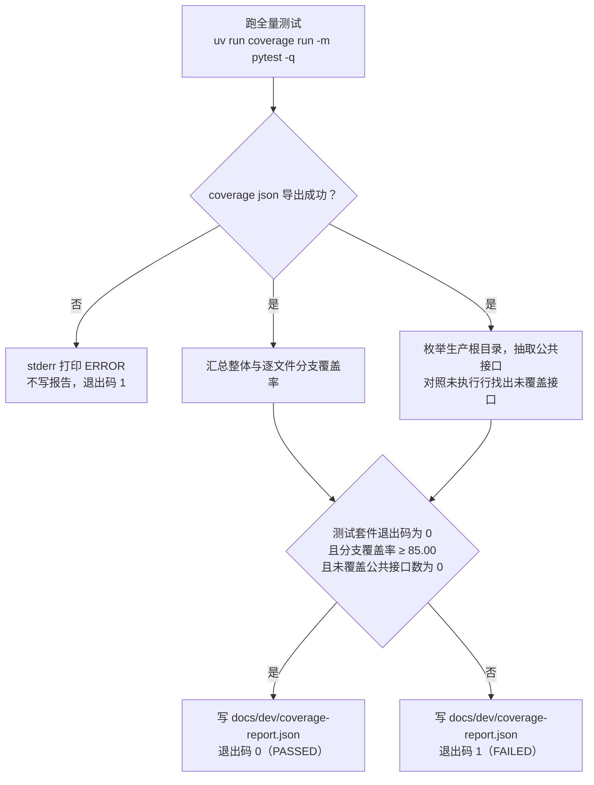

# 覆盖率门禁口径与基线

> 状态：本文口径与 `scripts/coverage_gate.py` 实现逐项一致；最近一次门禁记录两项机器口径达标（整体分支覆盖率 99.01% ≥ 85.00，未覆盖公共接口 0），顶层判定为不通过——该次运行的测试套件退出码非 0
> 日期：2026-09-18
> 范围：覆盖率门禁的判定口径、测量与排除范围、失败关闭约定、使用命令与基线记录；功能 spec 测试用例覆盖率矩阵的维护见 `docs/dev/ANALYSIS-spec-coverage.md`

门禁是 `scripts/coverage_gate.py` 一件事：跑全量测试，用 coverage 的分支数据与生产源码的公共接口清单做两项机器判定，把结果写进 `docs/dev/coverage-report.json`，用退出码 0 或 1 表态。本文描述该脚本当前的实际行为。

## 门禁流程



## 覆盖率口径

本项目验收采用三项覆盖率口径：两项由门禁机器判定，一项是映射义务。

| 覆盖率口径 | 目标 | 口径定义 | 判定方式 |
| --- | --- | --- | --- |
| 功能 spec 测试用例覆盖率 | 100% | `docs/dev/SPEC-*.md` 各特性规格的每条规格条款映射到至少一个具体测试用例 | 映射义务，随测试命名与映射矩阵评审维护；`scripts/coverage_gate.py` 不计算该项 |
| 接口覆盖率 | 100% | 三个生产根目录下全部 `.py` 文件中，模块顶层与类体直接定义的、非下划线开头的 `def` / `async def`（含类方法；`__init__` 等 dunder 与函数体内嵌套定义的函数均不计），其函数体全部行均被测试执行 | 机器判定：函数体行号区间内任一行出现在 coverage 的 `missing_lines` 即为未覆盖 |
| 分支覆盖率 | ≥ 85.00% | coverage branch 模式下 `covered_branches / (covered_branches + missing_branches)`，按 coverage 结果中的全部文件汇总，两位小数 | 机器判定：与 `BRANCH_THRESHOLD` 比较，判定式为 `branch_percent >= threshold` |

## 失败关闭约定

- 文件位于生产根目录但未被 coverage 测量（如从未被导入）：其全部公共接口计为未覆盖——防止脚本读不到某文件的覆盖数据时静默漏检。
- 汇总分支总数为 0（测量管道无数据）：整体分支覆盖率按 0.00% 判定，门禁不通过。
- 测试套件非零退出：顶层判定不通过，无论覆盖率数值如何。
- 覆盖数据导出失败（`coverage json` 非零退出）：向 stderr 打印 `ERROR`，不写报告，退出码 1。
- 生产源文件无法解析（语法错误）：抛出携带文件名与行号的 `RuntimeError`，门禁中断，不产生报告。

## 测量范围与排除

- 测量范围：`src/worldmock`、`custom/agents`、`custom/envs`。三者同时是 `pyproject.toml` 的 `[tool.coverage.run] source` 与脚本的 `PRODUCTION_ROOTS`。`custom/agents` 与 `custom/envs` 不是包（无 `__init__.py`），coverage 枚举未执行文件时会剪枝非包子目录，故必须显式列到叶子目录才能计入测量。
- 排除项：`tests/`、`scripts/`、`vendor/`（`[tool.coverage.run] omit` 安全网；三者也不在 `source` 目录边界内）。
- 分支模式：`branch = true`，测量与导出均启用；报告显示 `show_missing = true`、`precision = 2`。
- 行排除表（`[tool.coverage.report] exclude_lines`）显式替换默认值：仅保留 `# pragma: no cover` 与 `if TYPE_CHECKING:`；**不含**默认对纯 `...` stub 行的豁免，即未调用的占位实现会计入 `missing_lines` 并被接口覆盖率捕获——与项目「禁止占位实现」的方针一致。

## 使用命令

```bash
# 一键门禁：跑全量 pytest → 导出 coverage JSON → 判定两项机器口径 →
# 写 docs/dev/coverage-report.json；退出码 0=通过 / 1=不通过
uv run python scripts/coverage_gate.py

# 分项查看（需先有 .coverage 数据，可由门禁脚本产生）
uv run coverage report          # 终端汇总表
uv run coverage html            # HTML 明细
```

`docs/dev/coverage-report.json` 是生成物，每次运行覆盖重写，内容为：生成时间、执行命令、证据身份（本次运行的 `snapshot_id`、覆盖数据的 `manifest_hash`、被测源代码的 Git 提交哈希 `source_identity`，取不到时记为 `unknown`）、阈值、整体分支覆盖（covered / missing / total / percent / passed）、逐文件分支覆盖、未覆盖公共接口清单（`文件:行:函数名:种类`）、顶层判定位 `passed`。

## 基线记录

基线取自磁盘上的最近一次门禁产物 `docs/dev/coverage-report.json`（观察时间 2026-09-18T12:24:15+00:00，`source_identity` 为 `8991a1047764e279392967fa832ad48210558cdc`）：

| 指标 | 数值 |
| --- | --- |
| 整体分支覆盖率 | 99.01%（covered=5580，missing=56，total=5636；阈值 85.00） |
| 未覆盖公共接口数 | 0 |
| 两项机器口径 | 分支覆盖率达标、接口覆盖率达标 |
| 顶层判定 `passed` | false（未通过） |

顶层判定为 false 的成因是合取判定：该次运行的测试套件退出码非 0，两项机器口径本身均达标（报告内 `branch_coverage.passed` 为 true、`uncovered_public_interfaces` 为空）。测试套件是否全绿取决于 `tests/` 全量结果，不在本文的判定口径内。

更早记录的一次基线为整体分支覆盖率 99.03%（covered=5526，missing=54，total=5580）、未覆盖公共接口 0、全量 pytest 2525 passed / 0 failed、门禁判定 PASSED。该组数字未出现在本文核对所依据的任何门禁产物中，故基线以上表为准。

## 版本表

| 版本 | 日期 | 修订内容 |
| --- | --- | --- |
| `2026-09-18` | 2026-09-18 | 覆盖率门禁口径与基线记录：两项机器口径、一项映射义务；失败关闭约定；测量范围与排除。 |
| `2026-09-18-revision-1` | 2026-09-18 | 行文与结构改造：状态头改为 LabelKit 形态；章节标题改为概念命名；口径与阈值逐项对照 `scripts/coverage_gate.py` 与 `pyproject.toml` 重写；基线改以 `docs/dev/coverage-report.json` 实产物为准并标注观察时间。 |
| `2026-09-18-revision-2` | 2026-09-18 | 失败关闭约定按 `scripts/coverage_gate.py` 的 `parse_production_source` 原文纠正：语法错误抛出的 `RuntimeError` 只携带文件名与行号。 |
