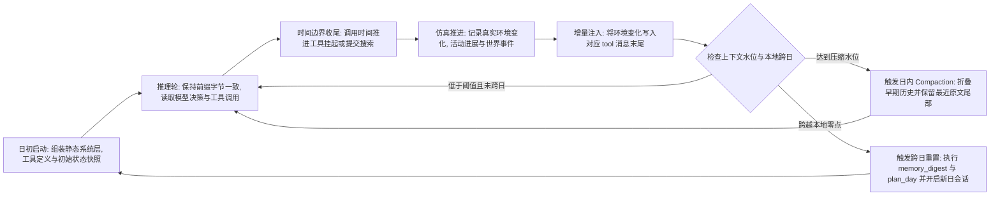
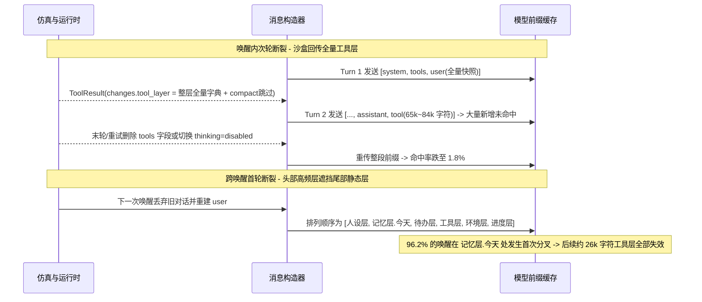
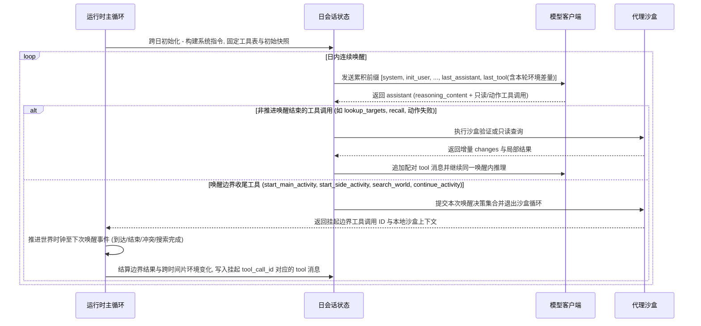
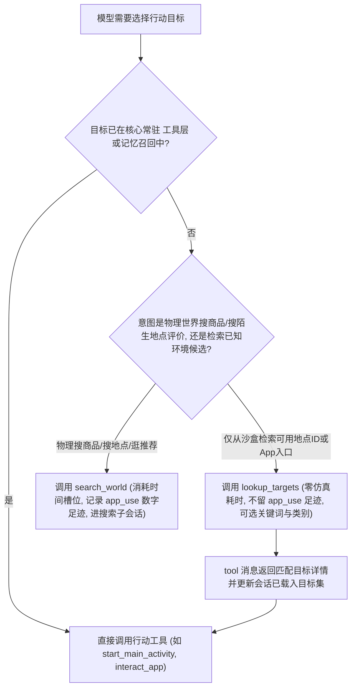
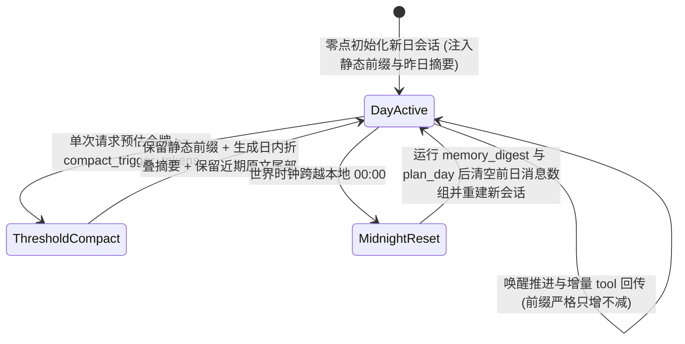

# 日会话连续上下文、Tool Search 与 Prefix Cache 优化方案

- 状态：提案，待评审；本文不改变当前运行规则与代码实现
- 基线提交：`28e7660c`
- 相关设计文档：[architecture](../../design/01-architecture.md)、[simulation-engine](../../design/04-simulation-engine.md)、[recording-engine](../../design/05-recording-engine.md)、[agent](../../design/06-agent.md)、[configuration](../../design/08-configuration.md)、[io-formats](../../design/09-io-formats.md)、[runtime](../../design/10-runtime.md)
- 前期上下文与循环分析：[agent-loop-and-search-session](../agent-loop-and-search-session/PROPOSAL.md)、[context-architecture](../context-architecture/ANALYSIS-context-architecture.md)

## 1. 目标与心智模型对齐

当前 WorldMock 的常规唤醒采用跨唤醒整页快照重建模式：每次仿真推进到新时间边界，运行时丢弃上一轮对话历史，将全量状态重新拼接成单条 `user` 消息发送给模型，导致静态尾部被高频变动层阻断、沙盒回传整层冗余字典，以及长工具清单随状态全局重算。本提案的目标是将代理上下文重构为与主流编码代理同构的日会话（Day Session）连续追加流，同时保持四引擎边界与确定性回放语义。



核心目标归纳如下：

- **编码代理同构的日会话追加流**：同一人格在单个本地日内维持连续的多轮 `[system, initial_user, assistant, tool, ...]` 对话历史，每轮系统只通过配对的 `tool` 消息注入环境差量，彻底消除跨唤醒全量重建与二次 `user` 消息插入导致的缓存失效及推理链冲突。
- **统一的边界退出与真实差量闭环**：所有唤醒必须以时间推进或边界挂起工具调用结束，消除纯文本空闲退出分支，并修复观察差量、沙盒搜索恢复与工具消息序列化链路中的整层覆盖缺陷。
- **核心常驻工具层瘦身与零耗时目标检索**：常驻 `工具层` 仅保留当前位置动作与高频常驻锚点，移除每轮滚动商品窗；引入只读零仿真耗时的 `lookup_targets` 检索沙盒，替代通过全表枚举或强塞时间与数字足迹的 `search_world` 来探测位置或应用。
- **双触发上下文控制与可观测性**：引入可配置的水位触发日内 Compaction，遏制未压缩长历史下推理思考文本引起的二次方缓存流量成本，同时在跨日零点结清记忆与日计划并重建纯净新日会话；同步修复后台任务键顺序、工具列表恒定性及缓存命中指标统计。

---

## 2. 现行快照重建与沙盒整层回传的缓存瓶颈

基于基线提交下的实跑模型消费记录（`20261125T092034Z-tsinghua-anon-v7-8k-mem1000-4day`，使用 `deepseek-flash`，总计 `1,072` 次调用与 `475` 次常规唤醒）及 `30` 天长程运行（`20261019T114100Z-zhaoming-30day`）审计，当前输入成本几乎全部消耗在非缓存令牌上。在 `0.1x` 命中与 `1.0x` 未命中计费模型下，`4` 天样本非缓存费用占比达 `84.9%`，`30` 天样本非缓存费用占比高达 `90.8%`。

### 2.1 前缀命中断裂与次轮退化机制

前缀缓存要求严格字节对齐的头部序列，任何偏移位置上的单字符变动都会使其后全部内容缓存失效。当前实现存在唤醒间与唤醒内两种典型断裂链路：



### 2.2 实测未命中成本结构分解

下表展示了 `4` 天实跑基线的精确模型令牌分解（总提示 `31,843,687`、命中 `20,405,248` 即 `64.1%`、未命中 `11,438,439` 即 `35.9%`、输出 `642,258`）：

| # | 调用类别 | 调用次数 | 总提示令牌 | 命中率 | 未命中令牌 | 占全部未命中比例 | 单次平均未命中 |
| --- | --- | --- | --- | --- | --- | --- | --- |
| 1 | 唤醒次轮及以上含沙盒整层回传 | 393 | 12,566,184 | 52.1% | 6,015,623 | 52.6% | 15,307 |
| 2 | 唤醒首轮全量快照重建 | 475 | 10,984,999 | 52.8% | 5,181,351 | 45.3% | 10,908 |
| 3 | 后台次日计划生成 (`plan_day`) | 9 | 98,698 | 0.0% | 98,698 | 0.9% | 10,966 |
| 4 | 后台记忆归纳 (`memory_digest`) | 6 | 70,221 | 0.0% | 70,221 | 0.6% | 11,704 |
| 5 | 轻量只读工具与小型恢复轮 | 144 | 4,485,401 | 98.9% | 50,713 | 0.4% | 352 |
| 6 | 搜索子会话 (`search_session`) | 45 | 120,905 | 81.9% | 21,833 | 0.2% | 485 |

在首轮 `user` 数组内部，各层平均字符体积及其稳定性呈现极端错配：`工具层` 独占平均 `22,431` 字符（峰值 `42,949` 字符，其中 `location:travel` 平均 `17,876` 字符 / `301` 个目标、`app:interact` 平均 `2,419` 字符 / `42` 个目标、`product:purchase` 平均 `1,035` 字符 / `20` 个商品），`进度层` 平均 `2,350` 字符，`记忆层` 平均 `8,986` 字符（其中 `记忆层.今天` 平均 `7,668` 字符、峰值 `13,699` 字符），而静态 `人设层` 仅 `1,077` 字符。连续两次唤醒之间，有 `92.4%`（`438/474`）处于同一位置与同一本地日期，但因 `记忆层.今天` 在 `96.2%`（`456/474`）的唤醒中发生变化且位于前缀靠前位置，后方近乎不变的大体积 `工具层` 每轮都遭受连带穿透。

### 2.3 代码根因映射

| # | 瓶颈现象 | 真实源码位置与缺陷机理 | 对缓存的具体破坏 |
| --- | --- | --- | --- |
| 1 | 跨唤醒丢弃历史与高频层前置 | `_WakeupRunner` 每次构造全新单轮 `user`；`USER_LAYER_NAMES` 将逐轮追加的 `记忆层.今天` 置于 `工具层` 之前 | `96.2%` 唤醒被 `记忆层.今天` 阻断；历史动作丢失导致系统被迫全量重发 |
| 2 | `changes.tool_layer` 回传整层 | `ObservationBuilder.layer_changes` 在比对发现任一子键不同时直接返回新版本完整顶层块 | 一次活动状态变更触发整层数十个动作组重传，占全部未命中的 `52.6%` |
| 3 | 搜索恢复打平全量五层 | `BarrierMerger._resume_search_payload` 调用 `{**base_layers}` 将搜索基线各层顶层键铺平注入返回 | 单条恢复工具消息膨胀至 `89,628` 字符，且字段暴露超出预期范围 |
| 4 | 工具消息绕过紧凑渲染 | `AgentLoop.tool_message` 直接执行原始 `json.dumps` 序列化，未调用 `render_layer_json` | `tool` 文本中全量工具对象失去 `compact_render` 与字段黑名单压缩，体积倍增 |
| 5 | 全局可用门禁耦合到行级按钮 | `tool_layer.py` 中的 `refusal_for` 将全局活动槽与待总结门禁拼进所有目标的 `available` 与 `reason` | 开始或结束单个活动瞬间翻转 `360+` 个目标行，产生无效的增量差异风暴 |
| 6 | 记忆 `14k` 硬截断重写头槽 | `layout.py` 中的 `_backstop` 在 `记忆层` 超出 `14,000` 字符时回填覆盖早间分时槽位 | 单日下午触发 `5` 次历史槽位重写，彻底摧毁长时段累积前缀 |
| 7 | 末轮删减工具与重试关思考 | `_life_turn_tools` 在末轮或重试时删减 `tools` 列表；`_turn_request` 截断重试关闭 `thinking` | 服务端按 `(tools, thinking, messages)` 计算前缀键，参数切换立即全量未命中 |
| 8 | 日计划静态字段置后 | `prepare_plan_day` 使用 `json.dumps(..., sort_keys=True)` 使 `"人物"` 按字母序排在 `"上一天的目标"` 之后 | 同日复用或重试时静态人物卡片被前置变动字段穿透 |

---

## 3. 日会话连续上下文与环境差量闭环架构

参考 Claude Code 与 Codex CLI 等编码代理的上下文组织方式，WorldMock 的生活决策主循环不再按"单次唤醒 = 独立快照请求"构建，而是重构为**日内单会话持续追加**。一次唤醒在日会话内仅是一段连续推理与环境反馈切片，所有状态推进均通过 `assistant` 发起的工具调用及其配对的 `tool` 响应完成。

### 3.1 完整日内跨唤醒会话闭环



关于消息序列合法性的关键约束：对于支持推理链的模型（如 DeepSeek 推理模式），如果连续多条历史之间额外插入一条 `role: "user"` 来通报"现在时间到了下午，环境发生以下变化"，部分接口契约会直接拒收非尾部轮次残留的用户插话，或强制丢弃前序 `reasoning_content` 并割裂工具语义连贯性。本方案严格遵循编码代理协议：**全天除初始上下文外不再插入任何 `role: "user"` 消息**。模型在上一次唤醒尾端调用边界推进工具后，对话恰好停留在挂起的 `assistant.tool_calls` 上；等到仿真器把世界时间推进到下一唤醒时刻，运行时计算该时间段内的所有真实变化并填充进对应的 `role: "tool"` 消息中，作为模型下一轮推理的起手输入。

### 3.2 日会话数据结构与状态归属

日会话状态属于人格持久世界状态下的运行时对话投影（不跨天长期堆积，但需完整纳入检查点与回放体系）。在 [io-formats](../../design/09-io-formats.md) 与状态模型中新增按人格隔离的日会话结构：

| # | 结构与字段 | 归属模块 | 语义与生命周期 |
| --- | --- | --- | --- |
| 1 | `DaySessionState.local_date` | 人格运行态 | 当前日会话绑定的本地日期字符串，用于判定跨日重置边界 |
| 2 | `DaySessionState.system_prompt` 与 `tools_digest` | 人格运行态 | 会话初始固化的系统层与工具声明摘要，保证日内前缀严格不可变 |
| 3 | `DaySessionState.messages` | 人格运行态 | 当前有效对话历史数组（初始用户层加多轮 `assistant`/`tool` 配对；支持按字节/令牌切片裁剪） |
| 4 | `DaySessionState.pending_boundary_calls` | 人格运行态 | 上一次唤醒退出的未闭合 `tool_call_id` 映射，等待下次唤醒回填环境差量 |
| 5 | `DaySessionState.last_observed_snapshot` | 人格运行态 | 上次发送给模型并已生效的观察基准快照（含核心与已按需载入的目标表），专供差量计算使用 |
| 6 | `DaySessionState.compaction_count` 与 `compacted_through_seq` | 人格运行态 | 本日已触发压缩的次数与已折叠的最后一轮事件序号 |

### 3.3 统一 `xx_activity` 收尾契约与 `continue_activity`

现行代码中当模型在有活跃活动时选择空闲等待（`can_finish_idle`），可以直接输出纯文本并结束唤醒，不留下任何挂起工具调用。若要在下一轮无缝通过 `role: "tool"` 注入环境变化，必须消除"纯文本结束唤醒"这一分支：

- **统一收尾工具清单**：唤醒只能通过以下时间推进或边界挂起工具之一退出，全部记入挂起列表以等待下一次唤醒回填环境差量：
  - `start_main_activity`：开启新主活动并推进或挂起等待结束。
  - `start_side_activity`：并行开启附带活动（或当次同步动作结束后继续挂起推进时间）。
  - `search_world`：提交物理手机搜索会话并消耗对应准备/交互时间，下轮由 `tool` 消息携带搜索会话最终落地结果与物品更新。
  - `continue_activity`（新增最小边界推进工具）：当模型判断当前无需新增任何动作或切换，仅维持当前正在进行的活动或静待既定时间边界（如闹钟、快递到达、活动结束）时必须调用该工具，可选附带简短状态原因字段，禁止再以纯文本结束唤醒。
- **拒绝非边界纯文本退出**：在 `AgentLoop` 收到无工具调用的纯文本响应时，不再以 `can_finish_idle` 放行，而是按协议纠偏机制附加纠正提示要求模型在动作工具或 `continue_activity` 中明确选择一个收尾动作，从而确保每一轮唤醒结束时对话尾部必然存在可配对的环境差量槽位。

### 3.4 `role: "tool"` 环境差量载荷契约与全局门禁解耦

每当新唤醒触发，结算器根据挂起 `tool_call_id` 对应的分支构造统一且紧凑的差量载荷（经 `render_layer_json` 紧凑渲染与黑名单过滤后序列化写入 `tool.content`）：

```json
{
  "ok": true,
  "result": { "...": "上轮挂起活动启动/搜索提交的即时回执或边界冲突撤销说明" },
  "boundary": {
    "observed_at": "2026-10-19T13:45:00+08:00",
    "wake_reasons": ["activity_completed", "location_changed"],
    "events": ["午休小睡结束", "到达目标地点"]
  },
  "changes": {
    "环境层": { "time": "...", "location": "...", "battery": 78 },
    "记忆层": { "今天_append": ["13:45 结束午休..."] },
    "待办层": { "timers_changed": [...] },
    "进度层": { "energy": 85 },
    "工具层": {
      "gate": { "main_slot_busy": false, "pending_conclusions": [] },
      "group_deltas": { "...": "仅包含可用性/参数实际变化的条目" }
    }
  }
}
```

为避免单个状态变化导致整张工具列表发生联动翻转，需对现行架构同步落地三项关键修复：

- **顶层 `gate` 与 `工具层` 行解耦**：废除将全局活动占用与待总结阻断状态写入每个目标行 `available` 与 `reason` 的做法（`tool_layer.py` 中的 `refusal_for` 不再污染单行按钮属性）。全局层面的主槽忙碌状态、正在进行的活动及必须先总结的活动清单统一收口至 `工具层.gate`。各个动作目标仅保留纯粹与自身前置条件相关的状态（如物理不可达、冷却期、余额不足或营业时间）。一旦某活动总结完毕，差量仅产生数十字符的 `gate` 更新，彻底消灭 `360+` 行的无谓重排。
- **真实子键级 `ObservationBuilder.layer_changes`**：改造 `observe.py` 与差量比对逻辑，严格按层语义计算精细补丁：`环境层` 仅输出变更字段；`待办层` 与 `进度层` 输出增删改键值；`记忆层.今天` 在未发生重排时输出增量追加行（`今天_append`）而非重发全部已有段落；`工具层` 仅输出发生实质变动的目标行字典（结合顶层 `gate` 剥离后，常态下每次唤醒变更目标数仅零星几条）。
- **`_resume_search_payload` 去整层化与 `AgentLoop.tool_message` 紧凑序列化**：修正 `merger.py` 中直接解包 `base_layers` 全量五层回填搜索结果消息的缺陷，搜索恢复仅输出经由 `render_layer_json` 过滤的搜索结论与真实差量；同时将 `AgentLoop.tool_message` 全面接入 `render_layer_json` 与 `compact_render`，消除原始未压缩 JSON 冗余空格与黑名单字段。

---

## 4. 常驻工具层瘦身与零耗时沙盒目标检索（Tool Search）

实测数据显示，现行 `工具层` 平均体积达 `22,431` 字符（高负载时超 `42,949` 字符），绝大部分内容由 `location:travel`（平均 `301` 个静态城市地点，占比约八成）和长尾 `app:interact` / `product:purchase` 构成，尽管 `name_resolution.py` 中的 `name_book` 本就支持按名称解析未在首屏展开的实体。同时，现行 `search_world` 是一个绑定物理时间推进（消耗 `3~7` 分钟游戏槽位）且强制归属并记录 `app_use` 数字足迹的仿真活动，绝不能被直接当成无副作用的模型提示词加载器（Prompt Tool Search）。

### 4.1 三级目标发现与调用路由机制

本提案参照 Anthropic Tool Search (`defer_loading`) 模式，将"提示词上下文检索"与"物理世界手机搜索"严格正交拆分为互不干扰的动作路由：



### 4.2 核心常驻 `工具层`、`lookup_targets` 与 `search_world` 职责对比

| # | 能力载体 | 覆盖范围与包含实体 | 仿真时间与数字足迹 | 对前缀缓存与工具列表的影响 |
| --- | --- | --- | --- | --- |
| 1 | 核心常驻 `工具层` | 当前物理停留位置下的可做单元与睡眠；当前主/副进行中与待总结活动；关键生活锚点（`home_location`、`workplace`、城市驿站、城际交通枢纽）；当前位置可直接触达或推送置顶的应用；全局 `gate` 与 `callable_index` 汇总计数 | 属于环境观察，不产生动作耗时与足迹 | 常驻体积从 `22k+` 字符压降至约 `2k~3k` 字符；彻底移除每轮随机滚动的 `20` 个 `product:purchase` 商品窗口（消灭无谓轮转漂移） |
| 2 | 新增 `lookup_targets` | 按类别（`location` / `app` / `product`）与关键词/邻近度分页检索城市地点、应用入口或常规常驻供给的真实结构化参数 | **零仿真时间消耗**，**零 `app_use` 数字足迹**，不进状态变更流水，可在单轮唤醒内连续多次执行 | 工具定义常驻固定列表；仅将模型本轮确实需要查看的少数目标懒加载进入对话后续 `tool` 消息，避免无关全集污染前缀 |
| 3 | 保留 `search_world` | 人格在仿真世界里打开购物、外卖、地图点评或内容搜索类手机应用探索商品列表或长尾陌生场所 | 正常消耗对应时间槽位，强制执行 `Fact Guard`、真实归因与 `app_use` 足迹记录 | 搜索子会话（`SearchSessionRunner`）继续独立运行；回传主会话时不再展开全量五层，只写搜索结论与物品/地点差量 |

关于物理真实性与合法性边界：为了防止模型在未检索前盲猜名称或绕过现实地理约束，`AgentSandbox` 在动作校验时直接沿用 `name_book` 结合人格当前可见全集的机制；而常驻 `工具层` 瘦身后，模型在首次遇到未置顶的城市地点或特定 App 时，通过先调用一次 `lookup_targets` 即可拿到精确目标名与合法动作参数，随后在同一唤醒轮次内无缝衔接调用执行工具，零成本完成闭环。

---

## 5. 水位触发 Compaction、跨日会话重置与检查点恢复

### 5.1 为什么日内不能放任上下文无限增长

即使实现了完美的 `100%` 前缀缓存命中，如果在包含推理过程（`reasoning_content`）的模型上放任单日 `250` 次左右唤醒无限累积而不加折叠，输入令牌成本仍会按 $O(N^2)$ 二次方曲线膨胀。在 `4` 天实跑基线（每次推理平均输出约 `616` 个推理令牌）的量化推算下：

| # | 方案模式 | 4 天累计总输入令牌 | 预估缓存命中率 | 折算等效未命中计费令牌 | 核心特征评价 |
| --- | --- | --- | --- | --- | --- |
| 1 | 现行跨唤醒整页重建 | 31.84M | 64.1% | 13.48M (`11.44M + 0.1×20.41M`) | 缓存击穿极严重，高单价全价账单 |
| 2 | 日会话追加但不做日内压缩 | ~120.19M | 99.8% | 12.24M (`0.22M + 0.1×120.0M`) | 命中率虽达极值，但历史 `reasoning_content` 与工具响应二次方滚动放大 `0.1x` 缓存读费，总成本仅降 `9.2%` |
| 3 | 日会话 + 核心层瘦身 + 水位触发 Compaction + 跨日重置 | 显著压缩至约基线五分之一至三分之一量级 | > 93% | 预期下降 **80% 以上** | 在保持连续思维链的同时，以线性的上下文上界锁定 `0.1x` 低费率缓存区间 |

注：上述推算基于单步推理体积近似常量、日均唤醒数与当前 `4` 天测试集同尺度，旨在反映日内长度失控引起的费用几何特征。

### 5.2 双触发机制状态机



### 5.3 日内阈值 Compaction 触发规则与折叠内容

日内阈值 Compaction 完全对齐主流编码代理策略：

- **可配置触发阈值**：在 `ModelProfileConfig` 中引入 `compact_trigger_tokens`（默认建议 `80,000`，显式低于上下文物理极限 `CONTEXT_THRESHOLD * max_context` 以兼顾成本效率与长程推理安全余量）。每次在 `AgentLoop` 组装请求前由 `prompt_capacity` 校验当前累计提示令牌（优先采用上轮真实观测 `prompt_tokens` 叠加本轮增量估算），达到阈值立即触发折叠。
- **固定静态前缀保留**：Compaction 重建消息数组时，原封不动保留最初生成的 `system_prompt`、`tools` 定义、以及初始 `user` 中稳定不变的 `人设层` 与 `记忆层.近三天/可查` 静态基座，确保即便经历一次重置，静态核心仍尽可能贴近基线格式。
- **确定性前序摘要 + 原文近期尾部（推荐默认路径）**：
  - 按 `assistant -> tool` 完整交互边界向前切割出需要保留的最近若干轮原文尾部（例如保留最近 `6~10` 个唤醒交互或固定占比令牌预算），禁止从成对的工具调用中间截断。
  - 对于被折叠的当日早先交互区间，优先采用基于当日起始事件与仿真流水记录的**确定性结构化摘要生成**（直接聚合当日已完成主/副活动、到达轨迹、关键消费与健康变化及未结事项），在一次重装内形成折叠历史节点，无须为压缩过程本身追加额外的 LLM 调用往返与幻觉风险；必要时预留可选模型总结分支以供对比实验。
  - 将最新权威快照锚点（当前的 `待办层`、`环境层`、`进度层` 以及对齐过的核心 `工具层` 状态）拼入 Compaction 后的基准载荷并更新 `last_observed_snapshot`，保证随后几百轮新增唤醒从全新紧凑水位平滑延续。
- **废除 `14,000` 字符记忆回填截断（`_backstop`）**：随着全天上下文移交给 `DaySessionState` 与阈值 Compaction 管理，彻底删除 `observation/memory/layout.py` 中触发早间分时槽位覆写的 `MEMORY_BACKSTOP_CHARS = 12000` 硬回填逻辑。`记忆层.今天` 在新唤醒与 Compaction 节点中自然承接当日关键事件与 `search_memory` 索引，不再产生破坏中间前缀的倒灌修改。

### 5.4 跨日重置、检查点持久化与并发冲突回滚

- **本地零点重置与后台结清**：当 `RunHost` 推进跨越人格本地 `00:00` 边界，先挂起推进并按既有时钟屏障调度后台 `memory_digest`（凝练前日记忆）与 `plan_day`（制定今日计划）。后台任务结清写入新一天世界状态后，直接销毁前一日 `DaySessionState.messages`，以干净的 `[system, new_day_initial_user]` 启动新日会话。昨日全量原始对话记录仅保留在 `recording_engine` 事后证据账本中供审计，绝不跨天带入上下文窗口。
- **检查点（Checkpoint）、恢复（Resume）与反事实回放（Replay）**：`DaySessionState` 整体纳入常规运行态快照检查点序列化。由于每轮增量与 Compaction 锚点均由确定性事件或有序快照状态派生，任意时刻中断后恢复或从检查点分叉重演时，均可毫秒级精准还原完全一致的消息前缀字节流，不产生外部非确定性漂移。
- **多人物并发 `BarrierMerger` 冲突回滚语义**：当多个并行人物在同一推进屏障内发生资源争抢冲突而需要回滚沙盒决策（`_conflict_rollback`）时，仅丢弃本次失败唤醒尚未落地的沙盒尾段增量，并将 `DaySessionState` 回退至本次唤醒起点快照（或将并发冲突结果作为结构化拒因写入当次 `tool` 响应要求模型改判），严禁把脏推理中间轮留在日会话前缀中。

---

## 6. 后台任务前缀顺序与缓存可观测性闭环

除了生活主循环之外，实测与代码审查同时暴露出后台定时任务与请求外围协议层的缓存损耗及指标失真问题，本提案一并纳入修复范围：

- **固定 `plan_day` 静态前置序列化顺序**：修改 `simulation_engine/scheduling/plans/day_planning.py` 中的 `prepare_plan_day`，移除导致顶层键按字母重排的 `sort_keys=True`，显式按照固定静态到动态的序列构造 JSON 对象（将恒定不变的 `"人物"` 与基础生活画像置于最前，动态变化的 `"上一天的目标"`、昨日执行反馈等置于末尾），消除首部变动字段对静态人物信息缓存的穿透。`memory_digest` 等同类后台结构化上下文同步保持静态键前置对齐。
- **全生命周期恒定 `tools` 与 `thinking` 参数**：修正 `life_agent.py`（`_life_turn_tools`）与 `agent_loop.py`（`_turn_request`）。日会话期间不再在末轮剩余预算收紧或格式重试时动态删减 `tools` 列表或粗暴切换 `thinking` 开关；工具调用合规性通过统一的 `tool_choice` 约束与简洁纠偏 `tool` 消息完成，彻底消灭 `30` 天实跑中观测到的末轮重传缓存归零（`1.8%` 命中率）退化。
- **支持并可选开启网关缓存路由键（`prompt_cache_key`）**：在多并发人物同时向大模型网关发起请求时，若提供路由亲和参数，可按人格标识与当前本地日期组合生成只读亲和键透传给支持的推理提供商，降低跨节点路由抖动导致的冷缓存重新构建概率（默认作为可选配置挂载在 `ModelProfileConfig`，不破坏统一 `ModelClient` 契约）。
- **补全真实缓存命中与成本可观测统计**：打通 `runtime/monitoring/status.py`（`_OBSERVED_USAGE_SQL` 与 `observed_model_usage`）及运行时结果输出账本中的缓存字段缺失。同时显式采集并持久化 `prompt_cache_hit_tokens`（别名映射自不同网关的 `cached_tokens`）与 `prompt_cache_miss_tokens`（非缓存输入令牌），并在状态摘要中直接计算实际非缓存占比与有效折算单价成本，消除现行统计只报告总 `prompt_tokens` 掩盖缓存真实能效的盲区。

---

## 7. 所属模块变更清单与验收门禁

本提案为设计输入文档，后续获得授权后应依序先更新对应 `docs/design/` 模块正文再实施代码变更。各模块职责划分与变更边界如下：

| # | 所属模块与文档入口 | 计划变更范围 |
| --- | --- | --- |
| 1 | `state/` 与 [io-formats](../../design/09-io-formats.md) | 升级模式版本；新增 `DaySessionState` 持久状态结构及检查点序列化规则 |
| 2 | `configuration/` 与 [configuration](../../design/08-configuration.md) | `ModelProfileConfig` 新增 `compact_trigger_tokens` 水位阈值及可选 `prompt_cache_key` 启用开关 |
| 3 | `simulation_engine/observation/` 与 [simulation-engine](../../design/04-simulation-engine.md) | 重写 `ObservationBuilder.layer_changes` 精细差量输出；`tool_layer.py` 解耦顶层 `gate`；核心常驻 `工具层` 瘦身并移除每轮商品窗；废除 `layout.py` 中的 `_backstop`；修正 `plan_day` 静态前置顺序 |
| 4 | `simulation_engine/decisions/` 与 [simulation-engine](../../design/04-simulation-engine.md) | 废除 `can_finish_idle` 纯文本退出；新增 `continue_activity` 与零耗时只读 `lookup_targets`；修正 `BarrierMerger._resume_search_payload` 铺平五层缺陷及并发冲突沙盒前缀回滚 |
| 5 | `agents/` 与 [agent](../../design/06-agent.md) | `LifeAgent` / `_WakeupRunner` / `AgentLoop` 切换为日会话连续循环与 `tool` 环境差量注入；实现阈值 Compaction 与跨日重置对齐；`tool_message` 接入 `render_layer_json`；固化跨轮 `tools` 与 `thinking` 一致性 |
| 6 | `runtime/`、`recording_engine/` 与 [runtime](../../design/10-runtime.md)、[recording-engine](../../design/05-recording-engine.md) | 跨日时钟屏障触发清扫重置；`observed_model_usage` 与运行状态导出统计 `cached_input_tokens` 与 `uncached_input_tokens`；证据流水完整落盘日会话原文与 Compaction 事件 |

### 验收门禁

实施阶段完成后需全部满足以下可观测验证门禁方可通过验收：

- **前缀连续性门禁**：单次非异常唤醒内多轮工具交互之间，以及连续相邻唤醒之间（在未触发 Compaction 且未跨越零点时），发送给模型的消息前缀必须严格保持前一轮请求消息的字节级完全一致，且日内仅在末尾追加新消息。
- **协议与零侵入门禁**：所有唤醒均以边界工具结束，全天除初始状态注入外禁止出现第二条 `role: "user"` 消息；`lookup_targets` 检索过程不得产生任何仿真时间推进，也不得在事件或 `app_use` 投影中留下任何数字足迹；`search_world` 的 `Fact Guard` 与真实应用归因保持不变。
- **体积与成本门禁**：单条次轮 `tool` 差量消息字符中位数与常规常驻 `工具层` 字符均值相比基线大幅回落；长时运行时触发水位 Compaction 后，单轮请求令牌严格受限于配置上限且稳定回落至核心基座之上，跨日零点按时重建干净日会话。
- **统计与确定性回放门禁**：`status` 与最终运行摘要精确区分命中与未命中输入令牌；基于记录响应重放（`recorded_response_run.py`）与检查点恢复测试全量通过 `python -m pytest tests`（含单元测试、集成测试与系统级回归），且符合 `AGENTS.md` 中的代码规范与文档完整性检查。
