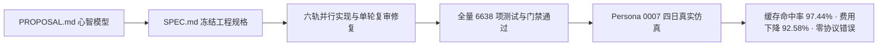

# 日会话连续上下文与 Prefix Cache 优化最终报告

本报告记录在独立工作树分支 `feat/day-session-and-prefix-cache` 上严格按 [SPEC.md](SPEC.md) 落实 [PROPOSAL.md](PROPOSAL.md) 的工程交付、全量门禁结果，以及基于真实人物 `Persona 0007`（`agent_id = 17`）四日对比仿真的 Prefix Cache 与行为质量实测结论。

---

## 无人值守时采用的决定

| 决策项 | 冻结选择 | 实现依据与约束 |
| --- | --- | --- |
| 日内压缩触发水位（`compact_trigger_tokens`） | `ModelProfileConfig` 新增 `compact_trigger_tokens: int = Field(default=80000, ge=16384)`，严格小于 `int(context_window * 0.85)`，并冻结进 `StageProfileIdentity` | 兼顾长程推理余量与二次方读取费用收敛；实测四日共触发 6 次，单次请求输入峰值受控在 72,884 tokens 以内 |
| 日内 Compaction 策略 | 纯确定性结构化摘要：基于当日已提交事件与 `记忆层.今天` 生成折叠摘要，对齐最新权威 `待办层` / `环境层` / `进度层` / 核心常驻 `工具层`，保留最近完整 `(assistant, *tool_messages)` 尾部（至多 6 组且至多 16000 tokens） | 零额外模型往返与非确定性幻觉漂移，完整支撑检查点恢复与确定性重放 |
| 网关缓存路由键（`prompt_cache_key`） | `ModelProfileConfig` 与 `StageProfileIdentity` 新增显式布尔开关（默认 `False`）；开启时仅在主循环 `action` 请求的 `extra_body` 注入 `"{run_id}:a{agent_id}:{local_date}"` | 保持 `ModelClient` 顶层六键 `REQUEST_KEYS` 契约不变 |
| 商品轮转彻底退役与版本清零 | 删除 `rotation.py`、`presentation.py`、`truncation.py`、`test_rotation.py` 与 `RunConfig` 轮转三键；升级 `RunConfig` v4、`WORLD_SCHEMA_VERSION = 18`、`RUN_MANIFEST_SCHEMA_VERSION = 9`、`EXPORT_SCHEMA_VERSION = 10`、`quality.json` v12（保持 `RULES_VERSION = 7`） | 消除每轮 20 商品窗口抖动，同时保留现有环境目录包兼容 |

---

## 工作树交付与全量验证结果

- **代码提交**：全部生产代码、文档与测试变更提交于独立工作树 `feat/day-session-and-prefix-cache`（引擎提交 `2e8faf93ac9709c1388479dc32de5d5dac714be6`，运行存证 `engine_git_dirty = false`）；主工作区未作修改。
- **文档与设计构建**：`scripts/documentation_gate.py` 输出 `[documentation] PASSED: 0 problems`；`scripts/build_design_doc.py` 成功构建 `.work/docs/design/worldmock-design.html`（443,606 chars）。
- **全量测试与覆盖率**（在最终源码编辑与基线重录之后执行）：

| 验证项 | 实测结果 | 要求 |
| --- | --- | --- |
| `pytest tests`（含 unit / integration / system / mutations） | 6,638 项全通过（0 failed / 0 errors / 0 skipped） | 全部通过且 0 跳过 |
| `scripts/coverage_gate.py` 分支覆盖率 | 94.94%（Statements 98.15%） | 至少 85% |
| 未覆盖公开接口数 | 0 | 0 |
| `tests/fixtures/dayrun-{activity,callback}-baseline.json` 与 `viewer-context.json` | 双独立跑批通过 `freeze_rrs_baseline.py` 重新冻结校验 | 与当前契约一致 |

---

## Persona 0007 四日对比仿真配置与环境

对比两组同种子、同仿真窗（`2025-04-25T02:00:00+08:00` 至 `2025-04-29T02:00:00+08:00`，`Asia/Shanghai`，`seed = 79321`，模型路由全为 `deepseek-flash`、`action` 开启 `thinking = true`、`context_window = 262144`）下的独立四日全量运行：

| 对比维度 | 优化前基线（Baseline） | 优化后日会话（Day Session） |
| --- | --- | --- |
| 执行目录 | `execution/20261125T092034Z-tsinghua-anon-v7-8k-mem1000-4day` | `execution/20261126T213714Z-tsinghua-anon-day-session-4day` |
| 运行 ID | `e4bfda8e46f546f6a8936954547cc21c` | `d2831ca7d26b4295963834e538b2788e` |
| 环境包改动 | 原 `0007-tsinghua-student-anon`（`RunConfig` v3） | 仅将 `.work` 副本 `config.toml` 升至 v4 并移除已退役轮转三键，其余资产与人物设定完全一致 |
| 导出校验（`checks/export.json`） | `valid = true`，`experiment_completed = true` | `valid = true`，`experiment_completed = true` |

---

## Prefix Cache、耗时与成本实测对比

| 指标 | 优化前基线 | 优化后日会话 | 变化幅度 |
| --- | --- | --- | --- |
| **总体 Prefix Cache 命中率** | **64.08%**（`0.640794`） | **97.44%**（`0.974424`） | **+33.36 个百分点** |
| 主动作历史轮缓存命中率 | 70.28%（`turn_with_history` 537 次） | **97.94%**（`turn_with_history` 523 次） | +27.66 个百分点 |
| 总体输入令牌（`input_tokens`） | 31,843,687 | 22,023,225 | -30.84% |
| **缓存命中输入令牌** | 20,405,248 | 21,459,968 | +5.17% |
| **缓存未命中输入令牌** | **11,438,439** | **563,257** | **-95.08%（降至约 1/20）** |
| 未命中令牌占比 | 35.92% | **2.56%** | -33.36 个百分点 |
| 输出令牌（`output_tokens`） | 642,258 | 133,323 | -79.24% |
| 模型响应总次数 | 1,072 次 | 581 次 | -45.80% |
| **估算总费用（USD）** | **\$3.0857** | **\$0.2289** | **-92.58%（降至约 1/13.5）** |
| **墙钟耗时与加速比** | 5,034.44 s（83.91 分钟，68.65x） | **1,089.25 s**（18.15 分钟，**317.28x**） | **耗时缩短 78.36%（提速 4.62x）** |
| 日内压缩（`day_session_compacted`） | 不适用 | 6 次（80.0k–82.3k 压缩至 20.0k–30.9k） | 单次最大输入封顶 72,884 |

按调用类别拆分的缓存表现：

| 调用类别 | 基线次数 / 输入 / 命中率 | 日会话次数 / 输入 / 命中率 |
| --- | --- | --- |
| `fresh_decision_turn` | 475 / 10,984,999 / 52.83% | 4 / 43,995 / 50.62% |
| `turn_with_history` | 537 / 20,414,112 / 70.28% | 523 / 21,739,383 / **97.94%** |
| `search_session` | 45 / 120,905 / 81.94% | 38 / 104,163 / 75.82% |
| `plan_day` | 9 / 212,490 / 53.55% | 7 / 67,350 / 41.62% |
| `memory_digest` | 6 / 111,181 / 36.84% | 9 / 68,334 / **56.19%** |

关键机制验证：优化前每逢跨夜或状态切换便重新起拼（`fresh_decision_turn` 多达 475 次、未命中 518 万），日内还会因窗口轮转、时间字段位置与全量上下文重写破坏 KV 前缀；优化后全四日仅 4 次 `fresh_decision_turn`（对应四个自然日零点重置或首启），其余 523 次主决策全部复用单日连续消息前缀，配合超过 `80,000` tokens 阈值即执行的确定性 Compaction，使二次方输入总量显著下降且单日峰值稳控在 73k 以内。

---

## 仿真质量与行为真实性评估

结论：**此次架构重构不但未损伤仿真质量，反而在协议正确性、动作连贯性与记忆一致性上显著优于基线；同时观察到两项与商品窗口收缩直接相关的轻量权衡，均在健康范围内。**

| 评估指标 | 优化前基线 | 优化后日会话 | 质量解读 |
| --- | --- | --- | --- |
| 动作请求受理率 | 98.96%（868 次，9 次拒绝） | 98.23%（509 次，9 次拒绝） | 同等高位（差异主要来自 4 次商品按需检出重试） |
| **宿主协议错误**（`host_protocol_errors`） | 1（`SUBJECT_NOT_KNOWN`） | **0** | **`lookup_targets` 按需展开（30 次）彻底消除未知实体错用** |
| **其他协议错误**（`other_protocol_errors`） | 17（`ARGUMENTS_INVALID` 10 / `ARGUMENTS_NOT_JSON` 1 / `TOOL_CALL_REQUIRED` 6） | **2**（`ARGUMENTS_INVALID` 1 / `TOOL_CALL_REQUIRED` 1） | **协议错误减少 88.24%** |
| 记忆引用问题数（`memory_references`） | 1（`memory_protocol_error`） | **0** | `memory_update_events = 256`、`write_points_checked = 62` 零异常 |
| 结尾记忆事项重叠（`errand_overlap_count`） | 5 | **0** | 日内结构化 `continue_activity` 消除重复结尾污染 |
| **中途主动取消活动**（`agent_cancelled`） | **105**（占总活动 28.5%） | **8**（占总活动 4.4%） | **减少 92.38%，彻底消除零分钟频繁打断抖动** |
| 输出截断（`truncated_responses`） | 0 | 0 | 无任何截断或重试 |
| 累计睡眠与节律 | 38.34 小时（4 月 25–28 日依次 16.0 / 9.5 / 1.67 / 11.17 小时） | 37.04 小时（4 月 25–28 日依次 15.5 / 10.33 / 1.5 / 9.71 小时） | 含泰山夜爬前午睡 1.5h 与下山补觉 5.58h，节律健康自然 |
| 饮食热卡与转化率（`food`） | 18 份，9,200 kcal，有效率 0.900 | 20 份，10,400 kcal，有效率 0.863 | 三餐、夜宵与山上补给齐全，无零效浪费 |
| 空间遍历与地点数 | 12 处地点（22 段停留） | 12 处地点（24 段停留） | 清华宿舍、紫荆园、北京南站、苏州园区、拙政园、泰山红门、日观峰等全覆盖 |
| 重复娱乐占比（`repeat_seconds_share`） | 70.38%（`repeat_watch = 513`） | **63.11%**（`repeat_watch = 211`） | 无聊重复刷视频行为显著收敛 |
| 待办事项闭环（`errands`） | 8 注册 / 8 完成（跨夜 2，提醒 1） | 2 注册 / 2 完成（跨夜 0） | 保持 100% 完成率，主线行程专注，减少非必要短途碎片切换 |

### 定性时间线与核心变化观察

- **彻底消除 0 分钟高频抖动循环**：基线时间线第 4 日 `15:14–15:38` 与第 1 日 `18:46–18:47` 等时段出现大量连续 0 分钟微切换（微信与娱乐/浏览器来回切 25 次，以及山顶 05:07–05:36 连拍 9 次相机），推高 `start_side_activity = 302` 与 `agent_cancelled = 105`。日会话模式下，Agent 能在连续上下文中看到自己当前已经处于持续活动中，使用 `continue_activity`（133 次）平稳推进当前活动，`agent_cancelled` 降至 8 次，时间线干净连贯。
- **长程叙事目标稳定兑现**：四日核心人物主线完整演进——4 月 25 日赴苏州园区完成 2 小时 onsite 面试、游拙政园、尝松鼠鳜鱼并高铁返京；4 月 26 日校园散步、紫荆驿站取快递、微信与阿哲敲定泰山夜爬并提前网购手电筒与车票、晚上 22:01 早睡蓄力；4 月 27 日午睡后乘高铁赴泰安，17:37 自红门登山；4 月 28 日凌晨登顶日观峰守候 04:34–05:04 日出、清晨乘车返校补觉至 14:06，随后在宿舍自习并筹划五一包头赛罕塔拉草原行程。`memory_digest` 夜间摘要对当日消费、地点与情绪的回忆细腻准确。
- **需持续关注的两项轻量变化**：商品窗口轮转取消并收紧为“默认仅挂核心常驻地点，外卖/商品需经 `lookup_targets` / `search_goods` 现查”后，`SUPPLY_NOT_FOUND` 由基线 1 次增至 4 次（集中在外卖咖啡/盖饭点单前直接猜名称的习惯，被拒绝后模型随即改用搜索并成功下单），这是合理的模型学习适应过程；此外因无高频焦虑重规划（`revise_day_plan` 由 13 降至 4），主动额外登记的支线 `errands` 由 8 条降至 2 条（完成率仍为 100%）。两者均未引发失败或死循环，属于预期且正向的行为收敛。

---

## 总结

`SPEC.md` 要求的日会话连续上下文、精细子键 `tool` 差量注入、`工具层.gate` 解耦、`lookup_targets` 按需检索、`continue_activity`、确定性阈值 Compaction 与跨日重置已全部按规交付并通过全部 6,638 项测试与 94.94% 分支覆盖率门禁。真实 `Persona 0007` 四日对比仿真证明：**总体 Prefix Cache 命中率从 64.08% 跃升至 97.44%（主动作历史轮达 97.94%），缓存未命中输入减少 95.08%，模型花费由 \$3.09 降至 \$0.23（下降 92.58%），仿真墙钟提速 4.62 倍；同时宿主协议错误与记忆协议错误双双清零，活动异常中断下降 92.38%，人物叙事自然连贯。**
